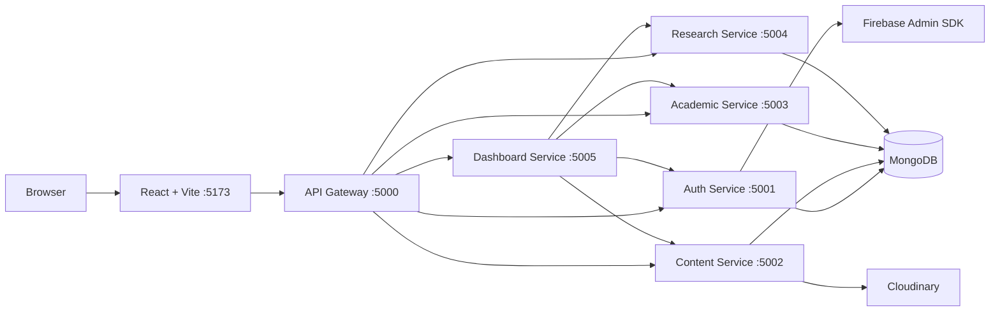

# Research Lab Management System — Microservices Interview Questions & Answers

## Project Architecture

এই project-এ একটি university research lab-এর তথ্য পরিচালনা করার জন্য Microservices Architecture ব্যবহার করা হয়েছে।

**Technology Stack:**
- Frontend: React + Vite
- Backend: Node.js + Express.js
- Authentication: Firebase Authentication + Firebase Admin SDK
- Database: MongoDB
- Image Storage: Cloudinary
- Containerization: Docker
- API Communication: REST API + JSON
- Internal Communication: HTTP requests with `x-internal-secret`

### Architecture Diagram



> **Note:** এই diagram তোমার দেওয়া architecture-এর সংক্ষিপ্ত রূপ। Interview-এ যেসব feature বাস্তবে implement করা হয়নি, সেগুলোকে implemented feature হিসেবে দাবি করা যাবে না।

---

# 1. Microservices Fundamentals

## Q1. What is microservices architecture?

**উত্তর:**

Microservices Architecture হলো এমন একটি software architecture যেখানে একটি বড় application-কে একাধিক ছোট, দায়িত্বভিত্তিক এবং তুলনামূলকভাবে স্বাধীন service-এ ভাগ করা হয়।

প্রতিটি service নির্দিষ্ট business functionality পরিচালনা করে এবং সাধারণত API-এর মাধ্যমে অন্য service-এর সঙ্গে যোগাযোগ করে।

আমার project-এ Auth, Content, Academic, Research এবং Dashboard—এই পাঁচটি service আছে। প্রতিটি service আলাদা দায়িত্ব পালন করে।

## Q2. Why did you choose microservices instead of a monolithic architecture?

**উত্তর:**

আমি application-এর functionality অনুযায়ী backend-কে আলাদা service-এ ভাগ করেছি, যাতে প্রতিটি domain-এর code আলাদাভাবে maintain করা যায়।

যেমন, Research Service books, conferences এবং journals পরিচালনা করে। Academic Service departments, teams এবং student projects পরিচালনা করে।

এর ফলে code organization, responsibility separation এবং ভবিষ্যতে প্রয়োজন অনুযায়ী নির্দিষ্ট service scale করার সুযোগ পাওয়া যায়।

তবে microservices-এর কারণে deployment, networking এবং debugging জটিল হয়। ছোট application-এর জন্য modular monolith অনেক সময় ভালো সিদ্ধান্ত হতে পারে।

## Q3. What are the advantages and disadvantages of microservices?

**উত্তর:**

**সুবিধা:**
- Business functionality অনুযায়ী code আলাদা রাখা যায়।
- প্রয়োজন অনুযায়ী নির্দিষ্ট service independently scale করা যায়।
- Service-এর দায়িত্ব ও codebase বোঝা সহজ হয়।
- উপযুক্ত deployment setup থাকলে service আলাদাভাবে deploy করা যায়।

**অসুবিধা:**
- Service-to-service communication পরিচালনা করতে হয়।
- Deployment ও monitoring জটিল হয়।
- Network failure এবং timeout সামলাতে হয়।
- Shared database থাকলে service-গুলোর মধ্যে coupling তৈরি হতে পারে।
- ছোট project-এর জন্য অতিরিক্ত complexity তৈরি করতে পারে।

## Q4. How many microservices are there in your project, and what is the responsibility of each?

**উত্তর:**

আমার project-এ পাঁচটি backend service আছে।

1. **Auth Service:** User-related operations এবং Firebase Admin SDK-ভিত্তিক authentication integration।
2. **Content Service:** Home, About Lab, About Professor, Contact, Footer এবং Images-সংক্রান্ত content।
3. **Academic Service:** Departments, Teams এবং Student Projects।
4. **Research Service:** Books, Conferences এবং Journals।
5. **Dashboard Service:** বিভিন্ন service থেকে প্রয়োজনীয় data সংগ্রহ করে dashboard-এর জন্য response তৈরি করা।

এছাড়া API Gateway frontend-এর request গ্রহণ করে এবং উপযুক্ত service-এ route করে।

## Q5. Why did you separate Auth, Content, Academic, Research, and Dashboard services?

**উত্তর:**

আমি functionality এবং business responsibility অনুযায়ী service-গুলো আলাদা করেছি।

Research-related data এবং academic-related data আলাদা domain। একইভাবে content management এবং user-related operations-এর দায়িত্বও ভিন্ন।

এই separation code maintainability বাড়ায় এবং ভবিষ্যতে নির্দিষ্ট domain-এর functionality পরিবর্তন করা সহজ করে।

## Q6. What is the difference between a microservice and a module in a monolithic application?

**উত্তর:**

Monolithic application-এ modules আলাদা থাকলেও সাধারণত তারা একই application process-এর মধ্যে চলে এবং একসঙ্গে deploy হয়।

Microservice সাধারণত আলাদা application process হিসেবে চলে, নিজস্ব API থাকে এবং উপযুক্ত deployment arrangement থাকলে independently deploy করা যায়।

আমার project-এ Research Service এবং Academic Service আলাদা Express application হিসেবে চলে, তাই তারা শুধু code module নয়; এগুলো পৃথক service।

## Q7. What problems did you face while implementing microservices?

**উত্তর:**

Microservices-এ সাধারণত কয়েকটি গুরুত্বপূর্ণ challenge থাকে:

- একাধিক service-এর port এবং URL configure করা।
- Service-to-service communication ঠিক রাখা।
- Environment variables এবং secrets manage করা।
- Docker network configuration করা।
- Error handling এবং service failure সামলানো।
- Shared database ব্যবহার করলে data ownership নিশ্চিত করা।
- একাধিক service-এর logs দেখে সমস্যা খুঁজে বের করা।

Interview-এ নিজের project-এ বাস্তবে যে সমস্যাগুলো হয়েছে, সেগুলোর উদাহরণ দেওয়া উচিত।

## Q8. If you were building this project from scratch, would you still choose microservices? Why?

**উত্তর:**

যদি project-এর scope ছোট হতো এবং একটি ছোট team দিয়ে development করা হতো, তাহলে প্রথমে Modular Monolith বিবেচনা করতাম।

কিন্তু আলাদা team, independent deployment এবং পৃথকভাবে scale করার প্রয়োজন থাকলে Microservices উপযুক্ত হতে পারে।

তাই architecture নির্বাচন করার সময় শুধু technology নয়, project-এর size, complexity, team এবং deployment requirement বিবেচনা করব।

## Q9. What is service independence, and how independent are your services?

**উত্তর:**

Service independence মানে একটি service-এর code, deployment এবং responsibility অন্য service-এর ওপর যতটা সম্ভব কম নির্ভরশীল হওয়া।

আমার project-এ প্রতিটি service আলাদা Express application। তবে Dashboard অন্য service-এর API ব্যবহার করে এবং একাধিক service একই MongoDB database ব্যবহার করে।

তাই আমার architecture-এ কিছু separation থাকলেও এটি সম্পূর্ণ independent বা loosely coupled architecture নয়।

## Q10. When would a monolithic architecture be a better choice?

**উত্তর:**

যখন application ছোট, business logic সহজ, team ছোট এবং independent scaling বা deployment-এর প্রয়োজন নেই, তখন Monolithic Architecture ভালো হতে পারে।

এতে development, testing, deployment এবং debugging তুলনামূলক সহজ হয়। পরে প্রয়োজন বাড়লে application-কে modular করা বা নির্দিষ্ট functionality আলাদা service-এ নেওয়া যায়।

---

# 2. API Gateway

## Q1. What is an API Gateway?

**উত্তর:**

API Gateway হলো client এবং backend services-এর মধ্যবর্তী একটি entry point।

Client-এর request গ্রহণ করে এটি নির্দিষ্ট service-এ request forward করতে পারে। এছাড়া authentication, rate limiting, logging এবং request validation-এর মতো cross-cutting কাজও এখানে রাখা যেতে পারে।

আমার project-এ frontend API Gateway-এর port `5000`-এ request পাঠায়।

## Q2. Why did you use an API Gateway in your project?

**উত্তর:**

API Gateway ব্যবহার করার ফলে frontend-কে প্রতিটি microservice-এর address আলাদাভাবে জানতে হয় না।

Frontend একটি central endpoint ব্যবহার করে। Gateway request path অনুযায়ী Auth, Content, Academic, Research অথবা Dashboard Service-এ request পাঠায়।

এতে frontend integration সহজ হয় এবং API access একটি central location থেকে পরিচালনা করা যায়।

## Q3. What happens when the frontend calls `/departments`?

**উত্তর:**

Frontend `/departments` endpoint-এ request পাঠালে API Gateway request গ্রহণ করে এবং Academic Service-এ forward করে।

Academic Service প্রয়োজনীয় business logic execute করে MongoDB থেকে data সংগ্রহ করে response দেয়। এরপর response Gateway হয়ে frontend-এ ফিরে আসে।

আমার architecture-এ request path হবে:

`Frontend → API Gateway → Academic Service → MongoDB → Response`

## Q4. How does the Gateway decide which microservice should receive a request?

**উত্তর:**

Gateway request-এর HTTP method এবং URL path দেখে routing rule অনুযায়ী service নির্বাচন করে।

উদাহরণ:

- `/users` → Auth Service
- `/home` → Content Service
- `/departments` → Academic Service
- `/journals` → Research Service
- `/dashboard` → Dashboard Service

Express-এ router বা proxy middleware ব্যবহার করে এই routing implement করা যায়।

## Q5. What is the difference between an API Gateway and a load balancer?

**উত্তর:**

API Gateway সাধারণত API routing, authentication integration, rate limiting এবং request/response handling-এর মতো কাজ করে।

Load Balancer incoming traffic একাধিক server বা service instance-এর মধ্যে ভাগ করে দেয়।

একটি API Gateway-এর সঙ্গে load balancing functionality থাকতে পারে, কিন্তু দুটির মূল উদ্দেশ্য এক নয়।

## Q6. Why not allow the frontend to communicate directly with each microservice?

**উত্তর:**

সরাসরি communicate করলে frontend-কে সব service-এর URL, port এবং API details জানতে হয়।

এতে frontend configuration জটিল হয় এবং public network-এ সব service expose করার প্রয়োজন তৈরি হতে পারে।

API Gateway ব্যবহার করলে frontend একটি entry point ব্যবহার করতে পারে। তবে Gateway নিজেই authentication ও authorization সম্পূর্ণ নিশ্চিত করে—এমন নয়; প্রয়োজন অনুযায়ী backend service-এও security check থাকতে হবে।

## Q7. Where should authentication and authorization be performed—the Gateway or individual services?

**উত্তর:**

Gateway-এ token verification করলে invalid request শুরুতেই reject করা যায়।

কিন্তু business-level authorization সংশ্লিষ্ট service-এ enforce করা উচিত। যেমন, কোনো user একটি journal edit করতে পারবে কি না, তা Research Service-এর business rules-এর অংশ।

আমার project-এ Firebase Admin SDK দিয়ে token verification-এর integration আছে। বাস্তবে Gateway এবং individual service—কোথায় কোন verification হয়, তা implementation অনুযায়ী ব্যাখ্যা করব।

## Q8. What happens if the API Gateway goes down?

**উত্তর:**

যদি একটিমাত্র Gateway instance থাকে এবং সেটি down হয়ে যায়, তাহলে frontend-এর মাধ্যমে সব backend service access করা ব্যাহত হবে।

সমাধান হিসেবে একাধিক Gateway instance, load balancer, health checks এবং restart policies ব্যবহার করা যায়।

Gateway-কে high-availability environment-এ deploy করা হলে একটি instance failure হলেও অন্য instance request নিতে পারে।

## Q9. How would you implement rate limiting at the Gateway?

**উত্তর:**

Rate limiting দিয়ে নির্দিষ্ট সময়ের মধ্যে একজন user বা IP কতগুলো request করতে পারবে, তা সীমাবদ্ধ করা হয়।

Express-এ `express-rate-limit` ব্যবহার করে শুরু করা যায়। একাধিক Gateway instance থাকলে shared store, যেমন Redis, ব্যবহার করা যেতে পারে।

Limit অতিক্রম করলে সাধারণত `429 Too Many Requests` response দেওয়া হয়।

## Q10. How would you handle request timeout and service failure?

**উত্তর:**

Gateway থেকে downstream service-এ request পাঠানোর সময় timeout নির্ধারণ করব।

Service নির্দিষ্ট সময়ের মধ্যে response না দিলে request fail করব এবং উপযুক্ত HTTP error response দেব।

Transient failure-এর ক্ষেত্রে সীমিত retry করা যেতে পারে, তবে non-idempotent operation-এ অন্ধভাবে retry করা যাবে না। দীর্ঘস্থায়ী failure-এর জন্য circuit breaker ব্যবহার করা যায়।

## Q11. Should the Gateway contain business logic?

**উত্তর:**

Gateway-এ মূলত routing এবং cross-cutting concerns রাখা উচিত।

যেমন, request routing, token verification integration, rate limiting এবং request logging।

কিন্তু journal তৈরি করা, department update করা বা research publication-এর business rules সংশ্লিষ্ট service-এ থাকা উচিত। এতে service responsibilities পরিষ্কার থাকে।

## Q12. How would you version your APIs?

**উত্তর:**

API versioning-এর জন্য URL-এ version ব্যবহার করা যায়, যেমন `/api/v1/journals` এবং `/api/v2/journals`।

Breaking change হলে নতুন version দেওয়া যেতে পারে, যাতে পুরোনো client কিছু সময় আগের API ব্যবহার করতে পারে।

তবে প্রতিটি ছোট change-এর জন্য নতুন version তৈরি করার প্রয়োজন নেই।

---

# 3. Service Responsibilities and Routing

## Q1. Why did you create a separate Research Service?

**উত্তর:**

Books, Conferences এবং Journals একই research domain-এর অংশ। তাই এগুলো Research Service-এ রেখেছি।

এতে research-related business logic একটি নির্দিষ্ট জায়গায় থাকে এবং ভবিষ্যতে publication search, filtering বা research metadata-এর মতো feature একই service-এ যুক্ত করা সহজ হয়।

## Q2. Which endpoints belong to the Content Service?

**উত্তর:**

আমার architecture অনুযায়ী Content Service-এর দায়িত্ব:

- `/home`
- `/about-lab`
- `/about-prof`
- `/contact`
- `/footer`
- `/images`

এগুলো lab website-এর সাধারণ content এবং image-related information পরিচালনা করে।

## Q3. Why are Departments, Teams, and Student Projects grouped in the Academic Service?

**উত্তর:**

এগুলো academic organization এবং student activities-এর সঙ্গে সম্পর্কিত।

একই service-এ রাখলে academic domain-এর logic এবং API পরিচালনা করা সহজ হয়। তবে Student Projects-এর সঙ্গে Research Projects-এর overlap থাকলে domain boundary আরও পরিষ্কারভাবে নির্ধারণ করা দরকার।

## Q4. Why is the Dashboard a separate service?

**উত্তর:**

Dashboard-এর কাজ হলো বিভিন্ন domain থেকে data সংগ্রহ করে summary বা dashboard-specific response তৈরি করা।

এটি আলাদা রাখলে frontend-এর জন্য প্রয়োজনীয় aggregate data তৈরি করা সহজ হয়।

তবে Dashboard Service যদি অনেকগুলো service-এর ওপর নির্ভরশীল হয়, তাহলে তাদের failure এবং response time-এর প্রভাবও Dashboard-এর ওপর পড়বে।

## Q5. How do you avoid overlapping responsibilities between services?

**উত্তর:**

প্রতিটি service-এর business responsibility এবং data ownership স্পষ্টভাবে নির্ধারণ করব।

যেমন, journal-related operation Research Service পরিচালনা করবে। Academic Service সরাসরি journal data পরিবর্তন করবে না; প্রয়োজন হলে Research Service-এর API ব্যবহার করবে।

API contract এবং domain documentation এই boundary বজায় রাখতে সাহায্য করে।

## Q6. If you add a new feature for thesis management, which service should handle it?

**উত্তর:**

Thesis management যদি academic records, students এবং supervisors-এর সঙ্গে সম্পর্কিত হয়, তাহলে প্রথমে Academic Service-এ রাখার কথা বিবেচনা করব।

যদি thesis-কে research publication বা institutional repository হিসেবে পরিচালনা করা হয়, তাহলে Research Service-ও উপযুক্ত হতে পারে।

সিদ্ধান্তটি feature-এর business ownership এবং data relationships অনুযায়ী নেব।

## Q7. If you add user profile management, which service should own that functionality?

**উত্তর:**

User identity এবং user profile management-এর জন্য Auth Service বা আলাদা User Service ব্যবহার করা যায়।

Authentication identity এবং application-specific profile আলাদা concern হলে আলাদা service রাখা উপযুক্ত হতে পারে।

আমার বর্তমান architecture-এ user-related functionality Auth Service-এর সঙ্গে যুক্ত।

## Q8. How would you add a new microservice without breaking existing services?

**উত্তর:**

প্রথমে নতুন service-এর API contract এবং responsibility নির্ধারণ করব।

এরপর service implement ও test করে Docker network-এ যুক্ত করব। প্রয়োজন অনুযায়ী Gateway-এ route যোগ করব এবং environment variables configure করব।

পুরোনো API contract পরিবর্তন না করে backward-compatible integration করব। তারপর health checks, logs এবং deployment পরীক্ষা করব।

## Q9. What happens if a request reaches the wrong service?

**উত্তর:**

Service-এর route না থাকলে সাধারণত `404 Not Found` response দেওয়া উচিত।

যদি route থাকে কিন্তু HTTP method ভুল হয়, তাহলে `405 Method Not Allowed` ব্যবহার করা যেতে পারে।

Gateway-এর routing configuration এবং service API contract সঠিক রাখলে এ ধরনের ভুল কমে।

## Q10. How do you maintain consistent API contracts between the frontend and services?

**উত্তর:**

API endpoint, request body, response format, validation rules এবং error format documentation-এ নির্দিষ্ট করে রাখব।

OpenAPI/Swagger-এর মতো tools ব্যবহার করে API contract document করা যায়।

Frontend এবং backend-এর integration tests থাকলে contract পরিবর্তনের কারণে তৈরি হওয়া সমস্যা আগে শনাক্ত করা সম্ভব।

---

# 4. Authentication and Security

## Q1. Why did you use Firebase Authentication?

**উত্তর:**

Firebase Authentication ব্যবহার করলে user sign-in এবং identity management-এর অনেক কাজ managed service-এর মাধ্যমে করা যায়।

আমার frontend Firebase Authentication ব্যবহার করে এবং backend-এ Firebase Admin SDK দিয়ে ID token verify করার ব্যবস্থা রয়েছে।

এতে নিজে password authentication infrastructure তৈরি করার প্রয়োজন কমে।

## Q2. What is a Firebase ID token?

**উত্তর:**

Firebase ID token হলো Firebase Authentication-এ authenticated user-এর পরিচয় বহনকারী signed token।

Frontend এই token backend-এ পাঠায়। Backend Firebase Admin SDK দিয়ে token verify করে user identity যাচাই করতে পারে।

শুধু token decode করা যথেষ্ট নয়; token-এর signature এবং validity verify করতে হয়।

## Q3. How does the frontend obtain an ID token?

**উত্তর:**

Firebase Authentication-এ user sign-in করার পর Firebase client SDK-এর মাধ্যমে current user পাওয়া যায়।

এরপর `getIdToken()` method দিয়ে ID token নেওয়া যায়।

উদাহরণ:

```javascript
const token = await auth.currentUser.getIdToken();

const response = await fetch("/api/journals", {
  headers: {
    Authorization: `Bearer ${token}`,
  },
});
```

এখানে `auth` হলো configured Firebase Auth instance।

## Q4. Why does the frontend send the token using the Authorization Bearer header?

**উত্তর:**

`Authorization: Bearer <token>` হলো HTTP request-এ bearer token পাঠানোর প্রচলিত পদ্ধতি।

Backend এই header থেকে token নিয়ে verify করে।

Token URL query parameter-এ পাঠানো এড়িয়ে চলা উচিত, কারণ URL browser history, logs বা অন্যান্য জায়গায় সংরক্ষিত হতে পারে।

## Q5. How can the backend verify a Firebase ID token?

**উত্তর:**

Backend Firebase Admin SDK-এর `verifyIdToken()` ব্যবহার করতে পারে।

```javascript
const decodedToken =
  await admin.auth().verifyIdToken(token);

const uid = decodedToken.uid;
```

Token invalid, expired বা verification ব্যর্থ হলে request reject করতে হবে। বাস্তবে error handling এবং proper HTTP status code-ও দিতে হবে।

## Q6. What is the difference between authentication and authorization?

**উত্তর:**

Authentication নির্ধারণ করে user কে।

Authorization নির্ধারণ করে ওই user কী করতে পারবে।

যেমন, Firebase ID token verify করে user-এর identity জানা authentication-এর অংশ। ওই user journal delete করতে পারবে কি না যাচাই করা authorization-এর অংশ।

## Q7. What happens when the token expires?

**উত্তর:**

Expired token backend-এ reject হবে।

Frontend Firebase SDK দিয়ে প্রয়োজন হলে নতুন ID token নিতে পারে এবং request পুনরায় পাঠাতে পারে।

তবে backend-এ expired token গ্রহণ করা যাবে না। Token refresh এবং request retry নিরাপদভাবে পরিচালনা করতে হবে।

## Q8. Can a user access a microservice directly and bypass the Gateway?

**উত্তর:**

যদি microservice public network-এ expose করা থাকে এবং নিজস্ব security check না থাকে, তাহলে Gateway bypass করার ঝুঁকি তৈরি হতে পারে।

এটি কমাতে internal services public access থেকে সরিয়ে রাখা, Docker private network ব্যবহার করা এবং service-level authentication/authorization নিশ্চিত করা উচিত।

Gateway-এ authentication থাকলেই downstream service স্বয়ংক্রিয়ভাবে নিরাপদ হয়ে যায় না।

## Q9. How would you implement role-based access control for Admin and normal users?

**উত্তর:**

প্রথমে authenticated user-এর identity verify করব। এরপর trusted backend data বা verified custom claims থেকে role নির্ধারণ করব।

উদাহরণস্বরূপ, Admin journal create, update বা delete করতে পারবে; সাধারণ user শুধু public journal দেখতে পারবে।

Role request body থেকে সরাসরি বিশ্বাস করা যাবে না। Role change করার অনুমতিও শুধু authorized administrator-এর থাকা উচিত।

## Q10. Why should we never trust a user ID or role sent only in the request body?

**উত্তর:**

Client নিজের request body পরিবর্তন করে অন্য user-এর ID বা Admin role পাঠাতে পারে।

তাই identity verified token থেকে নিতে হবে এবং role trusted backend source থেকে যাচাই করতে হবে।

প্রতিটি protected operation-এ user-এর permission পরীক্ষা করা উচিত।

## Q11. What is the purpose of Firebase Admin SDK?

**উত্তর:**

Firebase Admin SDK হলো trusted server environment-এ Firebase services পরিচালনার SDK।

আমার project-এ এটি Firebase ID token verify করার জন্য ব্যবহৃত হয়। প্রয়োজন অনুযায়ী user management এবং অন্যান্য administrative operation-ও করা যায়।

Admin SDK-এর credentials কখনো frontend-এ প্রকাশ করা উচিত নয়।

## Q12. How would you protect internal service endpoints?

**উত্তর:**

Internal service endpoint-গুলো public network-এ expose না করে private Docker network-এ রাখব।

এছাড়া internal request-এর জন্য authentication, authorization এবং প্রয়োজনীয় network restrictions ব্যবহার করব।

`x-internal-secret` header একটি সহজ shared-secret approach, কিন্তু secret leakage এবং rotation-এর বিষয় মাথায় রাখতে হবে।

## Q13. Why is an internal secret alone potentially insufficient for service-to-service security?

**উত্তর:**

একটি shared secret leak হলে সেটি জানা যে কেউ অনুমোদিত service-এর মতো request পাঠানোর চেষ্টা করতে পারে।

এটি কোন service request পাঠাচ্ছে, সেই পরিচয় শক্তভাবে নিশ্চিত করে না। Secret rotation, least privilege এবং network isolation প্রয়োজন।

Production environment-এ service identity, short-lived credentials অথবা mTLS ব্যবহার করা যেতে পারে।

## Q14. How should secrets and Firebase credentials be managed in Docker?

**উত্তর:**

Secret source code বা Git repository-তে রাখা যাবে না।

Development-এ environment variables বা `.env` file ব্যবহার করা যায়, তবে `.env` Git-এ commit করা উচিত নয়।

Production-এ secret manager বা deployment platform-এর secure environment variables ব্যবহার করা ভালো। Firebase service-account credentials-ও সুরক্ষিত রাখতে হবে।

---

# 5. Inter-Service Communication

## Q1. How do your microservices communicate with each other?

**উত্তর:**

আমার architecture-এ API Gateway frontend-এর request গ্রহণ করে উপযুক্ত microservice-এ forward করে।

Dashboard Service-ও প্রয়োজনীয় data সংগ্রহের জন্য Auth, Content, Academic এবং Research Service-এ internal HTTP request পাঠায়।

অর্থাৎ diagram অনুযায়ী মূল communication mechanism হলো HTTP/REST।

## Q2. What is synchronous communication?

**উত্তর:**

Synchronous communication-এ একটি service অন্য service-এ request পাঠায় এবং response-এর জন্য অপেক্ষা করে।

যেমন, Dashboard Service Academic Service-এ request পাঠিয়ে department count নিয়ে তারপর dashboard response তৈরি করতে পারে।

এটি সহজবোধ্য, কিন্তু downstream service slow বা unavailable হলে caller-এর response-ও দেরি হতে পারে।

## Q3. What is asynchronous communication?

**উত্তর:**

Asynchronous communication-এ sender request বা event পাঠানোর পর receiver-এর তাৎক্ষণিক response-এর জন্য অপেক্ষা না করেও কাজ চালিয়ে যেতে পারে।

Message queue বা event broker এর উদাহরণ।

যেমন, journal publication তৈরি হওয়ার পর notification পাঠানোর কাজ queue-তে দেওয়া যেতে পারে। আমার বর্তমান diagram-এ message broker দেখানো নেই; এটি সম্ভাব্য future improvement।

## Q4. Why did you use HTTP/REST for service-to-service communication?

**উত্তর:**

HTTP/REST সহজ, widely supported এবং JSON data নিয়ে কাজ করার জন্য সুবিধাজনক।

Node.js এবং Express.js service-গুলোর মধ্যে HTTP API তৈরি করা সহজ।

তবে বেশি volume-এর asynchronous task বা event-driven workflow-এর জন্য message queue আরও উপযুক্ত হতে পারে।

## Q5. Why does the Dashboard Service communicate with the other services?

**উত্তর:**

Dashboard-এ বিভিন্ন domain-এর summary প্রয়োজন হতে পারে।

যেমন, total users, departments, research publications এবং website content-এর summary। তাই Dashboard Service সংশ্লিষ্ট service-গুলো থেকে প্রয়োজনীয় data সংগ্রহ করতে পারে।

এটি একটি aggregation pattern, তবে এর ফলে Dashboard downstream service-গুলোর availability-এর ওপর নির্ভরশীল হয়।

## Q6. What happens if the Academic Service is unavailable while the Dashboard is loading?

**উত্তর:**

যদি Dashboard সব service-এর response-এর জন্য বাধ্যতামূলকভাবে অপেক্ষা করে, তাহলে Academic Service unavailable হলে পুরো dashboard request ব্যর্থ হতে পারে।

Alternative হিসেবে timeout দিয়ে অন্য service-এর data দেখানো এবং Academic data unavailable হিসেবে চিহ্নিত করা যায়।

কোন পদ্ধতি ভালো হবে, তা dashboard-এর business requirement-এর ওপর নির্ভর করবে।

## Q7. How do you handle timeout between two microservices?

**উত্তর:**

HTTP request-এ নির্দিষ্ট timeout রাখব।

Timeout হলে caller error handle করবে এবং প্রয়োজন অনুযায়ী fallback বা সীমিত retry করতে পারে।

সব request অনির্দিষ্ট সময় ধরে অপেক্ষা করতে দিলে resources আটকে যেতে পারে এবং failure অন্য service-এ ছড়িয়ে পড়তে পারে।

## Q8. What is the circuit breaker pattern?

**উত্তর:**

Circuit Breaker হলো এমন একটি pattern যা কোনো downstream service বারবার fail করলে সাময়িকভাবে সেখানে request পাঠানো বন্ধ করে দেয়।

সাধারণত এর তিনটি state থাকে:

- **Closed:** Request স্বাভাবিকভাবে যায়।
- **Open:** Request সাময়িকভাবে বন্ধ থাকে।
- **Half-open:** সীমিত test request দিয়ে দেখা হয় service সুস্থ হয়েছে কি না।

এটি cascading failure কমাতে সাহায্য করে।

## Q9. What is service discovery?

**উত্তর:**

Service discovery হলো কোনো service-এর network address বা instance খুঁজে বের করার ব্যবস্থা।

Docker Compose-এ একই network-এর service-গুলো সাধারণত তাদের service name দিয়ে একে অন্যকে access করতে পারে।

বড় distributed environment-এ service registry বা orchestrator-এর service discovery ব্যবহার করা যেতে পারে।

## Q10. Why can direct HTTP calls between many services become difficult to maintain?

**উত্তর:**

Service সংখ্যা বাড়লে এক service-এর ওপর অন্য service-এর dependency বেড়ে যেতে পারে।

এতে timeout, retries, API version compatibility এবং cascading failure সামলানো কঠিন হয়।

তাই service boundary পরিষ্কার রাখা, shared contract বজায় রাখা এবং প্রয়োজন অনুযায়ী asynchronous messaging ব্যবহার করা উচিত।

## Q11. When would you use RabbitMQ or Kafka instead of HTTP?

**উত্তর:**

যখন কাজটি asynchronous, retryable বা event-driven হয়, তখন RabbitMQ বা Kafka উপকারী হতে পারে।

যেমন, publication তৈরি হওয়ার পর email notification, audit event বা background processing।

HTTP request/response-এর মতো তাৎক্ষণিক ফলাফল প্রয়োজন হলে REST বেশি সরল হতে পারে। RabbitMQ সাধারণত task/message queue-এর জন্য এবং Kafka durable event streams-এর জন্য ব্যবহৃত হয়।

## Q12. How would you prevent cascading failures when one service becomes slow?

**উত্তর:**

প্রতিটি downstream request-এ timeout, bounded retries এবং circuit breaker ব্যবহার করা যায়।

এছাড়া concurrency limit, bulkhead isolation এবং প্রয়োজন অনুযায়ী caching ব্যবহার করা যেতে পারে।

Retry করলে exponential backoff এবং jitter ব্যবহার করা ভালো, যাতে একসঙ্গে অনেক retry service-এর ওপর আরও চাপ না সৃষ্টি করে।

---

# 6. Database and Data Ownership

## Q1. Why did you use MongoDB?

**উত্তর:**

MongoDB document-oriented database, যেখানে JSON-এর মতো structure-এ data রাখা যায়।

Research publication, content এবং image metadata-এর মতো data document হিসেবে পরিচালনা করা সুবিধাজনক হতে পারে।

তবে database নির্বাচন করার সময় data relationships, query patterns, consistency এবং transaction requirement বিবেচনা করা উচিত।

## Q2. Do all microservices use the same database?

**উত্তর:**

আমার দেওয়া architecture অনুযায়ী Auth, Content, Academic এবং Research Service একই MongoDB database ব্যবহার করে।

এটি shared-database approach। তবে production design-এ কোন service কোন collection-এর owner, তা স্পষ্টভাবে নির্ধারণ করা গুরুত্বপূর্ণ।

## Q3. What is the difference between a shared database and database-per-service architecture?

**উত্তর:**

Shared database-এ একাধিক service একই database ব্যবহার করে।

Database-per-service approach-এ প্রতিটি service নিজস্ব data store বা database-এর মালিক হয় এবং অন্য service তার data সাধারণত API বা event-এর মাধ্যমে access করে।

Shared database শুরুতে সহজ হলেও schema এবং collection-এর ওপর dependency বাড়াতে পারে। Database-per-service isolation বাড়ায়, কিন্তু data synchronization ও cross-service queries জটিল করে।

## Q4. What are the disadvantages of multiple services accessing the same database?

**উত্তর:**

একাধিক service একই collection বা schema-এর ওপর নির্ভর করলে tight coupling তৈরি হতে পারে।

একটি service schema পরিবর্তন করলে অন্য service-এর query ভেঙে যেতে পারে। এছাড়া permissions, migrations এবং ownership পরিচালনা কঠিন হয়।

তাই shared database থাকলেও collection ownership এবং access control পরিষ্কার থাকা উচিত।

## Q5. Which service is responsible for modifying a particular collection?

**উত্তর:**

প্রতিটি collection-এর জন্য একটি authoritative owner service নির্ধারণ করা উচিত।

উদাহরণস্বরূপ, journals-এর collection Research Service পরিচালনা করবে এবং departments-এর collection Academic Service পরিচালনা করবে।

অন্য service-এর প্রয়োজন হলে owner service-এর API ব্যবহার করবে। এই নিয়ম data consistency এবং maintainability বাড়ায়।

## Q6. How would you prevent one service from modifying another service's data?

**উত্তর:**

Database access permissions এবং application-level boundaries ব্যবহার করব।

আলাদা database user বা credential দিয়ে service-ভিত্তিক access সীমিত করা যেতে পারে, যদি deployment setup সেটি সমর্থন করে।

শুধু code convention-এর ওপর নির্ভর না করে database permissions দিয়ে unauthorized access কমানো বেশি নিরাপদ।

## Q7. What happens if MongoDB becomes unavailable?

**উত্তর:**

যে service database-এর ওপর নির্ভর করছে, তার database-dependent request ব্যর্থ হবে।

Service-এ timeout, proper error handling এবং user-friendly error response থাকতে হবে। সাময়িক failure হলে সীমিত retry করা যেতে পারে।

Production-এ database monitoring, backup, replica set এবং tested recovery plan রাখা উচিত।

## Q8. How do you handle database connection pooling?

**উত্তর:**

প্রতিটি request-এর জন্য নতুন database connection তৈরি না করে reusable connection pool ব্যবহার করা ভালো।

Node.js MongoDB driver সাধারণত connection pooling সমর্থন করে।

Microservices-এর একাধিক instance থাকলে মোট connection সংখ্যা যেন database-এর limit ছাড়িয়ে না যায়, সেটিও হিসাব করতে হবে।

## Q9. How would you design indexes for frequently queried collections?

**উত্তর:**

প্রথমে frequently used query এবং filter চিহ্নিত করব।

যেমন, journals collection-এ category, publication year বা searchable title দিয়ে query হলে query pattern অনুযায়ী index তৈরি করা যেতে পারে।

তবে অপ্রয়োজনীয় index write operation ধীর করতে পারে এবং storage ব্যবহার বাড়ায়। তাই `explain()` এবং query performance দেখে index নির্বাচন করা উচিত।

## Q10. What is the difference between embedding and referencing in MongoDB?

**উত্তর:**

Embedding-এ related data একই document-এর মধ্যে রাখা হয়। এতে একসঙ্গে data পড়া সহজ হতে পারে।

Referencing-এ একটি document অন্য document-এর ID সংরক্ষণ করে। এতে আলাদা data স্বাধীনভাবে পরিচালনা করা সহজ হয়।

Data size, relationship, update pattern এবং query requirement দেখে সিদ্ধান্ত নেওয়া উচিত।

## Q11. How would you migrate a database schema without breaking running services?

**উত্তর:**

Backward-compatible migration ব্যবহার করব।

প্রথমে নতুন field বা schema support যোগ করব, তারপর application ধাপে ধাপে নতুন format ব্যবহার করবে। প্রয়োজন হলে পুরোনো data backfill করব এবং সব consumer update হওয়ার পর পুরোনো field সরাব।

এটিকে expand-and-contract approach বলা হয়।

## Q12. If Research Service needs data from Academic Service, would you directly query its collections?

**উত্তর:**

Ideal microservices design-এ Research Service সরাসরি Academic Service-এর collection query করবে না।

পরিবর্তে Academic Service-এর API ব্যবহার করতে পারে অথবা প্রয়োজন হলে event-driven read model তৈরি করতে পারে।

আমার project-এ shared MongoDB থাকলেও সরাসরি cross-service collection access এড়িয়ে চললে coupling কমানো সহজ হবে।

---

# 7. Docker and Deployment

## Q1. Why did you use Docker for your microservices?

**উত্তর:**

Docker application এবং প্রয়োজনীয় runtime dependencies-কে container image-এ package করতে সাহায্য করে।

এতে বিভিন্ন environment-এ application চালানো এবং service-এর dependencies পরিচালনা করা সহজ হয়।

আমার project-এ প্রতিটি backend service আলাদা container হিসেবে চালানো যায়।

## Q2. What is a Docker container?

**উত্তর:**

Docker container হলো একটি isolated runtime environment, যেখানে application process চালানো হয়।

Container image থেকে container তৈরি হয়। এটি host machine-এর kernel share করে, তাই traditional virtual machine-এর তুলনায় সাধারণত lightweight।

## Q3. What is the difference between a Docker image and a container?

**উত্তর:**

Docker image হলো application চালানোর জন্য প্রয়োজনীয় files, dependencies এবং configuration-এর packaged template।

Container হলো সেই image থেকে তৈরি running বা stopped instance।

একই image থেকে একাধিক container চালানো সম্ভব।

## Q4. What is Docker Compose?

**উত্তর:**

Docker Compose দিয়ে একটি configuration file-এ একাধিক container, network, volume এবং environment settings সংজ্ঞায়িত করা যায়।

আমার project-এর Gateway, Auth, Content, Academic, Research এবং Dashboard service একসঙ্গে চালানোর জন্য এটি উপযোগী।

## Q5. What is the purpose of the `hpc-network` in your architecture?

**উত্তর:**

`hpc-network` হলো Docker network, যার মাধ্যমে একই network-এ থাকা container-গুলো একে অন্যের সঙ্গে communicate করতে পারে।

এতে Gateway container service name ব্যবহার করে অন্য container-এ request পাঠাতে পারে।

Network isolation service communication-কে সংগঠিত করতে সাহায্য করে, তবে এটি একাই সম্পূর্ণ security নিশ্চিত করে না।

## Q6. Why does each service have a different port?

**উত্তর:**

আমার project-এ প্রতিটি Express application-এর port আলাদা:

- Gateway: `5000`
- Auth: `5001`
- Content: `5002`
- Academic: `5003`
- Research: `5004`
- Dashboard: `5005`

একই host বা network namespace-এ একই IP ও protocol-এ একাধিক process একই port bind করতে পারে না। তাই এই setup-এ আলাদা port ব্যবহার করা হয়েছে।

## Q7. Can two containers listen on the same internal port?

**উত্তর:**

হ্যাঁ। আলাদা container-এর নিজস্ব network namespace থাকায় তারা একই internal port ব্যবহার করতে পারে।

যেমন, দুটি container-ই internal port `5000` ব্যবহার করতে পারে। তবে host machine-এ একই IP-এর একই port-এ একাধিক container publish করতে চাইলে port conflict হতে পারে।

## Q8. What is the difference between a container port and a published host port?

**উত্তর:**

Container port হলো container-এর ভেতরে application যে port-এ listen করে।

Published host port দিয়ে host machine থেকে container-এর service access করা যায়।

উদাহরণস্বরূপ, `5173:5173` mapping হলে সাধারণত বাম পাশের `5173` host port এবং ডান পাশের `5173` container port।

## Q9. How does the Gateway find the Research Service inside Docker?

**উত্তর:**

Docker Compose network-এ service DNS name ব্যবহার করা যায়।

যেমন, Compose service-এর নাম `research-service` হলে Gateway থেকে `http://research-service:5004` ব্যবহার করা যেতে পারে।

এখানে exact name Compose configuration-এর সঙ্গে মিলতে হবে।

## Q10. Why should service-to-service communication use container DNS names rather than localhost?

**উত্তর:**

Container-এর ভেতরে `localhost` সেই container-কেই বোঝায়।

Gateway container থেকে `localhost:5004` ব্যবহার করলে সাধারণত Gateway container-এর নিজের port `5004`-এ request যাবে, Research Service-এ নয়।

তাই Docker network-এ Research Service-এর service name ব্যবহার করতে হবে।

## Q11. What happens if one container crashes?

**উত্তর:**

Container crash করলে সেই service-এর request ব্যর্থ হতে পারে।

Docker restart policy ব্যবহার করে container পুনরায় চালু করার চেষ্টা করা যায়। তবে restart policy application-এর মূল bug ঠিক করে না।

Health checks, logs এবং alerting দিয়ে failure শনাক্ত করতে হবে। নির্ভরযোগ্য high availability-এর জন্য একাধিক instance-ও প্রয়োজন হতে পারে।

## Q12. How would you configure environment variables for each service?

**উত্তর:**

প্রতিটি service-এর প্রয়োজনীয় configuration environment variables দিয়ে পরিচালনা করব।

যেমন, database connection string, Firebase configuration এবং internal service secret।

Development-এ `.env` file ব্যবহার করা যায়, তবে সেটি Git-এ commit করা যাবে না। Production-এ secure secret management ব্যবহার করা উচিত।

## Q13. How would you deploy a new version of the Research Service without affecting other services?

**উত্তর:**

Research Service-এর নতুন image build ও test করে সেটি আলাদাভাবে deploy করা যায়, যদি deployment platform service-ভিত্তিক deployment সমর্থন করে।

API contract backward-compatible রাখতে হবে, যাতে অন্য service নতুন version-এর সঙ্গে কাজ করতে পারে।

Production-এ rolling deployment, health checks এবং rollback strategy ব্যবহার করা যেতে পারে।

## Q14. How would you check container logs and debug a failed service?

**উত্তর:**

প্রথমে `docker compose ps` দিয়ে container status দেখব।

তারপর `docker compose logs research-service` দিয়ে Research Service-এর logs দেখব।

প্রয়োজনে `docker compose exec research-service sh` দিয়ে container-এর ভেতরে configuration, files এবং process পরীক্ষা করব। পাশাপাশি network connectivity, environment variables এবং database connection যাচাই করব।

---

# 8. Reliability, Performance and Scaling

## Q1. How would you scale the Research Service independently?

**উত্তর:**

Research Service stateless হলে একাধিক instance চালিয়ে load balancer-এর মাধ্যমে request distribute করা যায়।

Database connection pool, query performance এবং database capacity-ও পর্যবেক্ষণ করতে হবে।

Docker Compose development-এর জন্য উপযোগী, কিন্তু production-এ independent scaling-এর জন্য উপযুক্ত deployment platform বা orchestrator প্রয়োজন হতে পারে।

## Q2. What happens when thousands of users request journals simultaneously?

**উত্তর:**

একসঙ্গে অনেক request এলে API server, database connection pool বা MongoDB query bottleneck হতে পারে।

এটি সামলাতে multiple service instances, appropriate indexes, caching, rate limiting এবং pagination ব্যবহার করা যায়।

Load testing করে actual bottleneck শনাক্ত করে capacity বাড়ানো উচিত।

## Q3. How would you cache frequently requested public content?

**উত্তর:**

Public content-এর জন্য Redis বা HTTP caching ব্যবহার করা যেতে পারে।

যেমন, homepage content বা frequently requested journal list অল্প সময়ের জন্য cache করা যায়।

Content update হলে cache invalidation বা cache expiration প্রয়োজন, যাতে user পুরোনো data অনির্দিষ্ট সময় ধরে না দেখে।

## Q4. Where would you implement Redis caching?

**উত্তর:**

যে service-এ frequently requested এবং তুলনামূলকভাবে কম পরিবর্তনশীল data আছে, সেই service-এর read path-এ Redis cache ব্যবহার করা যায়।

যেমন, Content Service-এর public content অথবা Research Service-এর popular journal list।

Cache-কে সাধারণত performance layer হিসেবে ব্যবহার করব; critical data-এর authoritative source হবে database।

## Q5. How would you avoid duplicate requests?

**উত্তর:**

Frontend-এ অপ্রয়োজনীয় repeated request কমানো যায় এবং backend-এ idempotency ব্যবহার করা যায়।

Create বা payment-এর মতো operation-এ client-generated idempotency key গ্রহণ করে একই logical request বারবার এলে duplicate resource তৈরি হওয়া প্রতিরোধ করা যায়।

শুধু frontend button disable করলেই backend duplicate request থেকে সম্পূর্ণ নিরাপদ হয় না।

## Q6. What is idempotency, and when is it useful?

**উত্তর:**

একই operation একাধিকবার execute করলেও final effect একই থাকলে সেটিকে idempotent operation বলা হয়।

যেমন, একই idempotency key দিয়ে journal creation request retry করলে দ্বিতীয়বার নতুন journal তৈরি না করে আগের result ফেরত দেওয়া যায়।

Network timeout-এর পরে client retry করলে এটি বিশেষভাবে উপকারী।

## Q7. How would you handle retries safely?

**উত্তর:**

শুধু retryable error-এর ক্ষেত্রে সীমিত retry করব।

Exponential backoff এবং jitter ব্যবহার করলে একসঙ্গে অনেক client বারবার request পাঠানোর ঝুঁকি কমে।

Non-idempotent operation-এ idempotency key ছাড়া retry করলে duplicate data তৈরি হতে পারে। তাই retry policy operation-এর ধরন অনুযায়ী নির্ধারণ করতে হবে।

## Q8. How do you monitor errors across different microservices?

**উত্তর:**

প্রতিটি service-এ structured logging এবং consistent error format ব্যবহার করব।

প্রতিটি request-এর সঙ্গে correlation ID বা trace ID রাখলে Gateway থেকে downstream service পর্যন্ত request trace করা সহজ হয়।

Centralized logging এবং alerting system দিয়ে error rate, latency এবং service availability পর্যবেক্ষণ করা যায়।

## Q9. What is distributed tracing?

**উত্তর:**

Distributed tracing দিয়ে একটি request বিভিন্ন service-এর মধ্য দিয়ে কীভাবে যায়, তা অনুসরণ করা হয়।

প্রতিটি service span তৈরি করে এবং একই trace ID-এর সঙ্গে যুক্ত থাকে।

যেমন, Gateway-এ ২০ মিলিসেকেন্ড, Dashboard Service-এ ৫০ মিলিসেকেন্ড এবং Research Service-এ ৩০০ মিলিসেকেন্ড লাগলে bottleneck শনাক্ত করা সহজ হয়।

## Q10. How would you implement centralized logging?

**উত্তর:**

প্রতিটি service structured JSON logs তৈরি করতে পারে।

Logs একটি centralized platform-এ পাঠানো যায়, যেমন ELK Stack বা Grafana Loki।

Logs-এ timestamp, service name, log level এবং correlation ID রাখলে সমস্যা অনুসন্ধান সহজ হয়। Password, token বা sensitive secret logs-এ রাখা যাবে না।

## Q11. What metrics would you monitor in production?

**উত্তর:**

প্রধান metrics হবে:

- Request rate
- Error rate
- Response latency
- CPU ও memory usage
- Database connection utilization
- Database query latency
- Container restart count
- Service availability

এগুলো পর্যবেক্ষণ করলে performance bottleneck এবং service failure দ্রুত শনাক্ত করা যায়।

## Q12. How would you handle a slow database query?

**উত্তর:**

প্রথমে query performance পরীক্ষা করব এবং MongoDB-এর `explain()` ব্যবহার করে execution plan দেখব।

প্রয়োজন অনুযায়ী index তৈরি বা পরিবর্তন, projection, pagination এবং query optimization করব।

Connection pool, database resource এবং query pattern-ও পরীক্ষা করব। শুধু application server scale করলেই database bottleneck দূর হবে না।

## Q13. How can a message queue improve reliability?

**উত্তর:**

Message queue sender এবং receiver-এর কাজ আলাদা করতে সাহায্য করে।

যেমন, Research Service publication তৈরি করার পর notification task queue-তে দিতে পারে। Notification service সাময়িকভাবে unavailable থাকলেও task পরে process করা সম্ভব হতে পারে।

তবে durable queue, retries, dead-letter queue এবং idempotent consumer প্রয়োজন।

## Q14. What is the difference between horizontal and vertical scaling?

**উত্তর:**

Vertical scaling-এ একটি machine-এর CPU, memory বা অন্যান্য resources বাড়ানো হয়।

Horizontal scaling-এ একাধিক server বা service instance যোগ করা হয়।

Stateless microservice horizontal scaling-এর জন্য ভালোভাবে উপযুক্ত, তবে database এবং shared dependencies-ও scale করতে হবে।

---

# 9. Architecture and Design Trade-offs

## Q1. What are the biggest disadvantages of your current architecture?

**উত্তর:**

আমার architecture-এর কয়েকটি সম্ভাব্য limitation হলো:

- একাধিক service পরিচালনার কারণে deployment ও debugging জটিল।
- Dashboard একাধিক service-এর ওপর নির্ভরশীল।
- একাধিক service একই MongoDB database ব্যবহার করে।
- Service-to-service HTTP call-এ timeout ও failure-এর ঝুঁকি আছে।
- Internal shared secret-এর security এবং rotation সঠিকভাবে পরিচালনা করতে হয়।

ভবিষ্যতে data ownership আরও পরিষ্কার করা, centralized monitoring এবং resilient communication যোগ করা যেতে পারে।

## Q2. Does using five services make your application automatically scalable?

**উত্তর:**

না। শুধু service আলাদা করলেই application automatically scalable হয় না।

প্রতিটি service-এর bottleneck, database capacity, network communication এবং deployment setup বিবেচনা করতে হয়।

Independent scaling সম্ভব হতে পারে, কিন্তু এর জন্য stateless design, load balancing এবং পর্যাপ্ত infrastructure প্রয়োজন।

## Q3. Would a modular monolith have been simpler for this project?

**উত্তর:**

হ্যাঁ, project-এর size এবং team ছোট হলে Modular Monolith সহজ হতে পারত।

একটি application-এর ভেতরে Auth, Academic, Research এবং Content-কে আলাদা module হিসেবে রাখা যেত।

এতে network communication ও deployment complexity কমত। তবে বর্তমান microservices approach আলাদা service boundary এবং future independent deployment শেখার সুযোগ দিয়েছে।

## Q4. How would you avoid creating too many small microservices?

**উত্তর:**

শুধু প্রতিটি feature-এর জন্য আলাদা service তৈরি করব না।

Business responsibility, independent scaling, deployment requirements এবং data ownership বিবেচনা করে service boundary নির্ধারণ করব।

একটি service-এর overhead যদি তার সুবিধার চেয়ে বেশি হয়, তাহলে related functionality একই service-এ রাখা ভালো।

## Q5. What is tight coupling, and where could it occur in your project?

**উত্তর:**

Tight coupling হলো যখন একটি component অন্য component-এর internal implementation বা availability-এর ওপর অতিরিক্ত নির্ভরশীল হয়।

আমার project-এ shared MongoDB collections এবং Dashboard Service-এর একাধিক downstream service-এর ওপর নির্ভরশীলতা coupling তৈরি করতে পারে।

API contract, data ownership এবং failure isolation উন্নত করলে coupling কমানো যায়।

## Q6. How would you handle distributed transactions if a feature needed updates in two services?

**উত্তর:**

একাধিক service-এর database update একটিমাত্র সাধারণ database transaction দিয়ে atomic করা সাধারণত সম্ভব নয়।

তাই business process অনুযায়ী Saga pattern বা event-driven workflow ব্যবহার করা যেতে পারে।

প্রতিটি service নিজের local transaction সম্পন্ন করবে এবং প্রয়োজন হলে পরবর্তী action বা compensating action চালাবে।

## Q7. What is the Saga pattern?

**উত্তর:**

Saga হলো distributed transaction পরিচালনার একটি pattern, যেখানে একটি business workflow একাধিক local transaction-এ ভাগ করা হয়।

কোনো ধাপ ব্যর্থ হলে প্রয়োজন অনুযায়ী আগের ধাপগুলোর compensating action চালানো হয়।

উদাহরণস্বরূপ, একটি workflow-তে resource reserve হওয়ার পর পরবর্তী step ব্যর্থ হলে reservation বাতিল করা যেতে পারে।

## Q8. What is eventual consistency?

**উত্তর:**

Eventual consistency-তে বিভিন্ন service বা replica-এর data কিছু সময়ের জন্য আলাদা থাকতে পারে, কিন্তু update সফলভাবে propagate হলে তারা শেষ পর্যন্ত একই consistent state-এ পৌঁছায়।

যেমন, কোনো publication তৈরি হওয়ার পর dashboard count সঙ্গে সঙ্গে update না হয়ে অল্প পরে update হতে পারে।

এটি গ্রহণযোগ্য কি না, তা feature-এর requirement-এর ওপর নির্ভর করে।

## Q9. How would you manage API changes when different services are deployed independently?

**উত্তর:**

Backward-compatible API change করার চেষ্টা করব।

প্রথমে নতুন field বা endpoint যোগ করব, তারপর consumers update করব। পুরোনো contract সরানোর আগে নিশ্চিত হব যে কোনো active consumer সেটির ওপর নির্ভর করছে না।

Contract tests এবং API documentation এই process-কে নিরাপদ করতে সাহায্য করে।

## Q10. What would you improve in your architecture if you had more time?

**উত্তর:**

আমি কয়েকটি improvement বিবেচনা করব:

1. প্রতিটি service-এর data ownership আরও পরিষ্কার করা।
2. Internal service authentication ও secret rotation উন্নত করা।
3. Service-to-service timeout এবং bounded retry যোগ করা।
4. Centralized logging ও distributed tracing যোগ করা।
5. প্রয়োজন অনুযায়ী caching এবং rate limiting চালু করা।
6. Automated integration tests এবং container health checks যোগ করা।
7. Service boundary সত্যিই প্রয়োজন মেটাচ্ছে কি না, তা যাচাই করা।

সব improvement একসঙ্গে প্রয়োজন নেই; project-এর actual bottleneck অনুযায়ী অগ্রাধিকার দেব।

---

# 10. Project-Specific Scenario Questions

## Q1. How would you add a Thesis Management Service?

**উত্তর:**

প্রথমে Thesis Management-এর business requirements এবং data ownership নির্ধারণ করব।

যদি thesis academic supervision এবং student records-এর অংশ হয়, Academic Service-এ feature যোগ করা যেতে পারে। যদি এটি আলাদা research repository হয় এবং independently scale বা deploy করার প্রয়োজন থাকে, নতুন Thesis Service তৈরি করা যেতে পারে।

নতুন service তৈরি করলে API, authentication, database ownership, Docker configuration এবং Gateway routing যোগ করতে হবে।

## Q2. What happens if the Research Service is down while the Dashboard is loading?

**উত্তর:**

Dashboard Service Research Service-এ request পাঠিয়ে timeout বা connection error পেতে পারে।

Dashboard-এর requirement অনুযায়ী পুরো response fail করা অথবা Research data unavailable হিসেবে দেখিয়ে বাকি data ফেরত দেওয়া যেতে পারে।

এই আচরণটি error handling, timeout এবং partial response design-এর মাধ্যমে implement করতে হবে।

## Q3. What happens if the Firebase token is invalid?

**উত্তর:**

Backend token verification-এ ব্যর্থ হলে request reject করবে।

সাধারণত `401 Unauthorized` response দেওয়া হবে। Authenticated user-এর valid identity না পাওয়া পর্যন্ত protected operation execute করা যাবে না।

Frontend user-কে পুনরায় sign-in করতে বলতে পারে, প্রয়োজন অনুযায়ী।

## Q4. How do you stop users from calling internal services directly?

**উত্তর:**

Internal service-এর ports public network-এ publish না করে private Docker network-এ রাখব।

সংশ্লিষ্ট service-এও authentication এবং authorization check রাখব। Internal shared secret ব্যবহার করলে সেটি secure environment variable থেকে নিতে হবে।

শুধু Gateway-এ security check করে downstream service-গুলো সম্পূর্ণ উন্মুক্ত রাখা উচিত নয়।

## Q5. What happens if MongoDB becomes unavailable?

**উত্তর:**

Database-dependent operations ব্যর্থ হবে। Service-গুলো timeout এবং database error handle করে উপযুক্ত response দেবে।

Monitoring, backups, database recovery এবং প্রয়োজন অনুযায়ী replica set ব্যবহার করা যায়।

Database পুনরায় চালু হওয়ার পর consistency এবং failed operations-এর অবস্থা পরীক্ষা করতে হবে।

## Q6. How would you scale only the Academic Service?

**উত্তর:**

Academic Service stateless হলে তার একাধিক instance চালানো যায়।

Gateway বা load balancer traffic ওই instance-গুলোর মধ্যে distribute করবে। Database connection limit এবং query performance পর্যবেক্ষণ করতে হবে।

অন্য service-গুলোকে একইভাবে scale করার প্রয়োজন নেই, যদি তাদের load স্বাভাবিক থাকে।

## Q7. How would you deploy one service without redeploying all services?

**উত্তর:**

প্রতিটি service-এর আলাদা image এবং deployment configuration থাকলে শুধু পরিবর্তিত service deploy করা যায়।

যেমন, Research Service-এর code পরিবর্তন হলে তার image rebuild, test এবং deployment করব।

অন্য service-এর API contract compatible থাকলে তাদের redeploy করার প্রয়োজন নাও হতে পারে।

## Q8. How would you protect the internal secret?

**উত্তর:**

Secret source code-এ hardcode করব না এবং Git-এ commit করব না।

Environment variables বা secure secret manager-এ রাখব। শুধু প্রয়োজনীয় service-কে secret access দেব এবং secret rotation-এর ব্যবস্থা রাখব।

Internal endpoint-এ secret verify করার পাশাপাশি private network এবং authorization ব্যবহার করব।

## Q9. How would you reduce repeated database reads?

**উত্তর:**

প্রথমে query pattern এবং frequently requested data শনাক্ত করব।

এরপর প্রয়োজন অনুযায়ী Redis cache, HTTP cache, projection এবং suitable indexes ব্যবহার করব।

Cache update বা invalidation strategy রাখতে হবে, যাতে data পরিবর্তনের পর পুরোনো information অনির্দিষ্ট সময় ধরে ফেরত না আসে।

## Q10. Can the Dashboard Service directly modify Research collections?

**উত্তর:**

Ideal design-এ Dashboard Service সরাসরি Research Service-এর collection পরিবর্তন করবে না।

Research-related write operation Research Service-এর মাধ্যমে হওয়া উচিত। Dashboard Service মূলত data aggregation এবং presentation-এর দায়িত্ব পালন করবে।

এতে business rules একটি authoritative service-এর মধ্যে থাকে।

## Q11. How would you prevent retries from overloading a failed service?

**উত্তর:**

Bounded retries, exponential backoff এবং jitter ব্যবহার করব।

প্রয়োজন অনুযায়ী circuit breaker এবং concurrency limit ব্যবহার করা যায়।

সব request একসঙ্গে retry করা হলে traffic spike তৈরি হতে পারে। তাই retry policy failure type এবং operation-এর idempotency অনুযায়ী নির্ধারণ করা উচিত।

## Q12. How would you update related data across two services safely?

**উত্তর:**

প্রথমে কোন service কোন data-এর owner, তা নির্ধারণ করব।

যদি দুই service-এর update একটি business workflow-এর অংশ হয়, তাহলে Saga বা event-driven approach ব্যবহার করা যায়। প্রতিটি service local transaction পরিচালনা করবে এবং failure হলে workflow-এর নিয়ম অনুযায়ী retry বা compensating action চালাবে।

একাধিক service-এর database-কে একটি সাধারণ atomic transaction হিসেবে বিবেচনা করব না।

---

# 11. Quick Revision: গুরুত্বপূর্ণ Technical Terms

| Term | সহজ বাংলা ব্যাখ্যা |
|---|---|
| Microservices | Application-কে দায়িত্বভিত্তিক ছোট service-এ ভাগ করা |
| API Gateway | Client request গ্রহণ করে উপযুক্ত service-এ পাঠানোর entry point |
| REST API | HTTP method ও resource endpoint-ভিত্তিক API design |
| Authentication | User কে, তা যাচাই করা |
| Authorization | User কী করতে পারবে, তা যাচাই করা |
| Firebase ID Token | Firebase-authenticated user-এর পরিচয় বহনকারী signed token |
| Docker Image | Container তৈরি করার template |
| Docker Container | Application চালানোর isolated runtime |
| Docker Network | Container-গুলোর মধ্যে network communication-এর ব্যবস্থা |
| Service Discovery | অন্য service-এর address খুঁজে বের করা |
| Shared Database | একাধিক service-এর একই database ব্যবহার |
| Database per Service | প্রতিটি service-এর নিজস্ব data ownership |
| Timeout | নির্দিষ্ট সময়ের মধ্যে response না এলে অপেক্ষা বন্ধ করা |
| Retry | ব্যর্থ operation পুনরায় চেষ্টা করা |
| Circuit Breaker | বারবার ব্যর্থ downstream service-এ request সাময়িক বন্ধ করা |
| Idempotency | একই logical operation retry করলেও duplicate effect না হওয়া |
| Caching | দ্রুত response-এর জন্য data সাময়িকভাবে সংরক্ষণ |
| Load Balancer | একাধিক instance-এর মধ্যে traffic ভাগ করা |
| Horizontal Scaling | আরও instance যোগ করে capacity বাড়ানো |
| Distributed Tracing | একাধিক service-এর মধ্য দিয়ে request অনুসরণ করা |
| Saga Pattern | একাধিক local transaction দিয়ে distributed workflow পরিচালনা |
| Eventual Consistency | Update propagate হওয়ার পর data শেষ পর্যন্ত consistent হওয়া |
| Rate Limiting | নির্দিষ্ট সময়ের মধ্যে request-এর সংখ্যা সীমিত করা |

---

# 12. Interview-এর আগে নিজের Project সম্পর্কে যেসব বিষয় নিশ্চিত করবে

নিচের বিষয়গুলো diagram দেখে নিশ্চিতভাবে বলা যায় না। নিজের codebase পরীক্ষা করে উত্তর প্রস্তুত করবে।

- [ ] API Gateway কি Firebase ID token verify করে?
- [ ] Individual service-গুলোও কি token verify করে?
- [ ] `x-internal-secret` কি সব internal endpoint-এ verify করা হয়?
- [ ] MongoDB collections-এর ownership কি service অনুযায়ী আলাদা?
- [ ] Docker Compose-এ internal service name কীভাবে configure করা হয়েছে?
- [ ] Container failure হলে restart policy বা health check আছে কি?
- [ ] Dashboard Service কি parallel request পাঠায়, নাকি sequential request?
- [ ] Timeout এবং error handling implement করা হয়েছে কি?
- [ ] Role-based authorization কোথায় enforce করা হয়?
- [ ] Automated tests দিয়ে service integration যাচাই করা হয় কি?
- [ ] Environment variables এবং credentials কীভাবে secure রাখা হয়েছে?
- [ ] প্রতিটি service কি আলাদাভাবে deploy করা যায়?

## Final Interview Tip

তোমার project explain করার সময় এই flow-টি পরিষ্কারভাবে বলতে পারলে ভালো হবে:

**React Frontend → API Gateway → Appropriate Microservice → MongoDB / External Service → Response**

এরপর interviewer-কে বোঝাবে কেন service-গুলো আলাদা, Gateway কীভাবে routing করে, Firebase token কীভাবে verify হয় এবং একটি service fail করলে system কীভাবে প্রতিক্রিয়া দেখাবে।

সবচেয়ে গুরুত্বপূর্ণ হলো, **তুমি যা implement করেছ এবং ভবিষ্যতে যা improve করতে চাও—এই দুটো আলাদা করে বলবে।** এতে technical understanding এবং architectural decision-making দুটোই প্রকাশ পাবে।