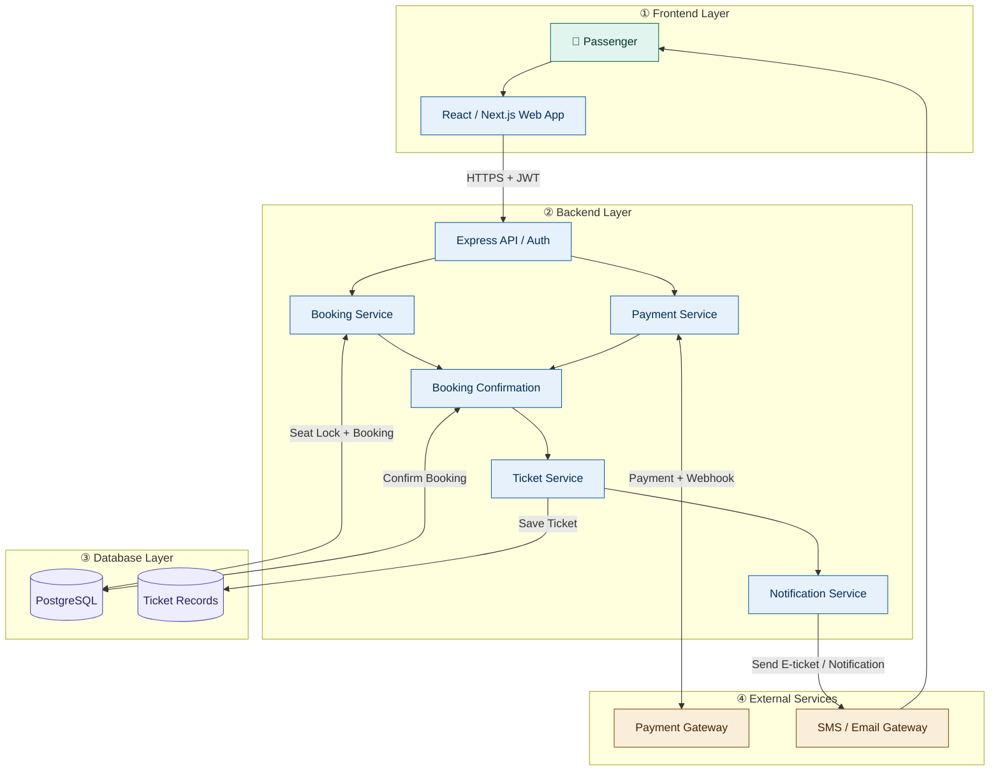
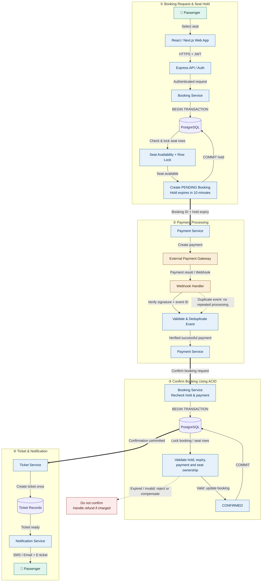
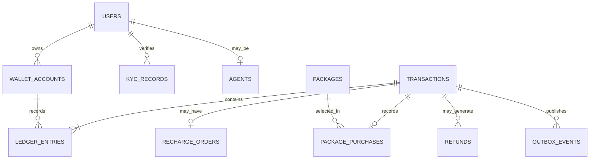
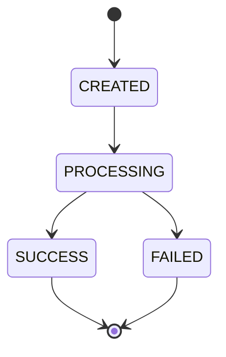
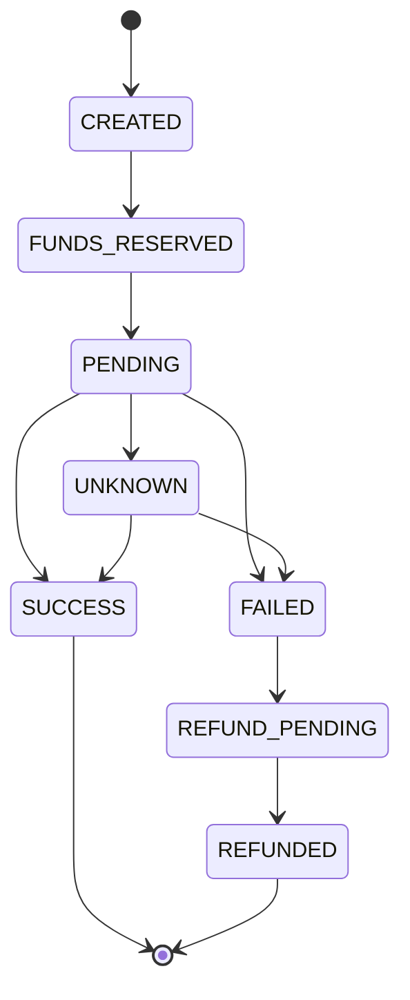

# Mobile Banking System (MFS like bKash/Nagad) — Complete System Design

**Language:** Bengali  
**Purpose:** Junior Software Engineer Interview Preparation  
**Difficulty:** Easy–Medium  
**Main Technologies:** React/Next.js, Node.js, Express.js, PostgreSQL  
**Core Concepts:** ACID, Double-Entry Ledger, Concurrency Control, Idempotency, Webhooks, Refund, Reconciliation

---

## Table of Contents

1. Problem Statement
2. Requirements Analysis
3. High-Level Architecture
4. 15-Step System Design: Interview Presentation
5. REST API Design
6. Database Design
7. ER Diagram
8. Transaction Status Management
9. Complete Send Money Flow
10. Cash In and Cash Out Flow
11. Mobile Recharge and Package Purchase Flow
12. Wallet, Ledger and Double-Entry Accounting
13. ACID Properties
14. Concurrency Control and Double Spending Prevention
15. Idempotency and Duplicate Request Prevention
16. Payment Provider Failure, Webhook and Refund
17. Security and Reliability
18. Scalability and Performance
19. Failure Scenarios and Solutions
20. Test Cases
21. Implementation Plan
22. Short Answers to Say in the Interview
23. Final Interview Checklist

---

# 1. Problem Statement

Suppose we are building a Mobile Financial Service (MFS) called **BanglaPay**, which will work like bKash or Nagad.

A customer can create an account and keep money in a wallet, Send Money to another customer, do Cash In/Out through an agent, and use that wallet balance to do mobile recharge on GP, Robi, Airtel and Teletalk numbers or buy internet, minute and SMS packages.

### Main Functions of the System

- User registration, login, OTP verification and PIN-based transaction authorization.
- Viewing wallet balance and transaction history.
- Sending Money from one user to another user.
- Cash In and Cash Out through an authorized agent.
- Mobile recharge and operator package purchase.
- Applying transaction fees, daily/monthly limits and account restrictions.
- Showing transaction status, receipt and notification.
- Refund/reversal of failed transactions and handling disputed transactions.
- Safely handling concurrent requests, duplicate requests and provider timeouts.
- Maintaining an audit trail and ledger record of every financial transaction.

### Where Is the Core Problem?

Suppose Murad has ৳1,000 in his wallet. Two requests arrive at the same time:

- Request A: Send Money ৳700.
- Request B: Send Money ৳600.

If both requests see the earlier ৳1,000 balance and deduct money separately, a total of ৳1,300 may be attempted to be sent. This is the problem of **race condition and double spending**.

Another problem is that a customer recharges ৳100. The external provider makes the recharge successful, but a network timeout happens before the response comes back. If we send the recharge request again without verifying, the same number may get recharged twice.

**Core design challenge:** In a financial transaction, no money should be lost, no wrong double debit should happen, and even in case of failure, the wallet and ledger accounts must remain consistent.

Our two important principles:

1. **Internal money transfer:** PostgreSQL transaction, ACID and concurrency control.
2. **External recharge/package purchase:** Idempotency, pending status, provider verification, retry and reconciliation.

---

# 2. Requirements Analysis

## 2.1 Functional Requirements

| Module | Requirement |
|---|---|
| User & Authentication | Registration, login, OTP, PIN, profile |
| KYC & Account | Identity verification, active/blocked account |
| Wallet | Balance, account status, available funds |
| Send Money | Customer-to-customer transfer |
| Cash In | Adding money to customer wallet through an agent |
| Cash Out | Withdrawing money from customer wallet and taking cash from an agent |
| Recharge | Mobile recharge on GP, Robi, Airtel, Teletalk |
| Package Purchase | Buying internet, minute, SMS or bundled offers |
| Transaction History | Paginated history, status, receipt |
| Fee & Limits | Transaction charge, daily/monthly limits |
| Refund & Dispute | Failed operation recovery and complaint |
| Agent Management | Agent approval, float balance, commission |
| Notification | SMS, push notification, transaction alerts |
| Admin & Audit | Account restrictions, limits, audit, reconciliation |

## 2.2 Non-Functional Requirements

- **Consistency:** Wallet balance and financial ledger accounts must match.
- **Atomicity:** In internal transfer, debit and credit will commit together or neither will happen.
- **Concurrency:** Balance must not become negative due to simultaneous requests.
- **Idempotency:** Even if the same logical request comes again, the financial operation will not execute a second time.
- **Reliability:** Even in case of provider or network failure, the transaction outcome can be verified.
- **Security:** PIN hashing, authentication, authorization, rate limiting and encryption.
- **Scalability:** API and asynchronous workers can be scaled separately.
- **Auditability:** There will be a verifiable record of who sent how much money to which account and when.
- **Observability:** Failed transactions, stuck recharges, database errors and reconciliation mismatches can be monitored.

## 2.3 Main Business Rules

1. Sender and receiver accounts must be eligible for the transaction.
2. KYC and account restrictions must be verified according to business policy.
3. Amount, fee and transaction limits will be verified in the backend.
4. Wallet balance cannot become negative without an overdraft policy.
5. Every financial operation will have a unique transaction ID.
6. The same refund operation cannot be executed more than once.
7. Old financial history cannot be changed by editing or deleting ledger entries.
8. Even if notification fails, a committed financial transaction will not be rolled back.
9. A provider timeout cannot be treated directly as a failure; the outcome must be verified first.
10. A network call to an external provider cannot be made while keeping a database transaction open.

---

# 3. High-Level Architecture
## 3.1 Full System Architecture



### Arrow follow Diagram

#### Step 1: Apps → API Gateway
Customer, Agent and Admin send HTTPS requests from their apps. The API Gateway receives the request and routes it to the correct service.

#### Step 2: API Gateway → Authentication & KYC
The user's identity, authentication token and required KYC status are verified. Approved requests proceed to the next step.

#### Step 3: Authentication → Transaction Service
The Transaction Service handles operations like money transfer, cash-in, cash-out or recharge.

#### Step 4: Transaction → Risk Service
The transaction's limits, fraud risk and account restrictions are verified. If the checks succeed, the transaction proceeds.

#### Step 5: Transaction → Wallet / Recharge Service
For sending money or changing wallet balance, the Wallet Service works. For mobile recharge, the Recharge Service manages operator and package-related information.

#### Step 6: Services ↔ PostgreSQL
The double arrow (<-->) means the service can both read and write data in the database. Wallet balance, transaction status and ledger entries must be stored through proper database transactions.

#### Step 7: API Gateway ⇢ Redis Cache
The dotted arrow (-.->) indicates an optional path for cached reads. Frequently accessed, non-sensitive or suitable cached data can be obtained quickly. For financial balance, cache should not be used as the authoritative source.

#### Step 8: PostgreSQL → Outbox → Message Queue
Events related to the transaction are reliably stored in the database. The Outbox publisher sends the event to the queue so that asynchronous work can be done.

#### Step 9: Queue → Background Workers
Workers take events from the queue and run background tasks—such as sending requests to the recharge provider, sending notifications and starting reconciliation.

#### Step 10: Worker ↔ Telecom Provider
The Worker sends a recharge request to the external telecom provider. The provider gives a response; the Worker updates the recharge status according to that response.

#### Step 11: Worker → Notification / Reconciliation
The Worker sends an SMS or push notification to the customer. The Reconciliation Service matches internal transaction records with the provider's records.

#### Step 12: Reconciliation → PostgreSQL
The reconciliation results are stored in the database. If there is a mismatch, it can be flagged for investigation or correction.


## 3.2 Responsibilities of Components

**1. Customer App — React Native / Flutter / Web**

- Interface for balance, Send Money, Cash In/Out and recharge.
- PIN/confirmation flow.
- Transaction history, receipt and status display.
- The balance or success message shown in the frontend will not be treated as financial truth.

**2. API Gateway / Express API**

- Receiving HTTPS requests.
- Authentication, input validation, rate limiting and routing.
- Creating or propagating request ID and correlation ID.

**3. Authentication & KYC Module**

- Login, OTP, PIN authorization.
- Verifying user status, KYC status and permissions.
- Applying additional verification on sensitive operations.

**4. Transaction Service**

- Managing Send Money, Cash In, Cash Out and the transaction lifecycle.
- Fee and limit validation.
- Detecting duplicate requests.

**5. Wallet & Ledger Service**

- Wallet balance update.
- Creating debit/credit and double-entry ledger records.
- Enforcing atomic database transactions and concurrency control.

**6. Recharge & Package Service**

- Verifying operator, mobile number, package and eligibility.
- Creating recharge orders and provider integration.
- Provider status verification, refund/release and reconciliation.

**7. PostgreSQL**

- Storing wallet, financial transaction, ledger, idempotency record and outbox.
- Authoritative source for financial writes.

**8. Background Worker**

- Processing recharge requests.
- Webhook/event processing.
- Notification delivery, retry and reconciliation.

**9. Redis (Optional)**

- Rate limiting, temporary cache or eligible read optimization.
- Redis will not be the authoritative source of wallet balance.

## 3.3 Technology Choices

| Component | Technology | Why? |
|---|---|---|
| Frontend | React Native / Flutter | Mobile app |
| Backend | Node.js + Express.js | REST API and business logic |
| Database | PostgreSQL | ACID, row locking, constraints |
| Cache | Redis | Rate limit and eligible cache |
| Queue | RabbitMQ / Kafka | Asynchronous processing |
| Provider Integration | REST API + Webhooks | Recharge and package activation |
| Monitoring | Logs, Metrics, Tracing | Failure investigation |

**Design decision for the junior interview:** First, I will build a modular monolith with PostgreSQL. I will keep the wallet, ledger and internal transfer in the same database transaction boundary. As traffic and team size grow, I will separate services as needed.

---

# 4. 15-Step System Design: Interview Presentation Breakdown

## Step 1: Request Initiation — Customer Action

**What is happening:** The customer opens the app, sees the balance, and wants to Send Money ৳1,000 to someone else. They provide the receiver's mobile number, amount and required authorization.

**Why it is happening:** The user's intended financial operation must be captured.

**Benefit:** The frontend will create the request, but the backend will determine the final balance or fee.

## Step 2: Customer App → HTTPS → Express REST API

**What is happening:** The app will send the request to the API via HTTPS.

Example:

```http
POST /api/v1/transfers
Authorization: Bearer <access-token>
Idempotency-Key: 5ef0c8e8-unique-operation
Content-Type: application/json
```

```json
{
  "receiver": "017XXXXXXXX",
  "amountMinor": 100000
}
```

Here `amountMinor: 100000` means ৳1,000, if the API uses paisa as the minor unit of BDT.

**Why it is happening:** HTTPS encrypts communication, and the Idempotency-Key helps identify retries of the same operation.

**Benefit:** The risk of duplicate transfers from double-click or network retry is reduced.

## Step 3: Authentication, PIN Authorization & Validation

**What is happening:** Middleware will verify:

- Whether the access token is valid.
- Whether the user account is active.
- Whether KYC and transaction permission are correct.
- Whether PIN authorization or the required step-up verification has succeeded.
- Whether the amount is valid and within the permitted limit.
- Whether the receiver account can accept the transaction.

**Why it is happening:** So that unauthorized or invalid requests do not enter financial processing.

**Benefit:** Security, compliance and business rules can be enforced right from the start.

## Step 4: Transaction Service — Idempotency Check

**What is happening:** The server will check whether the same user/scope's Idempotency-Key has been used before.

- New key: the request will be processed.
- Same key, same payload: the previous result or current status will be returned.
- Same key, different payload: it will be rejected as a conflict.
- If the previous request is still processing, the status will be returned without creating a duplicate operation.

**Why it is happening:** Retry is a normal event when the client loses the response.

**Benefit:** The same logical operation will not create a financial effect more than once.

## Step 5: Begin PostgreSQL Transaction

**What is happening:** A database transaction will begin for internal Send Money.

```sql
BEGIN;
```

Then the sender's and receiver's wallet records will be locked as needed.

**Why it is happening:** Debit, credit, transaction record and ledger entries must be committed together.

**Benefit:** If an error occurs at any step, the entire internal transfer can be rolled back.

## Step 6: Concurrency Control & Balance Validation

**What is happening:** The wallet record will be locked/guarded using PostgreSQL's `SELECT ... FOR UPDATE` or a conditional update.

Then it will be verified:

- Whether the sender's account is active.
- Whether the available balance is sufficient.
- Whether the total debit of amount + fee is permitted.
- Whether the daily/monthly limit has been exceeded.

**Why it is happening:** When two requests come at the same time from the same wallet, overspending using a stale balance must be prevented.

**Benefit:** The risk of the same money being spent in two transactions can be prevented.

## Step 7: Debit, Credit & Ledger Entries

**What is happening:** If all validations succeed, within the same database transaction:

1. Debit amount + fee from the sender wallet.
2. Credit the amount to the receiver wallet.
3. Create the transaction record.
4. Create balanced ledger entries.
5. Insert the required outbox event.

**Why it is happening:** The financial changes of the transfer must be committed together.

**Benefit:** A partial transfer—where the sender's debit succeeds but the receiver's credit fails—will not become permanent.

## Step 8: PostgreSQL Commit & Response

**What is happening:** If all updates and constraint checks succeed, `COMMIT` will happen. Then the transaction ID and status will be returned as the response.

**Why it is happening:** The committed financial record is the authoritative result of the operation.

**Benefit:** Even if the response is lost after commit, the previous result can be obtained with the same idempotency key.

## Step 9: Transactional Outbox & Notification

**What is happening:** In the same database transaction as the financial transaction, an `outbox_events` record will be inserted. The worker will later publish the event and send SMS or push notification.

**Why it is happening:** Even if the database commit succeeds, the message broker or notification service may be unavailable.

**Benefit:** A successful transfer will not be cancelled due to notification failure; the event can be retried.

## Step 10: Recharge/Package Request Initiation

**What is happening:** When a customer does a recharge or package purchase, the backend will verify operator, number, package, price and eligibility and create an order.

After deciding the policy for reserving/debiting funds, the order will be kept in `PENDING` or `PROCESSING` state.

**Why it is happening:** Internal wallet debit and external operator activation happen in two separate systems.

**Benefit:** The financial transaction and provider operation are managed in separate lifecycles.

## Step 11: Outbox Worker → External Provider

**What is happening:** The worker will send a recharge/package activation request to the provider API. If the provider reference and idempotency support exist, it will be used.

**Why it is happening:** The PostgreSQL transaction should not be kept open during an external network call.

**Benefit:** The database connection is not held for a long time and the worker can retry independently.

## Step 12: Provider Callback / Webhook

**What is happening:** When the provider sends a success/failure callback, the server will verify authenticity/signature, provider reference, amount, number and status.

If the same callback comes more than once, a unique event/reference and an idempotent handler will be used.

**Why it is happening:** Duplicate callbacks may come due to provider retry or network issues.

**Benefit:** The risk of the same recharge being completed or refunded twice is reduced.

## Step 13: Finalize Recharge or Package Purchase

**What is happening:**

- If success is verified, the order becomes `SUCCESS`.
- If terminal failure is confirmed, the refund/release workflow runs.
- If the outcome is unknown, it is kept as `PENDING/UNKNOWN` and provider status query and reconciliation are done.

**Why it is happening:** A timeout does not necessarily mean recharge failure.

**Benefit:** Even if the provider operation succeeded but the internal response was lost, wrong refund or duplicate recharge can be avoided.

## Step 14: Cash In/Out, Reversal & Reconciliation

**What is happening:** In Cash In/Out, agent authorization, float balance, customer eligibility and physical cash handover policy will be verified. For refund/reversal, a new transaction and ledger entries will be created.

The reconciliation worker will match internal records with provider reports and settlement records.

**Why it is happening:** Digital balance and actual cash movement or external provider outcome may not always be confirmed at the same moment.

**Benefit:** Mismatches can be identified, audited and recovered in a controlled manner.

## Step 15: Monitoring, Receipt & Customer Status

**What is happening:** The app will show transaction history/status. The backend will monitor failed transactions, stuck orders, duplicate events and database issues using metrics, structured logs, tracing and alerts.

**Why it is happening:** In a financial system, not only the success path but also failure recovery is important.

**Benefit:** The customer support and engineering team can quickly find the cause of problems.

---

# 5. REST API Design

All APIs will be versioned: `/api/v1/...`. Financial write requests will have authentication, validation, authorization and, as needed, an Idempotency-Key.

## 5.1 Authentication & Account APIs

| Method | Endpoint | Purpose |
|---|---|---|
| POST | `/api/v1/auth/register` | Registration |
| POST | `/api/v1/auth/verify-otp` | Mobile verification |
| POST | `/api/v1/auth/login` | Login |
| POST | `/api/v1/auth/pin/verify` | Sensitive operation authorization |
| POST | `/api/v1/kyc/submissions` | KYC submission |
| GET | `/api/v1/me` | Own profile |
| GET | `/api/v1/wallet` | Wallet balance and summary |

## 5.2 Financial APIs

| Method | Endpoint | Purpose |
|---|---|---|
| POST | `/api/v1/transfers` | Send Money |
| POST | `/api/v1/agents/cash-ins` | Cash In |
| POST | `/api/v1/agents/cash-outs` | Cash Out |
| GET | `/api/v1/wallet/transactions` | Paginated transaction history |
| GET | `/api/v1/transactions/:id` | Transaction status |
| POST | `/api/v1/transactions/:id/refunds` | Authorized refund workflow |
| POST | `/api/v1/disputes` | Dispute submission |

## 5.3 Recharge & Package APIs

| Method | Endpoint | Purpose |
|---|---|---|
| GET | `/api/v1/operators` | Supported operators |
| GET | `/api/v1/operators/:id/packages` | Available packages |
| POST | `/api/v1/recharges` | Mobile recharge |
| GET | `/api/v1/recharges/:id` | Recharge status |
| POST | `/api/v1/package-purchases` | Package purchase |
| POST | `/api/v1/webhooks/recharge/:provider` | Provider callback |

## 5.4 Admin & Agent APIs

| Method | Endpoint | Purpose |
|---|---|---|
| POST | `/api/v1/admin/agents` | Agent approval/registration |
| PATCH | `/api/v1/admin/accounts/:id/status` | Account status management |
| PATCH | `/api/v1/admin/limits/:id` | Limits management |
| GET | `/api/v1/admin/audit-logs` | Audit review |
| GET | `/api/v1/admin/reconciliation` | Reconciliation status |

Admin APIs must have Role-Based Access Control (RBAC), least privilege and audit logging.

## 5.5 Send Money Request Example

```http
POST /api/v1/transfers
Authorization: Bearer <access-token>
Idempotency-Key: 5ef0c8e8-unique-operation
Content-Type: application/json
```

```json
{
  "receiver": "017XXXXXXXX",
  "amountMinor": 100000
}
```

Suppose the fee determined by the server is ৳5.

```json
{
  "transactionId": "txn_01JXYZ",
  "type": "SEND_MONEY",
  "amountMinor": 100000,
  "feeMinor": 500,
  "status": "SUCCESS",
  "currency": "BDT"
}
```

Here the sender's total debit is ৳1,005 and the receiver will get ৳1,000.

**Important:** The fee cannot be trusted from the client; it must be determined according to the backend's fee policy.

## 5.6 Error Handling

| HTTP Status | Example |
|---|---|
| 400 | Invalid request/amount |
| 401 | Invalid or missing authentication |
| 403 | KYC/account/permission restriction |
| 404 | Receiver or transaction not found |
| 409 | Insufficient balance or idempotency conflict |
| 422 | Operation not acceptable per business rules |
| 429 | Rate limit exceeded |
| 202 | External operation pending |
| 503 | Temporary service unavailable |

The response should have a machine-readable error code, such as `INSUFFICIENT_FUNDS`, `ACCOUNT_BLOCKED`, `DUPLICATE_REQUEST`.

---

# 6. Database Design

## 6.1 Main Tables

### 1. `users`

| Column | Type | Purpose |
|---|---|---|
| id | UUID, PK | User ID |
| phone | VARCHAR, UNIQUE | Mobile number |
| password_hash | TEXT | Secure credential hash |
| status | VARCHAR/ENUM | ACTIVE/BLOCKED |
| created_at | TIMESTAMPTZ | Account creation |

users — Stores the user's account information, mobile number, secure password hash and account status.

### 2. `wallet_accounts`

| Column | Type | Purpose |
|---|---|---|
| id | UUID, PK | Wallet ID |
| user_id | UUID, FK | Wallet owner |
| currency | CHAR(3) | BDT |
| available_balance_minor | BIGINT | Available balance in paisa |
| status | VARCHAR/ENUM | ACTIVE/FROZEN |
| created_at | TIMESTAMPTZ | Creation time |

Constraint:

```sql
UNIQUE (user_id, currency)
CHECK (available_balance_minor >= 0)
```

In `available_balance_minor`, money will be kept as an integer minor unit; floating-point amounts will not be used.

wallet_accounts — Manages the user's wallet, currency, available balance and wallet status. Balance is kept in integer minor units.


### 3. `transactions`

| Column | Type | Purpose |
|---|---|---|
| id | UUID, PK | Transaction ID |
| type | VARCHAR/ENUM | SEND_MONEY/CASH_IN/RECHARGE |
| status | VARCHAR/ENUM | Lifecycle status |
| sender_account_id | UUID, FK, nullable | Source account |
| receiver_account_id | UUID, FK, nullable | Destination account |
| amount_minor | BIGINT | Amount |
| fee_minor | BIGINT | Fee |
| currency | CHAR(3) | BDT |
| idempotency_key | VARCHAR | Operation reference |
| created_at | TIMESTAMPTZ | Creation time |

transactions — Stores the amount, sender, receiver and status of financial transactions like money transfer, cash-in and mobile recharge.


### 4. `ledger_entries`

| Column | Type | Purpose |
|---|---|---|
| id | UUID, PK | Ledger entry ID |
| transaction_id | UUID, FK | Business transaction |
| account_id | UUID, FK | Financial account |
| direction | VARCHAR | DEBIT/CREDIT |
| amount_minor | BIGINT | Entry amount |
| created_at | TIMESTAMPTZ | Entry time |

The ledger will be append-only. Financial history cannot be changed by updating/deleting old entries.

ledger_entries — Keeps the Debit/Credit entries and financial history of every financial transaction. It is append-only, so old entries cannot be changed or deleted.


### 5. `kyc_records`

Will keep the user's KYC status, verification reference and verification metadata.

kyc_records — Stores the user's identity verification (KYC) status, verification reference and metadata.


### 6. `agents`

Will keep the agent's user reference, agent code, approval status and operational details.

agents — Keeps the agent's user reference, unique agent code, approval status and operational information.


### 7. `recharge_orders`

- Transaction ID
- Operator
- Mobile number reference
- Amount/package ID
- Provider reference
- Order status
- Retry/reconciliation metadata

recharge_orders — Stores the mobile recharge's operator, mobile number reference, amount/package, provider reference and recharge status.


### 8. `packages`

- Operator ID
- Provider package ID
- Package name/type
- Price
- Validity
- Eligibility
- Active status

packages — Manages the mobile operator's recharge packages, price, validity, eligibility and active status.

### 9. `idempotency_keys`

- Request scope
- Idempotency key
- Request payload hash
- Transaction reference
- Processing/result status
- Stored response reference

idempotency_keys — To prevent duplicate financial transactions from being created even when the same request is retried, it keeps the request key, payload hash and result reference.

### 10. `refunds`

Will keep the original transaction ID, refund operation ID, amount, reason, status and provider reference.

refunds — Stores the refund amount, reason, status and provider reference against the original transaction.


### 11. `outbox_events`

Will keep the event created atomically with the financial transaction and its publish status.

outbox_events — Stores the event created in the same database transaction as the financial transaction, so that it can be published reliably later.


### 12. `audit_logs`

Will keep administrative action, actor, timestamp, target, reason and correlation reference. PIN, OTP or access token must not be logged.

audit_logs — Keeps the audit history of the admin's action, actor, timestamp, target and reason. PIN, OTP or access token must not be logged.

## 6.2 Important Database Constraints

- `users.phone` will be unique.
- `(user_id, currency)` will be unique for the wallet.
- Transactions and ledger entries will have foreign keys.
- `(scope, idempotency_key)` will be unique.
- The provider's unique transaction/event reference will prevent duplicate processing.
- Amount will be positive and fee will be non-negative.
- If overdraft is prohibited by account policy, balance cannot become negative.
- The same refund operation of the original transaction cannot be duplicated.
- Ledger entries cannot be updated/deleted with normal application permission.

## 6.3 Sample PostgreSQL Schema

```sql
CREATE TABLE wallet_accounts (
    id UUID PRIMARY KEY,
    user_id UUID NOT NULL REFERENCES users(id),
    currency CHAR(3) NOT NULL DEFAULT 'BDT',
    available_balance_minor BIGINT NOT NULL DEFAULT 0,
    status VARCHAR(20) NOT NULL DEFAULT 'ACTIVE',
    created_at TIMESTAMPTZ NOT NULL DEFAULT NOW(),

    UNIQUE (user_id, currency),
    CHECK (available_balance_minor >= 0)
);

CREATE TABLE transactions (
    id UUID PRIMARY KEY,
    type VARCHAR(30) NOT NULL,
    status VARCHAR(30) NOT NULL,
    amount_minor BIGINT NOT NULL CHECK (amount_minor > 0),
    fee_minor BIGINT NOT NULL DEFAULT 0
        CHECK (fee_minor >= 0),
    currency CHAR(3) NOT NULL DEFAULT 'BDT',
    created_at TIMESTAMPTZ NOT NULL DEFAULT NOW()
);

CREATE TABLE ledger_entries (
    id UUID PRIMARY KEY,
    transaction_id UUID NOT NULL REFERENCES transactions(id),
    account_id UUID NOT NULL REFERENCES wallet_accounts(id),
    direction VARCHAR(6) NOT NULL
        CHECK (direction IN ('DEBIT', 'CREDIT')),
    amount_minor BIGINT NOT NULL CHECK (amount_minor > 0),
    created_at TIMESTAMPTZ NOT NULL DEFAULT NOW()
);
```

This is a **simplified schema**, not a complete production-ready schema. In a production implementation, sender/receiver references, accounting account types, idempotency, refund links, provider references and ledger invariants at the transaction boundary must be enforced.

---

# 7. ER Diagram




**Explanation:** `transactions` is the business event, and `ledger_entries` are the accounting records of that event. A transaction can have multiple debit/credit entries. The external provider reference of a recharge or package purchase will be stored separately.

---

# 8. Transaction Status Management

It is not right to use a single status lifecycle for all operations. The failure models of internal transfer and external recharge are different.

## 8.1 Send Money State



In internal transfer, `SUCCESS` will happen only when the debit, credit, ledger entries and transaction record have been committed in the same database transaction.

## 8.2 Recharge State



`UNKNOWN` means the outcome is not yet confirmed. It is not a synonym for `FAILED`.

### State Transition Rules

- Direct `SUCCESS → FAILED` transition cannot be allowed.
- A refund will have its own transaction ID and ledger entries.
- Even if the same callback comes multiple times, the financial effect will happen only once.
- If failure is confirmed, a refund or release of reserved funds will be done according to policy.
- If a late success arrives, audited recovery must be done after verifying the existing state, provider evidence and ledger.

---

# 9. Complete Send Money Flow

Suppose Murad has ৳5,000 in his wallet. He will send ৳1,000 to Rahim and the fee is ৳5.

## Step-by-Step Workflow

1. Murad selects the receiver and amount in the app.
2. The app sends a `POST /api/v1/transfers` request.
3. The server verifies JWT/session, PIN authorization, account status, KYC, limits and receiver.
4. The server checks the Idempotency-Key.
5. A PostgreSQL transaction begins.
6. The sender and receiver wallet rows are locked in a deterministic order.
7. It is verified whether the sender's balance is equal to or greater than ৳1,005.
8. ৳1,005 is debited from the sender wallet.
9. ৳1,000 is credited to the receiver wallet.
10. According to the fee policy, ৳5 fee is recorded as a credit to the fee-revenue account.
11. The transaction, balanced ledger entries and outbox event are inserted.
12. If everything succeeds, `COMMIT`; if there is an error, `ROLLBACK`.
13. The transaction ID and status are returned to the client.
14. The outbox worker sends SMS/push notification.

## Simplified SQL Logic

```sql
BEGIN;

-- Lock both wallets in a deterministic order.
SELECT id, available_balance_minor, status
FROM wallet_accounts
WHERE id IN (:sender_id, :receiver_id)
ORDER BY id
FOR UPDATE;

-- Application validates status, limits and authorization.

UPDATE wallet_accounts
SET available_balance_minor =
    available_balance_minor - :total_debit
WHERE id = :sender_id
  AND available_balance_minor >= :total_debit;

-- Application must verify exactly one row was updated.

UPDATE wallet_accounts
SET available_balance_minor =
    available_balance_minor + :receiver_credit
WHERE id = :receiver_id;

-- Insert transaction and balanced ledger entries.
-- Insert outbox event.

COMMIT;
```

This is a conceptual SQL flow. In production code, the sender and receiver being different, account status, fee accounting, ledger balance and affected-row count must be verified.

### Why the Same Transaction?

If the sender is debited but the receiver credit fails, `ROLLBACK` will cancel the entire operation. As a result, a partial transfer will not become permanent in the database.

---

# 10. Cash In and Cash Out Flow

Cash In/Out is not just a wallet balance update. Here, both electronic money movement and physical cash handover must be managed correctly.

## 10.1 Cash In

Suppose the customer gave the agent ৳2,000 in cash.

1. Verify that the agent is authenticated and approved.
2. Verify customer account, KYC and transaction limits.
3. Verify the agent's float balance and cash-in policy.
4. Take customer confirmation/OTP as needed.
5. Update the relevant financial accounts and ledger entries in a PostgreSQL transaction.
6. Record the transfer of ৳2,000 from the agent's electronic float to the customer wallet—if that is the settlement model being used.
7. If there is commission, create separate accounting entries.
8. Send receipt and notification after commit.

**Important:** The accounting model of agent float may differ according to the business. The ledger design of Cash In must match that model.

## 10.2 Cash Out

The customer will withdraw cash from an agent.

1. Verify the eligibility of customer and agent.
2. Verify the customer's available balance, fee and withdrawal limit.
3. Verify the agent's authorization and cash availability policy.
4. Record the financial transaction and ledger entries atomically.
5. The agent will give physical cash to the customer.
6. Customer confirmation, receipt and audit record will be stored.

**Failure scenario:** The wallet was debited, but the agent could not give the cash. In that case, the transaction record cannot be directly deleted. Investigation must be done according to the dispute/confirmation policy and, if needed, a compensating reversal must be done.

---

# 11. Mobile Recharge and Package Purchase Flow

Suppose Murad wants to recharge a GP number with ৳100 from his wallet.

## Step-by-Step Workflow

1. The customer selects the operator, mobile number and amount.
2. The backend verifies number format, operator, limits and eligibility.
3. A recharge order is created with a unique Idempotency-Key.
4. In an internal database transaction, a financial record is created according to the funds reserve or debit policy.
5. A provider request event is inserted into `outbox_events`.
6. After the database commit, the worker processes the event.
7. The worker sends a recharge request to the external provider API.
8. The provider reference and status are stored.
9. When a provider callback/webhook arrives, signature/authenticity and reference are verified.
10. If success is verified, the order becomes `SUCCESS`.
11. If failure is confirmed, the refund/release workflow runs.
12. If the outcome is unknown, the order stays pending and provider status query/reconciliation is done.
13. The outbox worker sends notification.

## 11.1 Should We Debit First, or Reserve?

Two designs are possible.

**Option A — Immediate Debit**

- Money will be debited from the customer's wallet.
- The recharge order will remain pending.
- If the provider succeeds, the order will complete.
- If failure is confirmed, a compensating refund entry will be created.

**Option B — Funds Reservation**

- A portion of the available funds will be reserved.
- If the provider succeeds, the reservation will be captured/finalized.
- If failure is confirmed, the reservation will be released.

If the reservation model is used, available balance and reserved balance must be modeled separately. Merely calling a single balance field "reserved" is not sufficient.

## 11.2 What to Do If the Provider Times Out?

Suppose:

1. BanglaPay sent the recharge request.
2. The provider made the recharge successful.
3. A network timeout happened before the response came back.

Now the system does not know whether the recharge succeeded.

Correct steps:

- The order will remain `PENDING/UNKNOWN`.
- Provider status will be queried.
- If the provider supports idempotency, the same logical operation reference will be used.
- If the provider contract does not guarantee safe retry, no blind retry will be done.
- If success is confirmed, the order will complete.
- If terminal failure is confirmed, refund/release will happen.
- If the outcome remains unknown, it will go to the reconciliation queue.

**Remember: Timeout does not mean failure; timeout means the outcome is not yet known.**

## 11.3 Additional Points for Package Purchase

In package purchase, the backend will verify:

- Operator and provider package ID.
- Package price, validity and type.
- Mobile number and customer eligibility.
- Purchase-time price snapshot.
- Activation reference and activation status.

Even if payment succeeds, package activation may fail. In that case, provider status query, safe retry or refund workflow is needed.

---

# 12. Wallet, Ledger and Double-Entry Accounting

This is the most important part of the whole system.

## 12.1 Wallet Balance vs Ledger

**Wallet balance:** How much money the customer can currently spend.

**Ledger:** The accounting journal of how much was debited from which account and how much was credited to which account in every financial operation.

Reasons for keeping both:

- Balance can be read quickly.
- Every financial movement can be audited from the ledger.
- If balance and ledger mismatch, reconciliation can be done.
- The accounting history of refund, reversal and fee is maintained.

Wallet balance can be a projection, but it must be kept consistent with the ledger.

## 12.2 Double-Entry Ledger

In every financial transaction, total debit and credit must be equal.

Suppose Murad sends ৳1,000 Send Money and the fee is ৳5. Customer wallets are treated as platform liabilities.

| Account | Debit | Credit |
|---|---:|---:|
| Murad wallet liability | ৳1,005 | — |
| Receiver wallet liability | — | ৳1,000 |
| Fee revenue | — | ৳5 |
| **Total** | **৳1,005** | **৳1,005** |

In this accounting model, the sender's wallet liability decreases by ৳1,005, the receiver's liability increases by ৳1,000 and the platform's fee revenue is ৳5.

In a real accounting model, if there are agent settlement, commission and other accounts, additional entries may be needed.

## 12.3 Ledger Rules

- Ledger entries will be append-only.
- Old entries cannot be updated/deleted.
- To correct a wrong transaction, a compensating entry must be created.
- The debit/credit invariant of every financial transaction must be enforced.
- Wallet balance and ledger must be reconciled regularly.
- A refund must be recorded as a separate transaction.

---

# 13. ACID Properties

| Property | Application in Mobile Banking |
|---|---|
| **Atomicity** | Debit, credit, ledger and outbox writes of Send Money commit/rollback together |
| **Consistency** | Maintaining balance constraints, valid states and balanced ledger |
| **Isolation** | Controlling conflicting writes between concurrent transactions using row locks or conditional updates |
| **Durability** | Keeping the financial records of a successful commit in durable storage; keeping backup and recovery ready |

## Atomicity Example

Murad is sending ৳1,000.

- Sender debit succeeds.
- Error during receiver credit.

If it is the same PostgreSQL transaction, the entire operation will `ROLLBACK`. The sender's debit will not become permanent.

## Consistency Example

Wallet balance cannot be negative. This invariant will be enforced by database constraint and atomic balance update.

## Isolation Example

If ৳700 and ৳600 transfer requests come at the same time, row locking or conditional update will ensure that at most one transaction can succeed from a ৳1,000 balance.

## Durability Example

Even if the application response is lost after commit, the transaction record will remain in the database. If the client retries with the same idempotency key, it will get the previous result.

**Important:** ACID applies to the same database transaction. The external recharge provider cannot be included within the same ACID transaction of PostgreSQL. For external workflows, state machine, idempotency, retry and reconciliation are needed.

---

# 14. Concurrency Control & Double Spending Prevention

## Problem

Murad's balance is ৳1,000. At the same time:

- Request A: ৳700 transfer.
- Request B: ৳600 transfer.

If both requests use the same stale balance, overspending can happen.

## Solution 1 — Row-Level Locking

```sql
BEGIN;

SELECT id, available_balance_minor
FROM wallet_accounts
WHERE id = :sender_id
FOR UPDATE;

-- Validate balance and account status.

UPDATE wallet_accounts
SET available_balance_minor =
    available_balance_minor - :total_debit
WHERE id = :sender_id
  AND available_balance_minor >= :total_debit;

-- Verify affected row count.
-- Insert transaction and ledger entries.

COMMIT;
```

Conflicting requests of the same wallet will be serialized due to the row lock. The second request will see the updated balance after the first one's commit.

## Solution 2 — Conditional Update

```sql
UPDATE wallet_accounts
SET available_balance_minor =
    available_balance_minor - :total_debit
WHERE id = :sender_id
  AND available_balance_minor >= :total_debit
RETURNING available_balance_minor;
```

If no row is returned, the balance is insufficient or the update condition was not met.

## Deadlock Prevention

If the sender and receiver wallets must be locked together, it is better to lock them in a deterministic order, such as `ORDER BY id FOR UPDATE` by wallet ID.

This reduces the risk of deadlock. Still, deadlock detection and bounded retry may be needed.

**Interview answer:** "I would use PostgreSQL row-level locking or an atomic conditional update to prevent overspending. The debit, credit and ledger writes would be committed in a single database transaction."

---

# 15. Idempotency — Duplicate Request Prevention

Timeouts are very common in mobile networks. The client sent a request, the server committed, but the response was lost. If the client sends the request again, money will not be deducted a second time.

## 15.1 How Does It Work?

Every logical financial operation will have a unique key:

```http
Idempotency-Key: 5ef0c8e8-unique-operation
```

The following will be stored in the database:

- User/client scope
- Idempotency key
- Request payload hash
- Associated transaction ID
- Processing/result status
- Response reference if needed

Unique constraint:

```sql
UNIQUE (scope, idempotency_key)
```

## 15.2 Four Situations

| Situation | System Behaviour |
|---|---|
| New key | Request will be processed |
| Same key, same payload, completed | Will return the previous result |
| Same key, same payload, processing | Will return the existing status/pending result |
| Same key, different payload | Will reject as a conflict |

The idempotency record and the internal financial transaction must be coordinated so that the result of a committed transaction is not lost.

**Remember:** Idempotency prevents duplicate logical requests; row locking and balance constraints prevent concurrent overspending. Both are needed together.

---

# 16. Payment Provider Failure, Webhook & Refund

## 16.1 Duplicate Webhook

**Problem:** The provider sends the same recharge success event three times.

**Solution:**

1. Verify provider signature/authenticity.
2. Store event/reference in the database with a unique constraint.
3. If the event already exists, stop duplicate financial processing.
4. Enforce transaction status transition atomically.
5. Process notification and downstream events idempotently.

## 16.2 Payment Successful, But Package Not Activated

**Problem:** The customer's money was debited, but the operator did not activate the package.

**Solution:**

1. I will keep the order pending.
2. I will query the provider activation status.
3. If success is confirmed, the order completes.
4. If terminal failure is confirmed, refund/release workflow.
5. If the outcome remains unknown, I will send it to the reconciliation queue.

## 16.3 How Will Refund Work?

For refund:
