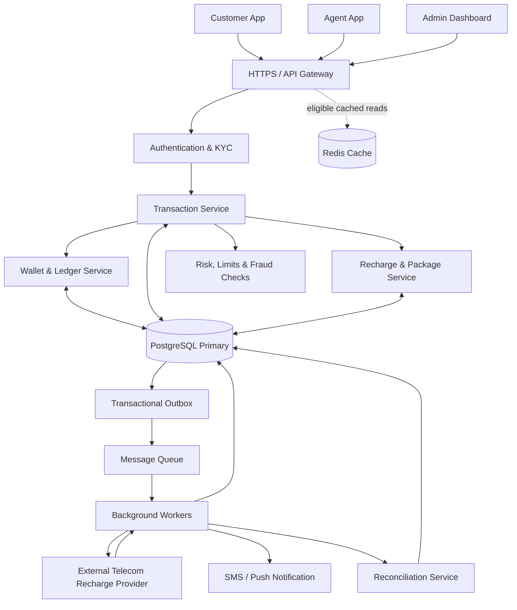
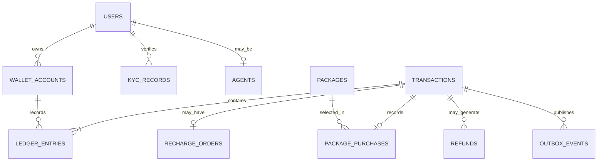
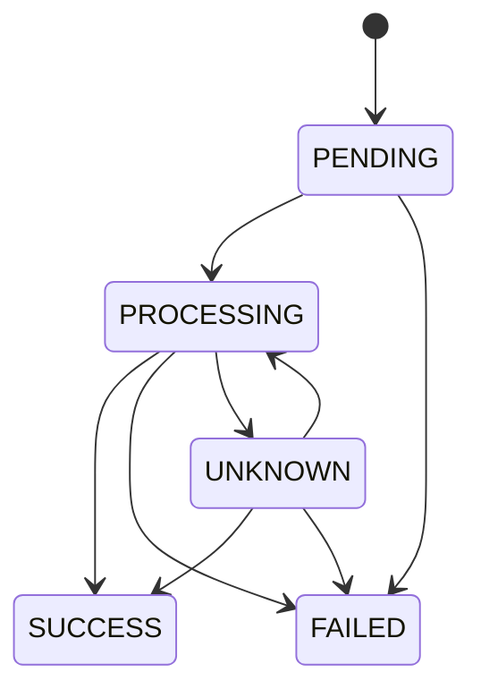
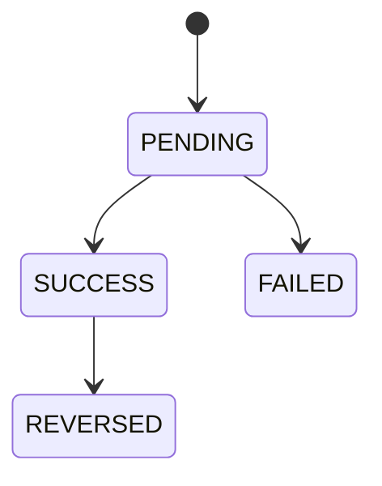
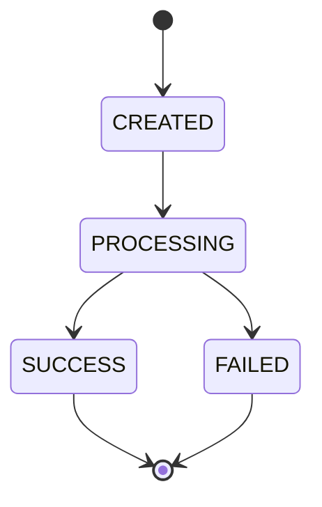
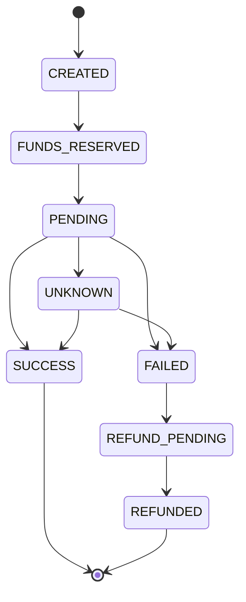

# Mobile Banking System (MFS like bKash/Nagad) — Complete System Design

**Language:** Bengali  
**Purpose:** Junior Software Engineer Interview Preparation  
**Difficulty:** Easy–Medium  
**Main Technologies:** React/Next.js, Node.js, Express.js, PostgreSQL  
**Core Concepts:** ACID, Double-Entry Ledger, Concurrency Control, Idempotency, Webhooks, Refund, Reconciliation

---

## Table of Contents

1. Problem Statement
2. Requirements Analysis
3. High-Level Architecture
4. REST API Design
5. Database Design
6. ER Diagram
7. Edge Case Design
8. Transaction Status Management
9. Complete Send Money Flow
10. Cash In and Cash Out Flow
11. Mobile Recharge and Package Purchase Flow
12. Wallet, Ledger and Double-Entry Accounting
13. ACID Properties
14. Concurrency Control and Double Spending Prevention
15. Idempotency and Duplicate Request Prevention
16. Payment Provider Failure, Webhook and Refund
17. Security and Reliability
18. Scalability and Performance
19. Failure Scenarios and Solutions
20. Test Cases
21. Implementation Plan
22. Short Answers to Say in the Interview
23. Final Interview Checklist

---

# 1. Problem Statement

Suppose we are building a Mobile Financial Service (MFS) called **BanglaPay**, which will work like bKash or Nagad.

A customer can create an account and keep money in a wallet, Send Money to another customer, do Cash In/Out through an agent, and use that wallet balance to do mobile recharge on GP, Robi, Airtel and Teletalk numbers or buy internet, minute and SMS packages.

### Main Functions of the System

- User registration, login, OTP verification and PIN-based transaction authorization.
- Viewing wallet balance and transaction history.
- Sending Money from one user to another user.
- Cash In and Cash Out through an authorized agent.
- Mobile recharge and operator package purchase.
- Applying transaction fees, daily/monthly limits and account restrictions.
- Showing transaction status, receipt and notification.
- Refund/reversal of failed transactions and handling disputed transactions.
- Safely handling concurrent requests, duplicate requests and provider timeouts.
- Maintaining an audit trail and ledger record of every financial transaction.

### Where Is the Core Problem?

Suppose Murad has ৳1,000 in his wallet. Two requests arrive at the same time:

- Request A: Send Money ৳700.
- Request B: Send Money ৳600.

If both requests see the earlier ৳1,000 balance and deduct money separately, a total of ৳1,300 may be attempted to be sent. This is the problem of **race condition and double spending**.

Another problem is that a customer recharges ৳100. The external provider makes the recharge successful, but a network timeout happens before the response comes back. If we send the recharge request again without verifying, the same number may get recharged twice.

**Core design challenge:** In a financial transaction, no money should be lost, no wrong double debit should happen, and even in case of failure, the wallet and ledger accounts must remain consistent.

Our two important principles:

1. **Internal money transfer:** PostgreSQL transaction, ACID and concurrency control.
2. **External recharge/package purchase:** Idempotency, pending status, provider verification, retry and reconciliation.

---

# 2. Requirements Analysis

## 2.1 Functional Requirements

| Module | Requirement |
|---|---|
| User & Authentication | Registration, login, OTP, PIN, profile |
| KYC & Account | Identity verification, active/blocked account |
| Wallet | Balance, account status, available funds |
| Send Money | Customer-to-customer transfer |
| Cash In | Adding money to customer wallet through an agent |
| Cash Out | Withdrawing money from customer wallet and taking cash from an agent |
| Recharge | Mobile recharge on GP, Robi, Airtel, Teletalk |
| Package Purchase | Buying internet, minute, SMS or bundled offers |
| Transaction History | Paginated history, status, receipt |
| Fee & Limits | Transaction charge, daily/monthly limits |
| Refund & Dispute | Failed operation recovery and complaint |
| Agent Management | Agent approval, float balance, commission |
| Notification | SMS, push notification, transaction alerts |
| Admin & Audit | Account restrictions, limits, audit, reconciliation |

## 2.2 Non-Functional Requirements

- **Consistency:** Wallet balance and financial ledger accounts must match.
- **Atomicity:** In internal transfer, debit and credit will commit together or neither will happen.
- **Concurrency:** Balance must not become negative due to simultaneous requests.
- **Idempotency:** Even if the same logical request comes again, the financial operation will not execute a second time.
- **Reliability:** Even in case of provider or network failure, the transaction outcome can be verified.
- **Security:** PIN hashing, authentication, authorization, rate limiting and encryption.
- **Scalability:** API and asynchronous workers can be scaled separately.
- **Auditability:** There will be a verifiable record of who sent how much money to which account and when.
- **Observability:** Failed transactions, stuck recharges, database errors and reconciliation mismatches can be monitored.

## 2.3 Main Business Rules

1. Sender and receiver accounts must be eligible for the transaction.
2. KYC and account restrictions must be verified according to business policy.
3. Amount, fee and transaction limits will be verified in the backend.
4. Wallet balance cannot become negative without an overdraft policy.
5. Every financial operation will have a unique transaction ID.
6. The same refund operation cannot be executed more than once.
7. Old financial history cannot be changed by editing or deleting ledger entries.
8. Even if notification fails, a committed financial transaction will not be rolled back.
9. A provider timeout cannot be treated directly as a failure; the outcome must be verified first.
10. A network call to an external provider cannot be made while keeping a database transaction open.

---

# 3. High-Level Architecture
## 3.1 Full System Architecture



### Arrow follow Diagram

#### Step 1: Apps → API Gateway
Customer, Agent and Admin send HTTPS requests from their apps. The API Gateway receives the request and routes it to the correct service.

#### Step 2: API Gateway → Authentication & KYC
The user's identity, authentication token and required KYC status are verified. Approved requests proceed to the next step.

#### Step 3: Authentication → Transaction Service
The Transaction Service handles operations like money transfer, cash-in, cash-out or recharge.

#### Step 4: Transaction → Risk Service
The transaction's limits, fraud risk and account restrictions are verified. If the checks succeed, the transaction proceeds.

#### Step 5: Transaction → Wallet / Recharge Service
For sending money or changing wallet balance, the Wallet Service works. For mobile recharge, the Recharge Service manages operator and package-related information.

#### Step 6: Services ↔ PostgreSQL
The double arrow (<-->) means the service can both read and write data in the database. Wallet balance, transaction status and ledger entries must be stored through proper database transactions.

#### Step 7: API Gateway ⇢ Redis Cache
The dotted arrow (-.->) indicates an optional path for cached reads. Frequently accessed, non-sensitive or suitable cached data can be obtained quickly. For financial balance, cache should not be used as the authoritative source.

#### Step 8: PostgreSQL → Outbox → Message Queue
Events related to the transaction are reliably stored in the database. The Outbox publisher sends the event to the queue so that asynchronous work can be done.

#### Step 9: Queue → Background Workers
Workers take events from the queue and run background tasks—such as sending requests to the recharge provider, sending notifications and starting reconciliation.

#### Step 10: Worker ↔ Telecom Provider
The Worker sends a recharge request to the external telecom provider. The provider gives a response; the Worker updates the recharge status according to that response.

#### Step 11: Worker → Notification / Reconciliation
The Worker sends an SMS or push notification to the customer. The Reconciliation Service matches internal transaction records with the provider's records.

#### Step 12: Reconciliation → PostgreSQL
The reconciliation results are stored in the database. If there is a mismatch, it can be flagged for investigation or correction.


## 3.2 Responsibilities of Components

**1. Customer App — React Native / Flutter / Web**

- Interface for balance, Send Money, Cash In/Out and recharge.
- PIN/confirmation flow.
- Transaction history, receipt and status display.
- The balance or success message shown in the frontend will not be treated as financial truth.

**2. API Gateway / Express API**

- Receiving HTTPS requests.
- Authentication, input validation, rate limiting and routing.
- Creating or propagating request ID and correlation ID.

**3. Authentication & KYC Module**

- Login, OTP, PIN authorization.
- Verifying user status, KYC status and permissions.
- Applying additional verification on sensitive operations.

**4. Transaction Service**

- Managing Send Money, Cash In, Cash Out and the transaction lifecycle.
- Fee and limit validation.
- Detecting duplicate requests.

**5. Wallet & Ledger Service**

- Wallet balance update.
- Creating debit/credit and double-entry ledger records.
- Enforcing atomic database transactions and concurrency control.

**6. Recharge & Package Service**

- Verifying operator, mobile number, package and eligibility.
- Creating recharge orders and provider integration.
- Provider status verification, refund/release and reconciliation.

**7. PostgreSQL**

- Storing wallet, financial transaction, ledger, idempotency record and outbox.
- Authoritative source for financial writes.

**8. Background Worker**

- Processing recharge requests.
- Webhook/event processing.
- Notification delivery, retry and reconciliation.

**9. Redis (Optional)**

- Rate limiting, temporary cache or eligible read optimization.
- Redis will not be the authoritative source of wallet balance.

## 3.3 Technology Choices

| Component | Technology | Why? |
|---|---|---|
| Frontend | React Native / Flutter | Mobile app |
| Backend | Node.js + Express.js | REST API and business logic |
| Database | PostgreSQL | ACID, row locking, constraints |
| Cache | Redis | Rate limit and eligible cache |
| Queue | RabbitMQ / Kafka | Asynchronous processing |
| Provider Integration | REST API + Webhooks | Recharge and package activation |
| Monitoring | Logs, Metrics, Tracing | Failure investigation |

**Design decision for the junior interview:** First, I will build a modular monolith with PostgreSQL. I will keep the wallet, ledger and internal transfer in the same database transaction boundary. As traffic and team size grow, I will separate services as needed.

---
---

# 4. REST API Design

## Step 1 — Convert Requirements into API Capabilities

| User or system goal | API capability |
|---|---|
| Create an account | Register a user |
| Prove phone ownership | Verify an OTP |
| Start a session | Authenticate and issue credentials |
| Authorize a sensitive action | Verify transaction PIN or another step-up factor |
| Submit identity details | Create a KYC submission |
| See own profile | Retrieve current user's profile |
| See wallet information | Retrieve wallet summary |
| Send money | Create a transfer |
| Perform agent cash operations | Create cash-in or cash-out operation |
| See transaction history | List transactions with pagination |
| Check a transaction | Retrieve transaction details/status |
| Request a refund | Start an authorized refund workflow |
| Report a problem | Create a dispute |
| Browse operators/packages | List supported operators and packages |
| Recharge a phone | Create a recharge operation |
| Receive provider updates | Process authenticated provider callbacks |
| Manage agents and limits | Admin-only operations |
| Review audit/reconciliation data | Restricted operational endpoints |

Questions to ask for every capability:

- Who is allowed to call it?
- Does it read data or change state?
- Which fields are required?
- Can the request be retried?
- Can it take time to complete?
- What must be recorded for audit and reconciliation?

---

## Step 2 — Identify Resources

REST APIs generally expose **resources** using nouns.

Core resources in this design:

- `users` / `me`
- `wallet`
- `transfers`
- `transactions`
- `agents`
- `cash-ins`
- `cash-outs`
- `operators`
- `packages`
- `recharges`
- `package-purchases`
- `refunds`
- `disputes`
- `kyc-submissions`
- `admin/limits`
- `admin/audit-logs`
- `admin/reconciliation`

Use action-oriented subpaths only when they represent a meaningful command or workflow, such as `/auth/login`, `/auth/verify-otp`, or `/transactions/{id}/refunds`.

Avoid designing everything as a generic `/doAction` endpoint. Resource names make API contracts easier to understand and maintain.

---

## Step 3 — Choose HTTP Methods and Resource URLs

| Method | Typical purpose | Example |
|---|---|---|
| `GET` | Read data; should not change business state | `GET /api/v1/wallet` |
| `POST` | Create a resource or start an operation | `POST /api/v1/transfers` |
| `PATCH` | Partially update a resource | `PATCH /api/v1/admin/accounts/{id}/status` |
| `PUT` | Replace a resource representation when appropriate | Not required by the initial API list |
| `DELETE` | Delete a resource where deletion is allowed | Usually unsuitable for posted financial records |

Use `/api/v1` for versioning. Use consistent plural nouns for collections, and use path parameters to identify a specific resource.

Financial records generally should not be deleted or silently overwritten. Correct mistakes through explicit reversal/refund workflows and preserve the audit trail.

---

## Step 4 — Complete Endpoint Catalog

All endpoints below use the `/api/v1` prefix.

### 4.1 Authentication and Account APIs

| Method | Endpoint | Purpose | Access |
|---|---|---|---|
| `POST` | `/auth/register` | Register account | Public, rate-limited |
| `POST` | `/auth/verify-otp` | Verify mobile ownership | OTP challenge / limited |
| `POST` | `/auth/login` | Authenticate user | Public, rate-limited |
| `POST` | `/auth/pin/verify` | Step-up authorization for sensitive operations | Authenticated user |
| `POST` | `/kyc/submissions` | Submit KYC information | Authenticated user |
| `GET` | `/me` | Retrieve own profile | Authenticated user |
| `GET` | `/wallet` | Retrieve own wallet summary | Authenticated user |

**Design decisions:**
- Do not expose another user's profile or wallet just by accepting their user ID from the client.
- Keep password and PIN verification separate. Never store plaintext passwords, PINs, or OTPs.
- Define token expiry, refresh, logout/revocation, and device/session handling if the authentication design requires them. These are not included in the original endpoint list and may need additional endpoints.

### 4.2 Financial APIs

| Method | Endpoint | Purpose | Access |
|---|---|---|---|
| `POST` | `/transfers` | Send Money | Authenticated, eligible user |
| `POST` | `/agents/cash-ins` | Cash In | Authorized customer/agent workflow |
| `POST` | `/agents/cash-outs` | Cash Out | Authorized customer/agent workflow |
| `GET` | `/wallet/transactions` | List own transaction history | Authenticated user |
| `GET` | `/transactions/{id}` | Retrieve permitted transaction details/status | Owner or authorized role |
| `POST` | `/transactions/{id}/refunds` | Request/execute an authorized refund workflow | Restricted permission |
| `POST` | `/disputes` | Submit a dispute | Authenticated user |

**Design decisions:**
- A transfer should be represented as one logical operation with a stable transaction ID.
- Cash In and Cash Out need explicit rules about who initiates the operation and how the agent is authenticated.
- A customer refund request should not automatically mean that money is refunded. Authorization and business validation must happen server-side.
- The API must verify that the caller is allowed to see the requested transaction.

### 4.3 Recharge and Package APIs

| Method | Endpoint | Purpose | Access |
|---|---|---|---|
| `GET` | `/operators` | List supported operators | Public or authenticated |
| `GET` | `/operators/{id}/packages` | List packages for an operator | Public or authenticated |
| `POST` | `/recharges` | Create mobile recharge | Authenticated, eligible user |
| `GET` | `/recharges/{id}` | Retrieve recharge status | Owner or authorized role |
| `POST` | `/package-purchases` | Purchase a package | Authenticated, eligible user |
| `POST` | `/webhooks/recharge/{provider}` | Receive provider callback | Provider-authenticated only |

**Design decisions:**
- Public catalog reads may be accessible without login, depending on product policy.
- The server must validate operator, mobile number, amount, package eligibility, and current pricing.
- A provider webhook is not a normal user endpoint. Verify its signature/authentication, reject invalid or replayed callbacks, and process events idempotently.

### 4.4 Admin and Agent Management APIs

| Method | Endpoint | Purpose | Access |
|---|---|---|---|
| `POST` | `/admin/agents` | Register or approve an agent, as defined by workflow | Admin permission |
| `PATCH` | `/admin/accounts/{id}/status` | Change account status | Admin permission |
| `PATCH` | `/admin/limits/{id}` | Update transaction limits | Specific limits-management permission |
| `GET` | `/admin/audit-logs` | Search audit records | Audit permission |
| `GET` | `/admin/reconciliation` | View reconciliation status | Operations permission |

Every admin action should use role-based access control (RBAC), least privilege, input validation, and audit logging. Consider separating agent creation from agent approval if those are different workflow steps.

### Recommended additions to consider

These were not included in the original list but may be needed in a complete API contract:

- `POST /auth/logout` and/or refresh-token endpoint, depending on session design.
- `GET /kyc/submissions/{id}` to check KYC status.
- `GET /disputes/{id}` to retrieve a dispute's status.
- Dedicated agent endpoints for viewing float/balance and initiating or confirming cash operations.
- Admin endpoints for reviewing and resolving disputes/refunds.
- A transaction receipt endpoint only if the product needs a separate representation; otherwise include receipt data in transaction details.

Do not add endpoints just to make the list longer. Add them when a real user or operational workflow needs them.

---

##  Step 5 — Define Request and Response Contracts

An endpoint should specify:

- Required headers
- Request body fields and types
- Required vs optional fields
- Validation rules
- Success response
- Pending response, if applicable
- Error response
- Authorization requirements


# 5. Database Design

## Step 1 — Understand Requirements

| Requirement | Data to store |
|---|---|
| User registration | Account, phone, credential hash, status |
| Wallet | Account owner, currency, balance, status |
| Send money | Sender, receiver, amount, fee, status |
| Cash in/out | Customer account, agent account, amount |
| Mobile recharge | Operator, mobile number, amount, provider reference, status |
| Package purchase | Operator, package, price |
| Transaction history | Transactions and ledger entries |
| KYC | Verification reference, status, metadata |
| Refund | Original transaction, refund transaction, amount, status |
| Fees and limits | Fee rules, KYC level, transaction limits |
| Duplicate request protection | Idempotency key, request hash, result |
| Notifications | User, channel, delivery status |
| Admin audit | Actor, action, target, timestamp |
| Background processing | Outbox event and publish status |
| Disputes | Transaction, reason, resolution status |

Questions to ask:

- What information must be stored?
- Which business rules must always hold?
- Which records need an audit history?
- What happens if a request is retried or a provider times out?
- Which actions need to be atomic?

---

## Step 2 — Identify Entities

The initial entity list:

### Core financial entities

- `users`
- `wallet_accounts`
- `transactions`
- `ledger_entries`
- `refunds`

### Business entities

- `kyc_records`
- `agents`
- `operators`
- `packages`
- `recharge_orders`

### Security and reliability entities

- `idempotency_keys`
- `otp_verifications`
- `outbox_events`
- `audit_logs`

### Supporting entities

- `transaction_limits`
- `fee_rules`
- `disputes`
- `notifications`

Do not turn every noun into a table automatically. Create a separate entity when it has its own data, lifecycle, relationships, or business rules.

---

## Step 3 — Define Attributes

### Example: `users`

| Column | Type | Purpose |
|---|---|---|
| `id` | UUID, PK | Unique user ID |
| `phone` | VARCHAR(20), UNIQUE | Mobile number |
| `password_hash` | TEXT | Password hash, never plaintext |
| `status` | VARCHAR | Account status |
| `created_at` | TIMESTAMPTZ | Creation time |

### Example: `wallet_accounts`

| Column | Type | Purpose |
|---|---|---|
| `id` | UUID, PK | Wallet/account ID |
| `owner_user_id` | UUID, FK, nullable for system accounts | Account owner |
| `account_code` | VARCHAR, UNIQUE | Internal account reference |
| `account_type` | VARCHAR | USER, AGENT, or SYSTEM |
| `currency` | CHAR(3) | Currency, such as BDT |
| `available_balance_minor` | BIGINT | Balance in minor units (paisa for BDT) |
| `status` | VARCHAR | ACTIVE, FROZEN, or CLOSED |
| `created_at` | TIMESTAMPTZ | Creation time |

For each entity, ask:

- What is its primary key?
- Which fields are required?
- Which values must be unique?
- Which fields can change?
- Does any information belong in a separate entity?

---

## Step 4 — Define Relationships

| Relationship | Cardinality | Implementation |
|---|---|---|
| User → Wallet account | One-to-many across currencies/accounts, depending on business rules | `wallet_accounts.owner_user_id` |
| User → KYC record | One-to-many if verification attempts/history are retained | `kyc_records.user_id` |
| User → Agent profile | One-to-zero-or-one in this design | `agents.user_id UNIQUE` |
| Operator → Package | One-to-many | `packages.operator_id` |
| Transaction → Ledger entries | One-to-many | `ledger_entries.transaction_id` |
| Wallet account → Ledger entries | One-to-many | `ledger_entries.account_id` |
| Transaction → Recharge order | One-to-one in this design | `recharge_orders.transaction_id UNIQUE` |
| Original transaction → Refunds | One-to-many if partial refunds are allowed | `refunds.original_transaction_id` |
| Transaction → Dispute | One-to-many if multiple dispute records are allowed | `disputes.transaction_id` |

A send-money transaction references the sender and receiver wallet accounts. A recharge may have no ordinary customer-to-customer receiver, so its transaction fields and business subtype must be designed to support that case.

---

## Step 5 — Normalization

Normalization helps reduce unnecessary data duplication and update anomalies.

Examples:

- Keep operator details in `operators` instead of repeating operator names in every recharge record.
- Keep package details in `packages` instead of duplicating package name, validity, and price in unrelated tables.
- Store identity verification details in `kyc_records` rather than mixing the whole KYC lifecycle into `users`.

### Normalization checklist

- **1NF:** Each field stores a single value; do not place multiple passengers, phone numbers, or package IDs in one ordinary column.
- **2NF:** If a table uses a composite key, every non-key attribute must depend on the whole key, not just part of it.
- **3NF:** Non-key attributes should not depend unnecessarily on other non-key attributes.

Denormalization may be appropriate for measured performance needs, but it adds consistency and maintenance costs. Avoid denormalizing before real query requirements justify it.

---

## Step 6 — Data Integrity and Constraints

| Business rule | Possible database protection |
|---|---|
| Every row has a unique identity | `PRIMARY KEY` |
| Phone number must be unique | `UNIQUE` |
| A wallet balance cannot be negative | `CHECK (available_balance_minor >= 0)` |
| Ledger entry must reference a transaction and account | `FOREIGN KEY` |
| Transaction amount must be positive | `CHECK (amount_minor > 0)` |
| One logical request key must not be processed twice within its scope | Scoped `UNIQUE` idempotency key |
| A refund operation must not be duplicated | Unique refund operation key |

Constraints do not replace application authorization or transaction logic. A balance `CHECK` alone cannot prevent two concurrent requests from spending the same funds.

For posted ledger entries, use database permissions and/or triggers to prevent updates and deletes. Corrections should be represented by reversal entries.

---

## Step 7 — Transactions and Concurrency

### Example: concurrent send-money requests

A wallet has ৳1,000. Two requests arrive simultaneously:

- Request A: send ৳700
- Request B: send ৳600

The database must not allow both to debit the same original balance.

A safe implementation should:

1. Begin a database transaction.
2. Validate the request, account status, limits, and idempotency key.
3. Lock or atomically update the relevant wallet row(s), using a consistent lock order when multiple accounts are involved.
4. Ensure sufficient balance at the point of debit.
5. Record the transaction and corresponding ledger entries.
6. Update balances consistently.
7. Commit everything together, or roll everything back.

The exact implementation depends on the isolation level, lock strategy, and schema. It must be tested under concurrent load.

### External recharge

A provider timeout does not prove that the recharge failed.

- Store the operation and provider reference.
- Use idempotency keys to prevent duplicate logical requests.
- Keep the result `PENDING` or `UNKNOWN` until verified.
- Check provider status before retrying an uncertain operation.
- Reconcile local records against provider records.

Do not keep a database transaction open while waiting for an external network call.

---

## 10. Step 8 — Indexing

First identify common queries, then create indexes to support them.

| Query pattern | Candidate index |
|---|---|
| User's transaction history | `(sender_account_id, created_at DESC)` |
| Receiver's transaction history | `(receiver_account_id, created_at DESC)` |
| Wallet ledger history | `(account_id, created_at DESC)` |
| Find pending recharge orders | Partial index on pending states |
| Find unpublished outbox events | Partial index on `status = 'PENDING'` |

Example:

```sql
CREATE INDEX idx_transactions_sender_history
ON transactions (sender_account_id, created_at DESC);
```

Indexes speed up suitable reads but use storage and add overhead to inserts and updates. Validate indexes with real query plans and workload measurements.

---

# 6. ER Diagram




**Explanation:** `transactions` is the business event, and `ledger_entries` are the accounting records of that event. A transaction can have multiple debit/credit entries. The external provider reference of a recharge or package purchase will be stored separately.

---
#  Edge Case Design

## 1. What Is an Edge Case?

An **edge case** is an unusual, boundary, concurrent, or failure situation that can cause a system to behave incorrectly if it has not been designed for it.

Examples in BanglaPay:

- The user tries to send ৳0 or a negative amount.
- Two transfers attempt to spend the same wallet balance simultaneously.
- The server processes a transfer, but the client times out before receiving the response.
- A recharge provider succeeds, but its response never reaches BanglaPay.
- The same webhook arrives several times.
- A refund request is repeated.
- The database commits, but notification delivery fails.

Edge-case design is not only about invalid input. It also covers concurrency, partial failure, retries, security, state transitions, and recovery.

---

## 2. The Edge-Case Thinking Framework

For every API or business operation, ask these questions:

1. **Input boundary:** What if the input is missing, malformed, too small, too large, or duplicated?
2. **Identity and permission:** What if the caller is unauthenticated, unauthorized, blocked, or trying to access another user's data?
3. **State:** What if the resource is already completed, cancelled, expired, frozen, or in an unexpected state?
4. **Concurrency:** What if two requests happen at the same time?
5. **Network:** What if the client, server, database, or provider times out?
6. **Partial failure:** What if one step succeeds but a later step fails?
7. **Retry:** What if the same request is sent again?
8. **Data integrity:** What if a balance, ledger entry, or provider record does not match?
9. **Recovery:** How will the system detect, reconcile, and correct the situation?
10. **Observability:** What should be logged, alerted, and traceable without exposing secrets?

A useful design template:

| Question | Decision to document |
|---|---|
| What can go wrong? | Edge case |
| What is the impact? | Financial, security, user experience, or availability |
| What should happen? | Expected behavior |
| Which layer enforces it? | API, application, database, provider integration, operations |
| How can we verify it? | Test, metric, alert, reconciliation |

---

## Step 1 — Find Boundaries and Failure Points

### A. Numeric boundaries

For every amount, limit, count, and time field, ask:

- What happens at zero?
- What happens below zero?
- What happens at the minimum allowed value?
- What happens at the maximum allowed value?
- What happens one unit below or above the limit?
- Can the value overflow the chosen database or programming-language type?
- Are currency and minor-unit conversion handled correctly?

For BDT, if the API uses paisa as the minor unit, ৳100.00 is `10000` minor units. Use integer arithmetic for money; do not use binary floating-point values for financial amounts.

### B. State boundaries

For each operation, test:

- Request before the operation starts.
- Request while it is processing.
- Request after success.
- Request after failure.
- Request after expiry or cancellation.
- Duplicate request after the state has changed.

### C. Timing boundaries

Test:

- Two requests at almost the same time.
- Request arrives just before a limit reset or expiry.
- Client times out while the server continues processing.
- Provider callback arrives before the synchronous provider response.
- A callback arrives much later than expected.
- A worker crashes after processing but before marking a job complete.

### D. Trust boundaries

Test:

- Missing or expired access token.
- User submits another user's resource ID.
- Customer attempts an admin-only action.
- Agent attempts an operation for an unauthorized account.
- Provider sends an invalid signature or repeated callback.
- Request payload contains fields the client should not control, such as fee, balance, or role.

---

## Step 2 — Classify Edge Cases

Use these categories so the review is systematic.

| Category | Example | Main design control |
|---|---|---|
| Input validation | Amount is zero or malformed | Schema and business validation |
| Boundary values | Amount exceeds daily limit by one paisa | Limit rules and boundary tests |
| Authentication | Expired token | Authentication middleware |
| Authorization | Accessing another user's wallet | Ownership and permission checks |
| Concurrency | Two transfers spend the same balance | Atomic updates/locks and transactions |
| Idempotency | Same transfer request retried | Idempotency key and request hash |
| Network failure | Client times out after server commits | Stable operation ID and retry contract |
| External provider | Recharge outcome unknown | Pending/unknown state and reconciliation |
| Database failure | Error before commit | Rollback and retry policy |
| Partial failure | Transfer commits but SMS fails | Outbox and independent notification retry |
| State transition | Refund requested twice | State validation and unique operation key |
| Data mismatch | Local recharge differs from provider record | Reconciliation and operational alert |
| Security abuse | OTP brute-force attempts | Rate limits, attempt counters, monitoring |
| Operational failure | Worker processes one event repeatedly | Idempotent consumer and durable queue/outbox |

---

## Step 3 — Edge-Case Matrix

The table below maps realistic cases to expected behavior. Exact HTTP codes and product policy should be standardized across the API.

| # | Edge case | Expected behavior | Main control |
|---:|---|---|---|
| 1 | Amount is missing, zero, negative, or non-integer | Reject without financial side effects | Request validation |
| 2 | Amount is above a per-transaction limit | Reject with a stable limit error | Business rules |
| 3 | Amount is exactly at the permitted limit | Accept if all other checks pass | Boundary test |
| 4 | Amount exceeds the limit by one minor unit | Reject | Boundary test |
| 5 | Sender and receiver are the same account | Reject transfer | Business validation |
| 6 | Sender has insufficient balance | Do not debit; return a stable error | Atomic balance check |
| 7 | Two requests concurrently spend the same funds | At most the amount safely supported by the balance succeeds | Row lock/conditional update |
| 8 | Account becomes frozen during a transfer attempt | Enforce status at the authoritative transaction point | Transaction/locking policy |
| 9 | Client retries after its request times out | Return existing operation/result; do not create another transfer | Idempotency |
| 10 | Same idempotency key with a different payload | Reject as a conflict | Payload hash |
| 11 | Server commits but response is lost | Retry retrieves the committed operation | Durable idempotency record |
| 12 | Database fails before commit | No partial financial changes remain | Database transaction |
| 13 | Notification service is unavailable | Financial result remains committed; retry notification separately | Transactional outbox |
| 14 | Recharge provider times out | Mark outcome pending/unknown and verify before retrying | Provider query/reconciliation |
| 15 | Provider sends duplicate webhook | Process the financial effect once | Event/provider reference deduplication |
| 16 | Provider webhook has invalid signature | Reject and log safely | Signature verification |
| 17 | Provider reports success after local timeout | Apply verified result exactly once | State transition + idempotent processing |
| 18 | Provider result conflicts with local status | Do not silently overwrite; reconcile and alert | Reconciliation workflow |
| 19 | Refund request is repeated | Return existing refund or reject duplicate; never refund twice | Unique refund key/idempotency |
| 20 | Refund total exceeds original eligible amount | Reject or hold for review according to policy | Locked aggregate check/controlled workflow |
| 21 | User exceeds OTP/PIN attempt threshold | Throttle or temporarily block according to policy | Rate limiting and attempt tracking |
| 22 | Transaction ID belongs to another user | Do not disclose protected transaction details | Object-level authorization |
| 23 | Transaction history is very large | Return bounded page with stable ordering | Cursor pagination |
| 24 | Client submits its own fee or balance | Ignore/reject client-controlled financial fields; calculate server-side | Allowlisted request schema |
| 25 | Ledger entries do not balance | Do not mark operation completed; trigger integrity alert/recovery | Atomic posting and ledger validation |
| 26 | Daily-limit requests race concurrently | Enforce the limit atomically, not using stale pre-checks only | Serialized/atomic limit accounting |
| 27 | Duplicate background job is delivered | Do not repeat financial side effects | Idempotent worker |
| 28 | User closes app while transfer is processing | Operation continues independently; user can query status | Durable operation resource |
| 29 | Phone number changes during an operation | Use a stable account ID internally and re-check authorization | Identity model |
| 30 | Clock skew affects expiry/signature checks | Use a documented trusted-time policy and tolerance | Time validation and monitoring |

### How to use this matrix

For every row, add:
- The exact expected API response.
- The transaction/state transition.
- The database constraint or locking strategy.
- The test case.
- The monitoring or recovery action.

---

## Step 4 — API Contract Decisions

### Example A: Insufficient funds

Request:

```http
POST /api/v1/transfers
Authorization: Bearer <access-token>
Idempotency-Key: transfer-unique-key
Content-Type: application/json
```

```json
{
  "receiver": "017XXXXXXXX",
  "amountMinor": 100000
}
```

Example error response:

```json
{
  "error": {
    "code": "INSUFFICIENT_FUNDS",
    "message": "The available balance is not sufficient for this transfer.",
    "requestId": "req_01JXYZ"
  }
}
```

The server must not create a successful transfer or debit funds. Whether a failed attempt is recorded for audit/idempotency purposes should be explicitly defined.

### Example B: Request times out but the transfer may have completed

The client must not assume a timeout means failure. It should retry with the **same idempotency key** or query the known operation ID.

The server should return the original result or current status instead of creating a second transfer.

### Example C: Recharge is still being verified

```json
{
  "rechargeId": "rch_01JXYZ",
  "transactionId": "txn_01JXYZ",
  "status": "PENDING",
  "message": "The provider result is being verified."
}
```

A pending response must not be described as success or failure until the outcome is known.

### Contract rules

- Use stable machine-readable error codes.
- Document which failures are safe to retry.
- Document whether a request may return `202 Accepted`.
- Return a stable operation/transaction ID for long-running work.
- Avoid exposing internal database errors or provider credentials.
- Do not return another user's resource details.

---

## Step 5 — Database and Concurrency Safety

### Case: Two simultaneous transfers

Assume the wallet balance is ৳1,000:

- Request A wants to send ৳700.
- Request B wants to send ৳600.

A naive implementation may let both requests read ৳1,000 before either updates the balance. This is unsafe.

A safer approach is to perform the balance check and debit as an atomic database operation within the transfer transaction. For example, in PostgreSQL:

```sql
UPDATE wallet_accounts
SET available_balance_minor = available_balance_minor - $1
WHERE id = $2
  AND status = 'ACTIVE'
  AND available_balance_minor >= $1
RETURNING available_balance_minor;
```

If no row is returned, the debit was not made. This statement is only one part of the complete transfer workflow: sender debit, receiver credit, transaction record, ledger entries, and outbox event must be handled consistently in one database transaction where appropriate.

For transfers involving multiple accounts, use a consistent lock order to reduce deadlock risk and retry serialization/deadlock failures only through a safe idempotent workflow.

### Important database principles

- Use foreign keys for references.
- Use `CHECK` constraints for row-level rules.
- Use unique constraints for identifiers and deduplication keys.
- Use transactions for related financial changes.
- Do not assume a row-level `CHECK` prevents concurrent overspending.
- Do not assume a database transaction alone protects against duplicate external provider operations.
- Posted ledger entries should be immutable; corrections should use reversal entries.
- Cross-row rules such as balanced ledger entries or total refunds require controlled transaction logic, a procedure/trigger strategy, or another explicit enforcement mechanism.

---

## Step 6 — External Provider Failure Design

External systems cannot participate in BanglaPay's local PostgreSQL transaction. Therefore, treat provider outcomes as a separate stateful workflow.

### Possible provider outcomes

| Outcome | Interpretation | Action |
|---|---|---|
| Explicit success | Provider confirms success | Record verified success once |
| Explicit failure | Provider confirms failure | Record verified failure and execute the defined financial recovery |
| Timeout / connection loss | Outcome is unknown | Keep pending/unknown; query provider or reconcile |
| Invalid response | Outcome cannot be trusted | Do not mark success; investigate/retry status verification |
| Duplicate callback | Event may have been delivered again | Deduplicate and apply transition once |
| Contradictory status | Local/provider state mismatch | Preserve evidence, reconcile, alert |

### Recommended workflow

1. Validate the request and check idempotency.
2. Create a durable local operation in a pending state.
3. Commit local state before making the external call.
4. Send the provider request outside an open database transaction.
5. Persist provider references and response details needed for reconciliation, avoiding unnecessary sensitive data.
6. If uncertain, query provider status rather than blindly submitting a new operation.
7. Process callbacks idempotently.
8. Reconcile stale pending operations and mismatches.

Define exactly when the customer's wallet is debited, reserved, or refunded. This policy affects ledger design, API status, and user-visible messaging.

---

## Step 7 — Security and Abuse Cases

| Risk | Protection |
|---|---|
| OTP brute force | Attempt counters, rate limits, expiry, monitoring |
| PIN guessing | Secure PIN hash, throttling, step-up/lockout policy |
| Account enumeration | Carefully designed authentication error messages |
| Broken object-level authorization | Verify resource ownership/permission for every request |
| Client tampers with fee or amount | Server-side fee calculation and strict request schema |
| Replay of a valid webhook | Signature/timestamp checks and deduplication |
| Repeated refund attempts | Authorization, idempotency, original-transaction checks |
| Admin privilege abuse | Fine-grained RBAC, least privilege, audit trail |
| Sensitive values in logs | Redaction; never log PINs, OTPs, tokens, or secrets |
| Excessive requests | Per-user/IP/device rate limits where appropriate |

Do not rely on hiding a button in the frontend as authorization. Every sensitive action must be authorized by the backend.

---

## Step 8 — State Machines and Recovery

Write valid state transitions before implementing retries.

### Example: Recharge state machine



`UNKNOWN` means the outcome is uncertain, not that the provider failed. The transition from `UNKNOWN` should be driven by verified provider status or reconciliation—not a blind repeat of the financial operation.

### Example: Transfer state machine



This is a simplified learning model. Define whether a transfer is synchronous or asynchronous and document all allowed transitions. A completed transaction should not be changed arbitrarily; a reversal is a separate auditable business operation.

### Recovery principles

- Every long-running operation has a stable ID and queryable status.
- Retry policies distinguish transient errors from permanent errors.
- Background workers must be idempotent.
- Stale pending operations are monitored and reconciled.
- Recovery must not create duplicate debits, credits, recharges, or refunds.
- Manual interventions are permission-controlled and audited.

---

## Step 9 — Test Case Design

Use this pattern:

**Given** a known initial state  
**When** an edge case occurs  
**Then** verify the expected result and all side effects.

### Test cases

| Test | Given | When | Expected result |
|---|---|---|---|
| Zero amount | Active wallet | Transfer amount is zero | Reject; no debit |
| Negative amount | Active wallet | Transfer amount is negative | Reject; no debit |
| Exact limit | Eligible account | Transfer equals allowed limit | Accept if all other checks pass |
| Over limit | Eligible account | Transfer exceeds limit by one paisa | Reject |
| Insufficient balance | Balance ৳500 | Send ৳501 plus any fee | Reject; no partial debit |
| Concurrent transfer | Balance ৳1,000 | Submit ৳700 and ৳600 concurrently | Combined successful debit cannot exceed available funds |
| Duplicate request | First transfer already processed | Retry with same key and payload | Same operation/result |
| Key reused incorrectly | Key used with different payload | Submit second payload with same key | Reject conflict |
| Lost response | Server commits then connection drops | Client retries same key | Return original result |
| Notification outage | Transfer committed | Notification service is unavailable | Transfer remains committed; notification retries |
| Provider timeout | Recharge submitted | Provider response times out | Pending/unknown; status verification |
| Duplicate webhook | Operation already processed | Same provider event arrives again | No duplicate financial effect |
| Invalid webhook | Invalid signature | Provider callback arrives | Reject and log safely |
| Duplicate refund | Refund already created | Same refund operation is retried | No second refund |
| Cross-user access | Transaction belongs to user A | User B requests its details | Deny access without leaking protected details |
| Database failure | Transfer has not committed | Database connection fails | No partial committed transfer |
| Worker redelivery | Event was processed | Same job is delivered again | No repeated financial side effect |

### Test types

- **Unit tests:** Individual validators, fee rules, state transition rules.
- **Integration tests:** API plus database transaction behavior.
- **Concurrency tests:** Simultaneous requests and duplicate submissions.
- **Contract tests:** Request/response schema and status codes.
- **Security tests:** Authorization, replay, rate limiting, input tampering.
- **Fault-injection tests:** Timeouts, database errors, provider outages, worker crashes.
- **Reconciliation tests:** Local records compared with provider results.

Do not test concurrency only with mocked repositories. Use a real test database and simultaneous requests to validate the actual locking and transaction strategy.

---

##  Step 10 — Prioritize Edge Cases

Not all edge cases have equal risk. Prioritize by **impact × likelihood**, and consider detectability and recovery cost.

| Priority | Examples | Why |
|---|---|---|
| Critical | Double debit, duplicate refund, incorrect ledger posting | Direct financial integrity risk |
| Critical | Unauthorized transfer or broken object-level authorization | Security and financial loss |
| High | Provider timeout with uncertain result | Duplicate recharge or incorrect user balance |
| High | Daily-limit race condition | Regulatory/business-rule violation |
| High | Database commit followed by lost response | Client retries may duplicate an operation without idempotency |
| Medium | Notification outage | User experience issue if financial state remains correct |
| Medium | Large transaction history | Performance and availability |
| Medium | Invalid catalog/package filter | Incorrect response or poor user experience |
| Low to medium | Optional display field omitted | Depends on client contract and product impact |

Priorities should be reviewed with business, security, compliance, and operations stakeholders.


# 8. Transaction Status Management

It is not right to use a single status lifecycle for all operations. The failure models of internal transfer and external recharge are different.

## 8.1 Send Money State



In internal transfer, `SUCCESS` will happen only when the debit, credit, ledger entries and transaction record have been committed in the same database transaction.

## 8.2 Recharge State



`UNKNOWN` means the outcome is not yet confirmed. It is not a synonym for `FAILED`.

### State Transition Rules

- Direct `SUCCESS → FAILED` transition cannot be allowed.
- A refund will have its own transaction ID and ledger entries.
- Even if the same callback comes multiple times, the financial effect will happen only once.
- If failure is confirmed, a refund or release of reserved funds will be done according to policy.
- If a late success arrives, audited recovery must be done after verifying the existing state, provider evidence and ledger.

---

# 9. Complete Send Money Flow

Suppose Murad has ৳5,000 in his wallet. He will send ৳1,000 to Rahim and the fee is ৳5.

## Step-by-Step Workflow

1. Murad selects the receiver and amount in the app.
2. The app sends a `POST /api/v1/transfers` request.
3. The server verifies JWT/session, PIN authorization, account status, KYC, limits and receiver.
4. The server checks the Idempotency-Key.
5. A PostgreSQL transaction begins.
6. The sender and receiver wallet rows are locked in a deterministic order.
7. It is verified whether the sender's balance is equal to or greater than ৳1,005.
8. ৳1,005 is debited from the sender wallet.
9. ৳1,000 is credited to the receiver wallet.
10. According to the fee policy, ৳5 fee is recorded as a credit to the fee-revenue account.
11. The transaction, balanced ledger entries and outbox event are inserted.
12. If everything succeeds, `COMMIT`; if there is an error, `ROLLBACK`.
13. The transaction ID and status are returned to the client.
14. The outbox worker sends SMS/push notification.

## Simplified SQL Logic

```sql
BEGIN;

-- Lock both wallets in a deterministic order.
SELECT id, available_balance_minor, status
FROM wallet_accounts
WHERE id IN (:sender_id, :receiver_id)
ORDER BY id
FOR UPDATE;

-- Application validates status, limits and authorization.

UPDATE wallet_accounts
SET available_balance_minor =
    available_balance_minor - :total_debit
WHERE id = :sender_id
  AND available_balance_minor >= :total_debit;

-- Application must verify exactly one row was updated.

UPDATE wallet_accounts
SET available_balance_minor =
    available_balance_minor + :receiver_credit
WHERE id = :receiver_id;

-- Insert transaction and balanced ledger entries.
-- Insert outbox event.

COMMIT;
```

This is a conceptual SQL flow. In production code, the sender and receiver being different, account status, fee accounting, ledger balance and affected-row count must be verified.

### Why the Same Transaction?

If the sender is debited but the receiver credit fails, `ROLLBACK` will cancel the entire operation. As a result, a partial transfer will not become permanent in the database.

---

# 10. Cash In and Cash Out Flow

Cash In/Out is not just a wallet balance update. Here, both electronic money movement and physical cash handover must be managed correctly.

## 10.1 Cash In

Suppose the customer gave the agent ৳2,000 in cash.

1. Verify that the agent is authenticated and approved.
2. Verify customer account, KYC and transaction limits.
3. Verify the agent's float balance and cash-in policy.
4. Take customer confirmation/OTP as needed.
5. Update the relevant financial accounts and ledger entries in a PostgreSQL transaction.
6. Record the transfer of ৳2,000 from the agent's electronic float to the customer wallet—if that is the settlement model being used.
7. If there is commission, create separate accounting entries.
8. Send receipt and notification after commit.

**Important:** The accounting model of agent float may differ according to the business. The ledger design of Cash In must match that model.

## 10.2 Cash Out

The customer will withdraw cash from an agent.

1. Verify the eligibility of customer and agent.
2. Verify the customer's available balance, fee and withdrawal limit.
3. Verify the agent's authorization and cash availability policy.
4. Record the financial transaction and ledger entries atomically.
5. The agent will give physical cash to the customer.
6. Customer confirmation, receipt and audit record will be stored.

**Failure scenario:** The wallet was debited, but the agent could not give the cash. In that case, the transaction record cannot be directly deleted. Investigation must be done according to the dispute/confirmation policy and, if needed, a compensating reversal must be done.

---

# 11. Mobile Recharge and Package Purchase Flow

Suppose Murad wants to recharge a GP number with ৳100 from his wallet.

## Step-by-Step Workflow

1. The customer selects the operator, mobile number and amount.
2. The backend verifies number format, operator, limits and eligibility.
3. A recharge order is created with a unique Idempotency-Key.
4. In an internal database transaction, a financial record is created according to the funds reserve or debit policy.
5. A provider request event is inserted into `outbox_events`.
6. After the database commit, the worker processes the event.
7. The worker sends a recharge request to the external provider API.
8. The provider reference and status are stored.
9. When a provider callback/webhook arrives, signature/authenticity and reference are verified.
10. If success is verified, the order becomes `SUCCESS`.
11. If failure is confirmed, the refund/release workflow runs.
12. If the outcome is unknown, the order stays pending and provider status query/reconciliation is done.
13. The outbox worker sends notification.

## 11.1 Should We Debit First, or Reserve?

Two designs are possible.

**Option A — Immediate Debit**

- Money will be debited from the customer's wallet.
- The recharge order will remain pending.
- If the provider succeeds, the order will complete.
- If failure is confirmed, a compensating refund entry will be created.

**Option B — Funds Reservation**

- A portion of the available funds will be reserved.
- If the provider succeeds, the reservation will be captured/finalized.
- If failure is confirmed, the reservation will be released.

If the reservation model is used, available balance and reserved balance must be modeled separately. Merely calling a single balance field "reserved" is not sufficient.

## 11.2 What to Do If the Provider Times Out?

Suppose:

1. BanglaPay sent the recharge request.
2. The provider made the recharge successful.
3. A network timeout happened before the response came back.

Now the system does not know whether the recharge succeeded.

Correct steps:

- The order will remain `PENDING/UNKNOWN`.
- Provider status will be queried.
- If the provider supports idempotency, the same logical operation reference will be used.
- If the provider contract does not guarantee safe retry, no blind retry will be done.
- If success is confirmed, the order will complete.
- If terminal failure is confirmed, refund/release will happen.
- If the outcome remains unknown, it will go to the reconciliation queue.

**Remember: Timeout does not mean failure; timeout means the outcome is not yet known.**

## 11.3 Additional Points for Package Purchase

In package purchase, the backend will verify:

- Operator and provider package ID.
- Package price, validity and type.
- Mobile number and customer eligibility.
- Purchase-time price snapshot.
- Activation reference and activation status.

Even if payment succeeds, package activation may fail. In that case, provider status query, safe retry or refund workflow is needed.

---

# 12. Wallet, Ledger and Double-Entry Accounting

This is the most important part of the whole system.

## 12.1 Wallet Balance vs Ledger

**Wallet balance:** How much money the customer can currently spend.

**Ledger:** The accounting journal of how much was debited from which account and how much was credited to which account in every financial operation.

Reasons for keeping both:

- Balance can be read quickly.
- Every financial movement can be audited from the ledger.
- If balance and ledger mismatch, reconciliation can be done.
- The accounting history of refund, reversal and fee is maintained.

Wallet balance can be a projection, but it must be kept consistent with the ledger.

## 12.2 Double-Entry Ledger

In every financial transaction, total debit and credit must be equal.

Suppose Murad sends ৳1,000 Send Money and the fee is ৳5. Customer wallets are treated as platform liabilities.

| Account | Debit | Credit |
|---|---:|---:|
| Murad wallet liability | ৳1,005 | — |
| Receiver wallet liability | — | ৳1,000 |
| Fee revenue | — | ৳5 |
| **Total** | **৳1,005** | **৳1,005** |

In this accounting model, the sender's wallet liability decreases by ৳1,005, the receiver's liability increases by ৳1,000 and the platform's fee revenue is ৳5.

In a real accounting model, if there are agent settlement, commission and other accounts, additional entries may be needed.

## 12.3 Ledger Rules

- Ledger entries will be append-only.
- Old entries cannot be updated/deleted.
- To correct a wrong transaction, a compensating entry must be created.
- The debit/credit invariant of every financial transaction must be enforced.
- Wallet balance and ledger must be reconciled regularly.
- A refund must be recorded as a separate transaction.

---

# 13. ACID Properties

| Property | Application in Mobile Banking |
|---|---|
| **Atomicity** | Debit, credit, ledger and outbox writes of Send Money commit/rollback together |
| **Consistency** | Maintaining balance constraints, valid states and balanced ledger |
| **Isolation** | Controlling conflicting writes between concurrent transactions using row locks or conditional updates |
| **Durability** | Keeping the financial records of a successful commit in durable storage; keeping backup and recovery ready |

## Atomicity Example

Murad is sending ৳1,000.

- Sender debit succeeds.
- Error during receiver credit.

If it is the same PostgreSQL transaction, the entire operation will `ROLLBACK`. The sender's debit will not become permanent.

## Consistency Example

Wallet balance cannot be negative. This invariant will be enforced by database constraint and atomic balance update.

## Isolation Example

If ৳700 and ৳600 transfer requests come at the same time, row locking or conditional update will ensure that at most one transaction can succeed from a ৳1,000 balance.

## Durability Example

Even if the application response is lost after commit, the transaction record will remain in the database. If the client retries with the same idempotency key, it will get the previous result.

**Important:** ACID applies to the same database transaction. The external recharge provider cannot be included within the same ACID transaction of PostgreSQL. For external workflows, state machine, idempotency, retry and reconciliation are needed.

---

# 14. Concurrency Control & Double Spending Prevention

## Problem

Murad's balance is ৳1,000. At the same time:

- Request A: ৳700 transfer.
- Request B: ৳600 transfer.

If both requests use the same stale balance, overspending can happen.

## Solution 1 — Row-Level Locking

```sql
BEGIN;

SELECT id, available_balance_minor
FROM wallet_accounts
WHERE id = :sender_id
FOR UPDATE;

-- Validate balance and account status.

UPDATE wallet_accounts
SET available_balance_minor =
    available_balance_minor - :total_debit
WHERE id = :sender_id
  AND available_balance_minor >= :total_debit;

-- Verify affected row count.
-- Insert transaction and ledger entries.

COMMIT;
```

Conflicting requests of the same wallet will be serialized due to the row lock. The second request will see the updated balance after the first one's commit.

## Solution 2 — Conditional Update

```sql
UPDATE wallet_accounts
SET available_balance_minor =
    available_balance_minor - :total_debit
WHERE id = :sender_id
  AND available_balance_minor >= :total_debit
RETURNING available_balance_minor;
```

If no row is returned, the balance is insufficient or the update condition was not met.

## Deadlock Prevention

If the sender and receiver wallets must be locked together, it is better to lock them in a deterministic order, such as `ORDER BY id FOR UPDATE` by wallet ID.

This reduces the risk of deadlock. Still, deadlock detection and bounded retry may be needed.

**Interview answer:** "I would use PostgreSQL row-level locking or an atomic conditional update to prevent overspending. The debit, credit and ledger writes would be committed in a single database transaction."

---

# 15. Idempotency — Duplicate Request Prevention

Timeouts are very common in mobile networks. The client sent a request, the server committed, but the response was lost. If the client sends the request again, money will not be deducted a second time.

## 15.1 How Does It Work?

Every logical financial operation will have a unique key:

```http
Idempotency-Key: 5ef0c8e8-unique-operation
```

The following will be stored in the database:

- User/client scope
- Idempotency key
- Request payload hash
- Associated transaction ID
- Processing/result status
- Response reference if needed

Unique constraint:

```sql
UNIQUE (scope, idempotency_key)
```

## 15.2 Four Situations

| Situation | System Behaviour |
|---|---|
| New key | Request will be processed |
| Same key, same payload, completed | Will return the previous result |
| Same key, same payload, processing | Will return the existing status/pending result |
| Same key, different payload | Will reject as a conflict |

The idempotency record and the internal financial transaction must be coordinated so that the result of a committed transaction is not lost.

**Remember:** Idempotency prevents duplicate logical requests; row locking and balance constraints prevent concurrent overspending. Both are needed together.

---

# 16. Payment Provider Failure, Webhook & Refund

## 16.1 Duplicate Webhook

**Problem:** The provider sends the same recharge success event three times.

**Solution:**

1. Verify provider signature/authenticity.
2. Store event/reference in the database with a unique constraint.
3. If the event already exists, stop duplicate financial processing.
4. Enforce transaction status transition atomically.
5. Process notification and downstream events idempotently.

## 16.2 Payment Successful, But Package Not Activated

**Problem:** The customer's money was debited, but the operator did not activate the package.

**Solution:**

1. I will keep the order pending.
2. I will query the provider activation status.
3. If success is confirmed, the order completes.
4. If terminal failure is confirmed, refund/release workflow.
5. If the outcome remains unknown, I will send it to the reconciliation queue.

## 16.3 How Will Refund Work?

For refund:
