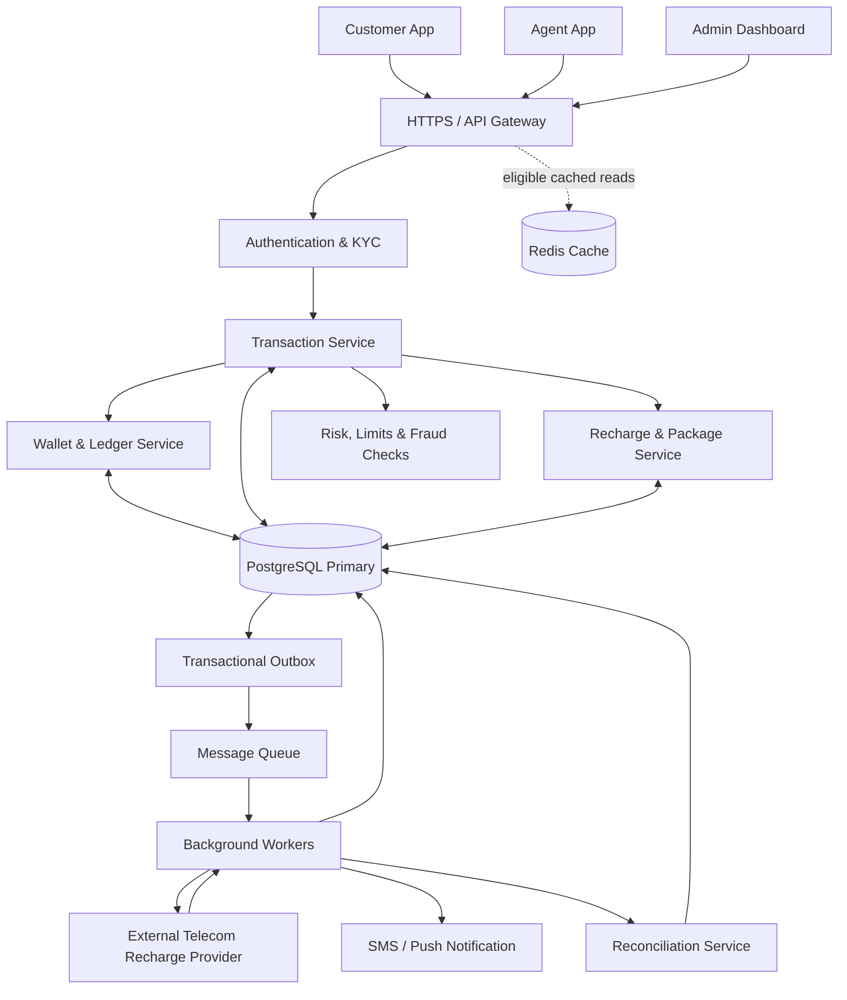
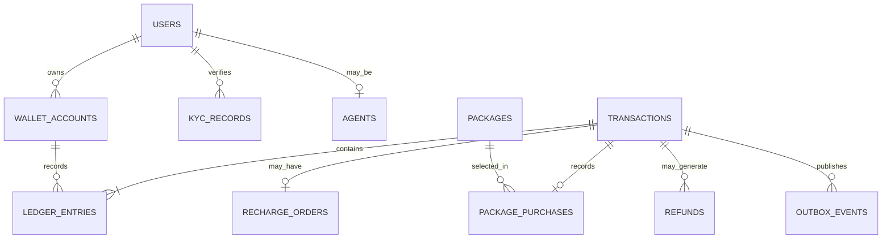
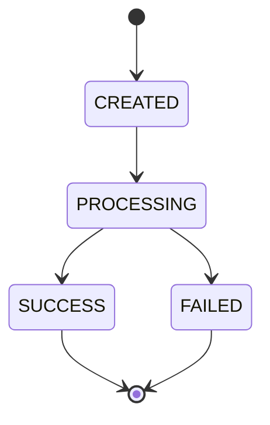
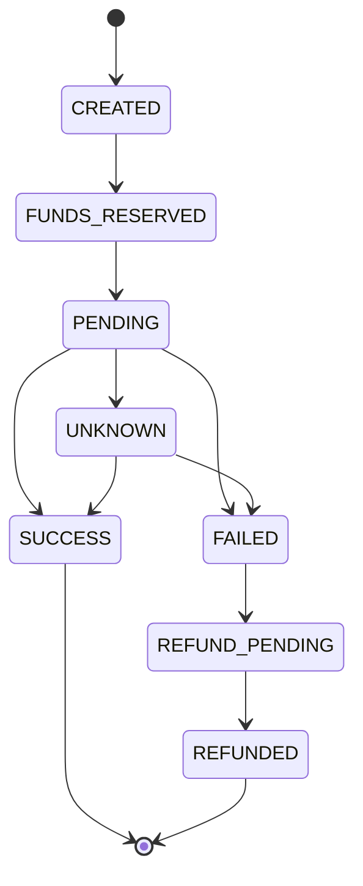

# Mobile Banking System (bKash/Nagad-এর মতো MFS) — Complete System Design

**ভাষা:** বাংলা  
**উদ্দেশ্য:** Junior Software Engineer Interview Preparation  
**Difficulty:** Easy–Medium  
**প্রধান প্রযুক্তি:** React/Next.js, Node.js, Express.js, PostgreSQL  
**Core Concepts:** ACID, Double-Entry Ledger, Concurrency Control, Idempotency, Webhooks, Refund, Reconciliation

---

## সূচিপত্র

1. Problem Statement
2. Requirements Analysis
3. High-Level Architecture
4. 15-Step System Design: Interview Presentation
5. REST API Design
6. Database Design
7. ER Diagram
8. Transaction Status Management
9. Complete Send Money Flow
10. Cash In ও Cash Out Flow
11. Mobile Recharge ও Package Purchase Flow
12. Wallet, Ledger ও Double-Entry Accounting
13. ACID Properties
14. Concurrency Control ও Double Spending Prevention
15. Idempotency ও Duplicate Request Prevention
16. Payment Provider Failure, Webhook ও Refund
17. Security ও Reliability
18. Scalability ও Performance
19. Failure Scenarios ও Solutions
20. Test Cases
21. Implementation Plan
22. Interview-এ বলার মতো সংক্ষিপ্ত উত্তর
23. Final Interview Checklist

---

# 1. Problem Statement

ধরা যাক, আমরা **BanglaPay** নামে একটি Mobile Financial Service (MFS) তৈরি করব, যা বিকাশ বা নগদের মতো কাজ করবে।

একজন customer account তৈরি করে wallet-এ টাকা রাখতে পারবেন, অন্য customer-কে Send Money করতে পারবেন, agent-এর মাধ্যমে Cash In/Out করতে পারবেন এবং সেই wallet balance ব্যবহার করে GP, Robi, Airtel ও Teletalk নম্বরে mobile recharge বা internet, minute ও SMS package কিনতে পারবেন।

### System-এর প্রধান কাজ

- User registration, login, OTP verification ও PIN-based transaction authorization।
- Wallet balance এবং transaction history দেখা।
- এক user থেকে অন্য user-কে Send Money করা।
- Authorized agent-এর মাধ্যমে Cash In ও Cash Out করা।
- Mobile recharge এবং operator package purchase করা।
- Transaction fee, daily/monthly limits এবং account restrictions প্রয়োগ করা।
- Transaction status, receipt ও notification দেখানো।
- Failed transaction-এর refund/reversal এবং disputed transaction handle করা।
- Concurrent request, duplicate request ও provider timeout নিরাপদে handle করা।
- প্রতিটি financial transaction-এর audit trail ও ledger record সংরক্ষণ করা।

### মূল সমস্যা কোথায়?

ধরা যাক, Murad-এর wallet-এ ৳1,000 আছে। একই সময়ে দুটি request আসে:

- Request A: ৳700 Send Money।
- Request B: ৳600 Send Money।

যদি দুটি request-ই আগের ৳1,000 balance দেখে আলাদাভাবে টাকা কাটে, তাহলে মোট ৳1,300 পাঠানোর চেষ্টা হতে পারে। এটি **race condition এবং double spending**-এর সমস্যা।

আরেকটি সমস্যা হলো, customer ৳100 recharge করলেন। External provider recharge সফল করল, কিন্তু response ফেরত আসার আগেই network timeout হলো। আমরা যদি যাচাই না করে আবার recharge request পাঠাই, তাহলে একই নম্বরে দুবার recharge হয়ে যেতে পারে।

**মূল design challenge:** Financial transaction-এ কোনো টাকা যেন হারিয়ে না যায়, ভুলভাবে দুবার debit না হয়, এবং failure হলেও wallet ও ledger-এর হিসাব consistent থাকে।

আমাদের দুটি গুরুত্বপূর্ণ নীতি:

1. **Internal money transfer:** PostgreSQL transaction, ACID এবং concurrency control।
2. **External recharge/package purchase:** Idempotency, pending status, provider verification, retry এবং reconciliation।

---

# 2. Requirements Analysis

## 2.1 Functional Requirements

| Module | Requirement |
|---|---|
| User & Authentication | Registration, login, OTP, PIN, profile |
| KYC & Account | Identity verification, active/blocked account |
| Wallet | Balance, account status, available funds |
| Send Money | Customer-to-customer transfer |
| Cash In | Agent-এর মাধ্যমে customer wallet-এ টাকা যোগ |
| Cash Out | Customer wallet থেকে টাকা তুলে agent-এর কাছ থেকে cash নেওয়া |
| Recharge | GP, Robi, Airtel, Teletalk-এ mobile recharge |
| Package Purchase | Internet, minute, SMS বা bundled offer কেনা |
| Transaction History | Paginated history, status, receipt |
| Fee & Limits | Transaction charge, daily/monthly limits |
| Refund & Dispute | Failed operation recovery এবং complaint |
| Agent Management | Agent approval, float balance, commission |
| Notification | SMS, push notification, transaction alerts |
| Admin & Audit | Account restrictions, limits, audit, reconciliation |

## 2.2 Non-Functional Requirements

- **Consistency:** Wallet balance এবং financial ledger-এর হিসাব মিলতে হবে।
- **Atomicity:** Internal transfer-এ debit ও credit একসঙ্গে commit হবে অথবা কোনোটিই হবে না।
- **Concurrency:** একসঙ্গে আসা request-এর কারণে balance negative হওয়া যাবে না।
- **Idempotency:** একই logical request পুনরায় এলেও financial operation দ্বিতীয়বার execute হবে না।
- **Reliability:** Provider বা network failure হলেও transaction-এর outcome যাচাই করা যাবে।
- **Security:** PIN hashing, authentication, authorization, rate limiting ও encryption।
- **Scalability:** API এবং asynchronous worker আলাদাভাবে scale করা যাবে।
- **Auditability:** কে, কখন, কত টাকা, কোন account-এ পাঠিয়েছে—তার যাচাইযোগ্য record থাকবে।
- **Observability:** Failed transaction, stuck recharge, database errors ও reconciliation mismatch monitor করা যাবে।

## 2.3 প্রধান Business Rules

1. Sender এবং receiver account transaction-এর জন্য eligible হতে হবে।
2. KYC ও account restrictions business policy অনুযায়ী যাচাই করতে হবে।
3. Amount, fee এবং transaction limits backend-এ যাচাই হবে।
4. Wallet-এর balance overdraft policy ছাড়া negative হতে পারবে না।
5. প্রতিটি financial operation-এর unique transaction ID থাকবে।
6. একই refund operation একাধিকবার execute করা যাবে না।
7. Ledger entry edit বা delete করে পুরোনো financial history পরিবর্তন করা যাবে না।
8. Notification failure হলেও committed financial transaction rollback হবে না।
9. Provider timeout-কে সরাসরি failure ধরা যাবে না; আগে outcome verify করতে হবে।
10. External provider-এর সঙ্গে database transaction খোলা রেখে network call করা যাবে না।

---

# 3. High-Level Architecture

## 3.1 Full System Architecture



### Arrow follow Diagram


#### Step 1: Apps → API Gateway
Customer, Agent ও Admin তাদের app থেকে HTTPS request পাঠায়। API Gateway request গ্রহণ করে এবং সঠিক service-এ route করে।

#### Step 2: API Gateway → Authentication & KYC
User-এর identity, authentication token এবং প্রয়োজনীয় KYC status যাচাই করা হয়। অনুমোদিত request পরবর্তী ধাপে যায়।

#### Step 3: Authentication → Transaction Service
Transaction Service টাকা transfer, cash-in, cash-out বা recharge-এর মতো operation পরিচালনা করে।

#### Step 4: Transaction → Risk Service
Transaction-এর limit, fraud risk এবং account restriction যাচাই করা হয়। Check সফল হলে transaction এগিয়ে যায়।

#### Step 5: Transaction → Wallet / Recharge Service
টাকা পাঠানো বা wallet balance পরিবর্তনের ক্ষেত্রে Wallet Service কাজ করে। Mobile recharge-এর ক্ষেত্রে Recharge Service operator ও package-সংক্রান্ত তথ্য পরিচালনা করে।

#### Step 6: Services ↔ PostgreSQL
Double arrow (<-->) বোঝায় service database-এ data read ও write—দুটিই করতে পারে। Wallet balance, transaction status ও ledger entries যথাযথ database transaction-এর মাধ্যমে সংরক্ষণ করতে হয়।

#### Step 7: API Gateway ⇢ Redis Cache
Dotted arrow (-.->) cached read-এর optional path বোঝায়। Frequently accessed, non-sensitive বা উপযুক্ত cached data দ্রুত পাওয়া যায়। Financial balance-এর ক্ষেত্রে cache-কে authoritative source হিসেবে ব্যবহার করা উচিত নয়।

#### Step 8: PostgreSQL → Outbox → Message Queue
Transaction-এর সঙ্গে সম্পর্কিত event database-এ নির্ভরযোগ্যভাবে সংরক্ষণ করা হয়। Outbox publisher event-টি queue-তে পাঠায়, যাতে asynchronous কাজ করা যায়।

#### Step 9: Queue → Background Workers
Worker queue থেকে event নিয়ে background task চালায়—যেমন recharge provider-কে request পাঠানো, notification পাঠানো এবং reconciliation শুরু করা।

#### Step 10: Worker ↔ Telecom Provider
Worker external telecom provider-কে recharge request পাঠায়। Provider response দেয়; Worker সেই response অনুযায়ী recharge status update করে।

#### Step 11: Worker → Notification / Reconciliation
Worker customer-কে SMS বা push notification পাঠায়। Reconciliation Service internal transaction records-এর সঙ্গে provider-এর records মিলিয়ে দেখে।

#### Step 12: Reconciliation → PostgreSQL
Reconciliation-এর ফলাফল database-এ সংরক্ষিত হয়। Mismatch হলে সেটি investigation বা correction-এর জন্য চিহ্নিত করা যায়।


## 3.2 Component-এর দায়িত্ব

**1. Customer App — React Native / Flutter / Web**

- Balance, Send Money, Cash In/Out ও recharge interface।
- PIN/confirmation flow।
- Transaction history, receipt এবং status display।
- Frontend-এ দেখানো balance বা success message-কে financial truth হিসেবে ধরা হবে না।

**2. API Gateway / Express API**

- HTTPS request গ্রহণ।
- Authentication, input validation, rate limiting ও routing।
- Request ID এবং correlation ID তৈরি বা propagate করা।

**3. Authentication & KYC Module**

- Login, OTP, PIN authorization।
- User status, KYC status ও permission যাচাই।
- Sensitive operation-এ অতিরিক্ত verification প্রয়োগ।

**4. Transaction Service**

- Send Money, Cash In, Cash Out এবং transaction lifecycle পরিচালনা।
- Fee ও limit validation।
- Duplicate request শনাক্ত করা।

**5. Wallet & Ledger Service**

- Wallet balance update।
- Debit/credit এবং double-entry ledger record তৈরি।
- Atomic database transaction এবং concurrency control enforce করা।

**6. Recharge & Package Service**

- Operator, mobile number, package ও eligibility যাচাই।
- Recharge order তৈরি এবং provider integration।
- Provider status verification, refund/release ও reconciliation।

**7. PostgreSQL**

- Wallet, financial transaction, ledger, idempotency record ও outbox সংরক্ষণ।
- Financial write-এর authoritative source।

**8. Background Worker**

- Recharge request process।
- Webhook/event processing।
- Notification delivery, retry ও reconciliation।

**9. Redis (ঐচ্ছিক)**

- Rate limiting, temporary cache বা eligible read optimization।
- Redis wallet balance-এর authoritative source হবে না।

## 3.3 Technology Choices

| Component | Technology | কেন? |
|---|---|---|
| Frontend | React Native / Flutter | Mobile app |
| Backend | Node.js + Express.js | REST API ও business logic |
| Database | PostgreSQL | ACID, row locking, constraints |
| Cache | Redis | Rate limit ও eligible cache |
| Queue | RabbitMQ / Kafka | Asynchronous processing |
| Provider Integration | REST API + Webhooks | Recharge ও package activation |
| Monitoring | Logs, Metrics, Tracing | Failure investigation |

**Junior interview-এর জন্য design decision:** প্রথমে PostgreSQL-সহ একটি modular monolith তৈরি করব। Wallet, ledger ও internal transfer একই database transaction boundary-তে রাখব। Traffic ও team size বাড়লে প্রয়োজন অনুযায়ী services আলাদা করব।

---

# 4. 15-Step System Design: Interview Presentation Breakdown

## Step 1: Request Initiation — Customer Action

**কী হচ্ছে:** Customer app খুলে balance দেখে ৳1,000 অন্য একজনকে Send Money করতে চান। তিনি receiver-এর mobile number, amount এবং প্রয়োজনীয় authorization দেন।

**কেন হচ্ছে:** User-এর intended financial operation capture করতে হবে।

**সুবিধা:** Frontend request তৈরি করবে, কিন্তু final balance বা fee নির্ধারণ করবে backend।

## Step 2: Customer App → HTTPS → Express REST API

**কী হচ্ছে:** App HTTPS-এর মাধ্যমে API-তে request পাঠাবে।

উদাহরণ:

```http
POST /api/v1/transfers
Authorization: Bearer <access-token>
Idempotency-Key: 5ef0c8e8-unique-operation
Content-Type: application/json
```

```json
{
  "receiver": "017XXXXXXXX",
  "amountMinor": 100000
}
```

এখানে `amountMinor: 100000` অর্থ ৳1,000, যদি API-তে BDT-এর minor unit হিসেবে পয়সা ব্যবহার করা হয়।

**কেন হচ্ছে:** HTTPS communication encrypt করে এবং Idempotency-Key একই operation-এর retry শনাক্ত করতে সাহায্য করে।

**সুবিধা:** Double-click বা network retry থেকে duplicate transfer-এর ঝুঁকি কমে।

## Step 3: Authentication, PIN Authorization & Validation

**কী হচ্ছে:** Middleware যাচাই করবে:

- Access token বৈধ কি না।
- User account active কি না।
- KYC ও transaction permission ঠিক আছে কি না।
- PIN authorization বা প্রয়োজনীয় step-up verification সফল হয়েছে কি না।
- Amount valid এবং permitted limit-এর মধ্যে কি না।
- Receiver account transaction গ্রহণ করতে পারবে কি না।

**কেন হচ্ছে:** Unauthorized বা invalid request যেন financial processing-এ প্রবেশ না করে।

**সুবিধা:** Security, compliance এবং business rules শুরুতেই enforce করা যায়।

## Step 4: Transaction Service — Idempotency Check

**কী হচ্ছে:** Server একই user/scope-এর Idempotency-Key আগে ব্যবহার হয়েছে কি না পরীক্ষা করবে।

- নতুন key: request process করা হবে।
- একই key, একই payload: আগের result বা বর্তমান status ফেরত দেওয়া হবে।
- একই key, ভিন্ন payload: conflict হিসেবে reject করা হবে।
- আগের request processing-এ থাকলে duplicate operation তৈরি না করে status ফেরত দেওয়া হবে।

**কেন হচ্ছে:** Client response হারিয়ে গেলে retry স্বাভাবিক ঘটনা।

**সুবিধা:** একই logical operation একাধিকবার financial effect তৈরি করবে না।

## Step 5: Begin PostgreSQL Transaction

**কী হচ্ছে:** Internal Send Money-এর জন্য database transaction শুরু হবে।

```sql
BEGIN;
```

তারপর sender ও receiver wallet-এর record প্রয়োজন অনুযায়ী lock করা হবে।

**কেন হচ্ছে:** Debit, credit, transaction record এবং ledger entries একসঙ্গে commit করতে হবে।

**সুবিধা:** কোনো ধাপে error হলে পুরো internal transfer rollback করা যাবে।

## Step 6: Concurrency Control & Balance Validation

**কী হচ্ছে:** PostgreSQL-এর `SELECT ... FOR UPDATE` অথবা conditional update ব্যবহার করে wallet record lock/guard করা হবে।

তারপর যাচাই হবে:

- Sender-এর account active কি না।
- Available balance যথেষ্ট কি না।
- Amount + fee-এর মোট debit অনুমোদিত কি না।
- Daily/monthly limit অতিক্রম হয়েছে কি না।

**কেন হচ্ছে:** একই wallet থেকে একসঙ্গে দুটি request এলে stale balance ব্যবহার করে overspending ঠেকাতে হবে।

**সুবিধা:** একই টাকা দুটি transaction-এ খরচ হওয়ার ঝুঁকি প্রতিরোধ করা যায়।

## Step 7: Debit, Credit & Ledger Entries

**কী হচ্ছে:** সব validation সফল হলে একই database transaction-এর মধ্যে:

1. Sender wallet থেকে amount + fee debit।
2. Receiver wallet-এ amount credit।
3. Transaction record তৈরি।
4. Balanced ledger entries তৈরি।
5. প্রয়োজনীয় outbox event insert।

**কেন হচ্ছে:** Transfer-এর financial changes-কে একসঙ্গে commit করতে হবে।

**সুবিধা:** Sender-এর debit সফল কিন্তু receiver-এর credit ব্যর্থ—এমন partial transfer স্থায়ী হবে না।

## Step 8: PostgreSQL Commit & Response

**কী হচ্ছে:** সব update ও constraint check সফল হলে `COMMIT` হবে। তারপর transaction ID ও status response হিসেবে ফেরত যাবে।

**কেন হচ্ছে:** Committed financial record-ই operation-এর authoritative result।

**সুবিধা:** Commit-এর পর response হারিয়ে গেলেও একই idempotency key দিয়ে আগের result পাওয়া যাবে।

## Step 9: Transactional Outbox & Notification

**কী হচ্ছে:** Financial transaction-এর একই database transaction-এ `outbox_events` record insert করা হবে। Worker পরে event publish করে SMS বা push notification পাঠাবে।

**কেন হচ্ছে:** Database commit সফল হলেও message broker বা notification service unavailable হতে পারে।

**সুবিধা:** Notification failure-এর কারণে successful transfer বাতিল হবে না; event retry করা যাবে।

## Step 10: Recharge/Package Request Initiation

**কী হচ্ছে:** Customer recharge বা package purchase করলে backend operator, number, package, price এবং eligibility যাচাই করে একটি order তৈরি করবে।

Funds reserve/debit করার policy নির্ধারণ করে order-কে `PENDING` বা `PROCESSING` state-এ রাখা হবে।

**কেন হচ্ছে:** Internal wallet debit এবং external operator activation দুটি আলাদা system-এ ঘটে।

**সুবিধা:** Financial transaction ও provider operation আলাদা lifecycle-এ পরিচালিত হয়।

## Step 11: Outbox Worker → External Provider

**কী হচ্ছে:** Worker provider API-তে recharge/package activation request পাঠাবে। Provider reference এবং idempotency support থাকলে সেটি ব্যবহার করা হবে।

**কেন হচ্ছে:** External network call-এর সময় PostgreSQL transaction খোলা রাখা উচিত নয়।

**সুবিধা:** Database connection দীর্ঘ সময় আটকে থাকে না এবং worker independently retry করতে পারে।

## Step 12: Provider Callback / Webhook

**কী হচ্ছে:** Provider success/failure callback পাঠালে server authenticity/signature, provider reference, amount, number ও status যাচাই করবে।

একই callback একাধিকবার এলে unique event/reference এবং idempotent handler ব্যবহার করা হবে।

**কেন হচ্ছে:** Provider retry বা network issue-এর কারণে duplicate callback আসতে পারে।

**সুবিধা:** একই recharge দুবার complete বা refund হওয়ার ঝুঁকি কমে।

## Step 13: Finalize Recharge or Package Purchase

**কী হচ্ছে:**

- Verified success হলে order `SUCCESS` হবে।
- Confirmed terminal failure হলে refund/release workflow চলবে।
- Outcome unknown হলে `PENDING/UNKNOWN` রেখে provider status query ও reconciliation করা হবে।

**কেন হচ্ছে:** Timeout মানেই recharge failure নয়।

**সুবিধা:** Provider operation সফল হলেও internal response হারিয়ে গেলে ভুল refund বা duplicate recharge এড়ানো যায়।

## Step 14: Cash In/Out, Reversal & Reconciliation

**কী হচ্ছে:** Cash In/Out-এ agent authorization, float balance, customer eligibility এবং physical cash handover policy যাচাই করা হবে। Refund/reversal-এর জন্য নতুন transaction ও ledger entries তৈরি হবে।

Reconciliation worker internal records-এর সঙ্গে provider reports ও settlement records মিলিয়ে দেখবে।

**কেন হচ্ছে:** Digital balance এবং বাস্তব cash movement বা external provider outcome সব সময় একই মুহূর্তে নিশ্চিত নাও হতে পারে।

**সুবিধা:** Mismatch শনাক্ত, audit এবং controlled recovery করা যায়।

## Step 15: Monitoring, Receipt & Customer Status

**কী হচ্ছে:** App transaction history/status দেখাবে। Backend metrics, structured logs, tracing এবং alerts দিয়ে failed transactions, stuck orders, duplicate events ও database issues monitor করবে।

**কেন হচ্ছে:** Financial system-এ শুধু success path নয়, failure recovery-ও গুরুত্বপূর্ণ।

**সুবিধা:** Customer support ও engineering team দ্রুত সমস্যার কারণ খুঁজে পাবে।

---

# 5. REST API Design

সব API versioned হবে: `/api/v1/...`। Financial write request-এ authentication, validation, authorization এবং প্রয়োজন অনুযায়ী Idempotency-Key থাকবে।

## 5.1 Authentication & Account APIs

| Method | Endpoint | কাজ |
|---|---|---|
| POST | `/api/v1/auth/register` | Registration |
| POST | `/api/v1/auth/verify-otp` | Mobile verification |
| POST | `/api/v1/auth/login` | Login |
| POST | `/api/v1/auth/pin/verify` | Sensitive operation authorization |
| POST | `/api/v1/kyc/submissions` | KYC submission |
| GET | `/api/v1/me` | নিজের profile |
| GET | `/api/v1/wallet` | Wallet balance ও summary |

## 5.2 Financial APIs

| Method | Endpoint | কাজ |
|---|---|---|
| POST | `/api/v1/transfers` | Send Money |
| POST | `/api/v1/agents/cash-ins` | Cash In |
| POST | `/api/v1/agents/cash-outs` | Cash Out |
| GET | `/api/v1/wallet/transactions` | Paginated transaction history |
| GET | `/api/v1/transactions/:id` | Transaction status |
| POST | `/api/v1/transactions/:id/refunds` | Authorized refund workflow |
| POST | `/api/v1/disputes` | Dispute submission |

## 5.3 Recharge & Package APIs

| Method | Endpoint | কাজ |
|---|---|---|
| GET | `/api/v1/operators` | Supported operators |
| GET | `/api/v1/operators/:id/packages` | Available packages |
| POST | `/api/v1/recharges` | Mobile recharge |
| GET | `/api/v1/recharges/:id` | Recharge status |
| POST | `/api/v1/package-purchases` | Package purchase |
| POST | `/api/v1/webhooks/recharge/:provider` | Provider callback |

## 5.4 Admin & Agent APIs

| Method | Endpoint | কাজ |
|---|---|---|
| POST | `/api/v1/admin/agents` | Agent approval/registration |
| PATCH | `/api/v1/admin/accounts/:id/status` | Account status management |
| PATCH | `/api/v1/admin/limits/:id` | Limits management |
| GET | `/api/v1/admin/audit-logs` | Audit review |
| GET | `/api/v1/admin/reconciliation` | Reconciliation status |

Admin API-তে Role-Based Access Control (RBAC), least privilege এবং audit logging বাধ্যতামূলক হবে।

## 5.5 Send Money Request Example

```http
POST /api/v1/transfers
Authorization: Bearer <access-token>
Idempotency-Key: 5ef0c8e8-unique-operation
Content-Type: application/json
```

```json
{
  "receiver": "017XXXXXXXX",
  "amountMinor": 100000
}
```

ধরা যাক, server নির্ধারিত fee ৳5।

```json
{
  "transactionId": "txn_01JXYZ",
  "type": "SEND_MONEY",
  "amountMinor": 100000,
  "feeMinor": 500,
  "status": "SUCCESS",
  "currency": "BDT"
}
```

এখানে sender-এর মোট debit ৳1,005 এবং receiver পাবেন ৳1,000।

**গুরুত্বপূর্ণ:** Fee client থেকে বিশ্বাস করে নেওয়া যাবে না; backend-এর fee policy অনুযায়ী নির্ধারণ করতে হবে।

## 5.6 Error Handling

| HTTP Status | উদাহরণ |
|---|---|
| 400 | Invalid request/amount |
| 401 | Invalid বা missing authentication |
| 403 | KYC/account/permission restriction |
| 404 | Receiver বা transaction পাওয়া যায়নি |
| 409 | Insufficient balance বা idempotency conflict |
| 422 | Business rule অনুযায়ী operation গ্রহণযোগ্য নয় |
| 429 | Rate limit অতিক্রম |
| 202 | External operation pending |
| 503 | Temporary service unavailable |

Response-এ machine-readable error code থাকা উচিত, যেমন `INSUFFICIENT_FUNDS`, `ACCOUNT_BLOCKED`, `DUPLICATE_REQUEST`।

---

# 6. Database Design

## 6.1 প্রধান Tables

### 1. `users`

| Column | Type | কাজ |
|---|---|---|
| id | UUID, PK | User ID |
| phone | VARCHAR, UNIQUE | Mobile number |
| password_hash | TEXT | Secure credential hash |
| status | VARCHAR/ENUM | ACTIVE/BLOCKED |
| created_at | TIMESTAMPTZ | Account creation |

users — User-এর account information, mobile number, secure password hash এবং account status সংরক্ষণ করে।

### 2. `wallet_accounts`

| Column | Type | কাজ |
|---|---|---|
| id | UUID, PK | Wallet ID |
| user_id | UUID, FK | Wallet owner |
| currency | CHAR(3) | BDT |
| available_balance_minor | BIGINT | Available balance in paisa |
| status | VARCHAR/ENUM | ACTIVE/FROZEN |
| created_at | TIMESTAMPTZ | Creation time |

Constraint:

```sql
UNIQUE (user_id, currency)
CHECK (available_balance_minor >= 0)
```

`available_balance_minor`-এ টাকা integer minor unit হিসেবে রাখা হবে; floating-point amount ব্যবহার করা হবে না।

wallet_accounts — User-এর wallet, currency, available balance এবং wallet status পরিচালনা করে। Balance integer minor unit-এ রাখা হয়।


### 3. `transactions`

| Column | Type | কাজ |
|---|---|---|
| id | UUID, PK | Transaction ID |
| type | VARCHAR/ENUM | SEND_MONEY/CASH_IN/RECHARGE |
| status | VARCHAR/ENUM | Lifecycle status |
| sender_account_id | UUID, FK, nullable | Source account |
| receiver_account_id | UUID, FK, nullable | Destination account |
| amount_minor | BIGINT | Amount |
| fee_minor | BIGINT | Fee |
| currency | CHAR(3) | BDT |
| idempotency_key | VARCHAR | Operation reference |
| created_at | TIMESTAMPTZ | Creation time |

transactions — Money transfer, cash-in ও mobile recharge-এর মতো financial transaction-এর amount, sender, receiver এবং status সংরক্ষণ করে।


### 4. `ledger_entries`

| Column | Type | কাজ |
|---|---|---|
| id | UUID, PK | Ledger entry ID |
| transaction_id | UUID, FK | Business transaction |
| account_id | UUID, FK | Financial account |
| direction | VARCHAR | DEBIT/CREDIT |
| amount_minor | BIGINT | Entry amount |
| created_at | TIMESTAMPTZ | Entry time |

Ledger append-only হবে। পুরোনো entry update/delete করে financial history পরিবর্তন করা যাবে না।

ledger_entries — প্রতিটি financial transaction-এর Debit/Credit entry ও financial history রাখে। এটি append-only, তাই পুরোনো entry পরিবর্তন বা delete করা যাবে না।


### 5. `kyc_records`

User-এর KYC status, verification reference এবং verification metadata রাখবে।

kyc_records — User-এর পরিচয় যাচাইয়ের (KYC) status, verification reference এবং metadata সংরক্ষণ করে।


### 6. `agents`

Agent-এর user reference, agent code, approval status ও operational details রাখবে।

agents — Agent-এর user reference, unique agent code, approval status এবং operational information রাখে।


### 7. `recharge_orders`

- Transaction ID
- Operator
- Mobile number reference
- Amount/package ID
- Provider reference
- Order status
- Retry/reconciliation metadata

recharge_orders — Mobile recharge-এর operator, mobile number reference, amount/package, provider reference এবং recharge status সংরক্ষণ করে।


### 8. `packages`

- Operator ID
- Provider package ID
- Package name/type
- Price
- Validity
- Eligibility
- Active status

packages — Mobile operator-এর recharge package, price, validity, eligibility এবং active status পরিচালনা করে।

### 9. `idempotency_keys`

- Request scope
- Idempotency key
- Request payload hash
- Transaction reference
- Processing/result status
- Stored response reference

idempotency_keys — একই request retry হলেও duplicate financial transaction তৈরি হওয়া আটকাতে request key, payload hash এবং result reference রাখে।

### 10. `refunds`

Original transaction ID, refund operation ID, amount, reason, status এবং provider reference রাখবে।

refunds — Original transaction-এর বিপরীতে refund amount, reason, status এবং provider reference সংরক্ষণ করে।


### 11. `outbox_events`

Financial transaction-এর সঙ্গে atomically তৈরি event ও publish status রাখবে।

outbox_events — Financial transaction-এর সঙ্গে একই database transaction-এ তৈরি event সংরক্ষণ করে, যাতে পরে নির্ভরযোগ্যভাবে publish করা যায়।


### 12. `audit_logs`

Administrative action, actor, timestamp, target, reason ও correlation reference রাখবে। PIN, OTP বা access token log করা যাবে না।

audit_logs — Admin-এর action, actor, timestamp, target এবং reason-এর audit history রাখে। PIN, OTP বা access token log করা যাবে না।

## 6.2 গুরুত্বপূর্ণ Database Constraints

- `users.phone` unique হবে।
- `(user_id, currency)` wallet-এর জন্য unique হবে।
- Transaction এবং ledger entries-এর foreign key থাকবে।
- `(scope, idempotency_key)` unique হবে।
- Provider-এর unique transaction/event reference duplicate processing ঠেকাবে।
- Amount positive এবং fee non-negative হবে।
- Account policy অনুযায়ী overdraft নিষিদ্ধ হলে balance negative হতে পারবে না।
- Original transaction-এর একই refund operation duplicate করা যাবে না।
- Ledger entry সাধারণ application permission দিয়ে update/delete করা যাবে না।

## 6.3 Sample PostgreSQL Schema

```sql
CREATE TABLE wallet_accounts (
    id UUID PRIMARY KEY,
    user_id UUID NOT NULL REFERENCES users(id),
    currency CHAR(3) NOT NULL DEFAULT 'BDT',
    available_balance_minor BIGINT NOT NULL DEFAULT 0,
    status VARCHAR(20) NOT NULL DEFAULT 'ACTIVE',
    created_at TIMESTAMPTZ NOT NULL DEFAULT NOW(),

    UNIQUE (user_id, currency),
    CHECK (available_balance_minor >= 0)
);

CREATE TABLE transactions (
    id UUID PRIMARY KEY,
    type VARCHAR(30) NOT NULL,
    status VARCHAR(30) NOT NULL,
    amount_minor BIGINT NOT NULL CHECK (amount_minor > 0),
    fee_minor BIGINT NOT NULL DEFAULT 0
        CHECK (fee_minor >= 0),
    currency CHAR(3) NOT NULL DEFAULT 'BDT',
    created_at TIMESTAMPTZ NOT NULL DEFAULT NOW()
);

CREATE TABLE ledger_entries (
    id UUID PRIMARY KEY,
    transaction_id UUID NOT NULL REFERENCES transactions(id),
    account_id UUID NOT NULL REFERENCES wallet_accounts(id),
    direction VARCHAR(6) NOT NULL
        CHECK (direction IN ('DEBIT', 'CREDIT')),
    amount_minor BIGINT NOT NULL CHECK (amount_minor > 0),
    created_at TIMESTAMPTZ NOT NULL DEFAULT NOW()
);
```

এটি একটি **simplified schema**, সম্পূর্ণ production-ready schema নয়। Production implementation-এ sender/receiver references, accounting account types, idempotency, refund links, provider references এবং transaction boundary-তে ledger invariants enforce করতে হবে।

---

# 7. ER Diagram



**ব্যাখ্যা:** `transactions` হলো business event, আর `ledger_entries` হলো সেই event-এর accounting records। একটি transaction-এ একাধিক debit/credit entry থাকতে পারে। Recharge বা package purchase-এর external provider reference আলাদাভাবে সংরক্ষণ করা হবে।

---

# 8. Transaction Status Management

সব operation-এর জন্য একটি status lifecycle ব্যবহার করা ঠিক হবে না। Internal transfer এবং external recharge-এর failure model আলাদা।

## 8.1 Send Money State



Internal transfer-এ `SUCCESS` হবে তখনই, যখন debit, credit, ledger entries ও transaction record একই database transaction-এ commit হয়েছে।

## 8.2 Recharge State



`UNKNOWN` মানে outcome এখনো নিশ্চিত নয়। এটি `FAILED`-এর সমার্থক নয়।

### State Transition Rules

- `SUCCESS → FAILED` সরাসরি transition অনুমোদন করা যাবে না।
- Refund-এর নিজস্ব transaction ID ও ledger entries থাকবে।
- একই callback একাধিকবার এলেও একবারই financial effect হবে।
- Confirmed failure হলে policy অনুযায়ী refund বা reserved funds release করা হবে।
- Late success এলে existing state, provider evidence ও ledger যাচাই করে audited recovery করতে হবে।

---

# 9. Complete Send Money Flow

ধরি, Murad-এর wallet-এ ৳5,000 আছে। তিনি Rahim-কে ৳1,000 পাঠাবেন এবং fee ৳5।

## Step-by-Step Workflow

1. Murad app-এ receiver ও amount নির্বাচন করেন।
2. App `POST /api/v1/transfers` request পাঠায়।
3. Server JWT/session, PIN authorization, account status, KYC, limits ও receiver যাচাই করে।
4. Server Idempotency-Key পরীক্ষা করে।
5. PostgreSQL transaction শুরু হয়।
6. Sender ও receiver wallet row deterministic order-এ lock করা হয়।
7. Sender-এর balance ৳1,005-এর সমান বা বেশি কি না যাচাই হয়।
8. Sender wallet থেকে ৳1,005 debit করা হয়।
9. Receiver wallet-এ ৳1,000 credit করা হয়।
10. Fee policy অনুযায়ী ৳5 fee-revenue account-এ credit record করা হয়।
11. Transaction, balanced ledger entries এবং outbox event insert করা হয়।
12. সব সফল হলে `COMMIT`; error হলে `ROLLBACK`।
13. Client-কে transaction ID ও status ফেরত দেওয়া হয়।
14. Outbox worker SMS/push notification পাঠায়।

## Simplified SQL Logic

```sql
BEGIN;

-- Lock both wallets in a deterministic order.
SELECT id, available_balance_minor, status
FROM wallet_accounts
WHERE id IN (:sender_id, :receiver_id)
ORDER BY id
FOR UPDATE;

-- Application validates status, limits and authorization.

UPDATE wallet_accounts
SET available_balance_minor =
    available_balance_minor - :total_debit
WHERE id = :sender_id
  AND available_balance_minor >= :total_debit;

-- Application must verify exactly one row was updated.

UPDATE wallet_accounts
SET available_balance_minor =
    available_balance_minor + :receiver_credit
WHERE id = :receiver_id;

-- Insert transaction and balanced ledger entries.
-- Insert outbox event.

COMMIT;
```

এটি conceptual SQL flow। Production code-এ sender ও receiver আলাদা হওয়া, account status, fee accounting, ledger balance এবং affected-row count যাচাই করতে হবে।

### কেন একই transaction?

যদি sender debit হয় কিন্তু receiver credit ব্যর্থ হয়, তাহলে `ROLLBACK` পুরো operation বাতিল করবে। ফলে database-এ partial transfer স্থায়ী হবে না।

---

# 10. Cash In ও Cash Out Flow

Cash In/Out শুধু wallet balance update নয়। এখানে electronic money movement এবং physical cash handover—দুটোই সঠিকভাবে manage করতে হবে।

## 10.1 Cash In

ধরি, customer agent-কে নগদ ৳2,000 দিলেন।

1. Agent authenticated ও approved কি না যাচাই।
2. Customer account, KYC ও transaction limits যাচাই।
3. Agent-এর float balance এবং cash-in policy যাচাই।
4. প্রয়োজন অনুযায়ী customer confirmation/OTP নেওয়া।
5. PostgreSQL transaction-এ সংশ্লিষ্ট financial account ও ledger entries update করা।
6. Agent-এর electronic float থেকে customer wallet-এ ৳2,000 transfer record করা—যদি ব্যবহৃত settlement model সেটি হয়।
7. Commission থাকলে আলাদা accounting entries তৈরি করা।
8. Commit-এর পরে receipt ও notification পাঠানো।

**গুরুত্বপূর্ণ:** Agent float-এর accounting model business অনুযায়ী আলাদা হতে পারে। Cash In-এর ledger design সেই model-এর সঙ্গে মিলতে হবে।

## 10.2 Cash Out

Customer agent-এর কাছ থেকে নগদ টাকা তুলবেন।

1. Customer ও agent-এর eligibility যাচাই।
2. Customer-এর available balance, fee এবং withdrawal limit যাচাই।
3. Agent-এর authorization এবং cash availability policy যাচাই।
4. Financial transaction ও ledger entries atomicভাবে record করা।
5. Agent customer-কে physical cash প্রদান করবেন।
6. Customer confirmation, receipt এবং audit record সংরক্ষণ হবে।

**Failure scenario:** Wallet debit হয়েছে, কিন্তু agent cash দিতে পারেননি। তখন সরাসরি transaction record মুছে ফেলা যাবে না। Dispute/confirmation policy অনুযায়ী investigation এবং প্রয়োজন হলে compensating reversal করতে হবে।

---

# 11. Mobile Recharge ও Package Purchase Flow

ধরি, Murad wallet থেকে ৳100 দিয়ে GP নম্বরে recharge করতে চান।

## Step-by-Step Workflow

1. Customer operator, mobile number ও amount নির্বাচন করেন।
2. Backend number format, operator, limits এবং eligibility যাচাই করে।
3. Unique Idempotency-Key দিয়ে recharge order তৈরি হয়।
4. Internal database transaction-এ funds reserve বা debit policy অনুযায়ী financial record তৈরি হয়।
5. `outbox_events`-এ provider request event insert হয়।
6. Database commit হওয়ার পরে worker event process করে।
7. Worker external provider API-তে recharge request পাঠায়।
8. Provider reference এবং status সংরক্ষণ করা হয়।
9. Provider callback/webhook এলে signature/authenticity ও reference যাচাই হয়।
10. Verified success হলে order `SUCCESS` হয়।
11. Confirmed failure হলে refund/release workflow চলে।
12. Outcome unknown হলে order pending থাকে এবং provider status query/reconciliation হয়।
13. Outbox worker notification পাঠায়।

## 11.1 টাকা আগে debit করব, নাকি reserve করব?

দুটি design সম্ভব।

**Option A — Immediate Debit**

- Customer-এর wallet থেকে টাকা debit হবে।
- Recharge order pending থাকবে।
- Provider success হলে order complete হবে।
- Confirmed failure হলে compensating refund entry তৈরি হবে।

**Option B — Funds Reservation**

- Available funds-এর একটি অংশ reserve করা হবে।
- Provider success হলে reservation capture/finalize হবে।
- Confirmed failure হলে reservation release হবে।

Reservation model ব্যবহার করলে available balance এবং reserved balance আলাদা করে model করতে হবে। শুধু একটি balance field-কে “reserved” বলা যথেষ্ট নয়।

## 11.2 Provider Timeout হলে কী করব?

ধরি:

1. BanglaPay recharge request পাঠাল।
2. Provider recharge সফল করল।
3. Response ফেরত আসার আগে network timeout হলো।

এখন system জানে না recharge সফল হয়েছে কি না।

সঠিক পদক্ষেপ:

- Order `PENDING/UNKNOWN` থাকবে।
- Provider status query করা হবে।
- Provider-এর idempotency support থাকলে একই logical operation reference ব্যবহার করা হবে।
- Provider contract নিরাপদ retry নিশ্চিত না করলে blind retry করা হবে না।
- Confirmed success হলে order complete হবে।
- Confirmed terminal failure হলে refund/release হবে।
- Outcome অজানা থাকলে reconciliation queue-তে যাবে।

**মনে রাখবে: Timeout মানে failure নয়; timeout মানে outcome এখনো জানা যায়নি।**

## 11.3 Package Purchase-এর অতিরিক্ত বিষয়

Package purchase-এ backend যাচাই করবে:

- Operator এবং provider package ID।
- Package price, validity ও type।
- Mobile number ও customer eligibility।
- Purchase-time price snapshot।
- Activation reference এবং activation status।

Payment সফল হলেও package activation ব্যর্থ হতে পারে। সেক্ষেত্রে provider status query, safe retry বা refund workflow প্রয়োজন।

---

# 12. Wallet, Ledger ও Double-Entry Accounting

এটি পুরো system-এর সবচেয়ে গুরুত্বপূর্ণ অংশ।

## 12.1 Wallet Balance বনাম Ledger

**Wallet balance:** Customer বর্তমানে কত টাকা খরচ করতে পারবেন।

**Ledger:** প্রতিটি financial operation-এ কোন account থেকে কত debit হয়েছে এবং কোন account-এ কত credit হয়েছে তার accounting journal।

দুটো রাখার কারণ:

- Balance দ্রুত পড়া যায়।
- Ledger থেকে প্রতিটি financial movement audit করা যায়।
- Balance ও ledger mismatch হলে reconciliation করা যায়।
- Refund, reversal ও fee-এর accounting history বজায় থাকে।

Wallet balance একটি projection হতে পারে, কিন্তু সেটি ledger-এর সঙ্গে consistent রাখতে হবে।

## 12.2 Double-Entry Ledger

প্রতিটি financial transaction-এ মোট debit এবং credit সমান হতে হবে।

ধরি, Murad ৳1,000 Send Money করলেন এবং fee ৳5। Customer wallet-গুলোকে platform liability হিসেবে ধরা হলো।

| Account | Debit | Credit |
|---|---:|---:|
| Murad wallet liability | ৳1,005 | — |
| Receiver wallet liability | — | ৳1,000 |
| Fee revenue | — | ৳5 |
| **Total** | **৳1,005** | **৳1,005** |

এই accounting model-এ sender-এর wallet liability ৳1,005 কমে, receiver-এর liability ৳1,000 বাড়ে এবং platform-এর fee revenue ৳5 হয়।

বাস্তব accounting model-এ agent settlement, commission ও অন্যান্য account থাকলে অতিরিক্ত entries লাগতে পারে।

## 12.3 Ledger Rules

- Ledger entry append-only হবে।
- পুরোনো entry update/delete করা যাবে না।
- ভুল transaction ঠিক করতে compensating entry তৈরি করতে হবে।
- প্রতিটি financial transaction-এর debit/credit invariant enforce করতে হবে।
- Wallet balance ও ledger নিয়মিত reconcile করতে হবে।
- Refund আলাদা transaction হিসেবে record করতে হবে।

---

# 13. ACID Properties

| Property | Mobile Banking-এ প্রয়োগ |
|---|---|
| **Atomicity** | Send Money-এর debit, credit, ledger ও outbox write একসঙ্গে commit/rollback |
| **Consistency** | Balance constraints, valid states ও balanced ledger বজায় রাখা |
| **Isolation** | Concurrent transaction-এর মধ্যে row locks বা conditional updates দিয়ে conflicting write control |
| **Durability** | Successful commit-এর financial records durable storage-এ রাখা; backup ও recovery প্রস্তুত রাখা |

## Atomicity Example

Murad ৳1,000 পাঠাচ্ছেন।

- Sender debit সফল।
- Receiver credit-এর সময় error।

একই PostgreSQL transaction হলে পুরো operation `ROLLBACK` হবে। Sender-এর debit স্থায়ী হবে না।

## Consistency Example

Wallet balance negative হওয়া নিষিদ্ধ। Database constraint ও atomic balance update দিয়ে এই invariant enforce করা হবে।

## Isolation Example

একই সময়ে ৳700 ও ৳600 transfer request এলে row locking বা conditional update নিশ্চিত করবে যে ৳1,000 balance থেকে সর্বোচ্চ একটি transaction সফল হতে পারে।

## Durability Example

Commit-এর পরে application response হারিয়ে গেলেও database-এ transaction record থাকবে। Client একই idempotency key দিয়ে retry করলে আগের result পাবে।

**গুরুত্বপূর্ণ:** ACID একই database transaction-এর জন্য প্রযোজ্য। External recharge provider-কে PostgreSQL-এর একই ACID transaction-এর মধ্যে অন্তর্ভুক্ত করা যায় না। External workflow-এর জন্য state machine, idempotency, retry ও reconciliation প্রয়োজন।

---

# 14. Concurrency Control & Double Spending Prevention

## Problem

Murad-এর balance ৳1,000। একই সময়ে:

- Request A: ৳700 transfer।
- Request B: ৳600 transfer।

দুটি request একই stale balance ব্যবহার করলে overspending হতে পারে।

## Solution 1 — Row-Level Locking

```sql
BEGIN;

SELECT id, available_balance_minor
FROM wallet_accounts
WHERE id = :sender_id
FOR UPDATE;

-- Validate balance and account status.

UPDATE wallet_accounts
SET available_balance_minor =
    available_balance_minor - :total_debit
WHERE id = :sender_id
  AND available_balance_minor >= :total_debit;

-- Verify affected row count.
-- Insert transaction and ledger entries.

COMMIT;
```

একই wallet-এর conflicting request row lock-এর কারণে serialize হবে। দ্বিতীয় request প্রথমটির commit-এর পরে updated balance দেখবে।

## Solution 2 — Conditional Update

```sql
UPDATE wallet_accounts
SET available_balance_minor =
    available_balance_minor - :total_debit
WHERE id = :sender_id
  AND available_balance_minor >= :total_debit
RETURNING available_balance_minor;
```

যদি কোনো row return না হয়, তাহলে balance যথেষ্ট নয় বা update-এর শর্ত পূরণ হয়নি।

## Deadlock Prevention

Sender ও receiver wallet একসঙ্গে lock করতে হলে deterministic order-এ lock করা ভালো, যেমন wallet ID অনুযায়ী `ORDER BY id FOR UPDATE`।

এতে deadlock-এর ঝুঁকি কমে। তবুও deadlock detection এবং bounded retry প্রয়োজন হতে পারে।

**Interview answer:** “I would use PostgreSQL row-level locking or an atomic conditional update to prevent overspending. The debit, credit and ledger writes would be committed in a single database transaction.”

---

# 15. Idempotency — Duplicate Request Prevention

Mobile network-এ timeout খুব স্বাভাবিক। Client request পাঠিয়েছে, server commit করেছে, কিন্তু response হারিয়ে গেছে। Client আবার request পাঠালে টাকা দ্বিতীয়বার কাটা যাবে না।

## 15.1 কীভাবে কাজ করে?

প্রতিটি logical financial operation-এর জন্য একটি unique key থাকবে:

```http
Idempotency-Key: 5ef0c8e8-unique-operation
```

Database-এ সংরক্ষণ করা হবে:

- User/client scope
- Idempotency key
- Request payload hash
- Associated transaction ID
- Processing/result status
- প্রয়োজনে response reference

Unique constraint:

```sql
UNIQUE (scope, idempotency_key)
```

## 15.2 চারটি পরিস্থিতি

| Situation | System Behaviour |
|---|---|
| নতুন key | Request process হবে |
| একই key, একই payload, completed | আগের result ফেরত দেবে |
| একই key, একই payload, processing | Existing status/pending result ফেরত দেবে |
| একই key, ভিন্ন payload | Conflict হিসেবে reject করবে |

Idempotency record এবং internal financial transaction এমনভাবে coordinate করতে হবে যেন commit হওয়া transaction-এর result হারিয়ে না যায়।

**মনে রাখবে:** Idempotency duplicate logical request আটকায়; row locking এবং balance constraints concurrent overspending আটকায়। দুটো একসঙ্গে প্রয়োজন।

---

# 16. Payment Provider Failure, Webhook & Refund

## 16.1 Duplicate Webhook

**সমস্যা:** Provider একই recharge success event তিনবার পাঠায়।

**Solution:**

1. Provider signature/authenticity যাচাই।
2. Event/reference database-এ unique constraint দিয়ে সংরক্ষণ।
3. Existing event হলে duplicate financial processing বন্ধ।
4. Transaction status transition atomicভাবে enforce।
5. Notification এবং downstream event idempotently process।

## 16.2 Payment Successful, কিন্তু Package Activate হয়নি

**সমস্যা:** Customer-এর টাকা debit হয়েছে, কিন্তু operator package activate করেনি।

**Solution:**

1. Order pending রাখব।
2. Provider activation status query করব।
3. Confirmed success হলে order complete।
4. Confirmed terminal failure হলে refund/release workflow।
5. Outcome unknown থাকলে reconciliation queue-তে পাঠাব।

## 16.3 Refund কীভাবে হবে?

Refund-এর জন্য: