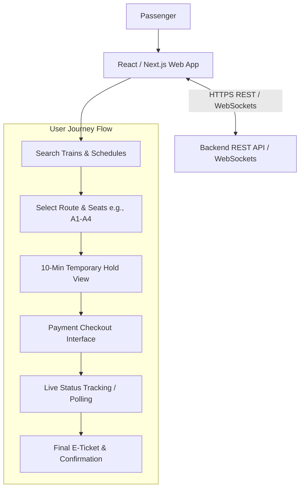
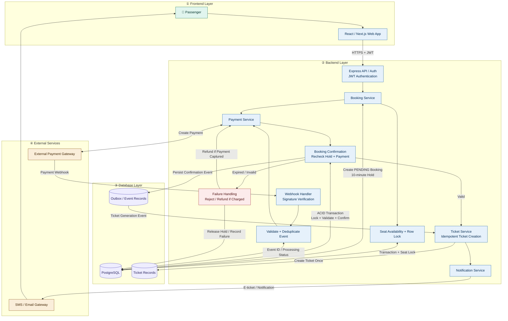
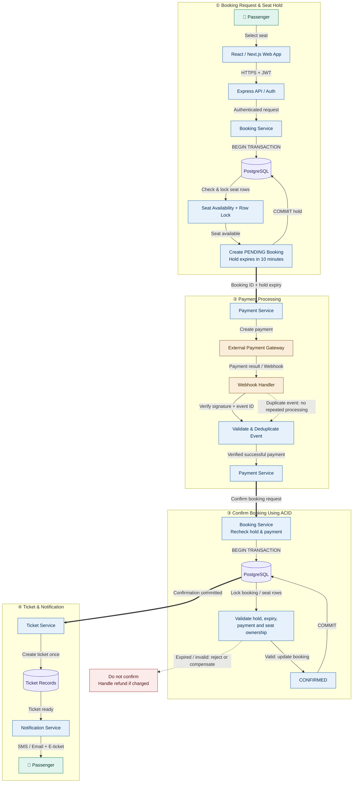
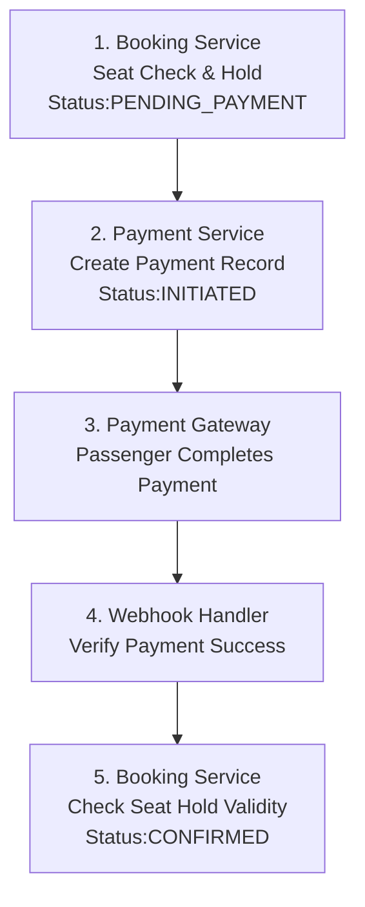
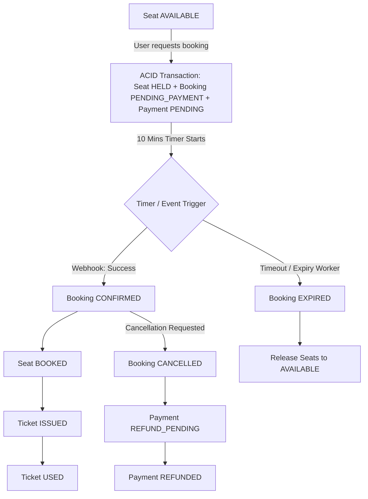
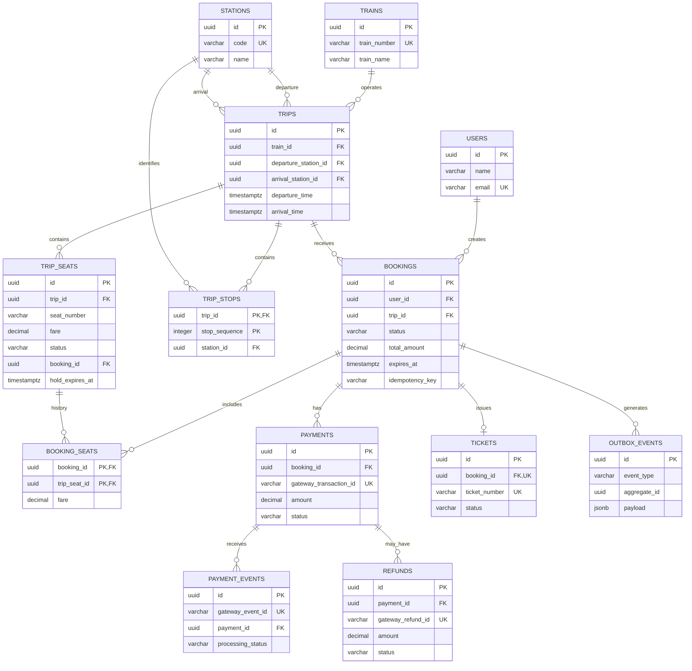
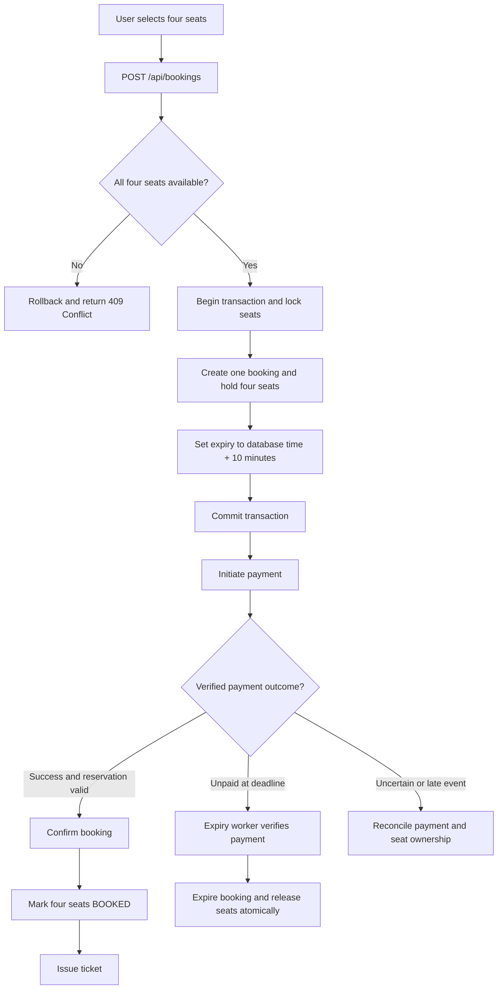

# Train Ticket Booking System --- System Design

> **Purpose:** Software Engineering Interview Preparation\
> **Main Technologies:** Node.js, Express.js, PostgreSQL\
> **Core Problem:** A user will select four seats in one booking to travel
> from Dhaka to Jashore. The seats will be held for 10 minutes to complete
> the payment.

------------------------------------------------------------------------

## Table of Contents

1.  [Problem Statement](#1-problem-statement)
2.  [Requirements](#2-requirements)
3.  [High-Level Architecture](#3-high-level-architecture)
3.3 [Important SQL for Interview](#train-ticket-booking-system--important-sql-for-interview)
    - [Core Booking Queries](#331-core-booking-queries)
    - [Search, Cancellation and Reporting Queries](#332-search-cancellation-and-reporting-queries)
    - [Useful Integrity Constraints and Indexes](#333-useful-integrity-constraints-and-indexes)
4.  [Database Design](#4-database-design)
5.  [Status Management](#5-status-management)
6.  [ER Diagram](#6-er-diagram)
7.  [REST API Design](#7-rest-api-design)
8.  [Complete Booking Flow](#8-complete-booking-flow)
9.  [Double Booking Prevention](#9-double-booking-prevention)
10. [10-Minute Hold and Expiry Mechanism](#10-10-minute-hold-and-expiry-mechanism)
11. [Payment Failure and Delayed Webhook](#11-payment-failure-and-delayed-webhook)
12. [Database Transaction](#12-database-transaction)
13. [ACID Properties](#13-acid-properties)
14. [Security and Reliability](#14-security-and-reliability)
15. [Scalability and Performance](#15-scalability-and-performance)
16. [Short Answer to Say in the Interview](#18-short-answer-to-say-in-the-interview)

------------------------------------------------------------------------

## 1. Problem Statement

Suppose a user finds a train from Dhaka to Jashore and wants to book four
seats together: `A1`, `A2`, `A3`, `A4`.

The system's tasks will be:

1.  Show trains, routes, travel dates and available seats.
2.  Reserve four seats under one booking.
3.  Hold the seats for a maximum of 10 minutes to make the payment.
4.  If the payment is successful and verified within the stipulated time,
    confirm the booking.
5.  If the payment is not successful even after the time expires, expire the
    booking and release all four seats.
6.  Ensure that the same seat does not go into the confirmed booking of two
    users at the same time.
7.  Safely handle payment failure, duplicate webhooks and delayed payment
    confirmation.

**Core design challenge:** This is not just a CRUD application. It is a
concurrent booking and payment system, where seat availability and booking
status must always be kept consistent.

## 2. Requirements

### 2.1 Functional Requirements

-   Search trains by departure station, destination and travel date.
-   View train schedule, fare and seat availability.
-   In this use case, select exactly four seats in one booking.
-   Atomically hold all selected seats.
-   Initiate and verify payment through a payment gateway.
-   If payment is successful, confirm the booking and issue the ticket.
-   Handle expiry of unpaid bookings and release the seats.
-   Show the user booking details, booking status and payment status.
-   Support cancellation and refund workflow.

### 2.2 Non-Functional Requirements

  -----------------------------------------------------------------------
  Requirement                         Explanation
  ----------------------------------- -----------------------------------
  Consistency                         The same seat of the same trip will
                                      not be allocated to more than one
                                      active booking.

  Reliability                         Inconsistencies between payment and
                                      booking state must be detected and
                                      resolved.

  Concurrency                         If many users want the same seat at
                                      the same time, requests must be
                                      processed safely.

  Security                            A user can view or cancel only
                                      their own booking.

  Scalability                         If traffic increases, API instances
                                      and workers can be increased.

  Observability                       Booking conflicts, payment
                                      failures, expiry delays and
                                      database load must be monitored.
  -----------------------------------------------------------------------

## 3. High-Level Architecture

### 3.1 Frontend Architecture



**Interview explanation:** The frontend will only handle the screen and user
interaction. The frontend will not make the final decision on fare, seat
availability, payment success or booking confirmation; these will come from
the backend.


### 3.3 Full System Architecture



#### Quick Reference Table (Concepts & Their Purpose)
##### Arrow flow


##### Step-by-step workflow ( Details )
# Step-by-Step Workflow (Detailed)

## Phase 1: Booking Request & Seat Hold

### 1. Passenger → React / Next.js Web App

The passenger first enters the web app and selects the journey date, Departure Station, Destination Station and preferred train. The app then shows the available seats and the passenger selects one or more seats and makes a booking request.

- **Frontend:** React.js / Next.js
- **Task:** Train search, seat selection, passenger information and creating the booking request.
- **Important point:** Just because a seat is shown as Available in the frontend does not mean it is definitely Available. Another passenger may try to book the seat at the same time. So the final availability check must be done in the Backend and Database.

### 2. React App → HTTPS / TLS 1.3 → Express REST API Gateway

The frontend sends the booking request to the API Gateway via HTTPS. HTTPS and TLS 1.3 help encrypt the communication between the client and the server.

**API endpoint:**

`POST /api/bookings`

The request body may contain:

- `trainId`
- `journeyDate`
- `seatIds`
- `passengerDetails`

To prevent duplicate bookings from retry or double-click, a unique `Idempotency-Key` will be sent in the request header. If the same key and the same request come again, the Server can return the previous response, so that a new booking is not created a second time.

Responsibilities of the API Gateway:

- Request routing
- Rate limiting
- Running authentication middleware
- Sending the request to the appropriate Backend Service

If a different request is sent with the same Idempotency-Key, it must not be accepted as a new booking; a conflict or validation error must be given.

### 3. API Gateway → Authentication & Request Validation

The API Gateway or the relevant Middleware verifies the passenger's identity and the validity of the request.

**Authentication:** Verify JWT or Session to confirm the passenger's identity.

**Validation:** Verify the format and validity of the Train ID, journey date, seat IDs and passenger information.

Possible responses:

- `401 Unauthorized` — Authentication missing or invalid.
- `400 Bad Request` — Request format or input invalid.
- `429 Too Many Requests` — Rate limit exceeded.

Here only whether the request is acceptable is verified. Confirming the final availability and reservation of seats is the responsibility of the Booking Service.

### 4. Authentication → Booking Service → PostgreSQL (Seat Hold)

If authentication and request validation succeed, the request is sent to the Booking Service. The Booking Service handles the booking's Business Logic and temporarily reserves the selected seats through a PostgreSQL transaction.

**Seat Hold workflow:**

1. The database transaction will start: `BEGIN`.
2. The relevant trip, journey date and seat IDs will be verified.
3. As needed, seat rows will be locked or atomically claimed using `SELECT ... FOR UPDATE` or a conditional update.
4. It will be verified whether all selected seats are Available.
5. If all seats are found, a booking will be created and the seat status will be `HELD`.
6. The booking status will be `PENDING_PAYMENT`.
7. `expires_at` will be set according to the database time, for example 10 minutes after the current time.
8. If all changes succeed, `COMMIT` will happen. If even one seat is not found, the entire transaction will `ROLLBACK` and `409 Conflict` will be returned.

**Example:**

- `bookingId`: `BK-1001`
- `bookingStatus`: `PENDING_PAYMENT`
- `seatIds`: `A1, A2, A3, A4`
- `seatStatus`: `HELD`
- `expiresAt`: 10 minutes after the database time at which the hold was created

If even one of the four seats has been allocated to another passenger, none of the four seats can be kept as a partial hold.

Appropriate constraints must be kept in the database, such as keeping the identity of each physical seat of a trip unique with `UNIQUE (trip_id, seat_number)`. As needed, additional constraints must also be kept for active seat allocation.

**Why is the 10-minute Hold important?**

It gives the passenger a limited time to complete the payment. Creating the hold and releasing the seat after hold expiry are separate database state transitions; so this rule cannot be enforced with just a Frontend timer.

#### Expiry Worker

A Cron Job or Queue Worker will regularly look for expired `PENDING_PAYMENT` bookings.

For each booking:

1. It will start a database transaction.
2. It will lock the booking and the related seat rows or do a safe conditional update.
3. It will verify, according to the database time, that the hold has really expired.
4. If the booking is still `PENDING_PAYMENT`, it will make it `EXPIRED`.
5. It will make the `HELD` seats owned by that booking `AVAILABLE`.
6. It will commit all changes together.

Even if multiple workers process the same booking, there must be no state corruption or release of another booking's seats. So consistent locking and conditional state-transition rules must be used for the expiry worker and payment confirmation.

## Phase 2: Payment Processing

### 5. Booking Service → Payment Service

If the Seat Hold succeeds, a request to start payment will be sent to the Payment Service.

The Payment Service will verify the booking ID, the determined fare and the payment request, and create a Payment Record.

**Example:**

- `paymentId`: `PAY-5001`
- `bookingId`: `BK-1001`
- `amount`: ৳800
- `paymentStatus`: `INITIATED`

The Payment Service's responsibility is to manage the payment lifecycle; the Booking Service's responsibility is to manage the booking and seat reservation.

If the two Services have separate databases, there will not be a direct common ACID transaction between them. So idempotency, retry and payment status tracking are needed in the Payment Service too.

### 6. Payment Service → External Payment Gateway

The Payment Service will initiate payment through an approved Payment Gateway such as bKash, SSLCommerz, Nagad or aamarPay.

Workflow:

1. The Backend will create a payment session with the Payment Gateway.
2. A Checkout URL or payment session will be obtained from the Gateway.
3. The Frontend will send the passenger to the Checkout page.
4. The passenger will complete the payment.
5. The Gateway will send a callback or webhook according to the payment status.

**Important:** Payment cannot be assumed successful just by seeing the Frontend's Success Page. The payment status, amount, currency and transaction reference must be verified using the Gateway's documented server-side verification API.

### 7. External Payment Gateway → Idempotent Webhook Handler

How does a Webhook work?

1 Payment Gateway → Backend

After you pay, bKash sends a message to your Backend's POST /api/webhooks/payment endpoint: "This payment was successful."

2 Verify that the message is genuine

The Backend checks whether the message really came from the Gateway and whether it has been altered. According to the Gateway's rules, signature verification or another authentication method is used.

3 Save the Event in the Database

The Backend saves the message in the Database. It also checks whether the same message has come before. Because of the UNIQUE constraint on the Event ID, the same event cannot be saved a second time as a new event.

4 Acknowledgement to the Gateway

If the message is saved safely, the Backend sends 200 OK. That is, "I received your message." This does not mean that the payment has already been verified.

5 The Worker Verifies the Payment

A Background Worker verifies through the Gateway's server-side API whether the payment was really successful, whether the amount is ৳500 and whether the transaction reference is correct. If everything is correct, the Payment Service makes the payment SUCCEEDED.

What will happen if the same message comes three times?
Suppose the Gateway mistakenly sends the same payment success message three times.
Event	What will the Backend do?
First time	Will save the event and process it
Second time	Will identify the same Event ID and treat it as a duplicate
Third time	Will not process the payment again
This reduces the risk of the same payment being recorded multiple times or tickets being created repeatedly for the same booking.

Remember two things:
- Webhook Idempotency: Even if the same message comes repeatedly, do not process it anew.
- Payment Idempotency: The same gateway transaction must not be recorded as a successful payment more than once.

Making only the Event ID unique is not enough. Even if the same transaction comes with a different event ID, the payment record must not be made a second time, so uniqueness must also be ensured on the gateway transaction reference. For ticket creation too, duplicate creation must be prevented with the booking ID or a ticket key

### 8. Webhook Handler → Payment Service (Payment Verification)

After receiving the event from the asynchronous worker, the Payment Service will verify the Gateway's authoritative payment record.

The things to verify:

- Whether the payment reference is correct.
- Whether the payment is linked to the relevant booking.
- Whether the paid amount equals the expected fare.
- Whether the currency is correct.
- Whether the Gateway's transaction status is successful.
- Whether the same gateway transaction has already been used in another payment record.

If all verifications succeed, the state of the Payment Record will be made `SUCCEEDED`. If the payment fails, an appropriate failure status will be kept.

The Payment Service will then send the verified payment result to the Booking Service. This can be done through an internal API or durable event delivery.

It must be ensured that even if payment events are duplicate or out-of-order, the status transition is not changed incorrectly.

## Phase 3: Booking Confirmation Using ACID

### 9. Payment Service → Booking Service (Confirm Request)

The Payment Service sends the verified payment success information to the Booking Service.

Before confirmation, the Booking Service will verify:

- Whether the Booking ID is correct.
- Whether the payment is truly verified.
- Whether the payment amount and booking fare match.
- Whether the booking is still `PENDING_PAYMENT`.
- Whether the seat hold is still valid.
- Whether the hold has expired.
- Whether the selected seats are still owned by the relevant booking.
- Whether the booking has already been `CONFIRMED`.

**Late Payment Scenario:**

Suppose a passenger did not make the payment within 10 minutes. The Expiry Worker made the booking `EXPIRED` and the seats became Available for another passenger. After that, the first passenger's payment-success event came late.

In this situation, the Booking Service will not directly confirm the booking.

- If the seat is allocated to another booking, the confirmation must be rejected.
- If the payment has already succeeded, `REFUND_PENDING` or an appropriate compensation workflow must be started.
- The Refund status must also be tracked separately.
- It must be ensured that even if the payment event or internal request comes again, there is no duplicate refund or duplicate confirmation.

Even if the seat has not been allocated to someone else yet, whether the expired booking will be automatically confirmed will depend on a clear business policy. The simplest and safest policy is to not reuse the expired hold and start a new reservation flow.

If the Payment Service and Booking Service use separate databases, payment success and booking confirmation will not be in a common ACID transaction. To make this distributed workflow reliable, durable event delivery, retry, idempotency and a reconciliation job are needed.

#### Mutex (Full form: Mutual Exclusion):
is a very important concept or mechanism of Concurrent Programming.

In simple words, it is a Digital Lock.

When multiple threads or processes try to access or modify the same shared resource—such as a memory location, variable, file or database table—at the same time, a Mutex is used to avoid data conflicts or Race Conditions.

How exactly Mutex works in a train ticket booking system and why it is so essential is explained below with a real example:

1. Where does the problem occur? (Race Condition) Suppose only one seat, seat number A1, is empty on a train going from Dhaka to Jashore. At exactly the same second (the same millisecond), two passengers—Rahim and Karim—send a request to book that seat.

If there is no lock or Mutex in the system, the backend server will do two things at the same time: Rahim will see the seat is empty  will book the seat. Karim will also see the seat is empty  he will also book the seat. The result? The same seat will be confirmed in the names of two passengers (Double Booking), which is not acceptable in any railway system.

2. How Mutex works here. To solve this problem, when requests arrive at the server, a Mutex (lock) is used:

Lock Acquire: After Rahim's and Karim's requests arrive, the system first tries to take a lock on the Mutex. Suppose Rahim's request reached a fraction of a millisecond earlier and he locked the Mutex.

Critical Section (Execution): Now Rahim checked on the server whether seat A1 is vacant. Since it was vacant, he held or booked it in his name.

Wait / Block: At that very moment, when Karim wanted to check the seat, the system saw that the Mutex was already held by Rahim (locked). So Karim's request was kept in a waiting state (Blocked).

Unlock & Result: After Rahim's booking process finished, the Mutex was released (Unlocked). Now Karim's request got its chance. Karim checked the seat and saw that seat A1 had already been BOOKED. As a result, the system informed Karim, "Sorry, this seat is no longer available."

### 10. Booking Service → PostgreSQL Primary Database (Atomic Confirmation)

This is one of the most important steps of the whole system. The Booking Service will finalize the booking and seat allocation through a PostgreSQL transaction.

**Confirmation transaction workflow:**

1. `BEGIN` — Start database transaction.
2. Lock or do a safe conditional update on the relevant Booking and Seat rows.
3. Verify booking status, hold expiry and seat ownership.
4. Verify confirmation eligibility based on the verified payment reference and payment status.
5. Make the booking status `CONFIRMED`.
6. Make the relevant seat status `BOOKED`.
7. Create the Ticket Record.
8. In the same database transaction, insert a ticket-processing or notification event into the `outbox_events` table.
9. `COMMIT` — If all changes succeed, save them permanently together.
10. If any database operation fails, `ROLLBACK`.

**Example:**

- `bookingStatus`: `CONFIRMED`
- `seatStatus`: `BOOKED`
- `ticketStatus`: `PENDING_ISSUANCE`

Here, although the Ticket Record is created within the transaction, PDF/QR generation and sending SMS/email will not be done within the transaction. These will happen later through asynchronous processing.

For the Transactional Outbox to work correctly, the Ticket Record and `outbox_events` must be in the same database transaction. If the Ticket Service has a separate database, the Booking Service will commit the confirmation and the Outbox event in its own database; then the Ticket Service will consume the event and create the ticket in its own database.

**ACID Properties:**

- **Atomicity:** The changes of the relevant database transaction will be complete, otherwise they will roll back.
- **Consistency:** Database constraints, seat ownership and booking state rules will be maintained.
- **Isolation:** Concurrent booking or confirmation requests cannot allocate the same seat inconsistently.
- **Durability:** If the commit succeeds, the booking, seat and ticket record will remain permanently stored in the database.

It must be remembered that ACID applies within the boundary of one database transaction. The entire distributed workflow including the Payment Gateway and separate Microservices does not automatically become one ACID transaction.

## Phase 4: Ticket & Notification

### 11. Booking Confirmation → Ticket Processing / Notification Service

The Ticket Record was created in the database transaction of Step 10. Now the Outbox Worker will read pending events from the `outbox_events` table and start further processing.

Workflow:

1. The Outbox Worker will collect pending events.
2. The Ticket Processing Service will create the PDF or QR ticket using the necessary booking and passenger data.
3. If ticket generation succeeds, the ticket status will be made `ISSUED`.
4. The notification event will be sent to the Notification Service.
5. If processing fails, it will be retried; if needed, a dead-letter queue and monitoring will be used.

Even if the same event is processed multiple times, a duplicate ticket cannot be created for the same booking. For this, an appropriate unique constraint per booking or booking-seat and idempotent processing must be kept in the Ticket Record.

The Transactional Outbox reduces the failure risk between the database commit and event delivery. However, duplicate delivery by the worker is possible, so the downstream consumer must also be idempotent.

### 12. Notification Service → SMS / Email Gateway

The Notification Service will send the booking confirmation and ticket information to the passenger using an external Email or SMS Provider.

- **Email Gateway:** Can send ticket details, a download link or a PDF.
- **SMS Gateway:** Can send the booking confirmation and Ticket Reference.
- **Retry Mechanism:** If there is a temporary provider failure, it will try sending again.
- **Idempotency:** It will prevent duplicate notifications caused by retry as much as possible.

If the notification fails, the booking should not be cancelled. If the booking is already `CONFIRMED`, the notification can be retried.

### 13. SMS / Email Gateway → Passenger

The passenger will receive the booking confirmation and ticket information by SMS or email. The ticket can also be viewed or downloaded from the My Bookings page of the web app.

During ticket verification, the validity of the ticket must be verified from the Backend using the Ticket ID or QR Code. The QR Code should not contain sensitive passenger information that could be misused if publicly exposed.

At this stage, the booking, payment and ticket records are kept stored. As a result, Ticket Verification, Refund, Cancellation and Audit become possible in the future.

## Simple End-to-End Story

A passenger searches for a train and selects four seats—A1, A2, A3 and A4. The Frontend sends a booking request to the API Gateway via HTTPS. If authentication and validation succeed, the Booking Service atomically holds the four seats within a PostgreSQL transaction and creates a 10-minute `PENDING_PAYMENT` booking.

Then the Payment Service initiates payment and the passenger completes the payment at the Gateway. The Gateway's webhook is stored durably; an asynchronous worker verifies the payment using the Gateway's authoritative API.

When the payment is verified, the Booking Service starts a database transaction again and verifies booking expiry, seat ownership and payment validity. If all conditions are met, the booking becomes `CONFIRMED`, the seats become `BOOKED` and the Ticket Record and an `outbox_events` row are created in the same transaction.

The Outbox Worker later runs ticket PDF/QR generation and notification processing. Even if the notification fails, the booking remains confirmed and can be retried.

On the other hand, if the payment is not completed within 10 minutes, the Expiry Worker, within a transaction, makes the booking `EXPIRED` and releases the `HELD` seats of that booking by making them `AVAILABLE`. Even if a payment success event arrives later, the expired booking is not directly confirmed; a refund or reconciliation workflow is run according to policy.


#### Isn't Payment happening before Booking?
##### Arrow flow

##### So when does the Booking happen?
Two separate things:
- Booking creation: Happens before the payment. The seat is held for 10 minutes so that no one else can book it.
- Booking confirmation: Happens after the payment is successfully verified. Then the seat is permanently BOOKED.
Why this method?

Suppose you want to book 4 seats. The Backend will first hold the seats for 10 minutes. Then you will make the payment. If the payment is successful, the booking will be confirmed. If you do not pay, the hold will expire and the seats will be available again.

1. Pending Booking & Seat Hold: The Backend verifies that the seats are empty, temporarily holds them for 10 minutes and creates a PENDING_PAYMENT booking.

2. Payment Initiation: The Payment Service creates a payment record and gives the Passenger the opportunity to pay at the payment gateway.

3. Payment Verification: Through the payment gateway's webhook or status check, the Backend verifies whether the payment was really successful.

4. Booking Confirmation: The Backend re-verifies whether the seat's Hold is still effective. If everything is fine, it makes the Booking CONFIRMED and the Seat BOOKED through a Database Transaction.

5. Ticket & Notification: After the booking is confirmed, an Asynchronous Worker creates the ticket and sends SMS/Email to the Passenger

### Train Ticket Booking System — Important SQL for Interview

These queries are written assuming PostgreSQL. The queries for booking
confirmation, expiry, cancellation and seat release must be run within the
same transaction. `NOW()` uses database time, so there will be no dependence
on the frontend's clock.

### 3.3.1 Core Booking Queries

#### 1. Seat Lock — So that another user cannot book the same seat at the same time

```sql
SELECT *
FROM trip_seats
WHERE trip_id = 101
    AND id IN (101, 102)
    AND status = 'AVAILABLE'
ORDER BY id
FOR UPDATE;
```

`FOR UPDATE` locks the selected rows until the end of the transaction. The
Application must check that all requested seats were found; if not, it must
`ROLLBACK` and give `409 Conflict`.

#### 2. Create Booking — Create a booking and give 10 minutes for payment

```sql
INSERT INTO bookings (user_id, trip_id, status, total_amount, expires_at)
VALUES (1, 101, 'PENDING_PAYMENT', 800.00,
                NOW() + INTERVAL '10 minutes')
RETURNING id, status, expires_at;
```
This query creates a new booking worth 800 taka for a specific user and trip, saves it in the database with PENDING_PAYMENT status for 10 minutes, and returns the id, status and expires_at of the created booking.

#### 3. Hold Seats — Temporarily reserve seats before payment

```sql
UPDATE trip_seats
SET status = 'HELD',
        booking_id = 1,
        hold_expires_at = NOW() + INTERVAL '10 minutes'
WHERE trip_id = 101
    AND id IN (101, 102)
    AND status = 'AVAILABLE';
```

If the affected row count is not equal to the requested seat count, the
transaction must be rolled back. In the case of four seats, a partial hold
cannot be kept.

#### 4. Payment Success — Confirm the booking if payment is successful

```sql
UPDATE bookings
SET status = 'CONFIRMED',
        expires_at = NULL
WHERE id = 1
    AND status = 'PENDING_PAYMENT'
    AND expires_at > NOW()
RETURNING id, status;
```

Before this update, the payment status, amount and gateway transaction must
be verified server-side. If the affected row count is zero, the booking may
be already confirmed, expired or invalid.

#### 5. Book Seats — Permanently reserve the seats of the confirmed booking

```sql
UPDATE trip_seats
SET status = 'BOOKED',
        hold_expires_at = NULL
WHERE booking_id = 1
    AND status = 'HELD'
RETURNING id, seat_number, status;
```

The booking update and seat update must be done in the same confirmation transaction.

#### 6. Expire Booking — Expire the booking when the payment time ends

```sql
UPDATE bookings
SET status = 'EXPIRED'
WHERE id = 1
    AND status = 'PENDING_PAYMENT'
    AND expires_at <= NOW()
RETURNING id, status;
```

If the worker processes many bookings at once, candidates can be claimed
with `FOR UPDATE SKIP LOCKED`. If payment success comes before expiry, the
payment flow and the expiry flow will lock the same booking row and
re-verify the state.

#### 7. Release Seats — Make the seats of the expired booking available again

```sql
UPDATE trip_seats
SET status = 'AVAILABLE',
        booking_id = NULL,
        hold_expires_at = NULL
WHERE booking_id = 1
    AND status = 'HELD';
```

Making the booking `EXPIRED` and releasing the seats must be done in the same transaction.

#### 8. Check Payment — See the payment status of the booking

```sql
SELECT status, amount, gateway_transaction_id, created_at
FROM payments
WHERE booking_id = 1
ORDER BY created_at DESC;
```

#### 9. Prevent Duplicate Webhook — So that the same webhook event is not processed twice

```sql
INSERT INTO payment_webhook_events (provider, event_id, payload)
VALUES ('BKASH', 'evt_123', '{}'::jsonb)
ON CONFLICT (provider, event_id) DO NOTHING
RETURNING id;
```

If no row comes in `RETURNING`, the event has been processed or recorded
before. For this, the `UNIQUE (provider, event_id)` constraint must exist.

#### 10. Find Available Seats — See which seats are available

```sql
SELECT id, seat_number, fare
FROM trip_seats
WHERE trip_id = 101
    AND status = 'AVAILABLE'
ORDER BY seat_number;
```

This query is for display. The final availability must be re-verified within
the booking transaction.

### 3.3.2 Search, Cancellation and Reporting Queries

#### 11. Search Trains — Find trains on a specific route and date

```sql
SELECT tr.id, t.train_number, t.train_name,
             tr.departure_station, tr.arrival_station,
             tr.departure_time, tr.arrival_time
FROM trips tr
JOIN trains t ON t.id = tr.train_id
WHERE tr.departure_station = 'Dhaka'
    AND tr.arrival_station = 'Jashore'
    AND tr.departure_time >= TIMESTAMPTZ '2026-11-01 00:00:00+00'
    AND tr.departure_time <  TIMESTAMPTZ '2026-11-02 00:00:00+00'
ORDER BY tr.departure_time;
```

#### 12. Booking History — See all bookings of a Passenger

```sql
SELECT id, trip_id, status, total_amount, expires_at, created_at
FROM bookings
WHERE user_id = 1
ORDER BY created_at DESC;
```

#### 13. Booking Details — See train and journey information along with the booking

```sql
SELECT b.id AS booking_id,
             b.status AS booking_status,
             b.total_amount,
             t.train_name,
             tr.departure_station,
             tr.arrival_station,
             tr.departure_time,
             tr.arrival_time
FROM bookings b
JOIN trips tr ON tr.id = b.trip_id
JOIN trains t ON t.id = tr.train_id
WHERE b.id = 1
    AND b.user_id = 1;
```

Filtering by `user_id` is important for authorization.

#### 14. Cancel Booking — Cancel a pending booking

```sql
BEGIN;

UPDATE bookings
SET status = 'CANCELLED'
WHERE id = 1
    AND user_id = 1
    AND status = 'PENDING_PAYMENT'
RETURNING id;

UPDATE trip_seats
SET status = 'AVAILABLE',
        booking_id = NULL,
        hold_expires_at = NULL
WHERE booking_id = 1
    AND status = 'HELD';

COMMIT;
```

If a confirmed booking is cancelled, a separate refund policy and
`REFUND_PENDING` workflow are needed.

#### 15. Refund Status — See the state of the refund

```sql
SELECT booking_id, amount, status, gateway_transaction_id
FROM payments
WHERE booking_id = 1
    AND status IN ('REFUND_PENDING', 'REFUNDED')
ORDER BY created_at DESC;
```

#### 16. Count Available Seats — See how many seats are available

```sql
SELECT COUNT(*) AS available_seats
FROM trip_seats
WHERE trip_id = 101
    AND status = 'AVAILABLE';
```

#### 17. Total Revenue — Calculate total revenue from successful payments

```sql
SELECT COALESCE(SUM(amount), 0) AS gross_revenue
FROM payments
WHERE status = 'SUCCEEDED';
```

This is gross successful payment. To find net revenue excluding refunds, the
refund amount or refund transactions must be calculated separately.

#### 18. Prevent Double Booking — Prevent the same seat of the same trip from being in more than one active booking

If allocation `status` (`HELD`/`BOOKED`) is kept in the `booking_seats`
table, then to not allow active allocation to be duplicated even while
keeping historical rows:

```sql
CREATE UNIQUE INDEX unique_active_seat_allocation
ON booking_seats (trip_seat_id)
WHERE status IN ('HELD', 'BOOKED');
```

In the current schema of this README, ownership is kept in
`trip_seats.booking_id` and `trip_seats.status`. In that design,
`UNIQUE (trip_id, seat_number)` and row locking/conditional update are the
main protection; the same ownership should not be stored separately in two
places.

#### 19. Transaction — Make multiple SQL operations succeed or fail together

```sql
BEGIN;

UPDATE bookings
SET status = 'CONFIRMED',
        expires_at = NULL
WHERE id = 1
    AND status = 'PENDING_PAYMENT'
    AND expires_at > NOW();

-- Application checks affected row count.
-- Then update the associated HELD seats and insert the ticket.

COMMIT;
-- On failure, execute ROLLBACK instead.
```

#### 20. Second Highest Fare — A common problem in SQL interviews

```sql
SELECT MAX(fare) AS second_highest_fare
FROM trip_seats
WHERE fare < (
        SELECT MAX(fare)
        FROM trip_seats
);
```

This finds the distinct second highest fare. If there is no second distinct
value, the result will be `NULL`.

#### 21 : Find the 2nd Highest Salary
```sql
SELECT MAX(salary) AS second_highest_salary
FROM employees
WHERE salary < (
    SELECT MAX(salary)
    FROM employees
);
```
### 3.3.3 Useful Integrity Constraints and Indexes

```sql
ALTER TABLE trip_seats
ADD CONSTRAINT unique_trip_seat
UNIQUE (trip_id, seat_number);

CREATE INDEX idx_bookings_expiry
ON bookings (expires_at)
WHERE status = 'PENDING_PAYMENT';

CREATE UNIQUE INDEX unique_webhook_event
ON payment_webhook_events (provider, event_id);
```

Database constraints prevent duplicate data, but they do not create a single
ACID transaction between the payment gateway and the database. So webhook
idempotency, retry and reconciliation workers are still needed.

### 3.4 Responsibilities of Components

-   **Client (React/Next.js):** Shows train search, seat selection,
    payment checkout and booking status.
-   **Express API:** Receives REST requests; runs authentication,
    validation and business logic.
-   **Booking Service:** Enforces seat hold, booking create,
    confirmation, cancellation and expiry rules.
-   **PostgreSQL:** Keeps the authoritative data of trains, trips, seats,
    bookings and payments.
-   **Ticket Service:** Handles ticket issue and ticket lookup after
    verified payment.
-   **Payment Gateway:** Processes payments and sends server-to-server
    webhooks.
-   **Background Worker:** Finds expired bookings, verifies payment state
    and releases seats if needed.

## 4. Database Design

### 1. Understanding the Requirements

Before creating database tables, we must understand the business requirements. Database design should start with the problem, not with the tables.

#### 1.1 Understand the Problem

Suppose a passenger wants to travel from Dhaka to Jashore and book four seats together: `A1`, `A2`, `A3`, and `A4`.

The system must:

1. Store users, trains, routes, trips, and seat information.
2. Allow passengers to search for available trips.
3. Reserve multiple seats under one booking.
4. Hold selected seats for a maximum of 10 minutes.
5. Record payment attempts and verify payment results.
6. Confirm bookings only after validating payment and reservation eligibility.
7. Release seats when unpaid bookings expire.
8. Prevent the same trip seat from being confirmed for two passengers.
9. Handle duplicate webhooks, delayed payment notifications, and failed payments.
10. Generate tickets for confirmed bookings.
11. Support cancellation and refund workflows.

#### 1.2 Identify the Business Rules

Business rules define what the database must protect.

| Rule | Database Design Implication |
|---|---|
| A user can make multiple bookings. | `bookings.user_id` references `users.id`. |
| A train can operate multiple trips. | `trips.train_id` references `trains.id`. |
| Each trip has its own seat inventory. | `trip_seats` stores seats for individual trips. |
| A booking can contain multiple seats. | Use a junction table named `booking_seats`. |
| A trip seat must not belong to two bookings simultaneously. | Use transactional seat allocation and database constraints. |
| A booking has a payment deadline. | Store `expires_at` in `bookings`. |
| One booking can have multiple payment attempts. | Use a one-to-many relationship between `bookings` and `payments`. |
| A gateway transaction must not be processed twice. | Enforce unique gateway transaction references and webhook event identifiers. |
| A ticket belongs to a booking. | `tickets.booking_id` references `bookings.id`. |
| A ticket can only be issued for a confirmed booking. | Enforce this rule in the booking/ticket workflow, with appropriate database safeguards. |

**Important:** A database schema is not just a collection of tables. It is a representation of the business rules that the system must preserve.

---

### 2. Identify the Entities

An entity represents a distinct business object about which the system needs to store information.

We should identify entities from the requirements before defining their columns.

#### 2.1 Entity Identification

| Entity | Why Is It Needed? |
|---|---|
| `users` | Stores passenger account information. |
| `stations` | Stores reusable railway station information. |
| `trains` | Stores train details. |
| `trips` | Represents a particular train journey on a specific date and time. |
| `trip_stops` | Stores intermediate stops, arrival/departure times, and stop order. |
| `trip_seats` | Stores the seat inventory and availability for each trip. |
| `bookings` | Represents a passenger's reservation request. |
| `booking_seats` | Connects a booking to its selected seats. |
| `payments` | Stores payment attempts and their outcomes. |
| `payment_events` | Tracks gateway webhook events and their processing status. |
| `tickets` | Stores issued travel tickets. |
| `refunds` | Tracks refund requests and refund outcomes. |
| `outbox_events` | Stores events that must be published after a database transaction commits. |

#### 2.2 Why Do We Need Both `trains` and `trips`?

A train and a trip represent different concepts.

For example:

- Train: Train 725, named Sundarban Express.
- Trip 1: Train 725 departing on October 27, 2026.
- Trip 2: Train 725 departing on October 28, 2026.

The train's identity remains the same, but each journey has its own schedule and seat inventory.

Therefore:

- `trains` stores relatively stable train information.
- `trips` stores individual scheduled journeys.
- `trip_seats` stores the inventory for each journey.

This separation prevents us from mixing train information with date-specific booking information.

#### 2.3 Why Do We Need `trip_seats`?

Suppose physical seat `A1` exists on Train 725.

The system must track whether `A1` is available on the October 27 trip independently of its availability on the October 28 trip.

Therefore, the logical identity of a bookable seat is:

`(trip_id, seat_number)`

We enforce this using:

`UNIQUE (trip_id, seat_number)`

This allows the same seat number to exist across different trips without creating a conflict.

---

### 3. Normalization vs. Denormalization

Normalization organizes data to reduce unnecessary duplication and prevent update, insertion, and deletion anomalies.

We should normalize the transactional database first and introduce denormalization only when a measured performance requirement justifies it.

#### 3.1 First Normal Form (1NF)

**Rule:** Each column should contain a single logical value, and repeating groups should be represented as separate rows.

Suppose we store four seats in a single booking row:

| booking_id | user_id | seats |
|---|---|---|
| B101 | U101 | A1, A2, A3, A4 |

This design makes it difficult to enforce seat-level constraints, join individual seats, or safely allocate inventory.

A normalized design separates the booking from its selected seats.

`bookings`

| id | user_id | status |
|---|---|---|
| B101 | U101 | PENDING_PAYMENT |

`booking_seats`

| booking_id | trip_seat_id |
|---|---|
| B101 | TS101 |
| B101 | TS102 |
| B101 | TS103 |
| B101 | TS104 |

Now each row represents one booking-seat association.

#### 3.2 Second Normal Form (2NF)

**Rule:** The table must satisfy 1NF, and every non-key attribute must depend on the entire candidate key, not just part of a composite key.

Consider:

`booking_seats(booking_id, trip_seat_id, passenger_name, train_name)`

Suppose the primary key is `(booking_id, trip_seat_id)`.

If `train_name` depends only on the trip, rather than the complete composite key, storing it repeatedly in `booking_seats` introduces unnecessary duplication.

Instead:

- Store train information in `trains`.
- Store trip information in `trips`.
- Store booking-to-seat associations in `booking_seats`.

For the proposed schema, `booking_seats` uses the composite primary key `(booking_id, trip_seat_id)` and stores the fare applicable to that specific booking-seat association.

#### 3.3 Third Normal Form (3NF)

**Rule:** The table must satisfy 2NF, and non-key attributes should not depend transitively on other non-key attributes.

Consider this table:

| trip_id | train_id | train_name | departure_station |
|---|---|---|---|
| TR101 | T101 | Sundarban Express | Dhaka |

If `train_name` depends on `train_id`, storing it in every trip row duplicates train information.

Instead:

`trains`

| id | train_name |
|---|---|
| T101 | Sundarban Express |

`trips`

| id | train_id | departure_station |
|---|---|---|
| TR101 | T101 | Dhaka |

The `train_id` foreign key connects the two tables.

This reduces duplication and prevents a train name from becoming inconsistent across multiple trip records.

#### 3.4 Why Should We Store `fare` in Both `trip_seats` and `booking_seats`?

These columns represent different business meanings.

- `trip_seats.fare`: The current fare for that seat on that trip.
- `booking_seats.fare`: A snapshot of the fare accepted when the booking was created.

Suppose seat `A1` costs 800 BDT when the passenger makes a booking. Later, the operator changes the fare to 900 BDT.

The existing booking should still use the original 800 BDT fare.

Therefore, storing the accepted fare in `booking_seats` is intentional historical duplication, not an accidental normalization error.

#### 3.5 When Should We Use Denormalization?

Denormalization intentionally duplicates or precomputes data to improve read performance.

Potential examples include:

- A cached count of available seats.
- A precomputed trip search result.
- A reporting table containing daily booking totals.

However, the authoritative seat inventory must remain consistent with the booking system.

For this project:

- Use normalized PostgreSQL tables for transactional data.
- Use indexes to optimize common queries.
- Add caching or read models only when performance measurements justify them.
- Never use an independently updated availability cache as the final authority for allocating seats.

---

### 4. Define Attributes

Attributes describe the properties of an entity.

For each attribute, determine:

1. What information does it represent?
2. Which data type should store it?
3. Can it be `NULL`?
4. Is it unique?
5. Does it reference another entity?
6. Does it need a default value or validation constraint?

#### 4.1 `users`

Stores passenger account information.

| Attribute | Data Type | Constraint / Purpose |
|---|---|---|
| `id` | UUID | Primary key |
| `name` | VARCHAR(100) | Required |
| `email` | VARCHAR(255) | Unique, required |
| `created_at` | TIMESTAMPTZ | Required, defaults to current time |

#### 4.2 `stations`

Stores reusable railway station information.

| Attribute | Data Type | Constraint / Purpose |
|---|---|---|
| `id` | UUID | Primary key |
| `code` | VARCHAR(20) | Unique station code |
| `name` | VARCHAR(150) | Required station name |

#### 4.3 `trains`

Stores train information.

| Attribute | Data Type | Constraint / Purpose |
|---|---|---|
| `id` | UUID | Primary key |
| `train_number` | VARCHAR(30) | Unique train number |
| `train_name` | VARCHAR(150) | Required |

#### 4.4 `trips`

Stores individual scheduled journeys.

| Attribute | Data Type | Constraint / Purpose |
|---|---|---|
| `id` | UUID | Primary key |
| `train_id` | UUID | Foreign key to `trains.id` |
| `departure_station_id` | UUID | Foreign key to `stations.id` |
| `arrival_station_id` | UUID | Foreign key to `stations.id` |
| `departure_time` | TIMESTAMPTZ | Required |
| `arrival_time` | TIMESTAMPTZ | Required |
| `status` | VARCHAR | Scheduled, cancelled, completed, etc. |

#### 4.5 `trip_stops`

Stores intermediate stops in a journey.

| Attribute | Data Type | Constraint / Purpose |
|---|---|---|
| `trip_id` | UUID | Part of composite primary key; foreign key |
| `station_id` | UUID | Foreign key to `stations.id` |
| `stop_sequence` | INTEGER | Part of composite primary key |
| `arrival_time` | TIMESTAMPTZ | Nullable for the initial stop |
| `departure_time` | TIMESTAMPTZ | Nullable for the final stop |

Composite primary key: `(trip_id, stop_sequence)`.

A suitable uniqueness constraint on `(trip_id, station_id)` can prevent the same station from appearing more than once on a trip, if that matches the railway's business rules.

#### 4.6 `trip_seats`

Stores the seat inventory for each trip.

| Attribute | Data Type | Constraint / Purpose |
|---|---|---|
| `id` | UUID | Primary key |
| `trip_id` | UUID | Foreign key to `trips.id` |
| `seat_number` | VARCHAR(20) | Required |
| `fare` | NUMERIC(12,2) | Non-negative fare |
| `status` | VARCHAR | `AVAILABLE`, `HELD`, `BOOKED`, `BLOCKED` |
| `booking_id` | UUID | Nullable foreign key to `bookings.id` |
| `hold_expires_at` | TIMESTAMPTZ | Nullable hold deadline |

Constraint: `UNIQUE (trip_id, seat_number)`.

#### 4.7 `bookings`

Stores the overall reservation.

| Attribute | Data Type | Constraint / Purpose |
|---|---|---|
| `id` | UUID | Primary key |
| `user_id` | UUID | Foreign key to `users.id` |
| `trip_id` | UUID | Foreign key to `trips.id` |
| `status` | VARCHAR | Booking lifecycle status |
| `total_amount` | NUMERIC(12,2) | Non-negative total |
| `expires_at` | TIMESTAMPTZ | Hold deadline |
| `idempotency_key` | VARCHAR(100) | Prevents duplicate booking creation for the same request |
| `created_at` | TIMESTAMPTZ | Creation timestamp |
| `updated_at` | TIMESTAMPTZ | Last update timestamp |

A suitable unique constraint on `(user_id, idempotency_key)` prevents the same user from accidentally creating duplicate bookings when retrying a request with the same idempotency key.

#### 4.8 `booking_seats`

Connects a booking with its selected seats.

| Attribute | Data Type | Constraint / Purpose |
|---|---|---|
| `booking_id` | UUID | Foreign key and part of composite primary key |
| `trip_seat_id` | UUID | Foreign key and part of composite primary key |
| `fare` | NUMERIC(12,2) | Fare snapshot at booking time |

Composite primary key: `(booking_id, trip_seat_id)`.

A unique constraint on `trip_seat_id` in this table is intentionally **not** used, because expired or cancelled bookings must retain their historical seat associations.

Instead, the current seat allocation is controlled through `trip_seats.booking_id`, the seat status, row locking, and transactional validation.

#### 4.9 `payments`

Stores payment attempts.

| Attribute | Data Type | Constraint / Purpose |
|---|---|---|
| `id` | UUID | Primary key |
| `booking_id` | UUID | Foreign key to `bookings.id` |
| `gateway_transaction_id` | VARCHAR(150) | Unique when provided |
| `idempotency_key` | VARCHAR(100) | Unique key for creating a payment attempt safely |
| `amount` | NUMERIC(12,2) | Non-negative |
| `currency` | CHAR(3) | Currency code, e.g. BDT |
| `status` | VARCHAR | Payment lifecycle status |
| `created_at` | TIMESTAMPTZ | Creation timestamp |
| `updated_at` | TIMESTAMPTZ | Last update timestamp |

One booking can have multiple payment attempts. The system must prevent the total amount collected across successful attempts from exceeding the amount owed.

#### 4.10 `payment_events`

Stores incoming payment gateway webhook events.

| Attribute | Data Type | Constraint / Purpose |
|---|---|---|
| `id` | UUID | Primary key |
| `gateway_event_id` | VARCHAR(200) | Unique gateway event identifier |
| `payment_id` | UUID | Foreign key to `payments.id` |
| `event_type` | VARCHAR(100) | Event category |
| `processing_status` | VARCHAR | `RECEIVED`, `PROCESSED`, `FAILED` |
| `received_at` | TIMESTAMPTZ | Receipt timestamp |
| `processed_at` | TIMESTAMPTZ | Nullable processing timestamp |

The unique gateway event identifier prevents the same webhook event from being processed repeatedly.

#### 4.11 `tickets`

Stores issued tickets.

| Attribute | Data Type | Constraint / Purpose |
|---|---|---|
| `id` | UUID | Primary key |
| `booking_id` | UUID | Foreign key to `bookings.id` |
| `ticket_number` | VARCHAR(100) | Unique ticket number |
| `status` | VARCHAR | `ISSUED`, `USED`, `CANCELLED` |
| `issued_at` | TIMESTAMPTZ | Ticket issue timestamp |

For this design, one ticket record represents one booking's ticket document. The individual passenger or seat details can be retrieved through `booking_seats`.

If the business requires a separate ticket for each passenger, the ticket model should instead associate each ticket with the relevant booking-seat or passenger record.

#### 4.12 `refunds`

Stores refund attempts and outcomes.

| Attribute | Data Type | Constraint / Purpose |
|---|---|---|
| `id` | UUID | Primary key |
| `payment_id` | UUID | Foreign key to `payments.id` |
| `gateway_refund_id` | VARCHAR(150) | Unique when provided |
| `amount` | NUMERIC(12,2) | Positive refund amount |
| `status` | VARCHAR | `PENDING`, `SUCCEEDED`, `FAILED` |
| `created_at` | TIMESTAMPTZ | Creation timestamp |

#### 4.13 `outbox_events`

Stores events that need to be published after a transaction commits.

| Attribute | Data Type | Constraint / Purpose |
|---|---|---|
| `id` | UUID | Primary key |
| `event_type` | VARCHAR(100) | Event category |
| `aggregate_id` | UUID | Related booking or other entity |
| `payload` | JSONB | Event data |
| `created_at` | TIMESTAMPTZ | Creation timestamp |
| `published_at` | TIMESTAMPTZ | Nullable publication timestamp |

The outbox pattern prevents a committed booking confirmation from being lost simply because the application crashes before publishing a ticket-generation or notification event.

---

### 5. Define Relationships

After identifying entities and attributes, determine how the entities are connected.

#### 5.1 Relationship Types

- **One-to-One (1:1):** One record is associated with at most one record in another table.
- **One-to-Many (1:N):** One record can be associated with multiple records in another table.
- **Many-to-Many (M:N):** Multiple records on both sides can be associated with one another. This usually requires a junction table.

#### 5.2 Relationships in the Train Booking System

| Relationship | Type | Implementation |
|---|---|---|
| User → Bookings | 1:N | `bookings.user_id` |
| Train → Trips | 1:N | `trips.train_id` |
| Station → Departure Trips | 1:N | `trips.departure_station_id` |
| Station → Arrival Trips | 1:N | `trips.arrival_station_id` |
| Trip → Trip Stops | 1:N | `trip_stops.trip_id` |
| Station → Trip Stops | 1:N | `trip_stops.station_id` |
| Trip → Trip Seats | 1:N | `trip_seats.trip_id` |
| Trip → Bookings | 1:N | `bookings.trip_id` |
| Booking → Booking Seats | 1:N | `booking_seats.booking_id` |
| Trip Seat → Booking Seat History | 1:N over time | `booking_seats.trip_seat_id` |
| Booking → Payments | 1:N | `payments.booking_id` |
| Payment → Payment Events | 1:N | `payment_events.payment_id` |
| Booking → Ticket | 1:1 for this design | Unique `tickets.booking_id` |
| Payment → Refunds | 1:N | `refunds.payment_id` |

#### 5.3 Why Do We Need a Junction Table?

A booking can contain multiple seats, and a seat can appear in the historical records of multiple bookings over time.

Therefore, the relationship between bookings and trip seats is logically many-to-many over the history of the system.

We represent it using `booking_seats`.

Example:

`bookings`

| id | user_id | status |
|---|---|---|
| B101 | U101 | PENDING_PAYMENT |

`booking_seats`

| booking_id | trip_seat_id | fare |
|---|---|---:|
| B101 | TS101 | 800.00 |
| B101 | TS102 | 800.00 |
| B101 | TS103 | 800.00 |
| B101 | TS104 | 800.00 |

The total amount is 3,200 BDT.

The booking contains four seat associations but remains one booking.


## 5. Status Management

The status of Booking, Seat, Payment and Ticket must be kept separate.
Because their lifecycles and meanings are not the same.

### 5.1 Booking Status

  Status              Meaning
  ------------------- ------------------------------------------------------
  `PENDING_PAYMENT`   Booking has been created; payment is not yet verified.
  `CONFIRMED`         Payment verified and booking confirmation successful.
  `EXPIRED`           Payment deadline has passed and the booking has expired.
  `FAILED`            Booking process failed, according to policy.
  `CANCELLED`         Booking has been cancelled.
  `REFUND_PENDING`    Refund processing is ongoing.
  `REFUNDED`          Refund has been completed.

### 5.2 Seat Status

  Status        Meaning
  ------------- -----------------------------------------------
  `AVAILABLE`   Seat is empty for reservation.
  `HELD`        Seat is temporarily held for a booking.
  `BOOKED`      Seat is allocated for a confirmed booking.
  `BLOCKED`     Seat has been closed by the operator/admin.

### 5.3 Payment Status

  Status             Meaning
  ------------------ -----------------------------------------------
  `PENDING`          Payment initiated or awaiting the final result.
  `SUCCEEDED`        Gateway has confirmed the payment as successful.
  `FAILED`           Payment failed.
  `CANCELLED`        Payment attempt cancelled.
  `REFUND_PENDING`   Refund in process.
  `REFUNDED`         Refund completed.

### 5.4 Ticket Status

  Status         Meaning
  -------------- ---------------------------------
  `NOT_ISSUED`   Ticket has not been issued yet.
  `ISSUED`       Ticket has been issued.
  `USED`         Ticket has been used for the journey.
  `CANCELLED`    Ticket has been cancelled.

### 5.5 Status Flow Diagram


Just because Payment is `SUCCEEDED`, the booking cannot be automatically
assumed `CONFIRMED`. The Backend must verify reservation validity, expiry
policy and seat ownership.

## 6. ER Diagram


**Relationship summary:**

-   A user can make many bookings.
-   A train can have multiple trips.
-   A trip has multiple trip-seats.
-   A booking can include multiple seats.
-   A booking can have multiple payment attempts.
-   A ticket is issued for a confirmed booking.

In the implementation, `trip_seats.booking_id` can indicate the current
hold/confirmed owner; when the seat is released, it must be cleared. How the
historical relationship of `booking_seats` will be preserved must be clearly
defined, so that there is no duplicate allocation.

## 7. REST API Design

### 1. Identify the Actors

An actor is a user or external system that interacts with the application.

| Actor | Responsibility |
|---|---|
| Passenger | Searches trips, selects seats, makes payments, and manages bookings. |
| Payment Gateway | Processes payments and sends payment notifications. |
| Ticket Inspector | Verifies issued tickets and QR codes. |
| Background Worker | Expires unpaid bookings and releases eligible seat holds. |
| Administrator | Manages trains, trips, schedules, and seat inventory. |

### 2. Identify the Resources

Based on the requirements defined in the Problem Statement, identify the main resources that the API needs to expose.

| Resource | Purpose |
|---|---|
| Auth | Passenger authentication |
| Trips | Scheduled train journeys |
| Seats | Seat inventory and availability for a trip |
| Bookings | Passenger reservations |
| Payments | Payment attempts and results |
| Tickets | Issued travel tickets |
| Refunds | Refund requests and outcomes |

**Important:** A train represents the train itself, whereas a trip represents a specific scheduled journey. Therefore, trip search and seat availability should be associated with a particular trip.

### 3. Convert Requirements into API Operations

For each requirement identified in the Problem Statement, determine:

1. Which resource is involved?
2. What operation does the client need to perform?
3. Which HTTP method is appropriate?
4. What data must the client send?
5. What response should the server return?
6. What validation, authorization, and failure handling are required?

#### 3.1 Search Trips

- Resource: Trips
- Operation: Retrieve matching trips
- HTTP method: `GET`

Endpoint:

`GET /api/trips?from=DHAKA&to=JASHORE&date=2026-10-27`

Returns matching trips, schedules, fares, and relevant availability information.

#### 3.2 Check Seat Availability

- Resource: Seats
- Operation: Retrieve seat availability
- HTTP method: `GET`

Endpoint:

`GET /api/trips/:tripId/seats`

Returns seat numbers, current availability, and fares.

Seat availability is informational. The booking operation must validate and allocate seats atomically because availability may change between requests.

#### 3.3 Create a Booking

- Resource: Bookings
- Operation: Create a booking and hold the selected seats
- HTTP method: `POST`

Endpoint:

`POST /api/bookings`

Request:

```json
{
  "tripId": "trip-101",
  "seatIds": [
    "seat-A1",
    "seat-A2",
    "seat-A3",
    "seat-A4"
  ]
}
```

The backend validates the request, calculates the total fare, and holds all requested seats within a database transaction.

A successful response uses `201 Created` and includes the booking ID, booking status, total amount, currency, and server-generated expiry timestamp.

The client may send an `Idempotency-Key` header to prevent duplicate bookings when retrying the same request.

#### 3.4 Initiate Payment

- Resource: Payments
- Operation: Create a payment attempt
- HTTP method: `POST`

Endpoint:

`POST /api/bookings/:bookingId/payments`

The backend verifies booking ownership and payment eligibility before initiating the payment gateway process.

Initiating payment does not confirm the booking.

#### 3.5 Process Payment Notifications

- Resource: Payment Events
- Operation: Receive a gateway notification
- HTTP method: `POST`

Endpoint:

`POST /api/payments/webhook`

The backend verifies the gateway signature, validates the payment details, and deduplicates repeated events.

Before confirming a booking, it must verify the payment result, booking eligibility, expiry policy, and seat ownership.

#### 3.6 Retrieve Booking Details

- Resource: Bookings
- Operation: Retrieve a booking
- HTTP method: `GET`

Endpoint:

`GET /api/bookings/:bookingId`

The backend returns the authorized passenger's booking details, status, selected seats, and relevant payment or ticket information.

#### 3.7 Cancel a Booking

- Resource: Bookings
- Operation: Request cancellation
- HTTP method: `POST`

Endpoint:

`POST /api/bookings/:bookingId/cancel`

The backend checks ownership, booking status, and cancellation eligibility before processing the request.

Cancellation and refund completion must be tracked separately.

#### 3.8 Retrieve Refund Status

- Resource: Refunds
- Operation: Retrieve refund information
- HTTP method: `GET`

Endpoint:

`GET /api/refunds/:refundId`

Returns the refund status to an authorized requester.

#### 3.9 Verify a Ticket

- Resource: Tickets
- Operation: Verify a ticket
- HTTP method: `POST`

Endpoint:

`POST /api/tickets/:ticketNumber/verify`

The backend verifies the ticket's validity and usage status. Appropriate inspector authorization is required.

### 4. Choose the Correct HTTP Method

| HTTP Method | Purpose | Example |
|---|---|---|
| `GET` | Retrieve data | `GET /api/bookings/:bookingId` |
| `POST` | Create a resource or initiate an operation | `POST /api/bookings` |
| `PUT` | Replace a resource representation | `PUT /api/admin/trips/:tripId` |
| `PATCH` | Partially update a resource | `PATCH /api/admin/trips/:tripId` |
| `DELETE` | Delete a resource when deletion is appropriate | `DELETE /api/admin/drafts/:draftId` |

Booking cancellation should generally be an explicit business operation rather than deleting the booking record.

`GET` requests should not initiate payments, hold seats, or perform other state-changing operations.

### 5. Define Request and Response Contracts

For each endpoint, define the request structure, successful response, validation rules, and possible errors.

Example: `POST /api/bookings`

Successful response — `201 Created`:

```json
{
  "bookingId": "booking-101",
  "status": "PENDING_PAYMENT",
  "totalAmount": 3200.00,
  "currency": "BDT",
  "expiresAt": "2026-10-27T10:10:00Z",
  "seats": ["A1", "A2", "A3", "A4"]
}
```

Common HTTP status codes:

| Status | Purpose |
|---|---|
| `400 Bad Request` | Malformed request or invalid request structure |
| `401 Unauthorized` | Authentication is missing or invalid |
| `403 Forbidden` | The caller lacks permission |
| `404 Not Found` | Requested resource does not exist or is not accessible |
| `409 Conflict` | Request conflicts with the current resource state |
| `422 Unprocessable Content` | Valid request structure but a business rule is violated |
| `500 Internal Server Error` | Unexpected server-side failure |

Use a consistent error response structure:

```json
{
  "error": {
    "code": "SEAT_UNAVAILABLE",
    "message": "One or more selected seats are no longer available."
  }
}
```

### 6. Complete REST API Endpoint List

| Method | Endpoint | Description |
|---|---|---|
| `POST` | `/api/auth/login` | Authenticate a passenger |
| `GET` | `/api/trips` | Search trips |
| `GET` | `/api/trips/:tripId` | Retrieve trip details |
| `GET` | `/api/trips/:tripId/seats` | Check seat availability |
| `POST` | `/api/bookings` | Create a booking and hold seats |
| `GET` | `/api/bookings/:bookingId` | Retrieve booking details |
| `GET` | `/api/bookings` | Retrieve the passenger's booking history |
| `POST` | `/api/bookings/:bookingId/payments` | Initiate a payment attempt |
| `GET` | `/api/bookings/:bookingId/payments` | Retrieve payment attempts |
| `POST` | `/api/payments/webhook` | Receive payment gateway notifications |
| `POST` | `/api/bookings/:bookingId/cancel` | Request booking cancellation |
| `GET` | `/api/tickets/:ticketNumber` | Retrieve authorized ticket details |
| `POST` | `/api/tickets/:ticketNumber/verify` | Verify a ticket |
| `GET` | `/api/refunds/:refundId` | Retrieve refund status |

Administrative endpoints can be added for managing stations, trains, trips, schedules, and seat inventory.

The background worker responsible for expiring bookings is an internal process and does not need a public passenger endpoint.

## 8. Complete Booking Flow



The four seats must be treated as one logical reservation. The availability
check in the diagram is only a preliminary check; final validation must be
done only after taking the row lock within the transaction. If the
requirement is that four seats be booked together, then the booking cannot
be confirmed by reserving two or three seats and leaving out the rest.

## 9. Double Booking Prevention

Suppose User A and User B want to book seat `A1` at the same time.

Naive implementation:

``` js
const seat = await findSeat(seatId);

if (seat.status === "AVAILABLE") {
  await updateSeat(seatId, "HELD");
}
```

This is unsafe: both requests may read `AVAILABLE` before the update happens.

### Correct Approach

1.  Start a database transaction.
2.  Lock the requested seat rows in a consistent order.
3.  Ensure that all four seats are of the same trip and available.
4.  Create one booking record.
5.  Make the four seats `HELD` and give them the same expiry deadline.
6.  Create four `booking_seats` records.
7.  If all succeed, commit; if any validation fails, roll back.

Illustrative SQL:

``` sql
BEGIN;

SELECT id, status
FROM trip_seats
WHERE trip_id = $1
  AND seat_number IN ('A1', 'A2', 'A3', 'A4')
ORDER BY id
FOR UPDATE;

-- Application logic:
-- 1. Verify exactly four requested seats were found.
-- 2. Verify every seat is eligible for reservation.
-- 3. Create one booking.
-- 4. Update all four seats conditionally.
-- 5. Insert four booking_seats rows.
-- 6. Roll back if any condition fails.

COMMIT;
```

`SELECT ... FOR UPDATE` alone is not enough. Seat validation, expired hold
reclaim, conditional update, unique constraints and transaction error
handling are also needed. The database transaction cannot be kept open until
payment is completed. First hold the seats and commit the transaction; then
communicate with the gateway.

### Q: How will you prevent Double Booking in a Concurrent System?
A:Usually in code we first check whether the seat is empty (if (seat.status === 'AVAILABLE')) and then update. But in a high-concurrency system (when thousands of users send requests at once) this is extremely risky. Because multiple users can read the seats as AVAILABLE in the same millisecond, and if both try to update, a Race Condition is created and double booking happens.

The correct solution to this problem is to use ACID Transaction and Row-Level Locking at the database level:
"To ensure that the same seat cannot be booked by multiple passengers, I will use ACID Transaction, Row-Level Locking and Deadlock Prevention.
##### 1. Start the Transaction: 
First I will start a transaction with BEGIN, so that all the database operations of the booking work as one atomic unit.

-A Transaction is a single unit or Logical Unit of Work of a database management system (DBMS).

A transaction ensures that—either both steps will be completed successfully (Commit), or no step will apply (Rollback). ACID Properties (the 4 main pillars of a transaction)
#####  2. Row-Level Locking:
 Then I will use SELECT ... FOR UPDATE to lock the rows of the seats that the passenger wants to book. As a result, no other concurrent transaction can lock the same row and change it; it will have to wait.
##### 3. Consistent Locking Order: 
When locking multiple seats, I will lock in the same order according to ORDER BY id. This reduces the risk of deadlock.
##### 4. What Deadlock is and why it happens: 
Deadlock happens when two transactions wait for each other's locked resources and neither can move forward.
For example:
- Transaction A first locked Seat 1, then is waiting for Seat 2.
- Transaction B first locked Seat 2, then is waiting for Seat 1.
- A is waiting for B, and B is waiting for A. As a result, a circular wait is created.
Example of Deadlock
Transaction A
Lock: Seat 1
Wait: Seat 2


Transaction B
Lock: Seat 2
Wait: Seat 1


Circular Wait → Deadlock


##### 5. Deadlock Prevention: 
To reduce this problem, I will lock the seats in the same order in all transactions, for example according to ascending id. As a result, if one transaction first locks Seat 1 and then Seat 2, the other transaction will also follow the same order. This avoids the circular-wait situation above.


Suppose Passenger 1 and Passenger 2 are sending requests from two places.

1. Passengers' requests
Passenger 1  Request  ["DF", "C3"]

Passenger 2  Request  ["C3", "DF"]

The Backend's Lock Ordering will sort by Seat ID

Passenger 1  C3 → DF


Passenger 2  C3 → DF

Both have the same lock order!

##### 6. Deadlock Recovery: 
Consistent locking order alone is not enough; deadlock can happen due to locking other tables or resources. So if the database detects a deadlock and aborts one transaction, I will detect the deadlock error in the application and use a limited number of retries and exponential backoff.
##### 7. Availability Verification: 
After taking the lock, I will verify whether each seat is of the correct trip and whether the seat's status is still AVAILABLE.
##### 8. Seat Hold and Booking:
 If all seats are available, I will change them to HELD status and create a booking record, whose expiry will be 10 minutes later.
##### 9. Commit or Rollback:
If all operations succeed, I will COMMIT. If any seat is unavailable or the operation fails, I will ROLLBACK, so that a partial booking is not created.
##### 10. Database Constraint: 
For additional protection, I will use unique constraints and conditional updates as needed, so that duplicate booking can be prevented even outside the application-level logic.
In this way, using transaction, consistent lock ordering, deadlock recovery and database constraints together, the same seat can be prevented from being allocated to multiple passengers even in concurrent booking."

#### 4 things to remember about Deadlock in the interview:
Suppose at the online and offline ticket counters of Dhaka Railway Station, two passengers (Passenger A and Passenger B) are trying to buy 2 tickets (Seat 1 and Seat 2) of the same train at the same time.
##### 1. Mutual Exclusion. Event: 
-A specific seat of the train (e.g., Seat 1) can be given to only one passenger at a time; it is not possible to give it to two together.

-How the condition works: According to the system's rules, a seat can never be shared (Non-shareable). As a result, if Seat 1 has been selected by 'Passenger A', anyone else must wait to get that seat.
##### 2. Hold and Wait. Event:
-Passenger A has successfully held Seat 1 for booking, and is waiting (Wait) to get Seat 2 to confirm the booking. Passenger B has successfully held Seat 2 for booking, and is waiting (Wait) to get Seat 1 to confirm the booking.

-How the condition works: Nobody is releasing the booking of the seat they hold, and yet they are sitting waiting for the next seat.
##### 3. No Preemption. Event:
-According to the ticketing system's rules, if a passenger has kept a seat in the payment process or cart, the system will not forcibly take the seat from their cart and give it to another passenger.

-How the condition works: Until the passenger cancels the booking themselves or the payment times out, the counter or system cannot take away the seat they booked.
##### 4. Circular Wait. Event:
Passenger A will release Seat 1, but is waiting for when Passenger B will release Seat 2. Passenger B will release Seat 2, but is waiting for when Passenger A will release Seat 1.

🚨 Result (Deadlock) Since all 4 conditions have been met together: neither Passenger A nor Passenger B can buy the ticket.

-The ticketing system is stuck or hung. In real life, to break this deadlock, the station's ticket counter or the online system uses Payment Timeout—that is, after 3/4/10 minutes it automatically cancels one booking (Rollback) so that the other can get the ticket.

### Q: In this design, what is the most important Golden Rule for payment processing?
A:The most important technical point is—the database transaction cannot be kept open until the payment is completed.

Why won't we keep it open?

Communicating with the payment gateway (e.g., bKash or a card company) takes some time (Network Delay). If we hold the database connection or transaction until the payment finishes, then with only a few user requests all the database connections will be exhausted and the whole system may go down.

What is the correct method?

1. First we will very quickly enter the database, make the seats HELD for 10 minutes and COMMIT the transaction (that is, the database will finish its work and become completely free).

2. After the database is free, we will start talking to the payment gateway.

3. If the payment is successful, the booking will be CONFIRMED, and if the payment is not made within 10 minutes, a background worker (Cron Job) will on its own release or free the seats for everyone again.

### Q: What is a Cron Job?
A:A Cron Job (or Cron Worker) is a background process or system automation tool that automatically runs a specific job or task at regular intervals or at a specific interval (for example, every 30 seconds or 1 minute).

In a train booking system, the cron job runs in the background, finds expired pending bookings and releases the stuck seats.

##### What is the problem actually? (The Problem Context)
Suppose a passenger clicks to buy a ticket in an online train booking system.

Seat Lock: The system immediately moves the seat to PENDING or LOCKED status (so that no one else can buy it).

Payment Window: The passenger is given 10 minutes to make the payment.

Abandonment: But what will happen if the passenger does not pay and closes the browser tab, leaves without entering the PIN of the bKash/Rocket app, or the internet gets disconnected?

If that seat in the database remains PENDING forever, it can never be sold to any passenger again. This is called Stale Data or Orphaned Lock.

##### 2. How does a Cron Job solve this problem? (The Mechanism)
A cron job is a scheduled automation service (Scheduled Task) that keeps running in the background on the server.


Schedule Trigger: The cron job is continuously triggered every 1 minute in the background.

Database Scanning: It goes to the database and runs a query:

"Find the bookings whose status is still PENDING but more than 10 minutes have passed."

Status Update & Seat Release: Through a Transaction, for the bookings found:

It changes the booking status from PENDING to EXPIRED or CANCELLED.

It makes the status of the related seats AVAILABLE, so that other passengers at the station or in the app can buy the seat within moments.

## 10. 10-Minute Hold and Expiry Mechanism

### 10.1 When a booking is created

Suppose:

``` text
created_at = 10:00:00
expires_at = 10:10:00
status     = PENDING_PAYMENT
```

The status of the four seats will be `HELD`.

Server-side deadline:

``` text
expiresAt = databaseCurrentTime + 10 minutes
```

The frontend can show a countdown, but the frontend is not the authority of
the timer. The Backend and database will enforce expiry.

### 10.2 Background Expiry Worker

The worker will look for bookings whose deadline has passed at regular
intervals:

``` sql
SELECT id
FROM bookings
WHERE status = 'PENDING_PAYMENT'
  AND expires_at <= NOW();
```

This only finds candidate bookings; this query alone is not sufficient to
expire a booking.

Safe worker process:

1.  If needed, verify the payment status from the gateway outside the
    database transaction. Database locks cannot be held during the gateway
    call.
2.  Start a transaction and lock/claim the booking row.
3.  Verify again that the booking is still `PENDING_PAYMENT` and the
    deadline has passed.
4.  If there is payment success or an unresolved state, do reconciliation
    according to policy; do not blindly release the seats.
5.  Make the unpaid booking `EXPIRED`.
6.  Make the four held seats under the booking `AVAILABLE` and clear the
    current booking ownership.
7.  Commit the transaction.

To ensure that there is no state corruption even if multiple worker
instances process the same booking, row locking/claiming and conditional
state transition must be used. The worker may run late, so the API will also
enforce the expiry rule.

### 10.3 Timeline

  -----------------------------------------------------------------------
  Time                                 Event
  ----------------------------------- -----------------------------------
  10:00 AM                            Four seats became `HELD`

  10:03 AM                            User started payment

  10:06 AM                            Payment was verified

  10:06 AM                            Booking `CONFIRMED`, seats `BOOKED`

  Alternative: 10:10 AM               If payment is not successful, the
                                      booking will expire and the seats
                                      will be released
  -----------------------------------------------------------------------

The payment gateway and database are separate systems. So the race condition
between payment outcome verification and the expiry worker must be handled.

## 11. Payment Failure and Delayed Webhook

### Problem: Late Webhook Arrival & Cron Job Race Condition Situation:

10:09:58 AM: The user successfully completes the payment at the payment gateway.

10:10:00 AM: The backend's Cron Job, as 10 minutes are complete, declares the pending booking EXPIRED and releases the seat (makes it AVAILABLE).

10:10:02 AM: Another new user comes and books that vacated seat.

10:10:05 AM: Due to network latency, the first user's payment Webhook reaches the server, in which the status says SUCCESS.

Where is the trouble?
Although the payment was successful, the first user's seat has already been given to someone else. Now if the backend blindly wants to confirm the payment without the seat or updates the state incorrectly, the system's data will be corrupted and Double Booking (the same seat given to two people) will occur

#### How the solution works (Step-by-Step Explanation)
##### 1. Verifying instead of blindly trusting (Verification & Authoritative Check)
What happens: The system does not directly trust the web hook (Webhook) message that comes from the payment gateway.

Why and how: Hackers can sometimes send fake messages. So the backend first checks whether the message's Signature is correct. Then it makes an API call to the payment gateway's own server and gets real-time confirmation: "Brother, has this user's money really been deposited in the bank?" Only when the gateway says yes does the system proceed to the next step.

##### 2. Preventing collisions in the database (Database Locking)
What happens: On one side the cron job is doing seat expiry work, on the other side the payment success web hook is coming to update data—both processes may attack the database at the same time.

Why and how: To prevent this, Row-Level Lock (SELECT ... FOR UPDATE) is used in the database. This means—while the cron job is working on a seat, the web hook is asked to stand outside and wait a bit (or the reverse). Until one finishes, the other cannot touch that seat.

##### 3. What if the seat is not vacant? (Seat Reconciliation)
What happens: The user's payment is successful, but the seat allocated for them has already been given to someone else by the cron job.

Why and how: Here the system can very intelligently do two things:

Alternative Seat: If another seat of that class is vacant on the train or bus, the system, without any hassle, assigns a new seat to that user and confirms the booking.

Refund Path: If the train has become completely full and not a single seat is vacant, then the booking has to be cancelled and the process of sending the user's money back has to start.

##### 4. Writing in the database does not return the money! (Real Gateway Refund API)
What happens: Many junior developers mistakenly change the status in the database to REFUNDED and think the user's money has gone to bKash or the bank. But in reality the money is not refunded.

Why and how: For real money to reach the user, a request must be sent from the backend to the payment gateway's Refund API (with gateway_transaction_id). Only when the gateway server successfully debits the money, sends it to the user's account and gives a confirmation response should the status be permanently updated to REFUND_SUCCESS in the database.

##### 5. Preventing a mess when the same message comes repeatedly (Idempotency)
What happens: Due to network problems, the payment gateway may send the same web hook repeatedly (Retries).

Why and how: The system checks the unique ID (event_id) of each web hook. If it sees that work has already been done once with this ID, it does not do things like deducting money or refunding a second time and just sends a simple 200 OK response.

## 12. Database Transaction

Illustrative transaction to reserve four seats:

``` text
BEGIN TRANSACTION

1. Lock the requested trip-seat rows.
2. Ensure that four valid seats were found.
3. Ensure all seats are eligible to be reserved.
4. Calculate the server-side fare.
5. Create one PENDING_PAYMENT booking.
6. Make the four seats HELD.
7. Set hold_expires_at = database time + 10 minutes.
8. Create four booking_seats rows.

COMMIT
```

If any validation or update fails, `ROLLBACK` must be done. After that,
payment will be initiated outside the transaction. When payment is verified,
the booking will be confirmed and the seats made `BOOKED` in a second
transaction---but following reservation validity and payment policy.

## 13. ACID Properties

ACID are the four important properties of a database transaction:

-   **A --- Atomicity**
-   **C --- Consistency**
-   **I --- Isolation**
-   **D --- Durability**

### 13.1 Atomicity --- Everything will happen, or nothing will

If `A4` among the four seats is unavailable, `A1`, `A2`, `A3` cannot be kept
reserved. The entire transaction will roll back.

``` sql
BEGIN;

-- Lock and validate all four seats.
-- Create one booking.
-- Reserve all four seats.
-- Create four booking_seats records.

COMMIT;   -- if all operations succeed
-- ROLLBACK; -- if any operation fails
```

**Interview answer:** "Atomicity ensures that all four seats are
reserved together, or none of them are reserved."

### 13.2 Consistency --- Database rules will remain correct

Before and after every transaction, database constraints and business
invariants must be maintained.

Main rules:

-   The same seat of the same trip will not be in more than one active
    booking at the same time.
-   If four seats are mandatory in this use case, the booking must have
    exactly four seats.
-   Before making a booking `CONFIRMED`, there must be verified payment and
    valid seat allocation.
-   The seats of an expired booking will be released correctly.
-   Total fare will be according to the server-side calculation.

**Interview answer:** "Consistency ensures that every successful
transaction preserves database constraints and booking business rules."

### 13.3 Isolation --- Keeping concurrent requests safe

If User A and User B want the same seat, row-level locking or atomic
conditional update will ensure that only one can successfully claim a valid
reservation.

PostgreSQL's `SELECT ... FOR UPDATE` can lock the requested rows. When the
transaction ends, the lock is released. The other request will later verify
the new state.

**Interview answer:** "Isolation prevents concurrent users from
successfully reserving the same seat. I would use row-level locking or
atomic conditional updates inside a transaction."

### 13.4 Durability --- Committed data will remain permanent

If a transaction is successfully committed, even if the application crashes
or restarts, the committed booking and seat status are expected to survive
even after database recovery. PostgreSQL's transaction logging and durable
storage configuration help in this guarantee.

However, the database commit and the external payment gateway's state are
not the same ACID transaction. So webhook retry, idempotency and
reconciliation are needed.

**Interview answer:** "Durability ensures that confirmed bookings and
their committed database changes survive application crashes."

### Q: What are ACID properties and how do they work in a train booking system?
A:ACID properties ensure that database transactions in a high-concurrency train booking system are completed very reliably. Below is an explanation of their application in our 4-seat booking flow:

#### Atomicity (Everything will happen, or nothing will):

Explanation: When a user tries to book 4 seats (A1, A2, A3, A4) together, either all four seats will be reserved together, or not even one seat will be reserved. If the 4th seat (A4) has already been taken by someone else, the hold of the remaining three seats will also be cancelled and the entire transaction will ROLLBACK.

Interview Answer: "Atomicity ensures that all four seats are reserved together, or none of them are reserved."

#### Consistency (Keeping database rules correct):

Explanation: Before and after every transaction, all constraints and business rules of the database must be maintained. For example—the same seat of the same trip cannot be in more than one active booking, the booking must have exactly four seats, the total fare must be calculated from the server side and the seats of an expired booking must be released correctly.

Interview Answer: "Consistency ensures that every successful transaction preserves database constraints and booking business rules."

#### Isolation (Keeping concurrent requests safe):

Explanation: If User A and User B want to book the same seat at the same time, isolation will ensure that only one can succeed. For this we use row-level locking (SELECT ... FOR UPDATE) inside the transaction.

Interview Answer: "Isolation prevents concurrent users from successfully reserving the same seat. I would use row-level locking or atomic conditional updates inside a transaction."

#### Durability (Committed data remains permanent):

Explanation: After a transaction is successfully COMMITTED, even if the application crashes or restarts, the committed booking and seat status remain safe in the database. However, it must be remembered that the database commit and the state of the third-party payment gateway are not the same, so payment reconciliation and webhook retry must be handled.

Interview Answer: "Durability ensures that confirmed bookings and their committed database changes survive application crashes."

### 13.5 Relationship between ACID and Expiry

  -----------------------------------------------------------------------
  ACID property                       Role in the expiry mechanism
  ----------------------------------- -----------------------------------
  Atomicity                           Booking expiry and release of the
                                      four seats will happen together.

  Consistency                         No seat will remain wrongly booked
                                      or unavailable.

  Isolation                           Conflicting updates of the payment
                                      webhook and expiry worker will be
                                      controlled.

  Durability                          After the confirmation or expiry
                                      commit, the state will remain
                                      permanent.
  -----------------------------------------------------------------------

### 13.6 Expiry vs Payment Race Condition

At exactly `10:10 AM`, the expiry worker may want to expire the booking, and
at the same time the payment webhook may report success.

Both processes will lock the booking row within a transaction and verify
the state. After getting the lock, each process will re-check the current
state and make only a valid transition.

The policy must be defined beforehand:

-   How will a successful payment before the deadline be confirmed?
-   If a success notification comes after the deadline, how will the actual
    payment time be verified?
-   If the seat has already been given to another user, what will the
    refund/reconciliation be?

Just having a lock does not determine the business policy. The state
transition must be enforced by verifying the gateway's timestamp/event
semantics.

> **Important:** ACID ensures the correctness of a database transaction; it
> does not turn the database and the external payment gateway into a single
> ACID transaction.

## 14. Security and Reliability

-   **Authentication:** Use secure session or JWT-based authentication.
-   **Authorization:** A user can view or cancel only their own booking.
-   **Input validation:** Validate trip ID, seat ID, seat count and payment
    request.
-   **Server-side pricing:** Do not trust the total amount sent by the
    client.
-   **Payment security:** Verify the gateway signature; the frontend
    success page cannot be taken as payment proof.
-   **Idempotency:** Retry or duplicate webhooks must not cause duplicate
    charge/confirmation.
-   **Database integrity:** Use foreign keys, unique constraints,
    transactions and indexes.
-   **Observability:** Log/monitor booking state transitions, payment
    events, expiry failures and reconciliation errors.
-   **Sensitive data:** Do not expose payment secrets or sensitive payment
    information in logs.

## 15. Scalability and Performance

If thousands of users want to book seats at the same time:

1.  **Stateless backend:** Run multiple API instances behind a load
    balancer.
2.  **Database indexing:** Keep query-friendly indexes on `trip_id`,
    `status`, `expires_at` and booking ownership.
3.  **Safe concurrency:** Use atomic seat allocation, database
    transactions and constraints.
4.  **Background processing:** Run expiry, notification and refund
    reconciliation in workers.
5.  **Caching:** Read-heavy data like train schedules can be cached;
    availability must be validated in the database before reservation.
6.  **Monitoring:** Track booking conflicts, payment failures, expired
    holds, worker delay and database load.

For the first version, modular monolith + PostgreSQL + background worker is
sufficient. If the need is proven, microservices can be considered.

## 18. Short Answer to Say in the Interview

> I will design the Train Ticket Booking System with Node.js, Express.js
> and PostgreSQL.
>
> The main database tables will be `Users`, `Trains`, `Trips`, `TripSeats`,
> `Bookings`, `BookingSeats`, `Payments` and `Tickets`. To link seats with a
> booking, I will use the `BookingSeats` relationship.
>
> First the user will search for trains from Dhaka to Jashore and select four
> seats. The backend, within a database transaction, will validate all seats
> and atomically hold them and create a `PENDING_PAYMENT` booking and keep a
> 10-minute `expires_at` timestamp.
>
> Then the backend will initiate payment at the payment gateway. If the
> payment is verified and remains valid according to the reservation policy,
> the booking will become `CONFIRMED`, the four seats will become `BOOKED`
> and the ticket will be issued.
>
> If the payment is not made within the deadline, a background worker will
> verify the payment status, make the booking `EXPIRED` and release the four
> seats through a transaction.
>
> The most important challenges are double booking, concurrent requests and
> delayed payment webhooks. To handle these, I will use PostgreSQL
> row-level locking or atomic conditional update, transactions, database
> constraints, idempotent webhook processing and an expiry worker.
>
> Alongside, I will implement authentication, authorization, input
> validation, logging, monitoring and concurrency/payment failure tests. I
> will keep a modular monolith at the start; as traffic and business need
> grow, I will scale the architecture.
