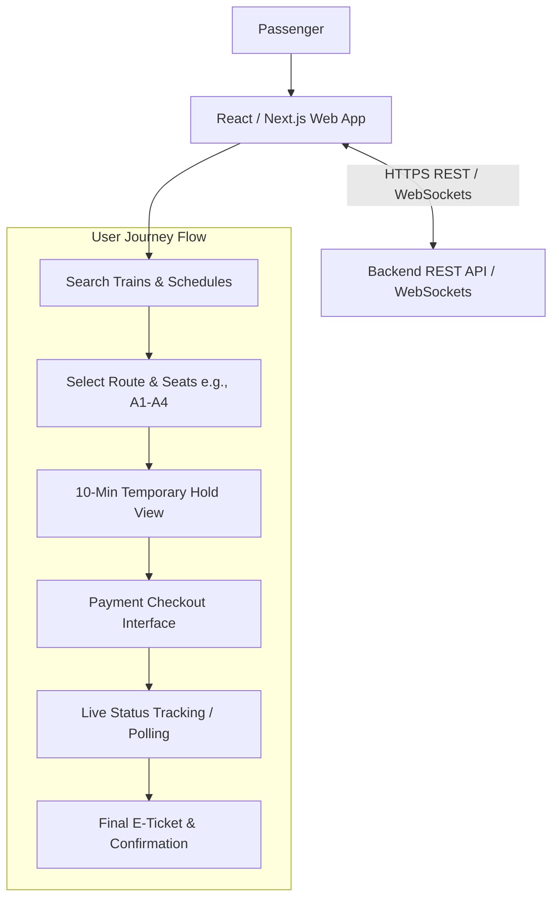
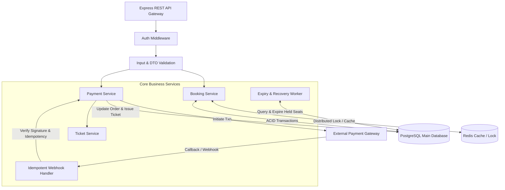
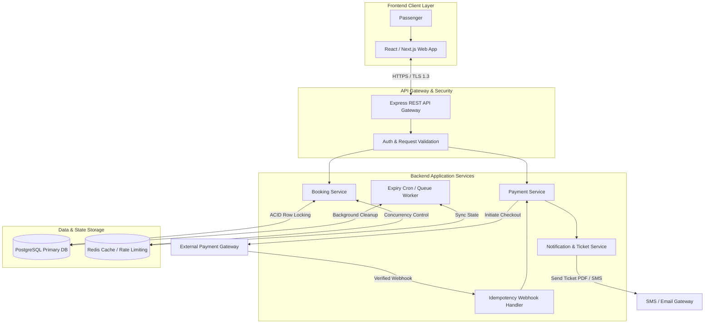
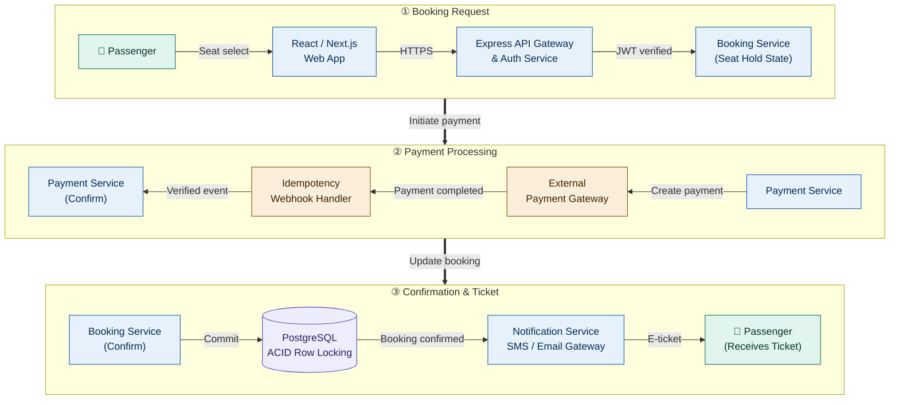
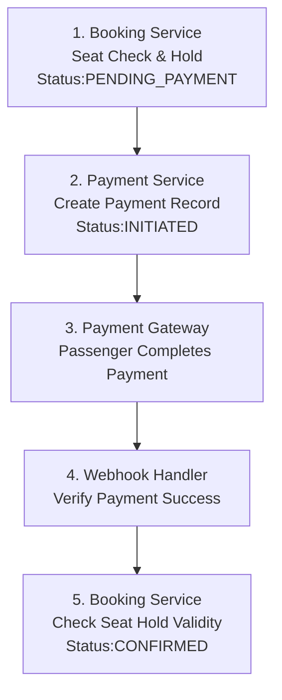
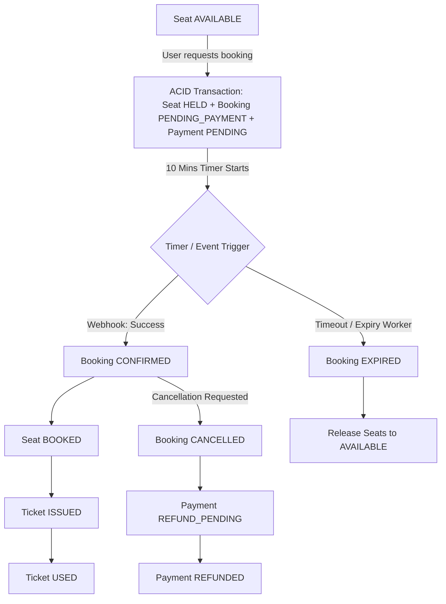
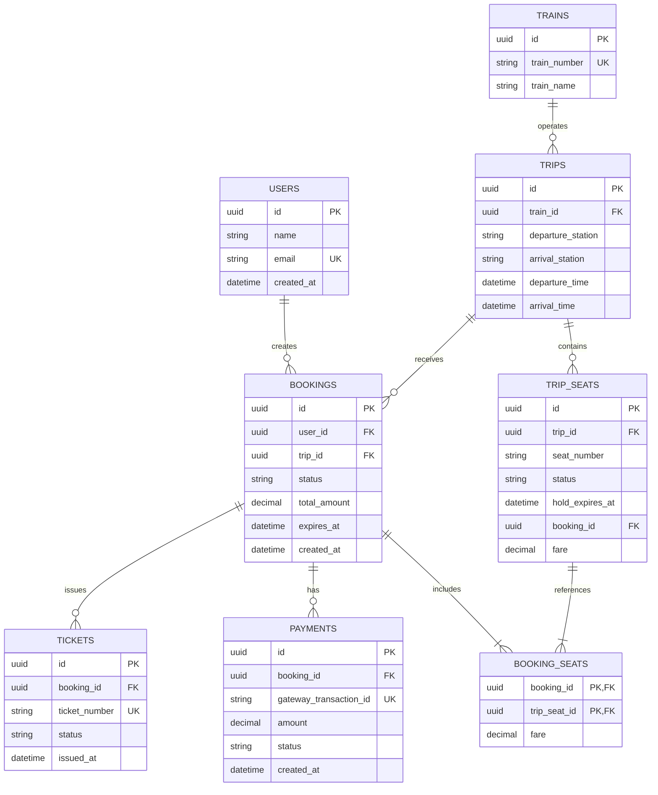
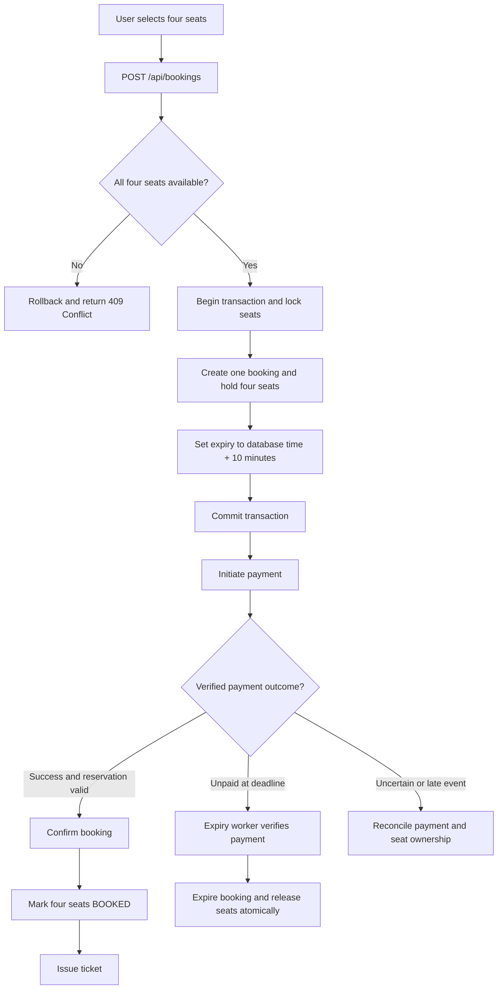

# Train Ticket Booking System --- System Design

> **উদ্দেশ্য:** Software Engineering Interview Preparation\
> **প্রধান প্রযুক্তি:** Node.js, Express.js, PostgreSQL\
> **মূল সমস্যা:** একজন user Dhaka থেকে Jashore যাওয়ার জন্য একটি booking-এ
> চারটি seat নির্বাচন করবেন। Payment সম্পন্ন করার জন্য seat-গুলো ১০ মিনিট
> hold থাকবে।

------------------------------------------------------------------------

## সূচিপত্র

1.  [Problem Statement](#1-problem-statement)
2.  [Requirements](#2-requirements)
3.  [High-Level Architecture](#3-high-level-architecture)
3.3 [Important SQL for Interview](#train-ticket-booking-system--important-sql-for-interview)
    - [Core Booking Queries](#331-core-booking-queries)
    - [Search, Cancellation এবং Reporting Queries](#332-search-cancellation-এবং-reporting-queries)
    - [Useful Integrity Constraints এবং Indexes](#333-useful-integrity-constraints-এবং-indexes)
4.  [Database Design](#4-database-design)
5.  [Status Management](#5-status-management)
6.  [ER Diagram](#6-er-diagram)
7.  [REST API Design](#7-rest-api-design)
8.  [Complete Booking Flow](#8-complete-booking-flow)
9.  [Double Booking Prevention](#9-double-booking-prevention)
10. [১০ মিনিটের Hold ও Expiry Mechanism](#10-১০-মিনিটের-hold-ও-expiry-mechanism)
11. [Payment Failure ও Delayed Webhook](#11-payment-failure-ও-delayed-webhook)
12. [Database Transaction](#12-database-transaction)
13. [ACID Properties](#13-acid-properties)
14. [Security ও Reliability](#14-security-ও-reliability)
15. [Scalability ও Performance](#15-scalability-ও-performance)
16. [Interview-এ বলার মতো সংক্ষিপ্ত উত্তর](#18-interview-এ-বলার-মতো-সংক্ষিপ্ত-উত্তর)

------------------------------------------------------------------------

## 1. Problem Statement

ধরা যাক, একজন user Dhaka থেকে Jashore যাওয়ার জন্য একটি train খুঁজে পেলেন
এবং `A1`, `A2`, `A3`, `A4`---এই চারটি seat একসঙ্গে book করতে চান।

System-এর কাজ হবে:

1.  Train, route, travel date এবং available seat দেখানো।
2.  চারটি seat এক booking-এর অধীনে reserve করা।
3.  Payment করার জন্য seat-গুলো সর্বোচ্চ ১০ মিনিট hold রাখা।
4.  নির্ধারিত সময়ের মধ্যে payment সফল ও যাচাই করা হলে booking confirm করা।
5.  সময় শেষ হওয়ার পরও payment সফল না হলে booking expire করে চারটি seat-ই
    release করা।
6.  একই seat যেন একসঙ্গে দুইজন user-এর confirmed booking-এ না যায়, তা
    নিশ্চিত করা।
7.  Payment failure, duplicate webhook এবং delayed payment confirmation
    নিরাপদে handle করা।

**মূল design challenge:** এটি শুধু CRUD application নয়। এটি একটি concurrent
booking ও payment system, যেখানে seat availability এবং booking status সব
সময় consistent রাখতে হবে।

## 2. Requirements

### 2.1 Functional Requirements

-   Departure station, destination ও travel date দিয়ে train search করা।
-   Train schedule, fare ও seat availability দেখা।
-   এই use case-এ এক booking-এ ঠিক চারটি seat নির্বাচন করা।
-   সব selected seat atomically hold করা।
-   Payment gateway-এর মাধ্যমে payment initiate ও verify করা।
-   Payment সফল হলে booking confirm করা এবং ticket issue করা।
-   Unpaid booking-এর expiry handle করে seat release করা।
-   User-কে booking details, booking status ও payment status দেখানো।
-   Cancellation ও refund workflow সমর্থন করা।

### 2.2 Non-Functional Requirements

  -----------------------------------------------------------------------
  Requirement                         ব্যাখ্যা
  ----------------------------------- -----------------------------------
  Consistency                         একই trip-এর একই seat একাধিক active
                                      booking-এ বরাদ্দ হবে না।

  Reliability                         Payment ও booking state-এর অসামঞ্জস্য
                                      শনাক্ত ও resolve করতে হবে।

  Concurrency                         একই সময়ে বহু user একই seat চাইলে
                                      নিরাপদভাবে request process করতে
                                      হবে।

  Security                            User কেবল নিজের booking দেখতে বা
                                      cancel করতে পারবেন।

  Scalability                         Traffic বাড়লে API instance ও worker
                                      বাড়ানো যাবে।

  Observability                       Booking conflict, payment failure,
                                      expiry delay ও database load
                                      monitor করতে হবে।
  -----------------------------------------------------------------------

## 3. High-Level Architecture

### 3.1 Frontend Architecture



**Interview explanation:** Frontend শুধু screen এবং user interaction handle
করবে। Fare, seat availability, payment success বা booking confirmation-এর
final decision frontend নেবে না; এগুলো backend থেকে আসবে।

### 3.2 Backend Architecture



**Interview explanation:** Backend হলো system-এর main authority। Booking
তৈরির সময় transaction-এর মধ্যে seat lock করে চারটি seat একসঙ্গে hold করবে।
Payment gateway-এর সঙ্গে কথা বলার সময় database transaction open রাখবে না।
Expiry worker আলাদাভাবে expired booking দেখে seat release করবে।

### 3.3 Full System Architecture



### Full architecture description --- ( what ,Why , Benefit wise)
15-Step System Design: Interview Presentation Breakdown
#### Step 1: Request Initiation (Passenger Booking Intent)
কী হচ্ছে (What): প্যাসেঞ্জার ফ্রন্টএন্ড অ্যাপলিকেশন (React/Next.js) থেকে রুটের নাম (Dhaka 
→ Jashore), ভ্রমণের তারিখ এবং ৪টি সিট (A1, A2, A3, A4) নির্বাচন করে বুকিং রিকোয়েস্ট পাঠায়।

কেন হচ্ছে (Why): সিস্টেমের মূল কাজ শুরু করার জন্য ইউজারের চাহিদা এবং ইনপুট ক্যাপচার করা প্রয়োজন।

সুবিধা (Benefit): ক্লায়েন্ট সাইড থেকেই প্রাথমিক সিট সিলেকশন সম্পন্ন হওয়ায় ইউজারের সময় বাঁচে এবং সঠিক পে-লোড ব্যাকএন্ডে পৌঁছায়।

#### Step 2: Express REST API Routing
কী হচ্ছে (What): ক্লায়েন্ট থেকে সিকিউর HTTPS protocol ব্যবহার করে POST /api/v1/bookings এ্যান্ডপয়েন্টে রিকোয়েস্ট আসে। Express API Gateway এটি গ্রহণ করে রুট হ্যান্ডলারে পাঠায়।

কেন হচ্ছে (Why): সিস্টেমে সব ট্রাফিককে এক জায়গায় রিসিভ করে সেন্ট্রালাইজডভাবে সঠিক মাইক্রোসার্ভিস বা কন্টেইনারে রাউট করার জন্য।

সুবিধা (Benefit): API Gateway ব্যবহারের ফলে লোড ব্যালেন্সিং, সেন্ট্রালাইজড লগিং এবং এ্যান্ডপয়েন্ট সিকিউরিটি ম্যানেজ করা সহজ হয়।

#### Step 3: Authentication & Input Validation
কী হচ্ছে (What): Middleware ইউজার টোকেন (JWT) চেক করে ইউজারের আইডেন্টিটি ভ্যালিড করে এবং রিকোয়েস্ট পে-লোড (Seat IDs, Trip ID, Date format) চেক করে।

কেন হচ্ছে (Why): ফেক বা ম্যালিশিয়াস রিকোয়েস্ট এবং ভুল ফরম্যাটের ডেটা যেন ডাটাবেজ পর্যন্ত না পৌঁছায়।

সুবিধা (Benefit): অবৈধ ইউজার ও ভুল রিকোয়েস্ট শুরুতেই রিজেক্ট হয়ে যাওয়ায় ব্যাকএন্ড সার্ভিস ও ডাটাবেজের ওপর অপ্রয়োজনীয় চাপ (CPU load) কমে।

#### Step 4: Booking Service & Transaction Initialization (BEGIN)
কী হচ্ছে (What): বুকিং সার্ভিস PostgreSQL ডেটাবেজে একটি নতুন ট্রানজেকশন শুরু করে (BEGIN TRANSACTION)।

কেন হচ্ছে (Why): ট্রানজেকশনের ভেতরে একাধিক কুয়েরি (সিট চেক, হোল্ড করা, বুকিং এন্ট্রি দেওয়া) সম্পূর্ণ হবে। এটি Atomicity নিশ্চিত করতে সাহায্য করে।

সুবিধা (Benefit): কোনো কারণে প্রসেসের মাঝে কোনো ত্রুটি ঘটলে ডাটাবেজে অর্ধেক বা ইনকনসিস্টেন্ট ডেটা সেভ হওয়া আটকানো যায়।

#### Step 5: Concurrency Control (Row Locking with FOR UPDATE)
কী হচ্ছে (What): বুকিং সার্ভিস নির্দিষ্ট ৪টি সিটের ওপর SELECT ... FOR UPDATE কুয়েরি চালিয়ে ডেটাবেজ লেভেলে Row Locking প্রয়োগ করে।

কেন হচ্ছে (Why): যদি একই সময়ে অন্য ১০ জন ইউজার একই সিটগুলো (A1-A4) বুক করার চেষ্টা করে, তবে কেবল প্রথম ইউজারের রিকোয়েস্ট আগে লকিং পাবে। বাকীদের কুয়েরি ব্লক বা ওয়েট স্টেটে চলে যাবে।

সুবিধা (Benefit): Race Condition বা Seat Double Booking সম্পূর্ণ বন্ধ হয়। এটিই কনকারেন্ট বুকিং সিস্টেমের সবচেয়ে বড় চ্যালেঞ্জ দূর করে।

#### Step 6: ACID Validation & Hold State Setup
কী হচ্ছে (What): ৪টি সিটই যদি AVAILABLE থাকে, তবে সেগুলোর স্ট্যাটাস আপডেট করে HELD করা হয়, বুকিং টেবিল-এ PENDING_PAYMENT স্ট্যাটাস দিয়ে এন্ট্রি তৈরি হয় এবং expires_at = NOW() + 10 mins সেট হয়। যদি ১টি সিটও নেওয়া হয়ে থাকে, তবে পুরো ট্রানজেকশন ROLLBACK হয়।

কেন হচ্ছে (Why): ইউজারকে ৪টি সিট একসঙ্গে দিতে হবে, কোনো আংশিক বুকিং (যেমন ৪টির বদলে ৩টি সিট পাওয়া) গ্রহণযোগ্য নয়।

সুবিধা (Benefit): All-or-Nothing Property (Atomicity) নিশ্চিত হয়। ইউজার হয় ৪টি সিটই একসঙ্গে হোল্ড করতে পারবে, নয়তো রিকোয়েস্ট পুরোপুরি রিজেক্ট হবে।

#### Step 7: PostgreSQL Commit
কী হচ্ছে (What): ডেটাবেজ ট্রানজেকশনটি সম্পূর্ণ সাকসেসফুল হলে COMMIT এক্সিকিউট করা হয় এবং সিট হোল্ড লকিং মুক্ত হয়।

কেন হচ্ছে (Why): ১০ মিনিটের অস্থায়ী সিট হোল্ডের স্থায়ী রেকর্ড ডাটাবেজের ডিস্কে রাইট করার জন্য।

সুবিধা (Benefit): Durability নিশ্চিত হয়। ট্রানজেকশন কমিট হওয়ার পর সার্ভার ক্র্যাশ করলেও ১০ মিনিটের জন্য ৪টি সিট লকড অবস্থায় থেকে যাবে, অন্য কেউ তা নিতে পারবে না।

#### Step 8: Payment Initiation
কী হচ্ছে (What): Payment Service বুকিং আইডি, অ্যামাউন্ট এবং একটি ইউনিক Idempotency Key / Payment Reference নিয়ে পেমেন্ট প্রসেসিং শুরু করে।

কেন হচ্ছে (Why): ইউজারকে বাইরের পেমেন্ট গেটওয়েতে (bKash/Nagad/SSLCommerz) টাকা পরিশোধ করার জন্য প্রস্তুত করা।

সুবিধা (Benefit): পেমেন্ট কল করার আগে DB Transaction বন্ধ রাখা হয়, যার ফলে পেমেন্ট গেটওয়ের নেটওয়ার্ক লেটেন্সির প্রভাব ডেটাবেজ ট্রানজেকশনের ওপর পড়ে না (Connection Pool নিঃশেষ হওয়া আটকায়)।

#### Step 9: External Payment Gateway Redirection
কী হচ্ছে (What): প্যাসেঞ্জারকে পেমেন্ট গেটওয়ের সিকিউর পেজে রিডাইরেক্ট করা হয় এবং ইউজার তার পেমেন্ট ইনফরমেশন দেয়।

কেন হচ্ছে (Why): সংবেদনশীল পেমেন্ট/কার্ড ইনফরমেশন আমাদের নিজস্ব সার্ভারে স্টোর না করে গেটওয়ের থার্ড-পার্টি সিকিউরিটি অনুসরন করার জন্য।

সুবিধা (Benefit): PCI-DSS Compliance মেইনটেইন করা সহজ হয় এবং পেমেন্ট প্রক্রিয়ার সর্বোচ্চ সিকিউরিটি নিশ্চিত হয়।

#### Step 10: Payment Webhook Callback
কী হচ্ছে (What): পেমেন্ট শেষ হলে পেমেন্ট গেটওয়ে আমাদের সার্ভারের /api/v1/payments/webhook এ্যান্ডপয়েন্টে একটি অসিঙ্ক্রোনাস POST রিকোয়েস্ট পাঠায়।

কেন হচ্ছে (Why): ফ্রন্টএন্ড বা ব্রাউজারের ওপর নির্ভর না করে ব্যাকএন্ড-টু-ব্যাকএন্ড রিয়েল পেমেন্ট স্ট্যাটাস রিসিভ করার জন্য (কারণ ইউজার ব্রাউজার ট্যাব বন্ধ করে দিতে পারে)।

সুবিধা (Benefit): নেটওয়ার্ক ড্রপ বা ব্রাউজার ক্লোজ হলেও ব্যাকএন্ড নিখুঁতভাবে নিশ্চিত হতে পারে পেমেন্ট সফল হয়েছে কি না।

#### Step 11: Idempotency & Signature Verification
কী হচ্ছে (What): ওয়েব হুক হ্যান্ডলার প্রেরিত Secret HMAC Signature মেলায় এবং চেক করে এই gateway_transaction_id দিয়ে আগে পেমেন্ট প্রসেস করা হয়েছে কি না।

কেন হচ্ছে (Why): পেমেন্ট গেটওয়ে ভুলবশত বা নেটওয়ার্ক রিট্রাইয়ের কারণে একই ওয়েব হুক একাধিকবার (Duplicate Webhook) পাঠাতে পারে।

সুবিধা (Benefit): Idempotency বজায় থাকে। একই পেমেন্ট দুবার প্রসেস হওয়া বা একটাই টিকেটের জন্য দুবার সিট কনফার্ম করার মারাত্মক ভুল প্রতিরোধ হয়।

#### Step 12: Booking Confirmation (PostgreSQL Transaction)
কী হচ্ছে (What): পেমেন্ট সফল হলে একটি নতুন DB Transaction-এর মাধ্যমে:

bookings.status = 'CONFIRMED'

trip_seats.status = 'BOOKED'

payments.status = 'SUCCEEDED'

Digital Ticket / PNR Issue করা হয়।

কেন হচ্ছে (Why): স্থায়ীভাবে ইউজারের বুকিং নিশ্চিত করা এবং সিটগুলোর স্ট্যাটাস খালি বা হোল্ড থেকে বুকড স্টেট-এ নেওয়া।

সুবিধা (Benefit): সিটগুলোর স্থায়ী অধিকার ইউজারকে দেওয়া হয় এবং সিস্টেমে টিকিট ফাইনাল করা হয়।

#### Step 13: Expiry Worker Monitoring
কী হচ্ছে (What): একটি ব্যাকগ্রাউন্ড সার্ভিস (BullMQ বা Cron Worker) প্রতি ১০-৩০ সেকেন্ড পর পর ডাটাবেজে কুয়েরি চালায়: WHERE status = 'PENDING_PAYMENT' AND expires_at < NOW().

কেন হচ্ছে (Why): ১০ মিনিট পার হয়ে যাওয়ার পরও যেসব বুকিংয়ের পেমেন্ট রিসিভ হয়নি, সেগুলোকে খুঁজে বের করা।

সুবিধা (Benefit): মেইন API বা ইউজারের রিকোয়েস্টের ওপর চাপ না ফেলে ব্যাকগ্রাউন্ডেই মেয়াাদোত্তীর্ণ বুকিংগুলো অটোমেটিক ডিটেক্ট করা যায়।

#### Step 14: Expiry, Recovery & Race-Condition Safety
কী হচ্ছে (What):

মেয়াাদোত্তীর্ণ বুকিংকে EXPIRED চিহ্নিত করে সিটগুলোকে আবার AVAILABLE করে দেওয়া হয়।

Edge Case (Late Payment): এক্সপায়ারি হওয়ার ঠিক সেই মুহূর্তেই পেমেন্ট কনফার্মেশন ওয়েব হুক আসলে row lock ব্যবহার করে যার সিদ্ধান্ত আগে কার্যকর হয় তা ধরা হয়। পেমেন্ট দেরিতে সফল হলে সিস্টেম REFUND_PENDING স্টেট-এ নিয়ে ইউজারকে স্বয়ংক্রিয় রিফান্ড দেয়।

কেন হচ্ছে (Why): অলস সিটগুলো আটকে থাকা প্রতিরোধ করা এবং লেট পেমেন্টের ফলে তৈরি হওয়া ইনকনসিস্টেন্সি হ্যান্ডেল করা।

সুবিধা (Benefit): সিটের সর্বোচ্চ ব্যবহার (Max Utilization) নিশ্চিত হয় এবং পেমেন্ট ঝুলন্ত অবস্থায় থেকে ইউজার ও প্ল্যাটফর্ম কারোর ক্ষতি হয় না।

#### Step 15: Frontend Notification & System Observability
কী হচ্ছে (What):

ফ্রন্টএন্ডে WebSockets/Polling-এর মাধ্যমে রিয়েল-টাইমে টিকিট CONFIRMED বা EXPIRED স্ট্যাটাস দেখানো হয়।

Prometheus, Grafana, ELK এর মাধ্যমে সিস্টেমের Erros, Latency, Lock Wait Times ও Webhook monitoring করা হয়।

কেন হচ্ছে (Why): ইউজারকে লাইভ ফিডব্যাক দেওয়া এবং ব্যাকএন্ড ইঞ্জিনিয়ারদের সিস্টেম পারফরম্যান্স ও কোনো ব্যর্থতার ইনসাইট দেওয়া।

সুবিধা (Benefit): ইউজার ট্রাস্ট ও ক্লায়েন্ট এক্সপেরিয়েন্স ভালো থাকে এবং প্রোডাকশন ডাউনটাইম বা মেমোরি লিক দ্রুত সমাধান করা যায়।

#### Quick Reference Table (Concepts & Their Purpose)
##### Arrow flow


##### Step-by-step workflow ( Details )
##### 1. Passenger → React / Next.js Web App
যাত্রী প্রথমে ওয়েব অ্যাপে প্রবেশ করে যাত্রার তারিখ, Departure Station, Destination Station এবং পছন্দের ট্রেন নির্বাচন করে। এরপর অ্যাপ উপলব্ধ সিট দেখায় এবং যাত্রী একটি বা একাধিক সিট নির্বাচন করে বুকিংয়ের অনুরোধ করে।
- Frontend: React.js / Next.js
- কাজ: Train search, seat selection, passenger information এবং booking request তৈরি করা।
- গুরুত্বপূর্ণ বিষয়: Frontend-এ সিট Available দেখালেই সেটি নিশ্চিতভাবে Available—এমন নয়। অন্য যাত্রী একই সময়ে সিট বুক করতে পারে।
##### 2. React App → HTTPS / TLS 1.3 → Express REST API Gateway
Frontend বুকিংয়ের অনুরোধটি HTTPS-এর মাধ্যমে API Gateway-তে পাঠায়। HTTPS এবং TLS 1.3 ক্লায়েন্ট ও সার্ভারের মধ্যে যোগাযোগ এনক্রিপ্ট করে, ফলে নেটওয়ার্কে সংবেদনশীল তথ্য সুরক্ষিত থাকে।
উদাহরণ:
POST /api/bookings
Request body-তে থাকতে পারে:
- trainId
- journeyDate
- seatIds
- passengerDetails
Retry বা double-click থেকে duplicate booking ঠেকাতে request header-এ একটি
unique `Idempotency-Key` পাঠানো হবে। একই key-এর request আগেই সফল হলে
server আগের response ফেরত দেবে।
API Gateway রিকোয়েস্ট গ্রহণ করে উপযুক্ত Backend Service-এ পাঠানোর ব্যবস্থা করে। এটি Routing, Rate Limiting এবং Authentication Middleware-এর মতো কাজও পরিচালনা করতে পারে।
#####  3. API Gateway → Authentication & Request Validation
API Gateway বা সংশ্লিষ্ট Middleware যাচাই করে যাত্রী লগইন করেছেন কি না এবং তাঁর রিকোয়েস্ট সঠিক কি না।
এখানে দুটি গুরুত্বপূর্ণ যাচাই হয়:
- Authentication: JWT বা Session যাচাই করে যাত্রীর পরিচয় নিশ্চিত করা।
- Validation: ট্রেন আইডি, যাত্রার তারিখ, সিট আইডি এবং অন্যান্য ইনপুট বৈধ কি না যাচাই করা।
অননুমোদিত ইউজার হলে 401 Unauthorized এবং ভুল ইনপুট হলে 400 Bad Request ফেরত দেওয়া যেতে পারে।
তবে এখানে সিট বুকিং নিশ্চিত করা হয় না; সেটি Booking Service-এর দায়িত্ব।
#####  4. Authentication → Booking Service
Authentication সফল হলে রিকোয়েস্ট Booking Service-এ পাঠানো হয়। এই সার্ভিস বুকিংয়ের মূল Business Logic পরিচালনা করে।
Booking Service প্রথমে যাচাই করে:
- ট্রেন ও যাত্রার তারিখ বৈধ কি না।
- নির্বাচিত সিটগুলো এখনো বুকিংয়ের জন্য পাওয়া যাচ্ছে কি না।
- যাত্রীর জন্য আগের কোনো Pending Booking রয়েছে কি না, যেখানে প্রাসঙ্গিক।
সিট hold করার সময় PostgreSQL transaction ব্যবহার করতে হবে। নির্দিষ্ট seat
row-গুলো `SELECT ... FOR UPDATE` দিয়ে lock করা অথবা
`UPDATE trip_seats SET status = 'HELD' WHERE status = 'AVAILABLE'` ধরনের
conditional update ব্যবহার করা হবে। কোনো seat আগে থেকেই নেওয়া থাকলে পুরো
transaction rollback করে `409 Conflict` ফেরত দিতে হবে; partial hold রাখা যাবে
না।

Hold-এর expiry, যেমন ১০ মিনিট, server/database time দিয়ে নির্ধারণ করতে হবে।
`UNIQUE (trip_id, seat_number)` constraint এবং active allocation-এর জন্য
উপযুক্ত unique constraint রাখতে হবে, যাতে একই trip-এর seat duplicate ভাবে
বরাদ্দ না হয়। এরপর একটি `PENDING_PAYMENT` booking তৈরি হবে।
উদাহরণ:
bookingId = BK-1001
bookingStatus = PENDING_PAYMENT
expiresAt = 2026-10-14T18:15:00Z
সাময়িক Hold-এর সময়সীমা শেষ হওয়ার আগেই পেমেন্ট সম্পন্ন করতে হবে। তা না হলে সিট আবার Available করা হবে।

##### Expiry Worker
Cron বা queue worker নিয়মিত expired `PENDING_PAYMENT` booking খুঁজবে।
প্রতিটি booking transaction-এর মধ্যে আবার যাচাই করে `PENDING_PAYMENT` থেকে
`EXPIRED` করবে এবং সেই booking-এর `HELD` seat-গুলোকে `AVAILABLE` করবে।
Row lock বা conditional state transition ব্যবহার করতে হবে, যাতে একই booking
একাধিক worker একসঙ্গে process করলেও state corruption না হয়।

##### 5. Booking Service → Payment Service
Booking Service বুকিংয়ের তথ্য Payment Service-এ পাঠায়, যাতে পেমেন্ট শুরু করা যায়।
Payment Service বুকিং আইডি, নির্ধারিত ভাড়া এবং পেমেন্টের অবস্থা যাচাই করে একটি Payment Record তৈরি করে।
উদাহরণ:
- paymentId: PAY-5001
- bookingId: BK-1001
- amount: ৳800
- paymentStatus: INITIATED
এখানে Booking Service এবং Payment Service-এর দায়িত্ব আলাদা রাখা হয়। Booking Service সিট ও বুকিং পরিচালনা করে, আর Payment Service অর্থ লেনদেন পরিচালনা করে।
##### 6. Payment Service → External Payment Gateway
Payment Service bKash, SSLCommerz, Nagad বা aamarPay-এর মতো অনুমোদিত
Payment Gateway-এর মাধ্যমে পেমেন্ট শুরু করে।
সাধারণত Backend Gateway-তে পেমেন্ট তৈরি করে এবং Frontend-কে Checkout URL বা প্রয়োজনীয় Payment Session দেয়।
যাত্রী এরপর পেমেন্ট সম্পন্ন করেন।
গুরুত্বপূর্ণ: শুধু Frontend-এর Success Page দেখে পেমেন্ট সফল ধরে নেওয়া যাবে
না। Backend-কে gateway-এর server-side validation API দিয়ে payment status,
amount ও transaction reference verify করতে হবে।
##### 7. External Payment Gateway → Idempotent Webhook Handler
Gateway অনুযায়ী payment confirmation আলাদা হতে পারে। SSLCommerz-এর ক্ষেত্রে
IPN এবং Validation API ব্যবহার করতে হবে; bKash-এর ক্ষেত্রে callback-এর সঙ্গে
Query Payment বা Execute Payment API ব্যবহার করে server-side verification করতে
হবে।

পেমেন্টের event বা callback এলে প্রথমে event-টি database-এ সংরক্ষণ করে
সঙ্গে সঙ্গে `200 OK` দিতে হবে। ভারী verification, booking update, ticket
processing এবং notification-এর কাজ asynchronous worker করবে।
উদাহরণ:
POST /api/webhooks/payment
Handler gateway-এর নিয়ম অনুযায়ী IPN/callback গ্রহণ করে এবং Validation API বা
Query/Execute API দিয়ে event-এর সত্যতা নিশ্চিত করার জন্য event record রাখে।
`event_id`-এর ওপর unique constraint রাখতে হবে এবং event আগে সংরক্ষিত হলে
duplicate processing করা যাবে না।
এখানেই Idempotency গুরুত্বপূর্ণ।
ধরা যাক, Gateway একই Payment Success Event তিনবার পাঠাল। সিস্টেম এমনভাবে তৈরি করতে হবে, যেন তিনবার Event এলেও পেমেন্ট একবারই সফল হিসেবে রেকর্ড হয় এবং একই বুকিংয়ের জন্য একাধিক টিকিট তৈরি না হয়।
Database-এ Unique Constraint এবং Transaction ব্যবহার করে এই সুরক্ষা আরও শক্তিশালী করা যায়।
##### 8. Webhook Handler → Payment Service
Webhook Handler যাচাইকৃত Payment Event Payment Service-এ পাঠায়। Payment Service প্রয়োজনীয় তথ্য Gateway-এর রেকর্ডের সঙ্গে মিলিয়ে দেখে।
যাচাইয়ের মধ্যে থাকতে পারে:
- Payment Reference সঠিক কি না।
- বুকিংয়ের সঙ্গে পেমেন্টের সম্পর্ক আছে কি না।
- পরিশোধিত Amount প্রত্যাশিত ভাড়ার সমান কি না।
- Currency এবং Transaction Status সঠিক কি না।
সব যাচাই সফল হলে Payment Record-এর অবস্থা SUCCEEDED করা হয়। পেমেন্ট ব্যর্থ হলে সেটি FAILED বা উপযুক্ত ব্যর্থতার অবস্থায় রাখা হয়।
এতে ভুয়া বা অসম্পূর্ণ Payment Confirmation-এর ভিত্তিতে বুকিং কনফার্ম হওয়ার ঝুঁকি কমে।
##### 9. Payment Service → Booking Service
Payment Service সফল পেমেন্টের তথ্য Booking Service-এ পাঠায়। এটি সরাসরি API Call বা Event-ভিত্তিক যোগাযোগের মাধ্যমে করা যেতে পারে।
Booking Service তখন পরীক্ষা করে:
- সংশ্লিষ্ট বুকিং এখনো বৈধ কি না।
- সিটের Hold-এর অবস্থা কী।
- বুকিংয়ের মেয়াদ শেষ হয়েছে কি না।
- একই বুকিং আগে থেকেই Confirmed হয়েছে কি না।
Hold expire হয়ে গেলে late payment event এলে row lock নিয়ে আবার seat ownership
যাচাই করতে হবে। Seat এখনো free থাকলে payment policy অনুযায়ী booking confirm
করা যাবে; seat ইতিমধ্যে অন্য booking-এ চলে গেলে booking confirm করা যাবে না
এবং payment gateway-তে auto-refund বা `REFUND_PENDING` workflow শুরু করতে হবে।
সব শর্ত পূরণ হলে বুকিং কনফার্ম করার প্রক্রিয়া শুরু হয়। Retry এবং
reconciliation job অনিশ্চিত বা দেরিতে আসা payment event পুনরায় যাচাই করবে।
তবে Payment Service এবং Booking Service আলাদা ডেটাবেজ ব্যবহার করলে দুটির আপডেটকে একটি সাধারণ ACID Transaction-এর মধ্যে রাখা যায় না। সে ক্ষেত্রে নির্ভরযোগ্য Event Processing, Retry এবং Reconciliation-এর মতো ব্যবস্থা প্রয়োজন।
##### 10. Booking Service → PostgreSQL Primary Database
এটি পুরো সিস্টেমের সবচেয়ে গুরুত্বপূর্ণ ধাপগুলোর একটি।
Booking Service PostgreSQL-এ Transaction শুরু করে এবং প্রয়োজন অনুযায়ী সংশ্লিষ্ট সিটের রেকর্ড Lock করে অথবা Conditional Update ব্যবহার করে। এর উদ্দেশ্য হলো, একাধিক যাত্রী একই সিট একই সময়ে বুক করতে চাইলে যেন শুধু একজনই সিটটি নিশ্চিত করতে পারেন।
একটি সরল Workflow:
1. BEGIN — Database Transaction শুরু।
2. সংশ্লিষ্ট Booking এবং Seat Hold যাচাই।
3. সিট এখনো বৈধভাবে Hold করা আছে কি না নিশ্চিত করা।
4. Booking Status-কে CONFIRMED করা।
5. প্রয়োজন অনুযায়ী Seat Status ও Ticket Record আপডেট করা।
6. একই transaction-এ Ticket Record তৈরি করা।
7. একই transaction-এ `outbox_events` table-এ notification বা ticket event
    insert করা।
8. COMMIT — সব আপডেট সফল হলে সংরক্ষণ করা।
কোনো ধাপে সমস্যা হলে ROLLBACK করা হয়।
PostgreSQL-এর Unique Constraint, Row-Level Lock এবং Conditional Update ব্যবহার করে Double Booking প্রতিরোধ করা যায়।
ACID Properties এখানে গুরুত্বপূর্ণ:
- Atomicity: সংশ্লিষ্ট Database Transaction-এর আপডেট সম্পূর্ণ হবে, নতুবা বাতিল হবে।
- Consistency: Database-এর নিয়ম ও Constraints অক্ষুণ্ণ থাকবে।
- Isolation: Concurrent Booking Request একে অপরের সঙ্গে অসামঞ্জস্যপূর্ণ ফল তৈরি করতে পারবে না।
- Durability: Commit সফল হলে ডেটা স্থায়ীভাবে সংরক্ষিত থাকবে।
মনে রাখতে হবে, ACID একই Database Transaction-এর ক্ষেত্রে প্রযোজ্য; একাধিক Microservice-এর পুরো Workflow স্বয়ংক্রিয়ভাবে একটি ACID Transaction হয়ে যায় না।
##### 11. Booking Service / Payment Service → Notification & Ticket Service
Ticket Record Step 10-এর transaction-এই তৈরি হয়ে গেছে। এই ধাপে Ticket
Service ticket data থেকে PDF/QR generate করবে এবং `outbox_events` table থেকে
event পড়ে Notification Service-কে দেবে। Notification Service প্রয়োজন হলে
SMS বা email provider-এ পাঠাবে। Outbox event সফলভাবে process না হওয়া পর্যন্ত
retry করা যাবে, ফলে database update সফল হলেও notification হারিয়ে যাবে না।
##### 12. Notification Service → SMS / Email Gateway
Notification Service ইমেইল বা SMS পাঠানোর জন্য বাহ্যিক Provider ব্যবহার করে।
- Email Gateway: টিকিটের বিস্তারিত বা PDF পাঠাতে পারে।
- SMS Gateway: Booking Confirmation এবং সংক্ষিপ্ত Ticket Reference পাঠাতে পারে।
- Retry Mechanism: সাময়িক Provider Failure হলে আবার পাঠানোর চেষ্টা করে।
Notification ব্যর্থ হলেই বুকিং বাতিল করা উচিত নয়। বুকিং ইতিমধ্যে Confirmed থাকলে Notification পুনরায় পাঠানোর ব্যবস্থা থাকবে।
##### 13. SMS / Email Gateway → Passenger
যাত্রী ইমেইল বা SMS-এ বুকিং কনফার্মেশন এবং টিকিটের তথ্য পান। এরপর ওয়েব অ্যাপের My Bookings পেজ থেকেও টিকিট দেখতে বা ডাউনলোড করতে পারেন।
টিকিট যাচাইয়ের সময় Ticket ID বা QR Code ব্যবহার করে Backend থেকে টিকিটের বৈধতা নিশ্চিত করা যায়।
এই পর্যায়ে যাত্রীর কাছে বুকিং সম্পন্ন হলেও Backend-এ বুকিংয়ের তথ্য, পেমেন্টের রেকর্ড এবং টিকিটের রেকর্ড সংরক্ষিত থাকে, যাতে ভবিষ্যতে Ticket Verification, Refund, Cancellation এবং Audit করা যায়।

**Simple end-to-end story:** User train search করে চারটি seat select করেন।
Frontend API-তে booking request পাঠায়। Backend PostgreSQL transaction-এ
চারটি seat lock করে `HELD` status দেয় এবং ১০ মিনিটের `PENDING_PAYMENT`
booking তৈরি করে। Payment সফল ও verified হলে booking `CONFIRMED` হয় এবং
seat `BOOKED` হয়। একই confirmation transaction-এ Ticket record এবং
`outbox_events` row তৈরি হয়; পরে outbox worker PDF/QR ও notification process
করে। Payment না হলে expiry worker `PENDING_PAYMENT` booking-কে `EXPIRED`
করে এবং `HELD` seat `AVAILABLE` করে release করে।

#### Summarized Table for Quick Reference ( Interview Answer )

Junior Software Engineer · Easy–Medium System Design

## Step-by-step workflow

##### step: 1\. Passenger → React / Next.js

Passenger train, journey date ও seats select করে booking request পাঠাবে। Frontend-এ seat Available দেখালেই সেটি নিশ্চিতভাবে available নয়, কারণ concurrent booking হতে পারে।

##### step: 2\. Frontend → HTTPS / TLS 1.3 → API Gateway

Frontend `POST /api/bookings` request পাঠাবে। HTTPS data encrypt করবে। `Idempotency-Key` ব্যবহার করে retry বা double-click থেকে duplicate booking প্রতিরোধ করব।

##### step: 3\. API Gateway → Authentication & Validation

JWT/Session দিয়ে Authentication এবং request validation করব। Rate limiting ও routing-ও এখানে থাকতে পারে।

##### step: 4\. API Gateway → Booking Service → PostgreSQL

Booking Service transaction ও row locking (`SELECT ... FOR UPDATE`) অথবা conditional update দিয়ে seat availability যাচাই করবে। সব requested seat available হলে `HELD` করে `PENDING_PAYMENT` booking তৈরি করবে, যার expiry ১০ মিনিট। Unique constraints double allocation ঠেকাবে। কোনো seat পাওয়া না গেলে পুরো transaction rollback করে `409 Conflict` দেব।

Expiry Worker: Cron/Queue Worker expired booking-কে `EXPIRED` করবে এবং সংশ্লিষ্ট held seats `AVAILABLE` করবে। Row locking ও conditional state transition দিয়ে concurrent expiry processing নিরাপদ রাখব।

##### step: 5\. Booking Service → Payment Service

Payment Service booking-এর amount যাচাই করে `INITIATED` Payment Record তৈরি করবে। Booking Service seat/booking এবং Payment Service payment পরিচালনা করবে।

##### step: 6\. Payment Service → External Payment Gateway

Backend bKash/SSLCommerz-এর মতো Gateway-তে payment initiate করবে এবং Frontend-কে checkout information দেবে। শুধু success page দেখে payment সফল ধরব না।

##### step: 7\. Payment Gateway → Idempotent Webhook Handler

Gateway payment notification পাঠাবে। Signature/authenticity যাচাই করে event database-এ সংরক্ষণ করব। Unique `event_id` ও idempotency ব্যবহার করে duplicate webhook থেকে duplicate processing ঠেকাব।

##### step: 8\. Webhook Handler → Payment Service

Payment Service Gateway-এর নিয়ম অনুযায়ী status, transaction reference, amount ও currency verify করবে। সফল হলে payment `SUCCEEDED` হবে। অনিশ্চিত status হলে reconciliation করব।

##### step: 9\. Payment Service → Booking Service

Verified payment success event Booking Service-এ পাঠাব। Booking এখনও `PENDING_PAYMENT`, seat ownership সঠিক এবং hold বৈধ কি না পুনরায় যাচাই করব। Hold expire হয়ে seat অন্য booking-এ চলে গেলে booking confirm করব না; payment কাটা হয়ে থাকলে `REFUND_PENDING` workflow শুরু করব।

##### step: 10\. Booking Service → PostgreSQL Primary Database

একটি transaction-এ booking `CONFIRMED`, seats `BOOKED`, Ticket Record এবং `outbox_events` তৈরি করব। সব সফল হলে `COMMIT`, অন্যথায় `ROLLBACK`।

এখানে ACID গুরুত্বপূর্ণ:

- Atomicity (সব হবে, না হয় কিছুই হবে না): একটা transaction-এর সব কাজ সফল হবে, নাহলে কোনো কাজই save হবে না।
উদাহরণ: Ticket booking-এর সময় seat book হলো, কিন্তু payment record save হলো না। Transaction rollback হলে seat booking-ও বাতিল হবে।
- Consistency (Database-এর নিয়ম ঠিক থাকবে): প্রতিটি transaction-এর পর database-এর নিয়ম ঠিক থাকতে হবে।
উদাহরণ: ট্রেনে ৪০টি seat থাকলে ৪১ নম্বর booking করা যাবে না।
- Isolation (একসঙ্গে কাজ করলেও সমস্যা হবে না): একাধিক user একই সময়ে booking করলেও database ভুল result হতে দেবে না।
উদাহরণ: একই seat-এর জন্য দুইজন একসঙ্গে request করলেও seat একজনই পাবে।
- Durability (Save হলে থেকে যাবে): Transaction একবার successfully commit হলে data database-এ সংরক্ষিত থাকবে, server restart হলেও।
উদাহরণ: Ticket booking successful হওয়ার পর server বন্ধ হলেও booking-এর data হারিয়ে যাবে না।

##### step: 11\. Ticket / Notification Service → SMS / Email Gateway

Outbox Worker event process করে Ticket PDF/QR তৈরি এবং notification পাঠাবে। Failure হলে retry করবে; notification failure-এর কারণে confirmed booking বাতিল হবে না।

##### step: 12\. SMS / Email Gateway → Passenger

Passenger confirmation ও ticket details পাবেন। `My Bookings` থেকে ticket দেখা যাবে এবং QR/Ticket ID দিয়ে backend-এ validity verify করা যাবে।

**Simple end-to-end story:** User train search করে চারটি seat select করেন।
Frontend API-তে booking request পাঠায়। Backend PostgreSQL transaction-এ
চারটি seat lock করে `HELD` status দেয় এবং ১০ মিনিটের `PENDING_PAYMENT`
booking তৈরি করে। Payment সফল ও verified হলে booking `CONFIRMED` হয় এবং
seat `BOOKED` হয়। Payment না হলে expiry worker booking expire করে seat
release করে।


#### Payment, Booking-এর আগে হচ্ছে না ?
##### Arrow flow

##### তাহলে Booking কখন হয়?
দুটি আলাদা বিষয়:
- Booking তৈরি: Payment-এর আগেই হয়। Seat ১০ মিনিটের জন্য hold করা হয়, যাতে অন্য কেউ সেটি book করতে না পারে।
- Booking confirm: Payment সফলভাবে verify হওয়ার পরে হয়। তখন seat স্থায়ীভাবে BOOKED হয়।
কেন এই পদ্ধতি?

ধরো, তুমি ৪টি seat book করতে চাও। Backend আগে seat-গুলো ১০ মিনিটের জন্য hold করবে। তারপর তুমি payment করবে। Payment সফল হলে booking confirm হবে। Payment না করলে hold expire হয়ে seat আবার available হবে।

### Train Ticket Booking System — Important SQL for Interview

এই query-গুলো PostgreSQL ধরে লেখা হয়েছে। Booking confirmation, expiry,
cancellation এবং seat release-এর query একই transaction-এর মধ্যে চালাতে হবে।
`NOW()` database time ব্যবহার করে, তাই frontend-এর clock-এর ওপর নির্ভর করা হবে
না।

### 3.3.1 Core Booking Queries

#### 1. Seat Lock — একই seat একসঙ্গে অন্য user যেন book করতে না পারে

```sql
SELECT *
FROM trip_seats
WHERE trip_id = 101
    AND id IN (101, 102)
    AND status = 'AVAILABLE'
ORDER BY id
FOR UPDATE;
```

`FOR UPDATE` transaction শেষ হওয়া পর্যন্ত selected row lock করে। Application
কে check করতে হবে যে requested সব seat পাওয়া গেছে; না হলে `ROLLBACK` করে
`409 Conflict` দিতে হবে।

#### 2. Create Booking — Booking তৈরি করে ১০ মিনিট payment-এর সময় দেওয়া

```sql
INSERT INTO bookings (user_id, trip_id, status, total_amount, expires_at)
VALUES (1, 101, 'PENDING_PAYMENT', 800.00,
                NOW() + INTERVAL '10 minutes')
RETURNING id, status, expires_at;
```

#### 3. Hold Seats — Payment-এর আগে seat সাময়িকভাবে reserve করা

```sql
UPDATE trip_seats
SET status = 'HELD',
        booking_id = 1,
        hold_expires_at = NOW() + INTERVAL '10 minutes'
WHERE trip_id = 101
    AND id IN (101, 102)
    AND status = 'AVAILABLE';
```

Affected row count requested seat count-এর সমান না হলে transaction rollback
করতে হবে। চারটি seat-এর ক্ষেত্রে আংশিক hold রাখা যাবে না।

#### 4. Payment Success — Payment সফল হলে booking confirm করা

```sql
UPDATE bookings
SET status = 'CONFIRMED',
        expires_at = NULL
WHERE id = 1
    AND status = 'PENDING_PAYMENT'
    AND expires_at > NOW()
RETURNING id, status;
```

এই update-এর আগে payment status, amount এবং gateway transaction server-side
verify করতে হবে। Affected row count zero হলে booking already confirmed,
expired অথবা invalid হতে পারে।

#### 5. Book Seats — Confirmed booking-এর seat স্থায়ীভাবে reserve করা

```sql
UPDATE trip_seats
SET status = 'BOOKED',
        hold_expires_at = NULL
WHERE booking_id = 1
    AND status = 'HELD'
RETURNING id, seat_number, status;
```

Booking update এবং seat update একই confirmation transaction-এ করতে হবে।

#### 6. Expire Booking — Payment-এর সময় শেষ হলে booking expire করা

```sql
UPDATE bookings
SET status = 'EXPIRED'
WHERE id = 1
    AND status = 'PENDING_PAYMENT'
    AND expires_at <= NOW()
RETURNING id, status;
```

Worker একসঙ্গে অনেক booking process করলে `FOR UPDATE SKIP LOCKED` দিয়ে
candidate claim করা যায়। Expiry-এর আগে payment success এলে payment flow এবং
expiry flow একই booking row lock করে state পুনরায় যাচাই করবে।

#### 7. Release Seats — Expired booking-এর seat আবার available করা

```sql
UPDATE trip_seats
SET status = 'AVAILABLE',
        booking_id = NULL,
        hold_expires_at = NULL
WHERE booking_id = 1
    AND status = 'HELD';
```

Booking `EXPIRED` করা এবং seat release করা একই transaction-এ করতে হবে।

#### 8. Check Payment — Booking-এর payment status দেখা

```sql
SELECT status, amount, gateway_transaction_id, created_at
FROM payments
WHERE booking_id = 1
ORDER BY created_at DESC;
```

#### 9. Prevent Duplicate Webhook — একই webhook event যেন দুবার process না হয়

```sql
INSERT INTO payment_webhook_events (provider, event_id, payload)
VALUES ('BKASH', 'evt_123', '{}'::jsonb)
ON CONFLICT (provider, event_id) DO NOTHING
RETURNING id;
```

`RETURNING`-এ কোনো row না এলে event আগে process বা record করা হয়েছে। এজন্য
`UNIQUE (provider, event_id)` constraint থাকতে হবে।

#### 10. Find Available Seats — কোন seat available আছে তা দেখা

```sql
SELECT id, seat_number, fare
FROM trip_seats
WHERE trip_id = 101
    AND status = 'AVAILABLE'
ORDER BY seat_number;
```

এই query display-এর জন্য। Final availability booking transaction-এর মধ্যে
আবার যাচাই করতে হবে।

### 3.3.2 Search, Cancellation এবং Reporting Queries

#### 11. Search Trains — নির্দিষ্ট route ও date-এ train খুঁজে বের করা

```sql
SELECT tr.id, t.train_number, t.train_name,
             tr.departure_station, tr.arrival_station,
             tr.departure_time, tr.arrival_time
FROM trips tr
JOIN trains t ON t.id = tr.train_id
WHERE tr.departure_station = 'Dhaka'
    AND tr.arrival_station = 'Jashore'
    AND tr.departure_time >= TIMESTAMPTZ '2026-11-01 00:00:00+00'
    AND tr.departure_time <  TIMESTAMPTZ '2026-11-02 00:00:00+00'
ORDER BY tr.departure_time;
```

#### 12. Booking History — Passenger-এর সব booking দেখা

```sql
SELECT id, trip_id, status, total_amount, expires_at, created_at
FROM bookings
WHERE user_id = 1
ORDER BY created_at DESC;
```

#### 13. Booking Details — Booking-এর সঙ্গে train ও journey information দেখা

```sql
SELECT b.id AS booking_id,
             b.status AS booking_status,
             b.total_amount,
             t.train_name,
             tr.departure_station,
             tr.arrival_station,
             tr.departure_time,
             tr.arrival_time
FROM bookings b
JOIN trips tr ON tr.id = b.trip_id
JOIN trains t ON t.id = tr.train_id
WHERE b.id = 1
    AND b.user_id = 1;
```

`user_id` দিয়ে filter করা authorization-এর জন্য গুরুত্বপূর্ণ।

#### 14. Cancel Booking — Pending booking বাতিল করা

```sql
BEGIN;

UPDATE bookings
SET status = 'CANCELLED'
WHERE id = 1
    AND user_id = 1
    AND status = 'PENDING_PAYMENT'
RETURNING id;

UPDATE trip_seats
SET status = 'AVAILABLE',
        booking_id = NULL,
        hold_expires_at = NULL
WHERE booking_id = 1
    AND status = 'HELD';

COMMIT;
```

Confirmed booking cancel করলে আলাদা refund policy এবং `REFUND_PENDING`
workflow দরকার।

#### 15. Refund Status — Refund-এর অবস্থা দেখা

```sql
SELECT booking_id, amount, status, gateway_transaction_id
FROM payments
WHERE booking_id = 1
    AND status IN ('REFUND_PENDING', 'REFUNDED')
ORDER BY created_at DESC;
```

#### 16. Count Available Seats — কতগুলো seat available আছে তা দেখা

```sql
SELECT COUNT(*) AS available_seats
FROM trip_seats
WHERE trip_id = 101
    AND status = 'AVAILABLE';
```

#### 17. Total Revenue — Successful payment থেকে মোট revenue হিসাব করা

```sql
SELECT COALESCE(SUM(amount), 0) AS gross_revenue
FROM payments
WHERE status = 'SUCCEEDED';
```

এটি gross successful payment। Refund বাদ দিয়ে net revenue বের করতে refund
amount বা refund transaction আলাদাভাবে হিসাব করতে হবে।

#### 18. Prevent Double Booking — একই trip-এর একই seat একাধিক active booking-এ আটকানো

যদি `booking_seats` table-এ allocation `status` (`HELD`/`BOOKED`) রাখা হয়,
তাহলে historical rows রেখেও active allocation duplicate হতে না দেওয়ার জন্য:

```sql
CREATE UNIQUE INDEX unique_active_seat_allocation
ON booking_seats (trip_seat_id)
WHERE status IN ('HELD', 'BOOKED');
```

এই README-এর বর্তমান schema-তে ownership `trip_seats.booking_id` এবং
`trip_seats.status`-এ রাখা হয়েছে। সেই design-এ `UNIQUE (trip_id,
seat_number)` এবং row locking/conditional update-ই মূল protection; একই
ownership দু জায়গায় আলাদা করে store করা উচিত নয়।

#### 19. Transaction — একাধিক SQL operation একসঙ্গে সফল বা ব্যর্থ করা

```sql
BEGIN;

UPDATE bookings
SET status = 'CONFIRMED',
        expires_at = NULL
WHERE id = 1
    AND status = 'PENDING_PAYMENT'
    AND expires_at > NOW();

-- Application checks affected row count.
-- Then update the associated HELD seats and insert the ticket.

COMMIT;
-- On failure, execute ROLLBACK instead.
```

#### 20. Second Highest Fare — SQL interview-এর common problem

```sql
SELECT MAX(fare) AS second_highest_fare
FROM trip_seats
WHERE fare < (
        SELECT MAX(fare)
        FROM trip_seats
);
```

এটি distinct দ্বিতীয় সর্বোচ্চ fare বের করে। কোনো দ্বিতীয় distinct value না
থাকলে result `NULL` হবে।

#### 21 : Find the 2nd Highest Salary
```sql
SELECT MAX(salary) AS second_highest_salary
FROM employees
WHERE salary < (
    SELECT MAX(salary)
    FROM employees
);
```
### 3.3.3 Useful Integrity Constraints এবং Indexes

```sql
ALTER TABLE trip_seats
ADD CONSTRAINT unique_trip_seat
UNIQUE (trip_id, seat_number);

CREATE INDEX idx_bookings_expiry
ON bookings (expires_at)
WHERE status = 'PENDING_PAYMENT';

CREATE UNIQUE INDEX unique_webhook_event
ON payment_webhook_events (provider, event_id);
```

Database constraint duplicate data আটকায়, কিন্তু payment gateway-এর সঙ্গে
database-এর একটি ACID transaction তৈরি করে না। তাই webhook idempotency,
retry এবং reconciliation worker এখনও প্রয়োজন।

### 3.4 Component-এর দায়িত্ব

-   **Client (React/Next.js):** Train search, seat selection, payment
    checkout ও booking status দেখায়।
-   **Express API:** REST request গ্রহণ করে; authentication, validation ও
    business logic চালায়।
-   **Booking Service:** Seat hold, booking create, confirmation,
    cancellation ও expiry rules enforce করে।
-   **PostgreSQL:** Train, trip, seat, booking ও payment-এর
    authoritative data রাখে।
-   **Ticket Service:** Verified payment-এর পরে ticket issue এবং ticket
    lookup handle করে।
-   **Payment Gateway:** Payment process করে এবং server-to-server
    webhook পাঠায়।
-   **Background Worker:** Expired booking খুঁজে payment state যাচাই করে
    এবং প্রয়োজন হলে seat release করে।

## 4. Database Design

আটটি প্রধান table:

1.  `users`
2.  `trains`
3.  `trips`
4.  `trip_seats`
5.  `bookings`
6.  `booking_seats`
7.  `payments`
8.  `tickets`

### 4.1 `users`

User account information রাখে।

  Column         Type              বিবরণ
  -------------- ----------------- -------------------
  `id`           UUID, PK          Unique user ID
  `name`         VARCHAR           User-এর নাম
  `email`        VARCHAR, UNIQUE   User-এর email
  `created_at`   TIMESTAMPTZ       Account তৈরির সময়

### 4.2 `trains`

Train-এর সাধারণ তথ্য রাখে।

  Column           Type              বিবরণ
  ---------------- ----------------- -----------------
  `id`             UUID, PK          Unique train ID
  `train_number`   VARCHAR, UNIQUE   Train number
  `train_name`     VARCHAR           Train name

### 4.3 `trips`

একটি নির্দিষ্ট তারিখ ও সময়ে একটি train-এর যাত্রাকে trip বলা হয়। একই
train-এর আলাদা তারিখের জন্য আলাদা trip record থাকবে।

  Column                Type          বিবরণ
  --------------------- ------------- -----------------------
  `id`                  UUID, PK      Unique trip ID
  `train_id`            UUID, FK      `trains.id` reference
  `departure_station`   VARCHAR       যাত্রা শুরুর station
  `arrival_station`     VARCHAR       গন্তব্য station
  `departure_time`      TIMESTAMPTZ   Departure date/time
  `arrival_time`        TIMESTAMPTZ   Arrival date/time

### 4.4 `trip_seats`

একটি নির্দিষ্ট trip-এর প্রতিটি seat-এর availability রাখে। একই physical seat
অন্য trip-এ আলাদাভাবে available হতে পারে।

  Column              Type                বিবরণ
  ------------------- ------------------- ---------------------------
  `id`                UUID, PK            Unique trip-seat ID
  `trip_id`           UUID, FK            `trips.id` reference
  `seat_number`       VARCHAR             যেমন `A1`, `A2`
  `status`            VARCHAR/ENUM        Seat status
  `hold_expires_at`   TIMESTAMPTZ, NULL   Hold deadline
  `booking_id`        UUID, NULL, FK      বর্তমান hold/booking owner
  `fare`              DECIMAL             Seat fare

**Constraint:** `UNIQUE (trip_id, seat_number)` রাখতে হবে।

### 4.5 `bookings`

Booking-এর overall state, user, total amount ও expiry deadline রাখে।

  Column           Type           বিবরণ
  ---------------- -------------- -----------------------------
  `id`             UUID, PK       Unique booking ID
  `user_id`        UUID, FK       `users.id` reference
  `trip_id`        UUID, FK       `trips.id` reference
  `status`         VARCHAR/ENUM   Booking lifecycle status
  `total_amount`   DECIMAL        Selected seat-গুলোর মোট fare
  `expires_at`     TIMESTAMPTZ    ১০ মিনিটের deadline
  `created_at`     TIMESTAMPTZ    Booking তৈরির সময়

### 4.6 `booking_seats`

একটি booking-এর সঙ্গে একাধিক seat যুক্ত করে। চারটি seat-এর জন্য **একটি
booking row এবং চারটি `booking_seats` row** তৈরি হবে।

  Column           Type          বিবরণ
  ---------------- ------------- ----------------------------------
  `booking_id`     UUID, PK/FK   `bookings.id` reference
  `trip_seat_id`   UUID, PK/FK   `trip_seats.id` reference
  `fare`           DECIMAL       Booking-এর সময় সংরক্ষিত seat fare

Composite primary key: `PRIMARY KEY (booking_id, trip_seat_id)`।

এ ছাড়া একই trip-seat একাধিক active booking-এ assign না হওয়ার নিয়ম
database constraint ও allocation logic দিয়ে নিশ্চিত করতে হবে।

### 4.7 `payments`

Payment attempt ও gateway transaction-এর ফলাফল রাখে।

  --------------------------------------------------------------------------
  Column                     Type                    বিবরণ
  -------------------------- ----------------------- -----------------------
  `id`                       UUID, PK                Unique payment ID

  `booking_id`               UUID, FK                `bookings.id` reference

  `gateway_transaction_id`   VARCHAR, UNIQUE         Gateway transaction
                                                     reference

  `amount`                   DECIMAL                 Payment amount

  `status`                   VARCHAR/ENUM            Payment status

  `created_at`               TIMESTAMPTZ             Payment attempt তৈরির
                                                     সময়
  --------------------------------------------------------------------------

এক booking-এর জন্য প্রয়োজন অনুযায়ী একাধিক payment attempt থাকতে পারে।
Gateway transaction ও event idempotently process করতে হবে।

### 4.8 `tickets`

Payment verify হওয়ার পর confirmed booking-এর জন্য ticket issue করার তথ্য
রাখে।

Column           Type              বিবরণ
--------------   ----------------  ------------------------------
`id`             UUID, PK          Unique ticket ID
`booking_id`     UUID, FK          `bookings.id` reference
`ticket_number`  VARCHAR, UNIQUE   Public ticket number
`status`         VARCHAR/ENUM      Ticket lifecycle status
`issued_at`      TIMESTAMPTZ       Ticket issue হওয়ার সময়

Ticket কেবল verified payment এবং `CONFIRMED` booking-এর পর issue করা যাবে।

## 5. Status Management

Booking, Seat, Payment এবং Ticket-এর status আলাদা রাখতে হবে। কারণ এগুলোর
lifecycle ও অর্থ এক নয়।

### 5.1 Booking Status

  Status              অর্থ
  ------------------- ------------------------------------------------------
  `PENDING_PAYMENT`   Booking তৈরি হয়েছে; payment এখনো verified হয়নি।
  `CONFIRMED`         Payment যাচাই এবং booking confirmation সফল।
  `EXPIRED`           Payment deadline পার হয়েছে এবং booking expire হয়েছে।
  `FAILED`            Booking process ব্যর্থ হয়েছে, policy অনুযায়ী।
  `CANCELLED`         Booking বাতিল করা হয়েছে।
  `REFUND_PENDING`    Refund processing চলছে।
  `REFUNDED`          Refund সম্পন্ন হয়েছে।

### 5.2 Seat Status

  Status        অর্থ
  ------------- -----------------------------------------------
  `AVAILABLE`   Seat reserve করার জন্য খালি।
  `HELD`        Seat সাময়িকভাবে একটি booking-এর জন্য hold করা।
  `BOOKED`      Seat confirmed booking-এর জন্য বরাদ্দ।
  `BLOCKED`     Seat operator/admin বন্ধ রেখেছে।

### 5.3 Payment Status

  Status             অর্থ
  ------------------ -----------------------------------------------
  `PENDING`          Payment initiated বা final result-এর অপেক্ষায়।
  `SUCCEEDED`        Gateway payment সফল বলে নিশ্চিত করেছে।
  `FAILED`           Payment ব্যর্থ।
  `CANCELLED`        Payment attempt বাতিল।
  `REFUND_PENDING`   Refund প্রক্রিয়াধীন।
  `REFUNDED`         Refund সম্পন্ন।

### 5.4 Ticket Status

  Status         অর্থ
  -------------- ---------------------------------
  `NOT_ISSUED`   Ticket এখনো issue হয়নি।
  `ISSUED`       Ticket issue হয়েছে।
  `USED`         Ticket যাত্রার জন্য ব্যবহার হয়েছে।
  `CANCELLED`    Ticket বাতিল হয়েছে।

### 5.5 Status Flow Diagram



Payment `SUCCEEDED` হলেই booking স্বয়ংক্রিয়ভাবে `CONFIRMED` ধরে নেওয়া যাবে
না। Backend-কে reservation validity, expiry policy এবং seat ownership
যাচাই করতে হবে।

## 6. ER Diagram



**Relationship summary:**

-   একজন user অনেক booking করতে পারেন।
-   একটি train-এর একাধিক trip থাকতে পারে।
-   একটি trip-এর একাধিক trip-seat থাকে।
-   একটি booking একাধিক seat অন্তর্ভুক্ত করতে পারে।
-   একটি booking-এর একাধিক payment attempt থাকতে পারে।
-   একটি confirmed booking-এর জন্য ticket issue করা হয়।

Implementation-এ `trip_seats.booking_id` বর্তমান hold/confirmed owner
বোঝাতে পারে; seat release হলে এটি clear করতে হবে। `booking_seats`-এর
historical relationship কীভাবে সংরক্ষণ হবে, তা স্পষ্টভাবে define করতে হবে,
যেন duplicate allocation না হয়।

## 7. REST API Design

The following REST APIs support passenger authentication, train search, seat booking, payment processing, and ticket verification.

| Method | Endpoint | Description |
|---|---|---|
| `POST` | `/api/auth/login` | Passenger login |
| `GET` | `/api/trains` | Search trains |
| `GET` | `/api/trips/:tripId/seats` | Check seat availability |
| `POST` | `/api/bookings` | Create booking and hold seats temporarily |
| `GET` | `/api/bookings/:id` | Get booking details and status |
| `POST` | `/api/bookings/:id/payment` | Initiate payment |
| `GET` | `/api/bookings/:id/payment-status` | Check payment status |
| `POST` | `/api/payments/webhook` | Receive payment gateway notifications |
| `POST` | `/api/bookings/:id/cancel` | Request booking cancellation |
| `GET` | `/api/tickets/:ticketNumber` | Retrieve ticket details |
| `GET` | `/api/bookings` | View passenger booking history |
| `POST` | `/api/tickets/:ticketNumber/verify` | Verify ticket or QR code |

### Important API Design Considerations

- **Authentication:** Protect passenger-specific endpoints using JWT or session-based authentication.
- **Seat Availability:** Revalidate seat availability during booking to prevent double booking.
- **Idempotency:** Use idempotency keys for booking and payment initiation to handle duplicate requests safely.
- **Payment Verification:** Verify payment status on the backend using the payment gateway's supported verification mechanism. Never trust the frontend success redirect alone.
- **Webhook Security:** Validate webhook authenticity and process duplicate events idempotently.
- **ACID Transactions:** Use PostgreSQL transactions, appropriate row locking, and database constraints to maintain booking and seat consistency.
- **Background Workers:** Use background jobs to expire unpaid seat holds, process refunds, and reconcile uncertain payment statuses. These workers do not need public REST endpoints.


## 8. Complete Booking Flow



চারটি seat-কে একটি logical reservation হিসেবে ধরতে হবে। Diagram-এর
availability check কেবল preliminary check; transaction-এর মধ্যে row lock
নেওয়ার পরেই final validation করতে হবে। Requirement যদি
চারটি seat একসঙ্গে বুক করা হয়, তাহলে দুই বা তিনটি seat reserve করে বাকি
seat বাদ দিয়ে booking confirm করা যাবে না।

## 9. Double Booking Prevention

ধরা যাক, User A ও User B একই সময়ে `A1` seat book করতে চায়।

Naive implementation:

``` js
const seat = await findSeat(seatId);

if (seat.status === "AVAILABLE") {
  await updateSeat(seatId, "HELD");
}
```

এটি unsafe: দুই request-ই update হওয়ার আগে `AVAILABLE` পড়ে ফেলতে পারে।

### সঠিক পদ্ধতি

1.  Database transaction শুরু করা।
2.  Requested seat row-গুলো consistent order-এ lock করা।
3.  নিশ্চিত করা যে সব চারটি seat একই trip-এর এবং available।
4.  একটি booking record তৈরি করা।
5.  চারটি seat-কে `HELD` করা এবং একই expiry deadline দেওয়া।
6.  চারটি `booking_seats` record তৈরি করা।
7.  সব সফল হলে commit; কোনো validation fail করলে rollback।

Illustrative SQL:

``` sql
BEGIN;

SELECT id, status
FROM trip_seats
WHERE trip_id = $1
  AND seat_number IN ('A1', 'A2', 'A3', 'A4')
ORDER BY id
FOR UPDATE;

-- Application logic:
-- 1. Verify exactly four requested seats were found.
-- 2. Verify every seat is eligible for reservation.
-- 3. Create one booking.
-- 4. Update all four seats conditionally.
-- 5. Insert four booking_seats rows.
-- 6. Roll back if any condition fails.

COMMIT;
```

`SELECT ... FOR UPDATE` একাই যথেষ্ট নয়। Seat validation, expired hold
reclaim, conditional update, unique constraints এবং transaction error
handling-ও প্রয়োজন। Payment সম্পন্ন হওয়া পর্যন্ত database transaction খোলা
রাখা যাবে না। আগে seat hold করে transaction commit করতে হবে; এরপর
gateway-এর সঙ্গে যোগাযোগ করতে হবে।

### Q: কনকারেন্ট সিস্টেমে (Concurrent System) ডাবল বুকিং (Double Booking) কীভাবে প্রতিরোধ করবেন?
A:সাধারণত কোডে আমরা প্রথমে সিট ফাঁকা আছে কি না চেক করি (if (seat.status === 'AVAILABLE')) এবং তারপর আপডেট করি। কিন্তু হাই-কনকারেন্সি সিস্টেমে (যখন হাজার হাজার ইউজার একসঙ্গে রিকোয়েস্ট পাঠায়) এটি অত্যন্ত ঝুঁকিপূর্ণ। কারণ একাধিক ইউজার একই মিলিিসেকেন্ডে সিটগুলোকে AVAILABLE পড়তে পারে এবং দুজনেই আপডেট করার চেষ্টা করলে Race Condition তৈরি হয়ে ডাবল বুকিং হয়ে যায়।

এই সমস্যার সঠিক সমাধান হলো ডেটাবেজ লেভেলে ACID Transaction এবং Row-Level Locking ব্যবহার করা:
“একই সিট যেন একাধিক passenger বুক করতে না পারে, সেটা নিশ্চিত করার জন্য আমি ACID Transaction, Row-Level Locking এবং Deadlock Prevention ব্যবহার করব।
##### ১. Transaction শুরু: 
প্রথমে BEGIN দিয়ে transaction শুরু করব, যাতে booking-এর সব database operation একটি atomic unit হিসেবে কাজ করে।

-ট্রানজেকশন (Transaction) হলো ডাটাবেজ ম্যানেজমেন্ট সিস্টেমের (DBMS) একটি একক বা লজিক্যাল কাজের একক (Logical Unit of Work)।

ট্রানজেকশন নিশ্চিত করে যে—হয় দুটি ধাপই সফলভাবে সম্পন্ন হবে (Commit), না হয় কোনো ধাপই প্রযোজ্য হবে না (Rollback)।ACID Properties (ট্রানজেকশনের ৪টি মূল স্তম্ভ)
#####  ২. Row-Level Locking:
 এরপর SELECT ... FOR UPDATE ব্যবহার করে passenger যে সিটগুলো বুক করতে চায়, সেগুলোর row lock করব। ফলে অন্য কোনো concurrent transaction একই row lock করে সেটিকে পরিবর্তন করতে পারবে না; তাকে অপেক্ষা করতে হবে।
##### ৩. Consistent Locking Order: 
একাধিক সিট lock করার সময় ORDER BY id অনুযায়ী একই ক্রমে lock করব। এতে deadlock-এর ঝুঁকি কমে।
##### ৪. Deadlock কী এবং কেন হয়: 
Deadlock হয় যখন দুটি transaction একে অপরের lock করা resource-এর জন্য অপেক্ষা করে এবং কেউই সামনে এগোতে পারে না।
উদাহরণস্বরূপ:
- Transaction A প্রথমে Seat 1 lock করল, তারপর Seat 2-এর জন্য অপেক্ষা করছে।
- Transaction B প্রথমে Seat 2 lock করল, তারপর Seat 1-এর জন্য অপেক্ষা করছে।
- A অপেক্ষা করছে B-এর জন্য, আর B অপেক্ষা করছে A-এর জন্য। ফলে একটি circular wait তৈরি হয়।
Deadlock-এর উদাহরণ
Transaction A
Lock: Seat 1
Wait: Seat 2


Transaction B
Lock: Seat 2
Wait: Seat 1


Circular Wait → Deadlock


##### ৫. Deadlock Prevention: 
এই সমস্যা কমাতে সব transaction-এ সিটগুলোকে একই ক্রমে, যেমন ascending id অনুযায়ী lock করব। ফলে একটি transaction আগে Seat 1 এবং পরে Seat 2 lock করলে অন্য transaction-ও একই order অনুসরণ করবে। এতে উপরের circular-wait পরিস্থিতি এড়ানো যায়।
##### ৬. Deadlock Recovery: 
শুধু consistent locking order যথেষ্ট নয়; অন্য table বা resource lock করার কারণে deadlock হতে পারে। তাই database deadlock detect করে কোনো একটি transaction abort করলে, application-এ deadlock error শনাক্ত করে সীমিত সংখ্যক retry এবং exponential backoff ব্যবহার করব।
##### ৭. Availability যাচাই: 
Lock নেওয়ার পর যাচাই করব প্রতিটি সিট সঠিক trip-এর কি না এবং সিটের status এখনো AVAILABLE কি না।
##### ৮. Seat Hold ও Booking:
 সব সিট available থাকলে সেগুলোকে HELD status-এ পরিবর্তন করব এবং booking record তৈরি করব, যার expiry হবে ১০ মিনিট পর।
##### ৯. Commit অথবা Rollback:
সব operation সফল হলে COMMIT করব। কোনো সিট unavailable হলে বা operation ব্যর্থ হলে ROLLBACK করব, যাতে আংশিক booking তৈরি না হয়।
##### ১০. Database Constraint: 
অতিরিক্ত সুরক্ষার জন্য প্রয়োজন অনুযায়ী unique constraint এবং conditional update ব্যবহার করব, যাতে application-level logic-এর বাইরেও duplicate booking প্রতিরোধ করা যায়।
এভাবে transaction, consistent lock ordering, deadlock recovery এবং database constraints একসঙ্গে ব্যবহার করে concurrent booking-এর মধ্যেও একই সিট একাধিক passenger-কে বরাদ্দ হওয়া প্রতিরোধ করা যায়।”

#### Deadlock নিয়ে ইন্টারভিউতে যে 4 টি বিষয় মনে রাখবে :
মনে করুন, ঢাকা রেলওয়ে স্টেশনের অনলাইন ও অফলাইন টিকিট কাউন্টারে একই সময়ে দুইজন যাত্রী (যাত্রী A এবং যাত্রী B) একই ট্রেনের ২টি টিকিট (সিট ১ এবং সিট ২) কাটার চেষ্টা করছেন।
##### ১. Mutual Exclusion (পারস্পরিক বর্জন)ঘটনা: 
-ট্রেনের নির্দিষ্ট একটি সিট (যেমন: সিট ১) একবারে মাত্র একজন যাত্রীকেই দেওয়া সম্ভব, দুজনকে একসাথে দেওয়া সম্ভব নয়।

-শর্তটি যেভাবে কাজ করে: সিস্টেমের নিয়ম অনুযায়ী একটি সিট কখনো শেয়ার করা যাবে না (Non-shareable)। ফলে সিট ১ যদি 'যাত্রী A' সিলেক্ট করে ফেলে, তবে অন্য কাউকে ওই সিটটি পাওয়ার জন্য অপেক্ষা করতেই হবে।
##### ২. Hold and Wait (ধরে রাখা এবং অপেক্ষা করা)ঘটনা:
-যাত্রী A সফলভাবে সিট ১ বুকিংয়ের জন্য হোল্ড (Hold) করে রেখেছে, এবং বুকিং কনফার্ম করতে সিট ২ পাওয়ার জন্য অপেক্ষা (Wait) করছে।যাত্রী B সফলভাবে সিট ২ বুকিংয়ের জন্য হোল্ড (Hold) করে রেখেছে, এবং বুকিং কনফার্ম করতে সিট ১ পাওয়ার জন্য অপেক্ষা (Wait) করছে।

-শর্তটি যেভাবে কাজ করে: কেউই তার হাতে থাকা সিটের বুকিং ছাড়ছে না, আবার পরের সিটের জন্য অপেক্ষা করে বসে আছে।
##### ৩. No Preemption (জোরপূর্বক কেড়ে না নেওয়া)ঘটনা:
-টিকিটিং সিস্টেমের নিয়ম অনুযায়ী, কোনো যাত্রী সিট পেমেন্ট প্রসেসে বা কার্টে রাখলে সিস্টেম জোর করে বা জোরজবরদস্তি করে তার কার্ট থেকে সিট কেড়ে নিয়ে অন্য যাত্রীকে দিয়ে দেবে না।

-শর্তটি যেভাবে কাজ করে: যাত্রী নিজে বুকিং ক্যানসেল না করা পর্যন্ত বা পেমেন্ট টাইমআউট না হওয়া পর্যন্ত কাউন্টার বা সিস্টেম তার বুকিং করা সিটটি কেড়ে নিতে পারবে না।
##### ৪. Circular Wait (চক্রাকার অপেক্ষা)ঘটনা:
যাত্রী A ছেড়ে দেবে সিট ১, কিন্তু সে অপেক্ষা করছে যাত্রী B কখন সিট ২ ছাড়বে তার জন্য।যাত্রী B ছেড়ে দেবে সিট ২, কিন্তু সে অপেক্ষা করছে যাত্রী A কখন সিট ১ ছাড়বে তার জন্য।

🚨 ফলাফল (Deadlock)যেহেতু ৪টি শর্তই একই সাথে পূরণ হয়ে গেছে, তাই:যাত্রী A বা যাত্রী B কেউই টিকিট কাটতে পারছে না।

-টিকিটিং সিস্টেম আটকে বা হ্যাং হয়ে গেছে।বাস্তব জীবনে এই ডেডলক ভাঙতে স্টেশনের টিকিট কাউন্টার বা অনলাইন সিস্টেম Payment Timeout ব্যবহার করে—অর্থাৎ 3/4/10 মিনিট পর স্বয়ংক্রিয়ভাবে একটি বুকিং ক্যানসেল (Rollback) করে দেয় যাতে অন্যজন টিকিটটি পেতে পারে।

### Q: এই ডিজাইনে পেমেন্ট প্রসেসিংয়ের ক্ষেত্রে সবচেয়ে গুরুত্বপূর্ণ গোল্ডেন রুল (Golden Rule) কী?
A:সবচেয়ে গুরুত্বপূর্ণ টেকনিক্যাল পয়েন্ট হলো—পেমেন্ট সম্পন্ন হওয়া পর্যন্ত ডেটাবেজ ট্রানজেকশন খোলা রাখা যাবে না।

কেন খোলা রাখব না?

পেমেন্ট গেটওয়ে (যেমন: বিকাশ বা কার্ড কোম্পানি)-র সাথে কমিউনিকেট করতে একটু সময় লাগে (Network Delay)। আমরা যদি পেমেন্ট শেষ হওয়া পর্যন্ত ডেটাবেজ কানেকশন বা ট্রানজেকশন হোল্ড করে রাখি, তাহলে অল্প কিছু ইউজার রিকোয়েস্ট আসলেই ডেটাবেজের সব কানেকশন শেষ (exhaust) হয়ে যাবে এবং পুরো সিস্টেম ডাউন হয়ে যেতে পারে।

সঠিক পদ্ধতি কী?

১. প্রথমে আমরা খুব দ্রুত ডেটাবেজে ঢুকে সিটগুলো ১০ মিনিটের জন্য HELD করে ট্রানজেকশন COMMIT করে দেব (অর্থাৎ ডেটাবেজ কাজ শেষ করে একদম ফ্রি হয়ে যাবে)।

২. ডেটাবেজ ফ্রি হওয়ার পর আমরা পেমেন্ট গেটওয়ের সাথে কথা বলা শুরু করব।

৩. পেমেন্ট সফল হলে বুকিং CONFIRMED হবে, আর ১০ মিনিটের মধ্যে পেমেন্ট না করলে ব্যাকগ্রাউন্ড ওয়ার্কার (Cron Job) নিজে থেকেই সিটগুলো আবার সবার জন্য রিলিজ বা খালি করে দেবে।

### Q: Cron Job কী?
A:Cron Job (বা Cron Worker) হলো একটি ব্যাকগ্রাউন্ড প্রসেস বা সিস্টেম অটোমেশন টুল, যা নির্দিষ্ট সময় পর পর বা নির্দিষ্ট একটি ইন্টারভেলে (যেমন: প্রতি ৩০ সেকেন্ড বা ১ মিনিট পর পর) স্বয়ংক্রিয়ভাবে কোনো নির্দিষ্ট কাজ বা টাস্ক রান করায়।

ট্রেন বুকিং সিস্টেমে ক্রন জব ব্যাকগ্রাউন্ডে রান করে মেয়াদোত্তীর্ণ (expired) পেন্ডিং বুকিংগুলো খুঁজে বের করে এবং আটকে থাকা সিটগুলো রিলিজ করে দেয়।

##### সমস্যাটি আসলে কী? (The Problem Context)
ধরে নেওয়া যাক, অনলাইন ট্রেন বুকিং সিস্টেমে কোনো যাত্রী একটি টিকিট কাটার জন্য ক্লিক করলেন।

Seat Lock: সিস্টেম তাৎক্ষণিকভাবে সিটটিকে PENDING বা LOCKED স্টেটাসে নিয়ে যায় (যাতে অন্য কেউ সেটি কিনতে না পারে)।

Payment Window: যাত্রীকে পেমেন্ট করার জন্য ১০ মিনিট সময় দেওয়া হয়।

Abandonment: কিন্তু যাত্রী যদি পেমেন্ট না করে ব্রাউজার ট্যাবটি কেটে দেন, বিকাশ/রকেট অ্যাপের পিন না দিয়ে বের হয়ে যান, অথবা ইন্টারনেট বিচ্ছিন্ন হয়ে যায়, তখন কী হবে?

যদি ডাটাবেজের ওই সিটটি চিরকাল PENDING হিসেবেই থেকে যায়, তবে সেটি আর কখনো কোনো যাত্রীর কাছে বিক্রি করা যাবে না। একেই বলা হয় Stale Data বা Orphaned Lock।

##### 2. Cron Job কীভাবে এই সমস্যার সমাধান করে? (The Mechanism)
ক্রন জব হলো সার্ভারে ব্যাকগ্রাউন্ডে চলতে থাকা একটি সময়সূচীভিত্তিক অটোমেশন সার্ভিস (Scheduled Task)।


Schedule Trigger: ক্রন জবটি ব্যাকগ্রাউন্ডে অনবরত প্রতি ১ মিনিট পর পর জাগ্রত (Trigger) হয়।

Database Scanning: ডাটাবেজে গিয়ে একটি কুয়েরি চালায়:

"যেসব বুকিংয়ের স্টেটাস এখনও PENDING কিন্তু ১০ মিনিটের বেশি সময় পার হয়ে গেছে, সেগুলোকে খুঁজে বের করো।"

Status Update & Seat Release: খুঁজে পাওয়া বুকিংগুলোকে একটি Transaction-এর মাধ্যমে:

বুকিং স্টেটাস PENDING থেকে পরিবর্তন করে EXPIRED বা CANCELLED করে দেয়।

সংশ্লিষ্ট সিটের স্টেটাস AVAILABLE করে দেয়, যাতে স্টেশনের বা অ্যাপের অন্য যাত্রীরা মুহূর্তের মধ্যেই সিটটি কিনে নিতে পারেন।

## 10. ১০ মিনিটের Hold ও Expiry Mechanism

### 10.1 Booking তৈরি হলে

ধরা যাক:

``` text
created_at = 10:00:00
expires_at = 10:10:00
status     = PENDING_PAYMENT
```

চারটি seat-এর status হবে `HELD`।

Server-side deadline:

``` text
expiresAt = databaseCurrentTime + 10 minutes
```

Frontend countdown দেখাতে পারে, কিন্তু timer-এর authority frontend নয়।
Backend এবং database expiry enforce করবে।

### 10.2 Background Expiry Worker

Worker নির্দিষ্ট বিরতিতে deadline পার হওয়া booking খুঁজবে:

``` sql
SELECT id
FROM bookings
WHERE status = 'PENDING_PAYMENT'
  AND expires_at <= NOW();
```

এটি কেবল candidate booking খুঁজে বের করে; query-টি একা booking expire করার
জন্য যথেষ্ট নয়।

নিরাপদ worker process:

1.  Payment status প্রয়োজন হলে database transaction-এর বাইরে gateway থেকে
    যাচাই করা। Gateway call-এর সময় database lock ধরে রাখা যাবে না।
2.  Transaction শুরু করে booking row lock/claim করা।
3.  আবার যাচাই করা যে booking এখনো `PENDING_PAYMENT` এবং deadline পার
    হয়েছে।
4.  Payment success বা unresolved state থাকলে policy অনুযায়ী
    reconciliation করা; অন্ধভাবে seat release না করা।
5.  Unpaid booking-কে `EXPIRED` করা।
6.  Booking-এর অধীনে থাকা চারটি held seat-কে `AVAILABLE` করা এবং current
    booking ownership clear করা।
7.  Transaction commit করা।

একাধিক worker instance একই booking process করলেও যেন state corruption না
হয়, সে জন্য row locking/claiming ও conditional state transition ব্যবহার
করতে হবে। Worker দেরিতে চলতে পারে, তাই API-ও expiry rule enforce করবে।

### 10.3 Timeline

  -----------------------------------------------------------------------
  সময়                                 ঘটনা
  ----------------------------------- -----------------------------------
  10:00 AM                            চারটি seat `HELD` হলো

  10:03 AM                            User payment শুরু করলেন

  10:06 AM                            Payment verify হলো

  10:06 AM                            Booking `CONFIRMED`, seat `BOOKED`

  বিকল্প: 10:10 AM                     Payment সফল না হলে booking expire
                                      হবে এবং seat release হবে
  -----------------------------------------------------------------------

Payment gateway ও database আলাদা system। তাই payment outcome যাচাই এবং
expiry worker-এর মধ্যে race condition সামলাতে হবে।

## 11. Payment Failure ও Delayed Webhook

### Problem (সমস্যা): Late Webhook Arrival & Cron Job Race Condition পরিস্থিতি:

১০:০৯:৫৮ AM: ইউজার পেমেন্ট গেটওয়েতে সফলভাবে পেমেন্ট সম্পন্ন করেন।

১০:১০:০০ AM: ব্যাকএন্ডের Cron Job ১০ মিনিট পূর্ণ হওয়ায় পেন্ডিং বুকিংটিকে EXPIRED ঘোষণা করে এবং সিটটি রিলিজ করে (AVAILABLE করে দেয়)।

১০:১০:০২ AM: অন্য একজন নতুন ইউজার এসে ওই ফাঁকা হওয়া সিটটি বুক করে ফেলেন।

১০:১০:০৫ AM: নেটওয়ার্ক ল্যাটেন্সির কারণে প্রথম ইউজারের পেমেন্টের Webhook সার্ভারে এসে পৌঁছায়, যেখানে স্ট্যাটাস SUCCESS বলা আছে।

ঝামেলা কোথায়?
পেমেন্ট সফল হওয়া সত্ত্বেও প্রথম ইউজারের সিটটি ইতিমধ্যে অন্য কাউকে দেওয়া হয়ে গেছে। এখন ব্যাকএন্ড যদি অন্ধের মতো সিট ছাড়াই পেমেন্ট কনফার্ম করতে চায় বা ভুলভাবে স্টেট আপডেট করে, তবে সিস্টেমের ডেটা করাপ্ট হবে এবং Double Booking (একই সিট দুজনকে দেওয়া) ঘটবে

#### সমাধান যেভাবে কাজ করে (Step-by-Step Explanation)
##### ১. অন্ধের মতো বিশ্বাস না করে যাচাই করা (Verification & Authoritative Check)
কী হয়: পেমেন্ট গেটওয়ে থেকে যে ওয়েব হুক (Webhook) মেসেজটি আসে, সিস্টেম সেটা সরাসরি বিশ্বাস করে না।

কেন ও কীভাবে: হ্যাকাররা অনেক সময় ফেক মেসেজ পাঠাতে পারে। তাই ব্যাকএন্ড প্রথমে চেক করে যে মেসেজের Signature ঠিক আছে কিনা। এরপর পেমেন্ট গেটওয়ের নিজের সার্ভারে API কল করে রিয়েল-টাইম কনফার্মেশন নেয় যে, "ভাই, এই ইউজারের টাকা কি সত্যি ব্যাংকে জমা হয়েছে?" যখন গেটওয়ে বলে হ্যাঁ হয়েছে, কেবল তখনই সিস্টেম পরবর্তী ধাপে যায়।

##### ২. ডাটাবেজে ধাক্কাধাক্কি আটকানো (Database Locking)
কী হয়: একদিকে ক্রন জব সিট এক্সপায়ারের কাজ করছে, অন্যদিকে পেমেন্ট সাকসেসের ওয়েব হুক ডাটা আপডেট করতে আসছে—দুটো প্রসেস একই সময়ে ডাটাবেজে আক্রমণ করতে পারে।

কেন ও কীভাবে: এটি রোধ করতে ডাটাবেজে Row-Level Lock (SELECT ... FOR UPDATE) ব্যবহার করা হয়। এর মানে হলো—ক্রন জব যখন একটি সিট নিয়ে কাজ করছে, তখন ওয়েব হুককে একটু বাইরে দাঁড়িয়ে অপেক্ষা করতে বলা হয় (বা উল্টোটা)। একজন শেষ না করা পর্যন্ত অন্যজন ওই সিট ছুঁতে পারে না।

##### ৩. সিট ফাঁকা না থাকলে কী হবে? (Seat Reconciliation)
কী হয়: ইউজারের পেমেন্ট সাকসেস, কিন্তু তার জন্য বরাদ্দ করা সিটটি ক্রন জব ইতিমধ্যে অন্য কাউকে দিয়ে দিয়েছে।

কেন ও কীভাবে: এখানে সিস্টেম খুব বুদ্ধিমত্তার সাথে দুটি কাজ করতে পারে:

বিকল্প সিট (Alternative Seat): যদি ট্রেনে বা বাসে ওই ক্লাসের অন্য কোনো সিট খালি থাকে, তবে সিস্টেম ঝামেলা না করে নতুন একটি সিট ওই ইউজারকে অ্যাসাইন করে বুকিং কনফার্ম করে দেয়।

টাকা ফেরত (Refund Path): যদি ট্রেন একদম ফুল হয়ে যায় এবং একটি সিটও ফাঁকা না থাকে, তখন বুকিংটি ক্যানসেল করে দিতে হয় এবং ইউজারের টাকা ফেরত পাঠানোর প্রসেস শুরু করতে হয়।

##### ৪. ডাটাবেজে লিখে রাখলেই টাকা ফেরত যায় না! (Real Gateway Refund API)
কী হয়: অনেক জুনিয়র ডেভেলপার ভুল করে ডাটাবেজে স্ট্যাটাস বদলে লিখে দেয় REFUNDED আর ভাবে ইউজারের টাকা বিকাশ বা ব্যাংকে চলে গেছে। কিন্তু বাস্তবে টাকা ফেরত যায় না।

কেন ও কীভাবে: ইউজারের কাছে রিয়েল টাকা পৌঁছাতে হলে ব্যাকএন্ড থেকে পেমেন্ট গেটওয়ের Refund API-এ রিকোয়েস্ট পাঠাতে হয় (gateway_transaction_id সহ)। গেটওয়ে সার্ভার যখন সফলভাবে টাকা কেটে ইউজারের অ্যাকাউন্টে পাঠিয়ে দেয় এবং কনফার্মেশন রেসপন্স দেয়, কেবল তখনই ডাটাবেজে স্ট্যাটাস পার্মানেন্টলি REFUND_SUCCESS আপডেট করতে হয়।

##### ৫. একই মেসেজ বারবার আসলে জগাখিচুড়ি পাকানো রোধ (Idempotency)
কী হয়: নেটওয়ার্ক সমস্যার কারণে পেমেন্ট গেটওয়ে একই ওয়েব হুক বারবার পাঠাতে পারে (Retries)।

কেন ও কীভাবে: সিস্টেম প্রতিটি ওয়েব হুকের একটি ইউনিক আইডি (event_id) চেক করে। যদি দেখে এই আইডি দিয়ে ইতিপূর্বে একবার কাজ করা হয়ে গেছে, তবে দ্বিতীয়বার আর টাকা কাটা বা রিফান্ড করার মতো কাজ না করে শুধু একটি সাধারণ 200 OK রেসপন্স পাঠিয়ে দেয়।

## 12. Database Transaction

চারটি seat reserve করার illustrative transaction:

``` text
BEGIN TRANSACTION

1. Requested trip-seat rows lock করো।
2. নিশ্চিত করো যে চারটি valid seat পাওয়া গেছে।
3. নিশ্চিত করো সব seat reserve করার উপযুক্ত।
4. Server-side fare calculate করো।
5. একটি PENDING_PAYMENT booking তৈরি করো।
6. চারটি seat-কে HELD করো।
7. hold_expires_at = database time + 10 minutes সেট করো।
8. চারটি booking_seats row তৈরি করো।

COMMIT
```

যেকোনো validation বা update ব্যর্থ হলে `ROLLBACK` করতে হবে। এরপর
transaction-এর বাইরে payment initiate করা হবে। Payment verify হলে দ্বিতীয়
transaction-এ booking confirm এবং seat `BOOKED` করা হবে---তবে
reservation validity ও payment policy মেনে।

## 13. ACID Properties

ACID হলো database transaction-এর চারটি গুরুত্বপূর্ণ property:

-   **A --- Atomicity**
-   **C --- Consistency**
-   **I --- Isolation**
-   **D --- Durability**

### 13.1 Atomicity --- সব হবে, না হলে কিছুই হবে না

চারটি seat-এর মধ্যে `A4` unavailable হলে `A1`, `A2`, `A3` reserve রেখে
দেওয়া যাবে না। পুরো transaction rollback হবে।

``` sql
BEGIN;

-- Lock and validate all four seats.
-- Create one booking.
-- Reserve all four seats.
-- Create four booking_seats records.

COMMIT;   -- সব operation সফল হলে
-- ROLLBACK; -- যেকোনো operation ব্যর্থ হলে
```

**Interview answer:** "Atomicity ensures that all four seats are
reserved together, or none of them are reserved."

### 13.2 Consistency --- Database rules ঠিক থাকবে

প্রতিটি transaction-এর আগে ও পরে database constraints এবং business
invariants বজায় থাকতে হবে।

মূল rules:

-   একই trip-এর একই seat একসঙ্গে একাধিক active booking-এ থাকবে না।
-   এই use case-এ চারটি seat বাধ্যতামূলক হলে booking-এ ঠিক চারটি seat
    থাকতে হবে।
-   Booking `CONFIRMED` করার আগে verified payment এবং valid seat
    allocation থাকতে হবে।
-   Expired booking-এর seat সঠিকভাবে release করা হবে।
-   Total fare server-side হিসাব অনুযায়ী হবে।

**Interview answer:** "Consistency ensures that every successful
transaction preserves database constraints and booking business rules."

### 13.3 Isolation --- Concurrent request নিরাপদ রাখা

User A ও User B একই seat চাইলে row-level locking বা atomic conditional
update নিশ্চিত করবে যে কেবল একজন valid reservation সফলভাবে claim করতে
পারে।

PostgreSQL-এর `SELECT ... FOR UPDATE` requested rows lock করতে পারে।
Transaction শেষ হলে lock release হয়। অন্য request পরে নতুন state যাচাই
করবে।

**Interview answer:** "Isolation prevents concurrent users from
successfully reserving the same seat. I would use row-level locking or
atomic conditional updates inside a transaction."

### 13.4 Durability --- Commit করা data স্থায়ী থাকবে

Transaction সফলভাবে commit হলে application crash বা restart হলেও
committed booking ও seat status database recovery-এর পরেও টিকে থাকার
কথা। PostgreSQL-এর transaction logging ও durable storage configuration এ
নিশ্চয়তায় সহায়তা করে।

তবে database commit এবং external payment gateway-এর state একই ACID
transaction নয়। এজন্য webhook retry, idempotency ও reconciliation দরকার।

**Interview answer:** "Durability ensures that confirmed bookings and
their committed database changes survive application crashes."

### Q: ACID properties কী এবং একটি ট্রেন বুকিং সিস্টেমে এগুলো কীভাবে কাজ করে?
A:ACID properties নিশ্চিত করে যে হাই-কনকারেন্সি ট্রেন বুকিং সিস্টেমে ডেটাবেজ ট্রানজেকশনগুলো অত্যন্ত নির্ভরযোগ্যভাবে সম্পন্ন হবে। নিচে আমাদের ৪টি সিট বুকিং ফ্লো-এর ক্ষেত্রে এগুলোর প্রয়োগ ব্যাখ্যা করা হলো:

#### Atomicity (অ্যাটমিসিটি - সব হবে, না হলে কিছুই হবে না):

ব্যাখ্যা: ইউজার যখন একসাথে ৪টি সিট (A1, A2, A3, A4) বুক করার চেষ্টা করে, তখন হয় চারটি সিটই একসঙ্গে রিজার্ভ হবে, অথবা একটি সিটও রিজার্ভ হবে না। যদি ৪ নম্বর সিটটি (A4) ইতিমধ্যে অন্য কেউ নিয়ে নেয়, তবে বাকি তিনটি সিটের হোল্ডও বাতিল হয়ে যাবে এবং পুরো ট্রানজেকশন ROLLBACK হয়ে যাবে।

ইন্টারভিউ অ্যানসার: "Atomicity ensures that all four seats are reserved together, or none of them are reserved."

#### Consistency (কনসিস্টেন্সি - ডেটাবেজ রুলস ঠিক রাখা):

ব্যাখ্যা: প্রতিটি ট্রানজেকশনের আগে ও পরে ডেটাবেজের সমস্ত কনস্ট্রেইন্ট এবং বিজনেস রুলস বজায় থাকতে হবে। যেমন—একই ট্রিপের একই সিট একাধিক active booking-এ থাকতে পারবে না, বুকিংয়ে ঠিক চারটি সিট থাকতে হবে, টোটাল ফেয়ার সার্ভার সাইড থেকে হিসাব হতে হবে এবং এক্সপায়ার্ড বুকিংয়ের সিট সঠিকভাবে রিলিজ হতে হবে।

ইন্টারভিউ অ্যানসার: "Consistency ensures that every successful transaction preserves database constraints and booking business rules."

#### Isolation (আইসোলেশন - কনকারেন্ট রিকোয়েস্ট নিরাপদ রাখা):

ব্যাখ্যা: User A এবং User B যদি একই সময়ে একই সিট বুক করতে চায়, তবে আইসোলেশন নিশ্চিত করবে যে কেবল একজনই সফল হতে পারবে। এর জন্য আমরা ট্রানজেকশনের ভেতরে রো-লেভেল লকিং (SELECT ... FOR UPDATE) ব্যবহার করি।

ইন্টারভিউ অ্যানসার: "Isolation prevents concurrent users from successfully reserving the same seat. I would use row-level locking or atomic conditional updates inside a transaction."

#### Durability (ডিউরেবিলিটি - কমিট করা ডেটা স্থায়ী থাকা):

ব্যাখ্যা: ট্রানজেকশন সফলভাবে COMMIT হওয়ার পর অ্যাপ্লিকেশন ক্র্যাশ করলেও বা রিস্টার্ট হলেও কমিট হওয়া বুকিং এবং সিটের স্ট্যাটাস ডেটাবেজে সুরক্ষিত থাকে। তবে মনে রাখতে হবে যে ডেটাবেজ কমিট এবং থার্ড-পার্টি পেমেন্ট গেটওয়ের স্টেট এক নয়, তাই পেমেন্ট রিকনসিলিয়েশন ও ওয়েবহুক রিট্রাই হ্যান্ডেল করতে হয়।

ইন্টারভিউ অ্যানসার: "Durability ensures that confirmed bookings and their committed database changes survive application crashes."

### 13.5 ACID ও Expiry-এর সম্পর্ক

  -----------------------------------------------------------------------
  ACID property                       Expiry mechanism-এ ভূমিকা
  ----------------------------------- -----------------------------------
  Atomicity                           Booking expire এবং চারটি seat
                                      release একসঙ্গে হবে।

  Consistency                         কোনো seat ভুলভাবে booked বা
                                      unavailable থাকবে না।

  Isolation                           Payment webhook ও expiry worker-এর
                                      conflicting update নিয়ন্ত্রণ করা হবে।

  Durability                          Confirmation বা expiry commit হওয়ার
                                      পর state স্থায়ী থাকবে।
  -----------------------------------------------------------------------

### 13.6 Expiry বনাম Payment Race Condition

ঠিক `10:10 AM`-এ expiry worker booking expire করতে চাইতে পারে, একই সময়ে
payment webhook success জানাতে পারে।

দুটি process-ই transaction-এর মধ্যে booking row lock করে state যাচাই করবে।
Lock পাওয়ার পরে প্রতিটি process বর্তমান state পুনরায় পরীক্ষা করবে এবং বৈধ
transition-ই করবে।

আগে থেকেই policy define করতে হবে:

-   Deadline-এর আগে সফল payment কীভাবে confirm হবে?
-   Deadline-এর পরে success notification এলে প্রকৃত payment time কীভাবে
    যাচাই হবে?
-   Seat ইতিমধ্যে অন্য user-কে দেওয়া হলে refund/reconciliation কী হবে?

শুধু lock থাকলেই business policy নির্ধারিত হয় না। Gateway-এর
timestamp/event semantics যাচাই করে state transition enforce করতে হবে।

> **গুরুত্বপূর্ণ:** ACID database transaction-এর correctness নিশ্চিত করে; এটি
> database ও external payment gateway-কে একটিমাত্র ACID transaction বানায়
> না।

## 14. Security ও Reliability

-   **Authentication:** Secure session বা JWT-based authentication
    ব্যবহার করা।
-   **Authorization:** User শুধু নিজের booking দেখতে বা cancel করতে
    পারবেন।
-   **Input validation:** Trip ID, seat ID, seat count ও payment request
    validate করা।
-   **Server-side pricing:** Client-এর পাঠানো total amount বিশ্বাস না
    করা।
-   **Payment security:** Gateway signature verify করা; frontend success
    page-কে payment proof ধরা যাবে না।
-   **Idempotency:** Retry বা duplicate webhook যেন duplicate
    charge/confirmation না ঘটায়।
-   **Database integrity:** Foreign key, unique constraint, transaction
    ও index ব্যবহার করা।
-   **Observability:** Booking state transition, payment event, expiry
    failure ও reconciliation error log/monitor করা।
-   **Sensitive data:** Log-এ payment secret বা sensitive payment
    information প্রকাশ না করা।

## 15. Scalability ও Performance

হাজার হাজার user একসঙ্গে seat book করতে চাইলে:

1.  **Stateless backend:** Load balancer-এর পেছনে একাধিক API instance
    চালানো।
2.  **Database indexing:** `trip_id`, `status`, `expires_at` ও booking
    ownership-এ query-উপযোগী index রাখা।
3.  **Safe concurrency:** Atomic seat allocation, database transaction ও
    constraint ব্যবহার করা।
4.  **Background processing:** Expiry, notification ও refund
    reconciliation worker-এ চালানো।
5.  **Caching:** Train schedule-এর মতো read-heavy data cache করা যায়;
    reservation-এর আগে database-এ availability validate করতেই হবে।
6.  **Monitoring:** Booking conflict, payment failure, expired hold,
    worker delay ও database load track করা।

প্রথম version-এ modular monolith + PostgreSQL + background worker যথেষ্ট।
প্রয়োজন প্রমাণিত হলে microservices বিবেচনা করা যেতে পারে।

## 18. Interview-এ বলার মতো সংক্ষিপ্ত উত্তর

> আমি Train Ticket Booking System-টি Node.js, Express.js এবং PostgreSQL
> দিয়ে design করব।
>
> Database-এর প্রধান table হবে `Users`, `Trains`, `Trips`, `TripSeats`,
> `Bookings`, `BookingSeats`, `Payments` এবং `Tickets`। একটি booking-এর সঙ্গে
> seat যুক্ত করতে `BookingSeats` relationship ব্যবহার করব।
>
> প্রথমে user Dhaka থেকে Jashore-এর train খুঁজে চারটি seat select করবেন।
> Backend database transaction-এর মধ্যে সব seat validate করে atomically
> hold করবে এবং `PENDING_PAYMENT` booking তৈরি করে ১০ মিনিটের
> `expires_at` timestamp রাখবে।
>
> এরপর backend payment gateway-তে payment initiate করবে। Payment
> verified হলে এবং reservation policy অনুযায়ী valid থাকলে booking
> `CONFIRMED` হবে, চারটি seat `BOOKED` হবে এবং ticket issue করা হবে।
>
> Deadline-এর মধ্যে payment না হলে background worker payment status যাচাই
> করে booking `EXPIRED` করবে এবং transaction-এর মাধ্যমে চারটি seat
> release করবে।
>
> সবচেয়ে গুরুত্বপূর্ণ challenge হলো double booking, concurrent request এবং
> delayed payment webhook। এগুলো handle করতে PostgreSQL row-level locking
> বা atomic conditional update, transaction, database constraint,
> idempotent webhook processing এবং expiry worker ব্যবহার করব।
>
> পাশাপাশি authentication, authorization, input validation, logging,
> monitoring এবং concurrency/payment failure tests implement করব। শুরুতে
> modular monolith রাখব; traffic ও business need বাড়লে architecture
> scale করব।
