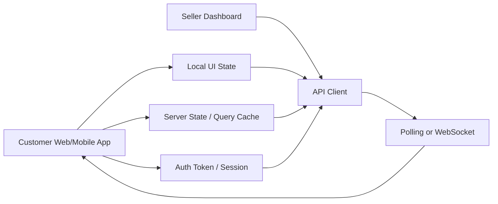
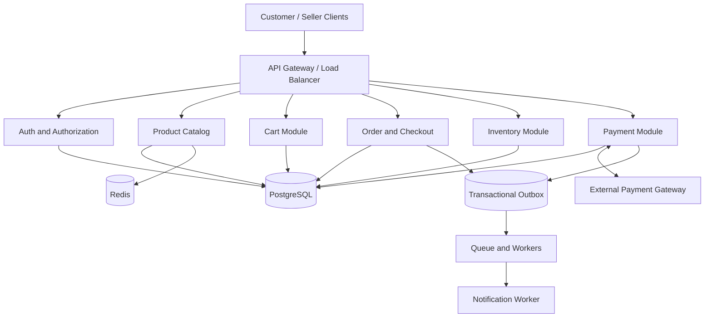
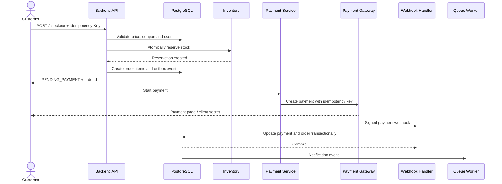
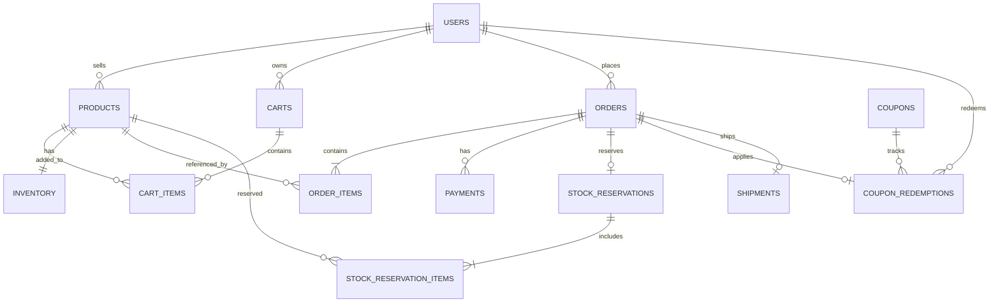
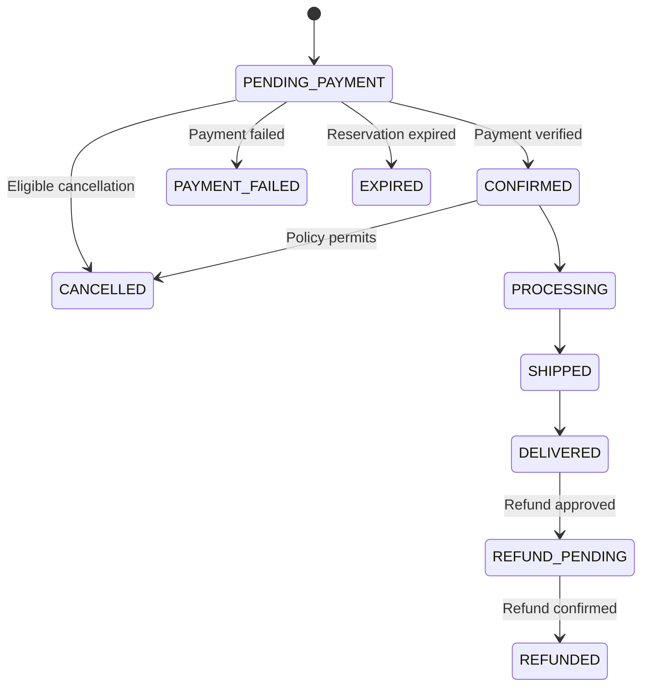

# Daraz-এর মতো E-commerce System Design

এই document-টি junior software engineer interview-এর জন্য তৈরি। এখানে শুধু প্রয়োজনীয় system design topics রাখা হয়েছে।

## ১. Problem Statement

Daraz-এর মতো একটি e-commerce platform design করতে হবে যেখানে customer product browse করতে, cart-এ item যোগ করতে, checkout করতে, online payment দিতে এবং order track করতে পারবে। Seller product, price এবং stock manage করতে পারবে।

সবচেয়ে গুরুত্বপূর্ণ সমস্যা:

- একই product একসঙ্গে অনেক customer কিনতে চাইলে overselling বন্ধ করা।
- Customer বারবার checkout request পাঠালেও duplicate order না তৈরি করা।
- Payment failure, server crash এবং delayed webhook handle করা।
- Payment না হলে নির্দিষ্ট সময় পরে reserved stock release করা।
- Order, payment এবং inventory data consistent রাখা।

**Interview answer:**

> আমি প্রথমে modular monolith, PostgreSQL এবং Redis cache ব্যবহার করব। Product browsing cache করা যাবে, কিন্তু checkout-এর price, stock এবং payment-এর authoritative data PostgreSQL-এ থাকবে। Order, order items এবং stock reservation database transaction-এর মধ্যে তৈরি করব। External payment gateway-এর জন্য idempotency, signed webhook এবং reconciliation ব্যবহার করব।

## ২. Frontend Architecture



### Frontend responsibility

- Product list, search, filter এবং product details দেখানো।
- Cart item add, update এবং remove করা।
- Checkout form এবং payment page দেখানো।
- Order status backend থেকে দেখানো।
- Request চলার সময় checkout button disable করা।
- প্রতিটি logical checkout-এর জন্য একই `Idempotency-Key` retry-তে reuse করা।
- `PENDING`, `PAYMENT_FAILED`, `EXPIRED`, `CONFIRMED` state আলাদাভাবে দেখানো।
- শুরুতে order tracking-এর জন্য polling ব্যবহার করা; প্রয়োজন হলে WebSocket যোগ করা।

**গুরুত্বপূর্ণ:** Duplicate order শুধু button disable করে আটকানো যাবে না। Backend এবং database-এ idempotency enforce করতে হবে।

## ৩. Backend Architecture



### Backend module-এর দায়িত্ব

| Module | দায়িত্ব |
|---|---|
| Auth | Login, token, role এবং ownership check |
| Product Catalog | Product, category, price এবং availability |
| Cart | Customer-এর cart ও quantity |
| Order/Checkout | Price validation, coupon, order creation |
| Inventory | Stock reserve, confirm এবং release |
| Payment | Payment session, webhook, refund ও reconciliation |
| PostgreSQL | Authoritative transactional data |
| Redis | Product/catalog-এর cache |
| Queue/Worker | Notification ও retryable background কাজ |
| Outbox | DB update-এর সঙ্গে event durable করা |

### Junior interview answer

> প্রথমে সব module একটি modular monolith-এর মধ্যে রাখব। Module boundary পরিষ্কার থাকবে, কিন্তু এক database ব্যবহার করবে। Traffic, team ownership বা independent scaling-এর প্রয়োজন হলে Product, Order, Inventory এবং Payment আলাদা service করা যাবে। Strongly consistent stock operation অপ্রয়োজনে network boundary-তে ভাগ করব না।

## ৪. Full System Architecture ও Order Flow



  ### Architecture-wise request path

  1. **Frontend layer:** Customer বা seller UI API client-এর মাধ্যমে HTTPS request পাঠায়। UI local state এবং server state আলাদা রাখে।
  2. **API layer:** API Gateway authentication, authorization, rate limit এবং request routing করে।
  3. **Business layer:** Catalog, Cart, Checkout, Inventory, Payment এবং Shipment module business rule প্রয়োগ করে।
  4. **Data layer:** PostgreSQL transaction, constraint এবং lock দিয়ে order, stock, payment ও reservation-এর consistency নিশ্চিত করে। Redis শুধু cache হিসেবে কাজ করে।
  5. **External layer:** Payment Gateway payment process করে এবং signed webhook পাঠায়। Queue/Outbox notification ও retryable side effect process করে।

  **Interview-এ বলার sequence:**

  > Customer frontend থেকে checkout request পাঠায়। API Gateway request authenticate করে Checkout module-এ পাঠায়। Checkout module PostgreSQL transaction-এর মধ্যে current price validate, inventory reserve, order এবং payment record তৈরি করে। Commit-এর পরে Payment Gateway session শুরু হয়। Gateway webhook এলে Payment module signature verify করে order ও payment update করে। তারপর Outbox/Queue notification এবং tracking update process করে।

### Complete checkout flow

1. Customer cart থেকে product ID এবং quantity পাঠায়।
2. Backend user authentication, product status, current price, quantity এবং coupon validate করে।
3. `Idempotency-Key` এবং request hash check করা হয়। আগের একই request থাকলে আগের order ফেরত দেওয়া হয়।
4. Database transaction শুরু হয়। Product ID-এর consistent order-এ inventory row lock বা conditional update করা হয়।
5. প্রতিটি item-এর stock reserve করা হয়। কোনো item reserve না হলে পুরো transaction rollback হয়।
6. `orders`, `order_items`, `stock_reservations` এবং outbox event তৈরি হয়।
7. Transaction commit হলে order `PENDING_PAYMENT` অবস্থায় client-কে ফেরত দেওয়া হয়।
8. Payment service provider-এর idempotency key ব্যবহার করে payment session তৈরি করে। External HTTP call database transaction-এর ভেতরে রাখা হয় না।
9. Payment gateway signed webhook পাঠায়। Webhook verify করে payment এবং order state update করা হয়।
10. Payment সফল হলে order `CONFIRMED` এবং reservation `CONFIRMED` হয়।
11. Payment failure বা expiry হলে stock release হয়। Notification queue worker দিয়ে পাঠানো হয়।

## ৫. Database Design

PostgreSQL ব্যবহার করব, কারণ order, payment এবং inventory-এর জন্য transaction, foreign key, unique constraint এবং row-level locking প্রয়োজন। Money floating-point নয়, integer minor unit-এ (`price_minor`) রাখা হবে।

### 5.1 `users`

| Column | Type | Rule |
|---|---|---|
| `id` | UUID | Primary key |
| `name` | VARCHAR(120) | NOT NULL |
| `email` | VARCHAR(255) | UNIQUE, NOT NULL |
| `password_hash` | TEXT | Plaintext নয় |
| `role` | VARCHAR(20) | `CUSTOMER`, `SELLER`, `ADMIN` |
| `created_at` | TIMESTAMPTZ | NOT NULL |

### 5.2 `products`

| Column | Type | Rule |
|---|---|---|
| `id` | UUID | Primary key |
| `seller_id` | UUID | FK → `users.id` |
| `name` | VARCHAR(255) | NOT NULL |
| `description` | TEXT | Optional |
| `price_minor` | BIGINT | `>= 0` |
| `currency` | CHAR(3) | যেমন `BDT` |
| `status` | VARCHAR(20) | `DRAFT`, `ACTIVE`, `INACTIVE` |
| `created_at` | TIMESTAMPTZ | NOT NULL |
| `updated_at` | TIMESTAMPTZ | NOT NULL |

### 5.3 `inventory`

| Column | Type | Rule |
|---|---|---|
| `product_id` | UUID | PK এবং FK → `products.id` |
| `available_qty` | INTEGER | `>= 0` |
| `reserved_qty` | INTEGER | `>= 0` |
| `updated_at` | TIMESTAMPTZ | NOT NULL |

`available_qty` নতুন order-এর জন্য available stock। `reserved_qty` active reservation-এ থাকা stock।

### 5.4 `carts`

| Column | Type | Rule |
|---|---|---|
| `id` | UUID | Primary key |
| `user_id` | UUID | FK → `users.id` |
| `status` | VARCHAR(20) | `ACTIVE`, `CONVERTED`, `ABANDONED` |
| `updated_at` | TIMESTAMPTZ | NOT NULL |

### 5.5 `cart_items`

| Column | Type | Rule |
|---|---|---|
| `cart_id` | UUID | FK → `carts.id` |
| `product_id` | UUID | FK → `products.id` |
| `quantity` | INTEGER | `> 0` |
| `added_at` | TIMESTAMPTZ | NOT NULL |

**Constraint:** `PRIMARY KEY (cart_id, product_id)`। Cart-এর price authoritative নয়; checkout-এ price আবার database থেকে পড়তে হবে।

### 5.6 `orders`

| Column | Type | Rule |
|---|---|---|
| `id` | UUID | Primary key |
| `user_id` | UUID | FK → `users.id` |
| `status` | VARCHAR(30) | Order status |
| `subtotal_minor` | BIGINT | `>= 0` |
| `discount_minor` | BIGINT | `>= 0` |
| `shipping_minor` | BIGINT | `>= 0` |
| `total_minor` | BIGINT | `>= 0` |
| `currency` | CHAR(3) | NOT NULL |
| `idempotency_key` | VARCHAR(128) | Retry protection |
| `created_at` | TIMESTAMPTZ | NOT NULL |
| `updated_at` | TIMESTAMPTZ | NOT NULL |

**Constraint:** `UNIQUE(user_id, idempotency_key)`। একই key-তে ভিন্ন payload এলে `409 Conflict`।

### 5.7 `order_items`

| Column | Type | Rule |
|---|---|---|
| `id` | UUID | Primary key |
| `order_id` | UUID | FK → `orders.id` |
| `product_id` | UUID | FK → `products.id` |
| `product_name_snapshot` | VARCHAR(255) | Order-time name |
| `unit_price_minor` | BIGINT | `>= 0` |
| `quantity` | INTEGER | `> 0` |
| `line_total_minor` | BIGINT | `>= 0` |

Price এবং name snapshot রাখতে হবে, যাতে পরে product update হলেও পুরোনো order বদলে না যায়।

### 5.8 `payments`

| Column | Type | Rule |
|---|---|---|
| `id` | UUID | Primary key |
| `order_id` | UUID | FK → `orders.id` |
| `provider` | VARCHAR(40) | Gateway name |
| `provider_payment_id` | VARCHAR(255) | Provider reference |
| `amount_minor` | BIGINT | `> 0` |
| `currency` | CHAR(3) | NOT NULL |
| `status` | VARCHAR(20) | Payment status |
| `idempotency_key` | VARCHAR(128) | Provider deduplication |
| `created_at` | TIMESTAMPTZ | NOT NULL |
| `updated_at` | TIMESTAMPTZ | NOT NULL |

**Constraint:** `UNIQUE(provider, provider_payment_id)`।

### 5.9 `coupons`

| Column | Type | Rule |
|---|---|---|
| `id` | UUID | Primary key |
| `code` | VARCHAR(50) | UNIQUE |
| `discount_type` | VARCHAR(20) | `PERCENTAGE`, `FIXED` |
| `discount_value` | BIGINT | `> 0` |
| `max_redemptions` | INTEGER | `> 0` |
| `redeemed_count` | INTEGER | `>= 0` |
| `starts_at` | TIMESTAMPTZ | NOT NULL |
| `expires_at` | TIMESTAMPTZ | NOT NULL |
| `status` | VARCHAR(20) | `ACTIVE`, `INACTIVE` |

### 5.10 `coupon_redemptions`

| Column | Type | Rule |
|---|---|---|
| `id` | UUID | Primary key |
| `coupon_id` | UUID | FK → `coupons.id` |
| `user_id` | UUID | FK → `users.id` |
| `order_id` | UUID | FK → `orders.id` |
| `status` | VARCHAR(20) | `RESERVED`, `REDEEMED`, `RELEASED` |
| `created_at` | TIMESTAMPTZ | NOT NULL |

Policy অনুযায়ী `UNIQUE(coupon_id, user_id)` বা `UNIQUE(order_id)` রাখা যায়।

### 5.11 `stock_reservations`

| Column | Type | Rule |
|---|---|---|
| `id` | UUID | Primary key |
| `order_id` | UUID | FK → `orders.id`, UNIQUE |
| `status` | VARCHAR(20) | `ACTIVE`, `CONFIRMED`, `RELEASED`, `EXPIRED` |
| `expires_at` | TIMESTAMPTZ | NOT NULL |
| `created_at` | TIMESTAMPTZ | NOT NULL |
| `updated_at` | TIMESTAMPTZ | NOT NULL |

### 5.12 `stock_reservation_items`

| Column | Type | Rule |
|---|---|---|
| `reservation_id` | UUID | FK → `stock_reservations.id` |
| `product_id` | UUID | FK → `products.id` |
| `quantity` | INTEGER | `> 0` |

**Primary key:** `(reservation_id, product_id)`।

### 5.13 `payment_webhook_events`

| Column | Type | Rule |
|---|---|---|
| `id` | UUID | Primary key |
| `provider` | VARCHAR(40) | NOT NULL |
| `event_id` | VARCHAR(255) | NOT NULL |
| `event_type` | VARCHAR(80) | NOT NULL |
| `status` | VARCHAR(20) | `RECEIVED`, `PROCESSED`, `FAILED` |
| `received_at` | TIMESTAMPTZ | NOT NULL |
| `processed_at` | TIMESTAMPTZ | Nullable |

**Constraint:** `UNIQUE(provider, event_id)`।

### 5.14 `outbox_events`

| Column | Type | Rule |
|---|---|---|
| `id` | UUID | Primary key |
| `aggregate_type` | VARCHAR(50) | যেমন `ORDER` |
| `aggregate_id` | UUID | NOT NULL |
| `event_type` | VARCHAR(80) | NOT NULL |
| `payload` | JSONB | NOT NULL |
| `published_at` | TIMESTAMPTZ | Nullable |
| `created_at` | TIMESTAMPTZ | NOT NULL |

### 5.15 `shipments`

| Column | Type | Rule |
|---|---|---|
| `id` | UUID | Primary key |
| `order_id` | UUID | FK → `orders.id` |
| `carrier` | VARCHAR(80) | NOT NULL |
| `tracking_number` | VARCHAR(120) | UNIQUE |
| `status` | VARCHAR(30) | Delivery status |
| `created_at` | TIMESTAMPTZ | NOT NULL |
| `updated_at` | TIMESTAMPTZ | NOT NULL |

### গুরুত্বপূর্ণ index

- `orders(user_id, created_at DESC)`
- `order_items(order_id)`
- `products(seller_id, status)`
- `stock_reservations(status, expires_at)`
- `payments(order_id)`
- `payment_webhook_events(provider, event_id)`
- `coupons(code)`

## ৬. ER Diagram



**Interview answer:** `users` table-এ customer, seller এবং admin role রাখা যায়। Product-এর সঙ্গে inventory-এর one-to-one relation। Order-এর সঙ্গে order items, payments, reservation এবং shipment-এর relation থাকবে।

## ৭. Status Management

### Order status



| Status | অর্থ |
|---|---|
| `PENDING_PAYMENT` | Order তৈরি, payment নিশ্চিত নয় |
| `CONFIRMED` | Payment verified এবং order নিশ্চিত |
| `PAYMENT_FAILED` | Payment ব্যর্থ, stock release হবে |
| `EXPIRED` | Payment সময়মতো হয়নি, reservation expire |
| `CANCELLED` | Business policy অনুযায়ী বাতিল |
| `PROCESSING` | Seller order প্রস্তুত করছে |
| `SHIPPED` | Order courier-এর কাছে |
| `DELIVERED` | Customer order পেয়েছে |
| `REFUND_PENDING` | Refund শুরু হয়েছে |
| `REFUNDED` | Refund নিশ্চিত হয়েছে |

### Payment status

`CREATED → PENDING → SUCCEEDED | FAILED | CANCELLED`

Refund হলে: `REFUND_PENDING → REFUNDED`। Signed webhook বা verified provider response ছাড়া payment-কে `SUCCEEDED` করা যাবে না।

### Reservation status

`ACTIVE → CONFIRMED` অথবা `ACTIVE → RELEASED / EXPIRED`

একটি reservation একবারের বেশি release করা যাবে না। Conditional status update এবং inventory update একই transaction-এ রাখতে হবে।

## ৮. REST API Design

সব endpoint HTTPS ব্যবহার করবে। Protected endpoint-এ authentication, role check এবং ownership check থাকবে।

### Authentication

| Method | Endpoint | কাজ |
|---|---|---|
| `POST` | `/api/v1/auth/register` | Account তৈরি |
| `POST` | `/api/v1/auth/login` | Login |
| `POST` | `/api/v1/auth/refresh` | Token refresh |
| `GET` | `/api/v1/users/me` | নিজের profile |
| `PATCH` | `/api/v1/users/me` | Profile update |
| `POST` | `/api/v1/auth/logout` | Current session invalidate |

### Address

| Method | Endpoint | কাজ |
|---|---|---|
| `GET` | `/api/v1/addresses` | নিজের address list |
| `POST` | `/api/v1/addresses` | নতুন delivery address |
| `GET` | `/api/v1/addresses/:addressId` | Address details |
| `PATCH` | `/api/v1/addresses/:addressId` | Address update |
| `DELETE` | `/api/v1/addresses/:addressId` | Address delete |

### Product ও Inventory

| Method | Endpoint | কাজ |
|---|---|---|
| `GET` | `/api/v1/products?q=&category=&page=` | Product search/filter |
| `GET` | `/api/v1/products/:productId` | Product details |
| `POST` | `/api/v1/seller/products` | Seller product তৈরি |
| `PATCH` | `/api/v1/seller/products/:productId` | Product update |
| `PUT` | `/api/v1/seller/products/:productId/inventory` | Stock adjustment |
| `GET` | `/api/v1/seller/products` | নিজের product list |
| `GET` | `/api/v1/seller/products/:productId` | নিজের product details |
| `DELETE` | `/api/v1/seller/products/:productId` | Product deactivate |
| `GET` | `/api/v1/products/:productId/inventory` | Product availability |

Seller arbitrary `available_qty` overwrite না করে stock adjustment বা stock movement ব্যবহার করবে।

### Cart

| Method | Endpoint | কাজ |
|---|---|---|
| `GET` | `/api/v1/cart` | নিজের cart |
| `POST` | `/api/v1/cart/items` | Product যোগ |
| `PATCH` | `/api/v1/cart/items/:productId` | Quantity update |
| `DELETE` | `/api/v1/cart/items/:productId` | Item remove |
| `DELETE` | `/api/v1/cart` | Cart empty করা |

### Checkout ও Order

| Method | Endpoint | কাজ |
|---|---|---|
| `POST` | `/api/v1/checkout` | Checkout ও stock reservation |
| `GET` | `/api/v1/orders` | Order history |
| `GET` | `/api/v1/orders/:orderId` | Order details |
| `POST` | `/api/v1/orders/:orderId/cancel` | Order cancel |
| `GET` | `/api/v1/orders/:orderId/items` | Order items |
| `GET` | `/api/v1/orders/:orderId/status` | Current order status |
| `POST` | `/api/v1/orders/:orderId/retry-payment` | Payment retry |

### Seller Order Management

| Method | Endpoint | কাজ |
|---|---|---|
| `GET` | `/api/v1/seller/orders` | Seller-এর order list |
| `GET` | `/api/v1/seller/orders/:orderId` | Seller order details |
| `PATCH` | `/api/v1/seller/orders/:orderId/confirm` | Order confirm |
| `PATCH` | `/api/v1/seller/orders/:orderId/reject` | Order reject |
| `PATCH` | `/api/v1/seller/orders/:orderId/processing` | Processing শুরু |
| `PATCH` | `/api/v1/seller/orders/:orderId/packed` | Product packed করা |

### Coupon

| Method | Endpoint | কাজ |
|---|---|---|
| `GET` | `/api/v1/coupons/:code` | Coupon details/validity |
| `POST` | `/api/v1/coupons/validate` | Checkout-এর আগে coupon validate |
| `POST` | `/api/v1/seller/coupons` | Seller coupon তৈরি |
| `PATCH` | `/api/v1/seller/coupons/:couponId` | Coupon update/deactivate |

Checkout request:

```http
POST /api/v1/checkout
Authorization: Bearer <token>
Idempotency-Key: checkout-unique-key
Content-Type: application/json
```

```json
{
  "items": [
    { "productId": "product-uuid-1", "quantity": 2 },
    { "productId": "product-uuid-2", "quantity": 1 }
  ],
  "couponCode": "SAVE10",
  "shippingAddressId": "address-uuid"
}
```

Client-এর price, discount এবং total trust করা যাবে না। Backend current price, stock ও coupon rules দিয়ে total calculate করবে।

### Payment ও Refund

| Method | Endpoint | কাজ |
|---|---|---|
| `POST` | `/api/v1/orders/:orderId/payment-session` | Payment session তৈরি |
| `GET` | `/api/v1/payments/:paymentId` | Payment status |
| `POST` | `/api/v1/webhooks/payments/:provider` | Gateway webhook |
| `POST` | `/api/v1/orders/:orderId/refund` | Refund request |
| `GET` | `/api/v1/orders/:orderId/payments` | Order-এর payment attempts |
| `POST` | `/api/v1/payments/:paymentId/cancel` | Pending payment cancel |
| `GET` | `/api/v1/refunds/:refundId` | Refund status |
| `POST` | `/api/v1/admin/payments/:paymentId/reconcile` | Payment reconcile |

Webhook-এ provider signature, timestamp, replay protection এবং event ID verify করতে হবে। সাধারণ user JWT নয়, provider signature ব্যবহার করতে হবে।

### Delivery/Tracking

| Method | Endpoint | কাজ |
|---|---|---|
| `POST` | `/api/v1/orders/:orderId/shipments` | Shipment তৈরি |
| `GET` | `/api/v1/orders/:orderId/shipment` | Shipment details |
| `GET` | `/api/v1/orders/:orderId/tracking` | Delivery tracking |
| `PATCH` | `/api/v1/seller/shipments/:shipmentId/status` | Shipment status update |

### Admin

| Method | Endpoint | কাজ |
|---|---|---|
| `GET` | `/api/v1/admin/orders` | সব order search |
| `GET` | `/api/v1/admin/users` | User management |
| `PATCH` | `/api/v1/admin/products/:productId/status` | Product moderate |
| `GET` | `/api/v1/admin/inventory/low-stock` | Low-stock product list |

### Error response

```json
{
  "error": {
    "code": "INSUFFICIENT_STOCK",
    "message": "একটি বা একাধিক পণ্যের পর্যাপ্ত stock নেই।",
    "requestId": "req-unique-id"
  }
}
```

- `400`: Invalid input
- `401`: Authentication সমস্যা
- `403`: Permission নেই
- `404`: Resource নেই
- `409`: Stock conflict, idempotency mismatch বা invalid state
- `422`: Business rule ব্যর্থ
- `429`: Rate limit
- `500`: Unexpected server error
- `502/503`: External provider unavailable

## ৯. ১০ মিনিটের Stock Reservation ও Expiry Mechanism

### Reservation তৈরি

Customer payment page-এ থাকা অবস্থায় stock ধরে রাখার জন্য reservation তৈরি হবে। Checkout transaction-এর মধ্যে:

1. `available_qty >= requested_qty` শর্তে stock reserve।
2. `stock_reservations` row `ACTIVE` হিসেবে তৈরি।
3. `expires_at = NOW() + INTERVAL '10 minutes'` সেট।
4. Reservation item quantity save।
5. Order `PENDING_PAYMENT` হিসেবে save।
6. সব একসঙ্গে commit।

### Expiry worker

প্রতি কিছু সময় পর background worker expired reservation খুঁজবে:

```sql
SELECT id
FROM stock_reservations
WHERE status = 'ACTIVE'
  AND expires_at <= NOW()
ORDER BY expires_at
FOR UPDATE SKIP LOCKED
LIMIT 100;
```

প্রতিটি reservation-এর জন্য transaction-এ:

1. Reservation row lock বা conditional transition।
2. `ACTIVE → EXPIRED` update সফল হয়েছে কি না যাচাই।
3. সফল হলে `available_qty += quantity` এবং `reserved_qty -= quantity`।
4. Order pending থাকলে `EXPIRED` করা।
5. Coupon reservation থাকলে release করা।
6. Commit করা।

**Idempotency:** `ACTIVE` থেকে একবারই transition হতে পারবে। তাই একই worker আবার চললেও stock দ্বিতীয়বার release হবে না।

### Expiry race

Expiry worker এবং payment webhook একই reservation update করতে পারে। দুজনকেই reservation/order row lock নিতে হবে এবং current status transaction-এর মধ্যে যাচাই করতে হবে।

## ১০. Payment Failure ও Delayed Webhook

Database এবং external payment gateway-এর মধ্যে single ACID transaction নেই। তাই idempotency, durable webhook record এবং reconciliation দরকার।

### Payment failure

1. Gateway webhook বা trusted provider API দিয়ে failure verify।
2. `payment: PENDING → FAILED` transition।
3. Order `PENDING_PAYMENT` হলে `PAYMENT_FAILED` করা।
4. Reservation `ACTIVE` থাকলে stock release।
5. Coupon reservation থাকলে release।
6. Duplicate webhook এলে দ্বিতীয়বার কোনো side effect না করা।

### Payment সফল কিন্তু server crash

Gateway টাকা কেটে নেওয়ার পর application crash করতে পারে। এই ক্ষেত্রে:

- `payment_webhook_events`-এ event ID unique করে event durable ভাবে রাখা হবে।
- Provider retry এবং scheduled reconciliation worker ব্যবহার করা হবে।
- Provider API থেকে pending payment-এর status verify করা হবে।
- Verified success হলে idempotent transaction দিয়ে order confirm করা হবে।
- Reservation expire হয়ে গেলে oversell না করে refund/void বা manual review করা হবে।

### Webhook processing rule

1. Provider signature এবং timestamp যাচাই।
2. `UNIQUE(provider, event_id)` দিয়ে duplicate event আটকানো।
3. Amount, currency, payment reference যাচাই।
4. Payment, order এবং reservation state একই DB transaction-এ update।
5. Commit হওয়ার পরে provider-কে `2xx` response।
6. Transient failure হলে provider/internal worker retry করবে।

### Delayed success after expiry

Reservation `EXPIRED` হওয়ার পরে success webhook এলে stock negative করা যাবে না। Current reservation এবং order row lock করে:

- Reservation active হলে order confirm করা যায়।
- Reservation expired এবং stock অন্য order-এ চলে গেলে refund/void বা manual review।
- Stock available থাকলে business policy অনুযায়ী নতুন atomic reservation চেষ্টা করা যায়।
- Race হলে database lock এবং valid state transition winner নির্ধারণ করবে।

## ১১. Database Transaction

### Checkout transaction pseudocode

```text
function checkout(userId, items, couponCode, idempotencyKey):
    validate request and positive quantities

    BEGIN TRANSACTION

      existing = find order by (userId, idempotencyKey)
      if existing exists:
          if request hash differs:
              return 409 Conflict
          return existing order

      load current products and prices
      validate active products and coupon
      calculate total using integer minor units

      for each product ordered by productId:
          UPDATE inventory
          SET available_qty = available_qty - quantity,
              reserved_qty = reserved_qty + quantity
          WHERE product_id = productId
            AND available_qty >= quantity
          if update affected zero rows:
              ROLLBACK and return INSUFFICIENT_STOCK

      create order with PENDING_PAYMENT
      create order_items with price/name snapshots
      create ACTIVE stock_reservation with 10-minute expiry
      insert outbox event

    COMMIT TRANSACTION

    create payment session outside the DB transaction
    return order and payment details
```

### Transaction-এর মূল নিয়ম

- Stock update, order, order items এবং reservation একই transaction-এ থাকবে।
- কোনো item reserve ব্যর্থ হলে পুরো checkout rollback হবে।
- External payment API, email বা SMS transaction-এর ভেতরে রাখা যাবে না।
- Concurrent duplicate checkout আটকাতে unique constraint ব্যবহার করতে হবে।
- Deadlock বা serialization failure হলে সীমিত retry করা যাবে।
- Product ID ascending order-এ lock করলে deadlock risk কমে।

## ১২. ACID Properties

### Atomicity

সব operation একসঙ্গে সফল হবে, অথবা সব rollback হবে। Stock reserve হয়েছে কিন্তু order তৈরি হয়নি—এমন partial result রাখা যাবে না।

### Consistency

প্রতিটি commit-এর পরে business rule ঠিক থাকবে:

- `available_qty` negative হবে না।
- Order item-এর quantity `> 0` হবে।
- Foreign key valid থাকবে।
- Coupon limit অতিক্রম হবে না।
- একটি reservation একবারের বেশি release হবে না।

### Isolation

একই stock-এর জন্য দুই customer একসঙ্গে checkout করলে database concurrent update control করবে। Conditional update, row lock এবং unique constraint ব্যবহার করে একজনই শেষ stock reserve করতে পারবে।

### Durability

Transaction commit হওয়ার পরে application crash হলেও PostgreSQL-এ order, payment এবং reservation record থাকবে। Backup এবং recovery strategy durability আরও নিশ্চিত করবে।

### ACID-এর সীমাবদ্ধতা

ACID database-এর ভেতরের transaction guarantee করে; external payment gateway-কে একই atomic transaction-এর অংশ করে না। তাই payment-এর জন্য idempotency, signed webhook, durable event, retry এবং reconciliation দরকার।

### Interview-এ ৩০ সেকেন্ডের উত্তর

> Atomicity দিয়ে stock reservation, order এবং order items একসঙ্গে commit বা rollback করব। Consistency-এর জন্য foreign key, check এবং unique constraint থাকবে। Isolation-এর জন্য conditional stock update বা row lock ব্যবহার করব। Durability PostgreSQL commit ও backup/recovery দিয়ে নিশ্চিত হবে। External payment gateway database transaction-এর অংশ নয়, তাই signed webhook, idempotency এবং reconciliation ব্যবহার করব।
