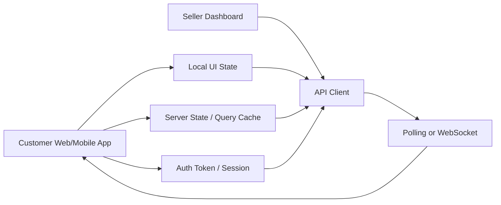
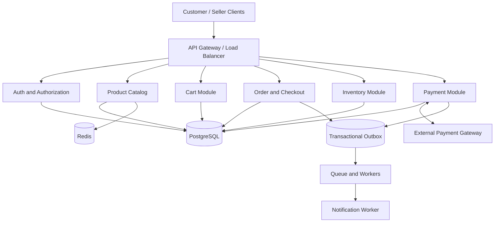
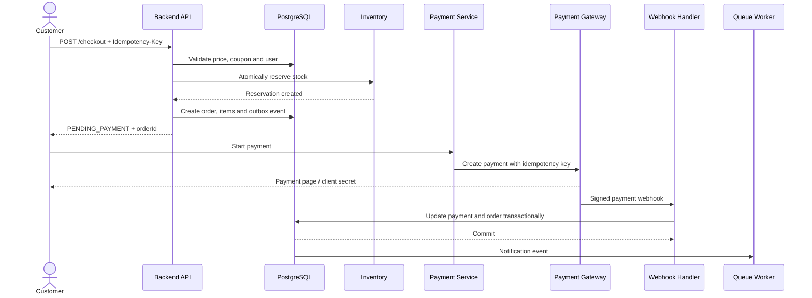
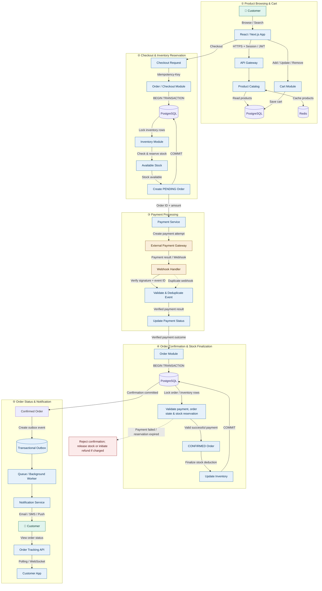
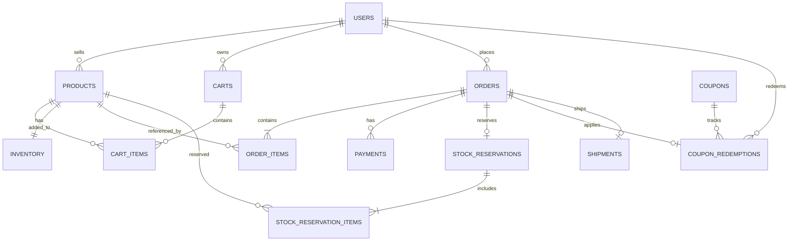
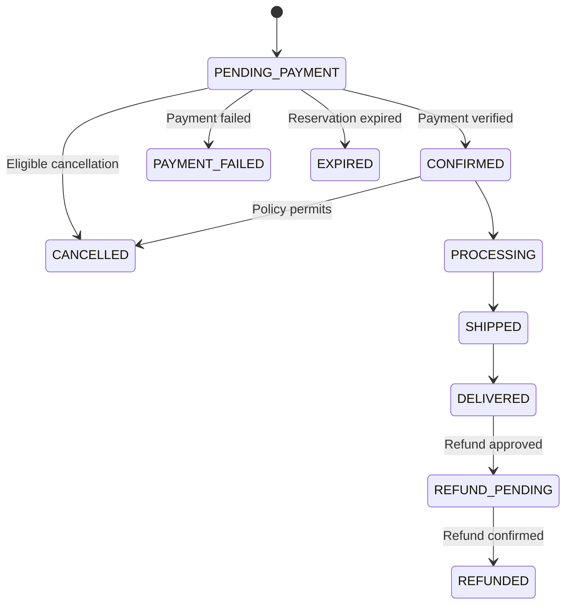

# Daraz-Like E-commerce System Design

This document is prepared for junior software engineer interviews. Only the essential system design topics are included here.

## 1. Problem Statement

Design an e-commerce platform like Daraz where customers can browse products, add items to their cart, check out, make online payments, and track orders. Sellers can manage products, prices, and stock.

The most important challenges are:

- Preventing overselling when many customers attempt to purchase the same product simultaneously.
- Preventing duplicate orders when a customer sends checkout requests repeatedly.
- Handling payment failures, server crashes, and delayed webhooks.
- Releasing reserved stock after a specified period if payment is not completed.
- Maintaining consistency across order, payment, and inventory data.

**Interview Answer:**

> I would initially use a modular monolith, PostgreSQL, and Redis cache. Product browsing can be cached, but PostgreSQL would remain the authoritative source for checkout prices, stock, and payment-related data. I would create orders, order items, and stock reservations within a database transaction. For the external payment gateway, I would use idempotency, signed webhooks, and reconciliation.

## 2. Frontend Architecture



### Frontend Responsibilities

- Display product lists, search results, filters, and product details.
- Add, update, and remove cart items.
- Display the checkout form and payment page.
- Display order status received from the backend.
- Disable the checkout button while a request is in progress.
- Generate an `Idempotency-Key` for each logical checkout and reuse the same key when retrying.
- Display `PENDING`, `PAYMENT_FAILED`, `EXPIRED`, and `CONFIRMED` states separately.
- Initially use polling for order tracking; add WebSockets when necessary.

**Important:** Disabling the button alone cannot prevent duplicate orders. Idempotency must be enforced by the backend and database.

## 3. Backend Architecture



### Responsibilities of Backend Modules

| Module | Responsibility |
|---|---|
| Auth | Login, tokens, roles, and ownership checks |
| Product Catalog | Products, categories, prices, and availability |
| Cart | Customer carts and quantities |
| Order/Checkout | Price validation, coupons, and order creation |
| Inventory | Stock reservation, confirmation, and release |
| Payment | Payment sessions, webhooks, refunds, and reconciliation |
| PostgreSQL | Authoritative transactional data |
| Redis | Product/catalog caching |
| Queue/Worker | Notifications and retryable background tasks |
| Outbox | Persisting events reliably alongside database updates |

### Junior Interview Answer

> I would initially keep all modules inside a modular monolith. Module boundaries would remain clear, but they would share one database. Product, Order, Inventory, and Payment could be separated into independent services when traffic, team ownership, or independent scaling requirements justify it. I would avoid splitting strongly consistent stock operations across network boundaries unnecessarily.

## 4. Full System Architecture and Order Flow



### Architecture-Wise Request Path

1. **Frontend Layer:** The customer or seller UI sends HTTPS requests through the API client. Local state and server state are managed separately.
2. **API Layer:** The API Gateway handles authentication, authorization, rate limiting, and request routing.
3. **Business Layer:** The Catalog, Cart, Checkout, Inventory, Payment, and Shipment modules enforce business rules.
4. **Data Layer:** PostgreSQL uses transactions, constraints, and locks to maintain consistency across orders, stock, payments, and reservations. Redis is used only for caching.
5. **External Layer:** The Payment Gateway processes payments and sends signed webhooks. The Queue/Outbox handles notifications and retryable side effects.

**Interview Sequence:**

> The customer sends a checkout request from the frontend. The API Gateway authenticates the request and routes it to the Checkout module. Within a PostgreSQL transaction, the Checkout module validates the current price, reserves inventory, and creates the order and payment record. After the transaction commits, a Payment Gateway session is initiated. When a webhook arrives, the Payment module verifies its signature and updates the order and payment records. The Outbox/Queue then processes notifications and tracking updates.

### End-to-End Flow



## Step-by-Step End-to-End Architecture

### Step 1: Product Browsing and Cart Management

At this stage, the customer browses products, searches and filters them, and adds selected products to the cart.

1. The customer sends a request from the React / Next.js Web App to view product lists, search results, filters, or product details.
2. The request reaches the API Gateway over HTTPS.
3. The API Gateway performs Authentication and Authorization checks when required and forwards the request to the Product Catalog Module.
4. The Product Catalog Module retrieves product information from PostgreSQL. Redis cache can be used to serve frequently requested product data more quickly.
5. When the customer adds, updates, or removes a product from the cart, the Cart Module processes the request.
6. The Cart Module stores cart changes in the database so that the customer can view the cart later.

**Purpose of this step:** Prepare the customer for checkout through product browsing and cart management.

### Step 2: Checkout Request and Inventory Reservation

At this stage, the customer attempts to place an order, and the system ensures that the required product stock is available.

1. When the customer clicks the Checkout button, the frontend sends a request to the Checkout API.
2. The frontend generates an `Idempotency-Key` for each logical checkout. The same key is reused for retry requests belonging to that checkout.
3. The Order / Checkout Module validates the key. If a result already exists for the same request, it returns that result; otherwise, it starts processing.
4. The Order Module starts a PostgreSQL transaction.
5. The Inventory Module locks the relevant product inventory rows or uses a conditional stock update to check stock availability.
6. If the required stock is available, the system reserves the stock and creates an order with `PENDING` status.
7. The transaction commits if the order and inventory reservation are successfully created within the same database transaction. If any operation fails, the transaction rolls back.
8. The frontend receives a response containing the Order ID, payable amount, and next payment step.

**Purpose of this step:** Prevent overselling when multiple customers attempt to purchase the same stock simultaneously and prevent duplicate orders caused by repeated checkout requests.

### Step 3: Payment Processing

At this stage, the customer's payment request is processed and the actual payment outcome is verified.

1. After the order is created, the Order ID, payable amount, and payment method are sent to the Payment Service.
2. The Payment Service creates a payment attempt and sends a payment request to the external payment gateway.
3. The customer completes the payment through the gateway.
4. After payment succeeds or fails, the payment gateway may send a webhook to the system.
5. The Webhook Handler first verifies the webhook signature to ensure that the request is not unauthorized.
6. The webhook event ID is checked to identify duplicate events. If the same event arrives again, the system ensures that payment processing is not applied a second time.
7. The Payment Service updates the payment record according to the verified payment result.

**Purpose of this step:** Reliably verify the actual payment outcome and protect the system against duplicate or forged webhooks.

**Important:** The frontend success page or browser redirect must not be accepted as definitive proof of successful payment. The system must rely on a verified gateway response or webhook.

### Step 4: Order Confirmation and Inventory Finalization

At this stage, the system verifies that the payment succeeded and that the order's stock reservation is still valid.

1. After receiving the verified payment result, the Order Module starts the order confirmation process.
2. A PostgreSQL transaction begins, and the relevant order and inventory reservation rows are locked as required.
3. The system verifies:
   - Whether the payment actually succeeded.
   - Whether the order has already been confirmed or cancelled.
   - Whether the inventory reservation is still valid.
   - Whether the reservation's expiry time has passed.
4. If all conditions are satisfied, the order status is changed to `CONFIRMED`.
5. Within the same transaction, the inventory reservation is finalized and the stock quantity is updated appropriately.
6. If all database operations succeed, the transaction commits. If any operation fails, the transaction rolls back, and the order is not treated as confirmed.
7. Even if payment succeeds, an expired reservation must not be blindly confirmed. Depending on business policy, a refund or compensation process must be initiated.

**Purpose of this step:** Maintain data consistency across Payment, Order, and Inventory.

**Role of ACID:**

- **Atomicity:** Order confirmation and stock finalization either succeed together or roll back together.
- **Consistency:** Stock cannot become negative, and invalid orders cannot be confirmed.
- **Isolation:** Concurrent checkouts are prevented from selling the same stock multiple times.
- **Durability:** Once a transaction commits, its confirmation-related database changes are permanently stored.

### Step 5: Notification and Order Tracking

At this stage, the customer is notified about order confirmation and can view the current order status.

1. After order confirmation commits successfully, a notification event is stored in the Transactional Outbox as part of the related database transaction.
2. A Background Worker retrieves events from the Outbox and processes notifications through a queue or another processing mechanism.
3. The Notification Service sends the customer an Email, SMS, or Push Notification.
4. The customer can view the current order status by sending a request from the frontend to the Order Tracking API.
5. Initially, the frontend can use polling at fixed intervals to receive order status updates.
6. WebSockets can be used when more real-time updates are required.
7. If notification delivery fails, a retry mechanism is used. Event processing should also be idempotent to prevent duplicate notifications caused by retries.

**Purpose of this step:** Inform the customer about order confirmation and subsequent status updates while reducing the risk of losing events when notification delivery fails.

### Step 6: Failure Handling and Recovery

A production-ready e-commerce system must handle failure scenarios, not just the successful flow.

1. **Duplicate Checkout:** If a request is retried with the same `Idempotency-Key`, return the result of the previous order; do not create a new order.
2. **Insufficient Stock:** Reject checkout if the required stock is unavailable, without creating an invalid reservation.
3. **Payment Failed:** If payment fails, the order must not be confirmed. Release stock according to the reservation policy.
4. **Duplicate Webhook:** Even if the same webhook arrives multiple times, payment or order transitions must not be applied a second time.
5. **Expired Reservation:** If the reservation has expired, the order must not be confirmed. If payment has already succeeded, initiate a refund or compensation process as required.
6. **Concurrent Purchase:** Prevent overselling using database row locks or atomic conditional updates and the necessary constraints.
7. **Notification Failure:** Use the Transactional Outbox and retry mechanism to process notifications later.
8. **Temporary Service Failure:** Use timeouts, bounded retries, and monitoring as required. When retrying external payment requests, use the gateway's idempotency support if available.

**Purpose of this step:** Maintain data consistency and business correctness despite network failures, concurrent requests, duplicate events, and external service failures.

---

## Brief Flow Summary

1. **Product Browsing:** The customer browses products and creates a cart.
2. **Checkout:** The backend validates the request, reserves stock, and creates a `PENDING` order.
3. **Payment:** The Payment Service sends a payment request to the gateway and obtains a verified result.
4. **Order Confirmation:** The order is confirmed through an ACID transaction if the payment and stock reservation are valid.
5. **Notification:** The customer is notified through the Transactional Outbox and Background Worker.
6. **Order Tracking:** The customer views order status through polling or WebSockets.
7. **Failure Recovery:** Failures are handled using idempotency, database constraints, transactions, retries, and refund/compensation mechanisms.

### Complete Checkout Flow

1. The customer sends product IDs and quantities from the cart.
2. The backend validates user authentication, product status, current price, quantity, and coupon.
3. The system checks the `Idempotency-Key` and request hash. If the same request already exists, it returns the previous order.
4. A database transaction begins. Inventory rows are locked or conditionally updated in a consistent order based on product ID.
5. Stock is reserved for each item. If any item cannot be reserved, the entire transaction rolls back.
6. The system creates `orders`, `order_items`, `stock_reservations`, and an outbox event.
7. After the transaction commits, the order is returned to the client with `PENDING_PAYMENT` status.
8. The Payment Service creates a payment session using the provider's idempotency key. External HTTP calls are not made inside the database transaction.
9. The payment gateway sends a signed webhook. After verification, the payment and order states are updated.
10. If payment succeeds, the order becomes `CONFIRMED` and the reservation becomes `CONFIRMED`.
11. If payment fails or the reservation expires, stock is released. Notifications are sent through a queue worker.

## 5. Database Design

I would use PostgreSQL because orders, payments, and inventory require transactions, foreign keys, unique constraints, and row-level locking. Money would be stored in integer minor units (`price_minor`), not floating-point values.

### 5.1 `users`

| Column | Type | Rule |
|---|---|---|
| `id` | UUID | Primary key |
| `name` | VARCHAR(120) | NOT NULL |
| `email` | VARCHAR(255) | UNIQUE, NOT NULL |
| `password_hash` | TEXT | Never store plaintext |
| `role` | VARCHAR(20) | `CUSTOMER`, `SELLER`, `ADMIN` |
| `created_at` | TIMESTAMPTZ | NOT NULL |

Purpose: Stores account information for customers, sellers, and administrators.

- `id` — Unique user ID
- `name`, `email` — Identity information
- `password_hash` — Hashed password
- `role` — `CUSTOMER`, `SELLER`, or `ADMIN`

Example: A seller logs in and manages their own products.

### 5.2 `products`

| Column | Type | Rule |
|---|---|---|
| `id` | UUID | Primary key |
| `seller_id` | UUID | FK → `users.id` |
| `name` | VARCHAR(255) | NOT NULL |
| `description` | TEXT | Optional |
| `price_minor` | BIGINT | `>= 0` |
| `currency` | CHAR(3) | For example, `BDT` |
| `status` | VARCHAR(20) | `DRAFT`, `ACTIVE`, `INACTIVE` |
| `created_at` | TIMESTAMPTZ | NOT NULL |
| `updated_at` | TIMESTAMPTZ | NOT NULL |

Purpose: Stores product details belonging to sellers.

- `seller_id` — Identifies the seller who owns the product
- `name`, `description` — Product details
- `price_minor`, `currency` — Price and currency
- `status` — `ACTIVE`, `INACTIVE`, etc.

Example: A seller adds a mobile phone's name, price, and description.

### 5.3 `inventory`

| Column | Type | Rule |
|---|---|---|
| `product_id` | UUID | PK and FK → `products.id` |
| `available_qty` | INTEGER | `>= 0` |
| `reserved_qty` | INTEGER | `>= 0` |
| `updated_at` | TIMESTAMPTZ | NOT NULL |

`available_qty` represents stock available for new orders. `reserved_qty` represents stock held by active reservations.

Purpose: Tracks the available and reserved stock of each product.

- `product_id` — Identifies the product whose stock is tracked
- `available_qty` — Stock remaining for new orders
- `reserved_qty` — Stock reserved while awaiting payment

Example: There are 10 units in stock. When a customer checks out 2 units, the available stock becomes 8 and the reserved stock becomes 2.

### 5.4 `carts`

| Column | Type | Rule |
|---|---|---|
| `id` | UUID | Primary key |
| `user_id` | UUID | FK → `users.id` |
| `status` | VARCHAR(20) | `ACTIVE`, `CONVERTED`, `ABANDONED` |
| `updated_at` | TIMESTAMPTZ | NOT NULL |

Purpose: Stores the main record for a customer's shopping cart.

- `id` — Cart ID
- `user_id` — Owner of the cart
- `status` — `ACTIVE`, `CONVERTED`, or `ABANDONED`

Example: Identifies a customer's current shopping cart.

### 5.5 `cart_items`

| Column | Type | Rule |
|---|---|---|
| `cart_id` | UUID | FK → `carts.id` |
| `product_id` | UUID | FK → `products.id` |
| `quantity` | INTEGER | `> 0` |
| `added_at` | TIMESTAMPTZ | NOT NULL |

Purpose: Stores which products are in a cart and their quantities.

- `cart_id` — Identifies the cart
- `product_id` — Identifies the product
- `quantity` — Number of units

Example: A cart contains 2 shirts and 1 headphone.

Remember: The cart price is not final. The backend must revalidate the current price from the database during checkout.

**Constraint:** `PRIMARY KEY (cart_id, product_id)`. The cart price is not authoritative; the price must be retrieved from the database again during checkout.

### 5.6 `orders`

| Column | Type | Rule |
|---|---|---|
| `id` | UUID | Primary key |
| `user_id` | UUID | FK → `users.id` |
| `status` | VARCHAR(30) | Order status |
| `subtotal_minor` | BIGINT | `>= 0` |
| `discount_minor` | BIGINT | `>= 0` |
| `shipping_minor` | BIGINT | `>= 0` |
| `total_minor` | BIGINT | `>= 0` |
| `currency` | CHAR(3) | NOT NULL |
| `idempotency_key` | VARCHAR(128) | Retry protection |
| `created_at` | TIMESTAMPTZ | NOT NULL |
| `updated_at` | TIMESTAMPTZ | NOT NULL |

**Constraint:** `UNIQUE(user_id, idempotency_key)`. A different payload using the same key returns `409 Conflict`.

Purpose: Stores the main order record and its current state.

- `id` — Order ID
- `user_id` — Customer who placed the order
- `status` — `PENDING_PAYMENT`, `CONFIRMED`, `EXPIRED`, etc.
- `subtotal_minor`, `discount_minor`, `shipping_minor`, `total_minor` — Financial breakdown of the order
- `idempotency_key` — Helps prevent duplicate orders when the same checkout request is retried

Example: Order #101 is awaiting payment.

### 5.7 `order_items`

| Column | Type | Rule |
|---|---|---|
| `id` | UUID | Primary key |
| `order_id` | UUID | FK → `orders.id` |
| `product_id` | UUID | FK → `products.id` |
| `product_name_snapshot` | VARCHAR(255) | Name at order time |
| `unit_price_minor` | BIGINT | `>= 0` |
| `quantity` | INTEGER | `> 0` |
| `line_total_minor` | BIGINT | `>= 0` |

Price and name snapshots must be stored so that future product updates do not change historical orders.

Purpose: Stores the products included in an order, their purchase prices, and their quantities.

- `order_id` — Identifies the order containing the item
- `product_id` — Identifies the product
- `product_name_snapshot` — Product name at purchase time
- `unit_price_minor` — Unit price at purchase time
- `quantity`, `line_total_minor` — Quantity and total price for the item

Example: Order #101 contains 2 shirts purchased at 500 each.

Why are snapshots necessary? Even if a seller changes the product's name or price later, the historical order remains unchanged.

### 5.8 `payments`

| Column | Type | Rule |
|---|---|---|
| `id` | UUID | Primary key |
| `order_id` | UUID | FK → `orders.id` |
| `provider` | VARCHAR(40) | Gateway name |
| `provider_payment_id` | VARCHAR(255) | Provider reference |
| `amount_minor` | BIGINT | `> 0` |
| `currency` | CHAR(3) | NOT NULL |
| `status` | VARCHAR(20) | Payment status |
| `idempotency_key` | VARCHAR(128) | Provider deduplication |
| `created_at` | TIMESTAMPTZ | NOT NULL |
| `updated_at` | TIMESTAMPTZ | NOT NULL |

**Constraint:** `UNIQUE(provider, provider_payment_id)`.

Purpose: Stores payment attempts and references from the payment gateway.

- `order_id` — Identifies the order being paid for
- `provider` — Payment gateway name
- `provider_payment_id` — Payment reference from the gateway
- `amount_minor`, `currency` — Payment amount and currency
- `status` — `PENDING`, `SUCCEEDED`, `FAILED`, etc.

Example: This table records whether payment for Order #101 succeeded.

### 5.9 `coupons`

| Column | Type | Rule |
|---|---|---|
| `id` | UUID | Primary key |
| `code` | VARCHAR(50) | UNIQUE |
| `discount_type` | VARCHAR(20) | `PERCENTAGE`, `FIXED` |
| `discount_value` | BIGINT | `> 0` |
| `max_redemptions` | INTEGER | `> 0` |
| `redeemed_count` | INTEGER | `>= 0` |
| `starts_at` | TIMESTAMPTZ | NOT NULL |
| `expires_at` | TIMESTAMPTZ | NOT NULL |
| `status` | VARCHAR(20) | `ACTIVE`, `INACTIVE` |

Purpose: Stores discount coupon rules and validity.

- `code` — Coupon code, such as `SAVE10`
- `discount_type` — Percentage or fixed discount
- `discount_value` — Discount amount
- `max_redemptions`, `redeemed_count` — Usage limit and current usage count
- `starts_at`, `expires_at` — When the coupon becomes valid and expires

Example: A customer can receive a 10% discount using the `SAVE10` coupon if all coupon rules are satisfied.

### 5.10 `coupon_redemptions`

| Column | Type | Rule |
|---|---|---|
| `id` | UUID | Primary key |
| `coupon_id` | UUID | FK → `coupons.id` |
| `user_id` | UUID | FK → `users.id` |
| `order_id` | UUID | FK → `orders.id` |
| `status` | VARCHAR(20) | `RESERVED`, `REDEEMED`, `RELEASED` |
| `created_at` | TIMESTAMPTZ | NOT NULL |

Depending on the policy, `UNIQUE(coupon_id, user_id)` or `UNIQUE(order_id)` can be used.

Purpose: Tracks which coupon a user used for which order and the current redemption status.

- `coupon_id` — Identifies the coupon
- `user_id` — Identifies the customer
- `order_id` — Identifies the order
- `status` — `RESERVED`, `REDEEMED`, or `RELEASED`

Example: A coupon is reserved during checkout. After successful payment, it is redeemed according to policy; if checkout expires, it can be released.

### 5.11 `stock_reservations`

| Column | Type | Rule |
|---|---|---|
| `id` | UUID | Primary key |
| `order_id` | UUID | FK → `orders.id`, UNIQUE |
| `status` | VARCHAR(20) | `ACTIVE`, `CONFIRMED`, `RELEASED`, `EXPIRED` |
| `expires_at` | TIMESTAMPTZ | NOT NULL |
| `created_at` | TIMESTAMPTZ | NOT NULL |
| `updated_at` | TIMESTAMPTZ | NOT NULL |

Purpose: Stores how long stock is held for an order and the current reservation status.

- `order_id` — Identifies the order associated with the reservation
- `status` — `ACTIVE`, `CONFIRMED`, `RELEASED`, or `EXPIRED`
- `expires_at` — Reservation deadline

Example: Stock is held for 10 minutes while the customer completes payment. The reservation can expire after that period.

### 5.12 `stock_reservation_items`

| Column | Type | Rule |
|---|---|---|
| `reservation_id` | UUID | FK → `stock_reservations.id` |
| `product_id` | UUID | FK → `products.id` |
| `quantity` | INTEGER | `> 0` |

**Primary key:** `(reservation_id, product_id)`.

Purpose: Stores how much stock of each product is held in a reservation.

- `reservation_id` — Identifies the reservation
- `product_id` — Identifies the product
- `quantity` — Number of reserved units

Example: One reservation contains 2 shirts and 1 headphone.

### 5.13 `payment_webhook_events`

| Column | Type | Rule |
|---|---|---|
| `id` | UUID | Primary key |
| `provider` | VARCHAR(40) | NOT NULL |
| `event_id` | VARCHAR(255) | NOT NULL |
| `event_type` | VARCHAR(80) | NOT NULL |
| `status` | VARCHAR(20) | `RECEIVED`, `PROCESSED`, `FAILED` |
| `received_at` | TIMESTAMPTZ | NOT NULL |
| `processed_at` | TIMESTAMPTZ | Nullable |

**Constraint:** `UNIQUE(provider, event_id)`.

Purpose: Stores records of webhook events received from the payment gateway to prevent duplicate event processing and track processing status.

- `provider` — Gateway name
- `event_id` — Unique gateway event ID
- `event_type` — Type of event
- `status` — `RECEIVED`, `PROCESSED`, or `FAILED`
- `received_at`, `processed_at` — Times when the event was received and processed

Example: If the gateway sends the same payment-success webhook twice, the unique `(provider, event_id)` constraint helps prevent duplicate event processing.

### 5.14 `outbox_events`

| Column | Type | Rule |
|---|---|---|
| `id` | UUID | Primary key |
| `aggregate_type` | VARCHAR(50) | For example, `ORDER` |
| `aggregate_id` | UUID | NOT NULL |
| `event_type` | VARCHAR(80) | NOT NULL |
| `payload` | JSONB | NOT NULL |
| `published_at` | TIMESTAMPTZ | Nullable |
| `created_at` | TIMESTAMPTZ | NOT NULL |

Purpose: Reliably stores events associated with the database transactions of orders or payments so that a worker can process them later.

- `aggregate_type` — For example, `ORDER`
- `aggregate_id` — Related order ID
- `event_type` — What happened
- `payload` — Event data
- `published_at` — Whether the event has been published

Example: After an order is created, a notification event is stored in the outbox. A worker later publishes it to the queue.

### 5.15 `shipments`

| Column | Type | Rule |
|---|---|---|
| `id` | UUID | Primary key |
| `order_id` | UUID | FK → `orders.id` |
| `carrier` | VARCHAR(80) | NOT NULL |
| `tracking_number` | VARCHAR(120) | UNIQUE |
| `status` | VARCHAR(30) | Delivery status |
| `created_at` | TIMESTAMPTZ | NOT NULL |
| `updated_at` | TIMESTAMPTZ | NOT NULL |

Purpose: Stores delivery and tracking information for orders.

- `order_id` — Identifies the order being shipped
- `carrier` — Courier or delivery provider
- `tracking_number` — Delivery tracking number
- `status` — Current delivery status

Example: When an order is marked `SHIPPED`, the customer can use the tracking number to monitor delivery progress.

### Important Indexes

- `orders(user_id, created_at DESC)`
- `order_items(order_id)`
- `products(seller_id, status)`
- `stock_reservations(status, expires_at)`
- `payments(order_id)`
- `payment_webhook_events(provider, event_id)`
- `coupons(code)`

## 6. ER Diagram



**Interview Answer:** The `users` table can store customers, sellers, and administrators using roles. Each product has a one-to-one relationship with inventory. An order is related to order items, payments, reservations, and shipments.

## 7. Status Management

### Order Status



| Status | Meaning |
|---|---|
| `PENDING_PAYMENT` | Order created; payment not confirmed |
| `CONFIRMED` | Payment verified and order confirmed |
| `PAYMENT_FAILED` | Payment failed; stock will be released |
| `EXPIRED` | Payment was not completed in time; reservation expired |
| `CANCELLED` | Cancelled according to business policy |
| `PROCESSING` | Seller is preparing the order |
| `SHIPPED` | Order handed over to the courier |
| `DELIVERED` | Customer received the order |
| `REFUND_PENDING` | Refund has been initiated |
| `REFUNDED` | Refund has been confirmed |

### Payment Status

`CREATED → PENDING → SUCCEEDED | FAILED | CANCELLED`

For refunds: `REFUND_PENDING → REFUNDED`.

Payment must not be marked `SUCCEEDED` without a signed webhook or verified provider response.

### Reservation Status

`ACTIVE → CONFIRMED` or `ACTIVE → RELEASED / EXPIRED`

A reservation must not be released more than once. The conditional status update and inventory update must be performed within the same transaction.

## 8. REST API Design

All endpoints will use HTTPS. Protected endpoints will enforce authentication, role checks, and ownership checks.

### Authentication

| Method | Endpoint | Purpose |
|---|---|---|
| `POST` | `/api/v1/auth/register` | Create an account |
| `POST` | `/api/v1/auth/login` | Log in |
| `POST` | `/api/v1/auth/refresh` | Refresh token |
| `GET` | `/api/v1/users/me` | Get own profile |
| `PATCH` | `/api/v1/users/me` | Update profile |
| `POST` | `/api/v1/auth/logout` | Invalidate the current session |

### Address

| Method | Endpoint | Purpose |
|---|---|---|
| `GET` | `/api/v1/addresses` | List own addresses |
| `POST` | `/api/v1/addresses` | Create a delivery address |
| `GET` | `/api/v1/addresses/:addressId` | Get address details |
| `PATCH` | `/api/v1/addresses/:addressId` | Update an address |
| `DELETE` | `/api/v1/addresses/:addressId` | Delete an address |

### Product and Inventory

| Method | Endpoint | Purpose |
|---|---|---|
| `GET` | `/api/v1/products?q=&category=&page=` | Search/filter products |
| `GET` | `/api/v1/products/:productId` | Get product details |
| `POST` | `/api/v1/seller/products` | Create a product as a seller |
| `PATCH` | `/api/v1/seller/products/:productId` | Update a product |
| `PUT` | `/api/v1/seller/products/:productId/inventory` | Adjust stock |
| `GET` | `/api/v1/seller/products` | List own products |
| `GET` | `/api/v1/seller/products/:productId` | Get own product details |
| `DELETE` | `/api/v1/seller/products/:productId` | Deactivate a product |
| `GET` | `/api/v1/products/:productId/inventory` | Check product availability |

Sellers should use stock adjustments or stock movements instead of arbitrarily overwriting `available_qty`.

### Cart

| Method | Endpoint | Purpose |
|---|---|---|
| `GET` | `/api/v1/cart` | Get own cart |
| `POST` | `/api/v1/cart/items` | Add a product |
| `PATCH` | `/api/v1/cart/items/:productId` | Update quantity |
| `DELETE` | `/api/v1/cart/items/:productId` | Remove an item |
| `DELETE` | `/api/v1/cart` | Empty the cart |

### Checkout and Orders

| Method | Endpoint | Purpose |
|---|---|---|
| `POST` | `/api/v1/checkout` | Checkout and reserve stock |
| `GET` | `/api/v1/orders` | Order history |
| `GET` | `/api/v1/orders/:orderId` | Order details |
| `POST` | `/api/v1/orders/:orderId/cancel` | Cancel an order |
| `GET` | `/api/v1/orders/:orderId/items` | Order items |
| `GET` | `/api/v1/orders/:orderId/status` | Current order status |
| `POST` | `/api/v1/orders/:orderId/retry-payment` | Retry payment |

### Seller Order Management

| Method | Endpoint | Purpose |
|---|---|---|
| `GET` | `/api/v1/seller/orders` | List the seller's orders |
| `GET` | `/api/v1/seller/orders/:orderId` | Get seller order details |
| `PATCH` | `/api/v1/seller/orders/:orderId/confirm` | Confirm an order |
| `PATCH` | `/api/v1/seller/orders/:orderId/reject` | Reject an order |
| `PATCH` | `/api/v1/seller/orders/:orderId/processing` | Start processing |
| `PATCH` | `/api/v1/seller/orders/:orderId/packed` | Mark the product as packed |

### Coupon

| Method | Endpoint | Purpose |
|---|---|---|
| `GET` | `/api/v1/coupons/:code` | Get coupon details/validity |
| `POST` | `/api/v1/coupons/validate` | Validate a coupon before checkout |
| `POST` | `/api/v1/seller/coupons` | Create a coupon as a seller |
| `PATCH` | `/api/v1/seller/coupons/:couponId` | Update/deactivate a coupon |

Checkout request:

```http
POST /api/v1/checkout
Authorization: Bearer <token>
Idempotency-Key: checkout-unique-key
Content-Type: application/json
```

```json
{
  "items": [
    { "productId": "product-uuid-1", "quantity": 2 },
    { "productId": "product-uuid-2", "quantity": 1 }
  ],
  "couponCode": "SAVE10",
  "shippingAddressId": "address-uuid"
}
```

The client's price, discount, and total must not be trusted. The backend calculates the total using current prices, stock, and coupon rules.

### Payment and Refund

| Method | Endpoint | Purpose |
|---|---|---|
| `POST` | `/api/v1/orders/:orderId/payment-session` | Create a payment session |
| `GET` | `/api/v1/payments/:paymentId` | Get payment status |
| `POST` | `/api/v1/webhooks/payments/:provider` | Payment gateway webhook |
| `POST` | `/api/v1/orders/:orderId/refund` | Request a refund |
| `GET` | `/api/v1/orders/:orderId/payments` | List payment attempts for an order |
| `POST` | `/api/v1/payments/:paymentId/cancel` | Cancel a pending payment |
| `GET` | `/api/v1/refunds/:refundId` | Get refund status |
| `POST` | `/api/v1/admin/payments/:paymentId/reconcile` | Reconcile a payment |

For webhooks, verify the provider signature, timestamp, replay protection, and event ID. Use the provider's signature rather than a regular user JWT.

### Delivery/Tracking

| Method | Endpoint | Purpose |
|---|---|---|
| `POST` | `/api/v1/orders/:orderId/shipments` | Create a shipment |
| `GET` | `/api/v1/orders/:orderId/shipment` | Get shipment details |
| `GET` | `/api/v1/orders/:orderId/tracking` | Track delivery |
| `PATCH` | `/api/v1/seller/shipments/:shipmentId/status` | Update shipment status |

### Admin

| Method | Endpoint | Purpose |
|---|---|---|
| `GET` | `/api/v1/admin/orders` | Search all orders |
| `GET` | `/api/v1/admin/users` | Manage users |
| `PATCH` | `/api/v1/admin/products/:productId/status` | Moderate a product |
| `GET` | `/api/v1/admin/inventory/low-stock` | List low-stock products |

### Error Response

```json
{
  "error": {
    "code": "INSUFFICIENT_STOCK",
    "message": "One or more products do not have sufficient stock.",
    "requestId": "req-unique-id"
  }
}
```

- `400`: Invalid input
- `401`: Authentication problem
- `403`: Permission denied
- `404`: Resource not found
- `409`: Stock conflict, idempotency mismatch, or invalid state
- `422`: Business rule violation
- `429`: Rate limit exceeded
- `500`: Unexpected server error
- `502/503`: External provider unavailable

## 9. Ten-Minute Stock Reservation and Expiry Mechanism

### Creating a Reservation

A reservation is created to hold stock while the customer is on the payment page. Within the checkout transaction:

1. Reserve stock using the condition `available_qty >= requested_qty`.
2. Create a `stock_reservations` row with `ACTIVE` status.
3. Set `expires_at = NOW() + INTERVAL '10 minutes'`.
4. Save the reservation item quantities.
5. Save the order with `PENDING_PAYMENT` status.
6. Commit everything together.

### Expiry Worker

A background worker periodically finds expired reservations:

```sql
SELECT id
FROM stock_reservations
WHERE status = 'ACTIVE'
  AND expires_at <= NOW()
ORDER BY expires_at
FOR UPDATE SKIP LOCKED
LIMIT 100;
```

For each reservation, perform the following inside a transaction:

1. Lock the reservation row or perform a conditional transition.
2. Check whether the `ACTIVE → EXPIRED` update succeeded.
3. If successful, execute `available_qty += quantity` and `reserved_qty -= quantity`.
4. If the order is still pending, change its status to `EXPIRED`.
5. Release any coupon reservation.
6. Commit the transaction.

**Idempotency:** A reservation can transition from `ACTIVE` only once. Therefore, even if the worker runs again, the stock will not be released twice.

### Expiry Race

The expiry worker and payment webhook may update the same reservation. Both must lock the same reservation/order rows and verify the current status inside a transaction.

## 10. Payment Failure and Delayed Webhooks

There is no single ACID transaction spanning the database and an external payment gateway. Therefore, idempotency, durable webhook records, and reconciliation are necessary.

### Payment Failure

1. Verify the failure through a gateway webhook or trusted provider API.
2. Transition `payment: PENDING → FAILED`.
3. If the order is `PENDING_PAYMENT`, change it to `PAYMENT_FAILED`.
4. If the reservation is still `ACTIVE`, release the stock.
5. Release any coupon reservation.
6. If a duplicate webhook arrives, do not apply the side effects a second time.

### Payment Succeeds but the Server Crashes

The gateway may deduct the money before the application crashes. In this case:

- Persist the event durably in `payment_webhook_events` with a unique event ID.
- Use provider retries and a scheduled reconciliation worker.
- Verify the status of pending payments through the provider API.
- If success is verified, confirm the order through an idempotent transaction.
- If the reservation has expired, do not oversell; initiate a refund/void or manual review.

### Webhook Processing Rules

1. Verify the provider signature and timestamp.
2. Prevent duplicate events using `UNIQUE(provider, event_id)`.
3. Verify the amount, currency, and payment reference.
4. Update payment, order, and reservation state within the same database transaction.
5. Return a `2xx` response to the provider after committing.
6. Retry transient failures through the provider or internal worker.

### Delayed Success After Expiry

If a success webhook arrives after the reservation has become `EXPIRED`, stock must not be made negative. Lock the current reservation and order rows and then:

- If the reservation is still active, the order can be confirmed.
- If the reservation has expired and the stock has been allocated to another customer, initiate a refund/void or manual review.
- If stock is available, attempt a new atomic reservation according to business policy.
- In a race condition, database locks and valid state transitions determine which operation succeeds.

## 11. Database Transaction

### Checkout Transaction Pseudocode

```text
function checkout(userId, items, couponCode, idempotencyKey):
    validate request and positive quantities

    BEGIN TRANSACTION

      existing = find order by (userId, idempotencyKey)
      if existing exists:
          if request hash differs:
              return 409 Conflict
          return existing order

      load current products and prices
      validate active products and coupon
      calculate total using integer minor units

      for each product ordered by productId:
          UPDATE inventory
          SET available_qty = available_qty - quantity,
              reserved_qty = reserved_qty + quantity
          WHERE product_id = productId
            AND available_qty >= quantity
          if update affected zero rows:
              ROLLBACK and return INSUFFICIENT_STOCK

      create order with PENDING_PAYMENT
      create order_items with price/name snapshots
      create ACTIVE stock_reservation with 10-minute expiry
      insert outbox event

    COMMIT TRANSACTION

    create payment session outside the DB transaction
    return order and payment details
```

### Core Transaction Rules

- Stock updates, orders, order items, and reservations must be part of the same transaction.
- If reserving any item fails, the entire checkout transaction must roll back.
- External payment APIs, email, and SMS must not be called inside the transaction.
- Use unique constraints to prevent concurrent duplicate checkouts.
- Limited retries can be used for deadlocks or serialization failures.
- Locking product IDs in ascending order reduces the risk of deadlocks.

## 12. ACID Properties

### Atomicity

All operations succeed together, or all operations roll back. A partial result in which stock is reserved but the order is not created must not be allowed.

### Consistency

Business rules must remain valid after every commit:

- `available_qty` must not become negative.
- Order item quantity must be `> 0`.
- Foreign keys must remain valid.
- Coupon limits must not be exceeded.
- A reservation must not be released more than once.

### Isolation

If two customers check out the same stock simultaneously, the database controls concurrent updates. Conditional updates, row locks, and unique constraints prevent the same stock from being sold multiple times.

### Durability

After a transaction commits, the order, payment, and reservation records remain in PostgreSQL even if the application crashes. Backup and recovery strategies further support durability.

### Limitations of ACID

ACID guarantees transactions within the database; it does not make an external payment gateway part of the same atomic transaction. Therefore, payment processing requires idempotency, signed webhooks, durable events, retries, and reconciliation.

### 30-Second Interview Answer

> I would use Atomicity to commit or roll back stock reservations, orders, and order items together. Consistency would be enforced through foreign keys, check constraints, and unique constraints. For Isolation, I would use conditional stock updates or row locks. Durability would be supported by PostgreSQL commits and backup/recovery. Since the external payment gateway is not part of the database transaction, I would use signed webhooks, idempotency, and reconciliation.

## E-commerce System Design Interview: 13 Important Questions and Answers

### Q1. How do you handle the last-item race condition during high concurrency?

**Problem:** There is only one unit in stock, but 1,000 customers are attempting to check out simultaneously. If multiple requests observe the same stock, overselling or negative stock may occur.

**Interview Answer:**

Sir, this is a classic concurrent race condition problem. If 1,000 users try to purchase one product simultaneously and we use a "Read then Write" approach, overselling will occur. To prevent this, I would implement a solution in three layers.

#### 1. Database-Level Atomic Conditional Update

I would not read the stock separately from the database and subtract it in application code. Instead, I would execute a single atomic SQL statement that checks and decrements the stock together:

```sql
UPDATE inventory
SET available_stock = available_stock - 1
WHERE product_id = :product_id AND available_stock >= 1
RETURNING product_id;
```

#### 2. Row-Level Locking and Serialization

When 1,000 connections execute this SQL simultaneously, the database engine's row-level locking mechanism serializes the conflicting updates, processing them one after another.

The first request to acquire the relevant row lock satisfies the condition and changes the stock from 1 to 0. The SQL statement returns one row through `RETURNING product_id`, indicating a successful reservation.

For the second through the thousandth requests, the condition `available_stock >= 1` no longer matches. No row is returned, and the backend immediately rejects those requests with an Out of Stock response.

#### 3. Database Hard Check Constraint (Final Guardrail)

As a final safeguard, I would add a check constraint to the database table:

```sql
ALTER TABLE inventory
ADD CONSTRAINT non_negative_stock
CHECK (available_stock >= 0);
```

Even if there is a bug in the backend code, the database itself will prevent stock from falling below zero.

**Result:** This architecture prevents overselling at the database level, allowing only the successful reservation to acquire the final unit.

### Q2. In a high-concurrency purchase request, who gets the item and how is it decided?

**Problem:** How does the backend determine the winner when thousands of users attempt to purchase an item simultaneously?

**Interview Answer:**

"The user who gets the product is determined through a first-come, first-served approach, with four layers of protection."

#### 1. API Gateway (Validation and Rate Limiting)

The gateway filters spam and bot requests and blocks unnecessary traffic through rate limiting.

#### 2. Virtual Waiting Room (Fairness and Traffic Control)

During a flash sale, instead of sending hundreds of thousands of users directly to the database, a queue or virtual waiting room is used to prevent the server from crashing.

#### 3. Inventory Microservice (Decoupled Processing)

Valid requests are sent to a dedicated Inventory Service, which handles stock locking and updates quickly.

#### 4. Database Atomic Update and Row-Level Locking (The Winner Decider)

A single atomic query is executed in the database:

```sql
UPDATE inventory
SET available_stock = available_stock - 1
WHERE product_id = :id AND available_stock >= 1
RETURNING product_id;
```

The database's row-level lock serializes conflicting requests. The request that acquires the database row lock first and satisfies the condition receives the `RETURNING` result and wins. The remaining requests affect zero rows and are immediately rejected.

### Q3. How do you handle temporary stock reservation and cleanup of expired locks?

**Problem:** After checkout starts, if the customer does not complete payment within 10 minutes, the stock must not remain reserved indefinitely.

### Q4. How do you show real-time stock updates without overloading the database?

**Problem:** Thousands of customers are viewing a product page. If every browser repeatedly queries the database, the database load increases.

**Interview Answer:**

"I would use an event-driven architecture for stock updates. When an inventory reservation succeeds, the backend publishes a stock-change event. Connected clients receive updates through WebSockets or Server-Sent Events (SSE)."

**Flow:**

```text
Inventory DB: Reservation Commit
    ----> Outbox / Event Broker
    ----> WebSocket / SSE Server
    ----> Connected clients update UI
```

- Redis Pub/Sub or a durable broker can be used to broadcast stock events.
- The UI may use optimistic updates, but it must not show the stock reduction as final until the reservation is confirmed.
- When a client reconnects, it should fetch the authoritative stock state again.
- Availability must always be revalidated against the database during checkout.

Remember: Real-time UI synchronization and overselling prevention are two separate problems.

### Q5. How do you handle the race condition between cron expiry and a late payment webhook?

**Problem:** The reservation has passed its 10-minute expiry time, so the expiry worker is releasing the stock at exactly the same time that a payment-success webhook arrives.

**Interview Answer:**

"I would synchronize reservation and payment state transitions using database transactions and conditional updates. Both the expiry worker and webhook handler would verify the current reservation state. I would not blindly release stock or confirm payment merely because a certain amount of time has passed."

Suppose:

- 12:00:00 — The reservation is created.
- 12:10:00 — The reservation expires.
- 12:10:01 — The expiry worker releases the stock.
- 12:10:05 — The payment-success webhook arrives.

The webhook handler will:

1. Verify the payment status with the gateway.
2. Check the reservation and order state.
3. If the reservation is still valid and stock allocation is possible, proceed with the order confirmation workflow.
4. If the reservation has already been released and the stock has been allocated to another customer, do not allocate the same stock a second time.
5. If payment succeeded but fulfilling the order is impossible, initiate the refund workflow.

**How will the race condition be prevented?**

I would use conditional state transitions and inventory updates within the same transaction. Depending on the requirements, I would use row locking or optimistic concurrency control. Once one transition succeeds, the other operation must make its decision using the new state.

### Q6. How do you handle stock reconciliation and automated refunds via payment gateway APIs?

**Problem:** During a late webhook, the stock is no longer available, but the customer's payment has succeeded.

**Interview Answer:**

"Even if payment succeeds, the system must refund the customer's money if the product cannot be fulfilled because stock is unavailable. However, a major technical challenge is that the refund API call to the payment gateway and the database transaction cannot be atomic together. I would handle this through a reliable and secure refund workflow."

#### 1. Validation and Event Persistence

After the webhook arrives, verify its signature and transaction details, then save the payment-success event in the database.

#### 2. State Verification and Marking (`REFUND_PENDING`)

The system checks whether enough stock exists to fulfill the order. If stock is unavailable, the database status is immediately changed to `REFUND_PENDING` or an equivalent state.

The database must never be marked `REFUNDED` before the gateway has actually confirmed the refund.

#### 3. Asynchronous and Idempotent Refund Job

A retry-safe background job or worker calls the payment gateway's Refund API. To prevent repeated refunds caused by network failures or retries, I would always use an idempotency key for the refund API when supported.

#### 4. Verification and Final State (`REFUNDED`)

Only after receiving an official success response or refund webhook from the gateway would I permanently update the database status to `REFUNDED`. If the process fails, I would flag it for retry, reconciliation, or manual review.

### Q7. How do you secure webhooks against forgery and replay attacks?

**Problem:** An attacker could send a fake payment-success webhook to obtain an order for free or repeatedly send an old valid webhook.

**Interview Answer:**

"My main principle when securing webhooks is that a valid signature alone does not mean an order can be blindly confirmed. The actual payment details and order context must also be verified."

I would follow four steps:

#### 1. Authenticity (Verify Whether the Message Is Genuine)

I would verify the cryptographic signature using the gateway's secret key to ensure the request genuinely came from the payment gateway rather than an attacker.

#### 2. Replay Protection (Prevent Repeated Messages)

To prevent attackers from repeatedly submitting old payment messages, I would check the unique webhook `event_id` in the database and prevent replayed events from being processed again.

#### 3. Context Verification (Match the Amount and Order Details)

Even if the signature is valid, I would check the backend to confirm that the gateway actually received the expected amount. For example, if the customer owes ৳1,000, the verified payment must be for ৳1,000. I would also verify that the order's current status allows the transition from `PENDING` to the paid state.

#### 4. Fast Response

When a webhook arrives, I would durably record the message and return `200 OK` promptly so the gateway does not time out. The actual processing can then be completed by a background queue.

**Core Principle:** A valid signature alone does not authorize an order to be marked as paid. The payment status and order context must also be verified.

### Q8. How do you implement idempotency in checkout requests?

**Problem:** If a customer clicks the Pay Now button four times or a network retry occurs, duplicate orders or payments may be created.

**Interview Answer:**

"I would use a client-generated UUID-based idempotency key for each logical checkout. All retries for the same checkout would use the same key. A database unique constraint would prevent duplicate order creation."

```http
POST /api/checkout
Idempotency-Key: 8b72-unique-uuid
```

```sql
CREATE UNIQUE INDEX uq_order_idempotency
ON orders (user_id, idempotency_key);
```

**Flow:**

1. Validate the authenticated user and request.
2. Check whether `(user_id, idempotency_key)` has already been used.
3. If the key is new, persist the order and idempotency record.
4. If concurrent requests arrive with the same key, use the unique constraint and conflict handling to ensure only one logical order is created.
5. If the previous request has completed, return the saved result.
6. If the previous request is still processing, return the current status or instructions for polling.

If the same key is used with a different cart or amount, reject the request as a payload hash mismatch.

**Important:** Order idempotency and payment idempotency are separate. Appropriate idempotency mechanisms are also required for payment initiation and refunds through the gateway.

### Q9. How do you ensure consistency across microservices during partial failures?

**Problem:** The Payment Service has deducted the money, but the Inventory Service crashes before completing the stock allocation.

**Interview Answer:**

"Since each microservice has its own database, global ACID transactions like those used in a monolith, or Two-Phase Commit, are generally not the preferred approach for scalable distributed workflows. To handle partial failures, such as payment being deducted while inventory updating fails, I would use the Saga Pattern and several reliability patterns."

#### 1. Saga Pattern (Orchestration-Based)

Instead of processing the entire workflow in one transaction, I would divide it into a sequence of local transactions. A Saga Orchestrator would coordinate each service's operations, such as Order → Inventory → Payment.

#### 2. Compensating Transactions (Business-Level Rollback)

A distributed microservice workflow cannot directly roll back a previously committed database transaction in another service. Therefore, if a step fails, a compensating action must reverse the business effect of the previously successful step.

For example, if payment succeeds but inventory allocation fails, the system automatically calls the Payment Service's Refund API.

Remember that this is not a database rollback; it is a separate business operation.

#### 3. Transactional Outbox Pattern

The database update and the event that must be published to the message queue, such as Kafka or RabbitMQ, are persisted together within one local database transaction. This prevents an event from being lost if the application crashes before publishing it.

#### 4. Idempotent Consumer

If the same event arrives multiple times because of network retries, use a unique event ID or idempotency key to prevent duplicate payments or repeated processing.

#### 5. Periodic Reconciliation

In real-world systems, background reconciliation jobs or cron workers scan incomplete transactions and recover them from unknown errors or network failures.

### Q11. How do you manage price fluctuations during checkout?

**Problem:** A product costs ৳200 in the cart, but the seller changes the price to ৳250 before checkout.

**Interview Answer:**

"I would never trust client-provided prices. During checkout, the server would verify the current price, discount, tax, and currency and create a price snapshot. If the business rules guarantee a price for a specific period, I would enforce the validity period of that snapshot."

### Q12. How do you merge a guest cart with a saved cart after login, while preventing duplicate quantity increases on retries?

**Problem:**

A user adds products to a cart while browsing without logging in (Guest Cart). The user then logs in. How should the existing saved cart and guest cart be merged? How can we prevent quantities from being doubled if the merge request is repeated because of a network retry?

**Interview Answer:**

"I would use a secure `guest_token` to track the guest cart. After the user successfully logs in, the backend would merge the guest cart and the user's saved cart through a single transactional and idempotent process."

**Quantity Merging:** If the same product variant exists in both carts, their quantities will be added together (`quantity + quantity`).

**Unique Constraints:** Different variants will be added as separate cart lines, and a database unique constraint will prevent duplicate cart lines.

**Idempotency:** The merge process will be idempotent so that retries do not repeatedly increase the quantities.

**Cleanup:** After the merge succeeds, the guest cart will be marked as `Consumed` or deleted. During checkout, stock and prices will be validated again as usual.
