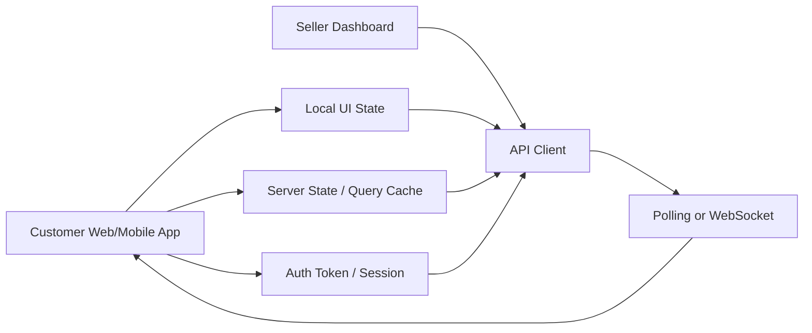
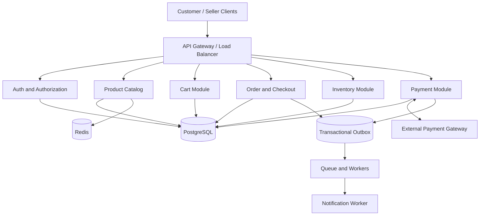
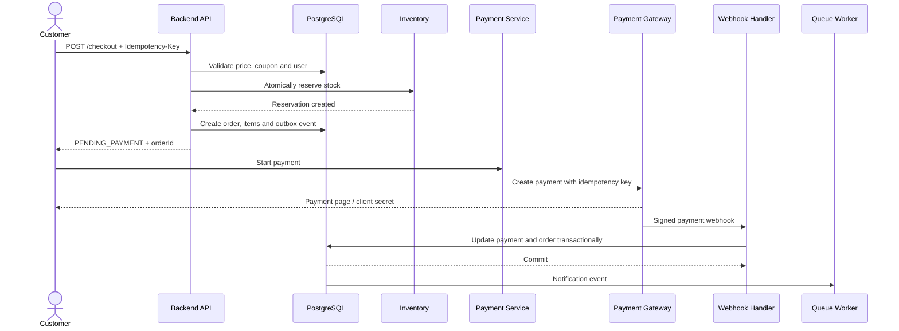
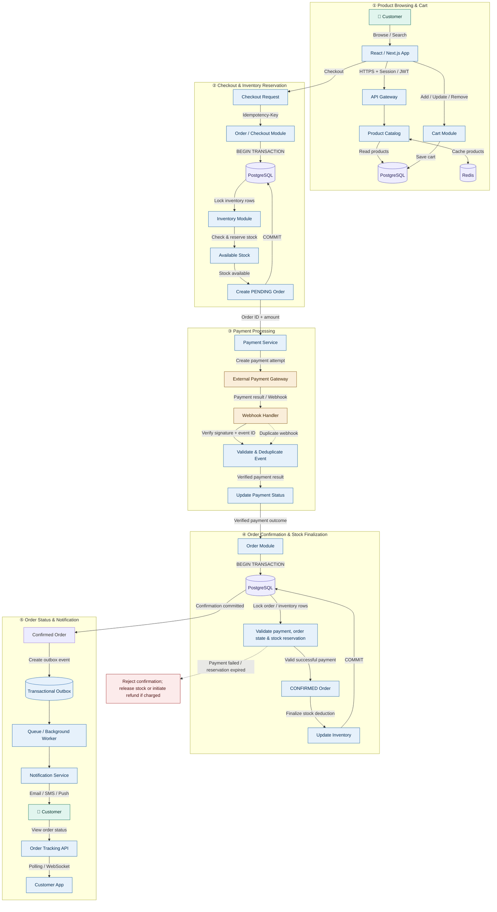
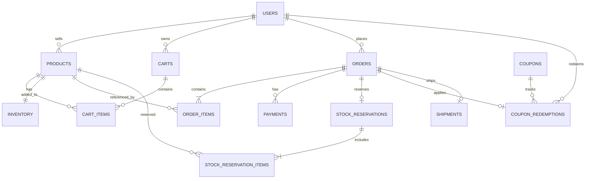
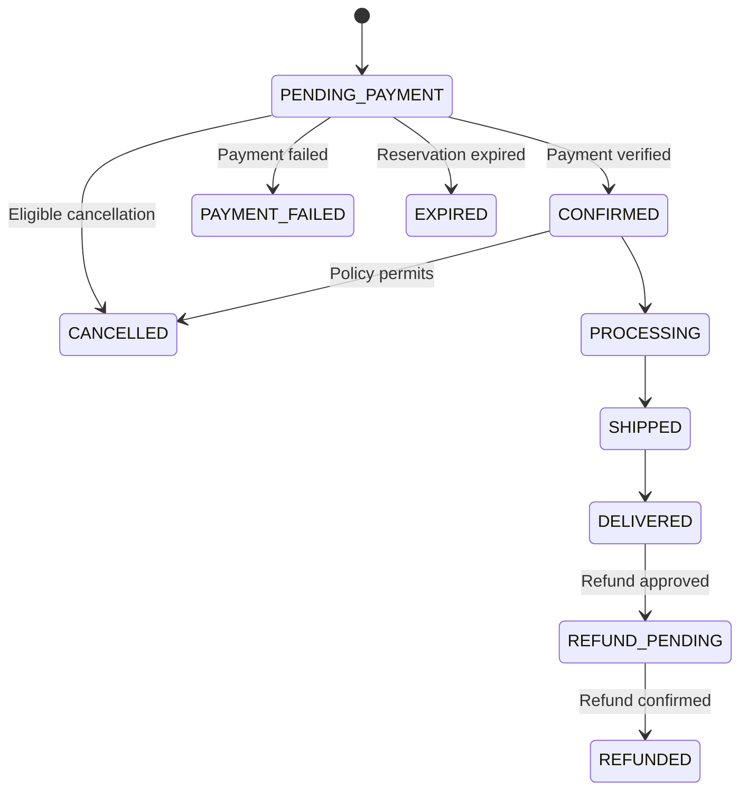

# Daraz-এর মতো E-commerce System Design

এই document-টি junior software engineer interview-এর জন্য তৈরি। এখানে শুধু প্রয়োজনীয় system design topics রাখা হয়েছে।

## ১. Problem Statement

Daraz-এর মতো একটি e-commerce platform design করতে হবে যেখানে customer product browse করতে, cart-এ item যোগ করতে, checkout করতে, online payment দিতে এবং order track করতে পারবে। Seller product, price এবং stock manage করতে পারবে।

সবচেয়ে গুরুত্বপূর্ণ সমস্যা:

- একই product একসঙ্গে অনেক customer কিনতে চাইলে overselling বন্ধ করা।
- Customer বারবার checkout request পাঠালেও duplicate order না তৈরি করা।
- Payment failure, server crash এবং delayed webhook handle করা।
- Payment না হলে নির্দিষ্ট সময় পরে reserved stock release করা।
- Order, payment এবং inventory data consistent রাখা।

**Interview answer:**

> আমি প্রথমে modular monolith, PostgreSQL এবং Redis cache ব্যবহার করব। Product browsing cache করা যাবে, কিন্তু checkout-এর price, stock এবং payment-এর authoritative data PostgreSQL-এ থাকবে। Order, order items এবং stock reservation database transaction-এর মধ্যে তৈরি করব। External payment gateway-এর জন্য idempotency, signed webhook এবং reconciliation ব্যবহার করব।

## ২. Frontend Architecture



### Frontend responsibility

- Product list, search, filter এবং product details দেখানো।
- Cart item add, update এবং remove করা।
- Checkout form এবং payment page দেখানো।
- Order status backend থেকে দেখানো।
- Request চলার সময় checkout button disable করা।
- প্রতিটি logical checkout-এর জন্য একই `Idempotency-Key` retry-তে reuse করা।
- `PENDING`, `PAYMENT_FAILED`, `EXPIRED`, `CONFIRMED` state আলাদাভাবে দেখানো।
- শুরুতে order tracking-এর জন্য polling ব্যবহার করা; প্রয়োজন হলে WebSocket যোগ করা।

**গুরুত্বপূর্ণ:** Duplicate order শুধু button disable করে আটকানো যাবে না। Backend এবং database-এ idempotency enforce করতে হবে।

## ৩. Backend Architecture



### Backend module-এর দায়িত্ব

| Module | দায়িত্ব |
|---|---|
| Auth | Login, token, role এবং ownership check |
| Product Catalog | Product, category, price এবং availability |
| Cart | Customer-এর cart ও quantity |
| Order/Checkout | Price validation, coupon, order creation |
| Inventory | Stock reserve, confirm এবং release |
| Payment | Payment session, webhook, refund ও reconciliation |
| PostgreSQL | Authoritative transactional data |
| Redis | Product/catalog-এর cache |
| Queue/Worker | Notification ও retryable background কাজ |
| Outbox | DB update-এর সঙ্গে event durable করা |

### Junior interview answer

> প্রথমে সব module একটি modular monolith-এর মধ্যে রাখব। Module boundary পরিষ্কার থাকবে, কিন্তু এক database ব্যবহার করবে। Traffic, team ownership বা independent scaling-এর প্রয়োজন হলে Product, Order, Inventory এবং Payment আলাদা service করা যাবে। Strongly consistent stock operation অপ্রয়োজনে network boundary-তে ভাগ করব না।

## ৪. Full System Architecture ও Order Flow



  ### Architecture-wise request path

  1. **Frontend layer:** Customer বা seller UI API client-এর মাধ্যমে HTTPS request পাঠায়। UI local state এবং server state আলাদা রাখে।
  2. **API layer:** API Gateway authentication, authorization, rate limit এবং request routing করে।
  3. **Business layer:** Catalog, Cart, Checkout, Inventory, Payment এবং Shipment module business rule প্রয়োগ করে।
  4. **Data layer:** PostgreSQL transaction, constraint এবং lock দিয়ে order, stock, payment ও reservation-এর consistency নিশ্চিত করে। Redis শুধু cache হিসেবে কাজ করে।
  5. **External layer:** Payment Gateway payment process করে এবং signed webhook পাঠায়। Queue/Outbox notification ও retryable side effect process করে।

  **Interview-এ বলার sequence:**

  > Customer frontend থেকে checkout request পাঠায়। API Gateway request authenticate করে Checkout module-এ পাঠায়। Checkout module PostgreSQL transaction-এর মধ্যে current price validate, inventory reserve, order এবং payment record তৈরি করে। Commit-এর পরে Payment Gateway session শুরু হয়। Gateway webhook এলে Payment module signature verify করে order ও payment update করে। তারপর Outbox/Queue notification এবং tracking update process করে।


### End to End follow


## Step-by-Step End-to-End Architecture

### ধাপ ১: Product Browsing ও Cart Management

এই ধাপে Customer product দেখবেন, search ও filter করবেন এবং পছন্দের product Cart-এ যোগ করবেন।

1. Customer React / Next.js Web App থেকে product list, search, filter অথবা product details দেখার request পাঠাবেন।
2. Request HTTPS-এর মাধ্যমে API Gateway-তে পৌঁছাবে।
3. API Gateway প্রয়োজন অনুযায়ী Authentication ও Authorization যাচাই করে Product Catalog Module-এ request পাঠাবে।
4. Product Catalog Module PostgreSQL থেকে product-এর তথ্য সংগ্রহ করবে। বারবার প্রয়োজন হয় এমন product data দ্রুত সরবরাহ করার জন্য Redis cache ব্যবহার করা যেতে পারে।
5. Customer কোনো product Cart-এ যোগ, update অথবা remove করলে Cart Module request process করবে।
6. Cart Module cart-এর পরিবর্তন database-এ সংরক্ষণ করবে, যাতে Customer পরবর্তী সময়ে Cart-এর তথ্য দেখতে পারেন।

**এই ধাপের উদ্দেশ্য:** Product browsing এবং Cart management-এর মাধ্যমে Customer-কে Checkout-এর জন্য প্রস্তুত করা।

### **ধাপ ২: Checkout Request ও Inventory Reservation**

এই ধাপে Customer order place করার চেষ্টা করবেন এবং system নিশ্চিত করবে যে প্রয়োজনীয় product-এর stock পাওয়া যাচ্ছে।

1. Customer Checkout button-এ click করলে Frontend Checkout API-তে request পাঠাবে।
2. প্রতিটি logical checkout-এর জন্য Frontend একটি `Idempotency-Key` তৈরি করবে। একই checkout-এর retry request-এ একই key ব্যবহার করবে।
3. Order / Checkout Module key-টি যাচাই করে আগের একই request-এর ফলাফল থাকলে সেটি ফেরত দেবে; নতুন request হলে processing শুরু করবে।
4. Order Module PostgreSQL transaction শুরু করবে।
5. Inventory Module সংশ্লিষ্ট product-এর inventory row lock করবে অথবা conditional stock update ব্যবহার করে stock availability যাচাই করবে।
6. প্রয়োজনীয় stock পাওয়া গেলে system stock reserve করবে এবং `PENDING` status-এ order তৈরি করবে।
7. Order এবং inventory reservation একই database transaction-এ সফল হলে transaction commit হবে। কোনো operation ব্যর্থ হলে transaction rollback হবে।
8. Frontend Order ID, payable amount এবং payment-এর পরবর্তী ধাপ সম্পর্কে response পাবে।

**এই ধাপের উদ্দেশ্য:** একই সময়ে একাধিক Customer একই stock কেনার চেষ্টা করলেও overselling প্রতিরোধ করা এবং duplicate checkout থেকে duplicate order তৈরি হওয়া ঠেকানো।

### **ধাপ ৩: Payment Processing**

এই ধাপে Customer-এর payment request process হবে এবং payment-এর প্রকৃত ফলাফল যাচাই করা হবে।

1. Order তৈরি হওয়ার পর Payment Service-এর কাছে Order ID, payable amount এবং payment method পাঠানো হবে।
2. Payment Service একটি payment attempt তৈরি করবে এবং external payment gateway-তে payment request পাঠাবে।
3. Customer gateway-এর মাধ্যমে payment complete করবেন।
4. Payment gateway payment সফল বা ব্যর্থ হওয়ার পর system-কে webhook পাঠাতে পারে।
5. Webhook Handler প্রথমে webhook signature যাচাই করবে, যাতে অননুমোদিত request গ্রহণ না করা হয়।
6. Webhook event ID যাচাই করে duplicate event শনাক্ত করা হবে। একই event পুনরায় এলে payment processing যেন দ্বিতীয়বার কার্যকর না হয়, তা নিশ্চিত করা হবে।
7. Verified payment result অনুযায়ী Payment Service payment record-এর status update করবে।

**এই ধাপের উদ্দেশ্য:** Payment-এর প্রকৃত ফলাফল নির্ভরযোগ্যভাবে যাচাই করা এবং duplicate বা forged webhook থেকে system-কে সুরক্ষিত রাখা।

**গুরুত্বপূর্ণ:** Frontend-এর success page বা browser redirect-কে payment সফল হওয়ার চূড়ান্ত প্রমাণ হিসেবে গ্রহণ করা যাবে না। Verified gateway response বা webhook-এর ওপর নির্ভর করতে হবে।

### **ধাপ ৪: Order Confirmation ও Inventory Finalization**

এই ধাপে system যাচাই করবে যে payment সফল হয়েছে এবং order-এর stock reservation এখনও বৈধ আছে কি না।

1. Verified payment result পাওয়ার পর Order Module order confirmation process শুরু করবে।
2. PostgreSQL transaction শুরু করে সংশ্লিষ্ট order এবং inventory reservation-এর প্রয়োজনীয় row lock করা হবে।
3. System যাচাই করবে:
   - Payment সত্যিই সফল হয়েছে কি না।
   - Order ইতোমধ্যে confirm বা cancel হয়েছে কি না।
   - Inventory reservation এখনও valid কি না।
   - Reservation-এর expiry time পার হয়েছে কি না।
4. সব শর্ত পূরণ হলে order-এর status `CONFIRMED` করা হবে।
5. একই transaction-এ inventory reservation finalize করে stock-এর পরিমাণ যথাযথভাবে update করা হবে।
6. সব database operation সফল হলে transaction commit হবে। কোনো operation ব্যর্থ হলে rollback হবে এবং order-কে confirmed হিসেবে দেখানো হবে না।
7. Payment সফল হলেও reservation expire হয়ে গেলে order স্বয়ংক্রিয়ভাবে confirm করা যাবে না। Business policy অনুযায়ী payment refund বা compensation process শুরু করতে হবে।

**এই ধাপের উদ্দেশ্য:** Payment, Order এবং Inventory-এর মধ্যে data consistency বজায় রাখা।

**ACID-এর ভূমিকা:**
- **Atomicity:** Order confirmation এবং stock finalization একসঙ্গে সফল হবে অথবা rollback হবে।
- **Consistency:** Stock negative হবে না এবং invalid order confirm হবে না।
- **Isolation:** Concurrent checkout-এর কারণে একই stock একাধিকবার বিক্রি হওয়া প্রতিরোধ করা হবে।
- **Durability:** Transaction commit হলে confirmation-এর database changes স্থায়ীভাবে সংরক্ষিত থাকবে।

### **ধাপ ৫: Notification ও Order Tracking**

এই ধাপে Customer-কে order confirmation জানানো হবে এবং order-এর বর্তমান status দেখানো হবে।

1. Order confirmation সফলভাবে commit হওয়ার পর database transaction-এর সঙ্গে সম্পর্কিত Transactional Outbox-এ notification event সংরক্ষণ করা হবে।
2. Background Worker Outbox থেকে event সংগ্রহ করে Queue বা processing mechanism-এর মাধ্যমে notification process করবে।
3. Notification Service Customer-কে Email, SMS অথবা Push Notification পাঠাবে।
4. Customer Frontend থেকে Order Tracking API-তে request পাঠিয়ে order-এর বর্তমান status দেখতে পারবেন।
5. শুরুতে Frontend নির্দিষ্ট interval-এ Polling করে order status update নিতে পারে।
6. অধিক real-time update প্রয়োজন হলে WebSocket ব্যবহার করা যেতে পারে।
7. Notification delivery ব্যর্থ হলে retry mechanism ব্যবহার করা হবে। Retry-এর কারণে duplicate notification পাঠানো ঠেকাতে event processing-ও idempotent করা উচিত।

**এই ধাপের উদ্দেশ্য:** Customer-কে order confirmation ও পরবর্তী status সম্পর্কে জানানো এবং notification failure হলেও event হারিয়ে যাওয়ার ঝুঁকি কমানো।

### **ধাপ ৬: Failure Handling ও Recovery**

একটি production-ready E-commerce System-এ শুধু successful flow নয়, failure scenario-ও handle করতে হবে।

1. **Duplicate Checkout:** একই `Idempotency-Key` দিয়ে retry করলে আগের order-এর ফলাফল ফেরত দিতে হবে; নতুন order তৈরি করা যাবে না।
2. **Insufficient Stock:** প্রয়োজনীয় stock না থাকলে checkout প্রত্যাখ্যান করতে হবে এবং কোনো invalid reservation তৈরি করা যাবে না।
3. **Payment Failed:** Payment failure হলে order confirm করা যাবে না। Reservation policy অনুযায়ী stock release করতে হবে।
4. **Duplicate Webhook:** একই gateway event একাধিকবার এলেও payment বা order transition দ্বিতীয়বার কার্যকর করা যাবে না।
5. **Expired Reservation:** Reservation expire হয়ে গেলে order confirm করা যাবে না। Payment ইতোমধ্যে সফল হলে প্রয়োজন অনুযায়ী refund বা compensation করতে হবে।
6. **Concurrent Purchase:** Database row lock অথবা atomic conditional update এবং প্রয়োজনীয় constraint ব্যবহার করে overselling প্রতিরোধ করতে হবে।
7. **Notification Failure:** Transactional Outbox এবং retry mechanism দিয়ে notification পরে আবার process করতে হবে।
8. **Temporary Service Failure:** প্রয়োজন অনুযায়ী timeout, bounded retry এবং monitoring ব্যবহার করতে হবে। External payment request retry করার সময় gateway-এর idempotency support থাকলে তা ব্যবহার করতে হবে।

**এই ধাপের উদ্দেশ্য:** Network failure, concurrent request, duplicate event এবং external service failure-এর মধ্যেও system-এর data consistency ও business correctness বজায় রাখা।

---

## **সংক্ষিপ্ত Flow Summary**

1. **Product Browsing:** Customer product দেখবেন এবং Cart তৈরি করবেন।
2. **Checkout:** Backend request যাচাই করে stock reserve এবং `PENDING` order তৈরি করবে।
3. **Payment:** Payment Service gateway-তে payment request পাঠাবে এবং verified result সংগ্রহ করবে।
4. **Order Confirmation:** Valid payment ও stock reservation থাকলে ACID transaction-এর মাধ্যমে order confirm হবে।
5. **Notification:** Transactional Outbox ও Background Worker-এর মাধ্যমে Customer-কে জানানো হবে।
6. **Order Tracking:** Customer Polling অথবা WebSocket-এর মাধ্যমে order status দেখতে পারবেন।
7. **Failure Recovery:** Idempotency, database constraints, transaction, retry এবং refund/compensation mechanism দিয়ে failure handle করা হবে।
### Complete checkout flow

1. Customer cart থেকে product ID এবং quantity পাঠায়।
2. Backend user authentication, product status, current price, quantity এবং coupon validate করে।
3. `Idempotency-Key` এবং request hash check করা হয়। আগের একই request থাকলে আগের order ফেরত দেওয়া হয়।
4. Database transaction শুরু হয়। Product ID-এর consistent order-এ inventory row lock বা conditional update করা হয়।
5. প্রতিটি item-এর stock reserve করা হয়। কোনো item reserve না হলে পুরো transaction rollback হয়।
6. `orders`, `order_items`, `stock_reservations` এবং outbox event তৈরি হয়।
7. Transaction commit হলে order `PENDING_PAYMENT` অবস্থায় client-কে ফেরত দেওয়া হয়।
8. Payment service provider-এর idempotency key ব্যবহার করে payment session তৈরি করে। External HTTP call database transaction-এর ভেতরে রাখা হয় না।
9. Payment gateway signed webhook পাঠায়। Webhook verify করে payment এবং order state update করা হয়।
10. Payment সফল হলে order `CONFIRMED` এবং reservation `CONFIRMED` হয়।
11. Payment failure বা expiry হলে stock release হয়। Notification queue worker দিয়ে পাঠানো হয়।

## ৫. Database Design

PostgreSQL ব্যবহার করব, কারণ order, payment এবং inventory-এর জন্য transaction, foreign key, unique constraint এবং row-level locking প্রয়োজন। Money floating-point নয়, integer minor unit-এ (`price_minor`) রাখা হবে।

### 5.1 `users`

| Column | Type | Rule |
|---|---|---|
| `id` | UUID | Primary key |
| `name` | VARCHAR(120) | NOT NULL |
| `email` | VARCHAR(255) | UNIQUE, NOT NULL |
| `password_hash` | TEXT | Plaintext নয় |
| `role` | VARCHAR(20) | `CUSTOMER`, `SELLER`, `ADMIN` |
| `created_at` | TIMESTAMPTZ | NOT NULL |

কাজ: Customer, Seller এবং Admin-এর account information সংরক্ষণ করে।
- id — User-এর unique ID
- name, email — পরিচিতির তথ্য
- password_hash — hashed password
- role — CUSTOMER, SELLER অথবা ADMIN
উদাহরণ: একজন seller login করে নিজের product manage করবে।


### 5.2 `products`

| Column | Type | Rule |
|---|---|---|
| `id` | UUID | Primary key |
| `seller_id` | UUID | FK → `users.id` |
| `name` | VARCHAR(255) | NOT NULL |
| `description` | TEXT | Optional |
| `price_minor` | BIGINT | `>= 0` |
| `currency` | CHAR(3) | যেমন `BDT` |
| `status` | VARCHAR(20) | `DRAFT`, `ACTIVE`, `INACTIVE` |
| `created_at` | TIMESTAMPTZ | NOT NULL |
| `updated_at` | TIMESTAMPTZ | NOT NULL |


কাজ: Seller-এর product details সংরক্ষণ করে।
- seller_id — কোন seller product-এর মালিক
- name, description — Product details
- price_minor, currency — Price ও currency
- status — ACTIVE, INACTIVE ইত্যাদি
উদাহরণ: Seller একটি mobile phone-এর নাম, দাম এবং description যোগ করল।
### 5.3 `inventory`

| Column | Type | Rule |
|---|---|---|
| `product_id` | UUID | PK এবং FK → `products.id` |
| `available_qty` | INTEGER | `>= 0` |
| `reserved_qty` | INTEGER | `>= 0` |
| `updated_at` | TIMESTAMPTZ | NOT NULL |

`available_qty` নতুন order-এর জন্য available stock। `reserved_qty` active reservation-এ থাকা stock।

কাজ: প্রতিটি product-এর available ও reserved stock হিসাব রাখে।
- product_id — কোন product-এর stock
- available_qty — নতুন order-এর জন্য অবশিষ্ট stock
- reserved_qty — payment-এর অপেক্ষায় reservation-এ থাকা stock
উদাহরণ: Stock 10টি। একজন customer 2টি checkout করলে available stock 8 এবং reserved stock 2 হবে।

### 5.4 `carts`

| Column | Type | Rule |
|---|---|---|
| `id` | UUID | Primary key |
| `user_id` | UUID | FK → `users.id` |
| `status` | VARCHAR(20) | `ACTIVE`, `CONVERTED`, `ABANDONED` |
| `updated_at` | TIMESTAMPTZ | NOT NULL |

কাজ: Customer-এর shopping cart-এর মূল record রাখে।
- id — Cart ID
- user_id — Cart-এর মালিক
- status — ACTIVE, CONVERTED অথবা ABANDONED
উদাহরণ: Customer-এর বর্তমান shopping cart চিহ্নিত করে।
### 5.5 `cart_items`

| Column | Type | Rule |
|---|---|---|
| `cart_id` | UUID | FK → `carts.id` |
| `product_id` | UUID | FK → `products.id` |
| `quantity` | INTEGER | `> 0` |
| `added_at` | TIMESTAMPTZ | NOT NULL |

কাজ: Cart-এর মধ্যে কোন product কত quantity আছে, তা রাখে।
- cart_id — কোন cart
- product_id — কোন product
- quantity — কতটি product
উদাহরণ: Cart-এ 2টি shirt এবং 1টি headphone আছে।
মনে রাখবে: Cart-এর price চূড়ান্ত নয়। Checkout-এর সময় backend database থেকে current price আবার যাচাই করবে।

**Constraint:** `PRIMARY KEY (cart_id, product_id)`। Cart-এর price authoritative নয়; checkout-এ price আবার database থেকে পড়তে হবে।

### 5.6 `orders`

| Column | Type | Rule |
|---|---|---|
| `id` | UUID | Primary key |
| `user_id` | UUID | FK → `users.id` |
| `status` | VARCHAR(30) | Order status |
| `subtotal_minor` | BIGINT | `>= 0` |
| `discount_minor` | BIGINT | `>= 0` |
| `shipping_minor` | BIGINT | `>= 0` |
| `total_minor` | BIGINT | `>= 0` |
| `currency` | CHAR(3) | NOT NULL |
| `idempotency_key` | VARCHAR(128) | Retry protection |
| `created_at` | TIMESTAMPTZ | NOT NULL |
| `updated_at` | TIMESTAMPTZ | NOT NULL |

**Constraint:** `UNIQUE(user_id, idempotency_key)`। একই key-তে ভিন্ন payload এলে `409 Conflict`।

কাজ: Customer-এর মূল order record এবং order-এর বর্তমান অবস্থা সংরক্ষণ করে।
- id — Order ID
- user_id — কে order করেছে
- status — PENDING_PAYMENT, CONFIRMED, EXPIRED ইত্যাদি
- subtotal_minor, discount_minor, shipping_minor, total_minor — Order-এর আর্থিক হিসাব
- idempotency_key — একই checkout request retry হলে duplicate order আটকাতে সাহায্য করে
উদাহরণ: Customer-এর Order #101 payment-এর অপেক্ষায় আছে।
### 5.7 `order_items`

| Column | Type | Rule |
|---|---|---|
| `id` | UUID | Primary key |
| `order_id` | UUID | FK → `orders.id` |
| `product_id` | UUID | FK → `products.id` |
| `product_name_snapshot` | VARCHAR(255) | Order-time name |
| `unit_price_minor` | BIGINT | `>= 0` |
| `quantity` | INTEGER | `> 0` |
| `line_total_minor` | BIGINT | `>= 0` |

Price এবং name snapshot রাখতে হবে, যাতে পরে product update হলেও পুরোনো order বদলে না যায়।


কাজ: একটি order-এর মধ্যে কোন কোন product, কী দামে এবং কত quantity-তে কেনা হয়েছে, তার বিস্তারিত রাখে।
- order_id — কোন order-এর item
- product_id — কোন product
- product_name_snapshot — কেনার সময়কার product name
- unit_price_minor — কেনার সময়কার unit price
- quantity, line_total_minor — Quantity ও item-এর মোট দাম
উদাহরণ: Order #101-এ 2টি shirt, প্রতিটি 500 টাকা দামে কেনা হয়েছিল।
কেন snapshot দরকার? পরে seller product-এর নাম বা দাম পরিবর্তন করলেও পুরোনো order-এর তথ্য অপরিবর্তিত থাকবে।
### 5.8 `payments`

| Column | Type | Rule |
|---|---|---|
| `id` | UUID | Primary key |
| `order_id` | UUID | FK → `orders.id` |
| `provider` | VARCHAR(40) | Gateway name |
| `provider_payment_id` | VARCHAR(255) | Provider reference |
| `amount_minor` | BIGINT | `> 0` |
| `currency` | CHAR(3) | NOT NULL |
| `status` | VARCHAR(20) | Payment status |
| `idempotency_key` | VARCHAR(128) | Provider deduplication |
| `created_at` | TIMESTAMPTZ | NOT NULL |
| `updated_at` | TIMESTAMPTZ | NOT NULL |

**Constraint:** `UNIQUE(provider, provider_payment_id)`।

কাজ: Payment attempt এবং payment gateway-এর reference সংরক্ষণ করে।
- order_id — কোন order-এর payment
- provider — Payment gateway-এর নাম
- provider_payment_id — Gateway-এর payment reference
- amount_minor, currency — Payment amount ও currency
- status — PENDING, SUCCEEDED, FAILED ইত্যাদি
উদাহরণ: Customer-এর Order #101-এর payment সফল হয়েছে কি না, তা এখানে রাখা হয়।
### 5.9 `coupons`

| Column | Type | Rule |
|---|---|---|
| `id` | UUID | Primary key |
| `code` | VARCHAR(50) | UNIQUE |
| `discount_type` | VARCHAR(20) | `PERCENTAGE`, `FIXED` |
| `discount_value` | BIGINT | `> 0` |
| `max_redemptions` | INTEGER | `> 0` |
| `redeemed_count` | INTEGER | `>= 0` |
| `starts_at` | TIMESTAMPTZ | NOT NULL |
| `expires_at` | TIMESTAMPTZ | NOT NULL |
| `status` | VARCHAR(20) | `ACTIVE`, `INACTIVE` |

কাজ: Discount coupon-এর নিয়ম ও validity সংরক্ষণ করে।
- code — Coupon code, যেমন SAVE10
- discount_type — Percentage অথবা fixed discount
- discount_value — Discount-এর পরিমাণ
- max_redemptions, redeemed_count — ব্যবহারের limit ও বর্তমান সংখ্যা
- starts_at, expires_at — Coupon কখন থেকে কখন পর্যন্ত valid
উদাহরণ: SAVE10 coupon ব্যবহার করে customer 10% discount পেতে পারে, যদি coupon-এর নিয়ম পূরণ হয়।
### 5.10 `coupon_redemptions`

| Column | Type | Rule |
|---|---|---|
| `id` | UUID | Primary key |
| `coupon_id` | UUID | FK → `coupons.id` |
| `user_id` | UUID | FK → `users.id` |
| `order_id` | UUID | FK → `orders.id` |
| `status` | VARCHAR(20) | `RESERVED`, `REDEEMED`, `RELEASED` |
| `created_at` | TIMESTAMPTZ | NOT NULL |

Policy অনুযায়ী `UNIQUE(coupon_id, user_id)` বা `UNIQUE(order_id)` রাখা যায়।

কাজ: কোন user কোন order-এ coupon ব্যবহার করেছে এবং তার redemption status কী, তা রাখে।
- coupon_id — কোন coupon
- user_id — কোন customer
- order_id — কোন order
- status — RESERVED, REDEEMED, RELEASED
উদাহরণ: Checkout-এর সময় coupon reserve করা হলো। Payment সফল হলে policy অনুযায়ী সেটি redeemed হবে; checkout expire হলে release করা যাবে।
### 5.11 `stock_reservations`

| Column | Type | Rule |
|---|---|---|
| `id` | UUID | Primary key |
| `order_id` | UUID | FK → `orders.id`, UNIQUE |
| `status` | VARCHAR(20) | `ACTIVE`, `CONFIRMED`, `RELEASED`, `EXPIRED` |
| `expires_at` | TIMESTAMPTZ | NOT NULL |
| `created_at` | TIMESTAMPTZ | NOT NULL |
| `updated_at` | TIMESTAMPTZ | NOT NULL |

কাজ: একটি order-এর জন্য stock কতক্ষণ ধরে রাখা হবে এবং reservation-এর বর্তমান অবস্থা কী, তা রাখে।
- order_id — কোন order-এর reservation
- status — ACTIVE, CONFIRMED, RELEASED, EXPIRED
- expires_at — Reservation-এর deadline
উদাহরণ: Payment-এর জন্য 10 মিনিট stock ধরে রাখা হলো। সময় শেষ হলে reservation expire হতে পারে।
### 5.12 `stock_reservation_items`

| Column | Type | Rule |
|---|---|---|
| `reservation_id` | UUID | FK → `stock_reservations.id` |
| `product_id` | UUID | FK → `products.id` |
| `quantity` | INTEGER | `> 0` |

**Primary key:** `(reservation_id, product_id)`।


কাজ: Reservation-এ কোন product-এর কত quantity আটকে রাখা হয়েছে, তা সংরক্ষণ করে।
- reservation_id — কোন reservation
- product_id — কোন product
- quantity — কতটি stock reserve হয়েছে
উদাহরণ: একটি reservation-এ 2টি shirt এবং 1টি headphone reserve করা হয়েছে।
### 5.13 `payment_webhook_events`

| Column | Type | Rule |
|---|---|---|
| `id` | UUID | Primary key |
| `provider` | VARCHAR(40) | NOT NULL |
| `event_id` | VARCHAR(255) | NOT NULL |
| `event_type` | VARCHAR(80) | NOT NULL |
| `status` | VARCHAR(20) | `RECEIVED`, `PROCESSED`, `FAILED` |
| `received_at` | TIMESTAMPTZ | NOT NULL |
| `processed_at` | TIMESTAMPTZ | Nullable |

**Constraint:** `UNIQUE(provider, event_id)`।

কাজ: Payment gateway থেকে আসা webhook event-এর record রাখে, যাতে duplicate event processing এড়ানো যায় এবং processing status track করা যায়।
- provider — Gateway-এর নাম
- event_id — Gateway event-এর unique ID
- event_type — Event-এর ধরন
- status — RECEIVED, PROCESSED, FAILED
- received_at, processed_at — Event পাওয়ার ও processing-এর সময়
উদাহরণ: Gateway একই payment-success webhook দুইবার পাঠালে unique (provider, event_id) constraint duplicate event আটকাতে সাহায্য করে।
### 5.14 `outbox_events`

| Column | Type | Rule |
|---|---|---|
| `id` | UUID | Primary key |
| `aggregate_type` | VARCHAR(50) | যেমন `ORDER` |
| `aggregate_id` | UUID | NOT NULL |
| `event_type` | VARCHAR(80) | NOT NULL |
| `payload` | JSONB | NOT NULL |
| `published_at` | TIMESTAMPTZ | Nullable |
| `created_at` | TIMESTAMPTZ | NOT NULL |

কাজ: Order বা payment-এর database transaction-এর সঙ্গে সম্পর্কিত event নির্ভরযোগ্যভাবে সংরক্ষণ করে, যাতে পরে worker সেটি process করতে পারে।
- aggregate_type — যেমন ORDER
- aggregate_id — সংশ্লিষ্ট order-এর ID
- event_type — কী ঘটনা ঘটেছে
- payload — Event-এর data
- published_at — Event publish হয়েছে কি না
উদাহরণ: Order তৈরি হওয়ার পর notification পাঠানোর event outbox-এ রাখা হয়। পরে worker সেটি queue-তে publish করতে পারে।
### 5.15 `shipments`

| Column | Type | Rule |
|---|---|---|
| `id` | UUID | Primary key |
| `order_id` | UUID | FK → `orders.id` |
| `carrier` | VARCHAR(80) | NOT NULL |
| `tracking_number` | VARCHAR(120) | UNIQUE |
| `status` | VARCHAR(30) | Delivery status |
| `created_at` | TIMESTAMPTZ | NOT NULL |
| `updated_at` | TIMESTAMPTZ | NOT NULL |

কাজ: Order-এর delivery ও tracking information সংরক্ষণ করে।
- order_id — কোন order পাঠানো হচ্ছে
- carrier — Courier বা delivery provider
- tracking_number — Delivery tracking number
- status — Delivery-এর বর্তমান অবস্থা
উদাহরণ: Order SHIPPED হলে customer tracking number ব্যবহার করে delivery progress দেখতে পারবে।
### গুরুত্বপূর্ণ index

- `orders(user_id, created_at DESC)`
- `order_items(order_id)`
- `products(seller_id, status)`
- `stock_reservations(status, expires_at)`
- `payments(order_id)`
- `payment_webhook_events(provider, event_id)`
- `coupons(code)`

## ৬. ER Diagram



**Interview answer:** `users` table-এ customer, seller এবং admin role রাখা যায়। Product-এর সঙ্গে inventory-এর one-to-one relation। Order-এর সঙ্গে order items, payments, reservation এবং shipment-এর relation থাকবে।

## ৭. Status Management

### Order status



| Status | অর্থ |
|---|---|
| `PENDING_PAYMENT` | Order তৈরি, payment নিশ্চিত নয় |
| `CONFIRMED` | Payment verified এবং order নিশ্চিত |
| `PAYMENT_FAILED` | Payment ব্যর্থ, stock release হবে |
| `EXPIRED` | Payment সময়মতো হয়নি, reservation expire |
| `CANCELLED` | Business policy অনুযায়ী বাতিল |
| `PROCESSING` | Seller order প্রস্তুত করছে |
| `SHIPPED` | Order courier-এর কাছে |
| `DELIVERED` | Customer order পেয়েছে |
| `REFUND_PENDING` | Refund শুরু হয়েছে |
| `REFUNDED` | Refund নিশ্চিত হয়েছে |

### Payment status

`CREATED → PENDING → SUCCEEDED | FAILED | CANCELLED`

Refund হলে: `REFUND_PENDING → REFUNDED`। Signed webhook বা verified provider response ছাড়া payment-কে `SUCCEEDED` করা যাবে না।

### Reservation status

`ACTIVE → CONFIRMED` অথবা `ACTIVE → RELEASED / EXPIRED`

একটি reservation একবারের বেশি release করা যাবে না। Conditional status update এবং inventory update একই transaction-এ রাখতে হবে।

## ৮. REST API Design

সব endpoint HTTPS ব্যবহার করবে। Protected endpoint-এ authentication, role check এবং ownership check থাকবে।

### Authentication

| Method | Endpoint | কাজ |
|---|---|---|
| `POST` | `/api/v1/auth/register` | Account তৈরি |
| `POST` | `/api/v1/auth/login` | Login |
| `POST` | `/api/v1/auth/refresh` | Token refresh |
| `GET` | `/api/v1/users/me` | নিজের profile |
| `PATCH` | `/api/v1/users/me` | Profile update |
| `POST` | `/api/v1/auth/logout` | Current session invalidate |

### Address

| Method | Endpoint | কাজ |
|---|---|---|
| `GET` | `/api/v1/addresses` | নিজের address list |
| `POST` | `/api/v1/addresses` | নতুন delivery address |
| `GET` | `/api/v1/addresses/:addressId` | Address details |
| `PATCH` | `/api/v1/addresses/:addressId` | Address update |
| `DELETE` | `/api/v1/addresses/:addressId` | Address delete |

### Product ও Inventory

| Method | Endpoint | কাজ |
|---|---|---|
| `GET` | `/api/v1/products?q=&category=&page=` | Product search/filter |
| `GET` | `/api/v1/products/:productId` | Product details |
| `POST` | `/api/v1/seller/products` | Seller product তৈরি |
| `PATCH` | `/api/v1/seller/products/:productId` | Product update |
| `PUT` | `/api/v1/seller/products/:productId/inventory` | Stock adjustment |
| `GET` | `/api/v1/seller/products` | নিজের product list |
| `GET` | `/api/v1/seller/products/:productId` | নিজের product details |
| `DELETE` | `/api/v1/seller/products/:productId` | Product deactivate |
| `GET` | `/api/v1/products/:productId/inventory` | Product availability |

Seller arbitrary `available_qty` overwrite না করে stock adjustment বা stock movement ব্যবহার করবে।

### Cart

| Method | Endpoint | কাজ |
|---|---|---|
| `GET` | `/api/v1/cart` | নিজের cart |
| `POST` | `/api/v1/cart/items` | Product যোগ |
| `PATCH` | `/api/v1/cart/items/:productId` | Quantity update |
| `DELETE` | `/api/v1/cart/items/:productId` | Item remove |
| `DELETE` | `/api/v1/cart` | Cart empty করা |

### Checkout ও Order

| Method | Endpoint | কাজ |
|---|---|---|
| `POST` | `/api/v1/checkout` | Checkout ও stock reservation |
| `GET` | `/api/v1/orders` | Order history |
| `GET` | `/api/v1/orders/:orderId` | Order details |
| `POST` | `/api/v1/orders/:orderId/cancel` | Order cancel |
| `GET` | `/api/v1/orders/:orderId/items` | Order items |
| `GET` | `/api/v1/orders/:orderId/status` | Current order status |
| `POST` | `/api/v1/orders/:orderId/retry-payment` | Payment retry |

### Seller Order Management

| Method | Endpoint | কাজ |
|---|---|---|
| `GET` | `/api/v1/seller/orders` | Seller-এর order list |
| `GET` | `/api/v1/seller/orders/:orderId` | Seller order details |
| `PATCH` | `/api/v1/seller/orders/:orderId/confirm` | Order confirm |
| `PATCH` | `/api/v1/seller/orders/:orderId/reject` | Order reject |
| `PATCH` | `/api/v1/seller/orders/:orderId/processing` | Processing শুরু |
| `PATCH` | `/api/v1/seller/orders/:orderId/packed` | Product packed করা |

### Coupon

| Method | Endpoint | কাজ |
|---|---|---|
| `GET` | `/api/v1/coupons/:code` | Coupon details/validity |
| `POST` | `/api/v1/coupons/validate` | Checkout-এর আগে coupon validate |
| `POST` | `/api/v1/seller/coupons` | Seller coupon তৈরি |
| `PATCH` | `/api/v1/seller/coupons/:couponId` | Coupon update/deactivate |

Checkout request:

```http
POST /api/v1/checkout
Authorization: Bearer <token>
Idempotency-Key: checkout-unique-key
Content-Type: application/json
```

```json
{
  "items": [
    { "productId": "product-uuid-1", "quantity": 2 },
    { "productId": "product-uuid-2", "quantity": 1 }
  ],
  "couponCode": "SAVE10",
  "shippingAddressId": "address-uuid"
}
```

Client-এর price, discount এবং total trust করা যাবে না। Backend current price, stock ও coupon rules দিয়ে total calculate করবে।

### Payment ও Refund

| Method | Endpoint | কাজ |
|---|---|---|
| `POST` | `/api/v1/orders/:orderId/payment-session` | Payment session তৈরি |
| `GET` | `/api/v1/payments/:paymentId` | Payment status |
| `POST` | `/api/v1/webhooks/payments/:provider` | Gateway webhook |
| `POST` | `/api/v1/orders/:orderId/refund` | Refund request |
| `GET` | `/api/v1/orders/:orderId/payments` | Order-এর payment attempts |
| `POST` | `/api/v1/payments/:paymentId/cancel` | Pending payment cancel |
| `GET` | `/api/v1/refunds/:refundId` | Refund status |
| `POST` | `/api/v1/admin/payments/:paymentId/reconcile` | Payment reconcile |

Webhook-এ provider signature, timestamp, replay protection এবং event ID verify করতে হবে। সাধারণ user JWT নয়, provider signature ব্যবহার করতে হবে।

### Delivery/Tracking

| Method | Endpoint | কাজ |
|---|---|---|
| `POST` | `/api/v1/orders/:orderId/shipments` | Shipment তৈরি |
| `GET` | `/api/v1/orders/:orderId/shipment` | Shipment details |
| `GET` | `/api/v1/orders/:orderId/tracking` | Delivery tracking |
| `PATCH` | `/api/v1/seller/shipments/:shipmentId/status` | Shipment status update |

### Admin

| Method | Endpoint | কাজ |
|---|---|---|
| `GET` | `/api/v1/admin/orders` | সব order search |
| `GET` | `/api/v1/admin/users` | User management |
| `PATCH` | `/api/v1/admin/products/:productId/status` | Product moderate |
| `GET` | `/api/v1/admin/inventory/low-stock` | Low-stock product list |

### Error response

```json
{
  "error": {
    "code": "INSUFFICIENT_STOCK",
    "message": "একটি বা একাধিক পণ্যের পর্যাপ্ত stock নেই।",
    "requestId": "req-unique-id"
  }
}
```

- `400`: Invalid input
- `401`: Authentication সমস্যা
- `403`: Permission নেই
- `404`: Resource নেই
- `409`: Stock conflict, idempotency mismatch বা invalid state
- `422`: Business rule ব্যর্থ
- `429`: Rate limit
- `500`: Unexpected server error
- `502/503`: External provider unavailable

## ৯. ১০ মিনিটের Stock Reservation ও Expiry Mechanism

### Reservation তৈরি

Customer payment page-এ থাকা অবস্থায় stock ধরে রাখার জন্য reservation তৈরি হবে। Checkout transaction-এর মধ্যে:

1. `available_qty >= requested_qty` শর্তে stock reserve।
2. `stock_reservations` row `ACTIVE` হিসেবে তৈরি।
3. `expires_at = NOW() + INTERVAL '10 minutes'` সেট।
4. Reservation item quantity save।
5. Order `PENDING_PAYMENT` হিসেবে save।
6. সব একসঙ্গে commit।

### Expiry worker

প্রতি কিছু সময় পর background worker expired reservation খুঁজবে:

```sql
SELECT id
FROM stock_reservations
WHERE status = 'ACTIVE'
  AND expires_at <= NOW()
ORDER BY expires_at
FOR UPDATE SKIP LOCKED
LIMIT 100;
```

প্রতিটি reservation-এর জন্য transaction-এ:

1. Reservation row lock বা conditional transition।
2. `ACTIVE → EXPIRED` update সফল হয়েছে কি না যাচাই।
3. সফল হলে `available_qty += quantity` এবং `reserved_qty -= quantity`।
4. Order pending থাকলে `EXPIRED` করা।
5. Coupon reservation থাকলে release করা।
6. Commit করা।

**Idempotency:** `ACTIVE` থেকে একবারই transition হতে পারবে। তাই একই worker আবার চললেও stock দ্বিতীয়বার release হবে না।

### Expiry race

Expiry worker এবং payment webhook একই reservation update করতে পারে। দুজনকেই reservation/order row lock নিতে হবে এবং current status transaction-এর মধ্যে যাচাই করতে হবে।

## ১০. Payment Failure ও Delayed Webhook

Database এবং external payment gateway-এর মধ্যে single ACID transaction নেই। তাই idempotency, durable webhook record এবং reconciliation দরকার।

### Payment failure

1. Gateway webhook বা trusted provider API দিয়ে failure verify।
2. `payment: PENDING → FAILED` transition।
3. Order `PENDING_PAYMENT` হলে `PAYMENT_FAILED` করা।
4. Reservation `ACTIVE` থাকলে stock release।
5. Coupon reservation থাকলে release।
6. Duplicate webhook এলে দ্বিতীয়বার কোনো side effect না করা।

### Payment সফল কিন্তু server crash

Gateway টাকা কেটে নেওয়ার পর application crash করতে পারে। এই ক্ষেত্রে:

- `payment_webhook_events`-এ event ID unique করে event durable ভাবে রাখা হবে।
- Provider retry এবং scheduled reconciliation worker ব্যবহার করা হবে।
- Provider API থেকে pending payment-এর status verify করা হবে।
- Verified success হলে idempotent transaction দিয়ে order confirm করা হবে।
- Reservation expire হয়ে গেলে oversell না করে refund/void বা manual review করা হবে।

### Webhook processing rule

1. Provider signature এবং timestamp যাচাই।
2. `UNIQUE(provider, event_id)` দিয়ে duplicate event আটকানো।
3. Amount, currency, payment reference যাচাই।
4. Payment, order এবং reservation state একই DB transaction-এ update।
5. Commit হওয়ার পরে provider-কে `2xx` response।
6. Transient failure হলে provider/internal worker retry করবে।

### Delayed success after expiry

Reservation `EXPIRED` হওয়ার পরে success webhook এলে stock negative করা যাবে না। Current reservation এবং order row lock করে:

- Reservation active হলে order confirm করা যায়।
- Reservation expired এবং stock অন্য order-এ চলে গেলে refund/void বা manual review।
- Stock available থাকলে business policy অনুযায়ী নতুন atomic reservation চেষ্টা করা যায়।
- Race হলে database lock এবং valid state transition winner নির্ধারণ করবে।

## ১১. Database Transaction

### Checkout transaction pseudocode

```text
function checkout(userId, items, couponCode, idempotencyKey):
    validate request and positive quantities

    BEGIN TRANSACTION

      existing = find order by (userId, idempotencyKey)
      if existing exists:
          if request hash differs:
              return 409 Conflict
          return existing order

      load current products and prices
      validate active products and coupon
      calculate total using integer minor units

      for each product ordered by productId:
          UPDATE inventory
          SET available_qty = available_qty - quantity,
              reserved_qty = reserved_qty + quantity
          WHERE product_id = productId
            AND available_qty >= quantity
          if update affected zero rows:
              ROLLBACK and return INSUFFICIENT_STOCK

      create order with PENDING_PAYMENT
      create order_items with price/name snapshots
      create ACTIVE stock_reservation with 10-minute expiry
      insert outbox event

    COMMIT TRANSACTION

    create payment session outside the DB transaction
    return order and payment details
```

### Transaction-এর মূল নিয়ম

- Stock update, order, order items এবং reservation একই transaction-এ থাকবে।
- কোনো item reserve ব্যর্থ হলে পুরো checkout rollback হবে।
- External payment API, email বা SMS transaction-এর ভেতরে রাখা যাবে না।
- Concurrent duplicate checkout আটকাতে unique constraint ব্যবহার করতে হবে।
- Deadlock বা serialization failure হলে সীমিত retry করা যাবে।
- Product ID ascending order-এ lock করলে deadlock risk কমে।

## ১২. ACID Properties

### Atomicity

সব operation একসঙ্গে সফল হবে, অথবা সব rollback হবে। Stock reserve হয়েছে কিন্তু order তৈরি হয়নি—এমন partial result রাখা যাবে না।

### Consistency

প্রতিটি commit-এর পরে business rule ঠিক থাকবে:

- `available_qty` negative হবে না।
- Order item-এর quantity `> 0` হবে।
- Foreign key valid থাকবে।
- Coupon limit অতিক্রম হবে না।
- একটি reservation একবারের বেশি release হবে না।

### Isolation

একই stock-এর জন্য দুই customer একসঙ্গে checkout করলে database concurrent update control করবে। Conditional update, row lock এবং unique constraint ব্যবহার করে একজনই শেষ stock reserve করতে পারবে।

### Durability

Transaction commit হওয়ার পরে application crash হলেও PostgreSQL-এ order, payment এবং reservation record থাকবে। Backup এবং recovery strategy durability আরও নিশ্চিত করবে।

### ACID-এর সীমাবদ্ধতা

ACID database-এর ভেতরের transaction guarantee করে; external payment gateway-কে একই atomic transaction-এর অংশ করে না। তাই payment-এর জন্য idempotency, signed webhook, durable event, retry এবং reconciliation দরকার।

### Interview-এ ৩০ সেকেন্ডের উত্তর

> Atomicity দিয়ে stock reservation, order এবং order items একসঙ্গে commit বা rollback করব। Consistency-এর জন্য foreign key, check এবং unique constraint থাকবে। Isolation-এর জন্য conditional stock update বা row lock ব্যবহার করব। Durability PostgreSQL commit ও backup/recovery দিয়ে নিশ্চিত হবে। External payment gateway database transaction-এর অংশ নয়, তাই signed webhook, idempotency এবং reconciliation ব্যবহার করব।

### E-commerce System Design Interview: ১৩টি গুরুত্বপূর্ণ প্রশ্ন ও উত্তর
#### Q1. How do you handle the last-item race condition during high concurrency?
সমস্যা: Stock মাত্র ১টি, কিন্তু একই সময়ে ১,০০০ জন customer checkout করছে। একাধিক request একই stock দেখতে পেলে overselling বা negative stock হতে পারে।

স্যার, এটি একটি ক্লাসিক Concurrent Race Condition প্রবলেম। একই সাথে ১,০০০ জন ইউজার ১টি প্রোডাক্ট কিনতে চাইলে 'Read then Write' অ্যাপ্রোচ ব্যবহার করলে Overselling হবে। এটি আটকাতে আমি ৩টি লেয়ারে সমাধান বাস্তবায়ন করব:
##### ১. Database-level Atomic Conditional Update:
আমি ডাটাবেজ থেকে আলাদাভাবে স্টক রিড করে কোডে বিয়োগ করব না। বরং একটিমাত্র Atomic SQL Statement চালাব, যা একসাথে স্টক চেক এবং ডিক্রিমেন্ট করবে:
```sql
UPDATE inventory
SET available_stock = available_stock - 1
WHERE product_id = :product_id AND available_stock >= 1
RETURNING product_id;
```
##### ২. Row-Level Locking & Serialization:

যখন ১,০০০টি কানেকশন একই সাথে এই SQL চালাবে, ডাটাবেজ ইঞ্জিনের Row-Level Lock মেকানিজম তাদের মাইক্রো-সেকেন্ডের ব্যবধানে Serialize (লাইক কিউতে (FIFO) একটার পর একটা প্রসেস) করবে।

যে ১ম রিকোয়েস্ট নিয়ে ঢুকবে, তার ক্ষেত্রে শর্ত মিলবে এবং স্টক 1-> 0 হবে। SQL-এর RETURNING product_id থেকে ১টি রো ফেরত আসবে—অর্থাৎ তার বুকিং সফল।

২য় থেকে ১০০০তম রিকোয়েস্টের জন্য WHERE available_stock >= 1 শর্তটি আর মিলবে না। ফলে কোনো রো ফেরত আসবে না এবং ব্যাকএন্ড সাথে সাথে তাদের Out of Stock রেসপন্স দিয়ে রিজেক্ট করবে।
##### ৩. Database Hard Check Constraint (Final Guardrail):
নিরাপত্তার শেষ ধাপ হিসেবে ডাটাবেজ টেবিলে একটি Check Constraint যুক্ত রাখব:
```sql
ALTER TABLE inventory ADD CONSTRAINT non_negative_stock CHECK (available_stock >= 0);
```
ব্যাকএন্ড কোডে কোনো বাগ থাকলেও ডাটাবেজ নিজে থেকে কখনো স্টক ০-এর নিচে নামতে দেবে না।

ফলাফল: এই আর্কিটেকচারে শতভাগ গ্যারান্টিসহ Zero Overselling নিশ্চিত হবে এবং কেবল বিজয়ী ১ম ইউজারই প্রোডাক্টটি পাবেন।

#### Q2. In a high-concurrency purchase request, who gets the item and how is it decided?
সমস্যা: হাজার জন একই সময়ে কিনতে চাইলে backend কীভাবে winner নির্ধারণ করবে?
"হাজার হাজার ইউজারের মধ্যে কে প্রোডাক্টটি পাবে, তা নির্ধারিত হয় 'First-Come, First-Served' ভিত্তিতে এবং এটি ৪টি স্তরে সিকিউর করা হয়:

১. API Gateway (Validation & Rate-Limiting):

গেটওয়ে স্প্যামিং বা বটের রিকোয়েস্টগুলো ফিল্টার করে এবং রেট-লিমিটিংয়ের মাধ্যমে অপ্রয়োজনীয় ট্রাফিক ব্লক করে দেয়।

২. Virtual Waiting Room (Fairness & Traffic Control):

ফ্ল্যাশ সেলের সময় লাখ লাখ ইউজারকে সরাসরি ডাটাবেজে না পাঠিয়ে একটি কিউ বা ওয়েটিং রুমে (FIFO) দাঁড় করানো হয়, যাতে সার্ভার ক্র্যাশ না করে।

৩. Inventory Microservice (Decoupled Processing):

বৈধ রিকোয়েস্টগুলো ডেডিকেটেড ইনভেনটরি সার্ভিসে পাঠানো হয়, যা শুধু স্টক লকিং ও আপডেট খুব দ্রুত হ্যান্ডেল করে।

৪. Database Atomic Update & Row-Level Locking (The Winner Decider):

ডাটাবেজে একটিমাত্র অ্যাটমিক কুয়েরি চালানো হয়:

```sql
UPDATE inventory SET available_stock = available_stock - 1 
WHERE product_id = :id AND available_stock >= 1 RETURNING product_id;
```
ডাটাবেজের Row-Level Lock রিকোয়েস্টগুলোকে সিরিয়ালাইজ (Serialize) করে। মাইক্রো-সেকেন্ডের ব্যবধানে যে রিকোয়েস্ট সবার আগে ডেটাবেজে পৌঁছাবে, কেবল সে-ই RETURNING ডেটা পাবে এবং বিজয়ী হবে। বাকিদের রিকোয়েস্ট 0 rows affected হয়ে তাৎক্ষণিকভাবে রিজেক্ট হয়ে যাবে।

#### Q3. How do you handle temporary stock reservation and cleanup of expired locks?
সমস্যা: Checkout শুরু করার পর customer ১০ মিনিটের মধ্যে payment না করলে stock যেন অনির্দিষ্টকাল আটকে না থাকে।

#### Q4. How do you show real-time stock updates without overloading the database?
সমস্যা: হাজার হাজার customer product page দেখছে। প্রত্যেকের browser বারবার database query করলে database load বাড়বে।
Interview answer:
“আমি stock update-এর জন্য event-driven architecture ব্যবহার করব। Inventory reservation সফল হলে backend একটি stock-change event publish করবে। WebSocket বা SSE দিয়ে connected client-দের update পাঠাব।”

Flow:

Inventory DB: Reservation Commit  ----> Outbox / Event Broker  ----> WebSocket / SSE Server ----> Connected clients update UI


- Stock event broadcast করার জন্য Redis Pub/Sub বা durable broker ব্যবহার করা যায়।
- UI-তে optimistic update করা গেলেও reservation নিশ্চিত হওয়ার আগে stock কমেছে বলে final state দেখাব না।
- Reconnect হলে authoritative stock state আবার fetch করব।
- Checkout-এর সময় সবসময় database-এ availability পুনরায় যাচাই করব।
মনে রাখবে: Real-time UI synchronization এবং overselling prevention দুটি আলাদা সমস্যা।

#### Q5. How do you handle the race condition between cron expiry and a late payment webhook?
সমস্যা: ১০ মিনিট পার হওয়ায় expiry worker reservation release করছে, ঠিক সেই সময়ে payment success webhook এসেছে।

Interview answer:

“আমি reservation এবং payment state transition database transaction ও conditional update দিয়ে synchronize করব। Expiry worker এবং webhook handler—দুজনেই একই reservation-এর বর্তমান state যাচাই করবে। শুধু সময় পার হয়েছে বলে reservation release বা payment confirmation অন্ধভাবে execute করব না।”
ধরা যাক:
- 12:00:00 — Reservation তৈরি হলো।
- 12:10:00 — Reservation expire হলো।
- 12:10:01 — Expiry worker stock release করল।
- 12:10:05 — Payment success webhook এলো।

এখন webhook handler:
- 1. Gateway থেকে payment status verify করবে।
- 2. Reservation এবং order state পরীক্ষা করবে।
- 3. Reservation এখনও বৈধ এবং stock allocation সম্ভব হলে order confirm করার workflow চালাবে।
- 4. Reservation ইতিমধ্যে release হয়ে অন্য customer-কে stock দেওয়া হলে একই stock দ্বিতীয়বার বরাদ্দ করবে না।
- 5. Payment সফল হলেও order fulfill করা অসম্ভব হলে refund workflow শুরু করবে।
Race condition কীভাবে আটকাব?
একই transaction-এ conditional status transition এবং inventory update করব। প্রয়োজন অনুযায়ী row locking বা optimistic concurrency control ব্যবহার করব। একটি transition সফল হলে অন্যটি নতুন state দেখে সিদ্ধান্ত নেবে।

#### Q6. How do you handle stock reconciliation and automated refunds via payment gateway APIs?
সমস্যা: Late webhook-এর সময় stock আর available নেই, কিন্তু customer-এর payment সফল হয়েছে।

Interview answer:
"পেমেন্ট সফল হওয়ার পরও যদি স্টক বা সিট ফাঁকা না পাওয়া যায়, তবে সিস্টেমকে ইউজারের টাকা ফেরত দিতে হবে। তবে এখানে একটা বড় টেকনিক্যাল চ্যালেঞ্জ হলো—পেমেন্ট গেটওয়ের রিফান্ড এপিআই কল এবং ডাটাবেজ ট্রানজেকশন কখনো একসাথে অ্যাটমিক (Atomic) হতে পারে না। এটি হ্যান্ডেল করার জন্য আমি একটি রিলায়াবেল এবং সিকিউর রিফান্ড ওয়ার্কফ্লো ব্যবহার করব:

১. Validation & Event Persistence:

ওয়েব হুক আসার পর সিগনেচার ও ট্রানজেকশন ডিটেইলস ভেরিফাই করে পেমেন্ট সাকসেস ইভেন্টটি ডাটাবেজে সেভ করব।

২. State Verification & Marking (REFUND_PENDING):

সিস্টেম চেক করবে যে অর্ডারটি ফুলফিল করার মতো স্টক আছে কি না। যদি স্টক না থাকে, তবে ডাটাবেজে সাথে সাথে স্ট্যাটাস REFUND_PENDING বা সমতুল্য স্টেটে নিয়ে যাব। (কখনোই গেটওয়ে থেকে টাকা ফেরত পাওয়ার আগে ডাটাবেজে REFUNDED লেখা যাবে না)।

৩. Asynchronous & Idempotent Refund Job:

ব্যাকগ্রাউন্ডে একটি রিট্রাই-সেফ (Retry-safe) জব বা ওয়ার্কার পেমেন্ট গেটওয়ের Refund API কল করবে। নেটওয়ার্ক ফেইলিওর বা রিট্রাইয়ের কারণে যেন একই টাকা বারবার রিফান্ড না হয়ে যায়, সেজন্য রিফান্ড এপিআইতে বাধ্যতামূলকভাবে Idempotency Key ব্যবহার করব।

৪. Verification & Final State (REFUNDED):

গেটওয়ে থেকে অফিশিয়াল সাকসেস রেসপন্স বা রিফান্ড ওয়েব হুক আসার পরই কেবল ডাটাবেজে স্ট্যাটাস পার্মানেন্টলি REFUNDED আপডেট করব। কোনো কারণে ফেইল করলে রিট্রাই, রিকনসিলিয়েশন বা ম্যানুয়াল রিভিউয়ের জন্য ফ্লাগ করব।"

#### Q7. How do you secure webhooks against forgery and replay attacks?
সমস্যা: Attacker fake payment success webhook পাঠিয়ে বিনা মূল্যে order পেতে পারে, অথবা একটি valid webhook বারবার পাঠাতে পারে।

Interview answer:
"ওয়েব হুকের সিকিউরিটি হ্যান্ডেল করার সময় আমার মূল নীতি হলো: 'সিগনেচার সঠিক হওয়া মানেই অন্ধের মতো অর্ডার Confirm করা যাবে না, পেমেন্ট ও অর্ডারের আসল তথ্যও যাচাই করতে হবে।'

এটি নিশ্চিত করতে আমি ৪টি ধাপ অনুসরণ করব:

১. Authenticity (আসল মেসেজ কি না যাচাই):

গেটওয়ের সিক্রেট কি (Secret Key) ও ক্রিপ্টোগ্রাফিক সিগনেচার দিয়ে ভেরিফাই করব যে রিকোয়েস্টটি সত্যি পেমেন্ট গেটওয়ে থেকেই এসেছে, কোনো হ্যাকার পাঠায়নি।

২. Replay Protection (একই মেসেজ বারবার আসা আটকানো):

হ্যাকাররা যেন পুরনো পেমেন্ট মেসেজ বারবার পাঠিয়ে ফ্রিতে জিনিস কিনতে না পারে, সেজন্য প্রতিটা ওয়েব হুকের ইউনিক event_id ডাটাবেজে চেক করে Replay Attack আটকাব।

৩. Context Verification (টাকার পরিমাণ ও অর্ডারের তথ্য মিলানো):

সিগনেচার ঠিক থাকলেও ব্যাকএন্ডে গিয়ে চেক করব—ইউজার যত টাকা পে করার কথা ছিল (যেমন: ১,০০০ টাকা), গেটওয়েতে সত্যিই ১,০০০ টাকাই জমা হয়েছে কি না। এছাড়া অর্ডারের বর্তমান স্ট্যাটাস PENDING থেকে PAID হওয়ার উপযুক্ত কি না তা নিশ্চিত হব।

৪. Fast Response (দ্রুত রেসপন্স দেওয়া):

ওয়েব হুক আসার সাথে সাথে মেসেজটি রিসিভ করে গেটওয়েকে দ্রুত 200 OK পাঠাব, যাতে গেটওয়ে টাইমআউট না হয়। এরপর আসল প্রসেসিং ব্যাকগ্রাউন্ড কিউতে (Background Queue) সম্পন্ন করব।

মূল কথা: Signature valid হওয়া মানেই order paid করার অনুমতি নয়। Payment status এবং order context-ও যাচাই করতে হবে।


#### Q8. How do you implement idempotency in checkout requests?
সমস্যা: Customer Pay Now button চারবার চাপলে বা network retry হলে duplicate order বা payment তৈরি হতে পারে।

Interview answer:
“আমি প্রতিটি logical checkout-এর জন্য client-generated UUID-ভিত্তিক idempotency key ব্যবহার করব। একই checkout-এর সব retry-তে একই key থাকবে। Database unique constraint দিয়ে duplicate order creation আটকাব।”
```api
POST /api/checkout
Idempotency-Key: 8b72-unique-uuid
```

```sql
CREATE UNIQUE INDEX uq_order_idempotency
ON orders (user_id, idempotency_key);
```

Flow:
- 1. Authenticated user ও request validate।
- 2. (user_id, idempotency_key) আগে ব্যবহৃত হয়েছে কি না পরীক্ষা।
- 3. নতুন key হলে order এবং idempotency record persist।
- 4. একই key-এর concurrent request এলে unique constraint ও conflict-handling দিয়ে একটি logical order নিশ্চিত।
- 5. আগের request completed হলে saved result ফেরত।
- 6. আগের request এখনও processing-এ থাকলে current status ফেরত বা polling নির্দেশনা।

একই key দিয়ে ভিন্ন cart বা amount পাঠালে payload hash mismatch হিসেবে reject করব।

গুরুত্বপূর্ণ: Order idempotency এবং payment idempotency আলাদা। Gateway payment initiation ও refund-এর ক্ষেত্রেও উপযুক্ত idempotency mechanism প্রয়োজন।

#### Q9. How do you ensure consistency across microservices during partial failures?
সমস্যা: Payment Service টাকা কেটে নিয়েছে, কিন্তু Inventory Service crash করায় stock allocation সম্পন্ন হয়নি।

Interview answer:
"মাইক্রোসার্ভিস আর্কিটেকচারে যেহেতু প্রতিটি সার্ভিসের আলাদা ডাটাবেজ থাকে, তাই মোনোলিথের মতো গ্লোবাল ACID ট্রানজেকশন বা Two-Phase Commit ব্যবহার করা যায় না—এগুলো স্কেলেবল নয়। পেমেন্ট কেটে নেওয়া কিন্তু ইনভেনটরি আপডেট ফেইল করার মতো Partial Failure হ্যান্ডেল করার জন্য আমি Saga Pattern এবং কিছু রিলায়াবিলিটি প্যাটার্ন ব্যবহার করব:

১. Saga Pattern (Orchestration-based):

পুরো কাজটিকে একটি ট্রানজেকশনে না রেখে কয়েকটি লোকাল ট্রানজেকশনের সিকোয়েন্স হিসেবে চালাব। মাঝখানে একটি Saga Orchestrator থাকবে, যা ধাপে ধাপে সার্ভিসগুলোর কাজ (যেমন: Order -> Inventory -> Payment) পরিচালনা করবে।

২. Compensating Transactions (Business-Level Rollback):

মাইক্রোসার্ভিসে সরাসরি ডাটাবেজ রোলব্যাক সম্ভব নয়। তাই কোনো ধাপ ফেইল করলে আগের সফল কাজটির বিপরীতে একটি রিভার্স বা Compensating Action চালাতে হবে। যেমন: পেমেন্ট সফল হওয়ার পর ইনভেনটরি আপডেট ফেইল করলে, সিস্টেম স্বয়ংক্রিয়ভাবে পেমেন্ট সার্ভিসের Refund API কল করে টাকা ফেরত পাঠাবে। (এখানে মনে রাখতে হবে, এটি ডাটাবেজের রোলব্যাক নয়, বরং একটি পৃথক বিজনেস অপারেশন)।

৩. Transactional Outbox Pattern:

ডাটাবেজে লোকাল স্টেট সেভ হওয়া এবং মেসেজ কিউতে (Kafka/RabbitMQ) ইভেন্ট পাবলিশ হওয়াকে একই ট্রানজেকশনে রাখা হয়, যাতে নেটওয়ার্ক ক্র্যাশ করলেও কোনো ইভেন্ট মিস না হয়।

৪. Idempotent Consumer:

নেটওয়ার্ক রিট্রাইয়ের কারণে যদি একই ইভেন্ট ডাবল চলে আসে, তবে ইউনিক ইভেন্ট আইডি বা Idempotency Key দিয়ে ডাবল পেমেন্ট বা ডাবল প্রসেসিং আটকাব।

৫. Periodic Reconciliation:

রিয়েল-ওয়ার্ল্ডে আননোন এরর বা নেটওয়ার্ক ড্রপ হ্যান্ডেল করার জন্য ব্যাকগ্রাউন্ডে রিকনসিলিয়েশন জব বা ক্রন ওয়ার্কার থাকবে, যা অসম্পূর্ণ ট্রানজেকশন স্ক্যান করে রিকভার করবে।"
#### Q11. How do you manage price fluctuations during checkout?
সমস্যা: Cart-এ product-এর দাম ৳২০০, কিন্তু checkout-এর আগে seller দাম ৳২৫০ করেছেন।

Interview answer:
“আমি client-provided price বিশ্বাস করব না। Checkout-এর সময় server current price, discount, tax ও currency যাচাই করে একটি price snapshot তৈরি করবে। ব্যবসায়িক নিয়ম অনুযায়ী price guarantee থাকলে snapshot-এর মেয়াদ enforce করব।”

####  🔴 Problem (সমস্যা):
একজন ইউজার লগইন না করে ব্রাউজ করার সময় কার্টে কিছু প্রোডাক্ট যোগ করলেন (Guest Cart)। এরপর তিনি লগইন করলেন। এখন তার আগের সেভড কার্ট এবং এই গেস্ট কার্টের ডেটা কীভাবে মার্জ হবে? এবং নেটওয়ার্ক রিট্রাইয়ের কারণে মার্জ রিকোয়েস্ট বারবার আসলে কোয়ান্টিটি যেন ডাবল হয়ে না যায়, সেটি কীভাবে নিশ্চিত করা যাবে?

🟢 Interview Answer (সমাধান):
"গেস্ট কার্ট ট্র্যাক করার জন্য একটি সিকিউর guest_token ব্যবহার করব। ইউজার সফলভাবে লগইন করার পর ব্যাকএন্ড একটি একক Transactional & Idempotent প্রক্রিয়ায় গেস্ট কার্ট এবং ইউজারের সেভড কার্ট মার্জ করবে।

Quantity Merging: একই প্রডাক্ট ভেরিয়েন্ট উভয় কার্টে থাকলে তাদের কোয়ান্টিটি যোগ (quantity + quantity) করে দেব।

Unique Constraints: আলাদা ভেরিয়েন্ট হলে আলাদা কার্ট লাইন হিসেবে যোগ হবে এবং ডাটাবেজে Unique Constraint দিয়ে ডুপ্লিকেট কার্ট লাইন আটকাব।

Idempotency: মার্জ প্রসেসটিকে আইডempotেন্ট রাখব, যাতে রিট্রাইয়ের কারণে কোয়ান্টিটি বারবার বেড়ে না যায়।

Cleanup: মার্জ সফল হওয়ার পর গেস্ট কার্টটিকেConsumed বা ডিলিট হিসেবে মার্ক করব এবং চেকআউটের সময় যথারীতি স্টক ও প্রাইস পুনরায় ভ্যালিডেট করব।"