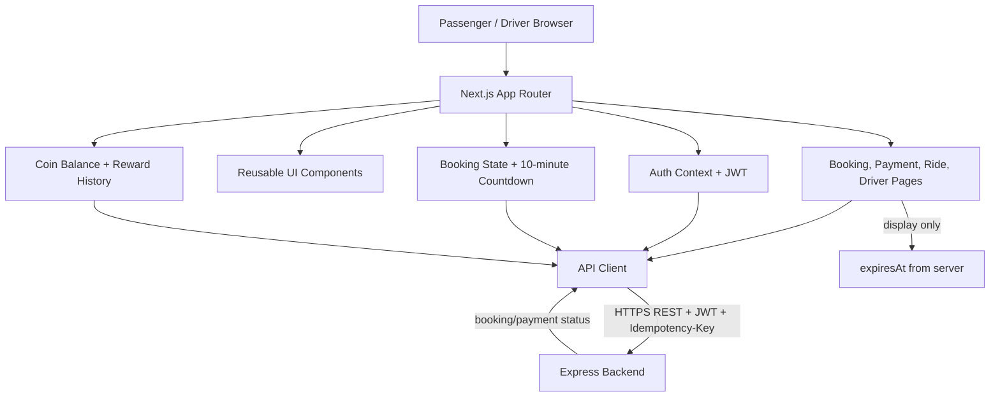
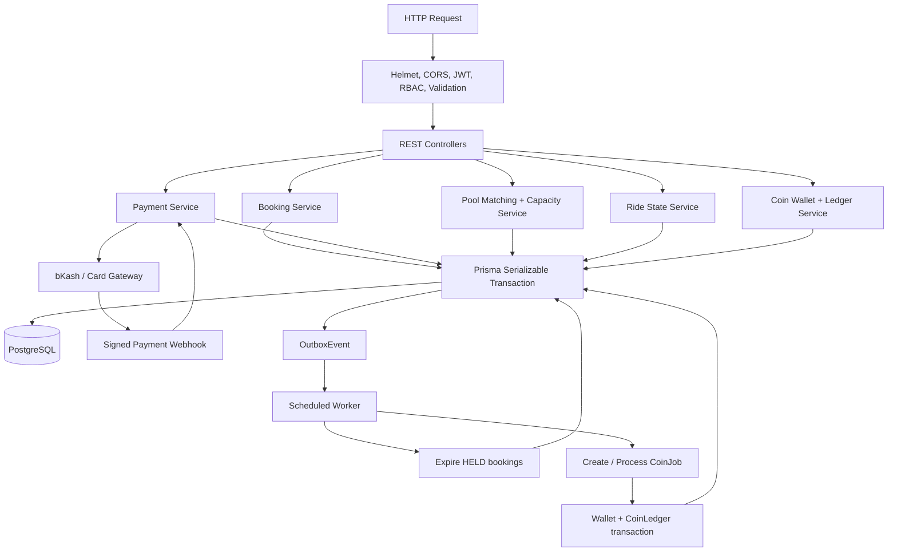
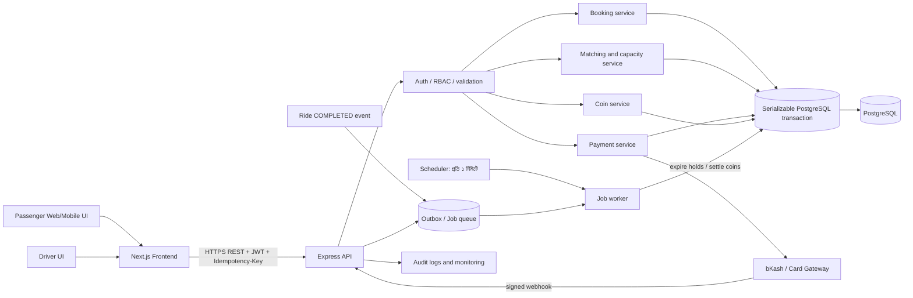
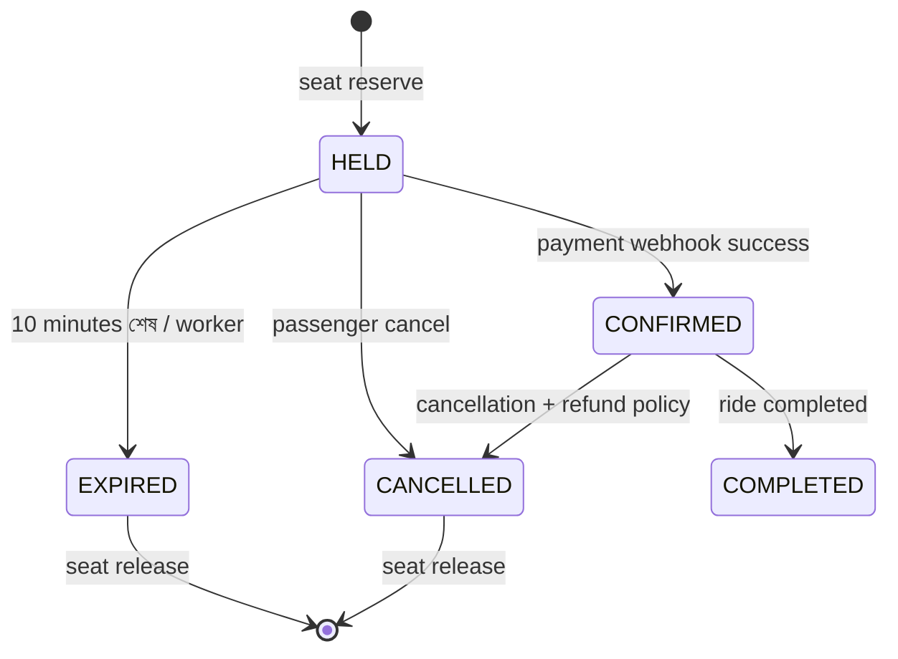
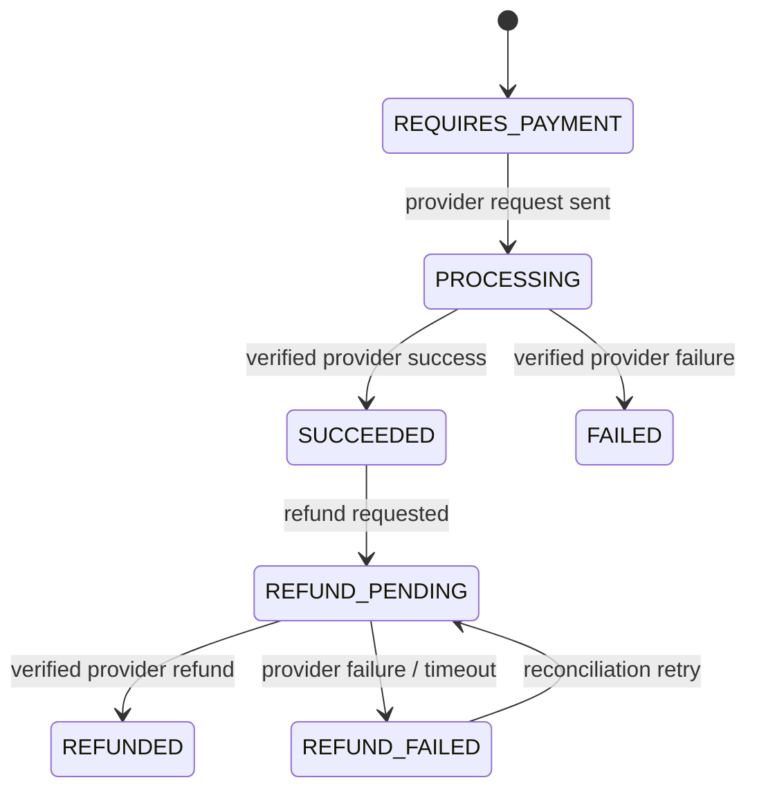
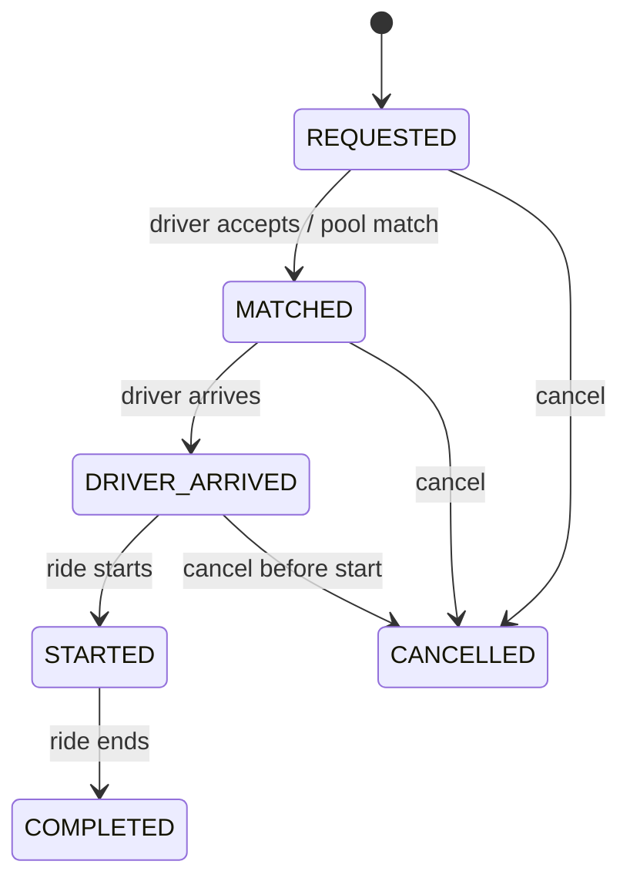
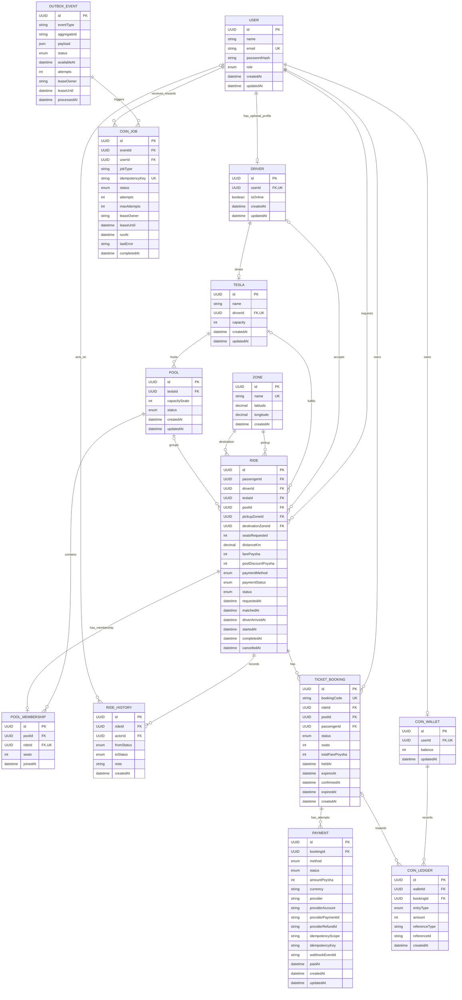

# Dhaka Tesla Pool

Dhaka Tesla Pool হলো Dhaka-ভিত্তিক full-stack ride-pooling system। এটি compatible zone-এর মধ্যে fixed-capacity Tesla ride ভাগ করে এবং passenger booking, driver matching, fare, payment, ১০ মিনিটের ticket hold, coin reward ও ride lifecycle পরিচালনা করে।

## Live Deployment

- Frontend: https://frontend-dhaka-tesla-pool.vercel.app
- Backend: https://backend-dhaka-tesla-pool.vercel.app
- Health check: https://backend-dhaka-tesla-pool.vercel.app/health

The frontend and backend are deployed as separate Vercel projects. PostgreSQL is hosted separately and is accessed by Prisma from the backend function.

## Zones & Matching Rule

The predefined zones are:

- Banani
- Gulshan 1
- Gulshan 2
- Mohakhali
- Dhanmondi
- Mirpur
- Uttara
- Farmgate
- Bashundhara

Two rides can be pooled when they have the same pickup zone and compatible destination corridors. Different pickup zones can also match only when both routes are registered compatible corridors and the destinations overlap, meet at a pickup zone, or otherwise satisfy the corridor rule in `backend/src/utils/zones.js`. This is route-corridor matching, not live map-based routing.

## Features

### মূল সুবিধা

- **[Reported]** Passenger ও driver registration/login
- **[Reported]** Driver online/offline status এবং ownership check
- **[Reported]** Seat count, fare ও payment method-সহ ride request
- **[Planned]** Ticket booking তৈরি হলে database time-ভিত্তিক সর্বোচ্চ ১০ মিনিটের seat hold
- **[Reported/needs verification]** Pool capacity ও concurrent booking protection
- **[Planned]** bKash/card payment attempt, signed webhook, refund state ও reconciliation
- **[Planned]** Ride completion-এর পরে coin reward, CoinJob এবং append-only coin ledger
- **[Reported/needs verification]** Fare calculation in poysha with pool discount
- **[Reported/needs verification]** Predefined Dhaka zone-এর route compatibility matching
- **[Reported/needs verification]** Ride status transitions:
  `REQUESTED -> MATCHED -> DRIVER_ARRIVED -> STARTED -> COMPLETED`
- **[Reported/needs verification]** Ride cancellation এবং ride history
- **[Planned]** Serializable capacity transaction, bounded retry এবং scoped idempotency key
- **[Planned]** Expired hold, outbox dispatch এবং coin settlement worker
- **[Reported/needs verification]** API health endpoint এবং database connectivity status

### Implementation status

এই workspace snapshot-এ `README.md` ছাড়া backend source, Prisma schema, migration, route বা test file দেখা যাচ্ছে না। তাই নিচের booking, payment, refund, coin এবং worker design-গুলো **Proposed/Planned**; এগুলো implemented বলে ধরে production deploy করা যাবে না। কোনো endpoint বা status `Verified` বলার আগে route, service, schema, migration এবং test দিয়ে মিলিয়ে নিতে হবে।

| Domain | বর্তমান documentation status | Implemented বলার প্রমাণ |
| --- | --- | --- |
| Authentication, ride, pool | Reported from previous project description; source verification pending | route + middleware + test |
| Ticket booking ও ১০ মিনিট hold | **Planned** | booking service, migration, expiry test |
| Payment, webhook ও refund | **Planned** | payment-attempt schema, provider adapter, webhook/refund tests |
| CoinWallet, CoinLedger ও CoinJob | **Planned** | worker, outbox migration, reconciliation test |
| Vercel Cron/worker delivery | **Planned** | deployed `vercel.json`/Cron config ও delivery monitoring |

## Architecture

এই system-এর architecture তিনটি স্তরে দেখা যায়: frontend user experience, backend business service এবং end-to-end deployment flow। Pool-এর available seat কেবল backend transaction হিসাব করবে; frontend-এর countdown কখনও seat availability নির্ধারণ করবে না।

### ১. Frontend Architecture



**Frontend নিয়ম:** booking তৈরির পরে API থেকে পাওয়া `expiresAt` দিয়ে countdown দেখাবে। Payment button retry করলে একই `Idempotency-Key` ব্যবহার করবে। Countdown শূন্য হলে UI payment বন্ধ করতে পারে, কিন্তু final decision backend-এর `HELD`/`EXPIRED` status থেকে আসবে।

### ২. Backend Architecture



**Backend নিয়ম:** controller validation-এর পরে service layer-এ যাবে। Booking service একই transaction-এ pool seat reserve, ticket hold, payment intent এবং outbox event লিখবে। Payment success কেবল signed webhook-এর পরে হবে; browser redirect-কে trusted result ধরা হবে না।

### ৩. Full System Architecture


### Arrow Follow 

```mermaid
flowchart TB

    subgraph S1["1. Booking Request →"]
        direction LR
        U["Passenger"]
        UI["Next.js Web App"]
        API["Express API"]
        AUTH["JWT / Authorization / Validation"]
        BOOK["Booking Service"]

        U -->|"Select pickup and destination"| UI
        UI -->|"POST /api/rides"| API
        API --> AUTH
        AUTH -->|"Validated request"| BOOK
    end

    subgraph S2["← 2. Pool Matching and Seat Hold"]
        direction RL
        MATCH["Pool Matcher"]
        FARE["Fare Calculator"]
        TX1["Prisma Transaction"]
        DB1[("PostgreSQL")]

        BOOK -->|"Find compatible pool"| MATCH
        MATCH -->|"Eligible pool"| FARE
        FARE -->|"Calculate fare"| TX1
        TX1 -->|"Lock / check capacity / create hold"| DB1
    end

    DB1 -->|"Hold committed"| PAY

    subgraph S3["3. Payment Processing →"]
        direction LR
        PAY["Payment Service"]
        PG["Payment Gateway"]
        WH["Webhook Signature Verification"]
        IDEM["Idempotency and Payment Status Check"]

        PAY -->|"Initiate payment"| PG
        PG -->|"Signed payment callback"| WH
        WH --> IDEM
    end

    IDEM -->|"Verified successful payment"| CONFIRM

    subgraph S4["← 4. Confirm Booking"]
        direction RL
        CONFIRM["Booking Confirmation Service"]
        TX2["Prisma Transaction"]
        DB2[("PostgreSQL")]
        STATE["Ride State Machine"]

        CONFIRM -->|"Recheck hold and payment state"| TX2
        TX2 -->|"Confirm booking / persist ledger"| DB2
        DB2 -->|"Committed booking state"| STATE
    end

    STATE -->|"Booking confirmed event"| OUTBOX

    subgraph S5["5. Events and Notification →"]
        direction LR
        OUTBOX["Transactional Outbox"]
        PUB["Outbox Publisher"]
        QUEUE[("Durable Queue")]
        WORKER["Background Worker"]
        NOTIFY["Notification Service"]
        USER2["Passenger receives confirmation"]

        OUTBOX --> PUB
        PUB --> QUEUE
        QUEUE --> WORKER
        WORKER --> NOTIFY
        NOTIFY -->|"Push / SMS / Email"| USER2
    end

    USER2 -->|"Failure recovery / reconciliation"| RECON

    subgraph S6["← 6. Failure and Recovery"]
        direction RL
        RECON["Payment Reconciliation"]
        FAIL["Payment Failed / Timed Out"]
        EXPIRE["Hold Expiry Worker"]
        RELEASE["Release Seat Hold"]

        RECON --> DB2
        FAIL --> EXPIRE
        EXPIRE --> RELEASE
        RELEASE --> DB2
    end

    PG -.->|"Failed payment"| FAIL
    WORKER -.-> RECON

    classDef user fill:#E1F5EE,stroke:#0F6E56,color:#04342C
    classDef svc fill:#E6F1FB,stroke:#185FA5,color:#042C53
    classDef ext fill:#FAEEDA,stroke:#854F0B,color:#412402
    classDef db fill:#EEEDFE,stroke:#534AB7,color:#26215C

    class U,UI,USER2 user
    class API,AUTH,BOOK,MATCH,FARE,PAY,WH,IDEM,CONFIRM,STATE,OUTBOX,PUB,WORKER,NOTIFY,TX1,TX2,FAIL,EXPIRE,RELEASE,RECON svc
    class PG ext
    class DB1,DB2,QUEUE db
```


#### step 1: Passenger ride request পাঠান
Passenger pickup location, destination এবং প্রয়োজনীয় ride preference নির্বাচন করেন। Next.js frontend POST /api/rides request Express API-তে পাঠায়।


#### step 2:Authentication ও validation হয়
Backend JWT, user permission, request data এবং idempotency key যাচাই করে। Invalid request হলে এখানেই reject হয়।


#### step 3: Pool matching হয়
Pool Matcher compatible pool খোঁজে। Route compatibility, detour, waiting time এবং available capacity বিবেচনা করে।


#### step 4: Fare calculate ও seat hold করা হয়
Fare Calculator server-side fare নির্ধারণ করে। PostgreSQL transaction-এর মধ্যে capacity যাচাই করে seat hold তৈরি করা হয়। Concurrent request থাকলে atomic update, row lock বা উপযুক্ত isolation ব্যবহার করতে হবে।


#### step 5:Payment initiate হয়
Payment Service external gateway-তে payment তৈরি করে। Payment pending থাকাকালে seat hold নির্দিষ্ট সময় পর্যন্ত বজায় থাকে।


#### step 6:Webhook verify করা হয়
Gateway callback-এর signature, payment reference, amount এবং transaction status যাচাই করা হয়। Idempotency নিশ্চিত করে একই callback দ্বিতীয়বার এলে duplicate credit বা confirmation আটকানো হয়।


#### step 7:Booking confirm হয়
Confirmation Service যাচাই করে payment সফল এবং hold এখনও বৈধ কি না। এরপর PostgreSQL transaction-এ booking state ও সংশ্লিষ্ট record commit করা হয়।


#### step 8:Notification পাঠানো হয়
একই transaction-এ booking update এবং outbox record persist করা হয়। Publisher committed event queue-তে পাঠায়; worker notification service-কে trigger করে।


#### step 9:Failure হলে recovery হয়
Payment ব্যর্থ হলে বা hold expire হলে worker booking ও payment status যাচাই করে প্রয়োজন অনুযায়ী hold release করে। Payment gateway এবং local database-এর status mismatch হলে reconciliation worker তা resolve করে।

**Full flow-এর সারাংশ:** Passenger বা driver frontend থেকে request পাঠায়, backend transaction দিয়ে pool-এর seat hold করে, payment gateway payment নেয়, webhook booking confirm করে এবং worker expiry বা coin reward process করে। PostgreSQL booking, seat, payment এবং coin-এর একমাত্র সত্য উৎস।
### Problem and solve
#### ১. Race Condition — একই Seat দুইজন Book করতে চাইলে
সমাধান:
1. Database transaction-এর মধ্যে seat availability check করব।
2. Atomic update বা row locking ব্যবহার করে seat allocate করব।
3. একজন seat পাবে, অন্যজন 409 Conflict পাবে।
মূল কথা: Overbooking প্রতিরোধ করব।
#### ২. Duplicate Payment Callback
সমাধান:
1. Payment gateway-এর webhook signature verify করব।
2. Unique payment reference ও idempotency ব্যবহার করব।
3. একই callback আবার এলে দ্বিতীয়বার টাকা credit করব না।
মূল কথা: Duplicate payment processing প্রতিরোধ করব।
#### ৩. Payment Success, কিন্তু Booking Failure
সমাধান:
1. Payment ও booking-এর status আলাদাভাবে track করব।
2. Payment সফল হলে booking confirm করার চেষ্টা করব।
3. Booking সম্ভব না হলে recovery workflow চালাব এবং প্রয়োজন হলে refund করব।
মূল কথা: Payment ও booking-এর consistency বজায় রাখব।
#### ৪. Server Crash — Response হারিয়ে গেলে
সমাধান:
1. প্রতিটি booking request-এর জন্য idempotency key ব্যবহার করব।
2. Database-এ request-এর result সংরক্ষণ করব।
3. একই request আবার এলে নতুন booking না বানিয়ে আগের result ফেরত দেব।
মূল কথা: Duplicate booking প্রতিরোধ করব।
#### ৫. Hold Expiry — Payment না করলে Seat Release
সমাধান:
1. Seat hold-এর সঙ্গে expiry time সংরক্ষণ করব।
2. Scheduler ও background worker দিয়ে expired hold খুঁজব।
3. Booking ও payment status যাচাই করে seat release করব।
মূল কথা: Unused seat অন্য passenger-এর জন্য available করব।
#### ৬. Notification Failure — SMS না গেলে
সমাধান:
1. Booking confirmation ও outbox event একই database transaction-এ সংরক্ষণ করব।
2. Background worker দিয়ে notification পাঠাব।
3. ব্যর্থ হলে retry করব; notification failure-এর কারণে booking rollback করব না।
মূল কথা: Booking নিশ্চিত থাকবে, notification পরে পাঠানো হবে।
#### ৭. Scaling — অনেক User একসঙ্গে Request করলে
সমাধান:
1. Load balancer দিয়ে request একাধিক API server-এ ভাগ করব।
2. Database query, index ও connection pooling optimize করব।
3. Background task queue-তে পাঠাব এবং monitoring দিয়ে bottleneck শনাক্ত করব।
মূল কথা: বেশি traffic সামলাব এবং system-এর performance বজায় রাখব।

### বাংলা পূর্ণ আর্কিটেকচার

**Frontend:** Next.js App Router-এর passenger ও driver dashboard, booking form, ১০ মিনিটের countdown, payment screen, booking status, coin balance/reward history এবং retry-safe API client থাকবে। Frontend শুধু coin job-এর ফলাফল দেখাবে; coin যোগ করার job frontend-এ চলবে না। Countdown শুধু UI feedback; hold-এর আসল expiry সবসময় server-এর `expiresAt` দিয়ে যাচাই হবে।

**Backend:** Express API-তে Auth/RBAC, request validation, booking, matching, fare, payment, coin এবং ride-state service আলাদা থাকবে। Controller সরাসরি balance বা seat update করবে না; domain service transaction-এর মধ্যে সেই কাজ করবে।

**Database:** PostgreSQL হলো source of truth। Fare/coin/poysha integer হিসেবে রাখা হবে। Provider-scoped payment ID, webhook event ID, operation-scoped idempotency key, `TicketBooking.bookingCode` এবং coin reward reference duplicate request ঠেকাবে।

**External integration:** Payment gateway-তে authorization/charge পাঠানোর আগে local payment intent তৈরি হবে। Gateway webhook signature যাচাই করে idempotentভাবে payment update করবে; browser redirect কখনও payment success-এর source of truth নয়।

**Worker:** প্রতি এক মিনিটে `EXPIRED` হওয়ার সময় পার হওয়া `HELD` booking lock করে seat release করবে। `RIDE_COMPLETED` event থেকে `CoinJob` তৈরি করে reward হিসাব, wallet balance এবং `CoinLedger` একই transaction-এ update করবে। Job পুনরায় চললেও unique key-এর কারণে duplicate coin হবে না।

Preview-safe architecture map:

```text
Passenger / Driver
        |
        | REST requests + JWT
        v
Next.js Web App
        |
        v
Express REST API
        |
        +--> Auth / ownership middleware
        |
        +--> Controllers
                |
                +--> Pool matcher
                +--> Fare calculator
                +--> Ride state machine
                +--> Prisma ORM
                        |
                        v
                  PostgreSQL database
```

### Request এবং matching flow

1. Frontend authenticated ride request বা driver action Express API-তে পাঠায়।
2. Controller data পরিবর্তনের আগে authentication, ownership এবং request validation middleware চালায়।
3. Operation অনুযায়ী fare calculator, route-corridor matcher এবং ride state machine ব্যবহার হয়।
4. Pool acceptance Prisma `Serializable` transaction-এর মধ্যে route compatibility যাচাই, Tesla capacity lock, active pool seat count এবং assignment একসঙ্গে সম্পন্ন করে।
5. PostgreSQL ride status, pool membership, seat usage, payment state, ticket hold, coin ledger এবং audit history-এর source of truth।

### Ticket booking এবং ১০ মিনিটের hold flow

1. Passenger `POST /api/bookings` করলে backend একই transaction-এর মধ্যে PostgreSQL-এর `CURRENT_TIMESTAMP` ব্যবহার করে `expiresAt = database_time + INTERVAL '10 minutes'` নির্ধারণ করবে। Application server-এর clock বা frontend clock authoritative নয়।
2. একই transaction-এ capacity aggregate lock করে confirmed seat এবং `expiresAt > CURRENT_TIMESTAMP` থাকা `HELD` seat count করবে। Capacity যথেষ্ট হলে `TicketBooking=HELD`, reserved seat, payment attempt এবং outbox event একসঙ্গে লিখবে।
3. Passenger ১০ মিনিটের মধ্যে payment করলে confirmation transaction আবার database time দিয়ে `status = HELD` এবং `expiresAt > CURRENT_TIMESTAMP` যাচাই করবে। শর্ত সত্য হলে booking `CONFIRMED` হবে।
4. Expiry worker একই row lock নিয়ে `status = HELD` এবং `expiresAt <= CURRENT_TIMESTAMP` শর্তে booking `EXPIRED` করবে এবং seat release করবে।
5. Payment capture expiry-এর পরে হয়ে গেলে booking confirm করা যাবে না; capture record রেখে refund/reconciliation শুরু করতে হবে। Confirmed booking cancel হলে আলাদা refund state machine চলবে।

#### Pool seat হিসাব

প্রতিটি pool-এর জন্য:

```text
availableSeats = poolCapacitySeats - confirmedSeats - activeHeldSeats
activeHeldSeats = HELD booking-এর seats,
          যেখানে expiresAt > database CURRENT_TIMESTAMP
```

`POST /api/bookings` transaction `availableSeats >= requestedSeats` যাচাই করে। যাচাই সফল হলে সেই seat ১০ মিনিটের জন্য `HELD` হয় এবং অন্য passenger সেটি book করতে পারে না। Payment সফল হলে একই booking `CONFIRMED` হয়; payment না হলে expiry job `HELD -> EXPIRED` করে এবং seat আবার `availableSeats`-এ ফিরে আসে। Aggregate capacity enforce করার জন্য শুধু unique index বা `CHECK` constraint যথেষ্ট নয়; একই pool-এর capacity row/aggregate অবশ্যই serialize করতে হবে।



Payment webhook এবং expiry worker একই booking row lock করবে। Confirmation-এর শর্ত হবে `status = HELD AND expiresAt > CURRENT_TIMESTAMP`; expiry-এর শর্ত হবে `status = HELD AND expiresAt <= CURRENT_TIMESTAMP`। তাই payment ঠিক expiry মুহূর্তে এলেও database-এ `CONFIRMED` অথবা `EXPIRED` একটি মাত্র final state থাকবে। Expired booking-এর পরে provider capture report এলে `409 BOOKING_EXPIRED` দিয়ে money capture record, refund এবং reconciliation queue করতে হবে।

### ACID transaction নীতি

- **Atomicity:** booking, seat reservation, payment intent এবং outbox event একই transaction-এ commit হবে; যেকোনো error হলে সব rollback।
- **Consistency:** foreign key, enum state transition, non-negative seat/coin balance এবং payment amount/currency validation বজায় থাকবে। Aggregate capacity শুধু unique index বা `CHECK` দিয়ে enforce করা হবে না; service transaction-এ count ও reserve একসঙ্গে হবে।
- **Isolation:** একই `Pool` capacity aggregate-এর booking/matching transaction serialize হবে। Prisma `Serializable` বা locked capacity row ব্যবহার হবে; শুধু transient serialization/deadlock error bounded limit পর্যন্ত retry হবে।
- **Durability:** PostgreSQL commit-এর পরে booking/payment state টিকে থাকবে; external gateway-এর ফল webhook ও audit record-এ রাখা হবে।

#### Interview-wise transaction flow

Passenger যখন ২টি seat book করে, backend-এর transaction এই ক্রমে কাজ করবে:

1. `Idempotency-Key` দেখে একই request আগে process হয়েছে কি না যাচাই করবে।
2. একই `Pool`-এর capacity aggregate row lock বা `Serializable` isolation-এর মাধ্যমে concurrent request নিয়ন্ত্রণ করবে।
3. Database `CURRENT_TIMESTAMP` দিয়ে `confirmedSeats + unexpiredHeldSeats` count করে `availableSeats >= requestedSeats` যাচাই করবে।
4. `TicketBooking=HELD`, database-calculated `expiresAt`, reserved seat এবং `PaymentAttempt=REQUIRES_PAYMENT` একই transaction-এ লিখবে।
5. `BookingHeld` outbox event লিখে commit করবে। যেকোনো ধাপে error হলে booking, seat এবং payment intent একসঙ্গে rollback হবে।
6. Payment gateway call database transaction-এর ভিতরে অপেক্ষা করে করা হবে না। Local payment intent commit হওয়ার পরে gateway call হবে; gateway-এর signed webhook নতুন ছোট transaction-এ `Payment=SUCCEEDED` এবং `TicketBooking=CONFIRMED` করবে।
7. PostgreSQL serialization failure বা deadlock হলে পুরো transaction নতুন করে retry হবে; একই `Idempotency-Key` থাকায় duplicate booking হবে না।

#### Race condition: payment বনাম expiry

Payment webhook এবং expiry worker একই booking-এর final state বদলাতে পারে। দুজনেই row lock নেবে এবং status শর্তসহ update করবে:

```sql
UPDATE ticket_booking
SET status = 'CONFIRMED', confirmed_at = CURRENT_TIMESTAMP
WHERE id = $1
  AND status = 'HELD'
  AND expires_at > CURRENT_TIMESTAMP;
```

Expiry update-এ একইভাবে `status = 'HELD' AND expires_at <= CURRENT_TIMESTAMP` থাকবে। যে transaction আগে lock পাবে সেটিই state পরিবর্তন করবে। পরে আসা transaction-এর affected row count `0` হলে backend বুঝবে booking আর active নয়। Provider ইতিমধ্যে money capture করেছে জানালে payment attempt-টি `REFUND_PENDING` হবে এবং refund/reconciliation flow শুরু হবে; blind success বা silent loss হবে না।

### Payment এবং refund state machine

Booking state এবং payment-attempt state আলাদা রাখতে হবে। একটি booking `HELD`, `CONFIRMED`, `EXPIRED` বা `CANCELLED` হতে পারে; payment attempt আলাদাভাবে নিচের state-গুলো অনুসরণ করবে:



- External gateway call কখনও open database transaction-এর ভিতরে রাখা যাবে না। Local payment attempt আগে commit হবে; provider result signed webhook বা verified reconciliation job-এর মাধ্যমে persist হবে।
- `REFUNDED` status শুধু provider-এর verified refund confirmation-এর পরে দেওয়া যাবে। Timeout মানেই refund success নয়।
- Expiry-এর পরে capture হলে `PaymentAttempt=SUCCEEDED` record করে booking confirm না করে `REFUND_PENDING` ও reconciliation task তৈরি করতে হবে।

### Idempotency এবং webhook security

- Idempotency key শুধু global unique নয়; user + operation + route বা provider account scope-এ রাখতে হবে। একই key-তে ভিন্ন request body এলে `409 IDEMPOTENCY_PAYLOAD_MISMATCH` দিতে হবে।
- Payment create, confirmation, refund request এবং coin reward-এর জন্য আলাদা operation-scoped key ব্যবহার করতে হবে।
- Webhook signature, provider transaction ID, amount, currency, merchant/provider account এবং event timestamp যাচাই না করে কোনো state update করা যাবে না।
- `provider + providerAccount + providerPaymentId` এবং `provider + providerAccount + webhookEventId` unique করে duplicate payment/webhook আটকাতে হবে।
- Refund request-ও idempotent হবে; একই refund key-তে ভিন্ন amount বা currency এলে reject হবে।

#### ACID interview questions এবং model answers

**প্রশ্ন ১: এই system-এ ACID কেন দরকার?**  
একই Tesla pool-এর শেষ seat একাধিক passenger একই সময়ে চাইতে পারে। Atomicity ও isolation ছাড়া দুজনই seat পেয়ে যেতে পারে, payment ও booking state আলাদা হয়ে যেতে পারে, এবং overbooking হবে।

**প্রশ্ন ২: Atomicity কীভাবে প্রয়োগ করেছেন?**  
Seat reserve, `TicketBooking=HELD`, payment intent, এবং outbox event একই PostgreSQL transaction-এ রাখা হয়েছে। যেকোনো validation বা constraint error হলে সব পরিবর্তন rollback হয়।

**প্রশ্ন ৩: Consistency কী কী rule দিয়ে নিশ্চিত হয়?**  
Foreign key, enum-based state transition, positive seat count, capacity check, unique `bookingCode`, unique `idempotencyKey`, এবং coin ledger reference uniqueness consistency বজায় রাখে। Business rule শুধু controller-এ নয়, database constraint ও service layer দু জায়গায় enforce করা হয়।

**প্রশ্ন ৪: Serializable isolation কেন ব্যবহার করেছেন?**  
দুটি concurrent booking যেন একই available seat পড়ে নিয়ে দুটোই reserve করতে না পারে, তাই booking/matching-এর critical transaction-এ `Serializable` ব্যবহার করা হয়েছে। Conflict হলে PostgreSQL একটি transaction abort করবে; backend bounded retry করবে।

**প্রশ্ন ৫: শুধু frontend countdown দিয়ে seat release করা যাবে?**  
না। Frontend বন্ধ হয়ে যেতে পারে, clock ভুল হতে পারে, বা request হারাতে পারে। Server-এর `expiresAt` এবং scheduled expiry worker authoritative; frontend countdown শুধু user feedback।

**প্রশ্ন ৬: Payment gateway call database transaction-এর ভিতরে রাখেননি কেন?**  
Gateway network call ধীর বা unavailable হতে পারে। দীর্ঘ transaction lock রাখলে database contention ও deadlock বাড়বে। তাই local payment intent আগে commit হয় এবং signed webhook পরে idempotent transaction-এ final payment state update করে।

**প্রশ্ন ৭: Payment webhook দুইবার এলে কী হবে?**  
Provider, provider account এবং provider payment/event ID scoped unique হওয়ায় দ্বিতীয় webhook নতুন charge বা booking তৈরি করবে না। Backend আগের payment result ফেরত দেবে এবং একই final state পুনরায় apply করবে না।

**প্রশ্ন ৮: Payment ঠিক ১০ মিনিটের সময় এলে কীভাবে সিদ্ধান্ত হবে?**  
Payment confirmation এবং expiry worker একই row lock নেয়। যে transaction আগে valid status update করে commit করবে, সেটিই জিতবে। `expiresAt` শর্তের কারণে expiry হয়ে গেলে পরে payment confirmation গ্রহণ করা হবে না।

**প্রশ্ন ৯: Outbox pattern কেন ব্যবহার করেছেন?**  
Database commit সফল হলেও event publish ব্যর্থ হলে coin job বা notification হারিয়ে যেতে পারে। Outbox event booking transaction-এর সঙ্গে commit হয়; worker pending event retry করে, তাই eventual processing এবং audit দুটোই পাওয়া যায়।

**প্রশ্ন ১০: Coin দুইবার যোগ হওয়া কীভাবে আটকাবেন?**  
`CoinLedger`-এ `referenceType + referenceId + entryType` unique constraint থাকবে। Worker retry করলেও একই `RIDE_COMPLETED` event-এর দ্বিতীয় credit insert হবে না; wallet balance এবং ledger update একই transaction-এ হবে।

**প্রশ্ন ১১: Serializable transaction বারবার fail করলে কী করবেন?**  
শুধু transient serialization/deadlock error bounded exponential backoff-এ retry করব। কয়েকবার retry-এর পর `409 BOOKING_CONFLICT` দেব, metrics/log রাখব এবং client-কে নতুন availability fetch করতে বলব। সব error blindly retry করব না।

**প্রশ্ন ১২: Durability কীভাবে নিশ্চিত হয়?**  
PostgreSQL commit-এর পরে booking/payment state durable থাকে। External gateway-এর response নয়, signed webhook-এর persisted result system-এর source of truth; backup, WAL এবং managed PostgreSQL durability বাড়ায়।

### Coin job

`RIDE_COMPLETED` এবং তার `OutboxEvent` একই database transaction-এ লেখা হবে। Worker outbox event claim করে একটি `CoinJob` তৈরি/প্রক্রিয়া করবে। Job passenger-এর reward হিসাব করে `CoinLedger(CREDIT)` insert এবং wallet balance update করবে। Event ID এবং reward reference unique হওয়ায় retry বা duplicate event-এ দ্বিতীয়বার coin যোগ হবে না। Fraud review, expiry এবং manual adjustment-এর জন্য ledger append-only থাকবে; balance cached হলেও ledger-ই হিসাবের source of truth।

#### CoinJob lifecycle

```text
RIDE_COMPLETED
  |
  v
OutboxEvent(PENDING)
  |
  v
CoinJob(PENDING) -> PROCESSING -> COMPLETED
         |
         +---- lease timeout -> PENDING retry
         +---- transient failure -> PENDING retry (bounded)
         +---- permanent failure/max attempts -> FAILED + alert
  |
  v
CoinWallet + CoinLedger(CREDIT)
```

#### CoinJob database design

| Table | প্রয়োজনীয় field | দায়িত্ব |
| --- | --- | --- |
| `CoinJob` | `id`, `eventId`, `userId`, `jobType`, `idempotencyKey`, `status`, `attempts`, `maxAttempts`, `leaseOwner`, `leaseUntil`, `runAt`, `lastError`, `completedAt` | কোন reward job কখন চলেছে, lease/retry হয়েছে কি না এবং failure audit রাখা |
| `CoinWallet` | `id`, `userId UNIQUE`, `balance`, `updatedAt` | দ্রুত বর্তমান coin balance দেখানো; এটি cached projection |
| `CoinLedger` | `id`, `walletId`, `amount`, `entryType`, `referenceType`, `referenceId`, `createdAt` | প্রতিটি credit/debit-এর append-only হিসাব |
| `OutboxEvent` | `id`, `eventType`, `aggregateId`, `payload`, `status`, `availableAt`, `processedAt` | ride completion event হারিয়ে না যাওয়া এবং worker retry |

`OutboxEvent.eventId`/primary key, `CoinJob(eventId, jobType)` এবং `CoinLedger(referenceType, referenceId, entryType)` unique থাকবে। Worker claim করার সময় `leaseOwner` ও `leaseUntil` লিখবে; lease শেষ হলে অন্য worker job reclaim করতে পারবে। `CoinJob` processing transaction-এ wallet row lock করে ledger insert এবং balance update করবে। Ledger insert আগে থেকেই থাকলে job-টি duplicate reward না দিয়ে `COMPLETED` হবে। `maxAttempts` পার হলে `FAILED` record, alert এবং reconciliation queue তৈরি হবে। Reconciliation job outbox, job, ledger ও wallet balance মিলিয়ে missing বা duplicate effect report করবে; নিজে silent correction করবে না।

#### Coin reward-এর interview questions

**প্রশ্ন ১: Coin reward synchronous না asynchronous কেন?**  
Ride complete করার API-কে coin calculation, wallet lock বা reward provider-এর জন্য অপেক্ষা করানো দরকার নেই। Outbox ও worker ব্যবহার করলে ride completion দ্রুত commit হয় এবং reward আলাদাভাবে retry করা যায়।

**প্রশ্ন ২: CoinJob কীভাবে তৈরি হয়?**  
`Ride.status` সফলভাবে `COMPLETED` হওয়ার একই database transaction-এ `RIDE_COMPLETED` outbox event লেখা হয়। Worker event claim করে `CoinJob` তৈরি করে; event আগে process হয়ে থাকলে unique key duplicate job আটকায়।

**প্রশ্ন ৩: Worker crash করলে coin হারাবে কি?**  
না। Outbox event ও job database-এ durable থাকে। Worker `PROCESSING` job-এর lease/timeout দেখে আবার `PENDING` করতে পারে। পরের retry idempotency key যাচাই করে reward সম্পন্ন করবে।

**প্রশ্ন ৪: Coin duplicate হওয়ার সবচেয়ে বড় ঝুঁকি কোথায়?**  
Worker একই event দুইবার পেতে পারে, network response হারিয়ে retry হতে পারে, অথবা process crash-এর পরে transaction commit হয়েছে কি না জানা নাও থাকতে পারে। তাই application check-এর পাশাপাশি database unique constraint বাধ্যতামূলক।

**প্রশ্ন ৫: Wallet balance এবং ledger কীভাবে update করবেন?**  
একটি ছোট transaction-এ wallet row lock, duplicate ledger check, নতুন ledger insert এবং `balance = balance + amount` update করব। যেকোনো ধাপে failure হলে সব rollback হবে।

**প্রশ্ন ৬: Ledger-কে source of truth বলা হলেও wallet balance রাখা হচ্ছে কেন?**  
প্রতিবার ledger sum করলে dashboard ধীর হতে পারে। Wallet দ্রুত read-এর জন্য cached projection; reconciliation job ledger sum-এর সঙ্গে wallet balance মিলিয়ে drift শনাক্ত করবে।

**প্রশ্ন ৭: CoinJob-এর কোন failure retry করা যাবে?**  
Database deadlock, timeout বা সাময়িক queue/database outage retry করা যাবে। Invalid user, malformed event বা business-rule violation permanent failure হিসেবে `FAILED` হবে এবং alert/manual review প্রয়োজন হবে।

**প্রশ্ন ৮: Coin reward-এর জন্য exactly-once processing কীভাবে দাবি করবেন?**  
Worker execution at-least-once হতে পারে, কিন্তু ledger effect idempotent করা হবে। Unique reward reference এবং atomic wallet/ledger transaction-এর কারণে business result effectively once হবে।

**প্রশ্ন ৯: User কি ride complete হওয়ার সঙ্গে সঙ্গে coin দেখবে?**  
সাধারণত `PENDING` reward status দেখানো যায়। CoinJob `COMPLETED` হলে wallet API নতুন balance ফেরত দেবে; প্রয়োজনে polling বা notification ব্যবহার করা যাবে। Frontend কখনও নিজে balance বাড়াবে না।

**প্রশ্ন ১০: Coin fraud বা manual adjustment কীভাবে audit করবেন?**  
Ledger append-only থাকবে। Manual adjustment আলাদা `ADJUSTMENT` entryType, actor, reason এবং reference সহ insert হবে; পুরোনো credit edit/delete করা হবে না।

### Ride Lifecycle



Only valid transitions are accepted by the state machine. Each transition records the previous status, new status, actor, optional note, and timestamp in `RideHistory`.

## Database Design / ERD (বাংলা নকশা)

PostgreSQL হলো identity, ride, vehicle capacity, pooling, payment, ticket hold, coin এবং audit history-এর source of truth। Prisma schema, migration এবং transactional write পরিচালনা করবে। নিচের ERD-তে বর্তমান ride model-এর সঙ্গে payment ও reward domain যুক্ত করা হয়েছে।

### 7.1 Problem Statement

Dhaka Tesla Pool একটি ride-pooling platform, যেখানে একাধিক passenger compatible pickup zone ও destination corridor অনুযায়ী একই Tesla ride share করতে পারে। System-টিকে passenger booking, driver assignment, seat capacity, payment, ticket hold, ride lifecycle এবং coin reward পরিচালনা করতে হবে।

এই system-এর Database Design এমনভাবে তৈরি করতে হবে, যাতে একাধিক concurrent request, payment failure, expired booking এবং ride status পরিবর্তনের সময় data consistency বজায় থাকে।

প্রধান Database Design Challenges:

1. **User & Role Management:** Passenger এবং Driver-এর account ও সংশ্লিষ্ট profile সংরক্ষণ করা।
2. **Zone & Route Matching:** Pickup zone, destination zone এবং compatible route corridor-এর তথ্য সংরক্ষণ করা।
3. **Ride & Driver Assignment:** Ride request, assigned driver, Tesla vehicle এবং ride lifecycle-এর তথ্য পরিচালনা করা।
4. **Pool Capacity Management:** Tesla-এর fixed seat capacity অনুযায়ী একাধিক ride একই pool-এ যুক্ত করা এবং মোট reserved seat capacity অতিক্রম করা প্রতিরোধ করা।
5. **Ticket Booking & Seat Hold:** Booking, passenger, reserved seat এবং সর্বোচ্চ ১০ মিনিটের hold expiry সংরক্ষণ করা।
6. **Concurrent Booking Protection:** একই সময়ে একাধিক passenger booking করলেও pool-এর available capacity অতিক্রম না করা।
7. **Payment Tracking:** প্রতিটি payment attempt, gateway reference, payment status এবং refund status সংরক্ষণ করা।
8. **Payment Failure & Recovery:** Failed payment, delayed বা duplicate webhook এবং application crash-এর পরেও payment ও booking-এর সঠিক অবস্থা পুনরুদ্ধার করা।
9. **Ride Lifecycle & History:** Ride-এর status transition, actor এবং প্রতিটি গুরুত্বপূর্ণ পরিবর্তনের history সংরক্ষণ করা।
10. **Coin Reward & Ledger:** Ride completion-এর পরে coin reward পরিচালনা করা এবং প্রতিটি credit বা debit-এর audit record রাখা।
11. **Background Job Processing:** Expired hold, coin settlement এবং asynchronous event processing নির্ভরযোগ্যভাবে পরিচালনা করা।
12. **Data Integrity:** Foreign Key, Unique Constraint, Check Constraint এবং Database Transaction ব্যবহার করে invalid বা inconsistent data প্রতিরোধ করা।

### 7.2 Entity Identification

উপরের requirements থেকে নিচের প্রধান entities শনাক্ত করা হয়েছে।

| Entity | দায়িত্ব |
|---|---|
| `USER` | Passenger, Driver ও অন্যান্য user-এর account তথ্য |
| `DRIVER` | Driver-এর profile ও online/offline status |
| `TESLA` | Vehicle এবং তার seat capacity |
| `ZONE` | Predefined pickup ও destination zone |
| `RIDE` | Passenger-এর ride request, fare, route ও lifecycle |
| `POOL` | একই vehicle-এ একাধিক compatible ride grouping |
| `POOL_MEMBERSHIP` | কোন ride কোন pool-এ যুক্ত এবং কত seat ব্যবহার করছে |
| `RIDE_HISTORY` | Ride status পরিবর্তনের audit history |
| `TICKET_BOOKING` | Ticket booking, seat count, hold expiry ও confirmation |
| `PAYMENT` | Payment attempts, provider references ও payment status |
| `COIN_WALLET` | User-এর বর্তমান coin balance |
| `COIN_LEDGER` | Coin credit ও debit-এর append-only history |
| `OUTBOX_EVENT` | Database transaction থেকে তৈরি asynchronous event |
| `COIN_JOB` | Coin reward processing, retry ও completion status |

### 7.3 Relationship Design


এই section-এ Dhaka Tesla Pool-এর প্রতিটি database table-এর উদ্দেশ্য, গুরুত্বপূর্ণ columns, constraints এবং সংশ্লিষ্ট business logic ব্যাখ্যা করা হয়েছে। Column names বিদ্যমান ER Diagram-এর সঙ্গে সামঞ্জস্য রেখে রাখা হয়েছে।

#### 7.3.1 User & Driver Management

##### Table: `USER`

**Purpose:** Passenger, Driver এবং অন্যান্য user-এর account ও authentication-related তথ্য সংরক্ষণ করা।

| Column | Type | Constraint | Description |
|---|---|---|---|
| `id` | UUID | Primary Key | User-এর unique identifier |
| `name` | String | Required | User-এর নাম |
| `email` | String | Unique, Required | Login ও communication-এর email |
| `passwordHash` | String | Required | Hashed password |
| `role` | Enum | Required | User-এর role, যেমন Passenger বা Driver |
| `createdAt` | DateTime | Required | Account তৈরির সময় |
| `updatedAt` | DateTime | Required | সর্বশেষ update-এর সময় |

**Relationship:**
- একজন User একাধিক Ride request করতে পারে।
- একজন User-এর একাধিক Ticket Booking থাকতে পারে।
- একজন User-এর সর্বোচ্চ একটি Driver Profile ও একটি Coin Wallet থাকতে পারে।

##### Table: `DRIVER`

**Purpose:** Driver-specific information এবং availability সংরক্ষণ করা।

| Column | Type | Constraint | Description |
|---|---|---|---|
| `id` | UUID | Primary Key | Driver Profile-এর unique identifier |
| `userId` | UUID | Foreign Key, Unique | সংশ্লিষ্ট `USER.id` |
| `isOnline` | Boolean | Required | Driver বর্তমানে online কি না |
| `createdAt` | DateTime | Required | Profile তৈরির সময় |
| `updatedAt` | DateTime | Required | সর্বশেষ update-এর সময় |

**Relationship:**
- প্রতিটি Driver Profile একটি User-এর সঙ্গে যুক্ত।
- একজন Driver সময়ের সঙ্গে একাধিক Ride গ্রহণ করতে পারে।
- Driver-এর সঙ্গে Tesla যুক্ত থাকতে পারে।

#### 7.3.2 Vehicle & Zone Management

##### Table: `TESLA`

**Purpose:** Ride পরিচালনার জন্য Tesla vehicle এবং তার passenger capacity সংরক্ষণ করা।

| Column | Type | Constraint | Description |
|---|---|---|---|
| `id` | UUID | Primary Key | Vehicle-এর unique identifier |
| `name` | String | Required | Vehicle-এর নাম বা display name |
| `driverId` | UUID | Foreign Key, Unique | সংশ্লিষ্ট `DRIVER.id` |
| `capacity` | Integer | Required, Positive | Vehicle-এর মোট passenger seat capacity |
| `createdAt` | DateTime | Required | Record তৈরির সময় |
| `updatedAt` | DateTime | Required | সর্বশেষ update-এর সময় |

**Relationship:**
- একজন Driver-এর সঙ্গে সর্বোচ্চ একটি Tesla যুক্ত।
- একটি Tesla বিভিন্ন সময়ে একাধিক Pool পরিচালনা করতে পারে।

##### Table: `ZONE`

**Purpose:** Dhaka-এর predefined pickup ও destination zone সংরক্ষণ করা।

| Column | Type | Constraint | Description |
|---|---|---|---|
| `id` | UUID | Primary Key | Zone-এর unique identifier |
| `name` | String | Unique, Required | Zone-এর নাম |
| `latitude` | Decimal | Optional/Required as implemented | Zone-এর latitude |
| `longitude` | Decimal | Optional/Required as implemented | Zone-এর longitude |
| `createdAt` | DateTime | Required | Record তৈরির সময় |

উদাহরণ: Banani, Gulshan 1, Gulshan 2, Mohakhali, Dhanmondi, Mirpur, Uttara, Farmgate এবং Bashundhara।

**Relationship:**
- একটি Zone অনেক Ride-এর pickup zone হতে পারে।
- একটি Zone অনেক Ride-এর destination zone হতে পারে।

> Zone-এর latitude ও longitude সংরক্ষণ করা হলেও বর্তমান route matching logic predefined zone ও compatible corridor-এর ওপর নির্ভর করে; এটি নিজে থেকে live map routing নিশ্চিত করে না।

#### 7.3.3 Ride & Pool Management

##### Table: `RIDE`

**Purpose:** Passenger-এর ride request, route, fare, payment method এবং ride lifecycle সংরক্ষণ করা।

| Column | Type | Constraint | Description |
|---|---|---|---|
| `id` | UUID | Primary Key | Ride-এর unique identifier |
| `passengerId` | UUID | Foreign Key | Ride request করা User |
| `driverId` | UUID | Nullable Foreign Key | Assigned Driver |
| `teslaId` | UUID | Nullable Foreign Key | Assigned Tesla |
| `poolId` | UUID | Nullable Foreign Key | সংশ্লিষ্ট Pool |
| `pickupZoneId` | UUID | Foreign Key | Pickup Zone |
| `destinationZoneId` | UUID | Foreign Key | Destination Zone |
| `seatsRequested` | Integer | Positive | Passenger-এর requested seat সংখ্যা |
| `distanceKm` | Decimal | Non-negative | হিসাব করা route distance |
| `farePoysha` | Integer | Non-negative | Fare-এর amount in poysha |
| `poolDiscountPoysha` | Integer | Non-negative | Pooling-এর কারণে discount |
| `paymentMethod` | Enum | Required | নির্বাচিত Payment Method |
| `paymentStatus` | Enum | Required | Payment-এর বর্তমান Status |
| `status` | Enum | Required | Ride lifecycle status |
| `requestedAt` | DateTime | Required | Ride request-এর সময় |
| `matchedAt` | DateTime | Nullable | Driver/Pool match হওয়ার সময় |
| `driverArrivedAt` | DateTime | Nullable | Driver pickup point-এ পৌঁছানোর সময় |
| `startedAt` | DateTime | Nullable | Ride শুরু হওয়ার সময় |
| `completedAt` | DateTime | Nullable | Ride সম্পন্ন হওয়ার সময় |
| `cancelledAt` | DateTime | Nullable | Ride cancel হওয়ার সময় |

**Relationship:**
- একটি User একাধিক Ride request করতে পারে।
- একটি Ride-এর সঙ্গে ঐচ্ছিক Driver, Tesla ও Pool যুক্ত হতে পারে।
- একটি Ride-এর একাধিক History Record এবং Ticket Booking থাকতে পারে।

##### Table: `POOL`

**Purpose:** একই Tesla-তে compatible route-এর একাধিক Ride group করা এবং pool-এর seat capacity নির্ধারণ করা।

| Column | Type | Constraint | Description |
|---|---|---|---|
| `id` | UUID | Primary Key | Pool-এর unique identifier |
| `teslaId` | UUID | Foreign Key | Pool পরিচালনাকারী Tesla |
| `capacitySeats` | Integer | Positive | Pool তৈরির সময় Tesla-এর capacity snapshot |
| `status` | Enum | Required | Pool-এর বর্তমান status |
| `createdAt` | DateTime | Required | Pool তৈরির সময় |
| `updatedAt` | DateTime | Required | সর্বশেষ update-এর সময় |

**Relationship:**
- একটি Tesla সময়ের সঙ্গে একাধিক Pool পরিচালনা করতে পারে।
- একটি Pool-এর একাধিক Ride ও Pool Membership থাকতে পারে।

**Design Note:** `capacitySeats` snapshot রাখার ফলে পরে Tesla-এর capacity update হলেও পুরোনো Pool-এর capacity নিজে থেকে পরিবর্তিত হবে না।

##### Table: `POOL_MEMBERSHIP`

**Purpose:** কোন Ride কোন Pool-এ যুক্ত এবং সেই Ride কত seat ব্যবহার করছে, তা সংরক্ষণ করা।

| Column | Type | Constraint | Description |
|---|---|---|---|
| `id` | UUID | Primary Key | Membership-এর unique identifier |
| `poolId` | UUID | Foreign Key | সংশ্লিষ্ট Pool |
| `rideId` | UUID | Foreign Key, Unique | Pool-এ যুক্ত Ride |
| `seats` | Integer | Positive | Ride-এর জন্য বরাদ্দকৃত seat |
| `joinedAt` | DateTime | Required | Pool-এ যুক্ত হওয়ার সময় |

**Relationship:**
- একটি Pool-এর একাধিক Membership থাকতে পারে।
- একটি Ride-এর সর্বোচ্চ একটি Membership Record থাকতে পারে।

**Design Note:** একটি Ride-এর সর্বোচ্চ একটি Membership থাকার নিয়মটি `rideId`-এর Unique Constraint দিয়ে প্রকাশ করা হয়েছে। Pool-এর মোট seat capacity অবশ্যই transaction-level validation বা উপযুক্ত database protection দিয়ে নিশ্চিত করতে হবে।

##### Table: `RIDE_HISTORY`

**Purpose:** Ride-এর গুরুত্বপূর্ণ status change এবং কে সেই পরিবর্তন করেছে, তার audit history সংরক্ষণ করা।

| Column | Type | Constraint | Description |
|---|---|---|---|
| `id` | UUID | Primary Key | History Record-এর unique identifier |
| `rideId` | UUID | Foreign Key | সংশ্লিষ্ট Ride |
| `actorId` | UUID | Nullable Foreign Key | পরিবর্তনকারী User বা Actor |
| `fromStatus` | Enum | Nullable | আগের Ride Status |
| `toStatus` | Enum | Required | নতুন Ride Status |
| `note` | String | Nullable | পরিবর্তনের কারণ বা অতিরিক্ত তথ্য |
| `createdAt` | DateTime | Required | Status পরিবর্তনের সময় |

**Relationship:**
- একটি Ride-এর একাধিক History Record থাকতে পারে।
- একটি User একাধিক Ride Status পরিবর্তনের Actor হতে পারে।

**Design Note:** History Record-গুলো append-only রাখা উচিত, যাতে Ride-এর পূর্ববর্তী lifecycle পরিবর্তনগুলো audit করা যায়।

#### 7.3.4 Ticket Booking & Payment

##### Table: `TICKET_BOOKING`

**Purpose:** Passenger-এর ticket booking, reserved seat, fare এবং ১০ মিনিটের hold lifecycle পরিচালনা করা।

| Column | Type | Constraint | Description |
|---|---|---|---|
| `id` | UUID | Primary Key | Booking-এর unique identifier |
| `bookingCode` | String | Unique, Required | Customer-এর Booking Reference |
| `rideId` | UUID | Foreign Key | সংশ্লিষ্ট Ride |
| `poolId` | UUID | Foreign Key | সংশ্লিষ্ট Pool |
| `passengerId` | UUID | Foreign Key | Booking করা Passenger |
| `status` | Enum | Required | `HELD`, `CONFIRMED`, `EXPIRED` বা `CANCELLED` |
| `seats` | Integer | Positive | Reserved seat সংখ্যা |
| `totalFarePoysha` | Integer | Non-negative | Booking-এর মোট fare |
| `heldAt` | DateTime | Required | Hold শুরু হওয়ার সময় |
| `expiresAt` | DateTime | Required | Hold-এর expiry time |
| `confirmedAt` | DateTime | Nullable | Booking confirm হওয়ার সময় |
| `expiredAt` | DateTime | Nullable | Hold expire হওয়ার সময় |
| `createdAt` | DateTime | Required | Booking Record তৈরির সময় |

**Relationship:**
- একটি User একাধিক Booking করতে পারে।
- একটি Ride-এর একাধিক Booking থাকতে পারে।
- একটি Booking-এর একাধিক Payment Attempt থাকতে পারে।

**Business Rules:**
- `HELD` Booking নির্ধারিত সময়ের মধ্যে Payment সম্পন্ন করার সুযোগ দেয়।
- `CONFIRMED` Booking সফলভাবে নিশ্চিত হওয়া Booking নির্দেশ করে।
- `EXPIRED` Booking-এর hold period শেষ হয়েছে।
- `CANCELLED` Booking বাতিল হয়েছে।

**Design Note:** Expiry Worker-কে Stock/Seat Release করার আগে Booking-এর বর্তমান Status যাচাই করতে হবে। Payment সফল হলেও Booking-এর eligibility যাচাই ছাড়া অন্ধভাবে `CONFIRMED` করা যাবে না।

##### Table: `PAYMENT`

**Purpose:** Booking-এর প্রতিটি Payment Attempt, Payment Gateway Reference এবং Payment/Refund Status সংরক্ষণ করা।

| Column | Type | Constraint | Description |
|---|---|---|---|
| `id` | UUID | Primary Key | Payment Attempt-এর unique identifier |
| `bookingId` | UUID | Foreign Key | সংশ্লিষ্ট Booking |
| `method` | Enum | Required | Payment Method |
| `status` | Enum | Required | Payment বা Refund-এর বর্তমান Status |
| `amountPoysha` | Integer | Non-negative | Payment Amount |
| `currency` | String | Required | Currency Code |
| `provider` | String | Required | Payment Provider |
| `providerAccount` | String | Required | Provider Account বা Configuration Identifier |
| `providerPaymentId` | String | Nullable | Gateway-এর Payment Reference |
| `providerRefundId` | String | Nullable | Gateway-এর Refund Reference |
| `idempotencyScope` | String | Required | Idempotency-এর Scope |
| `idempotencyKey` | String | Required | Request Deduplication Key |
| `webhookEventId` | String | Nullable | সংশ্লিষ্ট Webhook Event Identifier |
| `paidAt` | DateTime | Nullable | Payment সফল হওয়ার সময় |
| `createdAt` | DateTime | Required | Payment Record তৈরির সময় |
| `updatedAt` | DateTime | Required | সর্বশেষ update-এর সময় |

**Relationship:**
- একটি Booking-এর একাধিক Payment Attempt থাকতে পারে।

**Business Rules:**
- প্রতিটি Payment Attempt আলাদাভাবে সংরক্ষণ করতে হবে।
- Provider-এর Payment Result যাচাই করতে হবে।
- Duplicate Webhook যেন একই Payment-এর financial effect একাধিকবার প্রয়োগ না করে, তা নিশ্চিত করতে হবে।
- Refund Status ও Provider Reference সঠিকভাবে সংরক্ষণ করতে হবে।

#### 7.3.5 Coin Wallet & Reward Management

##### Table: `COIN_WALLET`

**Purpose:** প্রতিটি User-এর বর্তমান Coin Balance সংরক্ষণ করা।

| Column | Type | Constraint | Description |
|---|---|---|---|
| `id` | UUID | Primary Key | Wallet-এর unique identifier |
| `userId` | UUID | Foreign Key, Unique | Wallet-এর মালিক User |
| `balance` | Integer | Non-negative | বর্তমান Coin Balance |
| `updatedAt` | DateTime | Required | সর্বশেষ balance update-এর সময় |

**Relationship:**
- একটি User-এর সর্বোচ্চ একটি Coin Wallet থাকতে পারে।
- একটি Wallet-এর একাধিক Ledger Entry থাকতে পারে।

##### Table: `COIN_LEDGER`

**Purpose:** Wallet-এর প্রতিটি Coin Credit ও Debit-এর স্থায়ী হিসাব সংরক্ষণ করা।

| Column | Type | Constraint | Description |
|---|---|---|---|
| `id` | UUID | Primary Key | Ledger Entry-এর unique identifier |
| `walletId` | UUID | Foreign Key | সংশ্লিষ্ট Wallet |
| `bookingId` | UUID | Nullable Foreign Key | সংশ্লিষ্ট Booking |
| `entryType` | Enum | Required | Coin Credit বা Debit-এর ধরন |
| `amount` | Integer | Positive | Coin Transaction-এর পরিমাণ |
| `referenceType` | String | Required | সংশ্লিষ্ট Business Operation-এর ধরন |
| `referenceId` | String | Required | সংশ্লিষ্ট Operation-এর Identifier |
| `createdAt` | DateTime | Required | Ledger Entry তৈরির সময় |

**Relationship:**
- একটি Wallet-এর একাধিক Ledger Entry থাকতে পারে।
- একটি Booking-এর সঙ্গে ঐচ্ছিকভাবে একাধিক Ledger Entry যুক্ত থাকতে পারে।

**Design Note:** Ledger-কে append-only রাখতে হবে। Duplicate Reward প্রতিরোধ করতে Reward Operation-এর জন্য Unique Idempotency Reference প্রয়োজন। Wallet Balance ও Ledger-এর consistency বজায় রাখতে উভয় Update একই Database Transaction-এ পরিচালনা করা উচিত।

#### 7.3.6 Background Processing & Reliability

##### Table: `OUTBOX_EVENT`

**Purpose:** Business Database Transaction-এর সঙ্গে সম্পর্কিত Event সংরক্ষণ করা, যাতে Application Crash হলেও Event Dispatch পুনরায় চেষ্টা করা যায়।

| Column | Type | Constraint | Description |
|---|---|---|---|
| `id` | UUID | Primary Key | Event-এর unique identifier |
| `eventType` | String | Required | Event-এর ধরন |
| `aggregateId` | String | Required | সংশ্লিষ্ট Business Entity-এর Identifier |
| `payload` | JSON | Required | Event-এর প্রয়োজনীয় Data |
| `status` | Enum | Required | Event Processing Status |
| `availableAt` | DateTime | Required | Event Process করার earliest time |
| `attempts` | Integer | Non-negative | Processing Attempt-এর সংখ্যা |
| `leaseOwner` | String | Nullable | Event Processing-এর বর্তমান Worker |
| `leaseUntil` | DateTime | Nullable | Worker Lease-এর Expiry Time |
| `processedAt` | DateTime | Nullable | সফল Processing-এর সময় |

**Relationship:**
- একটি Outbox Event থেকে একাধিক Coin Job তৈরি হতে পারে।

**Business Rules:**
- Business Data ও Outbox Event একই Transaction-এ সংরক্ষণ করতে হবে।
- Worker Failed Event পুনরায় Process করতে পারবে।
- Duplicate Event Dispatch হলেও Downstream Operation Idempotent হতে হবে।

##### Table: `COIN_JOB`

**Purpose:** Coin Reward-এর মতো asynchronous task পরিচালনা, retry এবং completion status সংরক্ষণ করা।

| Column | Type | Constraint | Description |
|---|---|---|---|
| `id` | UUID | Primary Key | Job-এর unique identifier |
| `eventId` | UUID | Foreign Key | সংশ্লিষ্ট Outbox Event |
| `userId` | UUID | Foreign Key | Reward গ্রহণকারী User |
| `jobType` | String | Required | Job-এর ধরন |
| `idempotencyKey` | String | Unique, Required | Duplicate Job প্রতিরোধের Key |
| `status` | Enum | Required | Job-এর Processing Status |
| `attempts` | Integer | Non-negative | Retry Attempt-এর সংখ্যা |
| `maxAttempts` | Integer | Positive | সর্বোচ্চ Retry সংখ্যা |
| `leaseOwner` | String | Nullable | Job Processing Worker |
| `leaseUntil` | DateTime | Nullable | Worker Lease-এর Expiry |
| `runAt` | DateTime | Required | Job চালানোর নির্ধারিত সময় |
| `lastError` | String | Nullable | সর্বশেষ Error Details |
| `completedAt` | DateTime | Nullable | Job সম্পন্ন হওয়ার সময় |

**Relationship:**
- একটি Outbox Event-এর একাধিক Job থাকতে পারে।
- একটি User একাধিক Coin Job পেতে পারে।

**Design Note:** Worker Crash করলে Lease Expire হওয়ার পরে Job পুনরায় Process করা যেতে পারে। Coin Ledger-এর Unique Business Reference ও Idempotency Key Duplicate Reward প্রতিরোধে সহায়তা করবে।


| Relationship | Type | ব্যাখ্যা |
|---|---|---|
| `USER` → `DRIVER` | One-to-Zero-or-One | একজন User-এর ঐচ্ছিক Driver profile থাকতে পারে |
| `USER` → `RIDE` | One-to-Many | একজন Passenger একাধিক Ride request করতে পারে |
| `DRIVER` → `RIDE` | One-to-Many | একজন Driver সময়ের সঙ্গে একাধিক Ride গ্রহণ করতে পারে |
| `DRIVER` → `TESLA` | One-to-Zero-or-One | একজন Driver-এর সঙ্গে সর্বোচ্চ একটি Tesla যুক্ত |
| `TESLA` → `POOL` | One-to-Many | একটি Tesla সময়ের সঙ্গে একাধিক Pool পরিচালনা করতে পারে |
| `ZONE` → `RIDE` | One-to-Many | একটি Zone একাধিক Ride-এর pickup বা destination হতে পারে |
| `POOL` → `RIDE` | One-to-Many, Optional | একটি Pool-এর সঙ্গে একাধিক Ride যুক্ত হতে পারে |
| `POOL` → `POOL_MEMBERSHIP` | One-to-Many | Pool-এর প্রতিটি Ride membership record দ্বারা যুক্ত হয় |
| `RIDE` → `POOL_MEMBERSHIP` | One-to-Zero-or-One | একটি Ride-এর সর্বোচ্চ একটি membership record |
| `RIDE` → `TICKET_BOOKING` | One-to-Many | একটি Ride-এর জন্য একাধিক Booking তৈরি হতে পারে |
| `USER` → `TICKET_BOOKING` | One-to-Many | একজন Passenger একাধিক Booking করতে পারে |
| `TICKET_BOOKING` → `PAYMENT` | One-to-Many | একটি Booking-এর একাধিক Payment Attempt থাকতে পারে |
| `RIDE` → `RIDE_HISTORY` | One-to-Many | একটি Ride-এর সব status transition সংরক্ষণ করা হয় |
| `USER` → `COIN_WALLET` | One-to-Zero-or-One | একজন User-এর ঐচ্ছিক Coin Wallet |
| `COIN_WALLET` → `COIN_LEDGER` | One-to-Many | Wallet-এর প্রতিটি coin transaction ledger-এ সংরক্ষিত হয় |
| `OUTBOX_EVENT` → `COIN_JOB` | One-to-Many | একটি Event থেকে এক বা একাধিক job তৈরি হতে পারে |

### 7.4 ER Diagram

নিচের diagram-এ User, Driver, Tesla, Zone, Ride, Pool, Booking, Payment, Coin Reward এবং Background Job-এর মধ্যে সম্পর্ক দেখানো হয়েছে।



### 7.5 Database Constraints & Integrity

ER Diagram relationship দেখায়, কিন্তু সব business rule শুধু relationship দিয়ে নিশ্চিত করা যায় না। তাই Database Constraints এবং Transaction Logic-ও প্রয়োজন।

- **Foreign Keys:** Ride, Booking, Payment ও Wallet-এর reference যেন valid record নির্দেশ করে।
- **Unique Constraints:** User email, booking code, driver-user association এবং coin job idempotency key-এর uniqueness নিশ্চিত করা।
- **Check Constraints:** Seat count, fare ও coin amount-এর মতো field-এর valid range নিশ্চিত করা।
- **Capacity Validation:** Pool-এর মোট active reserved seat যেন Tesla-এর `capacitySeats` অতিক্রম না করে।
- **Booking Expiry:** `expiresAt` ব্যবহার করে hold-এর expiry নির্ধারণ করা এবং expiry worker-এ booking-এর বর্তমান status যাচাই করা।
- **Payment Idempotency:** একই gateway event বা payment request একাধিকবার process হয়ে duplicate financial effect তৈরি করা প্রতিরোধ করা।
- **Coin Ledger Integrity:** Coin reward-এর duplicate credit প্রতিরোধ করা এবং wallet balance ও ledger entries-এর consistency বজায় রাখা।
- **Audit History:** Ride status পরিবর্তনের সময় `RIDE_HISTORY`-তে actor, previous status, new status ও timestamp সংরক্ষণ করা।

### 7.6 Transaction & Concurrency Control

একই pool-এর শেষ available seat একাধিক passenger একসঙ্গে book করার চেষ্টা করতে পারে। শুধু API-level validation যথেষ্ট নয়, কারণ concurrent request একই সময়ে একই capacity দেখতে পারে।

তাই Booking ও Pool Capacity পরিচালনার সময়:

1. Database-এর বর্তমান Pool ও Booking state যাচাই করতে হবে।
2. প্রয়োজন অনুযায়ী Serializable Transaction বা উপযুক্ত row-level locking ব্যবহার করতে হবে।
3. Active reservation-এর seat count হিসাব করে capacity যাচাই করতে হবে।
4. Capacity available থাকলে Booking ও Hold Expiry সংরক্ষণ করতে হবে।
5. Transaction conflict হলে bounded retry করতে হবে; capacity না থাকলে request প্রত্যাখ্যান করতে হবে।
6. Payment webhook ও expiry worker-কে একই Booking-এর state transition নিরাপদভাবে পরিচালনা করতে হবে।

**মূল সিদ্ধান্ত:** Database-ই booking capacity ও financial state-এর authoritative source of truth হবে। API-level checks user experience উন্নত করতে পারে, কিন্তু concurrent booking এবং payment consistency নিশ্চিত করতে Database-level protection প্রয়োজন।

Preview-safe relationship map:

```text
USER (1) ------------------ (0..1) DRIVER
  |                              |
  | requests                     | drives
  |                              v
  |                         (0..1) TESLA
  |                              |
  |                              +---- (0..many) POOL
  |
  +---- (0..many) RIDE <---------- optional DRIVER
             |
             +-------------------- optional TESLA
             +-------------------- optional POOL
             +---- (1) pickup ZONE
             +---- (1) destination ZONE
             +---- (0..1) POOL_MEMBERSHIP ---- (1) POOL
             +---- (0..many) RIDE_HISTORY ---- optional USER(actor)
```

### ডেটাবেস rules এবং data integrity

- **Identity ও ownership:** `User`-এর একটি optional `Driver`, সর্বোচ্চ একটি `CoinWallet`, এবং প্রতিটি booking-এর একজন passenger থাকবে।
- **Capacity aggregate:** Tesla-এর static capacity `Tesla.capacity`; নির্দিষ্ট scheduled pool-এ reservation serialize করার aggregate হলো `Pool.capacitySeats` snapshot। Booking সবসময় একই `Pool` row lock করে confirmed ও unexpired held seat count করবে। Capacity enforce করতে শুধু unique index বা `CHECK` constraint ব্যবহার করা হবে না।
- **Ticket hold:** `TicketBooking.expiresAt` database time অনুযায়ী ১০ মিনিট। `HELD` booking-এর seat reserve থাকবে; `CONFIRMED` বা `EXPIRED` হলে final state হবে। একই passenger-এর একই pool-এ active duplicate booking আটকাতে scoped unique rule ব্যবহার করা যাবে, কিন্তু aggregate capacity service transaction-এই enforce হবে।
- **Ride–booking cardinality:** একটি `Ride`-এর সঙ্গে অনেক passenger-এর `TicketBooking` থাকতে পারে; প্রতিটি booking এক passenger ও এক pool-এর জন্য। একই passenger একই ride-এ একাধিক active booking করতে পারবে না।
- **Payment:** `PaymentAttempt`-এ প্রতিটি retry আলাদা attempt হতে পারে। `provider + providerAccount + providerPaymentId` এবং `provider + providerAccount + webhookEventId` scoped unique হবে; amount ও currency অবশ্যই booking-এর সঙ্গে মিলবে।
- **Coin:** `CoinLedger` append-only; wallet-এর cached balance ledger-এর সঙ্গে transaction-এ বদলাবে। একই reward event দ্বিতীয়বার apply না হওয়ার জন্য reference uniqueness থাকবে।
- **Outbox ও job:** database commit-এর সঙ্গে event commit হবে। Worker processing lease নিয়ে bounded retry করবে; lease timeout বা transient failure হলে retry, permanent failure হলে `FAILED` ও reconciliation হবে। `CoinJob` এবং ledger uniqueness duplicate reward ঠেকাবে।
- **Auditability:** `RideHistory`, payment status history এবং outbox/job timestamps operational audit-এর জন্য রাখা হবে।
- **Deletion:** payment, ledger এবং audit record hard-delete না করে protected/restricted delete বা anonymization ব্যবহার করতে হবে।

### প্রয়োজনীয় index ও enum

| Table | গুরুত্বপূর্ণ index/constraint | উদ্দেশ্য |
| --- | --- | --- |
| `TicketBooking` | `bookingCode UNIQUE`, `(rideId, status, expiresAt)` | booking lookup এবং expiry scan দ্রুত করা |
| `Payment` | `(provider, providerAccount, providerPaymentId) UNIQUE`, `(provider, providerAccount, webhookEventId) UNIQUE`, scoped idempotency key | provider retry/webhook duplicate ঠেকানো |
| `CoinLedger` | `(referenceType, referenceId, entryType) UNIQUE`, `(walletId, createdAt)` | একই reward দ্বিতীয়বার না দেওয়া এবং history pagination |
| `OutboxEvent` | `(status, availableAt)`, `(status, leaseUntil)` | pending event claim এবং lease recovery |
| `CoinJob` | `(eventId, jobType) UNIQUE`, `(status, runAt)`, `(status, leaseUntil)` | retry-safe coin settlement |

প্রস্তাবিত enum: `BookingStatus = HELD | CONFIRMED | EXPIRED | CANCELLED`, `PaymentStatus = REQUIRES_PAYMENT | PROCESSING | SUCCEEDED | FAILED | REFUND_PENDING | REFUND_FAILED | REFUNDED`, `CoinEntryType = CREDIT | DEBIT | REVERSAL | ADJUSTMENT`, এবং `JobStatus = PENDING | PROCESSING | COMPLETED | FAILED`। State transition service ছাড়া সরাসরি status update করা যাবে না।

### Applications

| Application | Directory | Local URL | Production |
| --- | --- | --- | --- |
| Frontend | `frontend/` | `http://localhost:3001` | Vercel |
| Backend | `backend/` | `http://localhost:4000` | Vercel serverless function |
| PostgreSQL | Docker service | `localhost:5432` | Hosted PostgreSQL |

### Project Structure

```text
backend/
  api/index.js             Vercel serverless entry point
  prisma/                  Schema, migrations, and seed data
  src/server.js            Express application
  src/controllers/         Request handlers
  src/middlewares/         Auth, ownership, and error handling
  src/routes/              API route registration
  src/utils/               Fare, matching, zones, and state logic
  src/tests/               Jest and Supertest tests
  vercel.json              Vercel route rewrites for Express paths

frontend/
  src/app/                 Next.js App Router pages
  src/components/          Shared UI components
  src/context/             Authentication context
  src/lib/api.js           API client and JWT header handling
  public/images/            Static image assets

docker-compose.yml         Local PostgreSQL, backend, and frontend services
```


## API Overview (বাংলা contract)

সব application route `/api` দিয়ে শুরু হবে। এই README-তে source verification না থাকায় endpoint-গুলো **Proposed**, যতক্ষণ না route/service/test দিয়ে যাচাই করা হয়। Protected request-এ JWT, resource ownership check এবং write request-এ operation-scoped `Idempotency-Key` ব্যবহার করতে হবে।

সাধারণ response rule: validation হলে `400`, unauthenticated হলে `401`, ownership/role ব্যর্থ হলে `403`, resource না পেলে `404`, expired বা concurrent state conflict হলে `409`, এবং unexpected provider/database failure হলে `5xx`। Error response-এ stable `code`, human-readable `message` এবং `requestId` থাকবে।

### Authentication

- `POST /api/auth/register`
- `POST /api/auth/login`

### Passenger and ride routes

- `POST /api/rides`
- `GET /api/rides/:id`
- `PATCH /api/rides/:id/status`
- `GET /api/rides/history`

### Driver routes

- `GET /api/drivers/me`
- `GET /api/drivers/requests`
- `GET /api/drivers/history`
- `PATCH /api/drivers/online`

### Pool routes

- `POST /api/rides/:id/match`
- `GET /api/pools/:id`

### Ticket booking এবং hold routes

- `POST /api/bookings` — rideId, seats, paymentMethod দিয়ে ১০ মিনিটের `HELD` booking তৈরি
- `GET /api/bookings/:id` — status, `expiresAt`, fare ও payment status
- `POST /api/bookings/:id/confirm` — সফল payment-এর পর server-side confirmation
- `POST /api/bookings/:id/cancel` — hold/confirmed booking cancel এবং প্রয়োজন হলে refund
- `POST /api/bookings/:id/payment-intent` — gateway payment intent তৈরি বা idempotently ফেরত

### Payment routes

- `POST /api/payments/webhook/:provider` — signature যাচাই করে payment status update
- `GET /api/payments/:id` — passenger-এর payment attempt status
- `POST /api/payments/:id/refund` — অনুমোদিত cancellation/refund operation

### Coin routes

- `GET /api/coins/wallet` — বর্তমান balance এবং summary
- `GET /api/coins/ledger` — append-only credit/debit history

### Internal job routes

- `POST /api/internal/jobs/expire-holds` **[Proposed]** — scheduler/worker-এর জন্য protected endpoint
- `POST /api/internal/jobs/settle-coins` **[Proposed]** — outbox থেকে pending coin job process
- `POST /api/internal/jobs/reconcile-payments` **[Proposed]** — provider settlement ও local payment attempt মিলিয়ে দেখা
- `POST /api/internal/jobs/reconcile-coins` **[Proposed]** — CoinLedger, CoinWallet এবং CoinJob mismatch report করা

Internal job endpoint public JWT route হিসেবে expose করা যাবে না। Dedicated scheduler secret/mTLS, allowlist, request signature এবং job-level idempotency ব্যবহার করতে হবে। Endpoint duplicate invocation tolerate করবে এবং lease/retry state database থেকে নেবে।

### Scheduled worker এবং Vercel caveat

`expire-holds`, outbox dispatch এবং `settle-coins` worker-এর design **Proposed**। বর্তমান README-তে deployed Vercel Cron configuration বা actual execution limit যাচাই করা হয়নি; তাই Cron delivery guaranteed ধরে নেওয়া যাবে না। Production-এ deployed `vercel.json`/Cron configuration, provider execution timeout, overlap policy, retry behavior এবং monitoring যাচাই করতে হবে। Critical expiry/payment reconciliation-এর জন্য durable queue বা external scheduler ব্যবহার করা নিরাপদ; worker idempotent হওয়ায় missed invocation পরের run-এ recover করতে পারবে।

### Booking response-এর উদাহরণ

```json
{
  "bookingId": "uuid",
  "bookingCode": "DTP-20261014-0001",
  "status": "HELD",
  "seats": 2,
  "totalFarePoysha": 27200,
  "expiresAt": "2026-10-14T10:10:00.000Z",
  "paymentStatus": "REQUIRES_PAYMENT"
}
```

`expiresAt` পার হয়ে গেলে API `409 BOOKING_EXPIRED` দেবে। Payment webhook পুনরায় এলে provider-scoped event/payment ID এবং একই idempotency payload দিয়ে আগের ফল ফেরত দেবে; ভিন্ন payload হলে `409 IDEMPOTENCY_PAYLOAD_MISMATCH` হবে। Duplicate charge বা duplicate coin তৈরি করা যাবে না।

### Proposed webhook contract

`POST /api/payments/webhook/:provider` **[Proposed]** কেবল signature verification সফল হলে process হবে। Handler provider transaction ID, merchant account, amount, currency, event ID, timestamp এবং booking/payment mapping যাচাই করবে। Duplicate event হলে আগের persisted result ফেরত দেবে; invalid signature, amount বা currency হলে `400 WEBHOOK_VERIFICATION_FAILED` দেবে এবং কোনো booking state বদলাবে না।

Protected routes require:

```http
Authorization: Bearer <jwt-token>
```

## Demo Data

The seed script creates demo users and zones. Demo password:

```text
Password123!
```

Demo accounts:

- Driver: `jashim@example.com`
- Passenger: `nusrat@example.com`
- Passenger: `rafiq@example.com`
- Passenger: `shirin@example.com`

Do not use these credentials in a real production system.

## Known Limitations & Next Improvements

- **Corridor-based matching**: Matching uses predefined zone corridors rather than live distance, traffic, or map routing. A future version could use a routing provider or PostGIS.
- **No real-time tracking**: Ride status is refreshed through REST requests and does not include live vehicle location tracking. WebSockets or server-sent events could support this later.
- **Single-region deployment**: The current Vercel and hosted PostgreSQL deployment is intended for a single-region MVP. Multi-region services and read replicas may be needed for broader coverage.
- **Payment gateway rollout**: Payment intent, signed webhook, refund এবং reconciliation-এর contract এই README-তে নির্ধারিত। বর্তমান MVP-তে gateway adapter simulated হতে পারে; production-এ bKash/card provider, webhook secret এবং settlement reconciliation চালু করতে হবে।

## Troubleshooting

### CORS error in the browser

Confirm that:

1. `CORS_ORIGIN` exactly matches the frontend origin, including `https://` and without a trailing slash.
2. `NEXT_PUBLIC_API_URL` ends with `/api`.
3. The backend has been redeployed after changing its environment variables.
4. The backend `vercel.json` rewrite is deployed.
5. The preflight response contains `Access-Control-Allow-Origin`.

Do not enter environment values through a shell pipeline that adds line endings. A value such as `production\r\n` fails backend validation. Vercel's dashboard environment editor or a newline-free value file should be used.

### `FUNCTION_INVOCATION_FAILED`

Check the Vercel runtime logs and verify that `DATABASE_URL`, `JWT_SECRET`, `NODE_ENV`, and `CORS_ORIGIN` exist in the Production environment. The Docker hostname `postgres` is valid only inside Docker Compose and cannot be used by Vercel.

### Vercel cannot find the project

Deploy each project from its configured root directory or from the repository root with the project linked. Do not configure the repository root as both the working directory and the project root.

### Database is unavailable

Check the hosted database connection string, SSL requirements, connection pool limits, and whether the database allows connections from the deployment provider. Then run `npx prisma migrate deploy` against that same database.

## Fare Model

The fare calculator uses the following formula:

```text
passengerFare = baseFare + (distanceKm * perKmRate) - poolDiscount
```

Current implementation constants:

- `baseFare = 5,000` poysha (BDT 50)
- `perKmRate = 3,000` poysha per kilometre (BDT 30/km)
- `poolDiscount = 20% of the gross fare` when the ride is pooled

Worked examples:

| Passenger | Route | Distance | Gross fare | Pool discount | Passenger fare |
| --- | --- | ---: | ---: | ---: | ---: |
| Nusrat | Banani -> Mohakhali | 4 km | `5,000 + (4 * 3,000) = 17,000` | `20% of 17,000 = 3,400` | `13,600` poysha (BDT 136) |
| Rafiq | Banani -> Gulshan 1 | 5 km | `5,000 + (5 * 3,000) = 20,000` | `20% of 20,000 = 4,000` | `16,000` poysha (BDT 160) |

Without pooling, the discount is zero, so the same fares would be `17,000` and `20,000` poysha. The implementation rounds distance charges and discounts to whole poysha and stores fare values as integers.

## Design and Domain Decisions

- Predefined zones keep the MVP independent of an external maps provider.
- PostgreSQL provides relational integrity for users, rides, pools, and history.
- Serializable transactions prevent two concurrent matches from exceeding Tesla capacity.
- JWT keeps authentication stateless for the MVP.
- The current matching algorithm is intentionally limited to compatible predefined corridors.


## AI Usage

### AI Tool: Google Antigravity

Google Antigravity was used as an AI engineering and development tool for:

- implementation assistance
- debugging
- configuration and deployment assistance
- code improvement and refactoring
- testing assistance
- documentation and README assistance

The developer reviewed and tested the resulting work and remains responsible for understanding the implementation, validating behavior, and making final engineering decisions.

