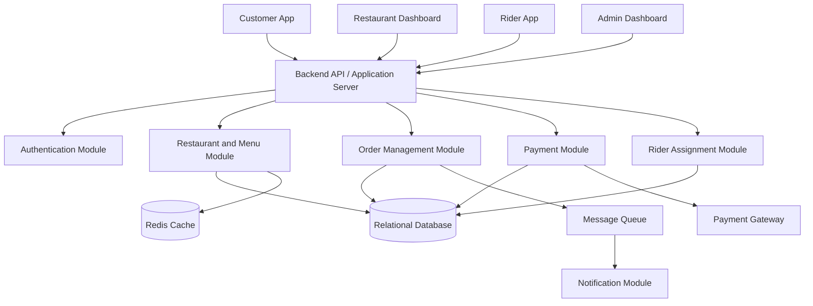
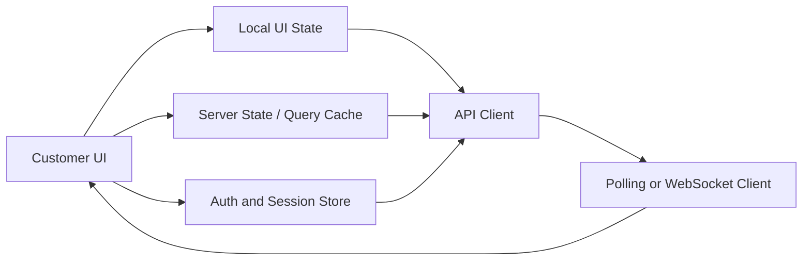
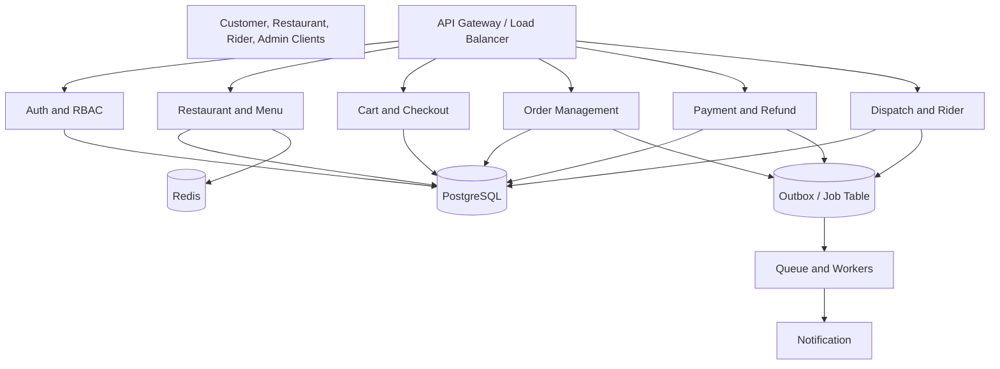
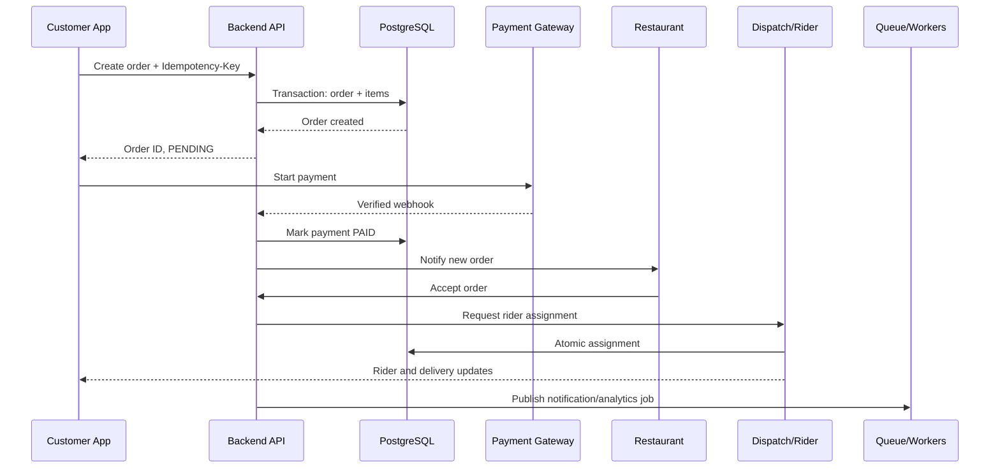
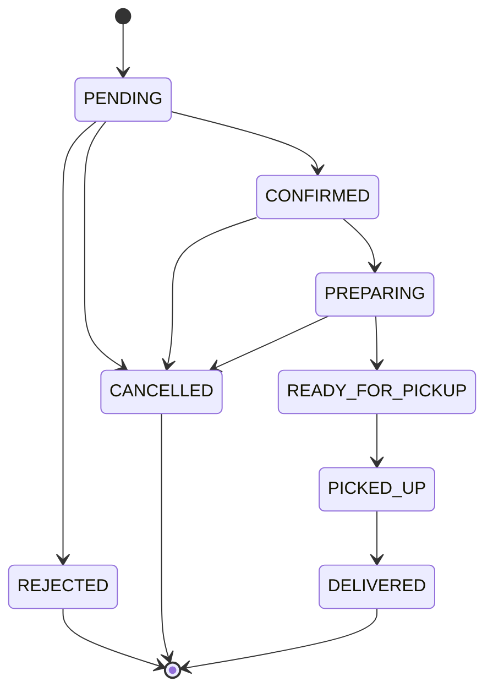
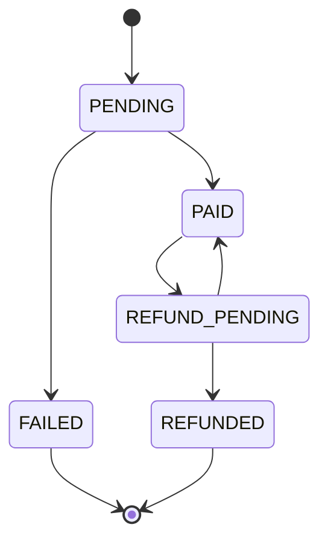
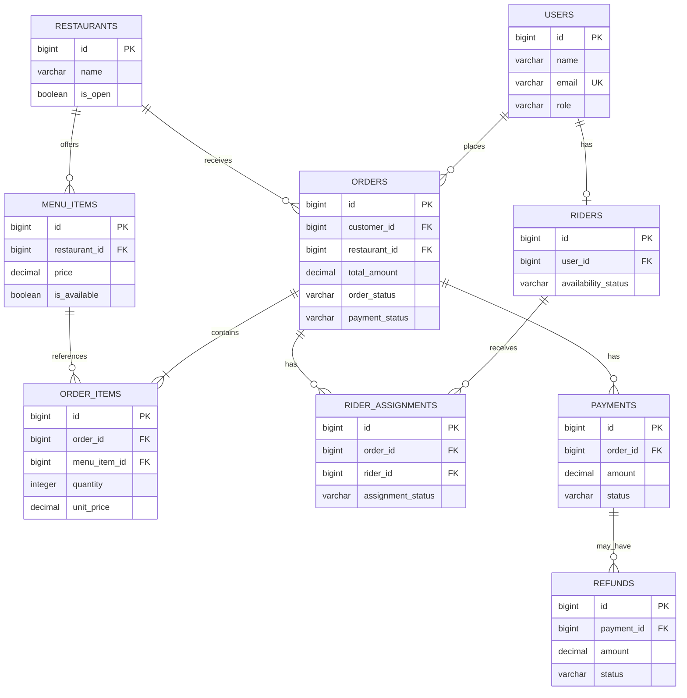

# ফুড ডেলিভারি সিস্টেম ডিজাইন — Foodpanda

বাংলাদেশের ঢাকার মতো একটি শহরের জন্য Foodpanda-এর মতো ফুড ডেলিভারি প্ল্যাটফর্ম তৈরির সিস্টেম ডিজাইন প্রকল্প।

**কঠিনতার স্তর:** সহজ থেকে মাঝারি  
**লক্ষ্য ভূমিকা:** জুনিয়র সফটওয়্যার ইঞ্জিনিয়ার / সফটওয়্যার ইঞ্জিনিয়ার ইন্টার্ন  
**মূল বিষয়:** অর্ডার ব্যবস্থাপনা, ডেটাবেস ট্রানজ্যাকশন, ACID বৈশিষ্ট্য, পেমেন্ট প্রসেসিং, রাইডার অ্যাসাইনমেন্ট, কনকারেন্সি কন্ট্রোল এবং সিস্টেম নির্ভরযোগ্যতা

---

## সূচিপত্র

1. [সমস্যার বিবরণ](#১-সমস্যার-বিবরণ)
2. [প্রয়োজনীয়তা](#২-প্রয়োজনীয়তা)
3. [উচ্চ-স্তরের আর্কিটেকচার](#৩-উচ্চ-স্তরের-আর্কিটেকচার)
4. [ডেটাবেস ডিজাইন](#৪-ডেটাবেস-ডিজাইন)
5. [স্ট্যাটাস ব্যবস্থাপনা](#৫-স্ট্যাটাস-ব্যবস্থাপনা)
6. [ER ডায়াগ্রাম](#৬-er-ডায়াগ্রাম)
7. [REST API ডিজাইন](#৭-rest-api-ডিজাইন)
8. [সম্পূর্ণ অর্ডার প্রবাহ](#৮-সম্পূর্ণ-অর্ডার-প্রবাহ)
9. [ডুপ্লিকেট অর্ডার ও রাইডার অ্যাসাইনমেন্ট প্রতিরোধ](#৯-ডুপ্লিকেট-অর্ডার-ও-রাইডার-অ্যাসাইনমেন্ট-প্রতিরোধ)
10. [পেমেন্ট ও অর্ডারের মেয়াদ শেষ হওয়ার ব্যবস্থা](#১০-পেমেন্ট-ও-অর্ডারের-মেয়াদ-শেষ-হওয়ার-ব্যবস্থা)
11. [পেমেন্ট ব্যর্থতা ও বিলম্বিত ওয়েবহুক](#১১-পেমেন্ট-ব্যর্থতা-ও-বিলম্বিত-ওয়েবহুক)
12. [ডেটাবেস ট্রানজ্যাকশন](#১২-ডেটাবেস-ট্রানজ্যাকশন)
13. [ACID বৈশিষ্ট্য](#১৩-acid-বৈশিষ্ট্য)
14. [নিরাপত্তা ও নির্ভরযোগ্যতা](#১৪-নিরাপত্তা-ও-নির্ভরযোগ্যতা)
15. [স্কেলযোগ্যতা ও পারফরম্যান্স](#১৫-স্কেলযোগ্যতা-ও-পারফরম্যান্স)
16. [টেস্ট কেস](#১৬-টেস্ট-কেস)
17. [বাস্তবায়ন পরিকল্পনা](#১৭-বাস্তবায়ন-পরিকল্পনা)
18. [সংক্ষিপ্ত ইন্টারভিউ উত্তর](#১৮-সংক্ষিপ্ত-ইন্টারভিউ-উত্তর)
19. [চূড়ান্ত ইন্টারভিউ চেকলিস্ট](#১৯-চূড়ান্ত-ইন্টারভিউ-চেকলিস্ট)
20. [ভবিষ্যৎ উন্নয়ন](#২০-ভবিষ্যৎ-উন্নয়ন)

---

## ১. সমস্যার বিবরণ

Foodpanda-এর মতো একটি ফুড ডেলিভারি প্ল্যাটফর্ম ডিজাইন করতে হবে, যেখানে গ্রাহক রেস্টুরেন্ট দেখতে, খাবার অর্ডার করতে, অনলাইনে পেমেন্ট করতে এবং রাইডারের মাধ্যমে ডেলিভারি পেতে পারবেন।

রেস্টুরেন্ট ইনকামিং অর্ডার গ্রহণ বা প্রত্যাখ্যান করতে পারবে। সিস্টেমকে গৃহীত অর্ডারের জন্য একজন উপলব্ধ রাইডার নির্ধারণ করতে হবে এবং গ্রাহককে ডেলিভারির অগ্রগতি ট্র্যাক করার সুযোগ দিতে হবে।

প্ল্যাটফর্মকে সঠিক অর্ডার ও পেমেন্ট রেকর্ড সংরক্ষণ করতে হবে এবং ডুপ্লিকেট অর্ডার, ডুপ্লিকেট রিফান্ড ও একই অর্ডারে একাধিক রাইডার অ্যাসাইনমেন্ট প্রতিরোধ করতে হবে।

এছাড়া পেমেন্ট ব্যর্থতা, রেস্টুরেন্টের প্রত্যাখ্যান, রাইডার অনুপলব্ধতা, গ্রাহকের বাতিলকরণ এবং একই পেমেন্ট গেটওয়ে ওয়েবহুক বারবার আসার বিষয়ও পরিচালনা করতে হবে।

### প্রধান চ্যালেঞ্জ

- গ্রাহক একাধিকবার Place Order বাটনে ক্লিক করলে ডুপ্লিকেট অর্ডার প্রতিরোধ করা।
- অর্ডার ও অর্ডার আইটেমের মধ্যে সামঞ্জস্য বজায় রাখা।
- দুইজন রাইডার যেন একই অর্ডার গ্রহণ করতে না পারে তা নিশ্চিত করা।
- রেস্টুরেন্ট অর্ডার প্রত্যাখ্যান করলেও সফল পেমেন্ট পরিচালনা করা।
- ডুপ্লিকেট ট্রানজ্যাকশন ছাড়া নিরাপদে রিফান্ড প্রসেস করা।
- বাহ্যিক পেমেন্ট গেটওয়ে ব্যর্থ হলে বা ধীরে উত্তর দিলে সামঞ্জস্য বজায় রাখা।

---

## ২. প্রয়োজনীয়তা

### ২.১ কার্যকরী প্রয়োজনীয়তা

১. গ্রাহক নিবন্ধন, লগইন এবং প্রোফাইল পরিচালনা করতে পারবেন।
২. গ্রাহক রেস্টুরেন্ট খুঁজে মেনু দেখতে পারবেন।
৩. গ্রাহক কার্টে একাধিক খাবার যোগ করতে পারবেন।
৪. গ্রাহক অর্ডার করতে এবং অনলাইনে পেমেন্ট করতে পারবেন।
৫. রেস্টুরেন্ট অর্ডার গ্রহণ বা প্রত্যাখ্যান করতে পারবে।
৬. সিস্টেম গৃহীত অর্ডারের জন্য একজন উপলব্ধ রাইডার নির্ধারণ করবে।
৭. গ্রাহক অর্ডারের স্ট্যাটাস ট্র্যাক করতে পারবেন।
৮. গ্রাহক অর্ডারের ইতিহাস দেখতে এবং যোগ্য অর্ডার বাতিল করতে পারবেন।
৯. প্রয়োজন হলে সিস্টেম রিফান্ড প্রসেস করবে।
১০. রাইডার নির্ধারিত ডেলিভারি দেখতে এবং ডেলিভারি স্ট্যাটাস আপডেট করতে পারবেন।

### ২.২ অ-কার্যকরী প্রয়োজনীয়তা

- **সামঞ্জস্য:** অর্ডার ও পেমেন্ট রেকর্ড সঠিক থাকতে হবে।
- **প্রাপ্যতা:** কোনো অগুরুত্বপূর্ণ সার্ভিস বন্ধ থাকলেও গ্রাহক যেন রেস্টুরেন্ট দেখতে পারেন।
- **নির্ভরযোগ্যতা:** ব্যর্থ অপারেশন পুনরুদ্ধার করা সম্ভব হতে হবে।
- **নিরাপত্তা:** শুধু অনুমোদিত ব্যবহারকারী নিজের রিসোর্স দেখতে বা পরিবর্তন করতে পারবেন।
- **স্কেলযোগ্যতা:** ব্যবহারকারী ও অর্ডার বাড়লেও প্ল্যাটফর্ম চলতে হবে।
- **পারফরম্যান্স:** রেস্টুরেন্ট তালিকা ও মেনু দ্রুত লোড হতে হবে।
- **আইডেমপোটেন্সি:** রিকোয়েস্ট পুনরায় পাঠালেও ডুপ্লিকেট অর্ডার বা রিফান্ড তৈরি হবে না।

### ২.৩ ব্যবসায়িক নিয়ম

- প্রতিটি অর্ডারের একটি ইউনিক ID থাকবে।
- প্রতিটি অর্ডারে অন্তত একটি আইটেম থাকবে।
- ব্যাকএন্ড চূড়ান্ত মূল্য হিসাব করবে।
- একটি অর্ডারে সর্বোচ্চ একজন সক্রিয় রাইডার অ্যাসাইন থাকতে পারবেন।
- শুধু যোগ্য অর্ডার বাতিল করা যাবে।
- পেমেন্ট করা প্রত্যাখ্যাত অর্ডারকে রিফান্ড workflow-তে যেতে হবে।
- পেমেন্ট ও অর্ডারের স্ট্যাটাস আলাদাভাবে পরিচালিত হবে।
- সব স্ট্যাটাস পরিবর্তন বৈধ ব্যবসায়িক নিয়ম মেনে হতে হবে।

---

## ৩. উচ্চ-স্তরের আর্কিটেকচার

শুরুতে সিস্টেমটি একটি modular monolith হিসেবে বাস্তবায়ন করা যায়। ট্রাফিক ও অপারেশনাল প্রয়োজন অনুযায়ী পরে আলাদা সার্ভিস যোগ করা যাবে।



### কম্পোনেন্টের দায়িত্ব

| কম্পোনেন্ট | দায়িত্ব |
|---|---|
| Customer App | মেনু দেখা, খাবার অর্ডার, পেমেন্ট ও ডেলিভারি ট্র্যাক করা |
| Restaurant Dashboard | অর্ডার গ্রহণ বা প্রত্যাখ্যান করা |
| Rider App | নির্ধারিত কাজ গ্রহণ ও ডেলিভারি অগ্রগতি আপডেট করা |
| Backend API | রিকোয়েস্ট যাচাই ও ব্যবসায়িক নিয়ম প্রয়োগ করা |
| Order Module | অর্ডার ও অর্ডার আইটেম পরিচালনা করা |
| Payment Module | পেমেন্ট, ওয়েবহুক ইভেন্ট ও রিফান্ড পরিচালনা করা |
| Rider Module | রাইডার খুঁজে বের করা ও দ্বন্দ্বপূর্ণ অ্যাসাইনমেন্ট ঠেকানো |
| Relational Database | ট্রানজ্যাকশনভিত্তিক ব্যবসায়িক ডেটা সংরক্ষণ করা |
| Redis | ঘন ঘন ব্যবহৃত রেস্টুরেন্ট ও মেনু ডেটা ক্যাশ করা |
| Message Queue | নোটিফিকেশন ও ব্যাকগ্রাউন্ড কাজ প্রসেস করা |
| Payment Gateway | অনলাইন পেমেন্ট ও রিফান্ড প্রসেস করা |

**গুরুত্বপূর্ণ:** Message queue ও Redis কার্যকর উন্নয়ন, তবে প্রথম সংস্করণের জন্য বাধ্যতামূলক নয়।

### 3.1 Interview-Oriented Architecture: Frontend to Full System

ইন্টারভিউতে ব্যবহারকারীর স্ক্রিন থেকে ব্যাকএন্ডের দিকে ডিজাইনটি ব্যাখ্যা করুন, তারপর একটি সম্পূর্ণ অর্ডারের প্রবাহ দেখান। এতে আলোচনা বাস্তবভিত্তিক থাকে এবং প্রতিটি কম্পোনেন্টের উদ্দেশ্য পরিষ্কার হয়।

#### ক. ফ্রন্টএন্ড আর্কিটেকচার



গ্রাহকের ক্লায়েন্ট একই logical layer ব্যবহার করা React web app বা mobile app হতে পারে। রেস্টুরেন্ট ও রাইডার ক্লায়েন্ট API এবং authentication layer পুনরায় ব্যবহার করবে, তবে role-specific screen ও action দেখাবে।

প্ল্যাটফর্মে তিনটি প্রধান ক্লায়েন্ট থাকবে:

| ক্লায়েন্ট | প্রধান স্ক্রিন | প্রধান দায়িত্ব |
|---|---|---|
| Customer app/web | রেস্টুরেন্ট তালিকা, মেনু, কার্ট, checkout, অর্ডার ট্র্যাকিং, অর্ডার ইতিহাস | দেখা, কার্ট তৈরি, অর্ডার, পেমেন্ট ও স্ট্যাটাস অনুসরণ |
| Restaurant dashboard | ইনকামিং অর্ডার, অর্ডারের বিবরণ, মেনু ব্যবস্থাপনা | অর্ডার গ্রহণ/প্রত্যাখ্যান ও প্রস্তুতির স্ট্যাটাস আপডেট |
| Rider app | উপলব্ধ কাজ, সক্রিয় ডেলিভারি, ডেলিভারি ইতিহাস | অ্যাসাইনমেন্ট পাওয়া, গ্রহণ এবং pickup/delivery স্ট্যাটাস আপডেট |

প্রতিটি ক্লায়েন্টে shared API client ও authentication layer ব্যবহার করুন। রেস্টুরেন্ট, অর্ডার ও পেমেন্ট স্ট্যাটাসের মতো server state-কে খোলা modal বা নির্বাচিত tab-এর মতো local UI state থেকে আলাদা রাখুন।

সাধারণ customer-side flow:

```text
Restaurant list -> Restaurant menu -> Cart -> Checkout -> Payment -> Order tracking
```

ইন্টারভিউতে গুরুত্বপূর্ণ ফ্রন্টএন্ড নিয়ম:

- রিকোয়েস্ট চলার সময় Place Order action disable বা guard করুন, তবে ডুপ্লিকেট প্রতিরোধে শুধু UI-এর ওপর নির্ভর করবেন না।
- প্রতিটি logical order attempt-এর জন্য একটি `Idempotency-Key` তৈরি ও সংরক্ষণ করুন; রিকোয়েস্ট retry হলে একই key ব্যবহার করুন।
- checkout-এর পর optimistic assumption নয়, ব্যাকএন্ডের order status দেখান।
- verified backend response বা webhook আপডেট না হওয়া পর্যন্ত payment-কে `PENDING` হিসেবে রাখুন।
- retry, failure, cancellation ও refund-pending state স্পষ্টভাবে দেখান।
- শুরুতে order tracking-এর জন্য polling ব্যবহার করুন; real-time update-এর প্রয়োজন ও operational cost যুক্তিযুক্ত হলে WebSocket বা server-sent event যোগ করুন।

#### খ. ব্যাকএন্ড আর্কিটেকচার



প্রথম release-এ এই module-গুলো একটি backend application-এর ভেতরে চলবে। তবুও এগুলোর দায়িত্ব আলাদা থাকা উচিত, যাতে পরে পুরো সিস্টেম redesign না করেই payment, dispatch বা notification আলাদা করা যায়।

একটি modular monolith দিয়ে শুরু করুন। module-গুলো একটি relational database ভাগ করে ব্যবহার করবে, তবে ownership boundary পরিষ্কার থাকবে:

| Module | দায়িত্ব |
|---|---|
| Auth and users | Login, session/token, role ও ownership যাচাই |
| Restaurant and menu | রেস্টুরেন্ট খোঁজা, মেনু, availability ও pricing source data |
| Cart and checkout | কার্ট validation ও order creation request |
| Order management | order item, order state transition, cancellation ও history |
| Payment | payment attempt, verified webhook, refund ও reconciliation |
| Dispatch | rider availability, assignment ও delivery state |
| Notification | push, email, SMS ও in-app event |

অর্ডার তৈরির request path হলো:

```text
Client
    -> API authentication and authorization
    -> Order module validates restaurant, items, and idempotency key
    -> Database transaction creates order and order items
    -> Outbox/job records follow-up work
    -> API returns order ID and current status
```

ব্যাকএন্ডকে trusted menu data থেকে মূল্য হিসাব করতে হবে। client item ID ও quantity পাঠাতে পারে, কিন্তু final amount বা payment status-এর জন্য client-কে কখনো trusted source হিসেবে ধরা যাবে না।

#### গ. সম্পূর্ণ সিস্টেমের অর্ডার প্রবাহ

১. গ্রাহক restaurant ও menu load করেন। API PostgreSQL থেকে data পড়ে এবং Redis নিরাপদ, স্বল্পমেয়াদি public-data cache হিসেবে ব্যবহৃত হয়।
২. গ্রাহক `Idempotency-Key` সহ cart submit করেন। order module ownership, item availability ও price যাচাই করে।
৩. একটি database transaction order ও immutable order-item price snapshot insert করে। unique constraint retry হলে existing order ফেরত দেয়।
৪. payment module payment attempt তৈরি করে এবং গ্রাহককে gateway-তে redirect করে বা gateway-এর client-side tokenization flow ব্যবহার করে।
৫. ব্যাকএন্ড gateway response বা webhook verify করে। signature, amount, currency ও transaction reference যাচাই করার পরই payment state update করে।
৬. রেস্টুরেন্ট order accept বা reject করে। paid rejection হলে durable ও idempotent refund job তৈরি হয়।
৭. acceptance-এর পর dispatch কাছাকাছি available rider খুঁজে। atomic update বা row lock-এর মাধ্যমে শুধু একটি valid assignment সফল হয়।
৮. rider pickup ও delivery state-এর মধ্য দিয়ে অগ্রসর হয়। প্রতিটি transition অনুমোদিত এবং আগের state অনুযায়ী valid হতে হয়।
৯. order `DELIVERED` হলে notification ও analytics asynchronous ভাবে process হয়।



#### ঘ. কোনো কিছু ব্যর্থ হলে কী হয়?

| ব্যর্থতা | পুনরুদ্ধার কৌশল |
|---|---|
| Client order creation retry করে | একই idempotency key original order ফেরত দেয় |
| Payment response timeout হয় | gateway-এর সঙ্গে reconcile করুন; অন্ধভাবে আবার charge করবেন না |
| Duplicate webhook আসে | unique gateway event ID processing-কে idempotent করে |
| Restaurant paid order reject করে | `REFUND_PENDING` সেট করে durable refund job retry করুন |
| দুই rider একই সময়ে accept করে | conditional database update-এর মাধ্যমে ঠিক একটি request সফল হয় |
| Notification service বন্ধ | business transaction সফল রাখুন এবং notification asynchronous ভাবে retry করুন |

#### ঙ. ইন্টারভিউ trade-off ও scaling path

প্রথমে কী তৈরি করবেন এবং পরে কী যোগ করবেন তা স্পষ্টভাবে বলুন:

1. **MVP:** Responsive web or mobile clients, modular monolith, PostgreSQL, and synchronous APIs.
2. **Reliability:** Idempotency, constraints, background workers, an outbox table, retries, and reconciliation.
3. **Performance:** Redis for restaurant/menu reads, pagination, indexes, connection pooling, and CDN-backed images.
4. **Scale:** Read replicas and independently deployable services for payments, dispatch, notifications, and search only when traffic or team ownership requires them.
5. **Real time:** WebSockets or server-sent events for active-order tracking; polling remains a simpler fallback.

মূল interview trade-off হলো consistency বনাম availability: browsing কিছুটা stale cached data সহ্য করতে পারে, কিন্তু order creation, payment state, refund ও rider assignment-এর জন্য authoritative transactional data প্রয়োজন।

---

## ৪. ডেটাবেস ডিজাইন

PostgreSQL বা MySQL-এর মতো relational database ভালো পছন্দ, কারণ order, order item, payment ও rider assignment-এর জন্য নির্ভরযোগ্য relationship এবং transactional update প্রয়োজন।

### 4.1 Users

গ্রাহক, রেস্টুরেন্ট মালিক এবং administrator account-এর তথ্য সংরক্ষণ করে।

| Column | Type | Constraint |
|---|---|---|
| id | BIGINT | Primary Key |
| name | VARCHAR(100) | NOT NULL |
| email | VARCHAR(255) | UNIQUE, NOT NULL |
| password_hash | VARCHAR(255) | NOT NULL |
| role | VARCHAR(30) | NOT NULL |
| created_at | TIMESTAMP | NOT NULL |

### 4.2 Restaurants

| Column | Type | Constraint |
|---|---|---|
| id | BIGINT | Primary Key |
| name | VARCHAR(150) | NOT NULL |
| address | TEXT | NOT NULL |
| is_open | BOOLEAN | NOT NULL |
| created_at | TIMESTAMP | NOT NULL |

### 4.3 Menu Items

| Column | Type | Constraint |
|---|---|---|
| id | BIGINT | Primary Key |
| restaurant_id | BIGINT | Foreign Key → Restaurants |
| name | VARCHAR(150) | NOT NULL |
| price | DECIMAL(10,2) | NOT NULL |
| is_available | BOOLEAN | NOT NULL |

একটি রেস্টুরেন্টে একাধিক menu item থাকতে পারে।

### 4.4 Orders

| Column | Type | Constraint |
|---|---|---|
| id | BIGINT | Primary Key |
| customer_id | BIGINT | Foreign Key → Users |
| restaurant_id | BIGINT | Foreign Key → Restaurants |
| total_amount | DECIMAL(10,2) | NOT NULL |
| order_status | VARCHAR(30) | NOT NULL |
| payment_status | VARCHAR(30) | NOT NULL |
| idempotency_key | VARCHAR(255) | UNIQUE with customer_id |
| created_at | TIMESTAMP | NOT NULL |

Suggested `order_status` values:

`PENDING`, `CONFIRMED`, `PREPARING`, `READY_FOR_PICKUP`, `PICKED_UP`, `DELIVERED`, `REJECTED`, `CANCELLED`.

Suggested `payment_status` values:

`UNPAID`, `PENDING`, `PAID`, `FAILED`, `REFUND_PENDING`, `REFUNDED`.

order status ও payment status আলাদা রাখতে হবে, কারণ payment সফল হলেও order reject হতে পারে।

### 4.5 Order Items

| Column | Type | Constraint |
|---|---|---|
| id | BIGINT | Primary Key |
| order_id | BIGINT | Foreign Key → Orders |
| menu_item_id | BIGINT | Foreign Key → Menu Items |
| quantity | INTEGER | NOT NULL, greater than 0 |
| unit_price | DECIMAL(10,2) | NOT NULL |
| subtotal | DECIMAL(10,2) | NOT NULL |

`unit_price` অর্ডারের সময় menu item-এর মূল্যের snapshot সংরক্ষণ করে। পরে menu-এর দাম পরিবর্তন হলেও historical order পরিবর্তিত হওয়া যাবে না।

### 4.6 Riders

| Column | Type | Constraint |
|---|---|---|
| id | BIGINT | Primary Key |
| user_id | BIGINT | Foreign Key → Users, UNIQUE |
| availability_status | VARCHAR(30) | NOT NULL |
| current_latitude | DECIMAL(10,7) | Nullable |
| current_longitude | DECIMAL(10,7) | Nullable |

Possible availability statuses: `AVAILABLE`, `BUSY`, `OFFLINE`.

### 4.7 Rider Assignments

| Column | Type | Constraint |
|---|---|---|
| id | BIGINT | Primary Key |
| order_id | BIGINT | Foreign Key → Orders |
| rider_id | BIGINT | Foreign Key → Riders |
| assignment_status | VARCHAR(30) | NOT NULL |
| assigned_at | TIMESTAMP | NOT NULL |

Use a database constraint or transactional assignment strategy to ensure that an order cannot have more than one active rider assignment.

For PostgreSQL, a partial unique index can enforce this rule:

```sql
CREATE UNIQUE INDEX one_active_assignment_per_order
ON rider_assignments (order_id)
WHERE assignment_status IN ('ASSIGNED', 'ACCEPTED', 'IN_TRANSIT');
```

### 4.8 Payments

| Column | Type | Constraint |
|---|---|---|
| id | BIGINT | Primary Key |
| order_id | BIGINT | Foreign Key → Orders |
| gateway_transaction_id | VARCHAR(255) | UNIQUE |
| amount | DECIMAL(10,2) | NOT NULL |
| status | VARCHAR(30) | NOT NULL |
| created_at | TIMESTAMP | NOT NULL |

Use a unique constraint on the payment gateway transaction ID to prevent duplicate transaction records. If multiple payment attempts are allowed, keep separate payment-attempt records rather than forcing one payment row per order.

### 4.9 Refunds

| Column | Type | Constraint |
|---|---|---|
| id | BIGINT | Primary Key |
| payment_id | BIGINT | Foreign Key → Payments |
| idempotency_key | VARCHAR(255) | UNIQUE |
| amount | DECIMAL(10,2) | NOT NULL |
| status | VARCHAR(30) | NOT NULL |
| gateway_refund_id | VARCHAR(255) | UNIQUE, nullable |
| created_at | TIMESTAMP | NOT NULL |

A refund should have its own status and idempotency key. A unique key prevents the same logical refund request from being created repeatedly.

### Database Rules

- Use foreign keys to maintain referential integrity.
- Use `NOT NULL` for required fields.
- Use `CHECK (quantity > 0)` for order quantities.
- Use `CHECK (total_amount >= 0)` for monetary totals.
- Use appropriate unique constraints and indexes.
- Store money using `DECIMAL`, not floating-point types.
- Use database transactions for related changes.

---

## ৫. স্ট্যাটাস ব্যবস্থাপনা

### অর্ডারের জীবনচক্র



ব্যবসায়িক নীতি অনুমতি দিলেই শুধু `CONFIRMED` বা `PREPARING` অবস্থা থেকে cancellation অনুমোদন করতে হবে। payment-এর পরে cancellation হলে refund প্রয়োজন হতে পারে।

### পেমেন্টের জীবনচক্র



`REFUND_PENDING` may return to `PAID` if a refund definitively fails and the payment remains captured. Such recovery must be based on the gateway's verified result.

### এই স্ট্যাটাসগুলো আলাদা কেন?

অর্ডার এবং তার payment দুটি আলাদা business process নির্দেশ করে।

Example:

- `order_status = REJECTED`
- `payment_status = REFUND_PENDING`

This means the restaurant rejected the order, but the refund has not yet been confirmed.

---

## ৬. ER ডায়াগ্রাম



The exact cardinalities depend on business policy. For example, an order may have multiple payment attempts, and a payment may have multiple partial refunds, but the total refunded amount must never exceed the captured amount.

---

## ৭. REST API ডিজাইন

### Authentication

| Method | Endpoint | Purpose |
|---|---|---|
| POST | `/api/auth/register` | Register a user |
| POST | `/api/auth/login` | Authenticate a user |
| GET | `/api/users/me` | Get the current user's profile |

### Restaurants and Menus

| Method | Endpoint | Purpose |
|---|---|---|
| GET | `/api/restaurants` | List or search restaurants |
| GET | `/api/restaurants/:id` | Get restaurant details |
| GET | `/api/restaurants/:id/menu` | Get restaurant menu |
| GET | `/api/menu-items/:id` | Get menu item details |

### Orders

| Method | Endpoint | Purpose |
|---|---|---|
| POST | `/api/orders` | Create an order |
| GET | `/api/orders/:id` | Get order details |
| GET | `/api/orders/my-orders` | Get customer order history |
| POST | `/api/orders/:id/cancel` | Request order cancellation |
| PATCH | `/api/orders/:id/accept` | Restaurant accepts an order |
| PATCH | `/api/orders/:id/reject` | Restaurant rejects an order |

### Payments and Refunds

| Method | Endpoint | Purpose |
|---|---|---|
| POST | `/api/orders/:id/payments` | Initiate payment |
| GET | `/api/orders/:id/payments` | Get payment information |
| POST | `/api/webhooks/payment-gateway` | Receive payment events |
| POST | `/api/payments/:id/refunds` | Initiate an eligible refund |

### Rider Operations

| Method | Endpoint | Purpose |
|---|---|---|
| GET | `/api/riders/available` | Find available riders |
| POST | `/api/orders/:id/assign-rider` | Assign a rider |
| POST | `/api/orders/:id/accept-assignment` | Accept an offered assignment |
| PATCH | `/api/orders/:id/delivery-status` | Update delivery progress |

### Idempotent Order Creation

The customer sends a unique `Idempotency-Key` header:

```http
POST /api/orders
Authorization: Bearer <access_token>
Idempotency-Key: order-request-abc123
Content-Type: application/json
```

Example request:

```json
{
  "restaurantId": 12,
  "items": [
    {
      "menuItemId": 101,
      "quantity": 2
    },
    {
      "menuItemId": 105,
      "quantity": 1
    }
  ],
  "deliveryAddress": "Dhanmondi, Dhaka"
}
```

The backend validates the items and calculates the total price from trusted database values.

If the same customer retries with the same key and the same request, the backend returns the existing order instead of creating another one.

---

## ৮. সম্পূর্ণ অর্ডার প্রবাহ

### Step 1: Customer Places an Order

The customer selects food items and submits the order.

The backend:

1. Authenticates the customer.
2. Validates the restaurant and menu items.
3. Checks item availability.
4. Calculates the total price.
5. Starts a database transaction.
6. Creates the order and its order items.
7. Commits the transaction.
8. Returns the order ID.

### Step 2: Customer Pays

The payment module creates or retrieves a payment attempt using an idempotency key.

The payment gateway processes the transaction. The backend updates payment status only after receiving a verified gateway response or webhook.

### Step 3: Restaurant Responds

The restaurant accepts or rejects the order.

- If accepted, the order moves to `CONFIRMED`.
- If rejected before payment, the order can move to `REJECTED`.
- If rejected after successful payment, the order moves to `REJECTED` and the payment enters `REFUND_PENDING`.

### Step 4: Rider Assignment

The rider module finds an available rider and performs a conditional assignment.

Only one competing assignment can succeed for a particular order.

### Step 5: Delivery

The rider updates the delivery status:

`ASSIGNED → ACCEPTED → IN_TRANSIT → DELIVERED`

The exact status sequence depends on the rider workflow.

### Step 6: Completion

The system records delivery completion and makes the final order and payment history available to the customer.

---

## ৯. ডুপ্লিকেট অর্ডার ও রাইডার অ্যাসাইনমেন্ট প্রতিরোধ

### 9.1 Prevent Duplicate Orders

Problem: A customer clicks Place Order multiple times because the UI is slow.

Solution: Idempotency keys plus a database unique constraint.

```sql
CREATE UNIQUE INDEX unique_customer_idempotency_key
ON orders (customer_id, idempotency_key);
```

The backend must use the same key for retries of the same logical request.

A unique key alone is not sufficient if the same key is reused with a different payload. Store a request hash and reject conflicting reuse.

### 9.2 Prevent Two Riders from Accepting One Order

Suppose Rider A and Rider B attempt to accept the same order simultaneously.

Use an atomic conditional update:

```sql
UPDATE orders
SET assigned_rider_id = :rider_id,
    order_status = 'ASSIGNED'
WHERE id = :order_id
  AND order_status = 'READY_FOR_PICKUP'
  AND assigned_rider_id IS NULL;
```

Check the number of affected rows:

- `1 row`: assignment succeeded.
- `0 rows`: another operation already changed the order or the order is not eligible.

If rider availability is stored separately, update or lock the rider record in the same transaction and enforce the active-assignment constraint.

For PostgreSQL, a row lock can also be used:

```sql
SELECT id, order_status
FROM orders
WHERE id = :order_id
FOR UPDATE;
```

The application validates the current status before assigning the rider.

**Interview point:** A normal application-level check is not enough. The database must enforce the critical condition atomically.

---

## ১০. পেমেন্ট ও অর্ডারের মেয়াদ শেষ হওয়ার ব্যবস্থা

A food delivery system may expire unpaid orders after a configurable time limit.

For example, an unpaid order may expire after 10 minutes if that policy is appropriate for the business.

### Expiry Flow

1. Create the order with `payment_status = PENDING`.
2. Store `expires_at` in the database.
3. A background worker finds expired, unpaid orders.
4. The worker conditionally changes the eligible order to `CANCELLED`.
5. The system prevents new payment attempts for the expired order.
6. Any payment attempt already in progress must be reconciled with the payment gateway.

Example SQL:

```sql
UPDATE orders
SET order_status = 'CANCELLED'
WHERE id = :order_id
  AND payment_status IN ('UNPAID', 'FAILED')
  AND order_status = 'PENDING'
  AND expires_at < CURRENT_TIMESTAMP;
```

A delayed successful payment may arrive after expiry. In that case, the system must verify the gateway transaction and follow the configured recovery policy, such as initiating a refund if the order cannot be fulfilled.

Do not assume that cancelling an order automatically cancels an in-flight payment at the gateway.

---

## ১১. পেমেন্ট ব্যর্থতা ও বিলম্বিত ওয়েবহুক

### Scenario A: Payment Fails

1. Create a payment attempt with `PENDING` status.
2. Send the payment request to the gateway.
3. Receive a verified failure response.
4. Mark the payment attempt as `FAILED`.
5. Allow another payment attempt if business rules permit.

### Scenario B: Payment Succeeds but the HTTP Response Times Out

The backend may not know whether the payment succeeded.

The system should:

1. Keep the attempt in a pending or unknown state.
2. Query the gateway using the existing transaction or idempotency reference.
3. Wait for a verified webhook or reconciliation result.
4. Avoid creating a second charge merely because the first response timed out.

### Scenario C: Duplicate Webhook

Payment gateways may deliver the same event more than once.

Store a unique event ID:

```sql
CREATE TABLE payment_webhook_events (
    id BIGSERIAL PRIMARY KEY,
    gateway_event_id VARCHAR(255) UNIQUE NOT NULL,
    event_type VARCHAR(100) NOT NULL,
    processed_at TIMESTAMP
);
```

Process the event in a transaction:

1. Verify the webhook signature.
2. Insert the gateway event ID.
3. If the ID already exists, treat the event as a duplicate.
4. Validate the payment and order references.
5. Apply only a valid state transition.
6. Mark the event as processed and commit.

If the same event is delivered concurrently, the unique constraint ensures only one processing transaction can claim it successfully.

Webhook handling must also tolerate out-of-order events. Do not blindly overwrite a terminal state with an older event; retrieve the authoritative gateway state when necessary.

### Scenario D: Restaurant Rejects a Paid Order

1. Lock or conditionally update the eligible order.
2. Set `order_status = REJECTED`.
3. Set `payment_status = REFUND_PENDING`.
4. Record a refund request with a stable idempotency key.
5. Commit the database transaction.
6. A background worker requests the refund from the gateway.
7. Update the refund and payment records when the result is confirmed.

The database transaction cannot atomically commit with an external payment gateway. A durable refund request and retry mechanism are therefore required.

---

## ১২. ডেটাবেস ট্রানজ্যাকশন

### Example: Creating an Order

The order and its order items must either all be saved or none of them should be saved.

```sql
BEGIN;

INSERT INTO orders (
    customer_id,
    restaurant_id,
    total_amount,
    order_status,
    payment_status,
    idempotency_key
)
VALUES (
    :customer_id,
    :restaurant_id,
    :total_amount,
    'PENDING',
    'UNPAID',
    :idempotency_key
)
RETURNING id;

INSERT INTO order_items (
    order_id,
    menu_item_id,
    quantity,
    unit_price,
    subtotal
)
VALUES
    (:order_id, :item_1, :quantity_1, :price_1, :subtotal_1),
    (:order_id, :item_2, :quantity_2, :price_2, :subtotal_2);

COMMIT;
```

If any insert fails, the application executes `ROLLBACK`.

In production, validate the menu prices and calculate totals on the server inside an appropriately consistent transaction. Handle unique-key conflicts by retrieving the existing order associated with the idempotency key.

### Example: Processing a Payment Webhook

Within a single database transaction:

1. Claim the webhook event using its unique event ID.
2. Lock the payment or use a conditional status update.
3. Validate the payment amount, currency, and gateway transaction reference.
4. Update payment status.
5. Update the related order's payment status if the transition is valid.
6. Commit.

Do not keep a database transaction open while waiting for a slow external HTTP request.

### Important Principle

**Use database transactions for internal data consistency, and use idempotency, durable jobs, and reconciliation for external service consistency.**

---

## ১৩. ACID বৈশিষ্ট্য

ACID stands for Atomicity, Consistency, Isolation, and Durability.

### 13.1 Atomicity

A transaction is completed entirely or not at all.

**Example:** Creating an order and three order items must be one transaction.

If inserting the third item fails, the order and the first two items must not remain partially saved.

### 13.2 Consistency

Every committed transaction must preserve database rules and business invariants.

**Examples:**

- Every order item references a valid order.
- Quantity must be greater than zero.
- An order must contain at least one item when it becomes eligible for processing.
- An order must not have two active rider assignments.
- Total refunded amount must not exceed the captured payment amount.

Foreign keys, unique constraints, check constraints, and application validation work together to maintain consistency.

### 13.3 Isolation

Concurrent transactions should not produce invalid results.

**Example:** Two riders try to accept the same order simultaneously.

The database uses conditional updates, row locks, or appropriate transaction isolation to ensure only one assignment succeeds.

For most operations, `READ COMMITTED` plus carefully designed atomic updates and constraints can be sufficient. Stronger isolation may be needed for more complex invariants.

### 13.4 Durability

Once a transaction commits successfully, its changes should survive a crash under the database's configured durability guarantees.

**Example:** After the order creation transaction commits, the order should remain recorded even if the application server restarts.

### ACID Summary

| Property | Meaning | Food Delivery Example |
|---|---|---|
| Atomicity | All or nothing | Save order and order items together |
| Consistency | Preserve valid rules | Prevent invalid quantities and assignments |
| Isolation | Control concurrent operations | Only one rider wins an assignment |
| Durability | Committed data persists | Saved orders survive a server restart |

### Does ACID Guarantee Payment Gateway Consistency?

No. A database transaction cannot directly make a third-party payment gateway part of the same ACID transaction.

Use verified gateway events, idempotent operations, durable job records, retries, and reconciliation to recover from failures.

---

## ১৪. নিরাপত্তা ও নির্ভরযোগ্যতা

### Authentication and Authorization

- Use secure authentication with short-lived access tokens or secure sessions.
- Hash passwords with a suitable password-hashing algorithm.
- Enforce role-based access for customers, restaurants, riders, and administrators.
- Verify that a customer owns the requested order.
- Verify that a restaurant can manage only its own orders.
- Verify that a rider can update only their assigned delivery.

### Payment Security

- Never trust payment status submitted by the client.
- Verify webhook signatures.
- Validate amount, currency, and gateway transaction references.
- Never store raw card numbers or CVVs.
- Use the payment provider's hosted checkout or tokenization features where appropriate.
- Use idempotency keys for charges and refunds.

### Reliability

- Use database transactions and constraints.
- Retry transient failures with exponential backoff.
- Send repeated background jobs safely through idempotent handlers.
- Record failed jobs and provide a recovery mechanism.
- Use timeouts and controlled retries for external services.
- Monitor payment mismatches, failed refunds, and stuck orders.
- Keep an audit trail of important state transitions.

---

## ১৫. স্কেলযোগ্যতা ও পারফরম্যান্স

### Database Optimization

- Add indexes to frequently queried columns.
- Index `customer_id`, `restaurant_id`, `order_status`, and relevant timestamps.
- Use pagination for order history.
- Use connection pooling.
- Avoid unnecessary joins and repeated queries.
- Use read replicas for suitable read-heavy workloads when needed.

### Caching

Redis can cache:

- Restaurant listings.
- Restaurant details.
- Menu data.
- Frequently accessed public information.

Do not rely solely on cached values for critical payment, order ownership, or rider assignment decisions.

### Background Processing

Use a message queue or durable job system for:

- Notifications.
- Refund requests.
- Rider search.
- Order timeout processing.
- Payment reconciliation.
- Analytics and reporting.

A transactional outbox pattern can help ensure that an order update and its corresponding background event are recorded reliably in the same database transaction.

### Scaling Strategy

Start with a modular monolith and a relational database. Add caching, background jobs, read replicas, and service separation only when justified by measured traffic or operational needs.

---

## ১৬. টেস্ট কেস

| # | Scenario | Expected Result |
|---|---|---|
| 1 | Customer places a valid order | One order is created |
| 2 | Customer submits an empty cart | Request is rejected |
| 3 | Customer submits a negative quantity | Request is rejected |
| 4 | Customer clicks Place Order repeatedly with the same key | One logical order is created |
| 5 | Same idempotency key is reused with a different payload | Request is rejected |
| 6 | Order item insertion fails | Entire order transaction rolls back |
| 7 | Payment fails | Payment attempt is marked failed |
| 8 | Payment succeeds but response times out | Gateway state is reconciled |
| 9 | Restaurant rejects a paid order | Refund workflow starts |
| 10 | Two riders accept the same order | Only one assignment succeeds |
| 11 | Assigned rider becomes unavailable | Assignment is safely released or reassigned |
| 12 | Customer cancels after payment | Cancellation policy and refund workflow apply |
| 13 | Same webhook is received twice | No duplicate payment processing |
| 14 | Webhook signature is invalid | Event is rejected |
| 15 | Refund request is retried | No duplicate logical refund |
| 16 | Refund amount exceeds captured amount | Request is rejected |
| 17 | Unauthorized customer accesses another order | Access is denied |
| 18 | Expired unpaid order receives a late payment | Gateway is reconciled and recovery policy applies |

### Essential Concurrency Test

Send two rider assignment requests for the same eligible order at nearly the same time.

Verify that exactly one active assignment exists after both requests finish.

---

## ১৭. বাস্তবায়ন পরিকল্পনা

### Phase 1: Core Database and API

- Set up PostgreSQL.
- Create users, restaurants, menu items, orders, and order items.
- Implement restaurant and menu APIs.
- Implement transactional order creation.
- Add foreign keys and validation.

### Phase 2: Authentication and Authorization

- Implement customer registration and login.
- Add role-based access control.
- Protect order and restaurant endpoints.
- Enforce resource ownership.

### Phase 3: Payments

- Integrate a payment gateway sandbox.
- Implement payment attempts.
- Add webhook verification.
- Add payment idempotency and duplicate-event protection.
- Implement refunds and reconciliation.

### Phase 4: Restaurant and Rider Workflows

- Implement restaurant accept/reject operations.
- Add rider availability.
- Implement atomic rider assignment.
- Add delivery status transitions.

### Phase 5: Reliability and Testing

- Add background workers.
- Implement retries and failed-job recovery.
- Test duplicate requests and concurrent rider assignments.
- Add logging and monitoring.
- Document APIs and deployment steps.

---

## ১৮. সংক্ষিপ্ত ইন্টারভিউ উত্তর

### Q1. Why use PostgreSQL or MySQL?

Because orders, order items, payments, and assignments have relationships and require transactions, constraints, and reliable consistency.

### Q2. What are ACID properties?

Atomicity means all or nothing, Consistency means preserving valid rules, Isolation controls concurrent transactions, and Durability means committed changes persist.

### Q3. How do you prevent duplicate orders?

Use an idempotency key, a unique database constraint, and logic that returns the existing order for a legitimate retry.

### Q4. How do you prevent two riders from accepting the same order?

Use an atomic conditional update or row lock, along with a database constraint enforcing at most one active assignment.

### Q5. What happens if payment succeeds but the restaurant rejects the order?

Mark the order as rejected, move the payment to a refund-pending state, and process an idempotent refund request through a durable workflow.

### Q6. What happens if a payment webhook arrives twice?

Verify the signature, record the unique gateway event ID, and process each logical event only once.

### Q7. What if payment succeeds but the server times out?

Do not blindly charge again. Query the gateway or wait for a verified webhook, then reconcile the payment state.

### Q8. Why separate order status and payment status?

They describe different processes. An order can be rejected while its payment is paid or awaiting a refund.

### Q9. Can a database transaction include an external payment gateway?

Usually not as one atomic ACID transaction. Use idempotency, durable jobs, verified events, and reconciliation.

### Q10. What is a database index?

An index helps the database find records more efficiently, usually at the cost of extra storage and additional write overhead.

### Q11. What is a foreign key?

A foreign key ensures that a referenced record exists and helps maintain referential integrity.

### Q12. What is a race condition?

A race condition occurs when concurrent operations interfere and the result depends on their timing. Atomic updates and database constraints can prevent invalid assignments.

### Q13. What is the difference between authentication and authorization?

Authentication verifies who a user is. Authorization determines what that user is allowed to do.

### Q14. How would you scale the system?

Start with a modular backend and relational database. Add indexes, caching, connection pooling, background workers, read replicas, and separate services as needed.

### Q15. What is the transactional outbox pattern?

It stores a business update and the event to publish in the same database transaction. A separate worker publishes the event reliably, with idempotent processing to handle retries.

---

## ১৯. চূড়ান্ত ইন্টারভিউ চেকলিস্ট

Before the interview, make sure you can explain:

- [ ] Functional and non-functional requirements.
- [ ] High-level architecture and component responsibilities.
- [ ] Database tables, primary keys, and foreign keys.
- [ ] One-to-many and one-to-one relationships.
- [ ] Order and payment status transitions.
- [ ] ACID properties with practical examples.
- [ ] Database transactions and rollback.
- [ ] Idempotency keys and unique constraints.
- [ ] Concurrent rider assignment prevention.
- [ ] Payment failure and duplicate webhook handling.
- [ ] Refund processing and reconciliation.
- [ ] REST API design and HTTP methods.
- [ ] Authentication, authorization, and resource ownership.
- [ ] Indexes, caching, queues, and background workers.
- [ ] Basic concurrency and failure test cases.

**Junior-level preparation tip:** Prioritize database design, SQL transactions, ACID properties, idempotency, race conditions, REST APIs, and payment failure handling before advanced distributed systems topics.

---

## ২০. ভবিষ্যৎ উন্নয়ন

Possible extensions for a production-grade platform include:

- Real-time order tracking with WebSockets.
- Location-based rider matching.
- Estimated delivery time calculation.
- Restaurant ratings and customer reviews.
- Promotional codes and discounts.
- Multiple payment gateways.
- Partial refunds.
- Delivery fee calculation based on distance.
- Event-driven architecture.
- Observability with structured logs, metrics, and tracing.
- Automated deployment and database migration pipelines.
- Service separation when justified by scale and team ownership.

---

## Conclusion

This project demonstrates how to design a reliable food delivery system with a focus on transactional data, payment safety, and concurrent operations.

The most important principles are:

1. Use database transactions to create an order and its items consistently.
2. Use database constraints and atomic updates to prevent conflicting assignments.
3. Use idempotency to make retries safe.
4. Keep order and payment statuses separate.
5. Use durable workflows and reconciliation for external payment failures.
6. Apply ACID properties to database transactions without assuming they guarantee end-to-end consistency across external services.

The goal is not to build the most complicated architecture. It is to build a correct, understandable, and reliable system that can evolve as the platform grows.
