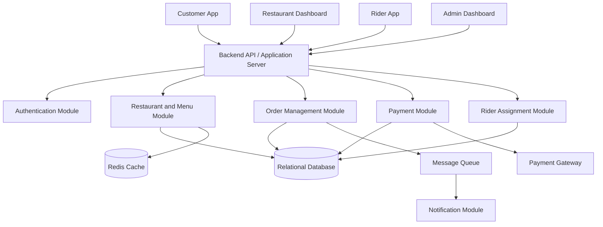
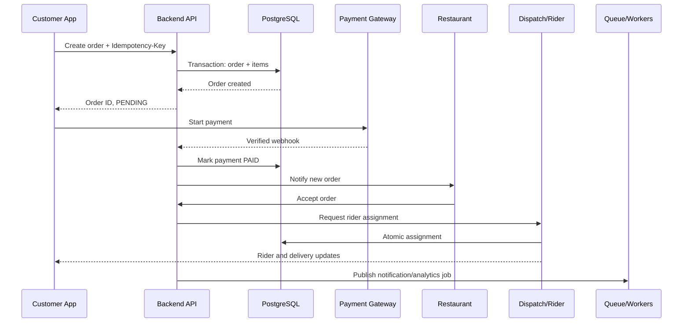
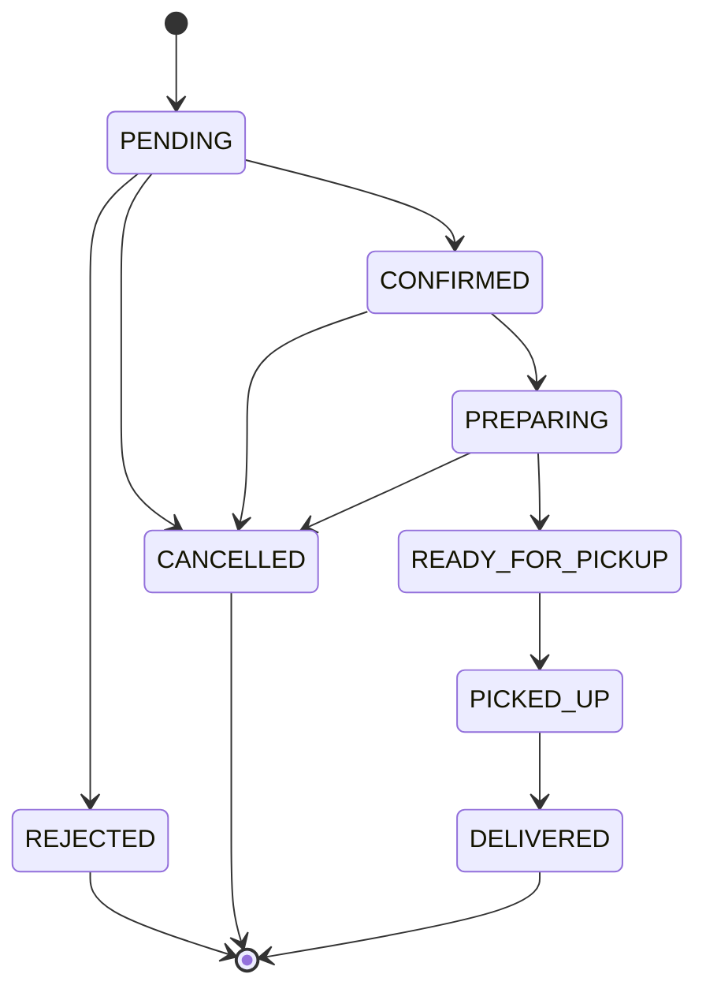
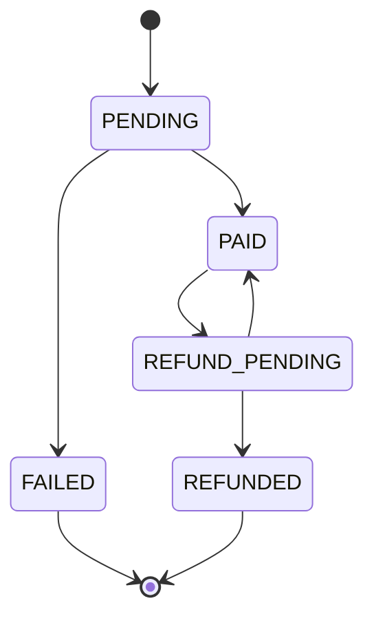
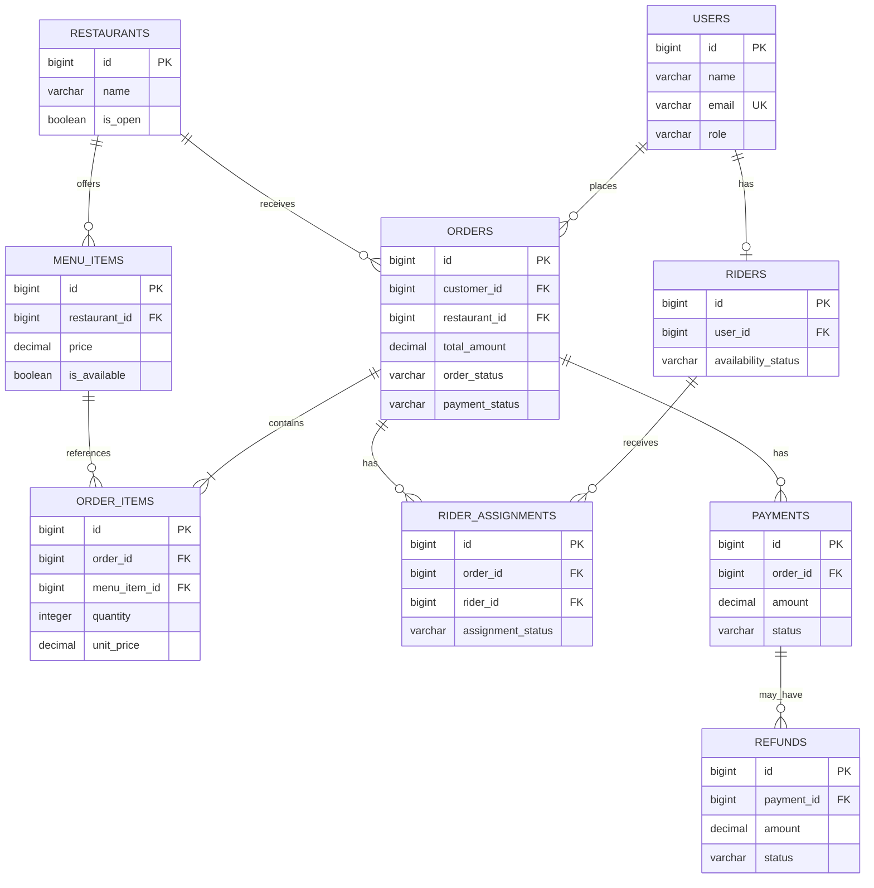

# Food Delivery System Design — Foodpanda

A system design project for building a food delivery platform similar to Foodpanda for a city like Dhaka, Bangladesh.

**Difficulty:** Easy to Medium  
**Target Role:** Junior Software Engineer / Software Engineer Intern  
**Focus:** Order Management, Database Transactions, ACID Properties, Payment Processing, Rider Assignment, Concurrency Control, and System Reliability

---

## Table of Contents

1. [Problem Statement](#1-problem-statement)
2. [Requirements](#2-requirements)
3. [High-Level Architecture](#3-high-level-architecture)
4. [Database Design](#4-database-design)
5. [Status Management](#5-status-management)
6. [ER Diagram](#6-er-diagram)
7. [REST API Design](#7-rest-api-design)
8. [Complete Order Flow](#8-complete-order-flow)
9. [Duplicate Order and Rider Assignment Prevention](#9-duplicate-order-and-rider-assignment-prevention)
10. [Payment and Order Expiry Mechanism](#10-payment-and-order-expiry-mechanism)
11. [Payment Failure and Delayed Webhooks](#11-payment-failure-and-delayed-webhooks)
12. [Database Transactions](#12-database-transactions)
13. [ACID Properties](#13-acid-properties)
14. [Security and Reliability](#14-security-and-reliability)
15. [Scalability and Performance](#15-scalability-and-performance)
16. [Test Cases](#16-test-cases)
17. [Implementation Plan](#17-implementation-plan)
18. [Short Interview Answers](#18-short-interview-answers)
19. [Final Interview Checklist](#19-final-interview-checklist)
20. [Future Improvements](#20-future-improvements)

---

## 1. Problem Statement

Design a food delivery platform similar to Foodpanda that allows customers to browse restaurants, order food, pay online, and receive deliveries from riders.

Restaurants should be able to accept or reject incoming orders. The system must assign an available rider to an accepted order and allow customers to track delivery progress.

The platform must maintain accurate order and payment records while preventing duplicate orders, duplicate refunds, and multiple riders being assigned to the same order.

It must also handle payment failures, restaurant rejection, rider unavailability, customer cancellation, and repeated payment gateway webhooks.

### Main Challenges

- Prevent duplicate orders when customers click the Place Order button multiple times.
- Maintain consistency between orders and order items.
- Prevent two riders from accepting the same order.
- Handle successful payments when restaurants reject orders.
- Process refunds safely without duplicate transactions.
- Maintain consistency when external payment gateways fail or respond slowly.

---

## 2. Requirements

### 2.1 Functional Requirements

1. Customers can register, log in, and manage profiles.
2. Customers can search restaurants and browse menus.
3. Customers can add multiple food items to a cart.
4. Customers can place orders and pay online.
5. Restaurants can accept or reject orders.
6. The system assigns an available rider to an accepted order.
7. Customers can track their order status.
8. Customers can view order history and cancel eligible orders.
9. The system processes refunds when required.
10. Riders can view assigned deliveries and update delivery status.

### 2.2 Non-Functional Requirements

- **Consistency:** Order and payment records must remain accurate.
- **Availability:** Customers should be able to browse restaurants even if a noncritical service is unavailable.
- **Reliability:** Failed operations should be recoverable.
- **Security:** Only authorized users can access or modify their resources.
- **Scalability:** The platform should support increasing orders and users.
- **Performance:** Restaurant listings and menus should load quickly.
- **Idempotency:** Retried requests must not create duplicate orders or refunds.

### 2.3 Business Rules

- Every order has a unique ID.
- Every order contains at least one item.
- The backend calculates the final price.
- An order can have only one active rider assignment.
- Only eligible orders can be cancelled.
- A rejected paid order must enter the refund workflow.
- Payment and order statuses are managed separately.
- All status transitions must follow valid business rules.

---

## 3. High-Level Architecture

The system can initially be implemented as a modular monolith. Separate services can be introduced when traffic and operational requirements justify them.



### Component Responsibilities

| Component | Responsibility |
|---|---|
| Customer App | Browse menus, order food, pay, track deliveries |
| Restaurant Dashboard | Accept or reject orders |
| Rider App | Accept assigned work and update delivery progress |
| Backend API | Validate requests and enforce business rules |
| Order Module | Manage orders and order items |
| Payment Module | Handle payments, webhook events, and refunds |
| Rider Module | Find riders and prevent conflicting assignments |
| Relational Database | Store transactional business data |
| Redis | Cache frequently accessed restaurant and menu data |
| Message Queue | Process notifications and background tasks |
| Payment Gateway | Process online payments and refunds |

**Important:** A message queue and Redis are useful enhancements, not mandatory for the first version.

### 3.1 Interview-Oriented Architecture: Frontend to Full System

In an interview, explain the design from the user's screen toward the backend and then walk through one complete order. This keeps the discussion concrete and makes each component's purpose clear.

#### A. Frontend Architecture

The platform has three primary clients:

| Client | Main screens | Main responsibilities |
|---|---|---|
| Customer app/web | Restaurant list, menu, cart, checkout, order tracking, order history | Browse, create a cart, place an order, pay, and follow status |
| Restaurant dashboard | Incoming orders, order detail, menu management | Accept or reject orders and update preparation status |
| Rider app | Available jobs, active delivery, delivery history | Receive an assignment, accept it, update pickup and delivery status |

Use a shared API client and authentication layer in each client. Keep server state such as restaurants, orders, and payment status separate from local UI state such as an open modal or selected tab.

Typical customer-side flow:

```text
Restaurant list -> Restaurant menu -> Cart -> Checkout -> Payment -> Order tracking
```

Frontend rules that matter in the interview:

- Disable or guard the Place Order action while a request is in progress, but do not depend on the UI alone to prevent duplicates.
- Generate and persist one `Idempotency-Key` for each logical order attempt; reuse it when the request is retried.
- Display order status from the backend, not from optimistic assumptions after checkout.
- Treat payment as `PENDING` until a verified backend response or webhook updates it.
- Show retry, failure, cancellation, and refund-pending states explicitly.
- Use polling initially for order tracking; introduce WebSockets or server-sent events when real-time updates justify the operational cost.

#### B. Backend Architecture

Start with a modular monolith. The modules share one relational database but have clear ownership boundaries:

| Module | Owns |
|---|---|
| Auth and users | Login, sessions/tokens, roles, and ownership checks |
| Restaurant and menu | Restaurant discovery, menus, availability, and pricing source data |
| Cart and checkout | Cart validation and the order creation request |
| Order management | Order items, order state transitions, cancellation, and history |
| Payment | Payment attempts, verified webhooks, refunds, and reconciliation |
| Dispatch | Rider availability, assignment, and delivery state |
| Notification | Push, email, SMS, and in-app events |

The request path for order creation is:

```text
Client
    -> API authentication and authorization
    -> Order module validates restaurant, items, and idempotency key
    -> Database transaction creates order and order items
    -> Outbox/job records follow-up work
    -> API returns order ID and current status
```

The backend must calculate prices from trusted menu data. The client may send item IDs and quantities, but it must never be trusted for the final amount or payment status.

#### C. Full-System Order Flow

1. The customer loads restaurants and menus. The API reads from PostgreSQL, with Redis used for safe, short-lived public-data caching.
2. The customer submits the cart with an `Idempotency-Key`. The order module validates ownership, item availability, and prices.
3. A database transaction inserts the order and immutable order-item price snapshots. A unique constraint makes retries return the existing order.
4. The payment module creates a payment attempt and redirects the customer to the gateway or uses the gateway's client-side tokenization flow.
5. The backend verifies the gateway response or webhook. It updates payment state only after validating the signature, amount, currency, and transaction reference.
6. The restaurant accepts or rejects the order. A paid rejection creates a durable, idempotent refund job.
7. After acceptance, dispatch finds a nearby available rider. An atomic update or row lock allows only one valid assignment.
8. The rider progresses through pickup and delivery states. Each transition is authorized and validated against the previous state.
9. The order reaches `DELIVERED`; notifications and analytics are processed asynchronously.



#### D. What Happens When Something Fails?

| Failure | Recovery strategy |
|---|---|
| Client retries order creation | Same idempotency key returns the original order |
| Payment response times out | Reconcile with the gateway; do not charge again blindly |
| Duplicate webhook | Unique gateway event ID makes processing idempotent |
| Restaurant rejects a paid order | Set `REFUND_PENDING` and retry a durable refund job |
| Two riders accept simultaneously | Conditional database update lets exactly one request win |
| Notification service is down | Keep the business transaction successful and retry notification asynchronously |

#### E. Interview Trade-offs and Scaling Path

Say explicitly what you would build first and what you would add later:

1. **MVP:** Responsive web or mobile clients, modular monolith, PostgreSQL, and synchronous APIs.
2. **Reliability:** Idempotency, constraints, background workers, an outbox table, retries, and reconciliation.
3. **Performance:** Redis for restaurant/menu reads, pagination, indexes, connection pooling, and CDN-backed images.
4. **Scale:** Read replicas and independently deployable services for payments, dispatch, notifications, and search only when traffic or team ownership requires them.
5. **Real time:** WebSockets or server-sent events for active-order tracking; polling remains a simpler fallback.

The key interview trade-off is consistency versus availability: browsing can tolerate stale cached data, but order creation, payment state, refunds, and rider assignment require authoritative transactional data.

---

## 4. Database Design

A relational database such as PostgreSQL or MySQL is a good choice because orders, order items, payments, and rider assignments require reliable relationships and transactional updates.

### 4.1 Users

Stores customer, restaurant-owner, and administrator account information.

| Column | Type | Constraint |
|---|---|---|
| id | BIGINT | Primary Key |
| name | VARCHAR(100) | NOT NULL |
| email | VARCHAR(255) | UNIQUE, NOT NULL |
| password_hash | VARCHAR(255) | NOT NULL |
| role | VARCHAR(30) | NOT NULL |
| created_at | TIMESTAMP | NOT NULL |

### 4.2 Restaurants

| Column | Type | Constraint |
|---|---|---|
| id | BIGINT | Primary Key |
| name | VARCHAR(150) | NOT NULL |
| address | TEXT | NOT NULL |
| is_open | BOOLEAN | NOT NULL |
| created_at | TIMESTAMP | NOT NULL |

### 4.3 Menu Items

| Column | Type | Constraint |
|---|---|---|
| id | BIGINT | Primary Key |
| restaurant_id | BIGINT | Foreign Key → Restaurants |
| name | VARCHAR(150) | NOT NULL |
| price | DECIMAL(10,2) | NOT NULL |
| is_available | BOOLEAN | NOT NULL |

A restaurant can have many menu items.

### 4.4 Orders

| Column | Type | Constraint |
|---|---|---|
| id | BIGINT | Primary Key |
| customer_id | BIGINT | Foreign Key → Users |
| restaurant_id | BIGINT | Foreign Key → Restaurants |
| total_amount | DECIMAL(10,2) | NOT NULL |
| order_status | VARCHAR(30) | NOT NULL |
| payment_status | VARCHAR(30) | NOT NULL |
| idempotency_key | VARCHAR(255) | UNIQUE with customer_id |
| created_at | TIMESTAMP | NOT NULL |

Suggested `order_status` values:

`PENDING`, `CONFIRMED`, `PREPARING`, `READY_FOR_PICKUP`, `PICKED_UP`, `DELIVERED`, `REJECTED`, `CANCELLED`.

Suggested `payment_status` values:

`UNPAID`, `PENDING`, `PAID`, `FAILED`, `REFUND_PENDING`, `REFUNDED`.

The order status and payment status must remain separate because an order can be rejected while its payment is already successful.

### 4.5 Order Items

| Column | Type | Constraint |
|---|---|---|
| id | BIGINT | Primary Key |
| order_id | BIGINT | Foreign Key → Orders |
| menu_item_id | BIGINT | Foreign Key → Menu Items |
| quantity | INTEGER | NOT NULL, greater than 0 |
| unit_price | DECIMAL(10,2) | NOT NULL |
| subtotal | DECIMAL(10,2) | NOT NULL |

The `unit_price` stores a snapshot of the menu item's price at the time of ordering. Later menu price changes must not alter historical orders.

### 4.6 Riders

| Column | Type | Constraint |
|---|---|---|
| id | BIGINT | Primary Key |
| user_id | BIGINT | Foreign Key → Users, UNIQUE |
| availability_status | VARCHAR(30) | NOT NULL |
| current_latitude | DECIMAL(10,7) | Nullable |
| current_longitude | DECIMAL(10,7) | Nullable |

Possible availability statuses: `AVAILABLE`, `BUSY`, `OFFLINE`.

### 4.7 Rider Assignments

| Column | Type | Constraint |
|---|---|---|
| id | BIGINT | Primary Key |
| order_id | BIGINT | Foreign Key → Orders |
| rider_id | BIGINT | Foreign Key → Riders |
| assignment_status | VARCHAR(30) | NOT NULL |
| assigned_at | TIMESTAMP | NOT NULL |

Use a database constraint or transactional assignment strategy to ensure that an order cannot have more than one active rider assignment.

For PostgreSQL, a partial unique index can enforce this rule:

```sql
CREATE UNIQUE INDEX one_active_assignment_per_order
ON rider_assignments (order_id)
WHERE assignment_status IN ('ASSIGNED', 'ACCEPTED', 'IN_TRANSIT');
```

### 4.8 Payments

| Column | Type | Constraint |
|---|---|---|
| id | BIGINT | Primary Key |
| order_id | BIGINT | Foreign Key → Orders |
| gateway_transaction_id | VARCHAR(255) | UNIQUE |
| amount | DECIMAL(10,2) | NOT NULL |
| status | VARCHAR(30) | NOT NULL |
| created_at | TIMESTAMP | NOT NULL |

Use a unique constraint on the payment gateway transaction ID to prevent duplicate transaction records. If multiple payment attempts are allowed, keep separate payment-attempt records rather than forcing one payment row per order.

### 4.9 Refunds

| Column | Type | Constraint |
|---|---|---|
| id | BIGINT | Primary Key |
| payment_id | BIGINT | Foreign Key → Payments |
| idempotency_key | VARCHAR(255) | UNIQUE |
| amount | DECIMAL(10,2) | NOT NULL |
| status | VARCHAR(30) | NOT NULL |
| gateway_refund_id | VARCHAR(255) | UNIQUE, nullable |
| created_at | TIMESTAMP | NOT NULL |

A refund should have its own status and idempotency key. A unique key prevents the same logical refund request from being created repeatedly.

### Database Rules

- Use foreign keys to maintain referential integrity.
- Use `NOT NULL` for required fields.
- Use `CHECK (quantity > 0)` for order quantities.
- Use `CHECK (total_amount >= 0)` for monetary totals.
- Use appropriate unique constraints and indexes.
- Store money using `DECIMAL`, not floating-point types.
- Use database transactions for related changes.

---

## 5. Status Management

### Order Lifecycle



Cancellation from `CONFIRMED` or `PREPARING` must be allowed only if business policy permits it. A cancellation after payment may require a refund.

### Payment Lifecycle



`REFUND_PENDING` may return to `PAID` if a refund definitively fails and the payment remains captured. Such recovery must be based on the gateway's verified result.

### Why Separate These Statuses?

An order and its payment represent different business processes.

Example:

- `order_status = REJECTED`
- `payment_status = REFUND_PENDING`

This means the restaurant rejected the order, but the refund has not yet been confirmed.

---

## 6. ER Diagram



The exact cardinalities depend on business policy. For example, an order may have multiple payment attempts, and a payment may have multiple partial refunds, but the total refunded amount must never exceed the captured amount.

---

## 7. REST API Design

### Authentication

| Method | Endpoint | Purpose |
|---|---|---|
| POST | `/api/auth/register` | Register a user |
| POST | `/api/auth/login` | Authenticate a user |
| GET | `/api/users/me` | Get the current user's profile |

### Restaurants and Menus

| Method | Endpoint | Purpose |
|---|---|---|
| GET | `/api/restaurants` | List or search restaurants |
| GET | `/api/restaurants/:id` | Get restaurant details |
| GET | `/api/restaurants/:id/menu` | Get restaurant menu |
| GET | `/api/menu-items/:id` | Get menu item details |

### Orders

| Method | Endpoint | Purpose |
|---|---|---|
| POST | `/api/orders` | Create an order |
| GET | `/api/orders/:id` | Get order details |
| GET | `/api/orders/my-orders` | Get customer order history |
| POST | `/api/orders/:id/cancel` | Request order cancellation |
| PATCH | `/api/orders/:id/accept` | Restaurant accepts an order |
| PATCH | `/api/orders/:id/reject` | Restaurant rejects an order |

### Payments and Refunds

| Method | Endpoint | Purpose |
|---|---|---|
| POST | `/api/orders/:id/payments` | Initiate payment |
| GET | `/api/orders/:id/payments` | Get payment information |
| POST | `/api/webhooks/payment-gateway` | Receive payment events |
| POST | `/api/payments/:id/refunds` | Initiate an eligible refund |

### Rider Operations

| Method | Endpoint | Purpose |
|---|---|---|
| GET | `/api/riders/available` | Find available riders |
| POST | `/api/orders/:id/assign-rider` | Assign a rider |
| POST | `/api/orders/:id/accept-assignment` | Accept an offered assignment |
| PATCH | `/api/orders/:id/delivery-status` | Update delivery progress |

### Idempotent Order Creation

The customer sends a unique `Idempotency-Key` header:

```http
POST /api/orders
Authorization: Bearer <access_token>
Idempotency-Key: order-request-abc123
Content-Type: application/json
```

Example request:

```json
{
  "restaurantId": 12,
  "items": [
    {
      "menuItemId": 101,
      "quantity": 2
    },
    {
      "menuItemId": 105,
      "quantity": 1
    }
  ],
  "deliveryAddress": "Dhanmondi, Dhaka"
}
```

The backend validates the items and calculates the total price from trusted database values.

If the same customer retries with the same key and the same request, the backend returns the existing order instead of creating another one.

---

## 8. Complete Order Flow

### Step 1: Customer Places an Order

The customer selects food items and submits the order.

The backend:

1. Authenticates the customer.
2. Validates the restaurant and menu items.
3. Checks item availability.
4. Calculates the total price.
5. Starts a database transaction.
6. Creates the order and its order items.
7. Commits the transaction.
8. Returns the order ID.

### Step 2: Customer Pays

The payment module creates or retrieves a payment attempt using an idempotency key.

The payment gateway processes the transaction. The backend updates payment status only after receiving a verified gateway response or webhook.

### Step 3: Restaurant Responds

The restaurant accepts or rejects the order.

- If accepted, the order moves to `CONFIRMED`.
- If rejected before payment, the order can move to `REJECTED`.
- If rejected after successful payment, the order moves to `REJECTED` and the payment enters `REFUND_PENDING`.

### Step 4: Rider Assignment

The rider module finds an available rider and performs a conditional assignment.

Only one competing assignment can succeed for a particular order.

### Step 5: Delivery

The rider updates the delivery status:

`ASSIGNED → ACCEPTED → IN_TRANSIT → DELIVERED`

The exact status sequence depends on the rider workflow.

### Step 6: Completion

The system records delivery completion and makes the final order and payment history available to the customer.

---

## 9. Duplicate Order and Rider Assignment Prevention

### 9.1 Prevent Duplicate Orders

Problem: A customer clicks Place Order multiple times because the UI is slow.

Solution: Idempotency keys plus a database unique constraint.

```sql
CREATE UNIQUE INDEX unique_customer_idempotency_key
ON orders (customer_id, idempotency_key);
```

The backend must use the same key for retries of the same logical request.

A unique key alone is not sufficient if the same key is reused with a different payload. Store a request hash and reject conflicting reuse.

### 9.2 Prevent Two Riders from Accepting One Order

Suppose Rider A and Rider B attempt to accept the same order simultaneously.

Use an atomic conditional update:

```sql
UPDATE orders
SET assigned_rider_id = :rider_id,
    order_status = 'ASSIGNED'
WHERE id = :order_id
  AND order_status = 'READY_FOR_PICKUP'
  AND assigned_rider_id IS NULL;
```

Check the number of affected rows:

- `1 row`: assignment succeeded.
- `0 rows`: another operation already changed the order or the order is not eligible.

If rider availability is stored separately, update or lock the rider record in the same transaction and enforce the active-assignment constraint.

For PostgreSQL, a row lock can also be used:

```sql
SELECT id, order_status
FROM orders
WHERE id = :order_id
FOR UPDATE;
```

The application validates the current status before assigning the rider.

**Interview point:** A normal application-level check is not enough. The database must enforce the critical condition atomically.

---

## 10. Payment and Order Expiry Mechanism

A food delivery system may expire unpaid orders after a configurable time limit.

For example, an unpaid order may expire after 10 minutes if that policy is appropriate for the business.

### Expiry Flow

1. Create the order with `payment_status = PENDING`.
2. Store `expires_at` in the database.
3. A background worker finds expired, unpaid orders.
4. The worker conditionally changes the eligible order to `CANCELLED`.
5. The system prevents new payment attempts for the expired order.
6. Any payment attempt already in progress must be reconciled with the payment gateway.

Example SQL:

```sql
UPDATE orders
SET order_status = 'CANCELLED'
WHERE id = :order_id
  AND payment_status IN ('UNPAID', 'FAILED')
  AND order_status = 'PENDING'
  AND expires_at < CURRENT_TIMESTAMP;
```

A delayed successful payment may arrive after expiry. In that case, the system must verify the gateway transaction and follow the configured recovery policy, such as initiating a refund if the order cannot be fulfilled.

Do not assume that cancelling an order automatically cancels an in-flight payment at the gateway.

---

## 11. Payment Failure and Delayed Webhooks

### Scenario A: Payment Fails

1. Create a payment attempt with `PENDING` status.
2. Send the payment request to the gateway.
3. Receive a verified failure response.
4. Mark the payment attempt as `FAILED`.
5. Allow another payment attempt if business rules permit.

### Scenario B: Payment Succeeds but the HTTP Response Times Out

The backend may not know whether the payment succeeded.

The system should:

1. Keep the attempt in a pending or unknown state.
2. Query the gateway using the existing transaction or idempotency reference.
3. Wait for a verified webhook or reconciliation result.
4. Avoid creating a second charge merely because the first response timed out.

### Scenario C: Duplicate Webhook

Payment gateways may deliver the same event more than once.

Store a unique event ID:

```sql
CREATE TABLE payment_webhook_events (
    id BIGSERIAL PRIMARY KEY,
    gateway_event_id VARCHAR(255) UNIQUE NOT NULL,
    event_type VARCHAR(100) NOT NULL,
    processed_at TIMESTAMP
);
```

Process the event in a transaction:

1. Verify the webhook signature.
2. Insert the gateway event ID.
3. If the ID already exists, treat the event as a duplicate.
4. Validate the payment and order references.
5. Apply only a valid state transition.
6. Mark the event as processed and commit.

If the same event is delivered concurrently, the unique constraint ensures only one processing transaction can claim it successfully.

Webhook handling must also tolerate out-of-order events. Do not blindly overwrite a terminal state with an older event; retrieve the authoritative gateway state when necessary.

### Scenario D: Restaurant Rejects a Paid Order

1. Lock or conditionally update the eligible order.
2. Set `order_status = REJECTED`.
3. Set `payment_status = REFUND_PENDING`.
4. Record a refund request with a stable idempotency key.
5. Commit the database transaction.
6. A background worker requests the refund from the gateway.
7. Update the refund and payment records when the result is confirmed.

The database transaction cannot atomically commit with an external payment gateway. A durable refund request and retry mechanism are therefore required.

---

## 12. Database Transactions

### Example: Creating an Order

The order and its order items must either all be saved or none of them should be saved.

```sql
BEGIN;

INSERT INTO orders (
    customer_id,
    restaurant_id,
    total_amount,
    order_status,
    payment_status,
    idempotency_key
)
VALUES (
    :customer_id,
    :restaurant_id,
    :total_amount,
    'PENDING',
    'UNPAID',
    :idempotency_key
)
RETURNING id;

INSERT INTO order_items (
    order_id,
    menu_item_id,
    quantity,
    unit_price,
    subtotal
)
VALUES
    (:order_id, :item_1, :quantity_1, :price_1, :subtotal_1),
    (:order_id, :item_2, :quantity_2, :price_2, :subtotal_2);

COMMIT;
```

If any insert fails, the application executes `ROLLBACK`.

In production, validate the menu prices and calculate totals on the server inside an appropriately consistent transaction. Handle unique-key conflicts by retrieving the existing order associated with the idempotency key.

### Example: Processing a Payment Webhook

Within a single database transaction:

1. Claim the webhook event using its unique event ID.
2. Lock the payment or use a conditional status update.
3. Validate the payment amount, currency, and gateway transaction reference.
4. Update payment status.
5. Update the related order's payment status if the transition is valid.
6. Commit.

Do not keep a database transaction open while waiting for a slow external HTTP request.

### Important Principle

**Use database transactions for internal data consistency, and use idempotency, durable jobs, and reconciliation for external service consistency.**

---

## 13. ACID Properties

ACID stands for Atomicity, Consistency, Isolation, and Durability.

### 13.1 Atomicity

A transaction is completed entirely or not at all.

**Example:** Creating an order and three order items must be one transaction.

If inserting the third item fails, the order and the first two items must not remain partially saved.

### 13.2 Consistency

Every committed transaction must preserve database rules and business invariants.

**Examples:**

- Every order item references a valid order.
- Quantity must be greater than zero.
- An order must contain at least one item when it becomes eligible for processing.
- An order must not have two active rider assignments.
- Total refunded amount must not exceed the captured payment amount.

Foreign keys, unique constraints, check constraints, and application validation work together to maintain consistency.

### 13.3 Isolation

Concurrent transactions should not produce invalid results.

**Example:** Two riders try to accept the same order simultaneously.

The database uses conditional updates, row locks, or appropriate transaction isolation to ensure only one assignment succeeds.

For most operations, `READ COMMITTED` plus carefully designed atomic updates and constraints can be sufficient. Stronger isolation may be needed for more complex invariants.

### 13.4 Durability

Once a transaction commits successfully, its changes should survive a crash under the database's configured durability guarantees.

**Example:** After the order creation transaction commits, the order should remain recorded even if the application server restarts.

### ACID Summary

| Property | Meaning | Food Delivery Example |
|---|---|---|
| Atomicity | All or nothing | Save order and order items together |
| Consistency | Preserve valid rules | Prevent invalid quantities and assignments |
| Isolation | Control concurrent operations | Only one rider wins an assignment |
| Durability | Committed data persists | Saved orders survive a server restart |

### Does ACID Guarantee Payment Gateway Consistency?

No. A database transaction cannot directly make a third-party payment gateway part of the same ACID transaction.

Use verified gateway events, idempotent operations, durable job records, retries, and reconciliation to recover from failures.

---

## 14. Security and Reliability

### Authentication and Authorization

- Use secure authentication with short-lived access tokens or secure sessions.
- Hash passwords with a suitable password-hashing algorithm.
- Enforce role-based access for customers, restaurants, riders, and administrators.
- Verify that a customer owns the requested order.
- Verify that a restaurant can manage only its own orders.
- Verify that a rider can update only their assigned delivery.

### Payment Security

- Never trust payment status submitted by the client.
- Verify webhook signatures.
- Validate amount, currency, and gateway transaction references.
- Never store raw card numbers or CVVs.
- Use the payment provider's hosted checkout or tokenization features where appropriate.
- Use idempotency keys for charges and refunds.

### Reliability

- Use database transactions and constraints.
- Retry transient failures with exponential backoff.
- Send repeated background jobs safely through idempotent handlers.
- Record failed jobs and provide a recovery mechanism.
- Use timeouts and controlled retries for external services.
- Monitor payment mismatches, failed refunds, and stuck orders.
- Keep an audit trail of important state transitions.

---

## 15. Scalability and Performance

### Database Optimization

- Add indexes to frequently queried columns.
- Index `customer_id`, `restaurant_id`, `order_status`, and relevant timestamps.
- Use pagination for order history.
- Use connection pooling.
- Avoid unnecessary joins and repeated queries.
- Use read replicas for suitable read-heavy workloads when needed.

### Caching

Redis can cache:

- Restaurant listings.
- Restaurant details.
- Menu data.
- Frequently accessed public information.

Do not rely solely on cached values for critical payment, order ownership, or rider assignment decisions.

### Background Processing

Use a message queue or durable job system for:

- Notifications.
- Refund requests.
- Rider search.
- Order timeout processing.
- Payment reconciliation.
- Analytics and reporting.

A transactional outbox pattern can help ensure that an order update and its corresponding background event are recorded reliably in the same database transaction.

### Scaling Strategy

Start with a modular monolith and a relational database. Add caching, background jobs, read replicas, and service separation only when justified by measured traffic or operational needs.

---

## 16. Test Cases

| # | Scenario | Expected Result |
|---|---|---|
| 1 | Customer places a valid order | One order is created |
| 2 | Customer submits an empty cart | Request is rejected |
| 3 | Customer submits a negative quantity | Request is rejected |
| 4 | Customer clicks Place Order repeatedly with the same key | One logical order is created |
| 5 | Same idempotency key is reused with a different payload | Request is rejected |
| 6 | Order item insertion fails | Entire order transaction rolls back |
| 7 | Payment fails | Payment attempt is marked failed |
| 8 | Payment succeeds but response times out | Gateway state is reconciled |
| 9 | Restaurant rejects a paid order | Refund workflow starts |
| 10 | Two riders accept the same order | Only one assignment succeeds |
| 11 | Assigned rider becomes unavailable | Assignment is safely released or reassigned |
| 12 | Customer cancels after payment | Cancellation policy and refund workflow apply |
| 13 | Same webhook is received twice | No duplicate payment processing |
| 14 | Webhook signature is invalid | Event is rejected |
| 15 | Refund request is retried | No duplicate logical refund |
| 16 | Refund amount exceeds captured amount | Request is rejected |
| 17 | Unauthorized customer accesses another order | Access is denied |
| 18 | Expired unpaid order receives a late payment | Gateway is reconciled and recovery policy applies |

### Essential Concurrency Test

Send two rider assignment requests for the same eligible order at nearly the same time.

Verify that exactly one active assignment exists after both requests finish.

---

## 17. Implementation Plan

### Phase 1: Core Database and API

- Set up PostgreSQL.
- Create users, restaurants, menu items, orders, and order items.
- Implement restaurant and menu APIs.
- Implement transactional order creation.
- Add foreign keys and validation.

### Phase 2: Authentication and Authorization

- Implement customer registration and login.
- Add role-based access control.
- Protect order and restaurant endpoints.
- Enforce resource ownership.

### Phase 3: Payments

- Integrate a payment gateway sandbox.
- Implement payment attempts.
- Add webhook verification.
- Add payment idempotency and duplicate-event protection.
- Implement refunds and reconciliation.

### Phase 4: Restaurant and Rider Workflows

- Implement restaurant accept/reject operations.
- Add rider availability.
- Implement atomic rider assignment.
- Add delivery status transitions.

### Phase 5: Reliability and Testing

- Add background workers.
- Implement retries and failed-job recovery.
- Test duplicate requests and concurrent rider assignments.
- Add logging and monitoring.
- Document APIs and deployment steps.

---

## 18. Short Interview Answers

### Q1. Why use PostgreSQL or MySQL?

Because orders, order items, payments, and assignments have relationships and require transactions, constraints, and reliable consistency.

### Q2. What are ACID properties?

Atomicity means all or nothing, Consistency means preserving valid rules, Isolation controls concurrent transactions, and Durability means committed changes persist.

### Q3. How do you prevent duplicate orders?

Use an idempotency key, a unique database constraint, and logic that returns the existing order for a legitimate retry.

### Q4. How do you prevent two riders from accepting the same order?

Use an atomic conditional update or row lock, along with a database constraint enforcing at most one active assignment.

### Q5. What happens if payment succeeds but the restaurant rejects the order?

Mark the order as rejected, move the payment to a refund-pending state, and process an idempotent refund request through a durable workflow.

### Q6. What happens if a payment webhook arrives twice?

Verify the signature, record the unique gateway event ID, and process each logical event only once.

### Q7. What if payment succeeds but the server times out?

Do not blindly charge again. Query the gateway or wait for a verified webhook, then reconcile the payment state.

### Q8. Why separate order status and payment status?

They describe different processes. An order can be rejected while its payment is paid or awaiting a refund.

### Q9. Can a database transaction include an external payment gateway?

Usually not as one atomic ACID transaction. Use idempotency, durable jobs, verified events, and reconciliation.

### Q10. What is a database index?

An index helps the database find records more efficiently, usually at the cost of extra storage and additional write overhead.

### Q11. What is a foreign key?

A foreign key ensures that a referenced record exists and helps maintain referential integrity.

### Q12. What is a race condition?

A race condition occurs when concurrent operations interfere and the result depends on their timing. Atomic updates and database constraints can prevent invalid assignments.

### Q13. What is the difference between authentication and authorization?

Authentication verifies who a user is. Authorization determines what that user is allowed to do.

### Q14. How would you scale the system?

Start with a modular backend and relational database. Add indexes, caching, connection pooling, background workers, read replicas, and separate services as needed.

### Q15. What is the transactional outbox pattern?

It stores a business update and the event to publish in the same database transaction. A separate worker publishes the event reliably, with idempotent processing to handle retries.

---

## 19. Final Interview Checklist

Before the interview, make sure you can explain:

- [ ] Functional and non-functional requirements.
- [ ] High-level architecture and component responsibilities.
- [ ] Database tables, primary keys, and foreign keys.
- [ ] One-to-many and one-to-one relationships.
- [ ] Order and payment status transitions.
- [ ] ACID properties with practical examples.
- [ ] Database transactions and rollback.
- [ ] Idempotency keys and unique constraints.
- [ ] Concurrent rider assignment prevention.
- [ ] Payment failure and duplicate webhook handling.
- [ ] Refund processing and reconciliation.
- [ ] REST API design and HTTP methods.
- [ ] Authentication, authorization, and resource ownership.
- [ ] Indexes, caching, queues, and background workers.
- [ ] Basic concurrency and failure test cases.

**Junior-level preparation tip:** Prioritize database design, SQL transactions, ACID properties, idempotency, race conditions, REST APIs, and payment failure handling before advanced distributed systems topics.

---

## 20. Future Improvements

Possible extensions for a production-grade platform include:

- Real-time order tracking with WebSockets.
- Location-based rider matching.
- Estimated delivery time calculation.
- Restaurant ratings and customer reviews.
- Promotional codes and discounts.
- Multiple payment gateways.
- Partial refunds.
- Delivery fee calculation based on distance.
- Event-driven architecture.
- Observability with structured logs, metrics, and tracing.
- Automated deployment and database migration pipelines.
- Service separation when justified by scale and team ownership.

---

## Conclusion

This project demonstrates how to design a reliable food delivery system with a focus on transactional data, payment safety, and concurrent operations.

The most important principles are:

1. Use database transactions to create an order and its items consistently.
2. Use database constraints and atomic updates to prevent conflicting assignments.
3. Use idempotency to make retries safe.
4. Keep order and payment statuses separate.
5. Use durable workflows and reconciliation for external payment failures.
6. Apply ACID properties to database transactions without assuming they guarantee end-to-end consistency across external services.

The goal is not to build the most complicated architecture. It is to build a correct, understandable, and reliable system that can evolve as the platform grows.
