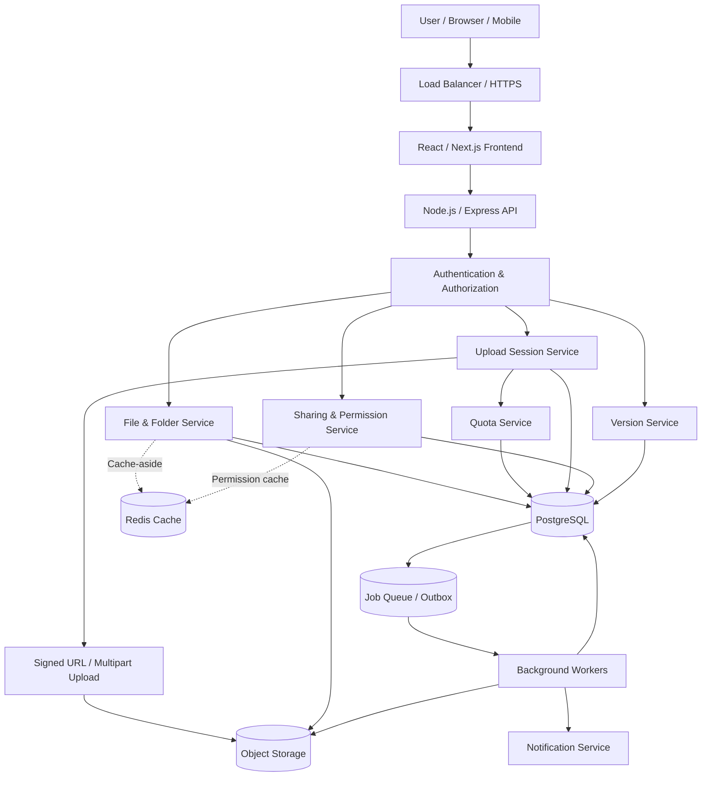
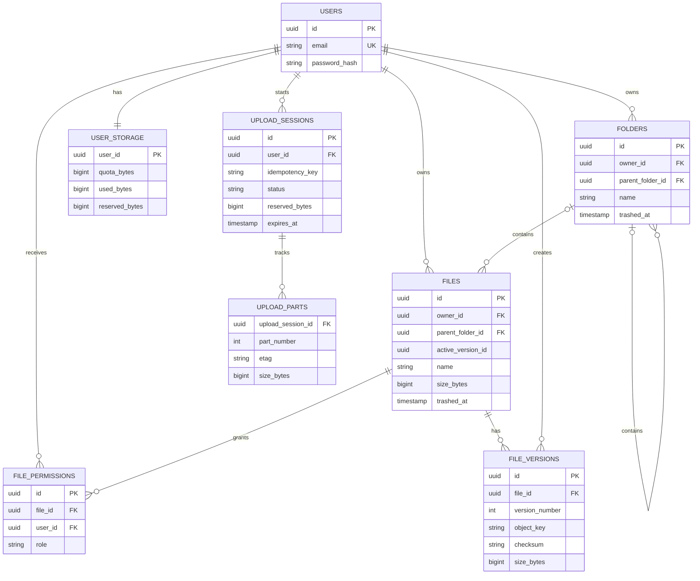
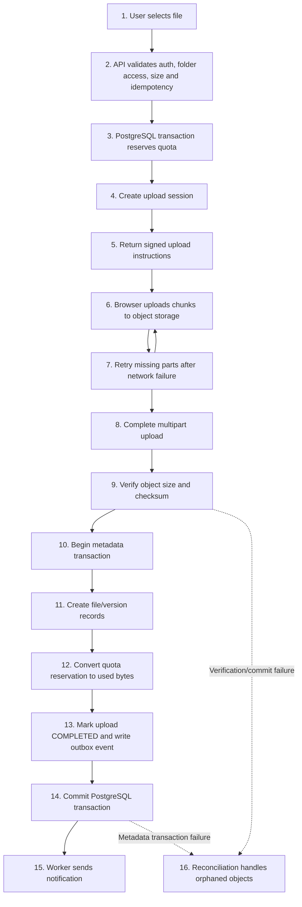

# **Google Drive System Design — System Design**

> **উদ্দেশ্য:** Software Engineering Interview Preparation\
> **প্রধান প্রযুক্তি:** Node.js, Express.js, PostgreSQL, Object Storage (Amazon S3-compatible), Redis\
> **মূল সমস্যা:** একজন user Google Drive-এর মতো application-এ file ও folder তৈরি, upload, download, rename, move এবং delete করবেন। তিনি অন্য users-এর সঙ্গে file share করতে পারবেন, Viewer/Commenter/Editor permissions নির্ধারণ করতে পারবেন এবং previous file versions restore করতে পারবেন।

## **Design Decisions at a Glance**

| সিদ্ধান্ত                                           | কেন এই approach                                                                                                  |
| --------------------------------------------------- | ---------------------------------------------------------------------------------------------------------------- |
| PostgreSQL-এ file ও folder metadata রাখা            | Relational integrity, transaction এবং constraints ব্যবহার করে metadata consistency বজায় রাখা যায়।                |
| Object Storage-এ file binary রাখা                   | বড় file efficiently store করা, durability এবং horizontal scalability নিশ্চিত করা যায়।                            |
| `file_versions`-এ version history রাখা              | Previous content restore করা যায় এবং প্রতিটি version-এর metadata আলাদাভাবে maintain করা যায়।                     |
| Chunked/Resumable Upload ব্যবহার                    | Network failure হলে সম্পূর্ণ file পুনরায় upload না করে interrupted upload resume করা যায়।                        |
| Upload operation-এ idempotency key ব্যবহার          | Retry বা duplicate request-এর কারণে duplicate upload session বা metadata creation প্রতিরোধ করা যায়।              |
| PostgreSQL transaction ও unique constraints ব্যবহার | Concurrent operations-এর সময় duplicate records, invalid relationships এবং metadata inconsistency কমানো যায়।      |
| Atomic quota reservation ব্যবহার                    | Concurrent uploads-এর সময় user-এর storage quota অতিক্রম করা প্রতিরোধ করা যায়।                                    |
| Centralized authorization ও permission inheritance  | File owner, shared users এবং Viewer/Commenter/Editor access সঠিকভাবে enforce করা যায়।                            |
| Optimistic locking ব্যবহার                          | একই file একাধিক user edit করলে conflicting updates শনাক্ত করা যায়।                                               |
| Soft delete ও Trash ব্যবহার                         | ভুল করে delete হওয়া file/folder restore করা যায়।                                                                 |
| Background workers ও Outbox pattern ব্যবহার         | Abandoned uploads, permanent deletion, orphaned objects এবং asynchronous events নির্ভরযোগ্যভাবে process করা যায়। |
| প্রথম version modular monolith রাখা                 | Development ও deployment সহজ রেখে প্রয়োজন অনুযায়ী services আলাদা করা যায়।                                        |

---

## **সূচিপত্র**

1. [সমস্যার বিবরণ](https://chatgpt.com/c/6ad6fb9c-6e00-83ee-9104-e5134a98d002#1-problem-statement)
2. [প্রয়োজনীয়তা](https://chatgpt.com/c/6ad6fb9c-6e00-83ee-9104-e5134a98d002#2-requirements)
   - [Functional Requirements](https://chatgpt.com/c/6ad6fb9c-6e00-83ee-9104-e5134a98d002#21-functional-requirements)
   - [Non-Functional Requirements](https://chatgpt.com/c/6ad6fb9c-6e00-83ee-9104-e5134a98d002#22-non-functional-requirements)
3. [High-Level Architecture](https://chatgpt.com/c/6ad6fb9c-6e00-83ee-9104-e5134a98d002#3-high-level-architecture)
   - [Frontend Architecture](https://chatgpt.com/c/6ad6fb9c-6e00-83ee-9104-e5134a98d002#31-frontend-architecture)
   - [Full System Architecture](https://chatgpt.com/c/6ad6fb9c-6e00-83ee-9104-e5134a98d002#32-full-system-architecture)
   - [Step-by-Step Workflow](https://chatgpt.com/c/6ad6fb9c-6e00-83ee-9104-e5134a98d002#33-step-by-step-workflow)
     - [Phase 1: File Upload ও Quota Reservation](https://chatgpt.com/c/6ad6fb9c-6e00-83ee-9104-e5134a98d002#phase-1-file-upload--quota-reservation)
     - [Phase 2: Chunked/Resumable Upload](https://chatgpt.com/c/6ad6fb9c-6e00-83ee-9104-e5134a98d002#phase-2-chunkedresumable-upload)
     - [Phase 3: Metadata Commit ও ACID](https://chatgpt.com/c/6ad6fb9c-6e00-83ee-9104-e5134a98d002#phase-3-metadata-commit--acid)
     - [Phase 4: File Download ও Preview](https://chatgpt.com/c/6ad6fb9c-6e00-83ee-9104-e5134a98d002#phase-4-file-download--preview)
     - [Phase 5: Sharing ও Access Control](https://chatgpt.com/c/6ad6fb9c-6e00-83ee-9104-e5134a98d002#phase-5-sharing--access-control)
     - [Phase 6: Versioning ও Restore](https://chatgpt.com/c/6ad6fb9c-6e00-83ee-9104-e5134a98d002#phase-6-versioning--restore)
     - [Phase 7: Delete, Trash ও Cleanup](https://chatgpt.com/c/6ad6fb9c-6e00-83ee-9104-e5134a98d002#phase-7-delete-trash--cleanup)
   - [Simple End-to-End Story](https://chatgpt.com/c/6ad6fb9c-6e00-83ee-9104-e5134a98d002#simple-end-to-end-story)
   - [Important SQL for Interview](https://chatgpt.com/c/6ad6fb9c-6e00-83ee-9104-e5134a98d002#34-important-sql-for-interview)
     - [Core File ও Folder Queries](https://chatgpt.com/c/6ad6fb9c-6e00-83ee-9104-e5134a98d002#341-core-file--folder-queries)
     - [Sharing, Versioning ও Quota Queries](https://chatgpt.com/c/6ad6fb9c-6e00-83ee-9104-e5134a98d002#342-sharing-versioning--quota-queries)
     - [Integrity Constraints ও Indexes](https://chatgpt.com/c/6ad6fb9c-6e00-83ee-9104-e5134a98d002#343-integrity-constraints--indexes)
4. [Database Design](https://chatgpt.com/c/6ad6fb9c-6e00-83ee-9104-e5134a98d002#4-database-design)
5. [Status Management](https://chatgpt.com/c/6ad6fb9c-6e00-83ee-9104-e5134a98d002#5-status-management)
6. [ER Diagram](https://chatgpt.com/c/6ad6fb9c-6e00-83ee-9104-e5134a98d002#6-er-diagram)
7. [REST API Design](https://chatgpt.com/c/6ad6fb9c-6e00-83ee-9104-e5134a98d002#7-rest-api-design)
8. [Complete File Upload Flow](https://chatgpt.com/c/6ad6fb9c-6e00-83ee-9104-e5134a98d002#8-complete-file-upload-flow)
9. [Concurrent Upload ও Quota Prevention](https://chatgpt.com/c/6ad6fb9c-6e00-83ee-9104-e5134a98d002#9-concurrent-upload--quota-prevention)
10. [Resumable Upload ও Expiry Mechanism](https://chatgpt.com/c/6ad6fb9c-6e00-83ee-9104-e5134a98d002#10-resumable-upload--expiry-mechanism)
11. [File Sharing ও Permission Management](https://chatgpt.com/c/6ad6fb9c-6e00-83ee-9104-e5134a98d002#11-file-sharing--permission-management)
12. [Database Transaction ও Object Storage Consistency](https://chatgpt.com/c/6ad6fb9c-6e00-83ee-9104-e5134a98d002#12-database-transaction--object-storage-consistency)
13. [ACID Properties](https://chatgpt.com/c/6ad6fb9c-6e00-83ee-9104-e5134a98d002#13-acid-properties)
14. [Security ও Reliability](https://chatgpt.com/c/6ad6fb9c-6e00-83ee-9104-e5134a98d002#14-security--reliability)
15. [Scalability ও Performance](https://chatgpt.com/c/6ad6fb9c-6e00-83ee-9104-e5134a98d002#15-scalability--performance)
16. [Interview-এ বলার মতো সংক্ষিপ্ত উত্তর](https://chatgpt.com/c/6ad6fb9c-6e00-83ee-9104-e5134a98d002#16-interview-%E0%A6%8F-%E0%A6%AC%E0%A6%B2%E0%A6%BE%E0%A6%B0-%E0%A6%AE%E0%A6%A4%E0%A7%8B-%E0%A6%B8%E0%A6%82%E0%A6%95%E0%A7%8D%E0%A6%B7%E0%A6%BF%E0%A6%AA%E0%A7%8D%E0%A6%A4-%E0%A6%89%E0%A6%A4%E0%A7%8D%E0%A6%A4%E0%A6%B0)

---

## **1. Problem Statement**

ধরা যাক, একজন user Google Drive-এর মতো একটি application-এ নিজের workspace তৈরি করলেন। তিনি file এবং nested folder তৈরি করতে পারবেন, বড় file upload ও download করতে পারবেন এবং প্রয়োজন অনুযায়ী অন্য users-এর সঙ্গে content share করতে পারবেন।

System-কে নিশ্চিত করতে হবে:

- প্রতিটি file-এর metadata এবং binary content সঠিকভাবে সংরক্ষিত হচ্ছে।
- Interrupted upload পুনরায় শুরু করা যাচ্ছে।
- Concurrent uploads-এর সময় storage quota অতিক্রম হচ্ছে না।
- একজন unauthorized user private file access করতে পারছেন না।
- একই file একাধিক user update করলে version conflict শনাক্ত হচ্ছে।
- File move, rename, delete ও restore operations metadata consistency বজায় রাখছে।
- Database এবং object storage-এর মধ্যে partial failure হলেও system recover করতে পারছে।

**মূল Design Challenge:** Object storage-এ বড় file নির্ভরযোগ্যভাবে সংরক্ষণ, PostgreSQL-এ metadata consistency, resumable upload, atomic quota enforcement, permission control এবং concurrent version updates নিরাপদে পরিচালনা করা।

## **2. Requirements**

### **2.1 Functional Requirements**

1. User registration, authentication এবং ব্যক্তিগত workspace management।
2. File/folder create, upload, download, preview, rename, move ও delete।
3. Nested folder hierarchy এবং parent-child relationships maintain করা।
4. File binary object storage-এ এবং metadata PostgreSQL-এ রাখা।
5. Upload operation-এ unique ID ও idempotency key ব্যবহার।
6. Large file-এর জন্য chunked/resumable upload support।
7. Duplicate chunks, retries, interrupted uploads এবং checksum verification handle করা।
8. User-specific storage quota এবং concurrent quota reservation।
9. File ও folder অন্য users-এর সঙ্গে share করা।
10. Viewer, Commenter ও Editor permissions enforce করা।
11. Private access, shareable links এবং permission revocation।
12. File version history maintain এবং previous version restore।
13. Concurrent updates-এর সময় optimistic locking ও conflict detection।
14. Filename, file type, owner, modified date ও folder অনুযায়ী search/filter।
15. Trash, restore এবং permanent deletion।
16. Metadata, permissions ও related database records atomicভাবে update করা।
17. Failed requests ও partial failures থেকে recovery।
18. Background worker দিয়ে abandoned upload sessions এবং orphaned objects cleanup।
19. Secure download links ও authorized file preview।
20. Multiple devices-এ file changes ও permissions synchronize করা।

### **2.2 Non-Functional Requirements**

| Requirement    | Design Approach                                                            |
| -------------- | -------------------------------------------------------------------------- |
| Consistency    | PostgreSQL transactions, constraints এবং optimistic locking                |
| Availability   | Load balancer, multiple application instances ও retry                      |
| Durability     | Replicated object storage, versioning ও backup                             |
| Security       | HTTPS, authentication, RBAC/ACL এবং short-lived signed URLs                |
| Scalability    | Stateless API, object storage, caching ও database indexing                 |
| Performance    | Direct-to-object-storage upload/download এবং pagination                    |
| Reliability    | Idempotency, checksums, retries, background workers ও reconciliation       |
| Recoverability | Trash, version history, database backup ও storage inventory reconciliation |

---

## **3. High-Level Architecture**

### **3.1 Frontend Architecture**

Frontend হিসেবে React বা Next.js ব্যবহার করা যেতে পারে।

প্রধান components:

- **Authentication:** Login, registration এবং session management।
- **File Explorer:** Folder navigation, breadcrumbs এবং file listing।
- **Upload Manager:** Progress bar, chunk tracking, retry ও resume।
- **File Preview:** Supported file type-এর preview।
- **Sharing Dialog:** Users, roles এবং shareable-link settings।
- **Version History:** Previous versions দেখা ও restore করা।
- **Trash:** Deleted files restore বা permanently delete করা।
- **Conflict Handler:** Concurrent modification হলে user-কে conflict জানানো।

Frontend শুধু interface এবং upload progress পরিচালনা করবে। **Authorization, quota enforcement, ownership এবং file status-এর final authority backend ও database-এর হাতে থাকবে।**

### **3.2 Full System Architecture**


**Architecture-এর গুরুত্বপূর্ণ বিষয়:**

- API authentication এবং authorization যাচাই করে।
- PostgreSQL file metadata, ownership, sharing, version references ও upload state রাখে।
- Object storage file-এর actual binary content রাখে।
- বড় file-এর bytes সাধারণত browser থেকে signed URL ব্যবহার করে সরাসরি object storage-এ যায়।
- Redis কেবল cache; authoritative permission, quota বা file state নয়।
- Background workers cleanup, abandoned upload এবং storage reconciliation পরিচালনা করে।
- Database transaction ও object storage operation একসঙ্গে সাধারণ ACID transaction-এর অংশ নয়। তাই recovery ও reconciliation প্রয়োজন।

### **3.3 Step-by-Step Workflow**

#### **Phase 1: File Upload ও Quota Reservation**

1. User frontend থেকে file নির্বাচন করবেন।
2. Frontend `POST /upload-sessions` request পাঠাবে।
3. Backend authentication, folder access, file size এবং idempotency key যাচাই করবে।
4. Database transaction-এর মধ্যে user quota row lock বা atomic conditional update করবে।
5. Upload-এর সম্ভাব্য size-এর জন্য quota reserve করা হবে।
6. Upload session `INITIATED` বা `UPLOADING` status-এ তৈরি হবে।
7. Backend signed upload URL বা multipart upload instructions দেবে।

**কেন quota আগে reserve করা হয়?**

একই user একসঙ্গে একাধিক বড় file upload করলে শুধু upload শেষে quota check করলে storage limit অতিক্রম হতে পারে। তাই concurrent uploads-এর জন্য reservation দরকার।

#### **Phase 2: Chunked/Resumable Upload**

1. File ছোট ছোট chunks-এ ভাগ করা হবে।
2. প্রতিটি chunk নির্দিষ্ট upload session ও part number-এর সঙ্গে যুক্ত থাকবে।
3. Object storage-এ chunks upload হবে।
4. Chunk upload সফল হলে তার checksum/ETag এবং part information সংরক্ষণ করা হবে।
5. Network failure হলে client server থেকে uploaded parts-এর status জেনে বাকি chunks upload করবে।
6. সব chunks upload হলে backend completion request process করবে।
7. Object storage multipart completion সফল হলে final object checksum/size verify করা হবে।

**Important:** Client-এর পাঠানো checksum বা size-কে অন্ধভাবে বিশ্বাস করা যাবে না। Backend এবং storage provider-এর verification semantics অনুযায়ী content verify করতে হবে।

#### **Phase 3: Metadata Commit ও ACID**

1. Object storage-এ final object সফলভাবে তৈরি হয়েছে কি না নিশ্চিত করতে হবে।
2. Database transaction শুরু হবে।
3. Upload session-এর current status এবং ownership যাচাই হবে।
4. `files` এবং `file_versions` records তৈরি বা update হবে।
5. Storage reference, checksum, size এবং active version সংরক্ষণ হবে।
6. Quota reservation committed usage-এ রূপান্তরিত হবে।
7. Upload session `COMPLETED` হবে।
8. একই transaction-এ প্রয়োজনে Outbox event তৈরি হবে।
9. Transaction commit হওয়ার পর asynchronous notification পাঠানো হবে।

যদি database transaction ব্যর্থ হয়, object storage-এ তৈরি হওয়া object orphaned থাকতে পারে। Retry বা reconciliation worker সেটি নিরাপদে recover অথবা cleanup করবে।

#### **Phase 4: File Download ও Preview**

1. User file ID দিয়ে download request পাঠাবেন।
2. Backend file-এর existence, trash status এবং access permission যাচাই করবে।
3. Authorized হলে short-lived signed download URL দেওয়া হবে, অথবা backend stream করবে।
4. Browser object storage থেকে file download করবে।
5. Preview-এর জন্য content type, disposition এবং supported format যাচাই করা হবে।

Private file-এর object URL স্থায়ীভাবে public রাখা যাবে না। Signed URL bearer credential-এর মতো আচরণ করে, তাই মেয়াদ ও scope সীমিত রাখতে হবে।

#### **Phase 5: Sharing ও Access Control**

1. Owner একটি user বা shareable link নির্বাচন করবেন।
2. Backend owner-এর permission যাচাই করবে।
3. `file_permissions` বা share record-এ target user এবং role সংরক্ষণ হবে।
4. Viewer শুধু দেখতে/download করতে পারবেন।
5. Commenter দেখতে এবং comment করতে পারবেন।
6. Editor content edit করতে পারবেন; তবে ownership transfer বা permission management-এর মতো কাজের জন্য আলাদা authorization policy থাকতে পারে।
7. Permission revoke হলে পরবর্তী request-এ access বন্ধ হবে।
8. Cached permissions invalidation করতে হবে; আগে তৈরি signed URL expire না হওয়া পর্যন্ত কিছু ক্ষেত্রে access চালু থাকতে পারে।

Folder sharing থাকলে descendant files-এ permission inheritance কীভাবে হবে তা স্পষ্টভাবে নির্ধারণ করতে হবে। Explicit deny, inherited permission এবং direct grant-এর precedence policy-ও consistent হতে হবে।

#### **Phase 6: Versioning ও Restore**

1. Editor file-এর নতুন content upload করবেন।
2. Backend expected version number বা ETag যাচাই করবে।
3. নতুন content আলাদা immutable object key-তে সংরক্ষণ হবে।
4. Database transaction-এ নতুন `file_versions` record তৈরি হবে।
5. File-এর active version pointer update হবে।
6. Version conflict হলে request `409 Conflict` দিতে পারে।
7. Previous version restore করতে পুরোনো version record-কে active করা যায়, অথবা পুরোনো content থেকে নতুন version তৈরি করা যায়।

**Recommended approach:** Previous version-এর immutable content রেখে restore-কে নতুন version হিসেবে record করা। এতে version history audit করা সহজ হয়।

#### **Phase 7: Delete, Trash ও Cleanup**

1. User delete request পাঠাবেন।
2. Backend ownership বা delete permission যাচাই করবে।
3. Database transaction-এ file/folder-কে Trash-এ নেওয়া হবে।
4. Folder delete-এর ক্ষেত্রে descendant files-এর আচরণ নির্ধারিত policy অনুযায়ী কার্যকর হবে।
5. Trash থেকে restore করলে parent folder-এর existence ও permission যাচাই হবে।
6. Permanent deletion-এর সময় object storage cleanup job তৈরি হবে।
7. সব relevant versions, references ও retention policy যাচাই করে unreferenced objects delete করা হবে।
8. Cleanup সফল হলে related metadata ও quota usage update করা হবে।

Database থেকে metadata মুছে ফেলার আগে object references এবং retention requirements যাচাই করা জরুরি।

### **Simple End-to-End Story**

ধরা যাক, Murad একটি 2 GB PDF upload করলেন।

1. Backend Murad-এর authentication ও destination folder access যাচাই করল।
2. PostgreSQL-এ 2 GB-এর জন্য quota reserve হলো।
3. File chunks আকারে object storage-এ upload হলো।
4. Network বন্ধ হয়ে গেলে upload session-এর recorded parts ব্যবহার করে upload resume হলো।
5. সব chunks complete ও verify হওয়ার পর metadata transaction commit হলো।
6. Murad file-টি একজন colleague-এর সঙ্গে Viewer permission-এ share করলেন।
7. Colleague permission যাচাই পেরিয়ে signed URL দিয়ে file download করলেন।
8. Murad updated PDF upload করলে নতুন version তৈরি হলো; পুরোনো version history-তে রইল।
9. Murad file delete করলে সেটি Trash-এ গেল; permanent deletion-এর আগে worker storage cleanup করল।

---

## **3.4 Important SQL for Interview**

নিচের SQL snippets PostgreSQL-এর illustrative examples। Production implementation-এ schema, transaction boundaries, authorization policy এবং error handling অনুযায়ী এগুলো adapt করতে হবে।

### **3.4.1 Core File & Folder Queries**

**1. Folder-এর file listing**
```
SELECT id, name, mime_type, size_bytes, updated_at
FROM files
WHERE owner_id = $1
  AND parent_folder_id = $2
  AND trashed_at IS NULL
ORDER BY name
LIMIT $3 OFFSET $4;
```

এটি owner-এর নির্দিষ্ট folder-এর active files দেখায়। Shared files-এর জন্য effective access policy অনুযায়ী query scope বাড়াতে হবে।

**2. File rename**
```
UPDATE files
SET name = $1,
    updated_at = NOW(),
    version_number = version_number + 1
WHERE id = $2
  AND owner_id = $3
  AND version_number = $4
  AND trashed_at IS NULL
RETURNING id, name, version_number;
```

এখানে expected `version_number` দিয়ে optimistic concurrency control দেখানো হয়েছে। বাস্তব schema-তে content version এবং metadata revision আলাদা রাখা যেতে পারে।

**3. File move**
```
BEGIN;

SELECT id
FROM folders
WHERE id = $1
  AND owner_id = $2
  AND trashed_at IS NULL
FOR UPDATE;

UPDATE files
SET parent_folder_id = $1,
    updated_at = NOW()
WHERE id = $3
  AND owner_id = $2
  AND trashed_at IS NULL;

COMMIT;
```

এটি একটি সরল উদাহরণ। Production-এ source/destination access, same-owner rules, folder-cycle prevention এবং missing destination-এর ক্ষেত্রে rollback নিশ্চিত করতে হবে। Folder tree-এর concurrent moves-এর জন্য আরও শক্তিশালী locking বা hierarchy validation লাগতে পারে।

### **3.4.2 Sharing, Versioning ও Quota Queries**

**4. User permission যাচাই**
```
SELECT role
FROM file_permissions
WHERE file_id = $1
  AND user_id = $2;
```

এটি direct grants-এর উদাহরণ। Owner access, inherited folder permissions এবং shareable-link access আলাদাভাবে বিবেচনা করতে হবে।

**5. Version history**
```
SELECT id, version_number, size_bytes, checksum, created_at
FROM file_versions
WHERE file_id = $1
ORDER BY version_number DESC;
```

**6. Atomic quota reservation**
```
UPDATE user_storage
SET reserved_bytes = reserved_bytes + $1
WHERE user_id = $2
  AND used_bytes + reserved_bytes + $1 <= quota_bytes
RETURNING used_bytes, reserved_bytes, quota_bytes;
```

কোনো row return না হলে reservation ব্যর্থ হবে। একই user-এর concurrent updates PostgreSQL-এর row-level update locking দ্বারা serialize হবে। `$1`-এর positive value, integer range এবং duplicate reservation-এর জন্য idempotency আলাদাভাবে যাচাই করতে হবে।

**7. Expired upload sessions খুঁজে বের করা**
```
SELECT id, user_id, object_key
FROM upload_sessions
WHERE status IN ('INITIATED', 'UPLOADING')
  AND expires_at < NOW()
ORDER BY expires_at
LIMIT 100;
```

Worker batches-এ expired sessions process করতে পারে। Multiple workers থাকলে `FOR UPDATE SKIP LOCKED` দিয়ে job claiming করা যেতে পারে।

### **3.4.3 Integrity Constraints ও Indexes**
```
CREATE UNIQUE INDEX uq_file_version
ON file_versions (file_id, version_number);

CREATE UNIQUE INDEX uq_upload_idempotency
ON upload_sessions (user_id, idempotency_key);

CREATE INDEX idx_files_parent
ON files (owner_id, parent_folder_id, name)
WHERE trashed_at IS NULL;

CREATE INDEX idx_versions_file
ON file_versions (file_id, version_number DESC);

CREATE INDEX idx_upload_expiry
ON upload_sessions (expires_at)
WHERE status IN ('INITIATED', 'UPLOADING');
```

**Interview point:** Unique constraints হলো database-level correctness guarantee। Application-level validation একা concurrent duplicate inserts প্রতিরোধের জন্য যথেষ্ট নয়।

---

## **4. Database Design**

### **Users**

| Column          | Description           |
| --------------- | --------------------- |
| `id`            | Primary key           |
| `email`         | Unique email          |
| `password_hash` | Hashed password       |
| `created_at`    | Account creation time |

### **Folders**

| Column             | Description                          |
| ------------------ | ------------------------------------ |
| `id`               | Folder ID                            |
| `owner_id`         | Folder owner                         |
| `parent_folder_id` | Parent folder; root-এর ক্ষেত্রে NULL |
| `name`             | Folder name                          |
| `trashed_at`       | Trash timestamp                      |
| `created_at`       | Creation timestamp                   |
| `updated_at`       | Last modification                    |

Folder tree maintain করার জন্য `parent_folder_id` self-referencing foreign key ব্যবহার করা হবে। Folder cycle প্রতিরোধে application validation এবং concurrent moves-এর জন্য appropriate locking প্রয়োজন।

### **Files**

| Column              | Description              |
| ------------------- | ------------------------ |
| `id`                | Logical file ID          |
| `owner_id`          | Owner user ID            |
| `parent_folder_id`  | Parent folder ID         |
| `name`              | Filename                 |
| `mime_type`         | File type                |
| `size_bytes`        | Current content size     |
| `active_version_id` | Current active version   |
| `version_number`    | Content version/revision |
| `trashed_at`        | Trash timestamp          |
| `created_at`        | Creation timestamp       |
| `updated_at`        | Modification timestamp   |

### **File Versions**

| Column           | Description                |
| ---------------- | -------------------------- |
| `id`             | Version ID                 |
| `file_id`        | Logical file ID            |
| `version_number` | Version sequence           |
| `object_key`     | Object storage reference   |
| `size_bytes`     | Version size               |
| `checksum`       | Verified content checksum  |
| `created_by`     | Uploader/editor            |
| `created_at`     | Version creation timestamp |

একটি file-এর প্রতিটি version-এর জন্য আলাদা immutable object key রাখা হবে। Version history-এর object delete করার আগে retention এবং active references যাচাই করতে হবে।

### **File Permissions**

| Column       | Description                   |
| ------------ | ----------------------------- |
| `id`         | Permission record ID          |
| `file_id`    | Shared file ID                |
| `user_id`    | Target user ID                |
| `role`       | VIEWER / COMMENTER / EDITOR   |
| `created_by` | Granting user                 |
| `created_at` | Permission creation timestamp |

Unique constraint হিসেবে `(file_id, user_id)` ব্যবহার করা যেতে পারে, যদি একজন user-এর জন্য প্রতি file-এ একটি direct permission record-ই policy হয়।

### **Upload Sessions**

| Column                | Description                                |
| --------------------- | ------------------------------------------ |
| `id`                  | Upload session ID                          |
| `user_id`             | Uploading user                             |
| `idempotency_key`     | Retry-safe request identifier              |
| `file_id`             | Target logical file, create/update অনুযায়ী |
| `object_key`          | Staging/final object reference             |
| `expected_size_bytes` | Expected upload size                       |
| `checksum`            | Expected/verified checksum                 |
| `status`              | Upload lifecycle status                    |
| `reserved_bytes`      | Reserved quota                             |
| `expires_at`          | Session expiry                             |
| `created_at`          | Session creation time                      |

### **Upload Parts**

| Column              | Description                      |
| ------------------- | -------------------------------- |
| `upload_session_id` | Upload session                   |
| `part_number`       | Chunk/part sequence              |
| `etag`              | Storage provider part identifier |
| `size_bytes`        | Part size                        |
| `checksum`          | Part checksum                    |
| `uploaded_at`       | Upload timestamp                 |

`(upload_session_id, part_number)`-এর ওপর unique constraint duplicate part records প্রতিরোধ করবে।

### **User Storage**

| Column           | Description                |
| ---------------- | -------------------------- |
| `user_id`        | User ID                    |
| `quota_bytes`    | Maximum allowed storage    |
| `used_bytes`     | Committed storage usage    |
| `reserved_bytes` | Active upload reservations |

`used_bytes` এবং `reserved_bytes` non-negative রাখার জন্য CHECK constraints ব্যবহার করা উচিত। Version history quota-তে গণনা হবে কি না, সেটি product policy অনুযায়ী নির্ধারণ করতে হবে।

### **Additional Tables**

- `share_links`: Token hash, resource, permission, expiry ও revocation status।
- `comments`: File/version references, author ও comment body।
- `outbox_events`: Transactional event publishing।
- `cleanup_jobs`: Expired uploads এবং object deletion tasks।
- `audit_logs`: Sharing, permission changes, restore ও permanent deletion-এর audit trail।

**Design note:** `files.active_version_id` এবং `file_versions.file_id`-এর foreign keys mutually dependent হলে insertion order বা deferred constraints পরিকল্পনা করতে হবে। Production schema-তে ownership, same-resource relationships এবং lifecycle invariants database constraints ও transactional service logic দিয়ে enforce করা উচিত।

---

## **5. Status Management**

### **Upload Session Status**

| Status       | Meaning                           |
| ------------ | --------------------------------- |
| `INITIATED`  | Upload session তৈরি হয়েছে         |
| `UPLOADING`  | Chunks upload হচ্ছে               |
| `COMPLETING` | Multipart upload finalize হচ্ছে   |
| `VERIFYING`  | Object size/checksum যাচাই হচ্ছে  |
| `COMPLETED`  | Upload ও metadata commit সফল      |
| `FAILED`     | Upload operation ব্যর্থ           |
| `EXPIRED`    | Session মেয়াদ শেষ                 |
| `ABORTED`    | User বা system upload বাতিল করেছে |

### **File Lifecycle**

| Status / State  | Meaning                              |
| --------------- | ------------------------------------ |
| `ACTIVE`        | File স্বাভাবিকভাবে access করা যায়    |
| `TRASHED`       | File Trash-এ আছে                     |
| `PENDING_PURGE` | Permanent deletion-এর জন্য অপেক্ষমাণ |
| `PURGED`        | Logical resource permanently deleted |

`PURGED` state রাখা হবে নাকি metadata record মুছে ফেলা হবে, সেটি audit এবং retention requirements-এর ওপর নির্ভর করবে।

### **Version Lifecycle**

| State           | Meaning                                     |
| --------------- | ------------------------------------------- |
| `STAGING`       | New version upload/verification হচ্ছে       |
| `ACTIVE`        | Current version                             |
| `HISTORICAL`    | Previous version                            |
| `PURGE_PENDING` | Retention policy অনুযায়ী deletion অপেক্ষমাণ |

Version lifecycle status আলাদা table-এ রাখা হবে, নাকি `active_version_id` দিয়ে বোঝানো হবে, তা implementation-এর ওপর নির্ভর করবে।

---

## **6. ER Diagram**


---

## **7. REST API Design**

### **Authentication**

| Method | Endpoint             | Purpose               |
| ------ | -------------------- | --------------------- |
| `POST` | `/api/auth/register` | Register user         |
| `POST` | `/api/auth/login`    | Authenticate user     |
| `POST` | `/api/auth/logout`   | Logout/revoke session |

### **Files & Folders**

| Method   | Endpoint                      | Purpose                        |
| -------- | ----------------------------- | ------------------------------ |
| `POST`   | `/api/folders`                | Create folder                  |
| `GET`    | `/api/folders/:id/files`      | List folder contents           |
| `POST`   | `/api/files`                  | Create logical file/metadata   |
| `GET`    | `/api/files/:id`              | Get file metadata              |
| `PATCH`  | `/api/files/:id`              | Rename/update metadata         |
| `POST`   | `/api/files/:id/move`         | Move file                      |
| `POST`   | `/api/files/:id/trash`        | Move file to Trash             |
| `POST`   | `/api/files/:id/restore`      | Restore from Trash             |
| `DELETE` | `/api/files/:id`              | Request permanent deletion     |
| `GET`    | `/api/files/:id/download-url` | Obtain authorized download URL |
| `GET`    | `/api/files/:id/preview-url`  | Obtain authorized preview URL  |

### **Upload Sessions**

| Method | Endpoint                            | Purpose                      |
| ------ | ----------------------------------- | ---------------------------- |
| `POST` | `/api/upload-sessions`              | Initiate upload              |
| `GET`  | `/api/upload-sessions/:id`          | Check upload status          |
| `POST` | `/api/upload-sessions/:id/parts`    | Get part upload instructions |
| `GET`  | `/api/upload-sessions/:id/parts`    | List completed parts         |
| `POST` | `/api/upload-sessions/:id/complete` | Finalize upload              |
| `POST` | `/api/upload-sessions/:id/abort`    | Abort upload                 |

Large files-এর জন্য actual part bytes সরাসরি object storage-এ যাবে। API upload authorization, part tracking এবং completion পরিচালনা করবে।

### **Sharing & Versioning**

| Method   | Endpoint                                     | Purpose            |
| -------- | -------------------------------------------- | ------------------ |
| `POST`   | `/api/files/:id/shares`                      | Share file         |
| `GET`    | `/api/files/:id/shares`                      | List direct shares |
| `PATCH`  | `/api/files/:id/shares/:shareId`             | Update permission  |
| `DELETE` | `/api/files/:id/shares/:shareId`             | Revoke permission  |
| `POST`   | `/api/files/:id/share-links`                 | Create share link  |
| `GET`    | `/api/files/:id/versions`                    | List versions      |
| `POST`   | `/api/files/:id/versions/:versionId/restore` | Restore version    |

### **HTTP Status Codes**

- `200 OK`: Successful read/update।
- `201 Created`: Resource created।
- `202 Accepted`: Asynchronous deletion বা processing request accepted।
- `400 Bad Request`: Invalid request।
- `401 Unauthorized`: Authentication required।
- `403 Forbidden`: Permission denied।
- `404 Not Found`: Resource not found বা policy অনুযায়ী hidden।
- `409 Conflict`: Version conflict, duplicate state transition বা invalid lifecycle operation।
- `413 Payload Too Large`: File size limit অতিক্রম।
- `422 Unprocessable Content`: Checksum বা semantic validation failure।
- `429 Too Many Requests`: Rate limit অতিক্রম।

---

## **8. Complete File Upload Flow**


**Workflow-এর গুরুত্বপূর্ণ নিয়ম:**

- একই idempotency key দিয়ে retry করলে একই logical operation-এর result ফেরত দিতে হবে।
- Quota reservation এবং upload-session creation একই database transaction-এ করতে হবে।
- Upload completion-এর আগে সব expected parts ও final object যাচাই করতে হবে।
- Database commit-এর আগে file-কে visible/active হিসেবে দেখানো যাবে না।
- Transaction commit ব্যর্থ হলে object storage-এর object orphaned হতে পারে; cleanup-এর আগে references যাচাই করতে হবে।
- Notifications বা other side effects transaction commit-এর আগে fire করা যাবে না।

---

## **9. Concurrent Upload ও Quota Prevention**

ধরা যাক, একজন user-এর quota 10 GB এবং committed usage 8 GB। একই সময়ে দুটি request 1.5 GB করে upload শুরু করল।

শুধু frontend quota check করলে দুটি request-ই সফল হতে পারে। Backend-এ atomic reservation ব্যবহার করলে:

1. প্রথম request 1.5 GB reserve করবে।
2. দ্বিতীয় request database-এর latest quota state অনুযায়ী check করবে।
3. মোট committed ও reserved storage 11 GB হওয়ার চেষ্টা করলে দ্বিতীয় request reject হবে।
4. Failed বা expired upload-এর reservation release হবে।
5. Successful upload-এ reservation থেকে actual verified usage-এ transition হবে।

**মূল নিয়ম:**

[\
\text{used_bytes}+\text{reserved_bytes}\leq\text{quota_bytes}\
]

এটি শুধু application code-এর check নয়; concurrent reservation-এর জন্য atomic SQL update অথবা locked transaction প্রয়োজন।

একই reservation একাধিকবার release বা commit যেন না হয়, সে জন্য upload session status এবং quota transition idempotent করতে হবে।

---

## **10. Resumable Upload ও Expiry Mechanism**

### **Upload Resume**

- প্রতিটি upload session-এর unique ID থাকবে।
- Multipart upload-এর provider-specific upload ID সংরক্ষণ করা হবে।
- Uploaded part number এবং ETag/checksum record করা হবে।
- Client reconnect করলে server বা storage provider-এর recorded parts থেকে upload resume করবে।
- একই part পুনরায় upload হলে provider-এর semantics অনুযায়ী safe retry নিশ্চিত করতে হবে।
- Completion request duplicate হলে completed result ফেরত দিতে হবে; দ্বিতীয়বার version বা quota update করা যাবে না।

### **Expiry ও Cleanup**

একটি background worker নির্দিষ্ট interval-এ expired sessions খুঁজে বের করবে।

1. Session row lock বা atomic state transition-এর মাধ্যমে worker ownership নেবে।
2. Session `EXPIRED` বা abort-pending state-এ যাবে।
3. Object storage-এর incomplete multipart upload abort করা হবে।
4. Reserved quota একবারই release হবে।
5. Staging object বা orphaned object থাকলে reference যাচাই করে cleanup করা হবে।
6. Failure হলে bounded retry ও monitoring চালু থাকবে।

**Race condition:** Expiry worker এবং upload completion একই সময়ে চলতে পারে। উভয় operation-কে একই session row-এর state transition ও locking rules অনুসরণ করতে হবে, যাতে expired session সফলভাবে complete হওয়ার সঙ্গে reservation release-এর সংঘর্ষ না হয়।

---

## **11. File Sharing ও Permission Management**

### **Permission Matrix**

| Action                     | Viewer | Commenter    | Editor       | Owner |
| -------------------------- | ------ | ------------ | ------------ | ----- |
| View/download              | Yes    | Yes          | Yes          | Yes   |
| Add comments               | No     | Yes          | Yes          | Yes   |
| Upload new content version | No     | No           | Yes          | Yes   |
| Rename/move                | No     | Policy-based | Policy-based | Yes   |
| Manage permissions         | No     | No           | Policy-based | Yes   |
| Delete permanently         | No     | No           | No           | Yes   |

এটি একটি example policy; actual product requirements অনুযায়ী Editor-এর move/delete permissions নির্ধারণ করতে হবে।

### **Authorization Rules**

- Authentication সফল হলেই file access অনুমোদিত হয় না।
- প্রতিটি request-এ file owner, direct grant, inherited folder access এবং share-link policy যাচাই করতে হবে।
- User-supplied `owner_id` বা `user_id`-কে trusted ধরে নেওয়া যাবে না; authenticated identity ব্যবহার করতে হবে।
- Permission revoke হওয়ার পর cache invalidation বা short cache TTL নিশ্চিত করতে হবে।
- Signed URL তৈরি করার আগে authorization যাচাই করতে হবে এবং URL-এর expiry সীমিত রাখতে হবে।
- Shareable link random, unguessable token ব্যবহার করবে; database-এ token hash রাখা যেতে পারে।
- Folder permission inheritance ও descendants-এর behavior সুস্পষ্টভাবে সংজ্ঞায়িত করতে হবে।

---

## **12. Database Transaction ও Object Storage Consistency**

PostgreSQL এবং object storage সাধারণত একটি shared ACID transaction-এ অংশ নেয় না। তাই শুধু database transaction ব্যবহার করে file bytes এবং metadata-কে একসঙ্গে atomicভাবে commit করা সম্ভব নয়।

### **Recommended Strategy: Staged Upload + Metadata Commit + Reconciliation**

1. প্রথমে upload session এবং quota reservation database-এ commit হবে।
2. File bytes staging বা version-specific object key-তে upload হবে।
3. Multipart completion ও content verification সফল হবে।
4. Database transaction-এ file/version metadata এবং quota transition commit হবে।
5. Metadata commit ব্যর্থ হলে object-টি staging/orphaned অবস্থায় থাকতে পারে।
6. Retry বা reconciliation worker object reference, session status এবং retention policy যাচাই করবে।
7. নিরাপদে recover করা না গেলে object delete করে reservation release করবে।

### **Failure Scenarios**

| Failure                                   | Expected Handling                                     |
| ----------------------------------------- | ----------------------------------------------------- |
| Network disconnect                        | Upload resume                                         |
| Duplicate API request                     | Idempotency key                                       |
| Duplicate part upload                     | Provider-specific retry semantics ও part verification |
| Object upload সফল, DB commit ব্যর্থ       | Retry/reconciliation; unreferenced object cleanup     |
| DB commit সফল, notification ব্যর্থ        | Outbox worker retry                                   |
| Quota reservation-এর পর upload ব্যর্থ     | Idempotent reservation release                        |
| Delete job ব্যর্থ                         | Retry এবং object reference যাচাই                      |
| Permission revoke-এর পর পুরোনো signed URL | Short expiry, প্রয়োজন হলে proxy-based access          |

**Important:** Cleanup worker কখনো এমন object delete করবে না, যা কোনো active file version বা in-progress upload-এর অংশ হিসেবে এখনও referenced আছে।

---

## **13. ACID Properties**

### **Atomicity**

একটি logical database operation সম্পূর্ণ সফল হবে অথবা rollback হবে।

উদাহরণ: Version metadata insert, active version pointer update এবং quota reservation-to-usage transition একই database transaction-এ commit হবে।

### **Consistency**

Database constraints এবং business rules মেনে state valid থাকবে।

উদাহরণ:

- `used_bytes >= 0`
- `reserved_bytes >= 0`
- Unique `(file_id, version_number)`
- Unique `(user_id, idempotency_key)`
- Valid foreign keys এবং permission roles

### **Isolation**

Concurrent operations একে অন্যের invalid intermediate state দেখতে বা তৈরি করতে পারবে না।

উদাহরণ: Quota reservation-এর atomic conditional update এবং version update-এর optimistic locking। Complex hierarchy operations-এর ক্ষেত্রে row locking বা প্রয়োজন অনুযায়ী stronger isolation ব্যবহার করা যেতে পারে।

### **Durability**

Database transaction commit হওয়ার পর data crash বা restart-এর পরও টিকে থাকবে—configured durability guarantees অনুযায়ী।

উদাহরণ: PostgreSQL durable commit, database backups এবং object storage durability/versioning।

**Interview note:** ACID database metadata-র transaction consistency নিশ্চিত করে; PostgreSQL ও object storage-এর মধ্যে distributed atomicity স্বয়ংক্রিয়ভাবে নিশ্চিত করে না। এজন্য staging, idempotency, retry, outbox এবং reconciliation দরকার।

---

## **14. Security ও Reliability**

### **Security**

- HTTPS/TLS দিয়ে client-server এবং supported storage transfer encrypt করা।
- Password নিরাপদ password-hashing algorithm দিয়ে hash করা।
- API-তে authentication, resource-level authorization এবং rate limiting enforce করা।
- File type, size, filename এবং content validation করা।
- Untrusted files-এর জন্য malware scanning এবং safe preview/download policy প্রয়োগ করা।
- Private object bucket এবং short-lived signed URLs ব্যবহার করা।
- Share-link tokens secure random generator দিয়ে তৈরি করা।
- Secrets environment/secret manager-এ রাখা; logs-এ token বা signed URL প্রকাশ না করা।
- Permission changes এবং permanent deletion-এর audit log রাখা।

### **Reliability**

- Idempotency key দিয়ে duplicate operations control করা।
- Transient failures-এ bounded exponential backoff ব্যবহার করা।
- Queue/outbox-based asynchronous processing করা।
- Upload session expiry এবং incomplete multipart cleanup করা।
- Database backup এবং restore drills চালানো।
- Object storage inventory ও database references reconcile করা।
- Upload success rate, checksum failures, orphaned objects, quota rejection এবং cleanup backlog monitor করা।

---

## **15. Scalability ও Performance**

### **Application Layer**

- Stateless Express instances load balancer-এর পেছনে চালানো।
- বড় file-এর bytes API server দিয়ে না পাঠিয়ে direct signed upload/download ব্যবহার করা।
- CPU-intensive preview, thumbnail generation ও malware scanning worker-এ চালানো।
- Rate limiting এবং bounded concurrency ব্যবহার করা।

### **Database Layer**

- Folder listing, owner, permission, upload expiry এবং version history-এর জন্য appropriate indexes।
- Pagination ব্যবহার করা; বড় listing-এ cursor pagination বিবেচনা করা।
- PostgreSQL connection pool এবং query timeout configure করা।
- Read-heavy metadata query-এর জন্য প্রয়োজন হলে replicas ব্যবহার করা; permission/quota/critical writes-এর authority primary database-এ রাখা।
- File version ও audit data বড় হলে retention policy এবং partitioning বিবেচনা করা।
- Folder move ও permission inheritance-এর query cost load test করা।

### **Object Storage**

- Multipart upload এবং lifecycle rules ব্যবহার করা।
- Immutable version-specific object keys রাখা।
- Appropriate caching/CDN ব্যবহার করা, তবে private access ও revocation requirements বজায় রেখে।
- Abandoned multipart uploads-এর জন্য provider lifecycle cleanup configure করা।
- Checksum, object size এবং version references reconcile করা।

### **Caching**

Redis-এ file listing বা permission data cache করা যেতে পারে, কিন্তু cache হবে non-authoritative।

- Permission changes-এ invalidation বা short TTL।
- Critical authorization-এর জন্য stale cache policy বিবেচনা করা।
- Quota enforcement বা final version update Redis cache-এর ওপর নির্ভর করবে না।

### **Monitoring**

- API latency ও error rate।
- Upload completion rate এবং resume success rate।
- Object storage latency ও failed multipart completion।
- PostgreSQL lock waits, slow queries এবং connection pool saturation।
- Quota reservation leak।
- Orphaned object count এবং cleanup backlog।
- Permission-denied এবং suspicious download patterns।

---

## **16. Interview-এ বলার মতো সংক্ষিপ্ত উত্তর**

**Question: How would you design a Google Drive-like system?**

আমি প্রথমে system-টিকে file management, upload, sharing, versioning এবং storage management modules-এ ভাগ করব। Frontend হবে React/Next.js, backend হবে Node.js ও Express.js, metadata থাকবে PostgreSQL-এ এবং actual file content থাকবে scalable object storage-এ।

বড় file-এর জন্য resumable multipart upload ব্যবহার করব, যাতে network failure হলে upload resume করা যায়। প্রতিটি upload-এর unique session ID ও idempotency key থাকবে। Upload শুরু করার সময় PostgreSQL-এ atomic quota reservation করব, যাতে concurrent uploads-এর কারণে quota অতিক্রম না হয়।

File sharing-এর জন্য resource-level authorization এবং Viewer/Commenter/Editor roles implement করব। Version history-এর জন্য immutable object keys এবং `file_versions` table ব্যবহার করব। Concurrent updates-এ optimistic locking দিয়ে version conflict detect করব।

File metadata, version pointer এবং quota transition database transaction-এ update করব। তবে PostgreSQL ও object storage-এর মধ্যে সাধারণ ACID transaction সম্ভব নয়, তাই staged uploads, retry, transactional outbox এবং reconciliation worker ব্যবহার করব। Deleted files প্রথমে Trash-এ যাবে; permanent deletion ও abandoned upload cleanup background worker পরিচালনা করবে।

পরিশেষে load balancing, database indexing, caching, rate limiting, monitoring এবং object storage lifecycle policies ব্যবহার করে system-টিকে reliable ও scalable করব।

### **Key Takeaways**

- **PostgreSQL:** Metadata, permissions, version references এবং quota state-এর source of truth।
- **Object Storage:** File-এর actual binary content।
- **Resumable Upload:** Interrupted upload থেকে recovery।
- **Idempotency:** Retry ও duplicate request নিরাপদে handle করা।
- **Atomic Quota Reservation:** Concurrent upload-এর সময় storage limit enforce করা।
- **Optimistic Locking:** Concurrent edits-এ conflict detection।
- **ACID Transactions:** Related database updates atomicভাবে commit করা।
- **Outbox + Reconciliation:** Database ও object storage-এর partial failure recover করা।
- **Authorization:** প্রতিটি file/folder operation-এ resource-level access যাচাই করা।
- **Background Workers:** Expired uploads, abandoned chunks এবং permanent deletion পরিচালনা করা।

# Google Drive System Design Interview: ২৫টি গুরুত্বপূর্ণ প্রশ্ন ও উত্তর

**উদ্দেশ্য:** Software Engineering Interview Preparation\
**প্রধান প্রযুক্তি:** Node.js, Express.js, PostgreSQL, Object Storage (S3-compatible), Redis\
**Topics:** File Upload, Resumable Upload, Concurrency, Storage Quota, File Sharing, Versioning, ACID, Security, Scalability

---

## Q1. How do you prevent storage quota from being exceeded during concurrent uploads?

🔴 **Problem (সমস্যা):**

একজন user-এর storage quota 10 GB। তাঁর বর্তমান usage 8 GB। একই সময়ে দুটি request 1.5 GB করে file upload করতে চায়। দুটি request-ই যদি পুরোনো usage দেখে অনুমতি পায়, তাহলে মোট usage 11 GB হয়ে যাবে।

🟢 **Interview Answer (সমাধান):**

“স্যার, এটি একটি Concurrent Race Condition। আমি শুধু application-level quota check করব না; PostgreSQL-এ Atomic Conditional Update ব্যবহার করে quota reservation নিশ্চিত করব।

**১. Atomic Quota Reservation:**
```
UPDATE user_storage
SET reserved_bytes = reserved_bytes + $1
WHERE user_id = $2
  AND used_bytes + reserved_bytes + $1 <= quota_bytes
RETURNING user_id;
```

এখানে `$1` হলো upload-এর expected size এবং `$2` হলো authenticated user-এর ID।

**২. Database-Level Serialization:**

একই user-এর দুটি concurrent update হলে PostgreSQL সংশ্লিষ্ট row-এর update lock ব্যবহার করে operation-গুলো serialize করবে। প্রথম request quota reserve করলে দ্বিতীয় request latest committed state অনুযায়ী condition evaluate করবে।

প্রথম request সফল হলেও দ্বিতীয় request-এর জন্য মোট storage limit অতিক্রম করলে কোনো row return হবে না। Backend তখন `413 Payload Too Large` অথবা quota-specific error response দিতে পারে।

**৩. Reservation Lifecycle:**

- Upload শুরু হলে quota reserve করব।
- Upload সফল হলে reservation থেকে verified actual usage-এ convert করব।
- Upload fail বা expire হলে reservation release করব।
- একই reservation যেন দুইবার commit বা release না হয়, তা session status এবং idempotency দিয়ে নিশ্চিত করব।

**৪. Database Constraints:**
```
ALTER TABLE user_storage
ADD CONSTRAINT non_negative_storage
CHECK (
  used_bytes >= 0
  AND reserved_bytes >= 0
);
```

**ফলাফল:** Concurrent uploads-এর মধ্যেও quota database-এর authoritative state দিয়ে enforce হবে।”

---

## Q2. How do you handle large file uploads without exhausting application server resources?

🔴 **Problem (সমস্যা):**

একজন user 5 GB file upload করছেন। হাজার হাজার user একই সময়ে upload করলে Express server দিয়ে সব file bytes pass করালে network bandwidth, memory এবং connection capacity শেষ হয়ে যেতে পারে।

🟢 **Interview Answer (সমাধান):**

“আমি Direct-to-Object-Storage Upload architecture ব্যবহার করব। Backend upload authorize করবে, কিন্তু বড় file-এর bytes সাধারণত সরাসরি object storage-এ যাবে।

**Flow:**
```
flowchart LR
    A["Browser"]
    B["Express API"]
    C[("PostgreSQL")]
    D["Signed Upload URL"]
    E[("Object Storage")]

    A -->|"1. Initiate upload"| B
    B -->|"2. Reserve quota and create session"| C
    B -->|"3. Return upload instructions"| A
    A -->|"4. Upload file chunks"| E
    A -->|"5. Complete upload request"| B
    B -->|"6. Verify object and commit metadata"| C
```

১. Backend authentication, destination-folder permission এবং quota যাচাই করবে।

২. একটি upload session তৈরি করে short-lived signed URLs বা multipart upload instructions দেবে।

৩. Browser সরাসরি object storage-এ chunks upload করবে।

৪. Upload complete হলে backend object size, checksum এবং session state যাচাই করবে।

৫. সবকিছু ঠিক থাকলে PostgreSQL transaction-এ metadata commit হবে।

এতে application server-এর ওপর বড় file transfer-এর load কমবে এবং horizontal scaling সহজ হবে।

**গুরুত্বপূর্ণ:** Signed URL পেয়ে গেলেই user metadata পরিবর্তন বা file share করতে পারবেন না। প্রতিটি metadata operation-এর authorization আলাদাভাবে enforce করতে হবে।”

---

## Q3. How do you implement resumable uploads when the network connection fails?

🔴 **Problem (সমস্যা):**

একজন user 2 GB file upload করছেন। 80% upload হওয়ার পর internet connection বিচ্ছিন্ন হলো। User আবার শুরু করলে পুরো 2 GB upload করতে হবে—এটি ব্যয়বহুল এবং ধীর।

🟢 **Interview Answer (সমাধান):**

“আমি Multipart/Chunked Upload এবং Persistent Upload Session ব্যবহার করব।

**১. Upload Session তৈরি:**
```
upload_session_id = unique UUID
status = UPLOADING
expected_size = 2 GB
expires_at = database time + configured TTL
```

**২. Chunk Tracking:**

প্রতিটি part-এর জন্য রাখব:

- `upload_session_id`
- `part_number`
- `size_bytes`
- `etag`
- `checksum`
- `uploaded_at`

`(upload_session_id, part_number)`-এর ওপর unique constraint থাকবে।

**৩. Resume Mechanism:**

Network failure হলে client server বা storage provider থেকে completed parts-এর তালিকা নেবে। শুধু missing বা incomplete parts upload করবে।

**৪. Final Completion:**

সব required parts upload হওয়ার পর backend storage provider-এর multipart completion operation চালাবে। তারপর final object-এর size এবং checksum যাচাই করবে।

**৫. Expiry:**

Upload session নির্দিষ্ট সময়ের মধ্যে complete না হলে background worker সেটি expire করবে এবং incomplete multipart upload abort করবে।

**ফলাফল:** User পুরো file পুনরায় upload না করে interrupted অবস্থান থেকে resume করতে পারবেন।”

---

## Q4. How do you prevent duplicate file creation when the client retries an upload request?

🔴 **Problem (সমস্যা):**

User Upload button দুইবার চাপলেন অথবা network timeout-এর কারণে একই request তিনবার পাঠানো হলো। Backend যদি প্রতিবার নতুন file record তৈরি করে, তাহলে duplicate files তৈরি হবে।

🟢 **Interview Answer (সমাধান):**

“আমি প্রতিটি logical upload operation-এর জন্য একটি idempotency key ব্যবহার করব। একই operation-এর সব retry-তে একই key পাঠাতে হবে।

**Request:**
```
POST /api/upload-sessions
Idempotency-Key: 8b72-unique-uuid
```

**Database constraint:**
```
CREATE UNIQUE INDEX uq_upload_idempotency
ON upload_sessions (user_id, idempotency_key);
```

**Flow:**

১. Backend authenticated user এবং request validate করবে।

২. `(user_id, idempotency_key)` আগে ব্যবহৃত হয়েছে কি না পরীক্ষা করবে।

৩. নতুন key হলে upload session তৈরি করবে।

৪. একই key-এর concurrent request এলে unique constraint-এর ভিত্তিতে duplicate session creation আটকাবে।

৫. আগের request-এর payload hash এবং নতুন payload hash মিলিয়ে দেখবে। একই key দিয়ে আলাদা file size, destination বা operation পাঠালে reject করবে।

৬. আগে completed হলে saved result ফেরত দেবে; processing চললে current status ফেরত দেবে।

একটি গুরুত্বপূর্ণ বিষয় হলো, idempotency key শুধু API request-এর duplicate session ঠেকায়। Object storage completion, quota conversion এবং version creation-ও retry-safe করতে হবে।”

---

## Q5. How do you prevent duplicate chunks and verify the integrity of an uploaded file?

🔴 **Problem (সমস্যা):**

Network retry-এর কারণে একই chunk একাধিকবার upload হতে পারে। আবার upload চলাকালে file corruption বা incomplete transfer হলেও backend ভুলভাবে upload complete হিসেবে mark করতে পারে।

🟢 **Interview Answer (সমাধান):**

“আমি Part Identity, Checksum Verification এবং Idempotent Completion ব্যবহার করব।

**১. Part Identity:**

প্রতিটি chunk-এর পরিচয় হবে `(upload_session_id, part_number)`। Database unique constraint duplicate part records আটকাবে।

**২. Retry-Safe Upload:**

Object storage provider-এর multipart semantics অনুযায়ী একই part number পুনরায় upload হলে latest accepted part এবং ETag-এর তথ্য সঠিকভাবে track করব।

**৩. Checksum Verification:**

- Part-level checksum, যেখানে supported।
- Final object-এর verified size।
- Provider-supported checksum বা independently computed content checksum।

শুধু ETag-কে সব provider এবং multipart upload-এর ক্ষেত্রে SHA-256 checksum ধরে নেওয়া যাবে না।

**৪. Completion Validation:**

সব expected parts আছে কি না, total size সঠিক কি না এবং final object verification সফল কি না নিশ্চিত করব।

**৫. Failure Handling:**

Verification fail হলে file-কে `COMPLETED` হিসেবে mark করব না। Upload session-কে `FAILED` বা retryable state-এ রেখে প্রয়োজন অনুযায়ী re-upload করব।

ফলে incomplete বা corrupted content user-এর active file হিসেবে প্রকাশ পাবে না।”

---

## Q6. How do you maintain consistency between PostgreSQL metadata and object storage?

🔴 **Problem (সমস্যা):**

Object storage-এ file upload সফল হয়েছে, কিন্তু PostgreSQL metadata transaction ব্যর্থ হলো। আবার database metadata তৈরি হওয়ার পর object upload ব্যর্থ হলেও file record থেকে যেতে পারে।

PostgreSQL এবং object storage সাধারণত একই ACID transaction-এর অংশ নয়।

🟢 **Interview Answer (সমাধান):**

“আমি Staged Upload, Database Transaction এবং Reconciliation Pattern ব্যবহার করব।

**১. Upload Staging:**

প্রথমে upload session এবং quota reservation database-এ commit করব। File content staging বা version-specific object key-তে upload হবে।

**২. Object Verification:**

Multipart upload complete হওয়ার পর object-এর existence, size এবং checksum verify করব।

**৩. Metadata Transaction:**
```
BEGIN;

Create or update file version;
Update active version reference;
Convert quota reservation to committed usage;
Mark upload session COMPLETED;
Insert outbox event;

COMMIT;
```

উপরের database changes একই PostgreSQL transaction-এর অংশ হবে।

**৪. Partial Failure:**

Database transaction fail হলে object storage-এ orphaned object থেকে যেতে পারে। তাই সরাসরি object delete না করে reconciliation worker দিয়ে session state এবং object references যাচাই করব।

**৫. Recovery:**

- Object আছে, metadata নেই: retry বা নিরাপদ cleanup।
- Metadata আছে, object missing: integrity error detect, repair attempt বা user-visible failure।
- Notification publish ব্যর্থ: outbox worker retry।

**মূল কথা:** Database transaction metadata consistency নিশ্চিত করে; object storage-এর সঙ্গে distributed atomicity নয়। এজন্য idempotency, retry এবং reconciliation প্রয়োজন।”

---

## Q7. How do you prevent concurrent uploads from creating conflicting versions of the same file?

🔴 **Problem (সমস্যা):**

দুইজন Editor একই file-এর version 5 থেকে কাজ শুরু করলেন। প্রথমজন update করে version 6 তৈরি করলেন। দ্বিতীয়জন পুরোনো version 5-এর ওপর ভিত্তি করে save করলে প্রথমজনের পরিবর্তন হারিয়ে যেতে পারে।

এটিকে Lost Update Problem বলা হয়।

🟢 **Interview Answer (সমাধান):**

“আমি Optimistic Concurrency Control ব্যবহার করব।

**১. Expected Version:**

Client file-এর current version number বা ETag পাবে।
```
PUT /api/files/file-123/content
If-Match: "version-5"
```

**২. Conditional Update:**
```
UPDATE files
SET active_version_id = $1,
    version_number = version_number + 1,
    updated_at = NOW()
WHERE id = $2
  AND version_number = $3
RETURNING version_number;
```

এখানে `$3` হলো client-এর expected version।

**৩. Conflict Detection:**

প্রথম update সফল হলে version 5 থেকে 6 হবে। দ্বিতীয় update-এর expected version 5 আর match করবে না। কোনো row return না হলে backend `409 Conflict` বা উপযুক্ত `412 Precondition Failed` response দিতে পারে।

**৪. Version Preservation:**

নতুন content আলাদা immutable object key-তে রাখা হবে। Database transaction-এ নতুন version record এবং active version pointer update হবে।

**৫. User Experience:**

User-কে latest version reload করে পরিবর্তন merge অথবা আবার save করার সুযোগ দেব।

এভাবে concurrent updates-এর কারণে silent data loss প্রতিরোধ করা যায়।”

---

## Q8. How do you prevent race conditions when multiple users move or rename files simultaneously?

🔴 **Problem (সমস্যা):**

একই file দুইজন user একই সময়ে ভিন্ন folder-এ move করলেন। অথবা একজন folder rename করার সময় অন্যজন একই folder move করলেন। ফলে stale metadata বা invalid hierarchy তৈরি হতে পারে।

🟢 **Interview Answer (সমাধান):**

“আমি Database Transactions, Authorization Checks, Constraints এবং Optimistic Locking ব্যবহার করব।

১. Move request-এর আগে source file এবং destination folder-এর access যাচাই করব।

২. Transaction-এর মধ্যে relevant rows lock করব অথবা expected metadata revision ব্যবহার করব।

৩. File-এর `parent_folder_id` এবং `updated_at`/revision atomicভাবে update করব।

৪. Update-এর সময় expected revision mismatch হলে conflict response দেব।

৫. একই folder tree-তে concurrent moves হলে cycle validation এবং serialization policy ব্যবহার করব।

উদাহরণ:
```
UPDATE files
SET parent_folder_id = $1,
    updated_at = NOW()
WHERE id = $2
  AND version_number = $3
  AND trashed_at IS NULL
RETURNING id;
```

এটি optimistic concurrency-এর একটি simplified example। Production implementation-এ metadata revision ও content version আলাদা রাখা ভালো হতে পারে।

**গুরুত্বপূর্ণ:** শুধু row lock ব্যবহার করলেই সব hierarchy race condition সমাধান হয় না। Folder cycle prevention এবং concurrent tree mutations-এর জন্য consistent locking strategy বা stronger isolation প্রয়োজন হতে পারে।”

---

## Q9. How do you prevent circular references in nested folders?

🔴 **Problem (সমস্যা):**

ধরা যাক, `A` folder-এর মধ্যে `B` folder আছে। এখন কেউ `A`-কে `B`-এর মধ্যে move করতে চাইলেন। এতে folder hierarchy-তে cycle তৈরি হবে।
```
A → B → A → B → ...
```

এর ফলে recursive listing, search এবং permission inheritance অসীম loop-এ যেতে পারে।

🟢 **Interview Answer (সমাধান):**

“আমি Move operation-এর সময় destination folder source folder-এর descendant কি না যাচাই করব।

**১. Hierarchy Validation:**

Recursive CTE ব্যবহার করে destination-এর ancestor/descendant relationships পরীক্ষা করতে পারি।

**২. Transactional Update:**

Validation এবং parent update একই transactional consistency boundary-তে রাখতে হবে।

**৩. Concurrent Move Protection:**

দুটি concurrent move আলাদাভাবে valid মনে হলেও একসঙ্গে cycle তৈরি করতে পারে। তাই folder-tree mutations-এর জন্য consistent lock ordering, relevant hierarchy locking অথবা serializable transaction এবং bounded retry ব্যবহার করব।

**৪. Database Constraints:**

Self-reference foreign key নিশ্চিত করবে যে parent folder বিদ্যমান। তবে সাধারণ foreign key একা arbitrary multi-level cycle আটকায় না।

**ফলাফল:** Valid parent-child relationships বজায় থাকবে এবং recursive traversal নিরাপদ হবে।”

---

## Q10. How do you implement Viewer, Commenter and Editor permissions securely?

🔴 **Problem (সমস্যা):**

একজন user file-এর Viewer permission পেয়েছেন। তিনি API-তে সরাসরি `PUT /api/files/:id/content` request পাঠিয়ে content পরিবর্তন করার চেষ্টা করলেন।

শুধু frontend-এ Edit button লুকিয়ে রাখলে unauthorized update আটকানো যাবে না।

🟢 **Interview Answer (সমাধান):**

“আমি প্রতিটি protected API-তে server-side Resource-Level Authorization enforce করব।

**Permission Matrix:**

| Action             | Viewer | Commenter | Editor       | Owner |
| ------------------ | ------ | --------- | ------------ | ----- |
| View/download      | Yes    | Yes       | Yes          | Yes   |
| Add comments       | No     | Yes       | Yes          | Yes   |
| Upload new version | No     | No        | Yes          | Yes   |
| Manage sharing     | No     | No        | Policy-based | Yes   |
| Permanent delete   | No     | No        | Policy-based | Yes   |

**Implementation:**

১. Authenticated identity token/session থেকে নেব; request body-এর `user_id` বিশ্বাস করব না।

২. Resource owner, direct share এবং inherited folder permission যাচাই করব।

৩. প্রতিটি endpoint-এর জন্য required permission নির্ধারণ করব।

৪. Sensitive operations-এর সময় permission check এবং state-changing operation-এর মধ্যবর্তী race condition বিবেচনা করব।

৫. Permission changes audit log-এ রাখব।

৬. Cache ব্যবহার করলে permission revoke-এর পরে invalidation বা short TTL নিশ্চিত করব।

**মূল কথা:** Authentication বলে user কে; authorization বলে তিনি নির্দিষ্ট resource-এ কী করতে পারবেন।”

---

## Q11. How do you revoke access when a file has already been shared using a signed URL?

🔴 **Problem (সমস্যা):**

Owner একটি file share করে signed download URL তৈরি করলেন। পরে তিনি permission revoke করলেন। কিন্তু URL-এর expiry শেষ হওয়ার আগে recipient সেটি ব্যবহার করতে পারছেন।

🟢 **Interview Answer (সমাধান):**

“আমি বুঝিয়ে বলব যে signed URL একটি time-limited bearer capability। URL যার কাছে থাকবে, সে expiry পর্যন্ত access পেতে পারেন—যদি storage provider অন্য কোনো revocation mechanism না দেয়।

**সমাধান:**

১. URL-এর মেয়াদ সংক্ষিপ্ত রাখব।

২. URL তৈরি করার আগে user-এর current permission যাচাই করব।

৩. Permission revoke করলে database permission এবং relevant permission cache invalidate করব।

৪. যদি near-immediate revocation বাধ্যতামূলক হয়, তাহলে প্রতিটি download request-এ authorization যাচাই করে backend proxy/streaming ব্যবহার করতে পারি।

৫. Provider-specific policy বা credential rotation দিয়ে signed access revoke করা সম্ভব কি না যাচাই করব; তবে broad credential revocation অন্য users-এর access-ও প্রভাবিত করতে পারে।

৬. Sensitive content-এর জন্য private bucket এবং scope-limited signed URLs ব্যবহার করব।

**গুরুত্বপূর্ণ:** ইতোমধ্যে download করা file-এর কপি server-side থেকে মুছে ফেলা যায় না। তাই access revocation এবং previously downloaded copies প্রত্যাহার করা দুটি আলাদা সমস্যা।”

---

## Q12. How do you implement secure shareable links for private files?

🔴 **Problem (সমস্যা):**

একজন owner file-এর public-style shareable link তৈরি করলেন। Attacker যদি token guess করতে পারেন, তাহলে private file access করতে পারবেন।

🟢 **Interview Answer (সমাধান):**

“আমি cryptographically secure random token ব্যবহার করব এবং database-এ plaintext token না রেখে token hash সংরক্ষণ করতে পারি।

**১. Link Creation:**

- Secure random token তৈরি।
- Token hash database-এ store।
- Resource ID, permission, expiry এবং revoked status সংরক্ষণ।
- Link তৈরি করার আগে owner authorization যাচাই।

**২. Link Access:**

Backend token validate করবে এবং expiry, revocation, resource state ও allowed permissions যাচাই করবে।

**৩. Least Privilege:**

Link-এর permission শুধু প্রয়োজনীয় কাজের জন্য দেব। Download-only link হলে edit বা permission management অনুমোদন করব না।

**৪. Expiry ও Revocation:**

Owner link revoke করতে পারবেন। Download-এর সময় short-lived signed URL দেওয়া হলে তার expiry-ও সীমিত রাখব।

**৫. Security:**

Rate limiting, audit logging, token leakage prevention এবং sensitive URLs log না করার ব্যবস্থা থাকবে।

Link-এ token থাকলেই unlimited permanent access দেওয়া উচিত নয়; access policy স্পষ্টভাবে enforce করতে হবে।”

---

## Q13. How do you restore a previous file version without losing version history?

🔴 **Problem (সমস্যা):**

একজন user ভুল করে file update করেছেন। তিনি version 4 restore করতে চান, অথচ current version 7। Version 4-কে current বানাতে গিয়ে যদি version 7 মুছে ফেলা হয়, তাহলে history হারিয়ে যাবে।

🟢 **Interview Answer (সমাধান):**

“আমি Immutable Version History বজায় রাখব এবং restore-কে নতুন version তৈরির operation হিসেবে implement করব।

**Flow:**

১. User restore request পাঠাবেন।

২. Backend owner/editor permission এবং requested version-এর existence যাচাই করবে।

৩. Version 4-এর immutable object reference ও checksum যাচাই করবে।

৪. Current version expected value-এর সঙ্গে match করছে কি না যাচাই করবে।

৫. Transaction-এ version 8 তৈরি করব, যা version 4-এর content/reference ব্যবহার করবে—policy অনুযায়ী content copy বা shared immutable object reference দিয়ে।

৬. Active version pointer version 8-এ update হবে।

৭. Version 7 history-তে থাকবে।

**উদাহরণ:**
```
Version 4 → Historical
Version 5 → Historical
Version 6 → Historical
Version 7 → Historical
Version 8 → Active (restored content from version 4)
```

এতে restore operation audit করা যায় এবং accidental rollback-এর কারণে নতুন content হারিয়ে যায় না।”

---

## Q14. How do you delete files permanently without deleting objects that are still referenced by other versions?

🔴 **Problem (সমস্যা):**

একটি file-এর পাঁচটি version আছে। কোনো version-এর object অন্য logical reference-এর সঙ্গেও share করা হতে পারে। Permanent deletion-এর সময় সব object নির্বিচারে delete করলে অন্য file বা version-এর content নষ্ট হতে পারে।

🟢 **Interview Answer (সমাধান):**

“আমি Trash, Retention Policy এবং Reference-Aware Cleanup ব্যবহার করব।

**১. Soft Delete:**

প্রথমে file বা folder-কে Trash-এ পাঠাব। Metadata ও version history তখনই permanently delete করব না।

**২. Permanent Delete Request:**

Database transaction-এ resource-কে purge-pending state-এ নিয়ে cleanup job তৈরি করব।

**৩. Reference Validation:**

Worker object key-এর active version, historical version, shared immutable references এবং retention policy যাচাই করবে।

**৪. Safe Deletion:**

Object আর কোনো protected reference-এর অংশ না হলে object storage থেকে delete করব।

**৫. Finalization:**

Storage deletion সফল হওয়ার পরে policy অনুযায়ী metadata এবং quota usage update করব।

**৬. Retry:**

Object deletion idempotentভাবে retry করব। Worker crash হলেও একই object-এর cleanup duplicate execution-এ ভুল state তৈরি করবে না।

**মূল কথা:** Metadata delete এবং object deletion এক transaction নয়। তাই staged deletion ও retry-safe cleanup প্রয়োজন।”

---

## Q15. How do you handle the race condition between upload completion and an expiry worker?

🔴 **Problem (সমস্যা):**

একটি upload session-এর deadline শেষ হয়েছে। একই সময়ে background worker session expire করছে, আর client upload completion request পাঠাচ্ছে।

Worker reservation release করার পর completion সফল হলে quota হিসাব ভুল হতে পারে।

🟢 **Interview Answer (সমাধান):**

“আমি Upload Session-এর state transition-গুলোকে PostgreSQL-এ synchronize করব।

**১. Shared State Machine:**
```
INITIATED → UPLOADING → COMPLETING → COMPLETED
                    ↘ EXPIRED
                    ↘ ABORTED
```

**২. Row Locking:**

Completion এবং expiry worker উভয়েই transaction-এ একই session row lock করবে অথবা conditional status update ব্যবহার করবে।

**৩. Conditional Transition:**
```
UPDATE upload_sessions
SET status = 'EXPIRED'
WHERE id = $1
  AND status IN ('INITIATED', 'UPLOADING')
  AND expires_at <= NOW()
RETURNING id, reserved_bytes;
```

কোনো row return না হলে worker reservation release করার অনুমতি পাবে না।

**৪. Reservation Release:**

Session expiry transition সফল হওয়ার পর একই transaction-এ reservation release করব।

**৫. Completion Rules:**

Expired session-এর completion request reject হবে, যদি না product policy অনুযায়ী controlled recovery অনুমোদিত হয়। Storage upload সফল হলেও database session expired হলে সেটিকে automatically active file হিসেবে প্রকাশ করব না।

**ফলাফল:** Completion এবং expiry একই session-এর জন্য conflicting terminal state তৈরি করতে পারবে না।”

---

## Q16. How do you handle abandoned multipart uploads and release reserved storage?

🔴 **Problem (সমস্যা):**

User upload শুরু করে browser বন্ধ করে দিলেন। Object storage-এ incomplete parts পড়ে থাকল এবং database-এ reserved quota আটকে রইল।

🟢 **Interview Answer (সমাধান):**

“আমি scheduled background worker এবং object storage lifecycle policy ব্যবহার করব।

**Flow:**

১. Worker expired `INITIATED` ও `UPLOADING` sessions batch আকারে খুঁজবে।

২. Session row lock বা atomic claim ব্যবহার করে worker ownership নেবে।

৩. Session-কে `EXPIRED` বা abort-pending state-এ transition করবে।

৪. Provider API দিয়ে incomplete multipart upload abort করবে।

৫. একই database transaction-এ reservation release নিশ্চিত করবে, যদি state transition-এর নিয়ম অনুযায়ী release এখনও প্রয়োজন হয়।

৬. Staging objects orphaned হলে references যাচাই করে cleanup করবে।

৭. Transient provider failure হলে bounded retry এবং monitoring চালু থাকবে।

৮. Object storage lifecycle policy অতিরিক্ত safety net হিসেবে পুরোনো incomplete multipart uploads পরিষ্কার করতে পারে।

**গুরুত্বপূর্ণ:** Worker একাধিকবার চললেও একই reservation যেন একবারের বেশি release না হয়। Database state transition এবং idempotent cleanup job দিয়ে এটি নিশ্চিত করব।”

---

## Q17. How do you ensure reliable notifications when a file is shared or uploaded?

🔴 **Problem (সমস্যা):**

File upload সফল হয়েছে এবং database commit হয়েছে, কিন্তু notification পাঠানোর সময় notification service crash করল। User file upload করেছেন, কিন্তু collaborator কোনো notification পেলেন না।

🟢 **Interview Answer (সমাধান):**

“আমি Transactional Outbox Pattern ব্যবহার করব।

**১. Same Database Transaction:**
```
BEGIN;

Insert file/version metadata;
Update upload status;
Insert outbox event: FILE_UPLOADED;

COMMIT;
```

**২. Background Publisher:**

Worker pending outbox events পড়বে এবং notification queue বা broker-এ publish করবে।

**৩. Idempotent Consumer:**

একই event একাধিকবার publish বা deliver হলে consumer unique event ID দিয়ে duplicate processing আটকাবে।

**৪. Retry:**

Notification service unavailable হলে event outbox-এ থাকবে এবং পরে retry হবে।

**৫. Monitoring:**

Pending event backlog, failed deliveries এবং retry count monitor করব।

Outbox pattern database commit এবং event publication-এর মধ্যকার হারানো event-এর ঝুঁকি কমায়। তবে delivery সাধারণত at-least-once হওয়ায় consumer-কে idempotent হতে হবে।”

---

## Q18. How do you handle duplicate events and retries in background workers?

🔴 **Problem (সমস্যা):**

একটি `FILE_DELETED` event message broker থেকে দুইবার এল। Worker দুইবার object delete করল এবং quota দুইবার কমিয়ে দিল।

🟢 **Interview Answer (সমাধান):**

“আমি Idempotent Consumer, Unique Event ID এবং Atomic State Transition ব্যবহার করব।

**১. Event Identity:**

প্রতিটি event-এর unique ID থাকবে।

**২. Deduplication Table:**
```
CREATE TABLE processed_events (
  event_id UUID PRIMARY KEY,
  processed_at TIMESTAMPTZ NOT NULL DEFAULT NOW()
);
```

**৩. Transactional Processing:**

Event process করার সময় deduplication record এবং database state changes একই transaction-এ commit করব।

**৪. External Side Effects:**

Object storage বা payment provider-এর মতো external API-এর ক্ষেত্রে provider-supported idempotency বা durable job state ব্যবহার করব। শুধু `processed_events` table external side effect-এর exactly-once guarantee দিতে পারে না।

**৫. Retry ও Reconciliation:**

Crash-এর কারণে external action সফল হলেও database update অসম্পূর্ণ হতে পারে। তাই retry এবং provider state reconciliation প্রয়োজন।

**ফলাফল:** Duplicate delivery থেকে duplicate business effects হওয়ার ঝুঁকি কমবে।”

---

## Q19. How do you implement file and folder search efficiently at scale?

🔴 **Problem (সমস্যা):**

লক্ষাধিক file এবং nested folder-এর মধ্যে filename, type, owner ও modified date দিয়ে search করতে হলে প্রতিবার full table scan করলে latency এবং database load বেড়ে যাবে।

🟢 **Interview Answer (সমাধান):**

“আমি Query Optimization, Database Indexing এবং প্রয়োজন অনুযায়ী Dedicated Search Index ব্যবহার করব।

**১. Common Queries:**

Folder-এর immediate children listing-এর জন্য `(owner_id, parent_folder_id, name)`-এর মতো composite index ব্যবহার করব।

**২. Filtering:**

File type, modification time এবং trash status-এর জন্য query patterns অনুযায়ী indexes তৈরি করব।

**৩. Pagination:**

বড় result set-এর জন্য cursor pagination ব্যবহার করব, যাতে বড় `OFFSET`-এর performance cost কমানো যায়।

**৪. Full-Text Search:**

PostgreSQL full-text search বা প্রয়োজন হলে OpenSearch/Elasticsearch-এর মতো search engine ব্যবহার করা যায়।

**৫. Authorization:**

Search results-এ শুধু authenticated user-এর authorized files ফেরত দেব। Search index stale হলে final resource access-এর সময় authoritative permission যাচাই করব।

**৬. Eventual Consistency:**

Dedicated search index update asynchronous হলে নতুন file কিছু সময় পরে search-এ আসতে পারে। Product requirements অনুযায়ী এই delay গ্রহণযোগ্য কি না নির্ধারণ করব।”

---

## Q20. How do you synchronize file changes across multiple devices in real time?

🔴 **Problem (সমস্যা):**

একজন user laptop-এ file rename করলেন, কিন্তু mobile application-এ পুরোনো filename দেখা যাচ্ছে। আবার user offline থাকাকালে অন্য কেউ file share permission পরিবর্তন করেছেন।

🟢 **Interview Answer (সমাধান):**

“আমি Event-Driven Synchronization ব্যবহার করব। WebSocket বা Server-Sent Events দিয়ে connected clients-কে file-change events পাঠানো যেতে পারে।

**Flow:**
```
Metadata Transaction
        ↓
Transactional Outbox
        ↓
Message Broker
        ↓
WebSocket / SSE Server
        ↓
Connected Devices Refresh UI
```

**Implementation:**

১. প্রতিটি committed change-এর জন্য event তৈরি করব।

২. Event-এ file ID, resource revision, event ID এবং change type থাকবে।

৩. Connected clients event পেলে UI update বা সংশ্লিষ্ট metadata refetch করবে।

৪. Offline device reconnect করলে last known cursor/revision থেকে changes fetch করবে।

৫. Event duplicate বা out-of-order হলে revision number দিয়ে stale updates উপেক্ষা করবে।

৬. Permission revoke হলে client notification পাঠানোর পাশাপাশি backend authorization অবিলম্বে enforce করবে।

**গুরুত্বপূর্ণ:** Real-time event হলো synchronization mechanism, source of truth নয়। Final metadata PostgreSQL থেকেই authoritative থাকবে।”

---

## Q21. How do you prevent malicious files from being uploaded or executed?

🔴 **Problem (সমস্যা):**

Attacker executable বা malware-যুক্ত file upload করে অন্য users-এর সঙ্গে share করলেন। শুধু `.pdf` বা `.jpg` extension দেখে allow করলে ক্ষতিকর content upload হতে পারে।

🟢 **Interview Answer (সমাধান):**

“আমি Defense-in-Depth Security ব্যবহার করব।

**১. Upload Validation:**

File size, extension, declared MIME type এবং actual content signature যাচাই করব। Client-provided MIME type-কে trusted ধরে নেব না।

**২. Quarantine:**

নতুন file প্রথমে quarantine/staging state-এ থাকবে, যতক্ষণ না required validation এবং malware scanning সম্পন্ন হয়।

**৩. Asynchronous Scanning:**

Background worker antivirus বা supported content-scanning service ব্যবহার করবে।

**৪. Safe Download:**

Untrusted file-এর জন্য `Content-Disposition: attachment` এবং উপযুক্ত security headers ব্যবহার করব। Preview renderer-কে sandbox করতে হবে।

**৫. Access Control:**

Malware scan pending বা failed হলে product policy অনুযায়ী download/share block করব।

**৬. Resource Limits:**

Decompression bombs, oversized files এবং archive extraction-এর ক্ষেত্রে resource limits enforce করব।

**ফলাফল:** File upload, sharing এবং preview-এর মাধ্যমে malware distribution-এর ঝুঁকি কমবে।”

---

## Q22. How do you design a reliable quota accounting system for versioned files?

🔴 **Problem (সমস্যা):**

একজন user-এর current file 100 MB। তিনি 100 MB-এর নতুন version upload করলেন। এখন quota usage 100 MB হবে, নাকি 200 MB? আবার পুরোনো version delete করলে quota কীভাবে update হবে?

🟢 **Interview Answer (সমাধান):**

“প্রথমে product policy নির্ধারণ করব—quota শুধু current versions গণনা করবে, নাকি retained historical versions-ও গণনা করবে।

**১. Current-Version Policy:**

শুধু active content গণনা করলে নতুন version commit হওয়ার সময় পুরোনো content usage থেকে বাদ দিয়ে নতুন content যোগ করতে হবে। তবে retention policy-তে পুরোনো content থাকলে সেটি আলাদা storage cost তৈরি করবে।

**২. All-Retained-Versions Policy:**

সব retained versions গণনা করলে নতুন version-এর size reserve করতে হবে। Version permanently delete হলে সংশ্লিষ্ট accounted bytes release করতে হবে।

**৩. Atomic Accounting:**

Version creation, quota reservation conversion এবং accounting ledger update database transaction-এ করতে হবে।

**৪. Shared Object References:**

একাধিক version একই immutable object reference ব্যবহার করলে logical quota এবং physical storage accounting আলাদা হতে পারে। কোন policy প্রয়োগ হবে তা নির্দিষ্ট করতে হবে।

**৫. Reconciliation:**

Background job মাঝে মাঝে version records ও accounting records মিলিয়ে drift শনাক্ত করবে।

**মূল কথা:** Quota policy পরিষ্কার না করে শুধু file-এর current `size_bytes` যোগ করলে version history-এর accounting ভুল হতে পারে।”

---

## Q23. How do you handle database failures or object storage outages during an upload?

🔴 **Problem (সমস্যা):**

Upload-এর মাঝখানে PostgreSQL unavailable হয়ে গেল, অথবা object storage কয়েক মিনিটের জন্য unavailable হলো। User যেন ভুলভাবে upload successful দেখতে না পান এবং retry করলে duplicate file তৈরি না হয়।

🟢 **Interview Answer (সমাধান):**

“আমি Explicit Upload State Machine, Idempotent Retry এবং Failure Recovery ব্যবহার করব।

**Database Failure:**

- Metadata commit সম্ভব না হলে upload complete হিসেবে দেখাব না।
- Session state recoverable হলে একই idempotency key দিয়ে retry করব।
- Object upload হয়ে থাকলে সেটিকে orphaned ধরে তাৎক্ষণিক delete না করে reconciliation করব।

**Object Storage Failure:**

- Retryable errors-এ exponential backoff ব্যবহার করব।
- Upload session এবং completed parts track করব।
- Persistent failure হলে session fail/expire করে quota reservation release করব।
- Provider response ambiguous হলে object existence এবং multipart state verify করব।

**User Experience:**

Frontend backend-এর authoritative upload status poll করবে বা event পাবে। শুধু browser-এর 100% progress দেখেই final upload success ঘোষণা করবে না।

**Reliability:** Circuit breaker, timeout, bounded retry এবং monitoring দিয়ে cascading failure প্রতিরোধ করব।”

---

## Q24. How do you scale the system for millions of files and concurrent users?

🔴 **Problem (সমস্যা):**

Application-এ লাখ লাখ user এবং কোটি কোটি files আছে। একই সময়ে upload, download, search, preview ও sharing request আসছে। Single Express instance এবং একটি unoptimized database দিয়ে সব traffic handle করা কঠিন।

🟢 **Interview Answer (সমাধান):**

“আমি ধাপে ধাপে horizontal scaling করব।

**১. Stateless Application Servers:**

একাধিক Express instance load balancer-এর পেছনে চালাব।

**২. Direct Object Storage:**

বড় file-এর upload/download API server-এর মধ্য দিয়ে না পাঠিয়ে signed URL ব্যবহার করব।

**৩. Database Optimization:**

Indexes, pagination, connection pooling এবং query optimization করব। প্রয়োজনে read replicas ব্যবহার করব; critical writes ও permission/quota decisions authoritative database-এর সঙ্গে synchronize করব।

**৪. Caching:**

Redis-এ frequently accessed metadata এবং safe-to-cache permission information রাখব। Cache কখনো final authorization বা quota authority হবে না।

**৫. Background Workers:**

Thumbnail generation, malware scanning, notifications এবং cleanup আলাদা workers-এ চালাব।

**৬. Search Scaling:**

Search workload বড় হলে dedicated search index ব্যবহার করব।

**৭. Observability:**

Latency, throughput, database lock waits, object storage failures, queue backlog এবং upload completion rate monitor করব।

**৮. Partitioning:**

Data volume ও query patterns অনুযায়ী version history, audit logs বা বড় tables partition করতে পারি। Premature sharding এড়িয়ে measured bottleneck অনুযায়ী architecture evolve করব।”

---

## Q25. How do you recover files after accidental deletion or a disaster?

🔴 **Problem (সমস্যা):**

একজন user গুরুত্বপূর্ণ folder delete করেছেন। পরে দেখা গেল database corruption বা accidental bulk deletion-এর কারণে অনেক users-এর metadata হারিয়ে গেছে।

🟢 **Interview Answer (সমাধান):**

“আমি Soft Delete, Version Retention, Database Backups এবং Disaster Recovery Strategy ব্যবহার করব।

**১. Trash:**

সাধারণ delete request প্রথমে `trashed_at` বা equivalent lifecycle state update করবে। User retention period-এর মধ্যে restore করতে পারবেন।

**২. Version History:**

আগের immutable content versions retention policy অনুযায়ী সংরক্ষণ করব।

**৩. Database Backup:**

নিয়মিত backups এবং supported হলে point-in-time recovery configure করব।

**৪. Object Storage Protection:**

Object versioning, lifecycle policies এবং প্রয়োজনে deletion protection ব্যবহার করব।

**৫. Restore Procedure:**

- Database backup restore।
- Object storage references ও checksums reconcile।
- Missing objects শনাক্ত।
- Metadata এবং content-এর consistency যাচাই।
- প্রয়োজন অনুযায়ী recovery status users-কে জানানো।

**৬. Background Recovery:**

বড় deletion বা cleanup-এর আগে retention policy, audit trail এবং deletion jobs যাচাই করব।

**৭. Disaster Recovery Testing:**

শুধু backup তৈরি করলেই হবে না; নিয়মিত restore drill চালিয়ে RPO (কতটা data loss গ্রহণযোগ্য) এবং RTO (কত দ্রুত service recover করতে হবে) যাচাই করব।

**ফলাফল:** Accidental deletion এবং বড় infrastructure failure—দুটির জন্যই আলাদা recovery strategy থাকবে।”

---

# Bonus: আরও ৫টি দ্রুত Interview Follow-up

| প্রশ্ন                                                            | যে বিষয়টি ব্যাখ্যা করতে হবে                                                 |
| ----------------------------------------------------------------- | --------------------------------------------------------------------------- |
| Q26. How would you implement comments on a shared file?           | Commenter permission, comment CRUD, version association, authorization      |
| Q27. How do you avoid N+1 queries when listing nested folders?    | Join strategy, batched queries, recursive CTE, pagination                   |
| Q28. How do you handle permission inheritance for nested folders? | Effective permission resolution, inheritance policy, revocation and caching |
| Q29. How do you detect orphaned objects safely?                   | Object inventory, reference scanning, grace period, reconciliation          |
| Q30. How would you test upload and quota concurrency?             | Parallel requests, integration tests, failure injection, invariant checks   |

---

# Interview Preparation: সবচেয়ে গুরুত্বপূর্ণ প্রশ্নগুলো

প্রথমে নিচের প্রশ্নগুলো ভালোভাবে prepare করো, কারণ এগুলো একাধিক system-design topic একসঙ্গে যাচাই করে।

1. **Q1:** Concurrent uploads-এ quota কীভাবে enforce করবে?
2. **Q3:** Network failure হলে resumable upload কীভাবে কাজ করবে?
3. **Q4:** Duplicate request থেকে duplicate file কীভাবে আটকাবে?
4. **Q6:** PostgreSQL ও object storage-এর consistency কীভাবে maintain করবে?
5. **Q7:** Concurrent file updates-এ lost update কীভাবে আটকাবে?
6. **Q9:** Nested folder-এর circular reference কীভাবে prevent করবে?
7. **Q11:** Permission revoke করার পর signed URL access কীভাবে handle করবে?
8. **Q13:** Previous version restore করেও history কীভাবে preserve করবে?
9. **Q15:** Expiry worker ও upload completion-এর race condition কীভাবে handle করবে?
10. **Q17:** Notification delivery reliable করবে কীভাবে?
11. **Q18:** Background worker-এর duplicate event কীভাবে handle করবে?
12. **Q22:** Versioned files-এর quota accounting কীভাবে maintain করবে?
13. **Q24:** Millions of files ও concurrent users-এর জন্য architecture কীভাবে scale করবে?
14. **Q25:** Accidental deletion ও disaster থেকে recovery কীভাবে করবে?

**শেষ কথা:** Google Drive system design interview-এ শুধু architecture diagram বা database schema বললেই যথেষ্ট নয়। Interviewer সাধারণত জানতে চাইবেন—একই সময়ে দুটি request এলে কী হবে, operation-এর মাঝখানে server crash করলে কী হবে, permission revoke হলে কী হবে এবং retry করলে duplicate data তৈরি হবে কি না। প্রতিটি উত্তরে database constraints, transaction boundaries, idempotency এবং failure recovery পরিষ্কারভাবে explain করার চেষ্টা করবে।
