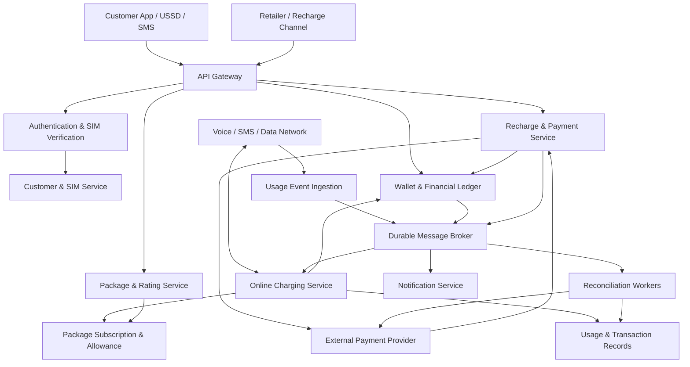
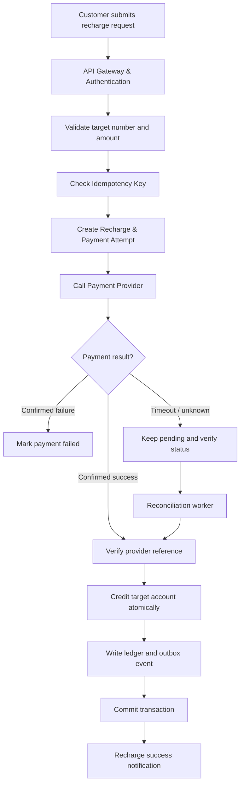
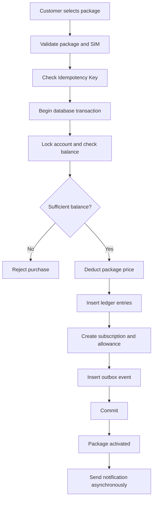
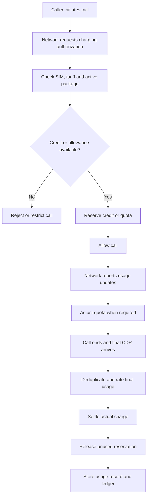
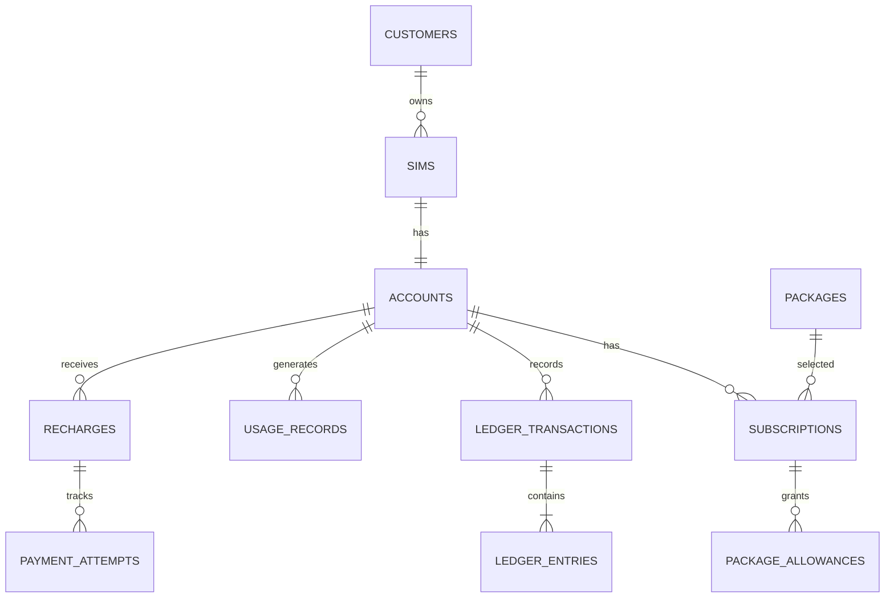
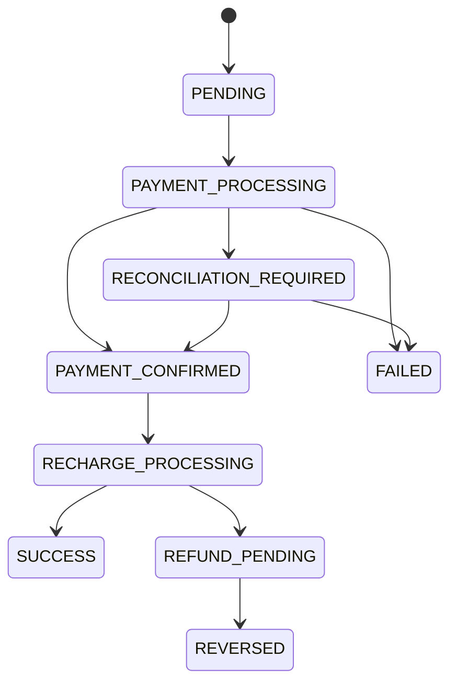
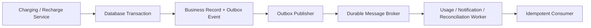

# Problem: Telecom Operator System — Grameenphone / Robi / Airtel / Teletalk

**System Design for Junior Software Engineer Interview (Easy–Medium)**

## 1. Problem Statement

ধরো, আমরা বাংলাদেশের Grameenphone, Robi, Airtel বা Teletalk-এর মতো একটি Telecom Operator System তৈরি করব। আমাদের কাল্পনিক operator-এর নাম `BD Telecom`।

System-এ customer একটি SIM ব্যবহার করে:

- Voice call করতে পারবে এবং SMS পাঠাতে পারবে।
- Mobile internet ব্যবহার করতে পারবে।
- Main balance recharge করতে পারবে।
- Internet, minute এবং SMS package কিনতে পারবে।
- নিজের balance, active package, usage history ও transaction history দেখতে পারবে।
- Package allowance শেষ হলে tariff policy অনুযায়ী main balance থেকে charge দিতে পারবে।

ধরি, system-এ কোটি কোটি customer আছে এবং প্রতিদিন অনেক call, SMS, data usage ও recharge event তৈরি হয়।

### প্রধান সমস্যা

**Problem 1: Concurrent Balance Deduction**

একজন customer-এর balance ৳100। একই সময়ে দুটি request যথাক্রমে ৳70 ও ৳50 charge করতে চায়। সঠিক concurrency control না থাকলে দুইটি request-ই পুরোনো balance পড়ে ভুলভাবে charge করতে পারে।

**Problem 2: Duplicate Recharge**

Payment provider ৳100 গ্রহণ করেছে, কিন্তু response network timeout-এর কারণে app-এ পৌঁছায়নি। Customer আবার recharge request পাঠাল। Idempotency না থাকলে একই operation দুইবার process হতে পারে।

**Problem 3: Duplicate Usage Event**

একটি call-এর final CDR (Call Detail Record) network থেকে দুইবার এসেছে। System যদি দুইবার charge করে, customer-এর balance ভুল হবে।

**Problem 4: Package Allowance Management**

Customer-এর 100 মিনিটের package আছে। তিনি 20 মিনিট কথা বললে package policy অনুযায়ী allowance থেকে মিনিট কমবে। Allowance শেষ হলে প্রযোজ্য নিয়ম অনুযায়ী main balance charge হতে পারে অথবা call বন্ধ করতে হবে।

**Problem 5: External Provider Failure**

Payment সফল হলেও recharge service crash করতে পারে। System-কে বুঝতে হবে recharge সম্পন্ন হয়েছে কি না, আবার charge করা নিরাপদ কি না, এবং প্রয়োজন হলে কীভাবে reconciliation বা reversal হবে।

### Goal

একটি reliable, secure ও scalable system design করা, যেখানে:

- Balance ও package allowance ভুলভাবে update হবে না।
- Duplicate request থেকে double charging হবে না।
- Call, SMS ও data usage সঠিকভাবে record হবে।
- Payment বা network failure হলেও transaction-এর অবস্থা recover করা যাবে।
- প্রতিটি financial operation audit করা যাবে।

---

## 2. Functional Requirements

1. Customer ও SIM management।
2. Main balance ও bonus balance management।
3. Recharge এবং recharge history।
4. Internet, minute ও SMS package catalog।
5. Package purchase ও subscription management।
6. Active package allowance tracking।
7. Voice call authorization ও final usage settlement।
8. SMS ও internet data charging।
9. Customer-এর transaction এবং usage history।
10. Payment provider callback handling।
11. Notification, reconciliation ও audit logging।

## 3. Non-Functional Requirements

- **Consistency:** একই balance একাধিক request-এর কারণে ভুলভাবে কমবে না।
- **Availability:** অপ্রয়োজনীয় service failure যেন charging ও customer-facing system-কে প্রভাবিত না করে।
- **Low latency:** Call ও data usage authorization দ্রুত হতে হবে।
- **Scalability:** বেশি customer ও usage event সামলাতে হবে।
- **Reliability:** Duplicate event, timeout ও retry নিরাপদে handle করতে হবে।
- **Security:** Customer account, SIM identity ও financial operation সুরক্ষিত রাখতে হবে।
- **Auditability:** প্রতিটি balance change-এর কারণ ও history সংরক্ষিত থাকবে।

**Interview assumption:** আমরা মূলত prepaid telecom system design করছি। Postpaid billing, roaming settlement এবং সম্পূর্ণ telecom core network-এর বিস্তারিত scope-এর বাইরে থাকবে।

---

## 4. High-Level Architecture

### Architecture Diagram



### Components-এর কাজ

| Component | Responsibility |
|---|---|
| API Gateway | Request routing, authentication enforcement, rate limiting |
| Authentication & SIM | Login, customer identity এবং SIM verification |
| Customer & SIM Service | Customer profile, MSISDN ও SIM status |
| Package & Rating Service | Package catalog, tariff ও charging rules |
| Recharge & Payment Service | Recharge lifecycle এবং external payment integration |
| Online Charging Service | Call/data/SMS-এর জন্য balance ও allowance authorization |
| Usage Event Ingestion | Network usage events ও CDR গ্রহণ |
| Message Broker | Durable event delivery এবং asynchronous processing |
| Wallet & Financial Ledger | Main balance, bonus balance ও financial history |
| Subscription Service | Active package, expiry এবং remaining allowance |
| Reconciliation Workers | Provider records, usage records ও ledger মিলিয়ে দেখা |
| Notification Service | Recharge ও package confirmation পাঠানো |

### কোন technology ব্যবহার করব?

| Layer | Suggested technology |
|---|---|
| Frontend | React / Next.js |
| Backend | Node.js + Express |
| Primary database | PostgreSQL |
| Message broker | Kafka বা সমমানের durable broker |
| Cache | Redis |
| Background processing | Worker services |
| Monitoring | Centralized logs, metrics ও distributed tracing |

**Junior interview-এর জন্য গুরুত্বপূর্ণ:** প্রথমেই সব service আলাদা microservice হিসেবে implement করা বাধ্যতামূলক নয়। ছোট system-এ modular monolith দিয়ে শুরু করা যায়। Traffic ও team ownership বাড়লে প্রয়োজনীয় component আলাদা service-এ নেওয়া যায়।

বাস্তব telecom network-এ voice/data charging সাধারণ REST API-নির্ভর হয় না; network-integrated charging interface ও quota-based authorization প্রয়োজন হতে পারে। এখানে application-level design সহজ করে দেখানো হয়েছে।

---

## 5. Main User Flows

### Flow A: Customer Recharge



**Step-by-step:**

1. Customer amount ও target mobile number দিয়ে recharge request পাঠায়।
2. API Gateway authentication ও request validation করে।
3. Server একই `Idempotency-Key` আগে ব্যবহার হয়েছে কি না পরীক্ষা করে।
4. Database-এ recharge এবং payment attempt তৈরি হয়।
5. Payment provider-এর কাছে payment initiate করা হয়।
6. Provider-এর callback বা status API থেকে payment result যাচাই করা হয়।
7. Payment নিশ্চিতভাবে successful হলে target account-এ recharge credit করা হয়।
8. Balance update, ledger entry এবং idempotency record একই database transaction-এ commit হয়।
9. Notification asynchronousভাবে পাঠানো হয়।

**গুরুত্বপূর্ণ:** Payment provider timeout করলে payment ব্যর্থ হয়েছে ধরে নেওয়া যাবে না। Result unknown থাকলে আগের payment attempt verify করতে হবে।

### Flow B: Package Purchase



**Step-by-step:**

1. Customer package নির্বাচন করে purchase request পাঠায়।
2. System package price, availability ও SIM status যাচাই করে।
3. একই request duplicate কি না পরীক্ষা করে।
4. Database transaction শুরু হয়।
5. Account row lock করে balance যাচাই করা হয়।
6. পর্যাপ্ত balance থাকলে package price deduct করা হয়।
7. Ledger entry, subscription এবং package allowance তৈরি হয়।
8. Outbox event তৈরি করে transaction commit করা হয়।
9. Package activation নিশ্চিত হওয়ার পর customer-কে notification পাঠানো হয়।

Wallet ও subscription একই database-এ থাকলে এই operation একটি ACID transaction-এ করা যায়। আলাদা database হলে reserve/confirm/compensate-ভিত্তিক workflow প্রয়োজন হতে পারে।

### Flow C: Voice Call Charging



**ব্যাখ্যা:**

1. Call শুরু হওয়ার আগে network charging authorization চায়।
2. System SIM/account status, tariff এবং active package যাচাই করে।
3. প্রয়োজনীয় credit বা allowance reserve করা হয়।
4. Network call চালু রাখে; quota শেষ হলে নতুন authorization চাইতে পারে।
5. Call শেষে final CDR আসে।
6. Actual duration ও tariff অনুযায়ী final charge হিসাব করা হয়।
7. Reserved amount-এর সঙ্গে actual charge সমন্বয় করে unused reservation release করা হয়।
8. Usage record ও financial ledger সংরক্ষণ করা হয়।

Prepaid charging-এ শুধু call শেষ হওয়ার পর charge করলে customer balance-এর চেয়ে বেশি usage করে ফেলতে পারে। তাই authorization এবং quota reservation গুরুত্বপূর্ণ।

### Flow D: SMS ও Internet Data

**SMS charging:**

1. Sender-এর SIM ও entitlement যাচাই।
2. SMS package allowance থাকলে policy অনুযায়ী সেখান থেকে deduction।
3. Allowance না থাকলে tariff অনুযায়ী main balance charge।
4. SMSC-এর submission/delivery status track করা।
5. Duplicate usage event হলে দ্বিতীয়বার charge না করা।

**Internet data charging:**

1. Network data session ও usage volume report করে।
2. Active package এবং remaining data allowance যাচাই করা হয়।
3. Quota reserve বা allocate করে network-কে অনুমোদন দেওয়া হয়।
4. Usage update ও final record deduplicate করা হয়।
5. Package allowance থেকে usage deduct হয়; policy অনুযায়ী main balance charge হতে পারে।
6. Allowance শেষ হলে policy অনুযায়ী throttling, additional charging বা session restriction হয়।

প্রতিটি network packet-এর জন্য application-level REST request না করে quota-based charging ব্যবহার করা উপযুক্ত।

---

## 6. REST API Design

| Method | Endpoint | Purpose |
|---|---|---|
| `GET` | `/v1/customers/me` | নিজের customer profile |
| `GET` | `/v1/accounts/me/balance` | Main ও bonus balance |
| `GET` | `/v1/packages` | Available packages |
| `POST` | `/v1/package-purchases` | Package purchase |
| `GET` | `/v1/package-purchases/:id` | Purchase status |
| `POST` | `/v1/recharges` | Recharge request |
| `GET` | `/v1/recharges/:id` | Recharge status |
| `GET` | `/v1/accounts/me/transactions` | Transaction history |
| `GET` | `/v1/accounts/me/usage` | Call, SMS ও data history |
| `POST` | `/internal/charging/authorize` | Network charging authorization |
| `POST` | `/internal/charging/settlements` | Usage settlement |
| `POST` | `/internal/usage-events` | Usage event ingestion |
| `POST` | `/v1/payments/webhooks/:provider` | Payment provider callback |

Internal charging endpoint-গুলো public customer endpoint থেকে আলাদা access control এবং network/service authentication ব্যবহার করবে।

### Recharge Request Example

```http
POST /v1/recharges
Authorization: Bearer <access_token>
Idempotency-Key: recharge-unique-123
Content-Type: application/json
```

```json
{
  "targetMsisdn": "88017XXXXXXXX",
  "amountPaisa": 10000,
  "paymentMethod": "MOBILE_BANKING"
}
```

এখানে `10000` পয়সা মানে ৳100।

### Response

```json
{
  "rechargeId": "rch_123",
  "status": "PENDING",
  "amountPaisa": 10000
}
```

`PENDING` মানে recharge successful নয়; operation এখনো process হচ্ছে বা result নিশ্চিত হয়নি।

---

## 7. Database Schema

প্রাথমিক design-এর জন্য PostgreSQL ব্যবহার করব।

### 7.1 `customers`

| Column | Description |
|---|---|
| `id` | Primary key |
| `name` | Customer name |
| `created_at` | Creation time |

### 7.2 `sims`

| Column | Description |
|---|---|
| `id` | Primary key |
| `customer_id` | FK → customers |
| `msisdn` | Unique mobile number |
| `imsi` | SIM/network identifier |
| `status` | Active, blocked, suspended |

### 7.3 `accounts`

| Column | Description |
|---|---|
| `id` | Primary key |
| `sim_id` | FK → sims |
| `main_balance_paisa` | Main balance |
| `bonus_balance_paisa` | Bonus balance |
| `version` | Optimistic locking version |

### 7.4 `packages`

`id`, `name`, `price_paisa`, `validity_seconds`, `status`

### 7.5 `subscriptions`

`id`, `account_id`, `package_id`, `starts_at`, `expires_at`, `status`

### 7.6 `package_allowances`

`id`, `subscription_id`, `allowance_type`, `granted_units`, `remaining_units`

`allowance_type` হতে পারে `DATA_MB`, `VOICE_SECONDS` অথবা `SMS_COUNT`।

### 7.7 `ledger_transactions`

`id`, `account_id`, `type`, `status`, `idempotency_key`, `created_at`

### 7.8 `ledger_entries`

`id`, `transaction_id`, `account_id`, `balance_type`, `amount_paisa`, `entry_type`, `created_at`

Financial entry append-only হবে। Correction প্রয়োজন হলে original entry delete না করে reversal বা compensating entry তৈরি করতে হবে।

### 7.9 `usage_records`

`id`, `event_id`, `account_id`, `usage_type`, `quantity`, `rated_amount_paisa`, `status`, `event_time`

`event_id` unique হতে হবে, যাতে একই event পুনরায় process করে double charging না হয়।

### 7.10 `recharges` এবং `payment_attempts`

Recharge request, target account, amount, payment status, provider reference, callback reference ও timestamps সংরক্ষণ করবে।

### 7.11 Supporting tables

- `outbox_events` — database commit-এর সঙ্গে event publish করার record।
- `inbox_events` — consumed event deduplication।
- `audit_logs` — sensitive action history।
- `notifications` — notification delivery status।

### ER Diagram



### Database rules

- Money integer minor units-এ রাখব, যেমন পয়সা; floating-point নয়।
- Balance non-negative রাখার business rule enforce করতে হবে।
- `msisdn`, provider reference, usage event ID এবং idempotency key-এর প্রয়োজনীয় uniqueness constraint থাকবে।
- Transaction ও ledger-এর সম্পর্ক consistent রাখতে হবে।
- High-volume usage table event time অনুযায়ী partition করা যেতে পারে।

---

## 8. ACID Properties

Telecom system-এ ACID-এর মূল লক্ষ্য হলো financial correctness বজায় রাখা।

| Property | অর্থ | Example |
|---|---|---|
| Atomicity | সব পরিবর্তন commit হবে, নয়তো কিছুই হবে না | Balance deduct হয়েছে কিন্তু ledger insert হয়নি—এমন অবস্থা হবে না |
| Consistency | Business rules ও database invariants বজায় থাকবে | অনুমোদিত সীমার বাইরে balance খরচ হবে না |
| Isolation | Concurrent transaction একে অপরের state নষ্ট করবে না | দুটি request একই পুরোনো balance ব্যবহার করে overspend করতে পারবে না |
| Durability | Commit হওয়া data recovery-যোগ্য থাকবে | Database restart হলেও committed recharge record হারানো যাবে না |

### Example: ৳30 Call Charge

ধরি, account-এর main balance ৳100 এবং call charge ৳30।

```sql
BEGIN;

SELECT id, main_balance_paisa
FROM accounts
WHERE id = :account_id
FOR UPDATE;

UPDATE accounts
SET main_balance_paisa = main_balance_paisa - 3000
WHERE id = :account_id
  AND main_balance_paisa >= 3000;

-- Application must verify exactly one row was updated.

INSERT INTO ledger_transactions (...);

INSERT INTO ledger_entries (...);

COMMIT;
```

সব financial update, ledger entry এবং usage event-এর uniqueness check একই transaction boundary-তে রাখতে হবে।

যদি ledger insert ব্যর্থ হয়, পুরো transaction rollback হবে; balance deduction-ও commit হবে না।

**Important:** Database ACID external payment provider বা telecom network-এর সঙ্গে স্বয়ংক্রিয়ভাবে distributed atomicity নিশ্চিত করে না। External operation-এর জন্য state machine, idempotency, retry ও reconciliation দরকার।

---

## 9. Concurrency Control

ধরি, customer-এর balance ৳100।

- Request A: ৳70 charge করতে চায়।
- Request B: ৳50 charge করতে চায়।

দুটি request একই balance পড়ে independently deduction করলে মোট ৳120 charge হওয়ার ঝুঁকি আছে।

### Solution 1: Row-level locking

```sql
BEGIN;

SELECT main_balance_paisa
FROM accounts
WHERE id = :account_id
FOR UPDATE;

-- Recheck balance inside the transaction.

UPDATE accounts
SET main_balance_paisa = main_balance_paisa - :charge
WHERE id = :account_id
  AND main_balance_paisa >= :charge;

COMMIT;
```

`FOR UPDATE` একই account row-এ competing transaction-কে serialize করে। Balance পুনরায় যাচাই করতে হবে।

### Solution 2: Atomic conditional update

```sql
UPDATE accounts
SET main_balance_paisa = main_balance_paisa - :charge
WHERE id = :account_id
  AND main_balance_paisa >= :charge
RETURNING main_balance_paisa;
```

কোনো row return না হলে charge reject করতে হবে। Ledger ও idempotency record-ও একই transaction-এ লিখতে হবে।

### Result

৳70 charge সফল হলে balance হবে ৳30। এরপর ৳50 charge-এর request reject হবে।

High-volume telecom charging-এর ক্ষেত্রে quota reservation এবং controlled allocation ব্যবহার করা যেতে পারে। তবে সব reservation মিলিয়ে authorized credit যেন policy limit অতিক্রম না করে।

---

## 10. Idempotency ও Duplicate Event Prevention

Idempotency-এর অর্থ হলো একই logical request retry হলেও operation একবারের বেশি কার্যকর হবে না।

### Example: Duplicate Recharge

Customer একই recharge request তিনবার পাঠিয়েছে। System একই logical recharge-ই process করবে।

```sql
CREATE UNIQUE INDEX uq_ledger_idempotency
ON ledger_transactions(account_id, idempotency_key);
```

Request handling:

1. Idempotency key ও request payload সংরক্ষণ।
2. একই key এবং একই payload হলে আগের result ফেরত দেওয়া।
3. একই key কিন্তু আলাদা amount বা target হলে conflict ফেরত দেওয়া।
4. নতুন key হলে operation শুরু করা।
5. Financial result ও idempotency record atomicভাবে commit করা।

### Duplicate usage event

```sql
INSERT INTO usage_records (
    event_id,
    account_id,
    usage_type,
    quantity,
    status
)
VALUES (
    :event_id,
    :account_id,
    :usage_type,
    :quantity,
    'RECEIVED'
)
ON CONFLICT (event_id) DO NOTHING;
```

তবে শুধু insert করলেই হবে না। একই database transaction-এ event-টি নতুন কি না যাচাই করে নতুন event হলে তবেই charge করতে হবে।

**অতিরিক্ত বিষয়:** একই call-এর interim usage update এবং final CDR-এর ID আলাদা হতে পারে। তাই session ID, sequence number, record version ও final-record indicator ব্যবহার করে duplicate settlement ঠেকাতে হবে।

---

## 11. Transaction State Management

### Recharge lifecycle



প্রতিটি state transition-এর validation ও allowed transition নির্দিষ্ট থাকতে হবে।

- `PENDING`: operation শুরু হয়েছে, final result জানা নেই।
- `PAYMENT_CONFIRMED`: Provider payment success নিশ্চিত করেছে।
- `RECHARGE_PROCESSING`: Account credit/recharge activation process চলছে।
- `SUCCESS`: Recharge সম্পন্ন।
- `FAILED`: Operation ব্যর্থ বলে নিশ্চিত।
- `RECONCILIATION_REQUIRED`: Result যাচাই করা দরকার।
- `REFUND_PENDING`: Refund বা reversal processing চলছে।
- `REVERSED`: Compensation সম্পন্ন হয়েছে।

`FAILED` এবং `PENDING` এক জিনিস নয়। Timeout মানেই failure নয়।

---

## 12. Package Allowance ও Main Balance

ধরি, customer-এর active package-এ 100 মিনিট আছে এবং তিনি 20 মিনিট কথা বলেছেন।

| Item | Before | Usage | After |
|---|---:|---:|---:|
| Package minutes | 100 | 20 | 80 |
| Main balance | ৳100 | ৳0, যদি package-এ অন্তর্ভুক্ত থাকে | ৳100 |

যদি package allowance শেষ হয়ে যায়, tariff অনুযায়ী main balance থেকে charge হতে পারে।

System-কে যাচাই করতে হবে:

1. Subscription active কি না।
2. Package expiry হয়েছে কি না।
3. Allowance যথেষ্ট কি না।
4. Applicable tariff version কোনটি।
5. Usage event ইতিমধ্যে process হয়েছে কি না।
6. Package ও main balance deduction একই usage-এর জন্য duplicate হচ্ছে কি না।

Allowance update ও main balance charge একই transaction-এ করা সম্ভব হলে একই transaction-এ করতে হবে। Distributed service হলে workflow consistency আলাদাভাবে design করতে হবে।

---

## 13. Message Queue ও Transactional Outbox

Usage event, notification এবং reconciliation-এর মতো কাজ asynchronousভাবে করা যায়।



### কেন Outbox?

যদি database commit সফল হয় কিন্তু event publish ব্যর্থ হয়, তাহলে notification বা reconciliation event হারিয়ে যেতে পারে।

Outbox pattern-এ business record ও outbox record একই database transaction-এ commit হয়। Publisher পরে event broker-এ পাঠায়।

Consumer-এর কাজও idempotent হতে হবে, কারণ message retry বা duplicate delivery হতে পারে।

**Interview point:** Message broker ব্যবহার করলেই exactly-once financial effect নিশ্চিত হয় না। Database uniqueness, idempotent consumer এবং reconciliation দরকার।

---

## 14. Failure Scenarios ও Recovery

| Failure | Expected behavior |
|---|---|
| Insufficient balance | Charge reject হবে |
| Two concurrent charges | Lock/conditional update overspending আটকাবে |
| Duplicate recharge request | একই idempotency key-এর result ফেরত দেওয়া হবে |
| Duplicate call CDR | Event ID/session version দিয়ে deduplicate হবে |
| Payment timeout | Recharge pending থাকবে; provider status যাচাই হবে |
| Payment successful, recharge service crash | Recovery worker operation resume বা reconcile করবে |
| Duplicate payment callback | Callback reference ও transaction state দিয়ে deduplicate হবে |
| Ledger insert fails | Database transaction rollback হবে |
| Notification service down | Financial transaction অপরিবর্তিত থাকবে; notification retry হবে |
| Message broker unavailable | Durable ingress/spool বা backpressure; event নিরাপদে persist না হলে success acknowledgement দেওয়া যাবে না |
| Charging database unavailable | Authoritative balance যাচাই করা না গেলে policy অনুযায়ী charge reject বা service limit করতে হবে |
| Package expired | Allowance ব্যবহার করা যাবে না |
| Late final CDR | Event version ও settlement state যাচাই করে process হবে |
| Payment success কিন্তু recharge permanently fails | Provider verification ও policy অনুযায়ী refund/reversal |
| Ledger ও balance mismatch | Alert, investigation এবং audited correction workflow |

### Reconciliation

Scheduled worker নিচের data মিলিয়ে দেখবে:

- Payment provider transaction records
- Internal recharge status
- Account balance ও ledger entries
- Usage records ও rated charges
- Package subscription এবং allowance

Mismatch পাওয়া গেলে alert ও investigation হবে। Original financial entry delete করে history গোপন করা যাবে না; correction audited compensating entry দিয়ে করতে হবে।

---

## 15. Security Design

- HTTPS/TLS ব্যবহার।
- Customer authentication ও SIM/account verification।
- Role-based access control।
- Rate limiting এবং schema validation।
- Payment callback signature verification।
- Provider reference ও callback event-এর uniqueness।
- SIM replacement বা account recovery-এর পরে high-risk transaction-এ অতিরিক্ত verification।
- Sensitive identifiers encryption/tokenization।
- Secrets management এবং restricted database permissions।
- Audit log-এ actor, transaction ID, timestamp ও action রাখা।
- OTP, password, access token ও payment secret log না করা।

একটি mobile number জানা মানেই customer authenticated—এমন ধরে নেওয়া যাবে না।

---

## 16. Scalability ও Availability

### Scalability

1. API Gateway ও stateless application horizontally scale করা।
2. Usage event-কে broker partition-এ ভাগ করে parallel processing করা।
3. High-volume usage table partition করা।
4. Transaction history-তে pagination ও suitable indexes ব্যবহার।
5. Historical CDR ও analytics-কে online charging database থেকে আলাদা রাখা।
6. Package catalog cache করা, কিন্তু charging-এর সময় সঠিক tariff version নিশ্চিত করা।
7. Background worker দিয়ে notification ও reconciliation process করা।
8. High-contention account-এর ক্ষেত্রে safe quota reservation ব্যবহার করা।

### Availability ও consistency

Balance charging-এর ক্ষেত্রে stale cache বা read replica থেকে পাওয়া balance-কে একমাত্র authority হিসেবে ব্যবহার করা যাবে না। Financial decision authoritative transactional state-এর ভিত্তিতে নিতে হবে।

Notification বা analytics down হলেও committed financial transaction যেন অকারণে ব্যর্থ না হয়। কিন্তু authoritative balance নিরাপদে যাচাই বা update করা সম্ভব না হলে system-কে ভুল charge অনুমোদন করা উচিত নয়।

### Monitoring

- Charging authorization latency ও failure rate
- Usage event processing lag
- Duplicate event count
- Pending recharge-এর বয়স
- Payment callback delay
- Database lock wait ও rollback rate
- Broker lag ও dead-letter queue size
- Ledger reconciliation mismatch
- Package activation failure

---

## 17. Testing Strategy

Junior interview-এ অন্তত নিচের test case-গুলো উল্লেখ করবে।

1. Successful recharge।
2. Successful package purchase।
3. Insufficient balance।
4. Same idempotency key দিয়ে duplicate request।
5. Same key, different payload।
6. Concurrent balance deduction।
7. Duplicate final CDR।
8. Interim usage update-এর পরে final CDR।
9. Payment provider timeout।
10. Payment successful কিন্তু recharge activation delayed।
11. Duplicate বা invalid provider callback।
12. Database rollback।
13. Expired package allowance।
14. Notification retry।
15. Ledger ও balance reconciliation।

---

## 18. Implementation Plan

Junior-level project হলে ধাপে ধাপে implement করা ভালো।

**Phase 1 — Core application**

- Customer ও SIM management
- Account balance
- Package catalog
- Recharge ও package purchase
- PostgreSQL schema
- Basic REST APIs

**Phase 2 — Financial correctness**

- ACID transactions
- Row-level locking বা atomic conditional updates
- Idempotency keys
- Append-only ledger
- Transaction history

**Phase 3 — Reliable processing**

- Payment provider integration
- Callback verification
- Transactional outbox
- Background workers
- Retry ও reconciliation

**Phase 4 — Telecom usage**

- Voice/SMS/data usage records
- Package allowance deduction
- CDR deduplication
- Quota reservation ও settlement

**Phase 5 — Production readiness**

- Security hardening
- Monitoring ও alerting
- Load/concurrency testing
- Database backup ও recovery
- High-volume event processing

---

## 19. Interview-এ কীভাবে Explain করবে?

**English interview answer:**

“I would design a telecom operator application supporting prepaid balance, recharge, package purchases, and call, SMS, and data usage tracking. The main challenges are financial consistency, concurrent balance deductions, duplicate usage events, and external payment failures.

I would use React or Next.js for the frontend, Node.js and Express for application APIs, PostgreSQL for transactional data, and a durable message broker for asynchronous usage processing and notifications.

For financial operations, I would use ACID transactions, row-level locking or atomic conditional updates, idempotency keys, and an append-only ledger. For usage events, I would deduplicate records using unique event identifiers and handle final CDR settlement carefully.

For payment provider timeouts, I would keep the operation pending until its outcome is verified. I would use an outbox pattern, retry workers, and reconciliation to recover from failures. Finally, I would secure the APIs, monitor charging latency and mismatches, and scale the stateless application and event-processing workers independently.”

---

## 20. Follow-up Questions for Practice

1. Balance ৳100 হলে একই সময়ে ৳70 ও ৳50 charge এলে কী হবে?
2. Payment provider successful response পাঠালেও recharge service crash করলে কী করবে?
3. একই CDR দুইবার এলে কীভাবে double charging ঠেকাবে?
4. Kafka বা অন্য message broker কি নিজে exactly-once financial transaction নিশ্চিত করে?
5. Package allowance ও main balance কীভাবে synchronize করবে?
6. Database unavailable হলে prepaid call authorization কীভাবে handle করবে?
7. Wallet ও package service আলাদা database ব্যবহার করলে কীভাবে consistency বজায় রাখবে?
8. Timeout-এর পরে কেন সরাসরি নতুন recharge তৈরি করা উচিত নয়?
9. Outbox pattern কেন দরকার?
10. ACID transaction external payment provider-কে অন্তর্ভুক্ত করতে পারে কি?

## Final Checklist

- [ ] Problem statement ও requirements
- [ ] High-level architecture
- [ ] Recharge flow
- [ ] Package purchase flow
- [ ] Voice/SMS/data charging
- [ ] REST API design
- [ ] Database schema ও relationships
- [ ] ACID properties
- [ ] Concurrency control
- [ ] Idempotency ও duplicate event handling
- [ ] Transaction states ও recovery
- [ ] Message broker ও outbox
- [ ] Failure handling ও reconciliation
- [ ] Security, scalability ও monitoring

**সবচেয়ে গুরুত্বপূর্ণ তিনটি বিষয়:** Financial correctness-এর জন্য ACID ও ledger, duplicate operation ঠেকাতে idempotency এবং reliable recovery-এর জন্য outbox, retry ও reconciliation। বাস্তব telecom charging-এর ক্ষেত্রে network-integrated authorization এবং quota reservation-ও গুরুত্বপূর্ণ।
