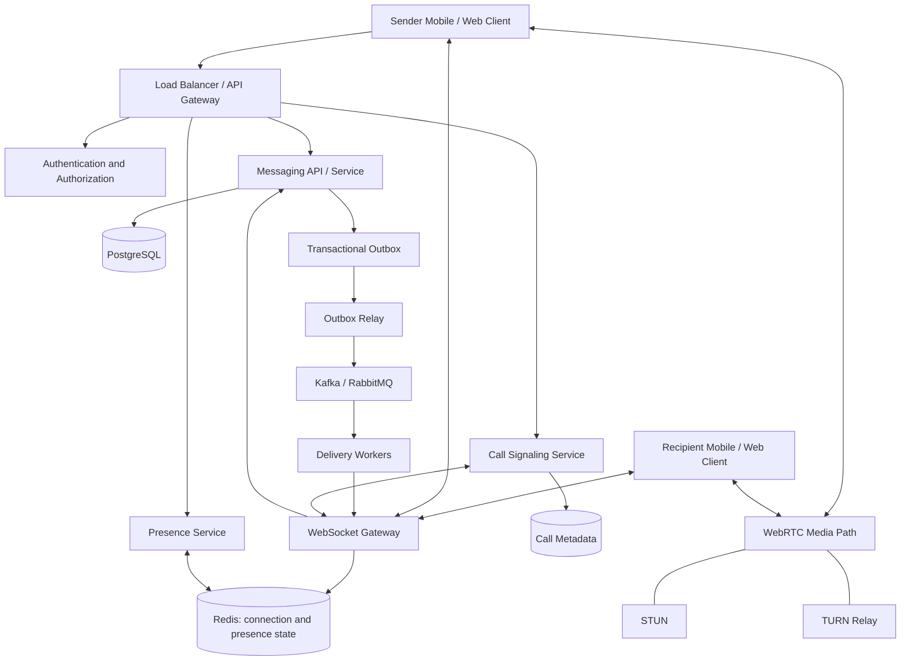
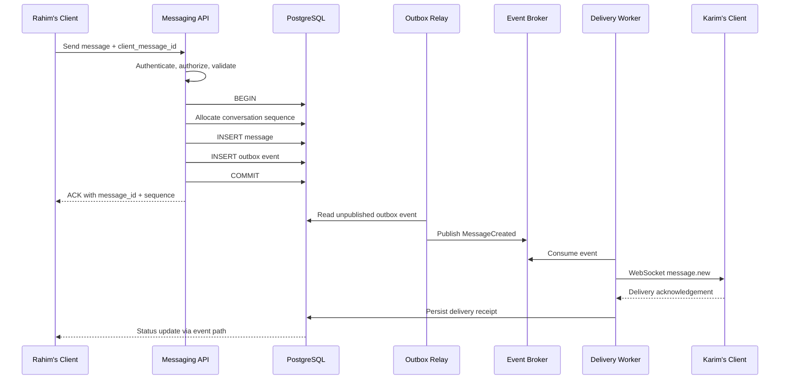
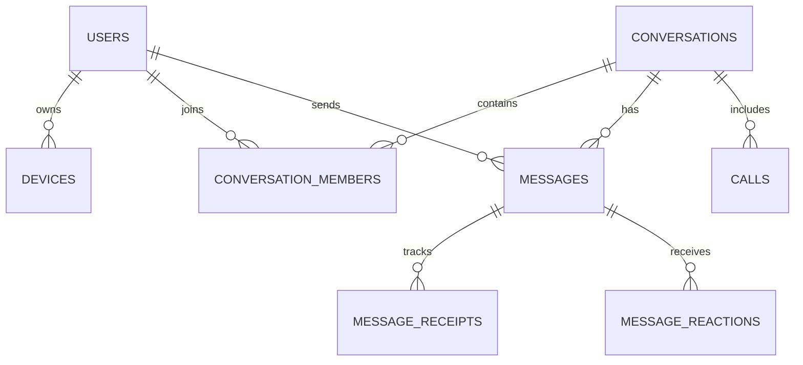
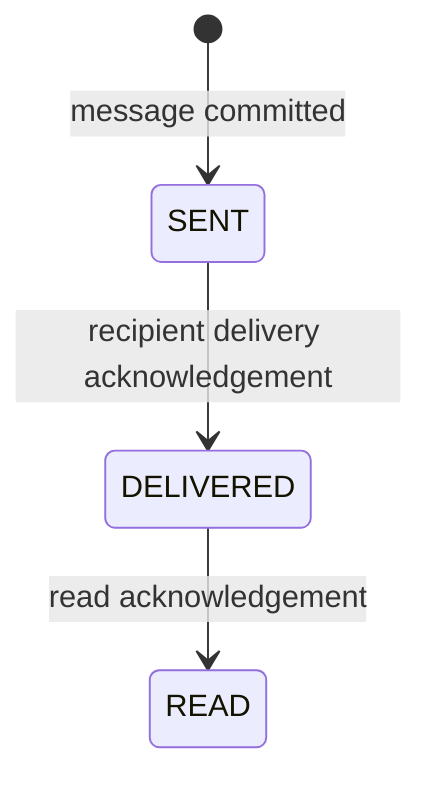
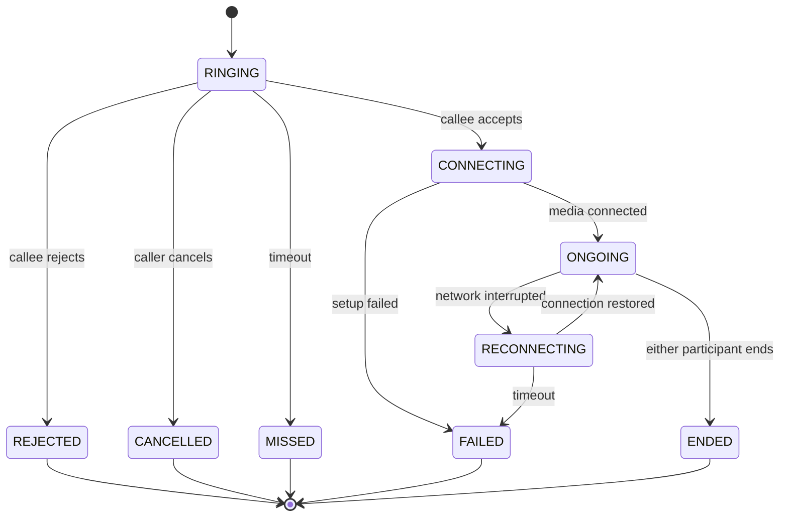

# WhatsApp-Like One-to-One Messaging System
## System Design, Architecture, Data Model, Reliability, Security, and Interview Q&A

> **Scope:** This document presents a production-oriented design for a WhatsApp-like one-to-one messaging application. It covers text messaging, message status, reactions, replies, forwarding, editing/deletion, presence, multi-device synchronization, and audio/video calls.
>
> **Important:** This is a proposed system design based on common distributed-systems practices. It does not claim to describe WhatsApp's private internal implementation.

---

## Contents

1. [Problem Statement](#1-problem-statement)
2. [Requirements and Scope](#2-requirements-and-scope)
3. [High-Level Architecture](#3-high-level-architecture)
4. [Core Request Flows](#4-core-request-flows)
5. [Database Design](#5-database-design)
6. [Message Ordering, Idempotency, and Delivery Semantics](#6-message-ordering-idempotency-and-delivery-semantics)
7. [ACID and Transaction Boundaries](#7-acid-and-transaction-boundaries)
8. [Message Status and Multi-Device Semantics](#8-message-status-and-multi-device-semantics)
9. [REST API and WebSocket Protocol](#9-rest-api-and-websocket-protocol)
10. [Offline Delivery and Reconnection](#10-offline-delivery-and-reconnection)
11. [Reactions, Replies, Forwarding, Editing, and Deletion](#11-reactions-replies-forwarding-editing-and-deletion)
12. [Audio/Video Calling](#12-audiovideo-calling)
13. [Security and End-to-End Encryption](#13-security-and-end-to-end-encryption)
14. [Scaling, Performance, and Capacity Planning](#14-scaling-performance-and-capacity-planning)
15. [Failure Scenarios and Observability](#15-failure-scenarios-and-observability)
16. [Testing Strategy](#16-testing-strategy)
17. [Implementation Roadmap](#17-implementation-roadmap)
18. [Interview Preparation: Questions and Answers](#18-interview-preparation-questions-and-answers)
19. [A 2-Minute Interview Summary](#19-a-2-minute-interview-summary)
20. [Glossary](#20-glossary)

---

## 1. Problem Statement

Design a real-time, one-to-one messaging system where users can:

- Send and receive text messages.
- See sent, delivered, and read status.
- React to messages.
- Reply to and forward messages.
- Edit or delete messages according to product rules.
- See online/offline presence and last-seen information where permitted.
- Make audio and video calls.
- Receive messages while online and retrieve missed messages after reconnecting.
- Synchronize conversations across multiple devices.

The system should be secure, reliable, low-latency, and scalable. It must tolerate network failures, duplicate requests, offline recipients, worker crashes, and concurrent actions.

### Design principle

**Persist first, acknowledge accurately, deliver asynchronously, and make retries safe.**

This principle drives the message transaction, outbox pattern, idempotency, and reconnection design.

---

## 2. Requirements and Scope

### 2.1 Functional requirements

1. Authenticate users and registered devices.
2. Create or find a one-to-one conversation.
3. Send, receive, and retrieve message history.
4. Preserve message ordering within a conversation.
5. Track message delivery and read status.
6. Add and remove reactions.
7. Reply to and forward messages.
8. Edit or delete messages under defined policies.
9. Show online/offline presence and last-seen data according to privacy settings.
10. Initiate, accept, reject, cancel, reconnect, and end audio/video calls.
11. Deliver messages to offline users when they reconnect.
12. Synchronize state across the user's devices.
13. Prevent unauthorized access to messages, conversations, and calls.

### 2.2 Non-functional requirements

| Requirement | Design target / approach |
|---|---|
| Reliability | Persist messages before confirming successful send. |
| Latency | Use WebSocket for real-time updates; keep synchronous transactions short. |
| Consistency | Define ordering and monotonic status rules. |
| Scalability | Scale API, WebSocket gateways, and workers independently when needed. |
| Availability | Retry transient failures and recover from durable state. |
| Security | Authentication, per-conversation authorization, TLS, rate limits. |
| Privacy | Minimize presence data; consider E2EE for message content. |
| Maintainability | Clear service boundaries, metrics, tracing, and automated tests. |

### 2.3 Explicitly define product semantics

Before coding, clarify these questions:

- Does “delivered” mean delivered to one device or all recipient devices?
- Does “read” mean read on any device or acknowledged by the user's account?
- Can a user edit a message indefinitely, or only for a time window?
- Does “delete for everyone” leave a tombstone?
- Should presence be exact, approximate, or hidden by privacy settings?
- Are messages end-to-end encrypted?
- Are media attachments included in the first version?
- Is message history synchronized across every registered device?

These are product decisions, not merely implementation details.

---

## 3. High-Level Architecture



### 3.1 Component responsibilities

| Component | Responsibility | Durable source of truth? |
|---|---|---|
| API Gateway | Routing, request limits, TLS termination, common middleware | No |
| Authentication | Identity and token validation | Identity provider / user store |
| Messaging Service | Authorization, message writes, history, edits, deletion | Uses PostgreSQL |
| WebSocket Gateway | Long-lived client connections and real-time event transport | No |
| PostgreSQL | Messages, conversations, memberships, receipts, reactions, outbox | **Yes, for persisted application state** |
| Transactional Outbox | Records events atomically with database writes | Yes, until published/retained |
| Kafka / RabbitMQ | Asynchronous event distribution | Depends on broker durability/configuration; not the canonical message store here |
| Delivery Workers | Deliver events, retry, push notifications | Worker state should be recoverable |
| Redis | Presence, ephemeral connection routing, caches, rate-limit counters | Usually no |
| Call Signaling Service | Call invitation and WebRTC signaling coordination | Call metadata may be durable; signaling messages may be transient |
| WebRTC + STUN/TURN | Audio/video transport and network traversal | Media is not stored in the messaging database by default |

### 3.2 Start simple, split when justified

For an MVP, a **modular monolith** can contain authentication, messaging, receipts, reactions, and call signaling as modules. PostgreSQL and a WebSocket layer may be enough for an early version.

Split into independent services when traffic, deployment independence, team ownership, or failure isolation justify the operational cost. Microservices do not automatically make a system faster.

---

## 4. Core Request Flows

### 4.1 Sending a message: first request to recipient delivery

Example: Rahim sends “Hello” to Karim.



**Step-by-step**

1. The client authenticates and opens a conversation.
2. The client generates a stable `client_message_id` for this logical message.
3. The request includes the conversation ID, client ID, message content, and optional reply reference.
4. The backend checks that the sender belongs to the conversation.
5. The backend validates payload size, content type, and referenced IDs.
6. A short database transaction allocates a conversation sequence number and inserts the message.
7. The same transaction inserts an outbox event.
8. PostgreSQL commits both records atomically.
9. Only after commit does the API acknowledge that the message was sent.
10. An outbox relay publishes the event to the broker.
11. A delivery worker routes the event to the recipient's active connection(s).
12. The recipient client acknowledges receipt; the server records the receipt.
13. When the recipient reads the message, the client sends a read acknowledgement.
14. The sender receives status updates.
15. If the recipient is offline, the message remains persisted and can be retrieved later.

### 4.2 What does “sent” mean?

Use precise definitions:

- **Sent:** the server has durably committed the message.
- **Delivered:** the recipient's defined delivery target has acknowledged the message.
- **Read:** the recipient has acknowledged reading the message according to product rules.

A WebSocket write alone is not proof that a device received or read a message.

### 4.3 Why not wait for delivery before acknowledging send?

Because the recipient may be offline or temporarily unreachable. The sender's message can be safely persisted even if delivery takes longer. The API should distinguish “persisted successfully” from “recipient delivered.”

---

## 5. Database Design

### 5.1 Core entities

| Table | Key fields | Purpose |
|---|---|---|
| `users` | `id`, `display_name`, `created_at` | User profile and account reference |
| `devices` | `id`, `user_id`, `device_token`, `last_seen_at` | Registered devices and sync metadata |
| `conversations` | `id`, `type`, `next_sequence`, `created_at` | Conversation metadata and sequence allocation |
| `conversation_members` | `conversation_id`, `user_id`, `joined_at` | Access-control membership |
| `messages` | `id`, `conversation_id`, `sender_id`, `client_message_id`, `sequence_no`, `body`, `message_type`, `reply_to_message_id`, `forwarded_from_message_id`, `created_at`, `edited_at`, `deleted_at` | Durable message history |
| `message_receipts` | `message_id`, `user_id`, `device_id`, `status`, `delivered_at`, `read_at` | Delivery/read state |
| `message_reactions` | `message_id`, `user_id`, `reaction`, `created_at` | Reactions |
| `message_outbox` | `id`, `aggregate_id`, `event_type`, `payload`, `created_at`, `published_at` | Reliable asynchronous event publication |
| `calls` | `id`, `conversation_id`, `caller_id`, `callee_id`, `status`, `started_at`, `ended_at` | Call metadata and lifecycle |
| `call_events` | `id`, `call_id`, `event_type`, `created_at` | Optional call audit/debug events |
| `processed_events` | `consumer_name`, `event_id`, `processed_at` | Optional deduplication record for consumers |

Presence is often ephemeral and can live in Redis with TTLs. If last-seen must survive restarts, persist a suitable timestamp separately.

### 5.2 ER diagram



The outbox is associated with domain changes through an aggregate/event identifier. It does not need to be modeled as a direct one-to-many foreign key from every message in every implementation.

### 5.3 Useful constraints and indexes

Illustrative PostgreSQL constraints:

```sql
-- Same sender retrying the same logical send cannot create a duplicate.
CREATE UNIQUE INDEX uq_messages_sender_client_id
ON messages (sender_id, client_message_id);

-- Sequence number is unique within a conversation.
CREATE UNIQUE INDEX uq_messages_conversation_sequence
ON messages (conversation_id, sequence_no);

-- One reaction of a given type per user per message.
CREATE UNIQUE INDEX uq_reactions_message_user_type
ON message_reactions (message_id, user_id, reaction);

-- A user joins a conversation only once.
CREATE UNIQUE INDEX uq_conversation_member
ON conversation_members (conversation_id, user_id);

-- Efficient chronological history retrieval.
CREATE INDEX idx_messages_conversation_sequence
ON messages (conversation_id, sequence_no DESC);

-- Efficient lookup of unpublished outbox events.
CREATE INDEX idx_outbox_unpublished
ON message_outbox (created_at)
WHERE published_at IS NULL;
```

**Important:** adapt indexes to the exact schema and query patterns. For example, if message IDs are globally unique and the client ID is only guaranteed unique per sender, the API must consistently use that scope for idempotency.

### 5.4 Message content and attachments

For text-only MVP, storing a bounded text body in `messages` may be adequate. For media:

1. Client requests an upload authorization or signed upload URL.
2. Client uploads the media to object storage.
3. Backend validates ownership, metadata, size, and content policy.
4. Message stores a media object reference and metadata—not a large binary blob.
5. Access to media is authorized and, if required, protected with short-lived signed URLs or encrypted content keys.

Do not put large media payloads into Kafka messages or ordinary relational message rows.

---

## 6. Message Ordering, Idempotency, and Delivery Semantics

### 6.1 Ordering

A conversation sequence number provides a stable ordering for messages in that conversation. One implementation maintains a counter on the conversation row and increments it in the same transaction as the message insert.

```sql
BEGIN;

UPDATE conversations
SET next_sequence = next_sequence + 1
WHERE id = :conversation_id
RETURNING next_sequence;

-- Insert message using the returned sequence number.
-- Insert the matching outbox event.

COMMIT;
```

Define the counter convention carefully: does `next_sequence` mean “next value to issue” or “last value issued”? Keep it consistent.

**Trade-off:** a single counter row can become a hot spot in an extremely active conversation. For one-to-one messaging this may be acceptable; at very high scale, ordering strategy must be evaluated against throughput and required semantics.

### 6.2 Idempotency

A network timeout does not tell the client whether the server committed the message.

Example:

1. Rahim sends message `client_message_id = abc`.
2. PostgreSQL commits the message.
3. The server's acknowledgement is lost.
4. Rahim retries with `client_message_id = abc`.
5. The unique constraint finds the existing message.
6. The API returns the existing result instead of creating a second message.

Idempotency must be implemented in the API/database, not merely by disabling the send button.

### 6.3 Delivery guarantees

Avoid saying “exactly once” across a database, broker, network, and recipient device. In distributed systems, retries and acknowledgements can produce duplicate delivery attempts.

A practical design uses:

- Durable message persistence.
- At-least-once event publication/delivery attempts.
- Stable message/event IDs.
- Idempotent consumers and client deduplication.
- Durable receipts and cursor-based recovery.

The goal is **effectively-once user-visible behavior** for operations that are idempotent, not magical exactly-once transport across every system.

### 6.4 Transactional outbox

Without an outbox, this sequence is unsafe:

1. Commit message to PostgreSQL.
2. Publish event to broker.

If the process crashes between these steps, the message exists but the event may never be published.

The outbox writes the message and event record in the same transaction. A relay publishes pending events and retries after failures. A crash after publish but before marking the event published can cause duplicate publication, so consumers must deduplicate.

---

## 7. ACID and Transaction Boundaries

| Property | Application |
|---|---|
| **Atomicity** | Message insert and outbox insert commit together or roll back together. |
| **Consistency** | Unique constraints and foreign keys preserve structural invariants; authorization and state-machine rules preserve business invariants. |
| **Isolation** | Sequence allocation uses an atomic row update or suitable locking. Complex invariants may need stronger isolation and transaction retries. |
| **Durability** | Send acknowledgement is returned only after a successful database commit. |

### What ACID does not cover

PostgreSQL cannot atomically commit a message, write to Redis, publish to Kafka, send a WebSocket frame, and establish a WebRTC call in one ordinary database transaction. Use outbox events, idempotency, retries, reconciliation, and explicit state transitions across these boundaries.

### Isolation-level guidance

- `READ COMMITTED` plus a correctly designed atomic update/locking protocol can be enough for simple sequence allocation.
- `SERIALIZABLE` may help enforce complex cross-row invariants but can abort transactions that must be retried.
- Do not select the strongest isolation level automatically; state the invariant, choose the simplest correct mechanism, and test concurrency.

---

## 8. Message Status and Multi-Device Semantics

### 8.1 Suggested status model



This is a conceptual monotonic model. A system may store delivery/read timestamps instead of one mutable status field.

### 8.2 Account-level versus device-level receipts

Suppose Karim uses a phone and a laptop. The system must define:

- **Per-device delivery:** track each device's acknowledgement independently.
- **Account-level delivery:** mark delivered when at least one eligible device acknowledges, or only after all required devices acknowledge.
- **Read state:** often best represented by a per-user read cursor or read timestamp, while retaining per-device details if the product needs them.

Never let an old event regress a message from `READ` back to `DELIVERED`. Use monotonic transitions and clear aggregation rules.

### 8.3 Read cursors

For long conversations, instead of writing a separate “read” row for every message every time, the system can store the highest contiguous sequence read by a user:

`conversation_read_state(conversation_id, user_id, last_read_sequence)`

This is compact, but it only works when the product's read semantics fit a sequence cursor. Out-of-order reading, per-message exceptions, and per-device receipts may require additional state.

---

## 9. REST API and WebSocket Protocol

### 9.1 Example REST endpoints

| Method | Endpoint | Purpose |
|---|---|---|
| `POST` | `/api/auth/login` | Authenticate user |
| `GET` | `/api/conversations` | List current user's conversations |
| `POST` | `/api/conversations` | Create/find one-to-one conversation |
| `GET` | `/api/conversations/:id/messages?after=:cursor` | Retrieve messages after cursor |
| `POST` | `/api/conversations/:id/messages` | Send message |
| `PATCH` | `/api/messages/:id` | Edit own message |
| `DELETE` | `/api/messages/:id` | Delete message under policy |
| `PUT` | `/api/messages/:id/reactions/:reaction` | Add reaction idempotently |
| `DELETE` | `/api/messages/:id/reactions/:reaction` | Remove reaction |
| `POST` | `/api/conversations/:id/read` | Update read cursor |
| `POST` | `/api/calls` | Initiate call |
| `POST` | `/api/calls/:id/accept` | Accept call |
| `POST` | `/api/calls/:id/reject` | Reject call |
| `POST` | `/api/calls/:id/end` | End call |

Every endpoint must authenticate the user and authorize access to the target resource. Never assume that knowing a conversation ID proves membership.

### 9.2 Example WebSocket events

| Direction | Event | Meaning |
|---|---|---|
| Client → Server | `message.send` | Submit a send command |
| Server → Client | `message.ack` | Message was persisted |
| Server → Client | `message.new` | New message available |
| Client → Server | `message.delivered` | Device acknowledges receipt |
| Client → Server | `message.read` | Read cursor/receipt update |
| Server → Client | `message.status` | Delivery/read status changed |
| Client → Server | `reaction.add` / `reaction.remove` | Reaction command |
| Server → Client | `message.updated` | Edit/deletion update |
| Server → Client | `presence.update` | Presence change |
| Server → Client | `call.invite` | Incoming call notification |
| Client ↔ Server | `call.signal` | SDP/ICE signaling |
| Server → Client | `call.state` | Call lifecycle change |

WebSocket is a transport, not the canonical history store. On reconnect, the client should use a cursor to recover events it missed.

---

## 10. Offline Delivery and Reconnection

### Offline recipient flow

1. Sender's message is persisted.
2. Delivery worker checks the recipient's active device connections.
3. If no device is connected, the system keeps the message in durable history and may send a push notification.
4. The recipient reconnects and authenticates.
5. The client supplies its last synchronized cursor or sequence number.
6. The server returns missed messages and relevant state changes.
7. The client deduplicates by stable message ID and advances its cursor after safely applying the batch.
8. The client sends delivery/read acknowledgements according to product semantics.

### Why cursor-based synchronization?

- Avoids downloading the entire history after every reconnect.
- Makes recovery deterministic.
- Reduces database and network load.
- Supports pagination and incremental sync.

For very large systems, design retention, archival, and partitioning carefully. A cursor must be meaningful within the chosen ordering and retention model.

---

## 11. Reactions, Replies, Forwarding, Editing, and Deletion

### Reactions

Use a uniqueness constraint such as `(message_id, user_id, reaction)`. Adding the same reaction twice should not create duplicate rows. Use a conflict-safe insert/upsert.

### Replies

Store `reply_to_message_id`; verify that the referenced message belongs to a conversation the sender can access. Decide how replies behave if the original message is deleted.

### Forwarding

Create a new message in the destination conversation. Store forwarding metadata or a source reference only if allowed by privacy and retention rules. Do not bypass destination authorization.

### Editing

Authorize the sender, validate the new content, update the message version/timestamp, and publish a durable update event. Consider edit windows and conflict handling if multiple devices edit concurrently.

### Delete for everyone

Use a tombstone or deletion marker so connected and reconnecting clients learn that the content was removed. The server can remove its own stored content according to policy, but cannot guarantee deletion of screenshots, exported copies, cached previews, or recipient-controlled backups.

---

## 12. Audio/Video Calling

### 12.1 Call state machine



### 12.2 Call setup flow

1. Caller initiates a call.
2. Backend authenticates the caller and verifies conversation membership.
3. Backend creates a call record and sets `RINGING`.
4. Callee is notified through WebSocket or push notification.
5. Callee accepts or rejects.
6. If accepted, clients exchange SDP offer/answer and ICE candidates through the signaling service.
7. STUN helps clients discover possible network paths.
8. TURN relays media when a direct path cannot be established.
9. WebRTC carries the audio/video media stream.
10. Clients report connection changes; the backend updates call state.
11. Either participant can end the call; the backend records the final state.

### 12.3 Signaling versus media

- **Signaling:** coordinates call setup, SDP, ICE candidates, and call state.
- **Media:** audio/video packets carried by WebRTC.
- **STUN:** helps discover public-facing network addresses and connectivity options.
- **TURN:** relays media when direct connectivity fails.

A WebSocket server does not itself carry the full audio/video media stream in this architecture. TURN bandwidth and regional placement can become major operating costs.

---

## 13. Security and End-to-End Encryption

### Essential controls

- TLS for API and WebSocket traffic.
- Secure authentication and token expiration/revocation strategy.
- Per-request authorization for conversation, message, reaction, and call operations.
- Rate limiting for login, message sending, reactions, and call invitations.
- Payload size limits, validation, abuse controls, and safe error messages.
- Secrets stored in a secrets manager or protected environment configuration.
- Backups, database access controls, and encryption at rest where appropriate.
- Audit events for sensitive administrative actions.
- Privacy controls for presence, last seen, read receipts, and blocking.
- Secure device registration and session revocation.

### TLS versus E2EE

**TLS** protects data in transit between client and server. The server may still be able to read message content.

**End-to-end encryption (E2EE)** means message content is encrypted on the sender's device and decrypted on authorized recipient devices. The server should not possess the keys needed to decrypt the content.

E2EE introduces substantial design work: device identity, key distribution, key rotation, new-device enrollment, multi-device fan-out, backups, and recovery. Server-side search, moderation, and content inspection may be limited. Do not claim E2EE merely because the API uses HTTPS.

---

## 14. Scaling, Performance, and Capacity Planning

### 14.1 Scale each bottleneck separately

| Bottleneck | Common approach | Trade-off |
|---|---|---|
| HTTP request load | Stateless API instances behind a load balancer | Requires externalized state and safe retries |
| Many concurrent sockets | Horizontally scaled WebSocket gateways | Needs connection routing and reconnect handling |
| Presence lookups | Redis with TTL/heartbeat | Ephemeral state can be stale |
| Event processing bursts | Kafka/RabbitMQ and worker pools | Adds eventual consistency and operations |
| Database writes | Short transactions, proper indexes, pooling, partitioning when justified | More complex data lifecycle |
| History reads | Cursor pagination, suitable indexes, caching where safe | Cache invalidation and stale data concerns |
| Media attachments | Object storage + signed upload/download flow | Requires access-control and retention design |
| Calls | Regional STUN/TURN deployment and monitoring | TURN relay can be bandwidth-expensive |

### 14.2 Back-of-the-envelope capacity estimate

Interview estimates should state assumptions rather than pretend to know exact traffic.

Example assumptions for an illustrative service:

- 1,000,000 daily active users.
- 40 messages per user per day.
- Average message payload stored by the service: 1 KB, excluding indexes and replication.
- 30-day hot retention.

Calculations:

- Daily messages = `1,000,000 × 40 = 40,000,000`.
- Average message rate = `40,000,000 / 86,400 ≈ 463 messages/second`.
- Peak traffic might be several times the average; measure real traffic before selecting a multiplier.
- Raw body storage per day ≈ `40,000,000 × 1 KB ≈ 40 GB/day` using decimal units.
- Raw body storage for 30 days ≈ `1.2 TB`, before indexes, metadata, replication, backups, and overhead.

This is an order-of-magnitude exercise, not a production sizing commitment. Real systems vary in message size, fan-out, retention, media usage, and peak patterns.

### 14.3 Does Kafka make the server faster?

Not automatically. A broker can move non-critical work off the request path, absorb bursts, and decouple consumers. It also adds latency, retries, operational overhead, and eventual consistency. Profile first; introduce a broker when asynchronous workload or throughput needs justify it.

### 14.4 Database choices

A relational database is a strong initial choice because messages, memberships, receipts, and reactions need clear constraints and transactions. At larger scale, partitioning or a different storage strategy may be appropriate, but choose it based on workload, retention, access patterns, and consistency requirements—not fashion.

---

## 15. Failure Scenarios and Observability

### 15.1 Failure handling

| Failure | Expected behavior |
|---|---|
| Client times out after the server commits | Retry with the same client message ID; return the existing message. |
| Server crashes before commit | Transaction rolls back; client can retry. |
| Server crashes after commit but before ACK | Retry resolves to the committed message. |
| Outbox relay is down | Outbox rows remain pending for later publication. |
| Broker event is published twice | Consumer deduplicates by stable event ID. |
| Recipient is offline | Message remains durable; reconnect sync retrieves it. |
| WebSocket disconnects | Reconnect and sync from last cursor. |
| Old receipt arrives late | Do not regress monotonic read/delivery state. |
| Database becomes unavailable | Fail safely; do not falsely acknowledge an uncommitted message. |
| Call setup times out | Transition to a valid failure/missed state and notify participants. |
| Redis loses presence state | Rebuild presence from reconnects/heartbeats; messages remain safe in the database. |

### 15.2 Metrics to monitor

- Message-send request rate and error rate.
- End-to-end send-to-recipient delivery latency.
- Database transaction latency, lock waits, connection pool saturation.
- Outbox backlog size and oldest unpublished event age.
- Broker consumer lag and retry/dead-letter counts.
- Active WebSocket connections, disconnect rate, reconnect storms.
- Duplicate message and idempotency-hit rates.
- Delivery/read receipt lag.
- Call setup success rate, time-to-connect, call drop rate.
- STUN/TURN allocation failures, relay bandwidth, packet loss, jitter.
- Authentication failures, rate-limit events, suspicious access patterns.

### 15.3 Logs and tracing

Use a correlation/request ID across API, database operations, outbox relay, broker event, and delivery worker. Avoid logging plaintext message content, access tokens, or encryption keys. Metrics should make it possible to locate the bottleneck without exposing private conversation data.

---

## 16. Testing Strategy

### Unit tests
- Message validation and authorization rules.
- Message state transitions.
- Reaction uniqueness and removal.
- Call state-machine transitions.
- Cursor calculation and status aggregation.

### Integration tests
- Database constraints and transactions.
- Message plus outbox atomicity.
- Idempotent retry after simulated timeout.
- Worker duplicate-event handling.
- Membership checks for every message and call endpoint.

### Concurrency tests
- Many simultaneous sends in the same conversation.
- Duplicate send requests with the same client ID.
- Concurrent reaction adds/removes.
- Concurrent read receipts from multiple devices.
- Outbox relay and consumer restarts during processing.

### Failure-injection tests
- Kill API after commit but before ACK.
- Stop broker or relay temporarily.
- Drop WebSocket connection during delivery.
- Make recipient offline, then reconnect.
- Simulate database timeout and transaction retry.
- Interrupt call setup and network connectivity.

### Load and security tests
- Sustained and peak message rates.
- Large numbers of concurrent WebSocket connections.
- History pagination at realistic conversation sizes.
- Authentication, authorization, abuse/rate-limit, and payload-boundary testing.

---

## 17. Implementation Roadmap

### Phase 1 — MVP messaging
- Authentication and devices.
- One-to-one conversations and membership authorization.
- PostgreSQL message history.
- WebSocket delivery for online users.
- Cursor-based history retrieval.

### Phase 2 — Reliability
- Client-generated idempotency IDs.
- Per-conversation sequence numbers.
- Transactional outbox and idempotent workers.
- Offline recovery and reconnect synchronization.

### Phase 3 — Message interactions
- Sent/delivered/read semantics.
- Reactions, replies, forwarding.
- Edit/delete policy and tombstones.
- Multi-device receipt semantics.

### Phase 4 — Audio/video
- Call state machine and signaling.
- WebRTC, STUN/TURN.
- Push notifications, reconnect behavior, call metrics.

### Phase 5 — Production readiness
- Rate limiting and abuse controls.
- Monitoring, tracing, alerting.
- Backup/restore drills and data-retention policies.
- Load, concurrency, failure-injection, and security tests.
- Scale services independently only where metrics show a need.

---

## 18. Interview Preparation: Questions and Answers

Answers are intentionally concise enough to speak in an interview. Follow-up details are included where useful.

### A. Requirements and architecture

#### Q1. How would you design a WhatsApp-like messaging system?

**Answer:** I would use a messaging API backed by PostgreSQL for durable messages and conversation state, WebSocket gateways for real-time delivery, and a transactional outbox to publish events reliably. Redis can manage ephemeral presence and connection routing. Offline clients recover messages using cursor-based synchronization. For calls, I would use a signaling service with WebRTC and STUN/TURN. I would begin with a modular monolith and split components based on measured bottlenecks.

#### Q2. Why use WebSocket instead of only REST polling?

**Answer:** REST polling repeatedly asks the server for updates, which adds request overhead and can increase update latency. WebSocket provides a persistent, bidirectional connection for low-latency events. REST is still useful for login, history retrieval, uploads, and operations that benefit from normal request/response semantics. WebSocket does not replace durable storage or reconnect synchronization.

#### Q3. Why not build everything as microservices from day one?

**Answer:** Microservices add network failures, distributed tracing, deployment complexity, and eventual-consistency boundaries. A modular monolith can establish clear domain boundaries with simpler transactions and operations. I would split services when independent scaling, ownership, deployment, or failure isolation creates a measurable benefit.

#### Q4. What is the source of truth for messages?

**Answer:** In this design, PostgreSQL is the canonical durable store. WebSocket frames, Redis entries, and broker events are delivery mechanisms or caches. If an event is missed, the client can recover the message from the database-backed history API.

#### Q5. What are the main functional and non-functional requirements?

**Answer:** Functional requirements include sending messages, reactions, receipts, editing/deletion, presence, synchronization, and calls. Non-functional requirements include low latency, durable storage, availability, authorization, privacy, scalability, and safe retry behavior. I would also clarify product semantics such as what “delivered” means across multiple devices.

### B. Persistence, ACID, and consistency

#### Q6. How do you ensure a message is not lost after the server says “sent”?

**Answer:** I persist the message in a database transaction and acknowledge success only after commit. If the server fails before commit, the transaction rolls back. If it fails after commit but before the ACK reaches the client, the client retries with the same idempotency ID and receives the existing message.

#### Q7. How do ACID properties apply here?

**Answer:** Atomicity ensures the message and outbox event are committed together. Consistency is enforced by constraints and business rules. Isolation protects concurrent sequence allocation and other invariants. Durability means a committed message survives a process restart according to the database's durability configuration. ACID does not atomically include Kafka, Redis, WebSocket delivery, or WebRTC.

#### Q8. What is a race condition in message sending?

**Answer:** It occurs when concurrent requests read or update shared state without adequate coordination. For example, two requests might allocate the same conversation sequence if sequence allocation is implemented incorrectly. An atomic database update or row lock, combined with a unique constraint, prevents duplicate sequence numbers.

#### Q9. Would you use `SERIALIZABLE` isolation for every message?

**Answer:** Not necessarily. A correctly designed atomic counter update can serialize sequence allocation under a less restrictive isolation level. `SERIALIZABLE` is useful for complex invariants but can cause transaction aborts that require retries. I would choose the least expensive mechanism that correctly protects the stated invariant.

#### Q10. How do you guarantee message ordering?

**Answer:** Assign a monotonically increasing sequence number within each conversation and return messages ordered by that sequence. Sequence allocation and message insertion must be coordinated in a transaction. Clients can use sequence numbers to order history and recover from gaps. A per-conversation counter can become a hot row under very high write concurrency, so its throughput must be measured.

#### Q11. How do you prevent duplicate messages if the client retries?

**Answer:** The client generates a stable `client_message_id` before the first attempt and reuses it for every retry of that logical message. A unique database constraint on the chosen idempotency scope prevents duplicates. If the row already exists, the API returns the original result.

#### Q12. Can you guarantee exactly-once delivery?

**Answer:** I would not claim exactly-once transport across databases, brokers, networks, and devices. A practical system uses durable writes, at-least-once delivery attempts, stable IDs, idempotent consumers, client deduplication, and durable receipts. This provides effectively-once user-visible behavior for idempotent operations.

#### Q13. What problem does the transactional outbox solve?

**Answer:** It prevents a dual-write failure. If the message is committed but broker publication fails, an outbox row remains for a relay to publish later. The message and event are written in one database transaction. Since the relay may publish the same event more than once after a crash, consumers must be idempotent.

#### Q14. Why not publish to Kafka first and then insert the message?

**Answer:** If the event is published but the database transaction fails, consumers may deliver a message that is not durably stored. Publishing first simply moves the dual-write inconsistency to the opposite order. The transactional outbox creates one atomic boundary in the database and publishes asynchronously afterward.

### C. Message delivery, offline users, and receipts

#### Q15. What happens when the recipient is offline?

**Answer:** The message remains in durable storage. The system can send a push notification if configured, but push is only a wake-up/notification mechanism, not the canonical message store. When the recipient reconnects, the client authenticates and requests messages after its last synchronized cursor.

#### Q16. How do you synchronize after a WebSocket disconnect?

**Answer:** The client remembers its last safely applied cursor or sequence number. After reconnecting and authenticating, it requests changes after that cursor, applies them idempotently, and advances the cursor. This recovers missed events without downloading all history.

#### Q17. What is the difference between sent, delivered, and read?

**Answer:** Sent means the server committed the message. Delivered means the defined recipient device/account acknowledged receipt. Read means the recipient marked it read under the product's semantics. These states should not be inferred merely from sending a WebSocket frame.

#### Q18. How should read receipts work across multiple devices?

**Answer:** First define whether receipts are per device or per account. A per-device model records each device's state. An account-level model might use a read cursor for the user and conversation. Status aggregation must be explicit, and old events must never regress a read state to delivered.

#### Q19. How would you avoid a separate receipt row for every read message?

**Answer:** If the product's semantics allow it, store the highest contiguous sequence the user has read for each conversation. That compact read cursor can represent read progress. If the product requires arbitrary per-message states or detailed per-device receipts, additional rows may still be necessary.

#### Q20. What if the recipient ACK is lost after delivery?

**Answer:** The sender or delivery worker may retry, so the recipient should deduplicate by stable message ID. The receipt write should be idempotent. The system should not assume that a missing ACK means the message was never received.

### D. Database and data modeling

#### Q21. Why use a relational database for messages?

**Answer:** A relational database provides transactions, unique constraints, foreign keys, and clear consistency rules for messages, memberships, reactions, and receipts. It is a strong starting point. At larger scale, partitioning or specialized storage may be needed, but the choice should follow actual query patterns and throughput requirements.

#### Q22. Which indexes are important?

**Answer:** A composite index on `(conversation_id, sequence_no)` supports history retrieval. Unique indexes prevent duplicate client message IDs, sequence numbers, memberships, and reactions. An index on unpublished outbox events supports the relay. I would validate all indexes with query plans and production metrics because indexes add write and storage overhead.

#### Q23. How would you paginate message history?

**Answer:** Prefer cursor-based pagination using the conversation sequence or a stable message ID/order key. For example, fetch messages where `sequence_no < cursor`, ordered descending with a limit, then reverse for display if needed. Large offset pagination becomes increasingly expensive and can behave poorly as new rows are inserted.

#### Q24. How would you store images, videos, and voice notes?

**Answer:** Store the binary content in object storage and put metadata plus an object reference in the message record. Use signed upload/download URLs or an authorized media service. Validate size, content type, ownership, and retention. Avoid storing large media blobs in message rows or broker events.

### E. Reactions, edits, and deletion

#### Q25. How do you prevent duplicate reactions?

**Answer:** Define a unique key such as `(message_id, user_id, reaction)` and use a conflict-safe insert/upsert. Repeating the same add operation then becomes idempotent. The server must verify that the user can access the message.

#### Q26. How would you implement “delete for everyone”?

**Answer:** Validate the sender's permission and deletion policy, then persist a tombstone or deletion marker and publish an update event. Connected clients apply it, and reconnecting clients see the same deletion state. I would be clear that the service cannot erase screenshots or copies already retained outside its control.

#### Q27. How do you handle editing the same message from two devices?

**Answer:** Define an edit policy and use version numbers or optimistic concurrency checks if conflicting edits matter. The API can reject stale updates or apply a documented last-write-wins rule. It should publish the resulting version so other devices converge.

#### Q28. How should forwarding work?

**Answer:** Create a new message in the destination conversation and verify that the sender has access to that conversation. Optionally retain forwarding metadata if product and privacy policies allow it. A forwarded message is not simply permission to expose the original conversation's record.

### F. Scaling and performance

#### Q29. How do you support millions of concurrent WebSocket connections?

**Answer:** Scale WebSocket gateways horizontally, keep gateway state minimal, and maintain a shared mapping from user/device to the gateway holding its connection. Use heartbeats, timeouts, reconnect backoff, and connection limits. Load-test memory, file descriptors, network throughput, and reconnect storms; exact capacity depends on the runtime and deployment.

#### Q30. Why use Redis?

**Answer:** Redis is useful for ephemeral presence, heartbeats, rate-limit counters, and connection routing metadata. TTLs help remove stale state after a device disconnects unexpectedly. I would not treat Redis as the canonical message history because ephemeral cache loss should not lose committed messages.

#### Q31. Does Kafka make message delivery faster?

**Answer:** Not by itself. Kafka can absorb bursts, decouple workers, and allow independent consumers. It can also add latency and operational complexity. I would keep the critical send transaction small and move suitable asynchronous tasks off the request path, then measure end-to-end latency.

#### Q32. How do you prevent a slow consumer from slowing down the whole system?

**Answer:** Separate consumers and worker pools by workload, monitor lag, apply bounded queues and backpressure, and avoid unbounded in-memory buffering. For a slow device, persist the message and let it catch up through sync instead of holding the sender request open. Retry transient failures with backoff and route poison events to a dead-letter/review path where appropriate.

#### Q33. What happens if one conversation receives a very high message rate?

**Answer:** Its sequence counter and ordered write path may become a hot spot. I would measure lock contention first. Possible options include more efficient atomic allocation, batching where semantics permit, or a different sequencing strategy. Sharding writes is not free because strict per-conversation ordering becomes harder.

#### Q34. How would you estimate storage?

**Answer:** State assumptions and calculate message volume, average stored size, retention, and overhead. For example, one million daily users sending 40 messages each produces 40 million messages/day, about 463 messages/second on average. At an illustrative 1 KB per message, raw payload is about 40 GB/day before indexes, metadata, replicas, and backups. Peak load and actual payload distribution must be measured.

### G. Presence and calls

#### Q35. How do you implement online/offline presence?

**Answer:** Gateways update presence using heartbeats and TTLs in Redis. A disconnect or expired heartbeat marks a device offline, but network partitions mean presence can be approximate. The service should honor privacy settings and define how account-level presence is aggregated across devices.

#### Q36. How do you design audio/video calls?

**Answer:** Store call metadata and state in the backend, use WebSocket or another signaling channel to exchange invitations, SDP, and ICE candidates, and use WebRTC for media. STUN helps discover network paths; TURN relays media when direct connectivity fails. Add timeouts, authorization, reconnect behavior, and call-state validation.

#### Q37. What is the difference between WebRTC and WebSocket?

**Answer:** WebSocket is a bidirectional application messaging channel often used for call signaling and chat events. WebRTC provides real-time media transport and related connectivity mechanisms. WebSocket can carry signaling messages, but it is not a replacement for the WebRTC media path in this design.

#### Q38. What happens if a call's network connection drops?

**Answer:** Clients detect connection-state changes and attempt ICE restart/reconnection where supported. The backend can move the call to `RECONNECTING`, notify the other participant, and apply a timeout. If recovery fails, transition to a terminal state such as `FAILED` or `ENDED`.

### H. Security and privacy

#### Q39. How do you prevent a user from reading another conversation by guessing its ID?

**Answer:** Every read and write operation checks authenticated user identity and conversation membership on the server. Random IDs alone are not authorization. Tests should explicitly attempt cross-user access to messages, reactions, receipts, and calls.

#### Q40. How would you add end-to-end encryption?

**Answer:** Use a vetted protocol and implementation rather than inventing cryptography. The design needs identity keys, session establishment, message-key evolution, device enrollment, key changes, and multi-device handling. The server stores and routes ciphertext but should not have decryption keys. Backups and account recovery need special consideration.

#### Q41. If messages are E2EE, can the server search message text?

**Answer:** Not with ordinary server-side plaintext search, because the server should not have the decryption keys. Search must happen on clients or use a carefully evaluated privacy-preserving design. This is a product/security trade-off that should be explicit.

#### Q42. How do you protect against spam and abuse?

**Answer:** Apply rate limits, per-account/device quotas, block/report controls, invitation throttles, suspicious-behavior detection, and safe account/session controls. Avoid exposing detailed internal errors to clients. With E2EE, abuse handling must respect the fact that the server may not be able to inspect message content.

### I. Reliability, deployment, and debugging

#### Q43. What if the database commits but the API response is lost?

**Answer:** The client retries with the same `client_message_id`. The database uniqueness constraint identifies the existing message, and the API returns the original result. This is a primary reason to use idempotency keys.

#### Q44. What if the outbox worker crashes after publishing an event but before marking it published?

**Answer:** It may publish the event again after restart. Consumers should use a stable event ID and a deduplication record or idempotent state update. The system favors recoverable at-least-once processing over risking silent event loss.

#### Q45. What metrics would you monitor in production?

**Answer:** Message-send latency and error rate, delivery latency, database locks and connection pool usage, outbox backlog age, broker consumer lag, active WebSocket connections, reconnect rates, duplicate-event counts, receipt lag, call setup success, and TURN bandwidth. Use correlation IDs for tracing but do not log plaintext messages or secrets.

#### Q46. How would you test concurrency bugs?

**Answer:** Run many simultaneous sends into the same conversation, retry the same client ID concurrently, race reaction operations, and update receipts from multiple devices. Assert unique sequence numbers, no duplicate logical messages, valid state transitions, and recoverability after injected crashes. Integration tests should use the real database engine or a close equivalent for locking behavior.

#### Q47. How do you deploy without losing messages?

**Answer:** Keep messages durable in the database and make API/worker operations restart-safe. Use rolling deployment or graceful shutdown for WebSocket gateways, reconnect clients with backoff, and recover workers from the outbox and broker offsets. Test migrations, backup restoration, and deployment rollback procedures.

#### Q48. What would you build first if time were limited?

**Answer:** Authentication, conversation membership, durable message persistence, idempotent send requests, history retrieval, and basic WebSocket delivery. Then add reconnect sync and receipts. Reactions and advanced call behavior can follow. I would not sacrifice authorization or durable message semantics for superficial real-time demos.

---

## 19. A 2-Minute Interview Summary

> I would design a WhatsApp-like one-to-one messaging system with PostgreSQL as the durable source of truth and WebSocket gateways for real-time updates. The client creates a stable message ID, and the backend authenticates the request, checks conversation membership, allocates a sequence number, and stores the message together with an outbox event in one database transaction. The server acknowledges the send only after commit. An outbox relay publishes events to a broker, and idempotent delivery workers route messages to connected devices. Offline devices recover missed messages using cursor-based synchronization. Sent, delivered, and read have separate definitions, especially for multi-device users. Reactions and message edits/deletions use authorization checks, constraints, and durable update events. Audio/video calls use a signaling service for invitations and WebRTC SDP/ICE exchange, while WebRTC carries the media and STUN/TURN helps connectivity. I would use Redis for ephemeral presence and connection routing, monitor database and delivery bottlenecks, and introduce Kafka or additional services only when measured workload justifies them. Security includes per-resource authorization, TLS, rate limits, and a carefully designed E2EE strategy if required.

### Interview answer framework

For any follow-up, answer in this order:

1. **Requirement:** what behavior must be guaranteed?
2. **Failure/race:** what can go wrong under concurrency or network failure?
3. **Mechanism:** database constraint, transaction, queue, cursor, or state machine.
4. **Trade-off:** latency, throughput, consistency, complexity, or cost.
5. **Recovery/observability:** how does the system recover and how would you detect problems?

---

## 20. Glossary

| Term | Meaning |
|---|---|
| API | Application Programming Interface |
| ACK | Acknowledgement that an operation or event was received/processed at a defined boundary |
| ACID | Atomicity, Consistency, Isolation, Durability |
| Cursor | A stable position used to fetch changes after a known point |
| E2EE | End-to-end encryption |
| ICE | Connectivity establishment process used by WebRTC |
| Idempotency | Repeating the same logical operation does not create additional effects |
| Outbox pattern | Persist domain change and event record atomically, then publish asynchronously |
| Presence | Online/offline or last-seen state |
| SDP | Session Description Protocol, used to describe WebRTC session parameters |
| STUN | Helps discover network addresses and connectivity options |
| TURN | Relays media when a direct WebRTC connection cannot be established |
| WebRTC | Technology for real-time audio/video and data communication |
| WebSocket | Persistent, bidirectional client-server communication channel |

---

## Final Checklist

Before presenting this design in an interview, make sure you can explain:

- [ ] Why the message is committed before the server acknowledges “sent”.
- [ ] How `client_message_id` prevents duplicate messages.
- [ ] Why the outbox pattern is needed.
- [ ] How per-conversation ordering is maintained.
- [ ] How offline clients recover missed messages.
- [ ] Why exactly-once transport is not a safe blanket claim.
- [ ] How ACID applies—and where its boundary ends.
- [ ] How read receipts work across multiple devices.
- [ ] Why Redis is suitable for presence but not canonical message history.
- [ ] Why WebSocket signaling is different from WebRTC media.
- [ ] What STUN and TURN do.
- [ ] How authorization, TLS, rate limiting, and E2EE fit into the design.
- [ ] What metrics reveal database, broker, WebSocket, or call bottlenecks.
