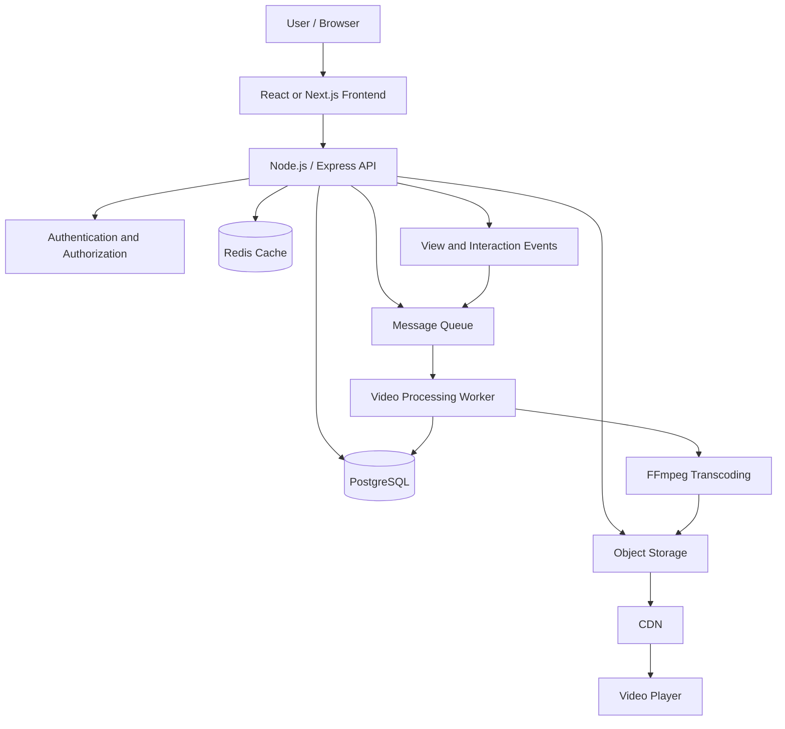
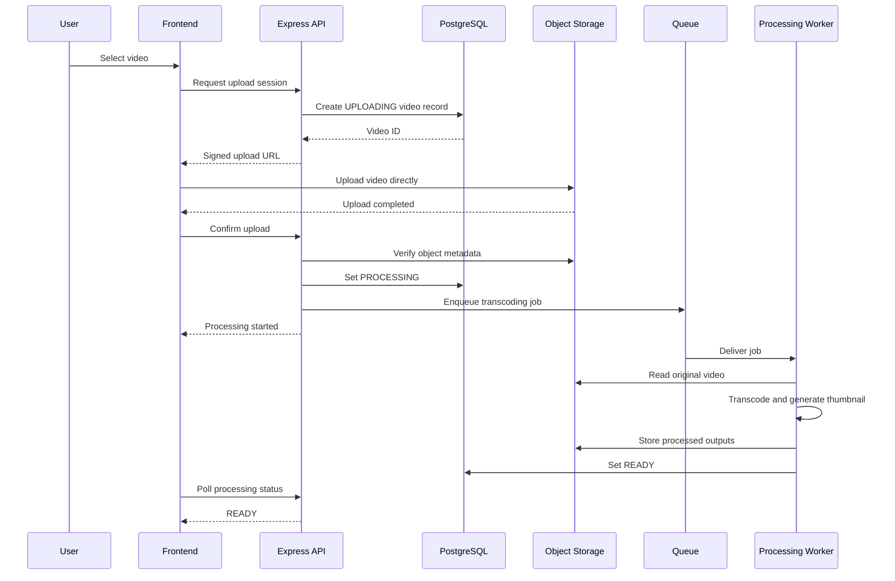
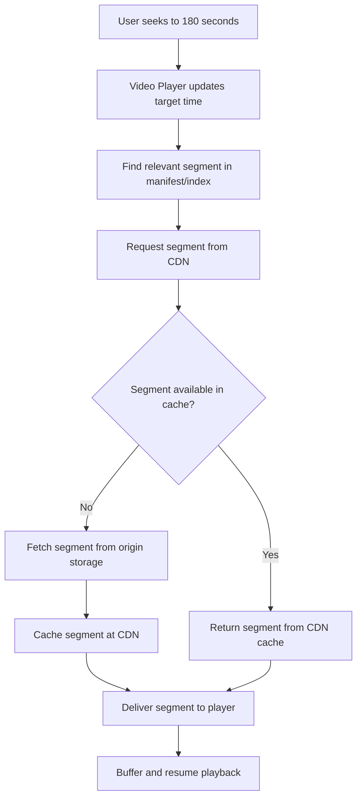
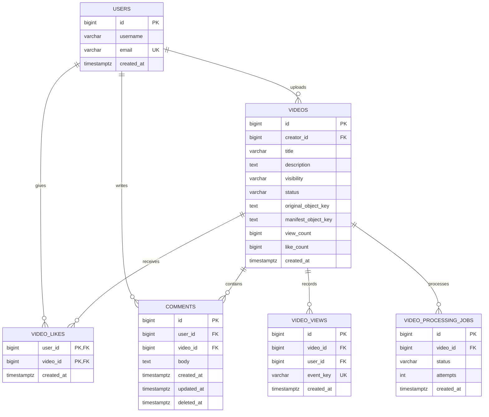
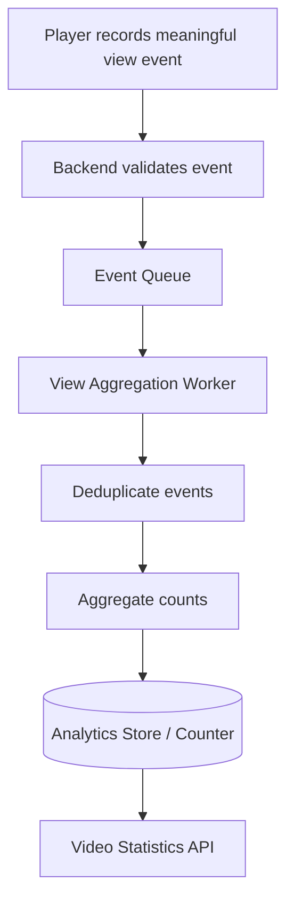
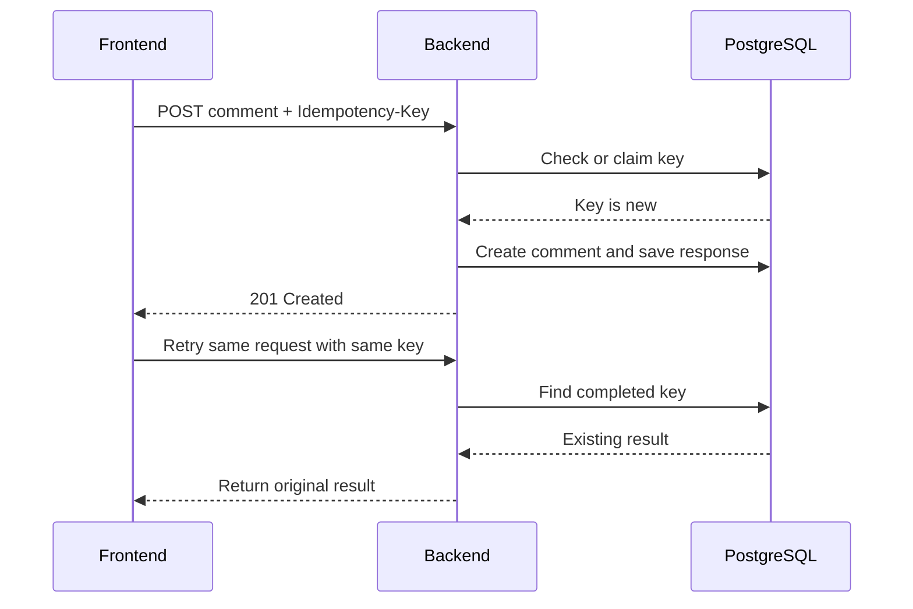

# YouTube System Design

A scalable YouTube-like video platform supporting video uploads, video processing, adaptive streaming, timestamp-based seeking, likes, unlikes, comments, and view counting. Designed to maintain data consistency under high concurrency while delivering smooth playback to thousands of concurrent users.

## Table of Contents

1. [Problem Statement](#1-problem-statement)
2. [Functional and Non-Functional Requirements](#2-functional-and-non-functional-requirements)
3. [Technology Stack](#3-technology-stack)
4. [High-Level Architecture](#4-high-level-architecture)
5. [Complete Video Upload and Publishing Flow](#5-complete-video-upload-and-publishing-flow)
6. [Video Streaming and Seeking](#6-video-streaming-and-seeking)
7. [REST API Design](#7-rest-api-design)
8. [Database Schema](#8-database-schema)
9. [Concurrent Likes and Unlikes](#9-concurrent-likes-and-unlikes)
10. [Concurrent Comments](#10-concurrent-comments)
11. [View Count and Like Count](#11-view-count-and-like-count)
12. [Database Transactions and ACID](#12-database-transactions-and-acid)
13. [Duplicate Request Prevention and Idempotency](#13-duplicate-request-prevention-and-idempotency)
14. [Video Processing Failure and Recovery](#14-video-processing-failure-and-recovery)
15. [Caching, CDN, and Scalability](#15-caching-cdn-and-scalability)
16. [Security and Access Control](#16-security-and-access-control)
17. [Monitoring and Error Handling](#17-monitoring-and-error-handling)
18. [Important SQL Queries](#18-important-sql-queries)
19. [Interview Questions and Answers](#19-interview-questions-and-answers)

---

## 1. Problem Statement

ধরা যাক, একজন user YouTube-এর মতো একটি platform-এ একটি video upload করলেন। অন্য users সেই video দেখতে, like দিতে, unlike করতে, comment করতে এবং video দেখার সময় নির্দিষ্ট timestamp-এ forward বা backward করতে পারবেন।

একই সময়ে হাজার হাজার users video দেখলেও system-কে smooth streaming, reliable video delivery এবং database consistency নিশ্চিত করতে হবে।

### System-এর মূল কাজ

1. **User Management:** User registration, login, authentication এবং creator profile পরিচালনা করা।
2. **Video Upload:** Video file, title, description, thumbnail এবং visibility settings manage করা।
3. **Video Processing:** Uploaded video-কে বিভিন্ন resolution এবং streaming format-এ convert করা।
4. **Video Publishing:** Processing সফল হওয়ার পর video-কে playback-এর জন্য available করা।
5. **Video Streaming:** Network condition ও device অনুযায়ী উপযুক্ত video quality deliver করা।
6. **Video Seeking:** 10 seconds forward/backward অথবা নির্দিষ্ট timestamp-এ দ্রুত playback resume করা।
7. **Like and Unlike:** একজন user যেন একই video-তে duplicate like তৈরি করতে না পারেন।
8. **Comment Management:** Comment create, update এবং delete করা; প্রতিটি comment-এর author ও video সঠিকভাবে সংরক্ষণ করা।
9. **View Count:** Concurrent view events-এর কারণে count হারিয়ে যাওয়া বা ভুলভাবে update হওয়া প্রতিরোধ করা।
10. **Concurrency Handling:** একই সময়ে হাজার হাজার request নিরাপদে process করা।
11. **Duplicate Request Prevention:** Network retry বা repeated request-এর কারণে duplicate operation প্রতিরোধ করা।
12. **Data Consistency:** Video, user, like এবং comment-এর মধ্যে relational integrity বজায় রাখা।
13. **Failure Recovery:** Video processing failure, interrupted upload, streaming errors এবং database failure থেকে recover করা।

### Example scenario

ধরা যাক:

- Creator একটি 2 GB video upload করলেন।
- System video-টি 144p, 360p, 720p এবং 1080p resolution-এ process করল।
- 10,000 users একই সময়ে video-টি দেখতে শুরু করলেন।
- User A video-তে like দিলেন এবং একটি comment করলেন।
- User B video-র 2 মিনিট 30 সেকেন্ডে seek করলেন।
- Network failure-এর কারণে User A-এর like request আবার পাঠানো হলো।

System-কে নিশ্চিত করতে হবে যে video playback scalable থাকবে, seeking দ্রুত হবে এবং duplicate request-এর কারণে duplicate like তৈরি হবে না।

## 2. Functional and Non-Functional Requirements

### 2.1 Functional Requirements

- User registration and authentication
- Video upload and metadata management
- Video transcoding and thumbnail generation
- Video publishing and visibility management
- Adaptive video streaming
- Timestamp-based forward and backward seeking
- Like and unlike
- Comment creation, editing and deletion
- View tracking and view count aggregation
- Video search and listing
- Processing status and failure recovery

### 2.2 Non-Functional Requirements

| Requirement | Design approach |
|---|---|
| Scalability | Object storage, CDN, stateless API servers and background workers |
| Availability | Replicated infrastructure, retries and health checks |
| Low latency | CDN caching, adaptive streaming and database indexes |
| Consistency | PostgreSQL constraints, transactions and atomic updates |
| Reliability | Durable queues, idempotent workers and retry policies |
| Security | Authentication, authorization, signed upload URLs and private storage |
| Observability | Structured logs, metrics, tracing and alerts |

### 2.3 Main Design Challenges

- Large video files should not pass through application servers unnecessarily.
- Video processing must not block ordinary API requests.
- Seeking should load only the required video segments instead of downloading the entire file again.
- Concurrent likes must not create duplicate records.
- Concurrent view updates must not lose increments.
- A video should not become publicly playable before processing is complete.
- Background jobs must safely recover from crashes and duplicate delivery.

**Core objective:** Build a scalable and reliable video platform that separates video delivery from transactional application data.

## 3. Technology Stack

The following is a practical reference stack. Equivalent technologies can be substituted based on requirements and infrastructure.

| Layer | Technology | Responsibility |
|---|---|---|
| Frontend | React or Next.js | Video player, upload UI, likes and comments |
| Backend API | Node.js and Express.js | Authentication, metadata and business logic |
| Primary database | PostgreSQL | Users, videos, likes, comments and processing records |
| Video storage | Amazon S3 or compatible object storage | Store original and processed video files |
| Video processing | FFmpeg | Transcoding, thumbnails and media packaging |
| Message queue | RabbitMQ, SQS or Kafka | Distribute asynchronous processing jobs |
| Background workers | Node.js workers | Transcoding orchestration, retries and event processing |
| Streaming format | HLS or MPEG-DASH | Deliver video as segments with quality variants |
| CDN | CloudFront or equivalent | Cache and deliver video segments near users |
| Cache | Redis | Frequently accessed metadata and temporary counters |
| Authentication | JWT or secure session | Verify user identity |
| Monitoring | OpenTelemetry and a metrics/logging platform | Observe errors, latency and system health |

**Important:** Kafka is not required just to make a server faster. It can help decouple event producers and consumers at scale, but it introduces additional operational complexity. A managed queue or simpler worker queue may be sufficient for an initial version.

## 4. High-Level Architecture

### 4.1 Architecture Diagram



### 4.2 Component Responsibilities

**Frontend**

- Upload video and display upload progress.
- Display video metadata and processing status.
- Play HLS/DASH streams.
- Support seeking, likes, unlikes and comments.
- Display loading states and recover from playback interruptions.

**Backend API**

- Authenticate users and authorize operations.
- Validate video metadata and requested actions.
- Create video records and initiate uploads.
- Generate authorized upload URLs.
- Manage likes, comments and view events.
- Return metadata and playback manifests.

**PostgreSQL**

- Store authoritative application records.
- Enforce foreign keys and uniqueness rules.
- Coordinate concurrent writes using transactions and row locks where appropriate.
- Prevent duplicate likes and maintain reliable interaction data.

**Object Storage**

- Store original video files.
- Store transcoded renditions, HLS/DASH manifests and thumbnails.
- Provide durable storage independently of application server memory.

**Message Queue and Workers**

- Process transcoding jobs asynchronously.
- Retry temporary failures.
- Generate thumbnails and update processing states.
- Avoid blocking API requests while expensive processing runs.

**CDN**

- Deliver video segments and thumbnails from geographically distributed edge locations.
- Reduce repeated requests to origin storage.
- Improve playback startup and reduce origin bandwidth.

### 4.3 Why separate video storage from PostgreSQL?

A video can be hundreds of megabytes or several gigabytes. Storing the full binary inside PostgreSQL would increase database storage, backup and I/O pressure.

Instead:

- PostgreSQL stores metadata and object keys.
- Object storage stores the actual media files.
- The CDN delivers the media to users.

For example:

```text
PostgreSQL:
video_id = 501
title = "System Design Tutorial"
status = "READY"
manifest_key = "videos/501/hls/master.m3u8"

Object Storage:
videos/501/original/source.mp4
videos/501/hls/master.m3u8
videos/501/hls/720p/segment_001.ts
videos/501/hls/360p/segment_001.ts
videos/501/thumbnails/thumbnail.jpg
```

The keys above are illustrative; the actual storage layout depends on the chosen packaging format.

## 5. Complete Video Upload and Publishing Flow

### 5.1 Step-by-Step Workflow

1. User logs in and receives an authenticated session or token.
2. Frontend requests permission to upload a video.
3. Backend validates the user, file size, file type and upload policy.
4. Backend creates a video record with status `UPLOADING`.
5. Backend generates a short-lived, authorized upload URL or multipart upload session.
6. Frontend uploads the file directly to object storage.
7. Frontend notifies the backend that upload is complete, or the backend receives a trusted storage event.
8. Backend verifies that the expected object exists and that its metadata is acceptable.
9. Backend marks the video as `PROCESSING` and publishes a transcoding job.
10. A worker downloads or reads the original file and runs FFmpeg.
11. Worker generates required resolution variants, streaming segments and thumbnails.
12. Worker writes the processed assets to object storage.
13. Worker verifies the output and updates the video status to `READY`.
14. The video becomes available according to its visibility settings.
15. Frontend fetches the playback manifest and starts streaming.

### 5.2 Upload Flow Diagram



### 5.3 Why use a Background Worker?

Transcoding can take seconds or minutes depending on file size, resolution and hardware.

If the API transcodes the video synchronously, the request may time out and occupy server resources unnecessarily.

Instead:

```text
Upload Request
    |
    v
Save Metadata
    |
    v
Enqueue Processing Job
    |
    v
Return Accepted Response
    |
    v
Worker Processes Video
    |
    v
Update Processing Status
```

A typical response for an accepted processing request is HTTP `202 Accepted`, with a video ID and a way to check processing status.

### 5.4 Video Processing States

Recommended lifecycle:

```text
UPLOADING
    |
    v
PROCESSING
    |
    +----> READY
    |
    +----> PROCESSING_FAILED
```

Additional states may include `DELETED`, `BLOCKED` or `RETRYING`, depending on moderation and operational requirements.

The system should not expose a playable manifest as ready until all required output assets have been verified.

## 6. Video Streaming and Seeking

### 6.1 The Problem with Downloading the Entire Video

Suppose a video is 20 minutes long and the user wants to jump from 30 seconds to 15 minutes.

If the player has to download the entire file from the beginning before playing the requested position, seeking will be slow and bandwidth will be wasted.

The solution is to package the video into segments and provide an index or manifest.

### 6.2 HLS/DASH-Based Streaming

With HLS or MPEG-DASH, a video is divided into smaller media segments. A manifest identifies the available renditions and the segments needed for playback.

Illustrative layout:

```text
videos/501/hls/
    master.m3u8
    360p/
        playlist.m3u8
        segment_000.ts
        segment_001.ts
    720p/
        playlist.m3u8
        segment_000.ts
        segment_001.ts
    1080p/
        playlist.m3u8
        segment_000.ts
        segment_001.ts
```

The player retrieves the manifest and requests the required segments from the CDN.

### 6.3 How Forward and Backward Seeking Works

ধরা যাক, user বর্তমানে video-র 120-second position-এ আছেন।

- 10 seconds forward: target position = 130 seconds.
- 10 seconds backward: target position = 110 seconds.
- Jump to 3 minutes: target position = 180 seconds.

Flow:

1. Player calculates the target timestamp.
2. Player identifies the relevant media segment using the manifest or segment index.
3. Player requests the required segment from the CDN.
4. Player buffers the segment and any necessary adjacent segments.
5. Playback resumes from the target position.

The player does not need to download the entire video again. It requests the segments required for the new playback position.

### 6.4 Seeking Flow Diagram



### 6.5 Why use Adaptive Bitrate Streaming?

Network speed changes over time. A fixed 1080p stream may buffer continuously on a slow network.

Adaptive bitrate streaming provides multiple quality variants. The player selects a suitable rendition based on estimated bandwidth, buffer health and device capabilities.

For example:

| Network condition | Possible selected quality |
|---|---|
| Weak or unstable connection | 144p or 360p |
| Moderate connection | 480p or 720p |
| Fast connection | 1080p or higher, if available |

The exact choice is made by the player and depends on available renditions and playback conditions.

**Key point:** HLS/DASH packaging, object storage and CDN delivery work together to support scalable streaming and efficient seeking.

## 7. REST API Design

The following APIs support user authentication, upload, streaming metadata, likes, comments and view tracking.

| Method | Endpoint | Description |
|---|---|---|
| `POST` | `/api/auth/register` | Register user |
| `POST` | `/api/auth/login` | Authenticate user |
| `GET` | `/api/users/me` | Get current user profile |
| `POST` | `/api/videos/upload-session` | Create video record and upload session |
| `POST` | `/api/videos/:id/upload-complete` | Verify completed upload and enqueue processing |
| `GET` | `/api/videos/:id` | Get video metadata and status |
| `PATCH` | `/api/videos/:id` | Update video metadata |
| `DELETE` | `/api/videos/:id` | Request video deletion |
| `GET` | `/api/videos/:id/processing-status` | Check processing status |
| `GET` | `/api/videos/:id/playback` | Get authorized playback manifest information |
| `PUT` | `/api/videos/:id/like` | Like a video |
| `DELETE` | `/api/videos/:id/like` | Remove current user's like |
| `GET` | `/api/videos/:id/likes` | Get like count and related metadata |
| `POST` | `/api/videos/:id/comments` | Create comment |
| `GET` | `/api/videos/:id/comments` | List comments |
| `PATCH` | `/api/comments/:commentId` | Update own comment |
| `DELETE` | `/api/comments/:commentId` | Delete own comment |
| `POST` | `/api/videos/:id/views` | Submit a view event |
| `GET` | `/api/videos/:id/stats` | Get permitted video statistics |

### Important API Design Considerations

- **Authentication:** Protect user-specific and creator-only operations.
- **Authorization:** Only the creator or an authorized moderator may update or delete a video.
- **Upload security:** Validate file size, upload permissions and allowed formats.
- **Video readiness:** Do not return a playable manifest for videos that are still processing or are not visible to the requester.
- **Like idempotency:** Repeating `PUT /like` should not create multiple like records.
- **Unlike idempotency:** Repeating `DELETE /like` should not create inconsistent state.
- **Comment ownership:** Verify that the authenticated user owns the comment or has moderator privileges.
- **View counting:** Avoid incrementing the count for every playback polling request.
- **Database constraints:** Use foreign keys and unique constraints as a final line of defense.
- **Background jobs:** Transcoding and large media operations should not block API requests.

## 8. Database Schema

PostgreSQL is the authoritative store for relational application data. Actual video files and streaming segments live in object storage.

### 8.1 Entity Relationship Diagram



### 8.2 Core SQL Schema

The following schema is illustrative and can be adapted to the application's authentication model and expected scale.

```sql
CREATE TABLE users (
    id BIGINT GENERATED ALWAYS AS IDENTITY PRIMARY KEY,
    username VARCHAR(100) NOT NULL,
    email VARCHAR(255) NOT NULL UNIQUE,
    created_at TIMESTAMPTZ NOT NULL DEFAULT NOW()
);

CREATE TABLE videos (
    id BIGINT GENERATED ALWAYS AS IDENTITY PRIMARY KEY,
    creator_id BIGINT NOT NULL REFERENCES users(id),
    title VARCHAR(255) NOT NULL,
    description TEXT,
    visibility VARCHAR(20) NOT NULL DEFAULT 'PRIVATE'
        CHECK (visibility IN ('PUBLIC', 'UNLISTED', 'PRIVATE')),
    status VARCHAR(30) NOT NULL DEFAULT 'UPLOADING'
        CHECK (status IN (
            'UPLOADING',
            'PROCESSING',
            'READY',
            'PROCESSING_FAILED',
            'BLOCKED',
            'DELETED'
        )),
    original_object_key TEXT,
    manifest_object_key TEXT,
    thumbnail_object_key TEXT,
    duration_seconds INTEGER CHECK (duration_seconds >= 0),
    view_count BIGINT NOT NULL DEFAULT 0 CHECK (view_count >= 0),
    like_count BIGINT NOT NULL DEFAULT 0 CHECK (like_count >= 0),
    created_at TIMESTAMPTZ NOT NULL DEFAULT NOW(),
    updated_at TIMESTAMPTZ NOT NULL DEFAULT NOW()
);

CREATE TABLE video_likes (
    user_id BIGINT NOT NULL REFERENCES users(id),
    video_id BIGINT NOT NULL REFERENCES videos(id),
    created_at TIMESTAMPTZ NOT NULL DEFAULT NOW(),
    PRIMARY KEY (user_id, video_id)
);

CREATE TABLE comments (
    id BIGINT GENERATED ALWAYS AS IDENTITY PRIMARY KEY,
    user_id BIGINT NOT NULL REFERENCES users(id),
    video_id BIGINT NOT NULL REFERENCES videos(id),
    body TEXT NOT NULL CHECK (length(trim(body)) > 0),
    created_at TIMESTAMPTZ NOT NULL DEFAULT NOW(),
    updated_at TIMESTAMPTZ NOT NULL DEFAULT NOW(),
    deleted_at TIMESTAMPTZ
);

CREATE TABLE video_processing_jobs (
    id BIGINT GENERATED ALWAYS AS IDENTITY PRIMARY KEY,
    video_id BIGINT NOT NULL REFERENCES videos(id),
    status VARCHAR(20) NOT NULL DEFAULT 'QUEUED'
        CHECK (status IN (
            'QUEUED',
            'PROCESSING',
            'COMPLETED',
            'FAILED'
        )),
    attempts INTEGER NOT NULL DEFAULT 0 CHECK (attempts >= 0),
    last_error TEXT,
    created_at TIMESTAMPTZ NOT NULL DEFAULT NOW(),
    updated_at TIMESTAMPTZ NOT NULL DEFAULT NOW()
);

CREATE INDEX idx_videos_creator_created
    ON videos (creator_id, created_at DESC);

CREATE INDEX idx_videos_public_ready
    ON videos (created_at DESC)
    WHERE visibility = 'PUBLIC' AND status = 'READY';

CREATE INDEX idx_comments_video_created
    ON comments (video_id, created_at DESC)
    WHERE deleted_at IS NULL;

CREATE INDEX idx_video_likes_video
    ON video_likes (video_id);

CREATE INDEX idx_processing_jobs_status_created
    ON video_processing_jobs (status, created_at);
```

For production, add a view-event or analytics event table if needed. Avoid inserting every repeated player heartbeat as a new view record.

### 8.3 Why is `PRIMARY KEY (user_id, video_id)` important?

It guarantees that one user can have at most one like record for a given video.

For example:

```text
User 10 + Video 501 = One like record
User 10 + Video 501 = Duplicate record rejected
User 10 + Video 502 = Allowed
User 11 + Video 501 = Allowed
```

This is a database-level guarantee, not merely a frontend validation rule.

### 8.4 Data Ownership

- `users`: identity and account metadata
- `videos`: metadata, visibility and processing state
- `video_likes`: current like state
- `comments`: user-generated comments
- `video_processing_jobs`: asynchronous processing state
- Object storage: original video and processed media files
- Analytics storage or event tables: view events and other high-volume telemetry, if required

The `like_count` and `view_count` columns are denormalized counters. Their consistency strategy must be defined explicitly; they should not silently become independent sources of truth from the underlying records or events.

## 9. Concurrent Likes and Unlikes

### 9.1 The Problem

ধরা যাক, User A একই video-তে like দেওয়ার জন্য একই সময়ে দুটি request পাঠালেন।

A naive implementation might look like this:

```javascript
const existingLike = await findLike(userId, videoId);

if (!existingLike) {
  await createLike(userId, videoId);
  await incrementLikeCount(videoId);
}
```

এখানে দুই request-ই `existingLike` না পেতে পারে। ফলে উভয় request like record তৈরি এবং count increment করার চেষ্টা করতে পারে।

এটি একটি race condition।

### 9.2 Correct Approach

1. Authenticate the user.
2. Validate that the video exists and the user may interact with it.
3. Insert the like using the unique `(user_id, video_id)` key.
4. Use `ON CONFLICT DO NOTHING` to handle duplicate insertion safely.
5. Increment the counter only if a new like row was actually inserted.
6. Commit the transaction.

### 9.3 Illustrative SQL

```sql
BEGIN;

WITH inserted_like AS (
    INSERT INTO video_likes (user_id, video_id)
    VALUES ($1, $2)
    ON CONFLICT (user_id, video_id) DO NOTHING
    RETURNING video_id
)
UPDATE videos
SET like_count = like_count + 1,
    updated_at = NOW()
WHERE id = $2
  AND EXISTS (SELECT 1 FROM inserted_like);

COMMIT;
```

If the like already exists, the insert returns no row and the counter is not incremented.

This assumes the counter is maintained by this operation and all other like-state changes follow the same rule.

### 9.4 Unlike Operation

Unlike should delete the user's existing like and decrement the counter only when a row was deleted.

```sql
BEGIN;

WITH deleted_like AS (
    DELETE FROM video_likes
    WHERE user_id = $1
      AND video_id = $2
    RETURNING video_id
)
UPDATE videos
SET like_count = like_count - 1,
    updated_at = NOW()
WHERE id = $2
  AND like_count > 0
  AND EXISTS (SELECT 1 FROM deleted_like);

COMMIT;
```

The application should also verify that the target video exists and that the operation is allowed.

### 9.5 Why does this work under concurrency?

The primary key prevents duplicate like records. PostgreSQL coordinates conflicting inserts on the unique key.

If two identical like requests arrive:

- One request inserts the like.
- The other encounters the unique conflict.
- Only the request that inserts the new row increments the counter.

The operation is safe to retry, and duplicate requests do not create duplicate likes.

**Important:** If likes are processed through a separate asynchronous event pipeline, do not combine an independently updated counter with this SQL strategy without a clear consistency design. Choose one authoritative counter-maintenance method.

## 10. Concurrent Comments

### 10.1 The Problem

Thousands of users may comment on the same video at approximately the same time.

The system must ensure that:

- Every comment belongs to the correct user.
- Every comment belongs to the correct video.
- Comments are not accidentally duplicated by retries.
- One user's update or delete request cannot modify another user's comment.
- Concurrent inserts do not overwrite each other.

### 10.2 Correct Approach

1. Authenticate the user.
2. Validate the video ID and comment content.
3. Verify that the video is available for commenting.
4. Insert a new comment row.
5. Let PostgreSQL generate a unique comment ID.
6. Return the created comment.
7. Use ownership checks when updating or deleting comments.

### 10.3 SQL Example

```sql
INSERT INTO comments (user_id, video_id, body)
VALUES ($1, $2, $3)
RETURNING id, user_id, video_id, body, created_at;
```

Each comment is an independent row, so multiple users can insert comments concurrently without overwriting one another.

### 10.4 Updating a Comment Safely

```sql
UPDATE comments
SET body = $3,
    updated_at = NOW()
WHERE id = $1
  AND user_id = $2
  AND deleted_at IS NULL
RETURNING id, body, updated_at;
```

Here `$2` must come from the authenticated server-side identity, not from a trusted client-supplied user ID.

If no row is returned, the comment may not exist, may already be deleted, or may not belong to the user. The API should return an appropriate response without revealing private information.

### 10.5 Preventing Duplicate Comments

A database transaction alone does not automatically prevent a retried request from creating the same comment twice.

For APIs that need retry-safe creation, use an idempotency key:

```text
User submits comment
    |
    v
Request times out
    |
    v
Frontend retries with the same key
    |
    v
Backend returns the original result
    |
    v
No second comment is created
```

The idempotency key should be scoped to the user and operation, stored with a unique constraint, and associated with a request fingerprint.

## 11. View Count and Like Count

### 11.1 Why can counters become incorrect?

Consider this unsafe update:

```javascript
const video = await getVideo(videoId);

await updateVideo(videoId, {
  viewCount: video.viewCount + 1
});
```

Suppose the current count is 100.

- Request A reads 100.
- Request B reads 100.
- Request A writes 101.
- Request B writes 101.

Two increments occurred, but the final count is 101 instead of 102. This is a lost update.

### 11.2 Atomic Database Increment

For a relatively low or moderate number of counter updates, use an atomic SQL operation:

```sql
UPDATE videos
SET view_count = view_count + 1
WHERE id = $1
RETURNING view_count;
```

The increment happens inside the database operation, so concurrent updates do not overwrite one another using a stale application-side value.

However, this alone does not define what qualifies as a legitimate view. The backend should not increment the view count for every page refresh, player heartbeat or repeated API request.

### 11.3 A More Scalable View Architecture

For high traffic, separate view-event collection from aggregated display counts.



A practical strategy:

1. Generate a unique event ID or deduplication key.
2. Validate that the event is associated with an eligible video and session.
3. Apply the chosen view-counting policy.
4. Send the event to a durable queue or analytics pipeline.
5. Deduplicate retried events.
6. Aggregate events into counters over time.
7. Display the resulting count.

The precise definition of a valid view is a product decision and may include minimum playback duration, session-level deduplication or abuse filtering.

### 11.4 Exact Counts versus Approximate Counts

- **Likes:** Usually need a reliable current state per user and video. A relational table with a unique key is appropriate.
- **Comments:** Need durable records and ownership integrity.
- **Views:** Can be high-volume telemetry. Counts may be aggregated asynchronously, so the displayed count may lag slightly.
- **Analytics:** May use separate storage optimized for large-scale event queries.

Do not promise that an asynchronously aggregated view count is immediately exact unless the implementation actually guarantees that property.

## 12. Database Transactions and ACID

ACID stands for Atomicity, Consistency, Isolation and Durability.

### 12.1 Atomicity — সব হবে, না হলে কিছুই হবে না

Suppose a like operation must insert a like record and increment the stored counter.

If the like row is inserted but the counter update fails, the transaction should roll back both operations.

```sql
BEGIN;

-- Insert like and update count using the
-- conditional SQL shown in Section 9.

COMMIT;
```

If any required operation fails, execute `ROLLBACK`.

**Interview answer:** "Atomicity ensures that all database changes belonging to a transaction succeed together or none of them are committed."

### 12.2 Consistency — Database Rules বজায় রাখা

The database must preserve defined constraints and business rules.

Examples:

- A like references an existing user and video.
- A user cannot have duplicate likes for the same video.
- A comment references an existing user and video.
- A view counter cannot become negative.
- A video cannot become publicly playable before required processing is complete.

Foreign keys, unique constraints, check constraints and controlled state transitions help enforce these rules.

**Interview answer:** "Consistency ensures that every committed transaction preserves database constraints and application invariants."

### 12.3 Isolation — Concurrent Requests নিরাপদ রাখা

Suppose two requests try to like the same video at the same time.

The unique key on `(user_id, video_id)` ensures that both requests cannot create two separate like records.

For operations that require coordinated reads and writes, use appropriate locking, conditional updates or transaction isolation.

`SELECT ... FOR UPDATE` can lock existing rows, but it does not replace unique constraints and is not required for every operation. For likes, a unique key and `INSERT ... ON CONFLICT` are often sufficient.

**Interview answer:** "Isolation helps concurrent transactions behave safely. I would choose row-level locking, conditional updates or unique constraints based on the operation's correctness requirements."

### 12.4 Durability — Commit করা Data স্থায়ী থাকা

After PostgreSQL successfully commits a transaction, its changes are expected to survive application crashes and normal database recovery, subject to the database's durability configuration and infrastructure guarantees.

For example, a committed comment should not disappear merely because the API server restarts.

**Interview answer:** "Durability ensures that committed database changes survive application crashes, supported by PostgreSQL's transaction logging and durable storage configuration."

### 12.5 Important Boundary: Database and Object Storage

A PostgreSQL transaction cannot atomically commit a change in object storage or guarantee that a message has been processed by an external worker.

For example:

```text
1. Upload original video to object storage.
2. Insert video record in PostgreSQL.
3. Publish transcoding job to queue.
```

These steps span multiple systems. A crash can occur between them.

Use an explicit recovery strategy, such as:

- Persist upload and processing states.
- Use a transactional outbox to reliably publish jobs from database changes.
- Make processing jobs idempotent.
- Retry transient failures.
- Reconcile database records against stored objects.
- Clean up abandoned uploads and orphaned media objects.

Do not claim that a single PostgreSQL transaction makes external storage, queues and video processing atomic.

## 13. Duplicate Request Prevention and Idempotency

### 13.1 What is Idempotency?

An operation is idempotent if repeating the same request does not produce additional unintended effects after the first successful execution.

For example, if a user clicks Like and the network times out, the frontend may retry the request.

Without idempotency, the system might create duplicate likes, comments or processing jobs.

### 13.2 Recommended Strategy

| Operation | Protection |
|---|---|
| Like | Unique `(user_id, video_id)` key |
| Unlike | Delete only the authenticated user's matching row |
| Comment creation | Idempotency key when retry-safe creation is required |
| Video upload session | Idempotency key or unique upload-session identifier |
| Processing job | Stable job ID and idempotent worker |
| View event | Unique event ID or deduplication key |
| Metadata update | Conditional update or version check when needed |

### 13.3 Idempotency Key Workflow



### 13.4 Important Implementation Rules

- The same key with the same payload should return the original result.
- The same key with a different payload should be rejected.
- The key must be scoped to the authenticated user and operation.
- A unique database constraint must prevent concurrent requests from claiming the same key.
- The idempotency record and resulting database changes should be committed atomically where possible.
- Retain keys long enough to cover the expected retry window.

Idempotency is not the same as deduplication by timing. Two legitimate comments posted separately should not be treated as duplicates merely because their text is identical.

## 14. Video Processing Failure and Recovery

### 14.1 Problem

A worker may crash while processing a large video. FFmpeg may fail because the source file is corrupted, the disk may run out of space, or object storage may temporarily become unavailable.

The video must not remain in `PROCESSING` forever.

### 14.2 Recovery Workflow

1. Store a durable processing job before acknowledging that it has been accepted.
2. Give each job a stable identifier.
3. Let a worker claim the job.
4. Update its status to `PROCESSING` and record the attempt.
5. Run transcoding and generate outputs in a temporary or versioned location.
6. Verify the generated files and manifests.
7. Publish the final asset references and set the video to `READY`.
8. On transient failure, retry with bounded exponential backoff.
9. On permanent failure or exhausted retries, mark the job and video appropriately.
10. Alert or expose the failure state so the creator can retry or replace the upload.

### 14.3 Why must the Worker Be Idempotent?

A queue may deliver a job more than once, particularly after a worker crash or acknowledgement timeout.

The worker should not create conflicting outputs or incorrectly overwrite a completed job.

A stable processing job ID, guarded state transitions and deterministic output keys can help. Workers should check whether the job has already completed before repeating expensive work.

### 14.4 Upload Completion Is Not Publishing

These are different states:

```text
UPLOADING
    |
    v
Original File Stored
    |
    v
PROCESSING
    |
    v
All Required Outputs Verified
    |
    v
READY
```

A successful upload only proves that the original file was received. It does not prove that playable streaming assets have been generated successfully.

## 15. Caching, CDN, and Scalability

### 15.1 Why does a CDN matter?

If every video segment is served directly by one application server, high concurrent playback can overload that server and its network connection.

A CDN caches media near viewers and reduces repeated requests to the origin.

```text
User
  |
  v
CDN Edge
  |
  +---- Cache hit ----> Deliver segment
  |
  +---- Cache miss ---> Object Storage Origin
                           |
                           v
                      Cache segment
                           |
                           v
                      Deliver segment
```

### 15.2 What should be cached?

| Data | Possible strategy |
|---|---|
| Public video segments | CDN caching with suitable cache headers |
| Public thumbnails | CDN caching |
| Public video metadata | Short-lived Redis or HTTP caching |
| Creator-private metadata | User-authorized cache strategy |
| Like state | Query by user/video or cache with reliable invalidation |
| Comments | Paginated database queries with selective caching |
| View statistics | Cached or periodically refreshed aggregated values |

Private video manifests and segments require access control. Do not make private assets publicly accessible through unrestricted cache URLs.

### 15.3 Stateless API Servers

Keep API instances stateless where practical. Authentication state should be represented through validated tokens or shared session storage rather than relying on memory in one server instance.

Then a load balancer can distribute requests across multiple API instances.

### 15.4 Database Scaling

Start with the simplest architecture that meets the workload:

1. Add suitable indexes.
2. Use connection pooling.
3. Keep transactions short.
4. Avoid loading large media files through the database.
5. Cache frequently requested public metadata when beneficial.
6. Move high-volume view analytics into a queue and aggregation pipeline.
7. Consider read replicas or partitioning when measurement shows they are needed.
8. Use sharding only when simpler scaling approaches are insufficient.

**Important:** Redis caching, Kafka, microservices and database sharding do not automatically make a system faster. Each should solve a measured bottleneck.

## 16. Security and Access Control

### 16.1 Authentication

- Verify the user's JWT or session on protected endpoints.
- Derive the user ID from the validated identity.
- Never trust a client-provided user ID for ownership checks.

### 16.2 Authorization

- Only authorized users can edit or delete their own videos.
- Only permitted viewers can access private or unlisted media.
- Only the comment owner or an authorized moderator can modify a comment.
- Moderation actions should be audited.

### 16.3 Upload Security

- Restrict maximum upload size.
- Validate file type and inspect media content rather than relying only on filename extensions.
- Use short-lived, narrowly scoped upload URLs.
- Store files under controlled object keys.
- Do not execute uploaded content.
- Apply malware scanning or content moderation where required.
- Use multipart upload policies for large files and clean up abandoned multipart uploads.

### 16.4 Streaming Security

- Enforce visibility and playback authorization before granting access to private media.
- Use signed CDN URLs or signed cookies where appropriate.
- Configure storage permissions so private origin objects cannot be fetched directly by unauthorized users.
- Apply rate limits and abuse protection to sensitive APIs.

### 16.5 API Protection

- Validate input and limit request sizes.
- Rate-limit login, upload-session creation and comment submission.
- Use parameterized SQL queries.
- Protect secrets and signing keys.
- Use HTTPS.
- Avoid exposing internal storage paths or sensitive processing errors.

## 17. Monitoring and Error Handling

### 17.1 What should be monitored?

| Area | Metrics |
|---|---|
| API | Request rate, latency, error rate, timeouts |
| Database | Connection usage, slow queries, lock waits, deadlocks |
| Upload | Upload failures, incomplete uploads, upload duration |
| Processing | Queue depth, job duration, retries and failures |
| Streaming | Startup time, buffering ratio, playback failures |
| CDN | Cache hit ratio, origin requests and bandwidth |
| Interactions | Like failures, comment errors and view-event ingestion |
| Storage | Capacity, failed writes and orphaned objects |

### 17.2 Example Error Responses

Seat booking systems use `409 Conflict` for conflicts in resource state. A video platform can use a similar pattern for conflicting state transitions, but each API should select a status appropriate to its semantics.

Example: a video is not ready for playback.

```json
{
  "error": {
    "code": "VIDEO_NOT_READY",
    "message": "This video is still being processed."
  }
}
```

Example: a comment cannot be modified by the current user.

```json
{
  "error": {
    "code": "COMMENT_UPDATE_NOT_ALLOWED",
    "message": "You are not allowed to update this comment."
  }
}
```

Suggested status codes:

- `200 OK`: Successful read or update.
- `201 Created`: Resource created.
- `202 Accepted`: Asynchronous processing accepted.
- `400 Bad Request`: Invalid input.
- `401 Unauthorized`: Authentication missing or invalid.
- `403 Forbidden`: Authenticated user lacks permission.
- `404 Not Found`: Resource unavailable or not found.
- `409 Conflict`: Request conflicts with current resource state.
- `413 Content Too Large`: Upload exceeds permitted size.
- `422 Unprocessable Content`: Semantically invalid request.
- `429 Too Many Requests`: Rate limit exceeded.
- `500 Internal Server Error`: Unexpected server failure.
- `503 Service Unavailable`: Temporary service unavailability.

The frontend should distinguish retryable failures from permanent validation or authorization errors.

## 18. Important SQL Queries

The following examples assume the schema in Section 8. Bind parameters using the database driver's parameterized-query mechanism.

### 18.1 Get Video Details

```sql
SELECT
    id,
    creator_id,
    title,
    description,
    visibility,
    status,
    duration_seconds,
    view_count,
    like_count,
    created_at
FROM videos
WHERE id = $1
  AND status <> 'DELETED';
```

The API must also apply visibility and authorization rules before returning private video metadata.

### 18.2 Get Public Ready Videos

```sql
SELECT id, title, thumbnail_object_key, view_count, like_count
FROM videos
WHERE visibility = 'PUBLIC'
  AND status = 'READY'
ORDER BY created_at DESC
LIMIT $1 OFFSET $2;
```

For deep pagination at scale, keyset pagination is often more efficient than large offsets.

### 18.3 Check Whether a User Liked a Video

```sql
SELECT EXISTS (
    SELECT 1
    FROM video_likes
    WHERE user_id = $1
      AND video_id = $2
) AS has_liked;
```

### 18.4 Get Like Count

```sql
SELECT COUNT(*) AS total_likes
FROM video_likes
WHERE video_id = $1;
```

This computes the count from the source rows. It may be more expensive than reading a maintained counter for very popular videos.

### 18.5 Get Comments for a Video

```sql
SELECT
    c.id,
    c.user_id,
    c.body,
    c.created_at,
    c.updated_at,
    u.username
FROM comments AS c
JOIN users AS u ON u.id = c.user_id
WHERE c.video_id = $1
  AND c.deleted_at IS NULL
ORDER BY c.created_at DESC, c.id DESC
LIMIT $2;
```

### 18.6 Insert a Comment

```sql
INSERT INTO comments (user_id, video_id, body)
VALUES ($1, $2, $3)
RETURNING id, user_id, video_id, body, created_at;
```

### 18.7 Atomically Increment View Count

```sql
UPDATE videos
SET view_count = view_count + 1
WHERE id = $1
  AND status = 'READY'
RETURNING view_count;
```

Use this only after the backend has decided that the event qualifies as a view and has applied any required deduplication.

### 18.8 Get Creator's Videos

```sql
SELECT id, title, status, visibility, created_at
FROM videos
WHERE creator_id = $1
  AND status <> 'DELETED'
ORDER BY created_at DESC
LIMIT $2;
```

The creator ID should be derived from the authenticated identity for a "my videos" endpoint.

### 18.9 Update Video Metadata

```sql
UPDATE videos
SET title = $3,
    description = $4,
    updated_at = NOW()
WHERE id = $1
  AND creator_id = $2
  AND status <> 'DELETED'
RETURNING id, title, description, updated_at;
```

### 18.10 Soft Delete a Comment

```sql
UPDATE comments
SET deleted_at = NOW(),
    updated_at = NOW()
WHERE id = $1
  AND user_id = $2
  AND deleted_at IS NULL
RETURNING id, deleted_at;
```

For production moderation and retention requirements, define whether comments should be soft-deleted, hard-deleted or retained in an audit record.

### 18.11 Count Comments

```sql
SELECT COUNT(*) AS total_comments
FROM comments
WHERE video_id = $1
  AND deleted_at IS NULL;
```

### 18.12 Inspect Failed Processing Jobs

```sql
SELECT id, video_id, attempts, last_error, updated_at
FROM video_processing_jobs
WHERE status = 'FAILED'
ORDER BY updated_at DESC
LIMIT $1;
```

### 18.13 Find Videos Stuck in Processing

This is a basic diagnostic query; the actual threshold should depend on expected processing duration.

```sql
SELECT id, title, updated_at
FROM videos
WHERE status = 'PROCESSING'
  AND updated_at < NOW() - INTERVAL '30 minutes';
```

A reconciliation worker can investigate these records, determine whether a job is still running and retry or mark it failed safely.

## 19. Interview Questions and Answers

### Q1. How would you design a YouTube-like system for thousands of concurrent users?

**Answer:**

"I would separate video delivery from application data. Video files and transcoded segments would live in object storage and be delivered through a CDN. Node.js and Express would handle authentication, video metadata, likes and comments, while PostgreSQL would maintain relational integrity. A background queue and worker system would process uploaded videos asynchronously. I would use database constraints and atomic operations for critical concurrent updates, and a separate aggregation pipeline for high-volume view analytics."

### Q2. How do you upload and process a large video?

**Answer:**

"I would create a video record and a short-lived signed upload URL. The client uploads the file directly to object storage instead of sending gigabytes through the application server. After verifying the upload, the backend enqueues a processing job. A worker uses FFmpeg to generate the required renditions, manifests and thumbnails. The video becomes playable only after the required outputs are verified and its state is changed to READY."

### Q3. How does video seeking work?

**Answer:**

"I would use HLS or MPEG-DASH rather than requiring the player to download the entire video. The media is packaged into segments and indexed through a manifest. When a user seeks to a timestamp, the player requests the corresponding segment from the CDN and resumes playback after buffering. This reduces unnecessary downloads and improves seeking performance."

### Q4. How do you prevent duplicate likes?

**Answer:**

"I would enforce a unique constraint on `(user_id, video_id)` in PostgreSQL. The like endpoint would use `INSERT ... ON CONFLICT DO NOTHING`. I would increment the like counter only when a new row is inserted. This protects against concurrent requests and retries without relying only on application-side checks."

### Q5. How do you prevent lost updates in a counter?

**Answer:**

"I would avoid reading a counter into application memory and writing back an incremented value. Instead, I would use an atomic database update such as `SET view_count = view_count + 1`. For very high-volume view events, I would use a durable event pipeline, deduplication and aggregation workers to reduce database write pressure."

### Q6. How do you handle thousands of concurrent comments?

**Answer:**

"Each comment is stored as an independent row with a generated primary key and foreign keys to the user and video. PostgreSQL can handle concurrent inserts without overwriting other comments. I would add pagination and an index on `(video_id, created_at)` and enforce comment ownership for update and delete operations. An idempotency key can prevent duplicate comment creation when a request is retried."

### Q7. Why do you need a background worker?

**Answer:**

"Video transcoding is CPU-intensive and may take a long time. If the API performs it synchronously, requests can time out and API capacity can be exhausted. A queue lets the API accept the upload and return quickly while workers process jobs independently, retry failures and update the processing status."

### Q8. What is the role of PostgreSQL transactions?

**Answer:**

"Transactions group related database changes into an atomic unit. For example, creating a like record and incrementing its counter can be performed together. If a required operation fails, both changes roll back. Unique constraints and conditional updates complement transactions by enforcing specific integrity rules under concurrency."

### Q9. Do you need `SELECT ... FOR UPDATE` for every concurrent operation?

**Answer:**

"No. The correct mechanism depends on the operation. For likes, a unique constraint and `INSERT ... ON CONFLICT` are usually sufficient. Row-level locks are useful when a transaction must read and then modify existing rows under a coordinated state transition. I would prefer the simplest database-level mechanism that guarantees the required invariant."

### Q10. How do you recover from video processing failure?

**Answer:**

"I would persist each processing job, track attempts and errors, and use bounded retries with exponential backoff for transient failures. Workers would be idempotent because a queue can deliver the same job more than once. If retries are exhausted, the job would be marked failed and monitored. A reconciliation process would detect videos stuck in PROCESSING and safely retry or finalize them."

### Q11. Is Kafka necessary for this system?

**Answer:**

"Not necessarily. A queue is useful for decoupling uploads from processing and for distributing work. Kafka can be appropriate for high-throughput event streams and multiple independent consumers, but a managed queue or simpler job system may be better for an initial implementation. I would choose based on throughput, ordering, replay and operational requirements."

### Q12. What is the difference between a CDN and Redis?

**Answer:**

"A CDN delivers and caches media assets such as video segments and thumbnails near users. Redis is an in-memory data store that can cache application data, support rate limiting or hold temporary coordination data. They solve different problems: a CDN reduces media delivery latency and origin load, while Redis can reduce repeated application-data lookups."

### Q13. How do you make the system reliable if a worker crashes?

**Answer:**

"I would store jobs durably, use a queue with acknowledgement and retry semantics, and make workers idempotent. The worker would only mark a video READY after the output assets are verified. A reconciliation process would find jobs that were abandoned or left in PROCESSING and recover them without publishing incomplete media."

### Q14. How do you ensure consistency across PostgreSQL, object storage and the queue?

**Answer:**

"A PostgreSQL transaction cannot atomically commit object storage changes or external queue processing. I would persist upload and processing states, use a transactional outbox or equivalent reliable job-publication pattern, make workers idempotent, and run reconciliation. These mechanisms provide reliable eventual coordination across systems without pretending there is one distributed ACID transaction."

### Q15. How would you scale the platform further?

**Answer:**

"I would first measure bottlenecks. I would use CDN delivery and object storage for video, connection pooling and indexes for PostgreSQL, caching for frequently accessed metadata, and asynchronous aggregation for high-volume view events. If traffic continued to grow, I would consider read replicas, partitioning, dedicated analytics storage and additional worker capacity based on measured demand."

---

## YouTube-like System-এর ১৫টি গুরুত্বপূর্ণ সমস্যা

### 1. Video Upload Failure — ভিডিও আপলোড মাঝপথে বন্ধ হয়ে যাওয়া

Problem: ধরো, তুমি 2 GB-এর একটা video upload করছ। 90% upload হওয়ার পর internet disconnect হয়ে গেল।

কেন হয়? সাধারণ upload ব্যবস্থায় connection হারালে পুরো file আবার upload করতে হতে পারে।

Solution: Resumable Upload ব্যবহার করবে। ভিডিওকে ছোট ছোট অংশে ভাগ করে upload করবে। Connection ফিরে এলে যেখানে থেমেছিল, সেখান থেকে আবার শুরু হবে।

সহজ উদাহরণ: ১০০ পৃষ্ঠার বইয়ের ৯০ পৃষ্ঠা পড়ার পর বিদ্যুৎ চলে গেলে, আবার প্রথম পৃষ্ঠা থেকে না পড়ে ৯১ নম্বর পৃষ্ঠা থেকে পড়া।
### 2. Video Processing Failure — ভিডিও আপলোড হয়েছে, কিন্তু চলছে না
Problem: Video upload শেষ হয়েছে, কিন্তু YouTube-এর মতো বিভিন্ন quality—360p, 720p, 1080p—তৈরি হওয়ার সময় server crash করেছে।

কেন হয়? Upload আর video processing আলাদা কাজ। Upload সফল হলেই processing সফল হয়েছে, এমন নয়।

Solution:
- Background worker দিয়ে processing করাবে।
- কাজ ব্যর্থ হলে retry করবে।
- Processing শেষ না হওয়া পর্যন্ত video publish করবে না।
সহজ উদাহরণ: তুমি রেস্টুরেন্টে খাবারের অর্ডার দিয়েছ। অর্ডার নেওয়া হয়েছে, কিন্তু রান্না এখনো শেষ হয়নি। রান্না শেষ হওয়ার আগেই খাবার পরিবেশন করা যাবে না।
### 3. High Traffic — একসঙ্গে অনেক মানুষ ব্যবহার করলে
Problem: একই সময়ে ১০,০০০ জন video upload করলে server slow বা crash করতে পারে।

কেন হয়? CPU, RAM, network এবং video-processing capacity সীমিত।

Solution:
- Upload API এবং processing worker আলাদা করবে।
- Processing job queue-তে রাখবে।
- প্রয়োজন অনুযায়ী একাধিক worker চালাবে।
সহজ উদাহরণ: একটি রেস্টুরেন্টে ১০০ জন একসঙ্গে অর্ডার দিলে একজন বাবুর্চি সব সামলাতে পারবেন না। অর্ডারগুলো queue-তে রেখে একাধিক বাবুর্চি দিয়ে কাজ করানো যায়।
### 4. Race Condition — একই সময়ে request এলে ভুল data
Problem: একটি video-তে একই সময়ে ১,০০০ জন Like দিল। অথবা একই user দ্রুত দুইবার Like request পাঠাল।

কেন হয়? একাধিক request একই সময়ে database-এর data পরিবর্তন করতে পারে।

Solution:
- Unique constraint দিয়ে duplicate Like আটকাবে।
- Atomic SQL update ব্যবহার করবে।
- একাধিক database operation একসঙ্গে সম্পন্ন করা জরুরি হলে transaction ব্যবহার করবে।
সহজ উদাহরণ: দোকানে একটি মাত্র টিকিট বাকি আছে। একই সময়ে দুজন সেটি কিনতে চাইলে এমন ব্যবস্থা দরকার, যাতে দুজনের কাছেই একই টিকিট বিক্রি না হয়ে যায়।
### 5. Duplicate Request — একই কাজ একাধিকবার হয়ে যাওয়া
Problem: তুমি একটি Comment করেছ। কিন্তু server response না আসায় আবার Submit করলে। ফলে একই Comment দুবার তৈরি হলো।

কেন হয়? Response হারিয়ে যেতে পারে, যদিও প্রথম request সফল হয়েছিল।

Solution: Idempotency Key ব্যবহার করবে। একই operation-এর retry এলে নতুন Comment না বানিয়ে আগের result ফেরত দেবে।

সহজ উদাহরণ: ATM থেকে টাকা তোলার সময় টাকা কেটে গেছে, কিন্তু confirmation আসেনি। আবার একই transaction চালালে যেন দ্বিতীয়বারও টাকা কেটে না যায়।
### 6. Database Overload — Database ধীর হয়ে যাওয়া
Problem: লক্ষ লক্ষ user video দেখছে, Like দিচ্ছে, Comment করছে। প্রতিটি request database-এ গেলে response time বেড়ে যাচ্ছে।

কেন হয়? Database-কে অতিরিক্ত query ও concurrent connection সামলাতে হয়।

Solution:
- Index দিয়ে প্রয়োজনীয় data দ্রুত খুঁজবে।
- Connection pooling ব্যবহার করবে।
- Redis দিয়ে frequently accessed data cache করবে।
- প্রয়োজন হলে read replica ব্যবহার করবে।
সহজ উদাহরণ: লাইব্রেরিতে প্রতিবার একটি বই খুঁজতে সব বই পরীক্ষা না করে catalog ব্যবহার করলে দ্রুত বই পাওয়া যায়। Database index অনেকটা সেই catalog-এর মতো।
### 7. Slow Video Streaming — ভিডিও বারবার Buffering হওয়া
Problem: তুমি Play চাপলে video বারবার থেমে যাচ্ছে।

কেন হয়? Video file বড় হতে পারে, user-এর network ধীর হতে পারে, অথবা মূল server থেকে দূরের user-এর কাছে data পৌঁছাতে বেশি সময় লাগতে পারে।

Solution:
- Video object storage-এ রাখবে।
- CDN দিয়ে বিভিন্ন location থেকে video সরবরাহ করবে।
- HLS/DASH ব্যবহার করে network অনুযায়ী video quality পরিবর্তন করবে।
সহজ উদাহরণ: ঢাকা থেকে সবাইকে একটি দোকান থেকে খাবার না পাঠিয়ে বিভিন্ন এলাকায় শাখা রাখলে খাবার দ্রুত পৌঁছায়। CDN ভিডিওর ক্ষেত্রে অনেকটা এমন কাজ করে।
### 8. Video Seeking Failure — সামনে বা পেছনে যাওয়া যাচ্ছে না
Problem: তুমি ৫ মিনিটের ভিডিও সরাসরি ২০ মিনিটে নিতে চাও, কিন্তু video আবার শুরু থেকে load হতে থাকে।

কেন হয়? Video-কে এমনভাবে পরিবেশন করা হচ্ছে না, যাতে প্রয়োজনীয় অংশ আলাদাভাবে পাওয়া যায়।

Solution:
- HLS/DASH-এ video-কে ছোট segment-এ ভাগ করবে।
- উপযুক্ত ক্ষেত্রে HTTP Range Requests সমর্থন করবে।
- Video metadata ও segment index সঠিকভাবে তৈরি করবে।
সহজ উদাহরণ: বইয়ের ২০০ পৃষ্ঠার মধ্যে ১৫০ নম্বর পৃষ্ঠা পড়তে চাইলে প্রথম থেকে সব পৃষ্ঠা পড়ে তারপর সেখানে যেতে হয় না।
### 9. Stale Cache — পুরোনো তথ্য দেখা
Problem: তুমি একটি video থেকে Like সরিয়ে ফেলেছ। কিন্তু screen-এ আগের Like Count-ই দেখা যাচ্ছে।

কেন হয়? Cache-এ পুরোনো data রয়ে গেছে।

Solution:
- Update বা delete-এর পর cache refresh বা invalidate করবে।
- Cache-এর TTL নির্ধারণ করবে।
- Critical operation-এর জন্য database-কে মূল data source হিসেবে রাখবে।
সহজ উদাহরণ: দোকানের পণ্যের দাম বদলেছে, কিন্তু বাইরে টাঙানো পুরোনো price list এখনো বদলানো হয়নি।
### 10. Slow Search — ভিডিও খুঁজে পেতে দেরি হওয়া
Problem: লক্ষ লক্ষ video-এর মধ্যে title লিখে search করলে ফলাফল আসতে অনেক সময় লাগে।

কেন হয়? অনেক data-এর মধ্যে inefficient query দিয়ে খুঁজতে হচ্ছে।

Solution:
- PostgreSQL full-text search দিয়ে শুরু করতে পারবে।
- বড় scale-এ Elasticsearch/OpenSearch ব্যবহার করতে পারবে।
- Search index নিয়মিত update করবে।
সহজ উদাহরণ: পুরো লাইব্রেরির প্রতিটি বই হাতে হাতে খোঁজার বদলে নাম অনুযায়ী সাজানো catalog ব্যবহার করা।
### 11. Incorrect View Count — View Count ভুল হওয়া
Problem: একটি video-তে ১০০টি valid view হওয়ার কথা, কিন্তু request retry বা bot-এর কারণে count ১২০ হয়ে গেল।

কেন হয়? প্রতিটি request-কে আলাদা valid view হিসেবে গণনা করা হচ্ছে।

Solution:
- View event track করবে।
- একই event যেন একাধিকবার গণনা না হয়, সেই ব্যবস্থা করবে।
- Bot traffic filter করবে।
- High traffic হলে queue ও batch aggregation দিয়ে count তৈরি করবে।
সহজ উদাহরণ: একই ব্যক্তি দোকানে পাঁচবার ঢুকলেই পাঁচজন আলাদা customer হয়ে যায় না।
### 12. Server Crash — Server বন্ধ হয়ে যাওয়া
Problem: তুমি Comment Submit করার সময় server crash করল। তুমি জানো না Comment তৈরি হয়েছে কি না।

কেন হয়? Server failure-এর কারণে request-এর response হারিয়ে যেতে পারে, অথবা operation অসম্পূর্ণ থাকতে পারে।

Solution:
- Multiple application instances চালাবে।
- Health check ও load balancer রাখবে।
- Database backup এবং recovery plan রাখবে।
- Retry ও idempotency ব্যবহার করবে।
সহজ উদাহরণ: একটি দোকান বন্ধ হলে পাশের আরেকটি শাখা থেকে সেবা পাওয়া যায়। তবে দোকান বদলালেই আগের অসম্পূর্ণ transaction-এর অবস্থা জানা যায় না—সেটিও যাচাই করতে হয়।
### 13. Security Problem — অনুমতি ছাড়া কাজ করা
Problem: একজন user অন্য user-এর private video দেখে ফেলল, অথবা অন্যের Comment delete করল।

কেন হয়? Backend শুধু user login করেছে কি না যাচাই করছে; সে কাজটি করার অনুমতি রাখে কি না যাচাই করছে না।

Solution:
- Authentication দিয়ে user-এর পরিচয় যাচাই করবে।
- Authorization দিয়ে নির্দিষ্ট কাজের অনুমতি যাচাই করবে।
- Ownership check, input validation ও rate limiting ব্যবহার করবে।
সহজ উদাহরণ: অফিসে প্রবেশের কার্ড থাকলেই সব গোপন কক্ষে ঢোকার অনুমতি পাওয়া যায় না।
### 14. Storage Cost — ভিডিও জমতে জমতে খরচ বেড়ে যাওয়া
Problem: প্রতিদিন হাজার হাজার video upload হচ্ছে। Original file, বিভিন্ন resolution, thumbnail ও backup-এর কারণে storage cost বাড়ছে।

কেন হয়? প্রতিটি video-এর জন্য একাধিক বড় file সংরক্ষণ করতে হয়।

Solution:
- Object storage ব্যবহার করবে।
- প্রয়োজন অনুযায়ী retention ও lifecycle policy রাখবে।
- অপ্রয়োজনীয় temporary file পরিষ্কার করবে।
- Storage এবং bandwidth usage monitor করবে।
সহজ উদাহরণ: বাড়িতে অপ্রয়োজনীয় জিনিস জমতে থাকলে আরও বড় ঘর ভাড়া নিতে হয়। নিয়মিত অপ্রয়োজনীয় জিনিস সরালে জায়গা ও খরচ দুটোই বাঁচে।
### 15. Partial Failure — একটি কাজ সফল, অন্যটি ব্যর্থ
Problem: Video database-এ save হয়েছে, কিন্তু processing queue-তে job পাঠানো যায়নি। ফলে video আর process হচ্ছে না।

কেন হয়? Database এবং message queue আলাদা system; একটিতে success মানেই অন্যটিতেও success নয়।

Solution:
- Transactional Outbox Pattern ব্যবহার করতে পারবে।
- Durable queue-তে job রাখবে।
- Failed job retry করবে।
- Periodically database-এর অসম্পূর্ণ processing state পরীক্ষা করবে।
সহজ উদাহরণ: তুমি পার্সেল বুক করেছ, কিন্তু delivery team-কে জানানোর message পাঠানো হয়নি। Booking record আছে, কিন্তু delivery শুরু হয়নি।


## Part 2: Important Technical Terms — সহজ বাংলায়
A. Video Upload ও Storage
### 1. Object Storage

Video, image, audio ও বড় file object আকারে রাখার storage system।

Example: Amazon S3, Cloudflare R2, Google Cloud Storage।

কেন ব্যবহার করব? বড় video file database-এ না রেখে আলাদা storage-এ রাখলে storage ও delivery সহজে scale করা যায়।
### 2. Resumable / Multipart Upload

বড় file-কে কয়েকটি অংশে ভাগ করে upload করা এবং ব্যর্থ হলে অসম্পূর্ণ অংশগুলো আবার upload করার পদ্ধতি।

Example: 2 GB video-এর 90% upload হওয়ার পর connection বিচ্ছিন্ন হলে বাকি অংশগুলো upload করা।

### 3. Transcoding

Original video-কে বিভিন্ন resolution, bitrate বা format-এ convert করা।

Example: Original video → 360p, 720p, 1080p।

কেন? Slow internet-এ নিম্ন quality এবং fast internet-এ উচ্চ quality দেওয়া যায়।


B. Video Delivery ও Streaming

### 4. CDN (Content Delivery Network)

বিভিন্ন ভৌগোলিক অঞ্চলে থাকা server-এর মাধ্যমে user-এর কাছাকাছি location থেকে content deliver করার network।

Example: User Bangladesh থেকে video দেখলে CDN-এর উপযুক্ত nearby edge server থেকে video segment পেতে পারেন।

Benefit: Latency কমে, origin server-এর load কমে এবং video দ্রুত load হতে পারে।

### 5. HLS / DASH

Video streaming protocol, যেখানে video-কে ছোট ছোট segment-এ ভাগ করে প্রয়োজন অনুযায়ী বিভিন্ন quality-তে পাঠানো যায়।

Example: Internet speed কমলে player 1080p থেকে 360p-তে switch করতে পারে।

Benefit: Buffering কমানো এবং playback smooth রাখা।

### 6. HTTP Range Request

একটি বড় file-এর নির্দিষ্ট byte range চাওয়ার HTTP mechanism।

Example: Browser পুরো file না নিয়ে প্রয়োজনীয় অংশ request করতে পারে। Server 206 Partial Content response দিতে পারে।

কেন? Video seeking বা নির্দিষ্ট অংশ থেকে playback শুরু করতে কাজে লাগে। HLS/DASH-এর segment delivery-তে এর প্রয়োজন সবসময় একই রকম নয়।


C. Backend Performance ও Database

### 7. Caching

Frequently requested data সাময়িকভাবে দ্রুত access করা যায় এমন জায়গায় রাখা।

Example: Redis-এ popular video-এর metadata বা view count রাখা।

Benefit: Database-এর ওপর চাপ ও response time কমতে পারে।

### 8. Database Indexing

নির্দিষ্ট column-এর data দ্রুত খুঁজে পেতে database-এর তৈরি করা অতিরিক্ত data structure।

Example: videos table-এর title বা created_at column-এ উপযুক্ত index।

Trade-off: Read দ্রুত হতে পারে, কিন্তু অতিরিক্ত index storage নেয় এবং insert/update ধীর করতে পারে।

### 9. Connection Pooling

Database connection তৈরি ও বন্ধ করার overhead কমাতে একাধিক request-এর জন্য connection পুনর্ব্যবহার করা।

Example: PostgreSQL connection pool বা PgBouncer।

Benefit: Database connection-এর সংখ্যা নিয়ন্ত্রণ করা এবং resource ব্যবহার উন্নত করা।
### 10. Read Replica

Primary database-এর data replicate করা অতিরিক্ত database server, যেখানে read query পাঠানো যায়।

Example: Video metadata-এর read query replica-তে পাঠানো।

Benefit: Primary database-এর read load কমে। তবে replication delay-এর কারণে replica-তে পুরোনো data থাকতে পারে।


D. Reliability ও Distributed Systems

### 11. Message Queue

এক service-এর তৈরি করা কাজ অন্য service পরে process করার জন্য queue-তে জমা রাখার ব্যবস্থা।

Example: Upload Service → Queue → Transcoding Worker।

Benefit: Upload request-এর সঙ্গে সঙ্গে video process না করেও request দ্রুত শেষ করা যায়।
### 12. Background Worker

Main API request-এর বাইরে দীর্ঘ সময়ের কাজ process করে এমন application process।

Example: Thumbnail generation, video transcoding, email delivery।

Benefit: API-কে দীর্ঘ processing-এর জন্য অপেক্ষা করতে হয় না।

### 13. Dead-Letter Queue (DLQ)

নির্দিষ্ট সংখ্যক retry-এর পরও process করা যায়নি এমন message আলাদাভাবে রাখার queue।

Example: একটি video transcoding job পাঁচবার ব্যর্থ হলে সেটি DLQ-তে পাঠানো।

Benefit: Failed job শনাক্ত, debug ও প্রয়োজন অনুযায়ী পুনরায় process করা যায়।

### 14. Load Balancer

একাধিক application server-এর মধ্যে incoming request distribute করে।

Example: 3টি backend instance থাকলে traffic তাদের মধ্যে ভাগ করে দেওয়া।

Benefit: Scalability এবং availability বাড়তে পারে।

### 15. Transactional Outbox Pattern

Database update এবং event record একই database transaction-এ save করে পরে নির্ভরযোগ্যভাবে message broker-এ পাঠানোর design pattern।

Example: Video metadata save করার সঙ্গে VideoUploaded event-ও outbox table-এ save করা।

Benefit: Database commit হওয়ার পর message পাঠাতে ব্যর্থ হলেও event হারিয়ে যাওয়ার ঝুঁকি কমে

# E. Correctness and Security

| Technical Term | সহজ অর্থ (Simple Meaning) | Video Platform-এ ব্যবহার (Use in a Video Platform) |
|---|---|---|
| **ACID** | Database transaction-এর reliability properties | Like ও Comment-এর related writes সঠিক রাখা |
| **Atomicity** | সব operation সফল হবে, নয়তো rollback | Like insert ও counter update একসঙ্গে করা |
| **Race Condition** | একসঙ্গে operation চলায় ভুল ফলাফল হওয়া | দুই request-এর update হারিয়ে যাওয়া |
| **Unique Constraint** | Duplicate key বা combination আটকানো | একজন user একই video-তে একবার Like দিতে পারবেন |
| **Idempotency** | একই operation পুনরাবৃত্তি হলেও intended effect একবারই হওয়া | Retry-তে duplicate Comment বা Like ঠেকানো |
| **Transaction** | একাধিক database operation-কে একটি logical unit হিসেবে চালানো | Related data consistency বজায় রাখা |
| **Row-level Locking** | নির্দিষ্ট row-তে conflicting operation নিয়ন্ত্রণ করা | একই record-এ concurrent update পরিচালনা |
| **Retry** | ব্যর্থ operation আবার চেষ্টা করা | সাময়িক network বা worker failure সামলানো |
| **TTL (Time to Live)** | Data কতক্ষণ valid থাকবে তার সময়সীমা | Redis cache নির্দিষ্ট সময় পর expire করা |
| **Eventual Consistency** | কিছু সময় পর বিভিন্ন system-এর data একই অবস্থায় পৌঁছানো | View count বা search index update |
| **Authentication** | User কে তা যাচাই করা | Login ও token verification |
| **Authorization** | User কী করতে পারবেন তা যাচাই করা | অন্যের private video বা Comment access আটকানো |
| **Signed URL** | নির্দিষ্ট resource access-এর জন্য মেয়াদযুক্ত signature-সহ URL | Private video সাময়িকভাবে access দেওয়া |
| **Rate Limiting** | নির্দিষ্ট সময়ের মধ্যে request-এর সংখ্যা সীমিত করা | Spam, abuse ও অতিরিক্ত traffic নিয়ন্ত্রণ |
| **Object Lifecycle Policy** | নির্দিষ্ট নিয়মে file archive বা delete করা | পুরোনো video ও backup-এর storage cost নিয়ন্ত্রণ |


## Final Design Principles

1. **Video files belong in object storage, not ordinary relational rows.**
2. **Use HLS or MPEG-DASH and a CDN for scalable streaming and seeking.**
3. **Process uploads asynchronously using durable jobs and workers.**
4. **Publish a video only after its required streaming assets are ready.**
5. **Use database constraints to prevent duplicate likes.**
6. **Use atomic updates to avoid lost counter increments.**
7. **Use idempotency keys where retries could create duplicate resources.**
8. **Separate high-volume view analytics from critical relational operations when necessary.**
9. **Use short database transactions and choose locking based on the invariant being protected.**
10. **Use retries, monitoring and reconciliation to recover from failures across databases, storage and queues.**

The overall design separates three major workloads: **media delivery**, **transactional application data**, and **asynchronous processing/analytics**. This separation helps the platform scale while preserving correctness for likes, comments, video metadata and processing state.
